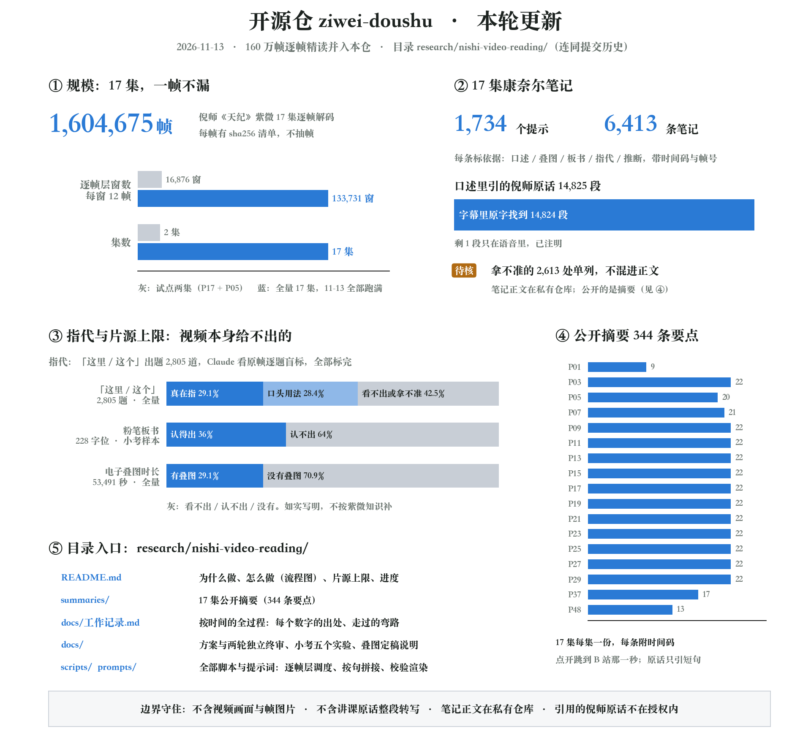
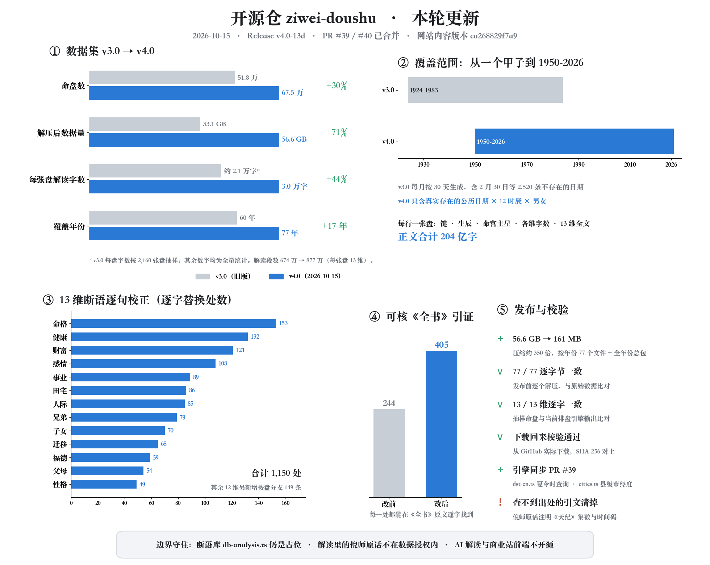

<div align="center">

# Zi Wei Dou Shu · Open-Source Charting Engine

### Algorithms are openly shared traditional wisdom; they shouldn’t be locked behind walls.

[](https://github.com/Renhuai123/ziwei-doushu/actions/workflows/ci.yml)
[](./LICENSE)
[](./DATASET-LICENSE)

[中文](./README.md) · **English**

</div>

**1. Philosophy:** Zi Wei Dou Shu is a treasure of traditional Chinese astrology, and Ni Haixia laid out its authentic system in *Tian Ji* (《天纪》). We hope technology can bring more people to learn it.

We open-source the charting algorithm and the knowledge base because we believe **algorithms are openly shared traditional wisdom and shouldn’t be locked behind walls**. The real value lies in the depth of interpretation, a carefully polished user experience, and what we build up by running the service day after day.

**2. About the project:** A Zi Wei Dou Shu (紫微斗数, "Purple Star Astrology") charting engine following the teaching system of **Ni Haixia's *Tian Ji* (倪海厦《天纪》)**. It includes the full charting algorithm, the Four Transformations (四化), a pattern knowledge base, public-domain classical texts, and a **518,400-chart sample dataset**, plus a **674,976-chart × 13-topic interpretation dataset (v4.0, 2026-10-15): 8.77 million readings, about 20.4 billion characters of text, 56.6 GB uncompressed** — up from 518,400 charts and 33.1 GB in v3.0.

| Dataset | Charts | Readings | Uncompressed | Years | Characters per chart |
|---|---|---|---|---|---|
| **v4.0 interpretations** (2026-10-15) | **674,976** | **8,774,688** | **56.6 GB** | **1950–2026** (real dates only) | **~30,000** |
| v3.0 samples | 518,400 | 6,739,200 | 33.1 GB | 1924–1983 | ~21,000 |
| Change | +30% | +30% | **+71%** | +17 years | +44% |

<sub>v3.0 characters per chart estimated from a 2,160-chart sample; all other figures are full counts. Both versions have 13 topics per chart.</sub>

This repo is an open snapshot of the engine behind [ouranic.cn](https://ouranic.cn/?from=gh-readme-en), synced from production periodically.

> **Note: on readings of family relations**
>
> Zi Wei Dou Shu has known limits when it comes to family relations (parents, siblings, children and so on). In *Tian Ji*, Master Ni Haixia said that "Dou Shu has always been somewhat weaker at reading family relations" ([lecture 2, part 1 · 00:25:27](https://www.bilibili.com/video/BV1KJsLekEfA?p=3&t=1527)). Among traditional methods, Tie Ban Shen Shu has its own strengths in checking family relations ([00:03:15](https://www.bilibili.com/video/BV1KJsLekEfA?p=3&t=195)); Master Ni still kept Zi Wei Dou Shu at the core because it can be read together with geography, surroundings and human affairs, forming a complete system that knows the heavens above, the earth below and human affairs in between ([00:25:43](https://www.bilibili.com/video/BV1KJsLekEfA?p=3&t=1543)). Readings about family relations are therefore for reference only; the Parents, Siblings and Children sections on [ouranic.cn](https://ouranic.cn/?from=gh-readme-en) carry the same note.

## Latest update (2026-11-13)

The frame-by-frame reading of Ni Haixia's *Tian Ji* Zi Wei lectures is finished and now lives in this repo: **17 episodes, 1,604,675 frames**, all **133,731 frame-layer windows** completed, Cornell notes written for all 17 episodes, and **344 public summary points** released. The former sister repo nishi-ziwei-video-reading has been merged, with its full commit history, into [`research/nishi-video-reading/`](./research/nishi-video-reading/); the old repo is archived (read-only) and all further updates happen here.



- **Scale, no frame skipped**: 1,604,675 frames across 17 episodes, each listed with its sha256, no sampling. The frame layer (DeepSeek, 12 frames per window) finished all 133,731 windows on 2026-11-13 (the pilot covered 2 episodes, P17 and P05, 16,876 windows). Claude labelled all 2,805 "here / this" pointing questions blind, from the original frames.
- **Cornell notes for all 17 episodes**: 1,734 cues and 6,413 notes, each tagged with its evidence (speech / overlay / chalkboard / pointing / inference) and frame numbers. Of the 14,825 passages of Master Ni's speech quoted in the notes, 14,824 were found character for character in the subtitles (the remaining one exists only in the audio and is marked as such); 2,613 uncertain points are listed separately as "to check" instead of being mixed into the notes. The full notes are kept in a private repository.
- **Public summaries**: 344 key points for the 17 episodes in [`research/nishi-video-reading/summaries/`](./research/nishi-video-reading/summaries/README.md) (in Chinese), one file per episode; every point has a timestamp that jumps to that second of the Bilibili video. Quotes are kept to short phrases and there are no screenshots.
- **Limits of the source, stated openly**: three things the video itself cannot give. About two in five "here / this" cannot be resolved (42.5% of 2,805 questions, full run); nearly two thirds of chalk characters are unreadable (64% of 228 character positions, pilot sample only); the printed chart overlays added in editing, the clearest source, cover only 29.1% of running time (full run). See [1.6 million frames, read frame by frame](#16-million-frames-read-frame-by-frame-2026-11-13).
- **What the directory holds**: the plan and two rounds of independent review, design and results of five pilot experiments, all scripts and prompts, a dated work log giving the source of every number, and the public summaries. It contains no video footage, frame images or full transcripts of the lectures. `tsconfig.json` now excludes `research/` from type checking. See [License](#license).

### Previous update (2026-10-15)



- **Interpretation dataset v4.0 released**: 674,976 charts (every real solar date 1950–2026 × 12 double-hours × male/female) × 13 topics = 8,774,688 readings; 161 MB compressed, 56.6 GB uncompressed (v3.0: 33.1 GB), 77 per-year files plus an all-years bundle. See [Release v4.0-13d](https://github.com/Renhuai123/ziwei-doushu/releases/tag/v4.0-13d) and the dataset section below.
- **The 13 topics were revised sentence by sentence** against the verbatim transcripts of Ni Haixia's *Tian Ji* and the original *Complete Book*: untraceable citations removed or replaced with verbatim quotes (with episode and timestamp), sentences about impossible transformations removed, conditions spelled out, two-sided sentences resolved per chart, and health now follows Master Ni's whole-chart method instead of mapping stars to organs by Five Element. (The judgment library itself stays closed; the results are in the v4.0 dataset.)
- **Engine sync** ([PR #39](https://github.com/Renhuai123/ziwei-doushu/pull/39)): `chinaDSTSpan(year)` in `dst-cn.ts`; longitudes for province-administered county-level cities in `cities.ts`.
- **License**: `DATASET-LICENSE` now covers v4.0; quotations from *Tian Ji* inside the readings are not covered by the dataset license.

> **2026-11-08 addendum**: new public repo **[nishi-ziwei-video-reading](./research/nishi-video-reading/)**: reading all 1.6 million frames of the 17 *Tian Ji* Zi Wei episodes one by one with several large models. The plan, scripts, test results and mistakes are published as the work goes on; recent progress lives there. (Merged into this repo under research/nishi-video-reading/ on 2026-11-13.)

> **2026-11-02 addendum**: the late Zi hour day change now uses **true solar time**, the same clock as the hour branch (#63). With a birthplace, 23:30 by the clock at 100°E (22:10 true solar time, the Hai hour) stays on the same day instead of becoming "Hai hour of the next day"; without a birthplace there is no correction and results are unchanged, matching ouranic.cn. An invalid leap-month policy now throws instead of silently charting as "same month" (#71). Thanks to Bortlesboat and xunguangzlj-cloud for the PRs and Verchiel666 for reviewing.

> **2026-10-31 addendum**: the live platform is now **OURANIC** and has moved from metisziwei.com to **[ouranic.cn](https://ouranic.cn/?from=gh-readme-en)**; old links redirect automatically. Code, datasets and licenses in this repo are unchanged.

> **2026-10-27 addendum**: engine sync. `true-solar-time.ts` accepts `utcOffsetMinutes` (the birthplace's standard UTC offset) for births outside China; results inside China are unchanged. New `clock-adjust.ts` converts a clock reading taken under daylight saving time (or an older time zone) to standard time; it never crosses midnight and is meant to run only when the user confirms. Correction: the engine detects China DST but has never subtracted it automatically; the table below said otherwise.

## What the engine handles

| Feature | Notes |
|---|---|
| True solar time | Longitude offset plus the equation of time, so births near hour boundaries are not off by one double-hour |
| China DST | 1986–1991 daylight-saving periods are detected (not subtracted automatically; convert the clock reading with `clock-adjust.ts` once the user confirms) |
| Leap months | Four configurable conventions (previous month / next month / split by day / same month) |
| Late Zi hour | 23:00–23:59 is charted on the next day, 00:00–00:59 on the same day; with a birthplace the cutoff uses true solar time (same as the hour branch); switchable |
| Star brightness | 7 levels (庙 旺 得 利 平 不 陷); brightness tables of different schools are switchable, not hard-coded |
| Four Transformations | Natal, decade (大限) and annual (流年) transformations, plus flying-star self-transformations |
| Twelve spirits | Natal layer by year branch, annual layer by the annual branch |
| Patterns | 1,100+ lines of pattern rules (紫府同宫, 日月并明, 七杀朝斗, …) |

Engine code lives in `lib/ziwei/` (entry point: `generateChart()` in `algorithm.ts`). Inputs are a **Gregorian** date and an **hour branch index 0–11** (子 = 0 … 亥 = 11), not a clock hour.

## Quick start

```bash
git clone https://github.com/Renhuai123/ziwei-doushu.git
cd ziwei-doushu
npm ci
npm run dev          # charting demo at http://localhost:3000/chart

npm run typecheck    # TypeScript check
npm test             # charting regression tests
```

**No API key is needed for charting.** The open-source version contains **no backend routes**: AI interpretation (`/api/interpret`) and compatibility analysis (`/api/heming`) return 404 until you implement them yourself.

## What is not included

The interpretation database (`lib/ziwei/db-analysis.ts` is a placeholder), AI prompts, all `/api/*` backend routes, user accounts, payments, deployment configuration, and — for the 1.6-million-frame reading — the full Cornell notes (kept in a private repository) and any video frames.

## Interpretation dataset v4.0 (674,976 charts × 13 topics, 2026-10-15)

Download from [Releases → v4.0-13d](https://github.com/Renhuai123/ziwei-doushu/releases/tag/v4.0-13d): 77 per-year files `year-YYYY.jsonl.zst` (161 MB compressed, 56.6 GB uncompressed (v3.0: 33.1 GB)), plus `SHA256SUMS.txt` and `MANIFEST.json`.

- Every solar date from 1950 to 2026 (only dates that actually exist) × 12 double-hours × male/female; one chart per line (JSON Lines).
- Fields: `k` key, `y`/`m`/`d` solar date, `h` double-hour index 0–11 (not clock hours), `g` gender, `ms` first major star of the Life Palace (`null` if empty), `t` character counts, `c` the 13 topic readings in Markdown.
- Generated deterministically by the charting engine and the 2026-10-15 judgment library (content version `ca268829f7a9`), no AI involved. The 13 topics were revised sentence by sentence against the verbatim transcripts of Ni Haixia's *Tian Ji* and the original *Complete Book of Zi Wei Dou Shu*.
- Natal-chart view only: age-based rewording, the appended Master Ni rule sections and AI readings shown on the website are not included. Charts use the double-hour index directly, without true-solar-time correction.
- Decompress with `zstd -d --long=27 year-1990.jsonl.zst` (`--long=27` is required).
- Quotations from Ni Haixia's *Tian Ji* inside the readings are **not covered by the dataset license**: they are short citations with episode and timestamp, and copyright in the original lectures remains with the rights holder; bulk reuse of those quotations falls under the [CC BY-NC-SA 4.0](./docs/tianji-ziwei/LICENSE.md) terms of chapter 5. The *Complete Book* is in the public domain.
- License: same as v3.0 — [CC BY 4.0](./DATASET-LICENSE), commercial use OK with attribution (except the quotations above).
- A single all-years bundle `ziwei-interp-v4-all.tar` is also provided.

## Sample dataset (518,400 charts)

Download from [Releases](https://github.com/Renhuai123/ziwei-doushu/releases/tag/v3.0-samples) (3 parts, 5.5 GB in total). Each sample is generated from `birthInfo`:

- `year` / `month` / `day`: **Gregorian** date, 1924–1983 (one full 60-year cycle), days 1–30 of every month
- `hour`: **hour branch index 0–11** (子 = 0 … 亥 = 11), *not* a clock hour; the `hHH` part of each file name is the same index
- `gender`: `male` / `female`; `longitude` is fixed at 120 (no local true-solar-time correction)

**Known issue:** about 2,520 samples (0.49%) carry dates that do not exist: Feb 30, and Feb 29 in non-leap years. The engine silently rolled them over to Mar 1–2, so their content duplicates the Mar 1–2 samples. Filter out `month = 2 && day = 30`, and `month = 2 && day = 29` in non-leap years. From 2026-10-03 the engine rejects non-existent dates.

## Ni Haixia's original words (*Tian Ji*, Zi Wei part)

[`docs/tianji-ziwei/`](./docs/tianji-ziwei/) holds **1,848 quotes** from the Zi Wei lectures of *Tian Ji* (14 lectures plus 2 supplements), each linked to the second it was said in the video. Taken from the sister repo [nihai-tianji-corpus](https://github.com/Renhuai123/nihai-tianji-corpus).

## 1.6 million frames, read frame by frame (2026-11-13)

[`research/nishi-video-reading/`](./research/nishi-video-reading/README.md) (formerly the separate repo nishi-ziwei-video-reading, merged with its history on 2026-11-13) documents how all 1,604,675 frames of the 17 *Tian Ji* Zi Wei episodes were read with several large models, so that what Master Ni wrote on the board, what the charts added in editing show, and where "here / this" points can each be traced back to an episode, timestamp and frame number. One line per layer:

- **Frame layer**: DeepSeek reads 12 frames per window and records what happens in each frame (writing on the board, pointing, subtitles); 133,731 windows, all complete. Frame numbers come from window positions, not from what the model copied.
- **Overlay layer**: the printed charts added in editing, the clearest source, are transcribed twice independently by Claude, compared cell by cell, settled against the original image, then cross-checked with Apple's Vision text recognition: 1,726 overlay states, about 163,000 characters, 0.98% illegible.
- **Pointing layer**: a script finds 2,869 "here / this / over here"; Claude labels the 2,805 resulting questions blind, from the original frames, fingertip-pause frames and hand crops.
- **Sentence join**: with the subtitle reference track (burned-in subtitles read frame by frame with Apple's Vision text recognition) as the timeline, a script attaches the frame layer, word-level speech, overlays, chalkboard and pointing to every subtitle sentence, with no model calls.
- **Cornell notes**: split by topic or case; each block is written by a Claude sub-agent from those materials, then every quote, chalkboard, pointing and overlay entry is checked by script. Every entry is tagged with its evidence: speech, overlay, chalkboard, pointing or inference.

Ground rules: only the video itself is used, nothing from the *Complete Book of Zi Wei Dou Shu* or other outside sources; anything unclear is recorded as "not shown in the video", never guessed or filled in from Zi Wei knowledge; every layer is first tested on a small sample (five pilot experiments) against thresholds set in advance, and if it falls short the method changes, not the bar.

Results are summarised in the latest update above. **Source limits**: some information is simply not in the video; all of it is stated.

| Item | Figure | Sample |
|---|---|---|
| "here / this" cannot be resolved | 1,191 of 2,805 questions (42.5%) unresolved or uncertain; of those that can be resolved, 816 (29.1% of all) are real pointing and 798 (28.4%) are verbal use with no pointing | Full run: every question in all 17 episodes |
| Chalk characters unreadable | 146 of 228 character positions (64%) | Pilot sample only (30 chalkboard cells); the full run does not transcribe the chalkboard character by character, and the notes record only what is legible |
| Share of running time with printed overlays (the clearest source) | 15,586 of 53,491 seconds (29.1%) | Full run: one frame per second scored across all 17 episodes |

**Public summaries**: one file per episode, 344 points in all, in [`summaries/`](./research/nishi-video-reading/summaries/README.md) (in Chinese). Master Ni is quoted only in short phrases, and every point has a timestamp that jumps to that second on Bilibili; there are no screenshots or video frames, and no birth data inferred from the charts. The summaries are study notes on the lectures, not our own judgment, and not medical, marriage, investment or other advice. The full notes stay in a private repository.

Details (in Chinese) are in the directory's [README](./research/nishi-video-reading/README.md), the [public summaries](./research/nishi-video-reading/summaries/README.md) and the [work log](./research/nishi-video-reading/docs/%E5%B7%A5%E4%BD%9C%E8%AE%B0%E5%BD%95.md). API keys are not in the repository; the paths in the scripts follow our own machine's layout, so change them when reproducing.

## License

| Part | License |
|---|---|
| Code (`lib/`, `app/`, `components/`) | [MIT](./LICENSE) |
| Datasets (Releases: 518,400-chart samples v3.0, 13-topic interpretations v4.0) | [CC BY 4.0](./DATASET-LICENSE): commercial use OK with attribution |
| Classical texts | Public domain |
| Ni Haixia quotes (`docs/tianji-ziwei/`) | [CC BY-NC-SA 4.0](./docs/tianji-ziwei/LICENSE.md): **non-commercial only** |
| Research directory (`research/nishi-video-reading/`) | Code [MIT](./research/nishi-video-reading/LICENSE); docs CC BY 4.0 (as in the original repo). Short quotations of Ni Haixia inside it are **not covered**: copyright stays with the rights holder and they are quoted for study only; bulk reuse of them falls under the [CC BY-NC-SA 4.0](./docs/tianji-ziwei/LICENSE.md) terms of the quotes above |

**In short**: use the code and data freely, commercially too, as long as you credit the source; Master Ni's quotes are for non-commercial study only (quotations inside the dataset readings and the research directory are likewise not covered by those licenses).

Contributions are welcome. Please read [CONTRIBUTING.md](./CONTRIBUTING.md); questions go to [Discussions](https://github.com/Renhuai123/ziwei-doushu/discussions).
