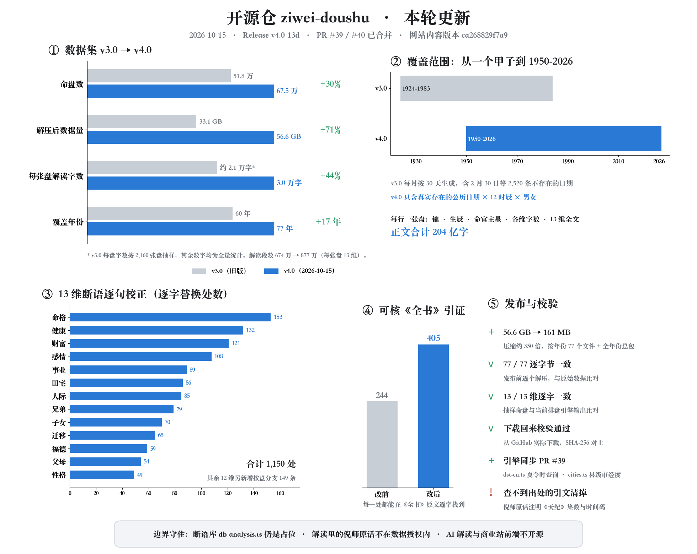

<div align="center">

# 紫微斗数 · オープンソース命盤作成エンジン

### アルゴリズムは公に共有された伝統の知恵であり、壁の中に閉じ込めるべきではありません。

[](https://github.com/Renhuai123/ziwei-doushu/actions/workflows/ci.yml)
[](./LICENSE)
[](./DATASET-LICENSE)

[中文](./README.md) · [English](./README.en.md) · **日本語**

</div>

**1. 理念：** 紫微斗数は中国の伝統的な命理学の至宝であり、倪海厦（Ni Haixia）氏は『天紀』（《天纪》）でその正統な体系を整理しました。私たちは、技術の力でより多くの人がこの学問に触れ、学べるようになることを願っています。

命盤作成のアルゴリズムと知識ベースをオープンソースにしているのは、**アルゴリズムは公に共有された伝統の知恵であり、壁の中に閉じ込めるべきではない**と考えているからです。本当の価値は、解釈の深さ、丁寧に磨き上げたユーザー体験、そして日々サービスを運営する中で積み上げていくものにあります。

**2. プロジェクトについて：** **倪海厦『天紀』（倪海厦《天纪》）** の教学体系に基づく紫微斗数（紫微斗数、"Purple Star Astrology"）の命盤作成エンジンです。完全な命盤作成アルゴリズム、四化（四化）、格局の知識ベース、パブリックドメインの古典原文、**518,400 件の命盤のサンプルデータセット**に加え、**674,976 件の命盤 × 13 テーマの解釈データセット（v4.0、2026-10-15）：877 万件の解釈、本文約 204 億文字、展開後 56.6 GB** を含んでいます。v3.0 の 518,400 件・33.1 GB から増えています。

| データセット | 命盤数 | 解釈数 | 展開後 | 対象年 | 命盤あたりの文字数 |
|---|---|---|---|---|---|
| **v4.0 解釈データセット**（2026-10-15） | **674,976** | **8,774,688** | **56.6 GB** | **1950–2026**（実在する日付のみ） | **約 30,000** |
| v3.0 サンプル | 518,400 | 6,739,200 | 33.1 GB | 1924–1983 | 約 21,000 |
| 変化 | +30% | +30% | **+71%** | +17 年 | +44% |

<sub>v3.0 の命盤あたりの文字数は 2,160 件の命盤のサンプルから推定した値で、その他の数値はすべて全件集計です。どちらのバージョンも命盤ごとに 13 テーマです。</sub>

このリポジトリは [ouranic.cn](https://ouranic.cn/?from=gh-readme-en) を支えるエンジンのオープンなスナップショットで、本番環境から定期的に同期されています。

> **注：六親（家族関係）の読み取りについて**
>
> 紫微斗数には、六親（父母、兄弟、子女など）の読み取りに関して既知の限界があります。倪海厦先生は『天紀』の中で「斗数はもともと六親を見るのがやや弱い」と述べています（[第 2 講 前半 · 00:25:27](https://www.bilibili.com/video/BV1KJsLekEfA?p=3&t=1527)）。伝統的な手法の中では、鉄板神数が六親の確認に独自の強みを持っています（[00:03:15](https://www.bilibili.com/video/BV1KJsLekEfA?p=3&t=195)）。それでも倪先生が紫微斗数を中核に据えたのは、地理・環境・人事と組み合わせて読むことができ、上は天文を知り、下は地理を知り、その間の人事を知るという完全な体系を形作れるからです（[00:25:43](https://www.bilibili.com/video/BV1KJsLekEfA?p=3&t=1543)）。そのため、六親に関する解釈はあくまで参考情報です。[ouranic.cn](https://ouranic.cn/?from=gh-readme-en) の父母宮、兄弟宮、子女宮のセクションにも同じ注記があります。

## 最新の更新（2026-10-15）



- **解釈データセット v4.0 をリリースしました**：674,976 件の命盤（1950–2026 年の実在するすべての日付 × 12 の時辰 × 男女）× 13 テーマ = 8,774,688 件の解釈。圧縮時 161 MB、展開後 56.6 GB（v3.0：33.1 GB）で、77 個の年別ファイルと全年分をまとめたバンドルがあります。[Release v4.0-13d](https://github.com/Renhuai123/ziwei-doushu/releases/tag/v4.0-13d) と、下記のデータセットのセクションをご覧ください。
- **13 テーマを一文ずつ改訂しました**：倪海厦『天紀』の逐語記録と『全書』の原文に照らし合わせ、出典をたどれない引用は削除するか逐語の引用（回とタイムスタンプ付き）に置き換え、起こりえない化に関する文を削除し、条件を明記し、両論併記の文は命盤ごとに結論を出すようにしました。また、健康については星を五行で臓器に対応させるのではなく、倪先生の命盤全体を見る手法に従うようになりました。（断語ライブラリ自体は非公開のままで、その成果は v4.0 データセットに含まれています。）
- **エンジンの同期**（[PR #39](https://github.com/Renhuai123/ziwei-doushu/pull/39)）：`dst-cn.ts` に `chinaDSTSpan(year)` を追加し、`cities.ts` に省直轄の県級市の経度を追加しました。
- **ライセンス**：`DATASET-LICENSE` が v4.0 にも適用されるようになりました。解釈の中に含まれる『天紀』からの引用は、データセットのライセンスの対象外です。

> **2026-11-02 追記**：晩子時の日付の切り替えに、時支と同じ時計である**真太陽時**を使うようになりました（#63）。出生地を指定した場合、東経 100° で時計の 23:30（真太陽時 22:10、亥の刻）は「翌日の亥の刻」にはならず同じ日のままになります。出生地を指定しない場合は補正が行われず、結果は変わらず ouranic.cn と一致します。無効な閏月の方針を指定すると、黙って「同じ月」として命盤を作成するのではなく、例外を投げるようになりました（#71）。PR を送ってくださった Bortlesboat さんと xunguangzlj-cloud さん、レビューしてくださった Verchiel666 さんに感謝します。

> **2026-10-31 追記**：本番のプラットフォームは **OURANIC** という名前になり、metisziwei.com から **[ouranic.cn](https://ouranic.cn/?from=gh-readme-en)** に移転しました。古いリンクは自動的にリダイレクトされます。このリポジトリのコード、データセット、ライセンスに変更はありません。

> **2026-10-27 追記**：エンジンを同期しました。`true-solar-time.ts` が `utcOffsetMinutes`（出生地の標準 UTC オフセット）を受け付けるようになり、中国国外での出生に対応しました。中国国内の結果は変わりません。新しい `clock-adjust.ts` は、夏時間（または以前のタイムゾーン）で読んだ時計の時刻を標準時に変換します。日付をまたぐことはなく、ユーザーが確認した場合にのみ実行することを想定しています。訂正：エンジンは中国の夏時間を検出しますが、これまで自動的に差し引いたことはありません。下の表の記載は誤りでした。

## エンジンが扱う内容

| 機能 | 説明 |
|---|---|
| 真太陽時 | 経度による時差と均時差を補正するため、時辰の境目付近の出生でも時辰が 1 つずれることはありません |
| 中国の夏時間 | 1986–1991 年の夏時間の期間を検出します（自動では差し引きません。ユーザーが確認したら `clock-adjust.ts` で時計の時刻を変換してください） |
| 閏月 | 設定可能な 4 つの方式（前月 / 翌月 / 日で分割 / 同じ月） |
| 晩子時 | 23:00–23:59 は翌日、00:00–00:59 は同じ日として命盤を作成します。出生地を指定した場合、境目には（時支と同じく）真太陽時を使います。切り替え可能です |
| 星の明るさ | 7 段階（庙 旺 得 利 平 不 陷）。流派ごとに異なる明るさの表を切り替えられ、ハードコードはしていません |
| 四化 | 生年、大限（大限）、流年（流年）の四化と、飛星の自化 |
| 十二神 | 生年の層は年支で、流年の層は流年の支で配置します |
| 格局 | 1,100 行以上の格局ルール（紫府同宫、日月并明、七杀朝斗、…） |

エンジンのコードは `lib/ziwei/` にあります（エントリーポイント：`algorithm.ts` の `generateChart()`）。入力は**グレゴリオ暦**の日付と**時支のインデックス 0–11**（子 = 0 … 亥 = 11）で、時計の時刻ではありません。

## クイックスタート

```bash
git clone https://github.com/Renhuai123/ziwei-doushu.git
cd ziwei-doushu
npm ci
npm run dev          # charting demo at http://localhost:3000/chart

npm run typecheck    # TypeScript check
npm test             # charting regression tests
```

**命盤の作成に API キーは不要です。** オープンソース版には**バックエンドのルートが含まれていません**。AI による解釈（`/api/interpret`）と相性分析（`/api/heming`）は、ご自身で実装するまで 404 を返します。

## 含まれていないもの

解釈データベース（`lib/ziwei/db-analysis.ts` はプレースホルダーです）、AI のプロンプト、すべての `/api/*` バックエンドのルート、ユーザーアカウント、決済、デプロイの設定。

## 解釈データセット v4.0（674,976 件の命盤 × 13 テーマ、2026-10-15）

[Releases → v4.0-13d](https://github.com/Renhuai123/ziwei-doushu/releases/tag/v4.0-13d) からダウンロードできます：77 個の年別ファイル `year-YYYY.jsonl.zst`（圧縮時 161 MB、展開後 56.6 GB（v3.0：33.1 GB））と、`SHA256SUMS.txt` および `MANIFEST.json`。

- 1950 年から 2026 年までのすべての日付（実在する日付のみ）× 12 の時辰 × 男女で、1 行に 1 件の命盤が入っています（JSON Lines）。
- フィールド：`k` キー、`y`/`m`/`d` 太陽暦の日付、`h` 時辰のインデックス 0–11（時計の時刻ではありません）、`g` 性別、`ms` 命宮の最初の主星（空の場合は `null`）、`t` 文字数、`c` Markdown 形式の 13 テーマの解釈。
- 命盤作成エンジンと 2026-10-15 版の断語ライブラリ（コンテンツバージョン `ca268829f7a9`）によって決定論的に生成されており、AI は使っていません。13 テーマは、倪海厦『天紀』の逐語記録と『紫微斗数全書』の原文に照らし合わせて一文ずつ改訂されています。
- 本命盤の視点のみです。Web サイトに表示される年齢に応じた言い換え、末尾に付く倪先生のルールのセクション、AI による解釈は含まれていません。命盤は時辰のインデックスをそのまま使っており、真太陽時の補正は行っていません。
- 展開には `zstd -d --long=27 year-1990.jsonl.zst` を使います（`--long=27` は必須です）。
- 解釈の中に含まれる倪海厦『天紀』からの引用は**データセットのライセンスの対象外**です。これらは回とタイムスタンプ付きの短い引用であり、元の講義の著作権は権利者に帰属します。これらの引用を大量に再利用する場合は、第 5 章の [CC BY-NC-SA 4.0](./docs/tianji-ziwei/LICENSE.md) の条件が適用されます。『全書』はパブリックドメインです。
- ライセンス：v3.0 と同じく [CC BY 4.0](./DATASET-LICENSE) です。クレジットを表記すれば商用利用も可能です（上記の引用を除きます）。
- 全年分をまとめた単一のバンドル `ziwei-interp-v4-all.tar` も提供しています。

## サンプルデータセット（518,400 件の命盤）

[Releases](https://github.com/Renhuai123/ziwei-doushu/releases/tag/v3.0-samples) からダウンロードできます（3 分割、合計 5.5 GB）。各サンプルは `birthInfo` から生成されています：

- `year` / `month` / `day`：**グレゴリオ暦**の日付。1924–1983 年（60 年の 1 周期分）、各月の 1–30 日
- `hour`：**時支のインデックス 0–11**（子 = 0 … 亥 = 11）で、時計の時刻*ではありません*。各ファイル名の `hHH` の部分も同じインデックスです
- `gender`：`male` / `female`。`longitude` は 120 に固定されています（地方の真太陽時の補正はありません）

**既知の問題：** 約 2,520 件のサンプル（0.49%）に、実在しない日付（2 月 30 日、および閏年でない年の 2 月 29 日）が含まれています。エンジンがそれらを黙って 3 月 1–2 日に繰り越していたため、その内容は 3 月 1–2 日のサンプルと重複しています。`month = 2 && day = 30` と、閏年でない年の `month = 2 && day = 29` を除外してください。2026-10-03 以降、エンジンは実在しない日付を拒否するようになっています。

## 倪海厦の原文（『天紀』紫微の部）

[`docs/tianji-ziwei/`](./docs/tianji-ziwei/) には、『天紀』の紫微の講義（14 講と補足 2 回）から **1,848 件の言葉**を収録しており、それぞれが動画内で語られた秒数にリンクしています。姉妹リポジトリ [nihai-tianji-corpus](https://github.com/Renhuai123/nihai-tianji-corpus) から取り込んでいます。

## ライセンス

| 対象 | ライセンス |
|---|---|
| コード（`lib/`、`app/`、`components/`） | [MIT](./LICENSE) |
| サンプルデータセット（Releases） | [CC BY 4.0](./DATASET-LICENSE)：クレジットを表記すれば商用利用も可能 |
| 古典の原文 | パブリックドメイン |
| 倪海厦の言葉（`docs/tianji-ziwei/`） | [CC BY-NC-SA 4.0](./docs/tianji-ziwei/LICENSE.md)：**非商用のみ** |

コントリビュートを歓迎します。[CONTRIBUTING.md](./CONTRIBUTING.md) をお読みください。質問は [Discussions](https://github.com/Renhuai123/ziwei-doushu/discussions) へどうぞ。
