<div align="center">

# 紫微斗数 · オープンソース命盤作成エンジン

### アルゴリズムは公に共有された伝統の知恵であり、壁の中に閉じ込めるべきではありません。

[](https://github.com/Renhuai123/ziwei-doushu/actions/workflows/ci.yml)
[](./LICENSE)
[](./DATASET-LICENSE)

[简体中文](./README.md) · [繁體中文](./README.zh-Hant.md) · [English](./README.en.md) · **日本語**

</div>

> この日本語版は翻訳です。内容が追いついていない場合は、[中文](./README.md) と [English](./README.en.md) の README を正としてください。

**1. 理念：** 紫微斗数は中国の伝統的な命理学の至宝であり、倪海厦（Ni Haixia）氏は『天紀』（《天纪》）でその正統な体系を整理しました。私たちは、技術の力でより多くの人がこの学問に触れ、学べるようになることを願っています。

命盤作成のアルゴリズムと知識ベースをオープンソースにしているのは、**アルゴリズムは公に共有された伝統の知恵であり、壁の中に閉じ込めるべきではない**と考えているからです。本当の価値は、解釈の深さ、丁寧に磨き上げたユーザー体験、そして日々サービスを運営する中で積み上げていくものにあります。

**2. プロジェクトについて：** **倪海厦『天紀』（倪海厦《天纪》）** の教学体系に基づく紫微斗数（紫微斗数、"Purple Star Astrology"）の命盤作成エンジンです。完全な命盤作成アルゴリズム、四化（四化）、格局の知識ベース、パブリックドメインの古典原文、**518,400 件の命盤のサンプルデータセット**に加え、**674,976 件の命盤 × 13 テーマの解釈データセット（v4.0、2026-10-15）：877 万件の解釈、本文約 204 億文字、展開後 56.6 GB** を含んでいます。v3.0 の 518,400 件・33.1 GB から増えています。

| データセット | 命盤数 | 解釈数 | 展開後 | 対象年 | 命盤あたりの文字数 |
|---|---|---|---|---|---|
| **v4.0 解釈データセット**（2026-10-15） | **674,976** | **8,774,688** | **56.6 GB** | **1950–2026**（実在する日付のみ） | **約 30,000** |
| v3.0 サンプル | 518,400 | 6,739,200 | 33.1 GB | 1924–1983 | 約 21,000 |
| 変化 | +30% | +30% | **+71%** | +17 年 | +44% |

<sub>v3.0 の命盤あたりの文字数は 2,160 件の命盤のサンプルから推定した値で、その他の数値はすべて全件集計です。どちらのバージョンも命盤ごとに 13 テーマです。</sub>

このリポジトリは [ouranic.cn](https://ouranic.cn/?from=gh-readme-ja) を支えるエンジンのオープンなスナップショットで、本番環境から定期的に同期されています。

> **注：六親（家族関係）の読み取りについて**
>
> 紫微斗数には、六親（父母、兄弟、子女など）の読み取りに関して既知の限界があります。倪海厦先生は『天紀』の中で「斗数はもともと六親を見るのがやや弱い」と述べています（[第 2 講 前半 · 00:25:27](https://www.bilibili.com/video/BV1KJsLekEfA?p=3&t=1527)）。伝統的な手法の中では、鉄板神数が六親の確認に独自の強みを持っています（[00:03:15](https://www.bilibili.com/video/BV1KJsLekEfA?p=3&t=195)）。それでも倪先生が紫微斗数を中核に据えたのは、地理・環境・人事と組み合わせて読むことができ、上は天文を知り、下は地理を知り、その間の人事を知るという完全な体系を形作れるからです（[00:25:43](https://www.bilibili.com/video/BV1KJsLekEfA?p=3&t=1543)）。そのため、六親に関する解釈はあくまで参考情報です。[ouranic.cn](https://ouranic.cn/?from=gh-readme-ja) の父母宮、兄弟宮、子女宮のセクションにも同じ注記があります。

## 最新の更新（2026-11-21）

『天紀』紫微全 17 回のコーネル式ノートの**全文を公開**し、ノートに**講義をもとに私たちが描き直した図**を添えました：板書の図解 **193 点**、事例の命盤 **26 枚**です。図は対応する問答のすぐそばに置いてあり、文と図を照らし合わせて読めます。下に、各回から 1 件ずつ選んだ **16 件の図解事例**を並べています。

<div align="center">

<table>
<tr>
<td align="center" valign="top" width="25%"><a href="./research/nishi-video-reading/康奈尔笔记/P03/P03-康奈尔笔记.md">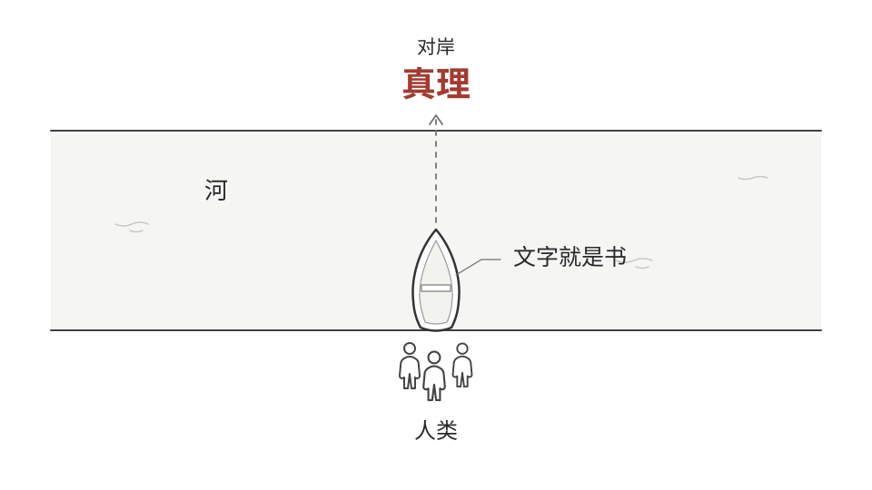</a><br><b>1 · 渡河のたとえ</b><br><sub>P03</sub></td>
<td align="center" valign="top" width="25%"><a href="./research/nishi-video-reading/康奈尔笔记/P05/P05-康奈尔笔记.md">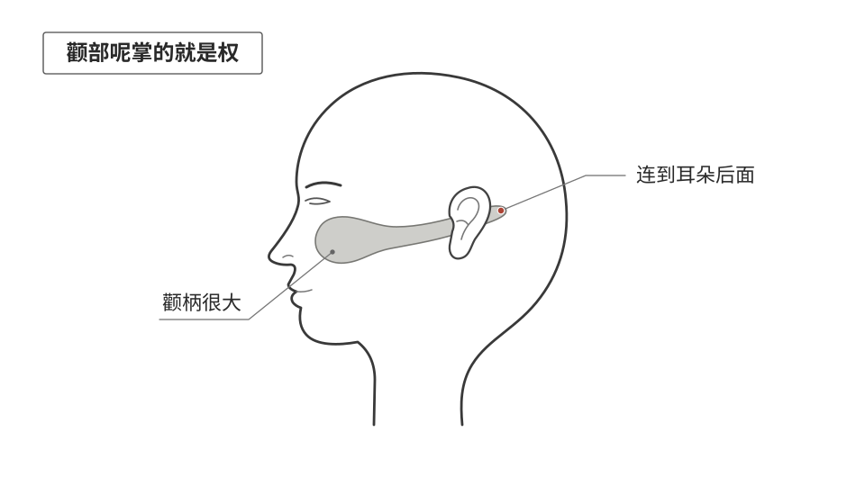</a><br><b>2 · 頬骨（顴部）と権</b><br><sub>P05</sub></td>
<td align="center" valign="top" width="25%"><a href="./research/nishi-video-reading/康奈尔笔记/P07/P07-康奈尔笔记.md">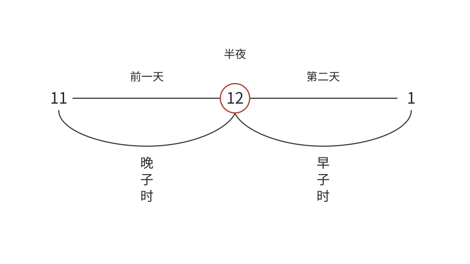</a><br><b>3 · 晩子時と早子時</b><br><sub>P07</sub></td>
<td align="center" valign="top" width="25%"><a href="./research/nishi-video-reading/康奈尔笔记/P09/P09-康奈尔笔记.md">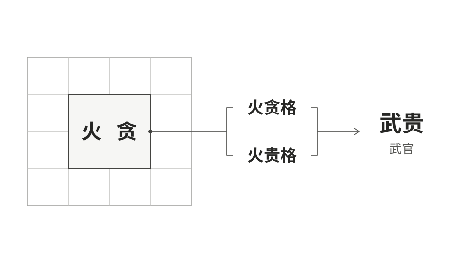</a><br><b>4 · 火貪格と火貴格</b><br><sub>P09</sub></td>
</tr>
<tr>
<td align="center" valign="top" width="25%"><a href="./research/nishi-video-reading/康奈尔笔记/P11/P11-康奈尔笔记.md">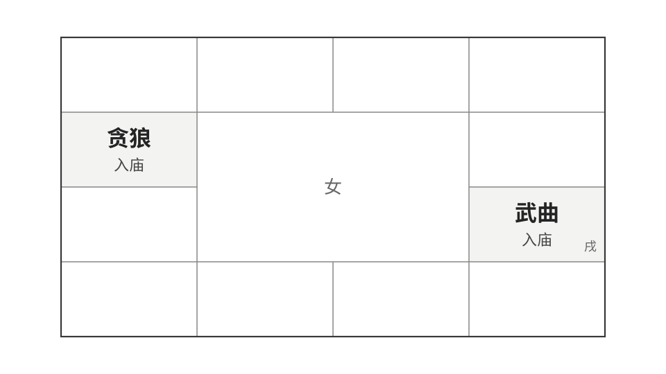</a><br><b>5 · 武曲・貪狼の入廟</b><br><sub>P11</sub></td>
<td align="center" valign="top" width="25%"><a href="./research/nishi-video-reading/康奈尔笔记/P13/P13-康奈尔笔记.md">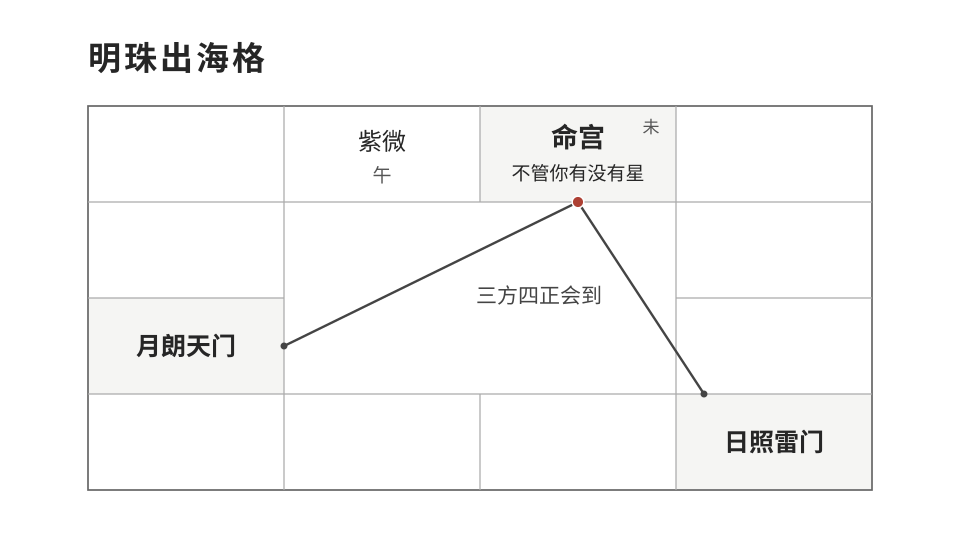</a><br><b>6 · 明珠出海格</b><br><sub>P13</sub></td>
<td align="center" valign="top" width="25%"><a href="./research/nishi-video-reading/康奈尔笔记/P15/P15-康奈尔笔记.md">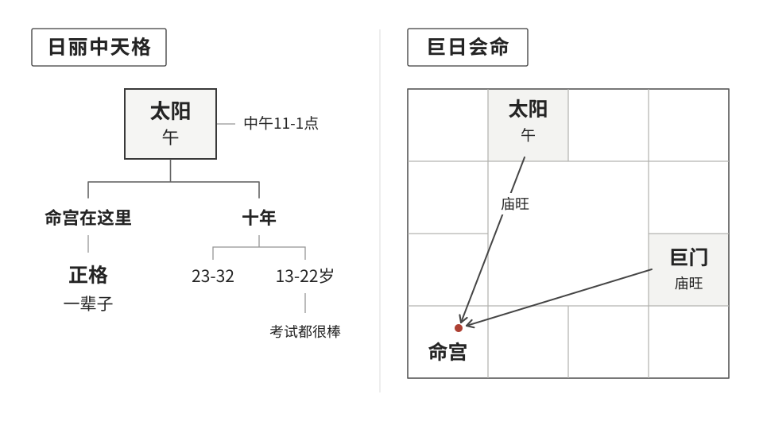</a><br><b>7 · 日麗中天</b><br><sub>P15</sub></td>
<td align="center" valign="top" width="25%"><a href="./research/nishi-video-reading/康奈尔笔记/P17/P17-康奈尔笔记.md">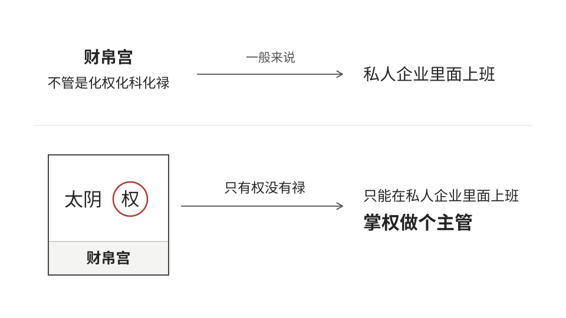</a><br><b>8 · 財帛宮の化権</b><br><sub>P17</sub></td>
</tr>
<tr>
<td align="center" valign="top" width="25%"><a href="./research/nishi-video-reading/康奈尔笔记/P19/P19-康奈尔笔记.md">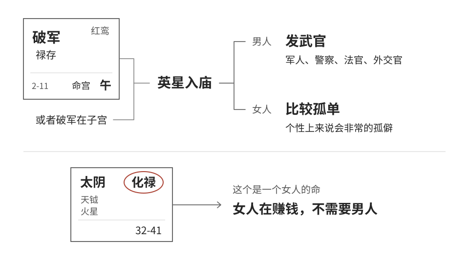</a><br><b>9 · 英星入廟</b><br><sub>P19</sub></td>
<td align="center" valign="top" width="25%"><a href="./research/nishi-video-reading/康奈尔笔记/P21/P21-康奈尔笔记.md">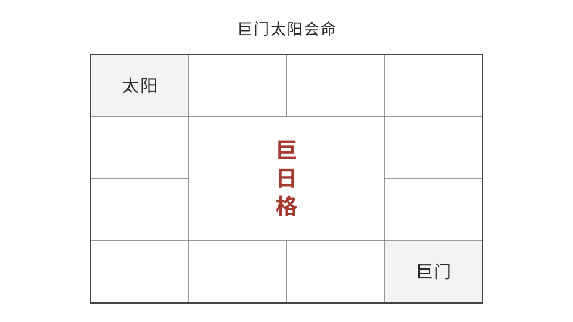</a><br><b>10 · 巨門・太陽会命</b><br><sub>P21</sub></td>
<td align="center" valign="top" width="25%"><a href="./research/nishi-video-reading/康奈尔笔记/P23/P23-康奈尔笔记.md">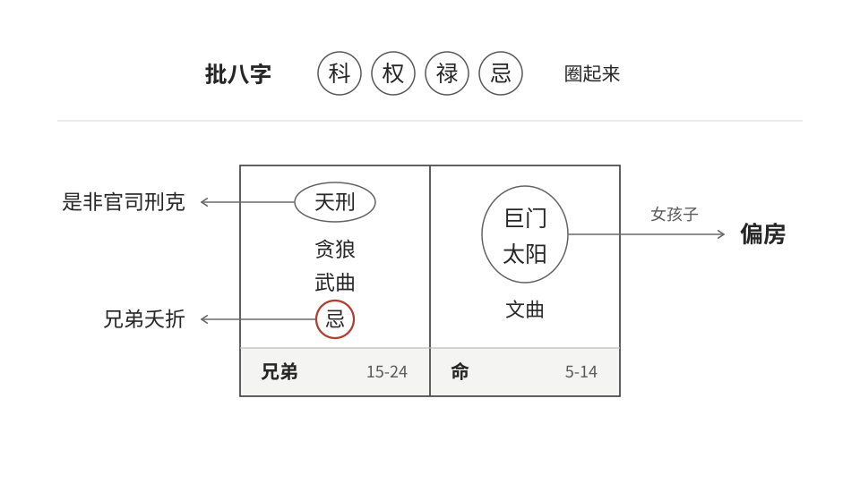</a><br><b>11 · まず科権禄忌を丸で囲む</b><br><sub>P23</sub></td>
<td align="center" valign="top" width="25%"><a href="./research/nishi-video-reading/康奈尔笔记/P25/P25-康奈尔笔记.md">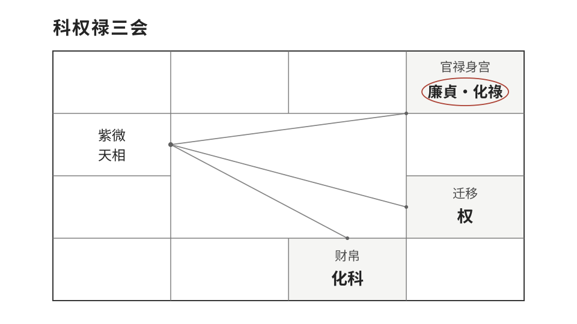</a><br><b>12 · 科権禄三会</b><br><sub>P25</sub></td>
</tr>
<tr>
<td align="center" valign="top" width="25%"><a href="./research/nishi-video-reading/康奈尔笔记/P27/P27-康奈尔笔记.md">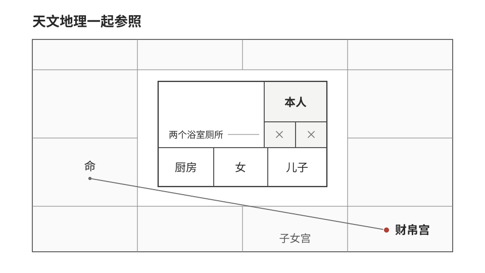</a><br><b>13 · 天文と地理を合わせて見る</b><br><sub>P27</sub></td>
<td align="center" valign="top" width="25%"><a href="./research/nishi-video-reading/康奈尔笔记/P29/P29-康奈尔笔记.md">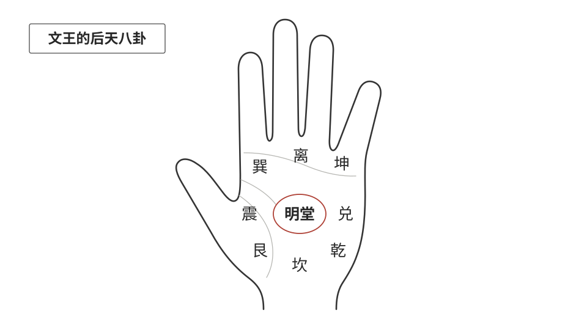</a><br><b>14 · 手相と後天八卦</b><br><sub>P29</sub></td>
<td align="center" valign="top" width="25%"><a href="./research/nishi-video-reading/康奈尔笔记/P37/P37-康奈尔笔记.md">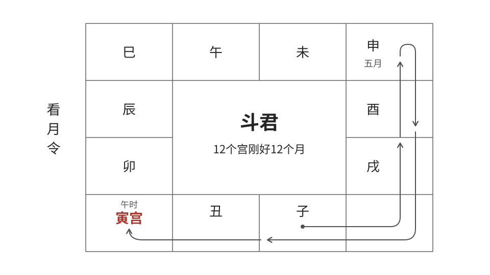</a><br><b>15 · 斗君で月を見る</b><br><sub>P37</sub></td>
<td align="center" valign="top" width="25%"><a href="./research/nishi-video-reading/康奈尔笔记/P48/P48-康奈尔笔记.md">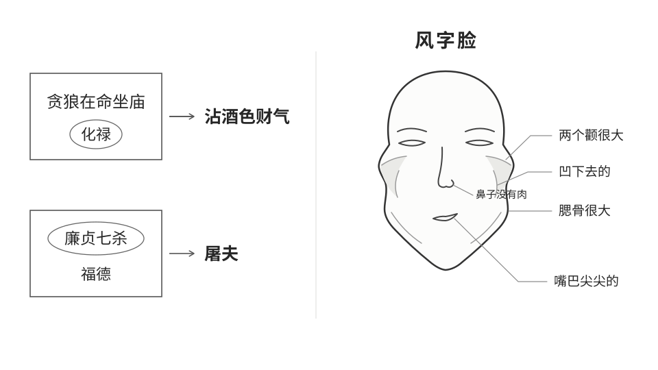</a><br><b>16 · 貪狼化禄と「風」字の顔</b><br><sub>P48</sub></td>
</tr>
</table>

<sub>各回 1 件、計 16 件の図解事例です。図はすべて講義をもとに私たちが描き直したもので、動画のスクリーンショットではありません。図をクリックすると、倪先生の言葉とあわせてその回のノート全文（中国語）が開きます。</sub>

</div>

- **全 17 回のコーネル式ノートを全文公開**（2026-11-20）：[`research/nishi-video-reading/康奈尔笔记/`](./research/nishi-video-reading/康奈尔笔记/)（中国語）に、1,734 個のキューと 6,413 件のノートがあります。それぞれに根拠（発話 / オーバーレイ / 板書 / 指し示し / 推論）を付け、回・タイムコード・フレーム番号までたどれます。倪先生の言葉は字幕の原文どおりに引用しています。
- **板書の図解 193 点**：17 回分 921 件の板書を 410 グループに分け、そのうち文字だけの 215 グループ（文字の丸囲み、下線、文字間の矢印）は描いていません。図のあるグループは、講義が説明しようとしている原理が伝わるように Astra が図解にし、すべてのラベルは板書か同じ箇所の字幕に原語があります。そのうえで Grok が元の画面と 1 点ずつ照合しました。描いた 195 点のうち 193 点が照合を通ってノートに入り、2 回の照合を通らなかった 2 点（どちらも住宅の間取り図）は当面掲載していません。
- **事例の命盤 26 枚を 1 マスずつ描き直し**（2026-11-20）：動画に示された命盤をもとに描き直しました。宮名、宮の干支、主星、補佐星はフレームごとに確認したオーバーレイの書き起こしから取り、どの命盤も Astra と Grok がそれぞれ動画のフレームと照合しています。命盤から逆算した生年月日は公開しません。
- **研究ディレクトリのトップページを図文版に**：[`research/nishi-video-reading/`](./research/nishi-video-reading/README.md) のトップページは、全 17 回の図文ノートの一覧（回ごとの図と命盤の数）、**16 件の図解事例のギャラリー**（各回 1 件、クリックで開く）、主要な数値、作業の流れ、ソースの限界、現状と今後（中国語）で構成しています。

### 前回の更新（2026-11-13）

倪海厦『天紀』紫微の講義の 1 フレームずつの精読が完了し、このリポジトリに収録されました：**17 回、1,604,675 フレーム**、**133,731 のフレーム層ウィンドウ**をすべて完了し、全 17 回のコーネル式ノートを作成し、**344 件の公開要約ポイント**を公開しました。以前の姉妹リポジトリ nishi-ziwei-video-reading は、コミット履歴ごと [`research/nishi-video-reading/`](./research/nishi-video-reading/) に統合されました。旧リポジトリはアーカイブ（読み取り専用）となり、今後の更新はすべてこちらで行います。

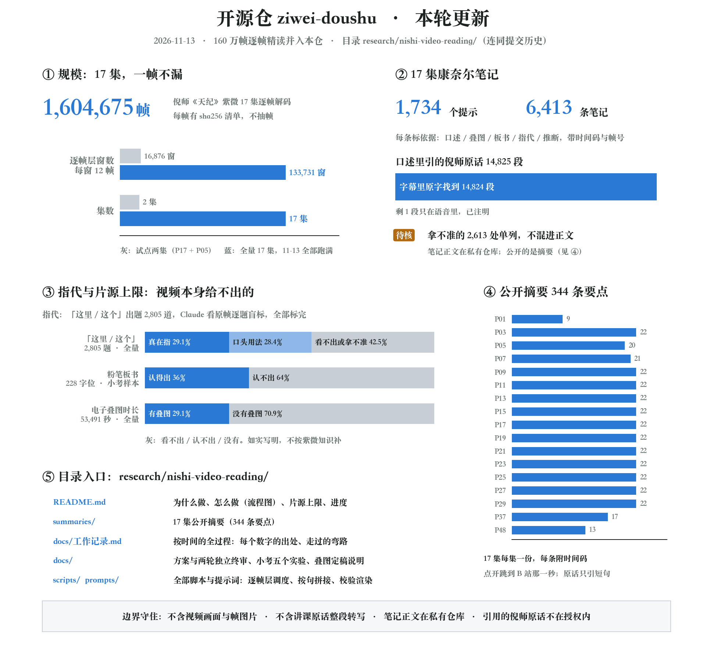

- **規模、1 フレームも飛ばさない**：17 回で 1,604,675 フレーム。各フレームを sha256 付きで一覧化し、サンプリングはしていません。フレーム層（DeepSeek、1 ウィンドウ 12 フレーム）は 2026-11-13 に 133,731 ウィンドウすべてを完了しました（パイロットは P17 と P05 の 2 回分、16,876 ウィンドウでした）。「ここ / これ」を指す 2,805 件の質問は、Claude が元のフレームを見てすべてブラインドでラベル付けしました。
- **全 17 回のコーネル式ノート**：1,734 個のキューと 6,413 件のノートがあり、それぞれに根拠（発話 / オーバーレイ / 板書 / 指し示し / 推論）とフレーム番号を付けています。ノートに引用した倪先生の発話 14,825 か所のうち、14,824 か所は字幕の中に一字一句そのまま見つかりました（残りの 1 か所は音声にのみ存在し、その旨を記載しています）。確信が持てない 2,613 か所は、ノートに混ぜずに「要確認」として別に一覧化しています。当時、ノートの全文は非公開リポジトリに保管していましたが、2026-11-20 から全文を公開しています（最新の更新を参照）。
- **公開要約**：17 回分の 344 件の要点を [`research/nishi-video-reading/summaries/`](./research/nishi-video-reading/summaries/README.md)（中国語）に、1 回につき 1 ファイルで収録しています。すべてのポイントに、Bilibili の動画のその秒に飛ぶタイムスタンプが付いています。引用は短いフレーズにとどめ、スクリーンショットは含めていません。
- **ソースの限界を明示**：動画そのものからは得られないことが 3 つあります。「ここ / これ」の約 5 分の 2 は特定できません（2,805 件の質問のうち 42.5%、全件）。チョークの文字のほぼ 3 分の 2 は判読できません（228 の文字位置のうち 64%、パイロットのサンプルのみ）。最も明瞭なソースである、編集で追加された印刷された命盤のオーバーレイは、再生時間の 29.1% しかカバーしていません（全件）。[160 万フレームを 1 フレームずつ読む](#160-万フレームを-1-フレームずつ読む2026-11-13)をご覧ください。
- **ディレクトリの内容**：計画と 2 回の独立レビュー、5 つのパイロット実験の設計と結果、すべてのスクリプトとプロンプト、すべての数値の出典を示す日付入りの作業ログ、そして公開要約です。講義の動画映像、フレーム画像、全文の書き起こしは含まれていません。`tsconfig.json` は `research/` を型チェックの対象から除外するようになりました。[ライセンス](#ライセンス)をご覧ください。

### 前々回の更新（2026-10-15）

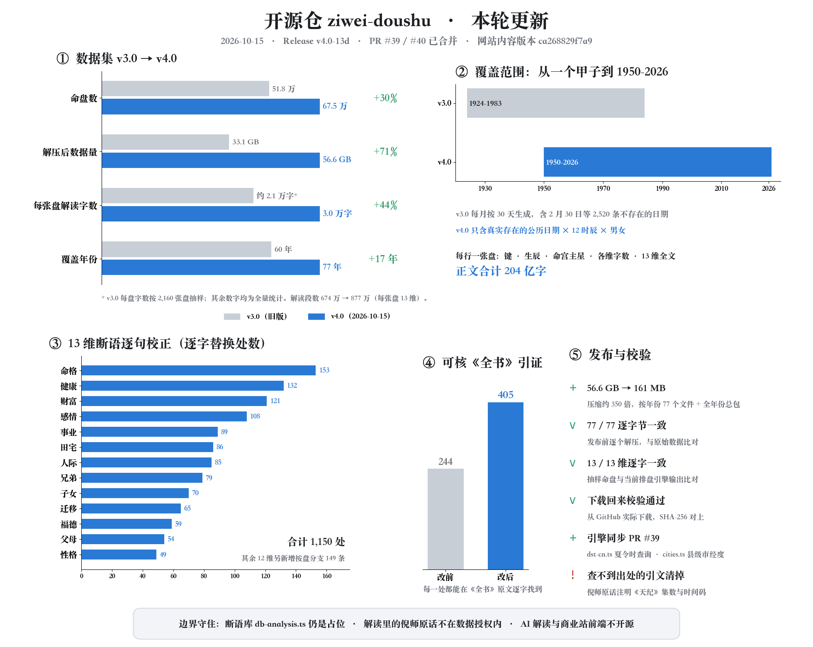

- **解釈データセット v4.0 をリリースしました**：674,976 件の命盤（1950–2026 年の実在するすべての日付 × 12 の時辰 × 男女）× 13 テーマ = 8,774,688 件の解釈。圧縮時 161 MB、展開後 56.6 GB（v3.0：33.1 GB）で、77 個の年別ファイルと全年分をまとめたバンドルがあります。[Release v4.0-13d](https://github.com/Renhuai123/ziwei-doushu/releases/tag/v4.0-13d) と、下記のデータセットのセクションをご覧ください。
- **13 テーマを一文ずつ改訂しました**：倪海厦『天紀』の逐語記録と『全書』の原文に照らし合わせ、出典をたどれない引用は削除するか逐語の引用（回とタイムスタンプ付き）に置き換え、起こりえない四化に関する文を削除し、条件を明記し、両論併記の文は命盤ごとに結論を出すようにしました。また、健康については星を五行で臓器に対応させるのではなく、倪先生の命盤全体を見る手法に従うようになりました。（断語ライブラリ自体は非公開のままで、その成果は v4.0 データセットに含まれています。）
- **エンジンの同期**（[PR #39](https://github.com/Renhuai123/ziwei-doushu/pull/39)）：`dst-cn.ts` に `chinaDSTSpan(year)` を追加し、`cities.ts` に省直轄の県級市の経度を追加しました。
- **ライセンス**：`DATASET-LICENSE` が v4.0 にも適用されるようになりました。解釈の中に含まれる『天紀』からの引用は、データセットのライセンスの対象外です。

> **2026-11-08 追記**：新しい公開リポジトリ **[nishi-ziwei-video-reading](./research/nishi-video-reading/)**：複数の大規模モデルを使い、『天紀』紫微の 17 回分の 160 万フレームすべてを 1 枚ずつ読んでいきます。計画、スクリプト、テスト結果、失敗は作業の進行に合わせて公開しており、最新の進捗はそちらにあります。（2026-11-13 にこのリポジトリの research/nishi-video-reading/ に統合されました。）

> **2026-11-02 追記**：晩子時の日付の切り替えに、時支と同じ時計である**真太陽時**を使うようになりました（#63）。出生地を指定した場合、東経 100° で時計の 23:30（真太陽時 22:10、亥の刻）は「翌日の亥の刻」にはならず同じ日のままになります。出生地を指定しない場合は補正が行われず、結果は変わらず ouranic.cn と一致します。無効な閏月の方針を指定すると、黙って「同じ月」として命盤を作成するのではなく、例外を投げるようになりました（#71）。PR を送ってくださった Bortlesboat さんと xunguangzlj-cloud さん、レビューしてくださった Verchiel666 さんに感謝します。

> **2026-10-31 追記**：本番のプラットフォームは **OURANIC** という名前になり、metisziwei.com から **[ouranic.cn](https://ouranic.cn/?from=gh-readme-ja)** に移転しました。古いリンクは自動的にリダイレクトされます。このリポジトリのコード、データセット、ライセンスに変更はありません。

> **2026-10-27 追記**：エンジンを同期しました。`true-solar-time.ts` が `utcOffsetMinutes`（出生地の標準 UTC オフセット）を受け付けるようになり、中国国外での出生に対応しました。中国国内の結果は変わりません。新しい `clock-adjust.ts` は、夏時間（または以前のタイムゾーン）で読んだ時計の時刻を標準時に変換します。日付をまたぐことはなく、ユーザーが確認した場合にのみ実行することを想定しています。訂正：エンジンは中国の夏時間を検出しますが、これまで自動的に差し引いたことはありません。下の表の記載は誤りでした。

## エンジンが扱う内容

| 機能 | 説明 |
|---|---|
| 真太陽時 | 経度による時差と均時差を補正するため、時辰の境目付近の出生でも時辰が 1 つずれることはありません |
| 中国の夏時間 | 1986–1991 年の夏時間の期間を検出します（自動では差し引きません。ユーザーが確認したら `clock-adjust.ts` で時計の時刻を変換してください） |
| 閏月 | 設定可能な 4 つの方式（前月 / 翌月 / 日で分割 / 同じ月） |
| 晩子時 | 23:00–23:59 は翌日、00:00–00:59 は同じ日として命盤を作成します。出生地を指定した場合、境目には（時支と同じく）真太陽時を使います。切り替え可能です |
| 星の明るさ | 7 段階（庙 旺 得 利 平 不 陷）。流派ごとに異なる明るさの表を切り替えられ、ハードコードはしていません |
| 四化 | 生年、大限（大限）、流年（流年）の四化と、飛星の自化 |
| 十二神 | 生年の層は年支で、流年の層は流年の支で配置します |
| 格局 | 1,100 行以上の格局ルール（紫府同宫、日月并明、七杀朝斗、…） |

エンジンのコードは `lib/ziwei/` にあります（エントリーポイント：`algorithm.ts` の `generateChart()`）。入力は**グレゴリオ暦**の日付と**時支のインデックス 0–11**（子 = 0 … 亥 = 11）で、時計の時刻ではありません。

## クイックスタート

```bash
git clone https://github.com/Renhuai123/ziwei-doushu.git
cd ziwei-doushu
npm ci
npm run dev          # charting demo at http://localhost:3000/chart

npm run typecheck    # TypeScript check
npm test             # charting regression tests
```

**命盤の作成に API キーは不要です。** オープンソース版には**バックエンドのルートが含まれていません**。AI による解釈（`/api/interpret`）と相性分析（`/api/heming`）は、ご自身で実装するまで 404 を返します。

## 含まれていないもの

解釈データベース（`lib/ziwei/db-analysis.ts` はプレースホルダーです）、AI のプロンプト、すべての `/api/*` バックエンドのルート、ユーザーアカウント、決済、デプロイの設定、そして 160 万フレームの精読で使ったすべての動画フレーム（コーネル式ノートの全文は 2026-11-20 から公開しています）。

## 解釈データセット v4.0（674,976 件の命盤 × 13 テーマ、2026-10-15）

[Releases → v4.0-13d](https://github.com/Renhuai123/ziwei-doushu/releases/tag/v4.0-13d) からダウンロードできます：77 個の年別ファイル `year-YYYY.jsonl.zst`（圧縮時 161 MB、展開後 56.6 GB（v3.0：33.1 GB））と、`SHA256SUMS.txt` および `MANIFEST.json`。

- 1950 年から 2026 年までのすべての日付（実在する日付のみ）× 12 の時辰 × 男女で、1 行に 1 件の命盤が入っています（JSON Lines）。
- フィールド：`k` キー、`y`/`m`/`d` 太陽暦の日付、`h` 時辰のインデックス 0–11（時計の時刻ではありません）、`g` 性別、`ms` 命宮の最初の主星（空の場合は `null`）、`t` 文字数、`c` Markdown 形式の 13 テーマの解釈。
- 命盤作成エンジンと 2026-10-15 版の断語ライブラリ（コンテンツバージョン `ca268829f7a9`）によって決定論的に生成されており、AI は使っていません。13 テーマは、倪海厦『天紀』の逐語記録と『紫微斗数全書』の原文に照らし合わせて一文ずつ改訂されています。
- 本命盤の視点のみです。Web サイトに表示される年齢に応じた言い換え、末尾に付く倪先生のルールのセクション、AI による解釈は含まれていません。命盤は時辰のインデックスをそのまま使っており、真太陽時の補正は行っていません。
- 展開には `zstd -d --long=27 year-1990.jsonl.zst` を使います（`--long=27` は必須です）。
- 解釈の中に含まれる倪海厦『天紀』からの引用は**データセットのライセンスの対象外**です。これらは回とタイムスタンプ付きの短い引用であり、元の講義の著作権は権利者に帰属します。これらの引用を大量に再利用する場合は、第 5 章の [CC BY-NC-SA 4.0](./docs/tianji-ziwei/LICENSE.md) の条件が適用されます。『全書』はパブリックドメインです。
- ライセンス：v3.0 と同じく [CC BY 4.0](./DATASET-LICENSE) です。クレジットを表記すれば商用利用も可能です（上記の引用を除きます）。
- 全年分をまとめた単一のバンドル `ziwei-interp-v4-all.tar` も提供しています。

## サンプルデータセット（518,400 件の命盤）

[Releases](https://github.com/Renhuai123/ziwei-doushu/releases/tag/v3.0-samples) からダウンロードできます（3 分割、合計 5.5 GB）。各サンプルは `birthInfo` から生成されています：

- `year` / `month` / `day`：**グレゴリオ暦**の日付。1924–1983 年（60 年の 1 周期分）、各月の 1–30 日
- `hour`：**時支のインデックス 0–11**（子 = 0 … 亥 = 11）で、時計の時刻*ではありません*。各ファイル名の `hHH` の部分も同じインデックスです
- `gender`：`male` / `female`。`longitude` は 120 に固定されています（地方の真太陽時の補正はありません）

**既知の問題：** 約 2,520 件のサンプル（0.49%）に、実在しない日付（2 月 30 日、および閏年でない年の 2 月 29 日）が含まれています。エンジンがそれらを黙って 3 月 1–2 日に繰り越していたため、その内容は 3 月 1–2 日のサンプルと重複しています。`month = 2 && day = 30` と、閏年でない年の `month = 2 && day = 29` を除外してください。2026-10-03 以降、エンジンは実在しない日付を拒否するようになっています。

## 倪海厦の原文（『天紀』紫微の部）

[`docs/tianji-ziwei/`](./docs/tianji-ziwei/) には、『天紀』の紫微の講義（14 講と補足 2 回）から **1,848 件の言葉**を収録しており、それぞれが動画内で語られた秒数にリンクしています。姉妹リポジトリ [nihai-tianji-corpus](https://github.com/Renhuai123/nihai-tianji-corpus) から取り込んでいます。

## 160 万フレームを 1 フレームずつ読む（2026-11-13）

[`research/nishi-video-reading/`](./research/nishi-video-reading/README.md)（以前は独立したリポジトリ nishi-ziwei-video-reading で、2026-11-13 に履歴ごと統合されました）は、『天紀』紫微の 17 回分の 1,604,675 フレームすべてを複数の大規模モデルでどのように読んだかを記録しています。これにより、倪先生が黒板に書いたこと、編集で追加された命盤が示すこと、「ここ / これ」が指す場所を、それぞれ回、タイムスタンプ、フレーム番号までたどれるようにしています。各層を 1 行で説明します：

- **フレーム層**：DeepSeek が 1 ウィンドウにつき 12 フレームを読み、各フレームで起きていること（板書、指し示し、字幕）を記録します。133,731 ウィンドウすべてを完了しています。フレーム番号はモデルが書き写したものではなく、ウィンドウの位置から求めています。
- **オーバーレイ層**：最も明瞭なソースである、編集で追加された印刷された命盤を、Claude が独立して 2 回書き起こし、セルごとに比較し、元の画像で確定させたうえで、Apple の Vision テキスト認識でクロスチェックしています：1,726 のオーバーレイ状態、約 163,000 文字、判読不能は 0.98% です。
- **指し示し層**：スクリプトが 2,869 か所の「ここ / これ / こちら」を見つけ、そこから得られた 2,805 件の質問を、Claude が元のフレーム、指先が止まったフレーム、手元の切り抜きを見てブラインドでラベル付けします。
- **文の結合**：字幕の参照トラック（焼き込み字幕を Apple の Vision テキスト認識で 1 フレームずつ読んだもの）をタイムラインとして、スクリプトがフレーム層、単語単位の発話、オーバーレイ、板書、指し示しを字幕の各文に結び付けます。モデルの呼び出しは行いません。
- **コーネル式ノート**：トピックまたは事例ごとに分割し、各ブロックを Claude のサブエージェントがそれらの素材から書き、その後すべての引用、板書、指し示し、オーバーレイの項目をスクリプトで検査します。すべての項目に、発話、オーバーレイ、板書、指し示し、推論のいずれかの根拠を付けています。

基本ルール：使うのは動画そのものだけで、『紫微斗数全書』やその他の外部ソースは使いません。はっきりしないことは「動画に示されていない」と記録し、推測したり紫微の知識で補ったりはしません。どの層も、まず少数のサンプル（5 つのパイロット実験）で事前に決めたしきい値に照らしてテストし、基準に届かなければ基準ではなく手法を変えます。

結果は上の 2026-11-13 の更新にまとめています。**ソースの限界**：動画にはそもそも含まれていない情報があり、それらはすべて明記しています。

| 項目 | 数値 | サンプル |
|---|---|---|
| 「ここ / これ」を特定できない | 2,805 件の質問のうち 1,191 件（42.5%）が未解決または不確か。特定できたもののうち、816 件（全体の 29.1%）は実際の指し示しで、798 件（28.4%）は指し示しを伴わない言葉だけの用法 | 全件：全 17 回のすべての質問 |
| 判読できないチョークの文字 | 228 の文字位置のうち 146（64%） | パイロットのサンプルのみ（板書セル 30 個）。全件の処理では板書を一字ずつ書き起こしてはおらず、ノートには判読できたものだけを記録しています |
| 印刷されたオーバーレイ（最も明瞭なソース）がある再生時間の割合 | 53,491 秒のうち 15,586 秒（29.1%） | 全件：全 17 回を 1 秒につき 1 フレームで判定 |

**公開要約**：1 回につき 1 ファイル、合計 344 ポイントを [`summaries/`](./research/nishi-video-reading/summaries/README.md)（中国語）に収録しています。倪先生の引用は短いフレーズにとどめ、すべてのポイントに Bilibili のその秒に飛ぶタイムスタンプが付いています。スクリーンショットや動画フレームは含めず、命盤から推測した出生データも含めていません。要約は講義の学習ノートであり、私たち自身の判断ではなく、医療、結婚、投資などの助言でもありません。

**コーネル式ノートの全文**（2026-11-20 から公開）：[`康奈尔笔记/`](./research/nishi-video-reading/康奈尔笔记/)（中国語）にあり、文と図が一体になっています。板書の各項目のすぐ後に私たちが描き直した図解（計 193 点）があり、事例の命盤は 1 マスずつ描き直しています（計 26 枚）。いずれも動画のスクリーンショットではありません。

詳細（中国語）は、ディレクトリの [README](./research/nishi-video-reading/README.md)、[公開要約](./research/nishi-video-reading/summaries/README.md)、[作業ログ](./research/nishi-video-reading/docs/%E5%B7%A5%E4%BD%9C%E8%AE%B0%E5%BD%95.md) にあります。API キーはリポジトリに含まれていません。スクリプト内のパスは私たちのマシンの構成に合わせているので、再現する際は変更してください。

## ライセンス

| 対象 | ライセンス |
|---|---|
| コード（`lib/`、`app/`、`components/`） | [MIT](./LICENSE) |
| データセット（Releases：518,400 件の命盤のサンプル v3.0、13 テーマの解釈 v4.0） | [CC BY 4.0](./DATASET-LICENSE)：クレジットを表記すれば商用利用も可能 |
| 古典の原文 | パブリックドメイン |
| 倪海厦の言葉（`docs/tianji-ziwei/`） | [CC BY-NC-SA 4.0](./docs/tianji-ziwei/LICENSE.md)：**非商用のみ** |
| 研究ディレクトリ（`research/nishi-video-reading/`） | コードは [MIT](./research/nishi-video-reading/LICENSE)、ドキュメントは CC BY 4.0（元のリポジトリと同じ）。その中に含まれる倪海厦の短い引用は**対象外**です：著作権は権利者に帰属し、学習目的でのみ引用しています。これらを大量に再利用する場合は、上記の引用と同じく [CC BY-NC-SA 4.0](./docs/tianji-ziwei/LICENSE.md) の条件が適用されます |

**要するに**：コードとデータは、出典を明記すれば商用も含めて自由に使えます。倪先生の言葉は非商用の学習目的に限ります（データセットの解釈や研究ディレクトリに含まれる引用も、同様にそれらのライセンスの対象外です）。

コントリビュートを歓迎します。[CONTRIBUTING.md](./CONTRIBUTING.md) をお読みください。質問は [Discussions](https://github.com/Renhuai123/ziwei-doushu/discussions) へどうぞ。
