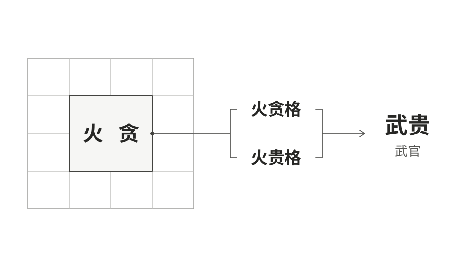
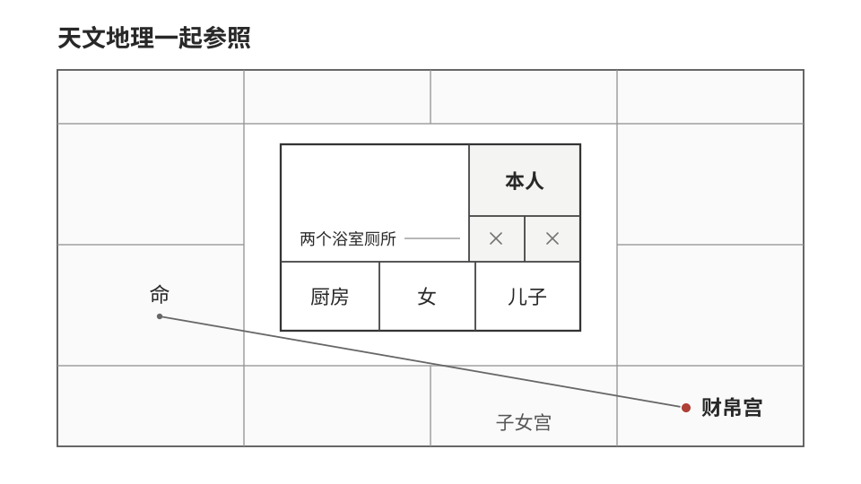
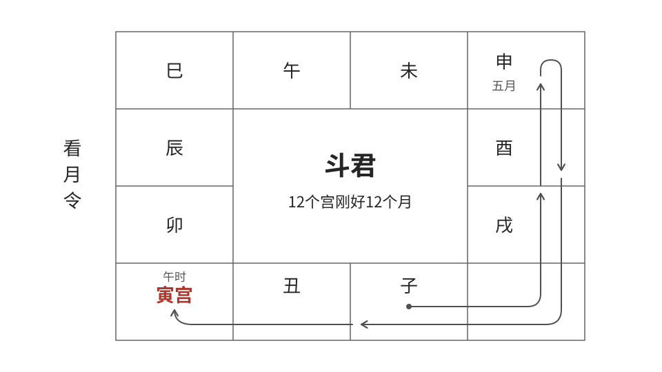

<div align="center">

# Tử Vi Đẩu Số · Engine Lập Lá Số Mã Nguồn Mở

### Thuật toán là trí tuệ truyền thống của nhân loại — không nên bị khoá sau tường rào.

[](https://github.com/Winston-DucPham/ziwei-doushu-vn/actions/workflows/ci.yml)
[](./LICENSE)
[](./DATASET-LICENSE)

**Tiếng Việt** · [English](./README.en.md) · [日本語](./README.ja.md)

</div>

**1. Triết lý:** Tử Vi Đẩu Số là tinh hoa của mệnh lý học Trung Hoa truyền thống. Thầy Nghê Hải Hạ đã hệ thống hoá trường phái chính thống qua bộ giảng **《Thiên Kỷ》**. Chúng tôi muốn dùng công nghệ để nhiều người Việt Nam hơn có thể tiếp cận môn học này.

Chúng tôi mã nguồn mở thuật toán lập lá số và kho kiến thức vì: **thuật toán là trí tuệ truyền thống được chia sẻ công khai — không nên bị khoá sau tường rào**. Giá trị thực nằm ở chiều sâu của việc luận giải, trải nghiệm người dùng được đánh bóng kỹ lưỡng, và những gì tích lũy được qua vận hành.

**2. Giới thiệu dự án:** Engine lập lá số Tử Vi Đẩu Số theo hệ thống giảng dạy của **Nghê Hải Hạ trong 《Thiên Kỷ》**. Bao gồm: thuật toán lập lá số đầy đủ, hệ thống Tứ Hóa, kho cách cục, cổ thư nguyên văn, và **bộ dữ liệu luận giải v4.0**: 674.976 lá số × 13 chủ đề = 8,77 triệu đoạn luận, khoảng 20,4 tỷ ký tự, 56,6 GB giải nén (phát hành 2026-10-15).

| Bộ dữ liệu | Lá số | Đoạn luận | Giải nén | Năm | Ký tự/lá số |
|---|---|---|---|---|---|
| **v4.0 luận giải** (2026-10-15) | **674.976** | **8.774.688** | **56,6 GB** | **1950–2026** (chỉ ngày thực tế) | **~30.000** |
| v3.0 mẫu | 518.400 | 6.739.200 | 33,1 GB | 1924–1983 | ~21.000 |
| Thay đổi | +30% | +30% | **+71%** | +17 năm | +44% |

<sub>Ký tự/lá số của v3.0 ước tính từ mẫu 2.160 lá; các số liệu còn lại là thống kê toàn bộ. Cả hai phiên bản đều có 13 chủ đề mỗi lá.</sub>

> **Lưu ý về lục thân**
>
> Tử Vi Đẩu Số có giới hạn nhất định khi luận lục thân (cha mẹ, anh chị em, con cái…). Thầy Nghê trong《Thiên Kỷ》đã nói: "Đẩu số phê lục thân vốn kém hơn một chút." ([tập 2 thượng · 00:25:27](https://www.bilibili.com/video/BV1KJsLekEfA?p=3&t=1527)). Luận giải về lục thân chỉ mang tính tham khảo.

---

## Cập nhật mới nhất (2026-11-21)

Toàn bộ **ghi chú Cornell 17 tập** Tử Vi của《Thiên Kỷ》đã được công bố, kèm **hình vẽ lại từ bài giảng**: **193 sơ đồ bảng đen** và **26 lá số ví dụ** vẽ lại từng ô. Mỗi hình nằm ngay cạnh câu hỏi tương ứng.

<div align="center">

<table>
<tr>
<td align="center" valign="top" width="25%"><a href="./research/nishi-video-reading/康奈尔笔记/P03/P03-康奈尔笔记.md"></a><br><b>1 · Ví dụ qua sông</b><br><sub>P03</sub></td>
<td align="center" valign="top" width="25%"><a href="./research/nishi-video-reading/康奈尔笔记/P05/P05-康奈尔笔记.md"></a><br><b>2 · Gò má và quyền uy</b><br><sub>P05</sub></td>
<td align="center" valign="top" width="25%"><a href="./research/nishi-video-reading/康奈尔笔记/P07/P07-康奈尔笔记.md"></a><br><b>3 · Giờ Tý muộn và sớm</b><br><sub>P07</sub></td>
<td align="center" valign="top" width="25%"><a href="./research/nishi-video-reading/康奈尔笔记/P09/P09-康奈尔笔记.md"></a><br><b>4 · Cách Hỏa Tham và Hỏa Quý</b><br><sub>P09</sub></td>
</tr>
<tr>
<td align="center" valign="top" width="25%"><a href="./research/nishi-video-reading/康奈尔笔记/P11/P11-康奈尔笔记.md"></a><br><b>5 · Vũ Khúc Tham Lang nhập miếu</b><br><sub>P11</sub></td>
<td align="center" valign="top" width="25%"><a href="./research/nishi-video-reading/康奈尔笔记/P13/P13-康奈尔笔记.md"></a><br><b>6 · Minh Châu Xuất Hải</b><br><sub>P13</sub></td>
<td align="center" valign="top" width="25%"><a href="./research/nishi-video-reading/康奈尔笔记/P15/P15-康奈尔笔记.md"></a><br><b>7 · Nhật Lệ Trung Thiên</b><br><sub>P15</sub></td>
<td align="center" valign="top" width="25%"><a href="./research/nishi-video-reading/康奈尔笔记/P17/P17-康奈尔笔记.md"></a><br><b>8 · Hóa Quyền tại cung Tài Bạch</b><br><sub>P17</sub></td>
</tr>
<tr>
<td align="center" valign="top" width="25%"><a href="./research/nishi-video-reading/康奈尔笔记/P19/P19-康奈尔笔记.md"></a><br><b>9 · Tinh ứng nhập miếu</b><br><sub>P19</sub></td>
<td align="center" valign="top" width="25%"><a href="./research/nishi-video-reading/康奈尔笔记/P21/P21-康奈尔笔记.md"></a><br><b>10 · Cự Môn Thái Dương hội Mệnh</b><br><sub>P21</sub></td>
<td align="center" valign="top" width="25%"><a href="./research/nishi-video-reading/康奈尔笔记/P23/P23-康奈尔笔记.md"></a><br><b>11 · Khoa Quyền Lộc Kỵ vòng đầu</b><br><sub>P23</sub></td>
<td align="center" valign="top" width="25%"><a href="./research/nishi-video-reading/康奈尔笔记/P25/P25-康奈尔笔记.md"></a><br><b>12 · Khoa Quyền Lộc hội tụ</b><br><sub>P25</sub></td>
</tr>
<tr>
<td align="center" valign="top" width="25%"><a href="./research/nishi-video-reading/康奈尔笔记/P27/P27-康奈尔笔记.md"></a><br><b>13 · Lá số đọc cùng nhà ở</b><br><sub>P27</sub></td>
<td align="center" valign="top" width="25%"><a href="./research/nishi-video-reading/康奈尔笔记/P29/P29-康奈尔笔记.md"></a><br><b>14 · Lòng bàn tay Bát Quái</b><br><sub>P29</sub></td>
<td align="center" valign="top" width="25%"><a href="./research/nishi-video-reading/康奈尔笔记/P37/P37-康奈尔笔记.md"></a><br><b>15 · Đẩu Quân theo tháng</b><br><sub>P37</sub></td>
<td align="center" valign="top" width="25%"><a href="./research/nishi-video-reading/康奈尔笔记/P48/P48-康奈尔笔记.md"></a><br><b>16 · Tham Lang Hóa Lộc và tướng mạo gió</b><br><sub>P48</sub></td>
</tr>
</table>

<sub>16 ví dụ minh hoạ, mỗi tập một ví dụ. Tất cả hình vẽ đều do chúng tôi vẽ lại từ bài giảng, không phải ảnh chụp màn hình video. Bấm để mở ghi chú tập đó kèm nguyên văn thầy Nghê (tiếng Trung).</sub>

</div>

- **Ghi chú Cornell 17 tập đã công bố** (2026-11-20): trong [`research/nishi-video-reading/康奈尔笔记/`](./research/nishi-video-reading/康奈尔笔记/) (tiếng Trung) — 1.734 từ khoá và 6.413 ghi chú, mỗi ghi chú có thẻ bằng chứng và truy nguyên về tập, mốc thời gian và số khung hình.
- **193 sơ đồ bảng đen**: vẽ lại để minh hoạ nguyên lý đang giảng; Grok đã kiểm đối chiếu từng hình với khung hình gốc. 193/195 hình qua kiểm tra; 2 hình (cả hai là sơ đồ nhà) chưa đạt.
- **26 lá số ví dụ vẽ lại từng ô** (2026-11-20): mỗi lá vẽ lại từ lá số xuất hiện trong video; tên cung, thiên can địa chi và sao lấy từ phụ đề đã kiểm khung hình.
- **Trang chủ thư mục mới**: [`research/nishi-video-reading/`](./research/nishi-video-reading/README.md) mở ra với 17 tập minh hoạ, bộ sưu tập 16 ví dụ và số liệu tổng quan.

### Cập nhật trước (2026-11-13)

Việc đọc từng khung hình bài giảng Tử Vi《Thiên Kỷ》của thầy Nghê đã hoàn tất và đưa vào repo này: **17 tập, 1.604.675 khung hình**, tất cả **133.731 cửa sổ tầng khung hình** đã hoàn thành, ghi chú Cornell cho cả 17 tập, và **344 điểm tóm tắt công khai** được phát hành.


### Cập nhật trước đó (2026-10-15)


- **Bộ dữ liệu luận giải v4.0 phát hành**: 674.976 lá số × 13 chủ đề = 8.774.688 đoạn luận; 161 MB nén, 56,6 GB giải nén; 77 file theo năm. Xem [Release v4.0-13d](https://github.com/Renhuai123/ziwei-doushu/releases/tag/v4.0-13d).
- **13 chủ đề được soát lại từng câu** đối chiếu với phụ đề nguyên văn của 《Thiên Kỷ》 và 《Toàn Thư》.

---

## Engine xử lý những gì

| Tính năng | Ghi chú |
|---|---|
| Giờ mặt trời thực | Hiệu chỉnh kinh độ + phương trình thời gian, tránh sai chi giờ ở gần ranh giới |
| Giờ hè Trung Quốc | 1986–1991 được phát hiện (không trừ tự động; dùng `clock-adjust.ts` khi người dùng xác nhận) |
| Tháng nhuận | Bốn chính sách có thể cấu hình (tháng trước / tháng sau / chia ngày / cùng tháng) |
| Giờ Tý muộn | 23:00–23:59 lập theo ngày hôm sau, 00:00–00:59 theo ngày hôm trước; nếu có kinh độ dùng giờ mặt trời thực |
| Độ sáng sao | 7 mức (Miếu Vượng Đắc Lợi Bình Bất Hãm); bảng độ sáng theo trường phái có thể chọn |
| Tứ Hóa | Bản mệnh, Đại hạn, Lưu niên |
| Thập nhị thần | Bác sĩ (theo năm sinh), Tướng tiền / Tuế tiền (theo chi hiện tại) |
| Cách cục | 1.100+ dòng quy tắc (Tử Phủ Đồng Cung, Nhật Nguyệt Tịnh Minh, Thất Sát Triều Đẩu,…) |

Mã nguồn engine trong `lib/ziwei/` (điểm vào: `generateChart()` trong `algorithm.ts`). Đầu vào là ngày **dương lịch** và **chỉ số chi giờ 0–11** (Tý = 0 … Hợi = 11), không phải giờ đồng hồ.

---

## Bắt đầu nhanh

```bash
git clone https://github.com/Winston-DucPham/ziwei-doushu-vn.git
cd ziwei-doushu-vn
npm ci
npm run dev          # demo lập lá số tại http://localhost:3000/chart

npm run typecheck    # kiểm tra TypeScript
npm test             # kiểm thử hồi quy engine
```

**Lập lá số không cần API key.** Tính năng AI luận giải cần cấu hình thêm (xem bên dưới).

---

## Tính năng AI luận giải (tiếng Việt)

Phiên bản này tích hợp API luận giải lá số bằng AI (`app/api/interpret/`), hoàn toàn bằng **tiếng Việt với thuật ngữ Tử Vi Hán-Việt**:

- AI **đọc dữ liệu nguồn tiếng Trung** (bộ dữ liệu v4.0, cổ thư《Toàn Thư》《Toàn Tập》《Cốt Tủy Phú》, nguyên văn thầy Nghê trong《Thiên Kỷ》)
- AI **trả lời hoàn toàn bằng tiếng Việt** theo system prompt nghiêm ngặt
- Mọi nhận định đều **truy được về sao, cung, tứ hóa hoặc tư liệu cụ thể** trong lá số
- Hỗ trợ **UTC+7** (giờ Việt Nam), nhập giờ đồng hồ Việt Nam trực tiếp

Để bật AI luận giải, cấu hình một trong các nhà cung cấp sau trong `.env.local`:

```env
# Claude Code CLI (dùng subscription đã đăng nhập)
AI_PROVIDER=claude-code

# Hoặc Claude API
AI_PROVIDER=anthropic
ANTHROPIC_API_KEY=sk-ant-...

# Hoặc các nhà cung cấp khác: codex, zai
```

---

## Những gì không có trong bản mã nguồn mở

Thư viện quyết định luận giải, tài khoản người dùng, thanh toán, cấu hình triển khai sản xuất, và — đối với 1,6 triệu khung hình — toàn bộ khung hình video (ghi chú Cornell đã công khai từ 2026-11-20).

---

## Bộ dữ liệu luận giải v4.0 (674.976 lá × 13 chủ đề, 2026-10-15)

Tải về từ [Releases → v4.0-13d](https://github.com/Renhuai123/ziwei-doushu/releases/tag/v4.0-13d) (upstream): 77 file theo năm `year-YYYY.jsonl.zst` (161 MB nén, 56,6 GB giải nén), kèm `SHA256SUMS.txt` và `MANIFEST.json`.

- Mỗi ngày dương lịch thực tế từ 1950 đến 2026 × 12 chi giờ × nam/nữ; một lá số mỗi dòng (JSON Lines).
- Trường: `k` khoá, `y`/`m`/`d` ngày dương, `h` chỉ số chi giờ 0–11, `g` giới tính, `ms` chính tinh đầu tiên của cung Mệnh, `c` 13 chủ đề luận giải dạng Markdown.
- Giải nén bằng `zstd -d --long=27 year-1990.jsonl.zst` (cờ `--long=27` bắt buộc).
- Trích dẫn thầy Nghê bên trong dữ liệu **không thuộc phạm vi giấy phép bộ dữ liệu**: bản quyền giảng bài vẫn thuộc người có quyền; sử dụng số lượng lớn các trích dẫn đó chịu điều khoản [CC BY-NC-SA 4.0](./docs/tianji-ziwei/LICENSE.md).
- Giấy phép: [CC BY 4.0](./DATASET-LICENSE) — sử dụng thương mại được phép khi ghi nguồn (ngoại trừ trích dẫn ở trên).

---

## Bộ dữ liệu mẫu (518.400 lá số)

Tải về từ [Releases](https://github.com/Renhuai123/ziwei-doushu/releases/tag/v3.0-samples) (3 phần, tổng 5,5 GB).

**Lưu ý đã biết:** khoảng 2.520 mẫu (0,49%) chứa ngày không tồn tại (30/2, 29/2 năm không nhuận). Engine đã lặn sang 1–2/3, trùng với mẫu 1–2/3. Từ 2026-10-03, engine từ chối ngày không tồn tại.

---

## Nguyên văn thầy Nghê Hải Hạ (《Thiên Kỷ》 — phần Tử Vi)

[`docs/tianji-ziwei/`](./docs/tianji-ziwei/) chứa **1.848 trích dẫn** từ 14 tập giảng Tử Vi của 《Thiên Kỷ》 (kèm 2 đoạn bổ sung), mỗi trích dẫn gắn với giây cụ thể trong video.

---

## Giấy phép

| Thành phần | Giấy phép |
|---|---|
| Mã nguồn (`lib/`, `app/`, `components/`) | [MIT](./LICENSE) |
| Bộ dữ liệu (Releases: mẫu v3.0, luận giải v4.0) | [CC BY 4.0](./DATASET-LICENSE): thương mại được phép khi ghi nguồn |
| Cổ thư | Công hữu (public domain) |
| Trích dẫn thầy Nghê (`docs/tianji-ziwei/`) | [CC BY-NC-SA 4.0](./docs/tianji-ziwei/LICENSE.md): **chỉ dùng phi thương mại** |
| Thư mục nghiên cứu (`research/nishi-video-reading/`) | Mã: [MIT](./research/nishi-video-reading/LICENSE); Tài liệu: CC BY 4.0. Trích dẫn thầy Nghê bên trong **không thuộc các giấy phép này**. |

**Tóm lại**: dùng mã nguồn và dữ liệu tự do, kể cả thương mại, miễn ghi nguồn; trích dẫn thầy Nghê chỉ dùng cho nghiên cứu phi thương mại.

Đóng góp được hoan nghênh. Xem [CONTRIBUTING.md](./CONTRIBUTING.md); thảo luận tại [Discussions](https://github.com/Winston-DucPham/ziwei-doushu-vn/discussions).
