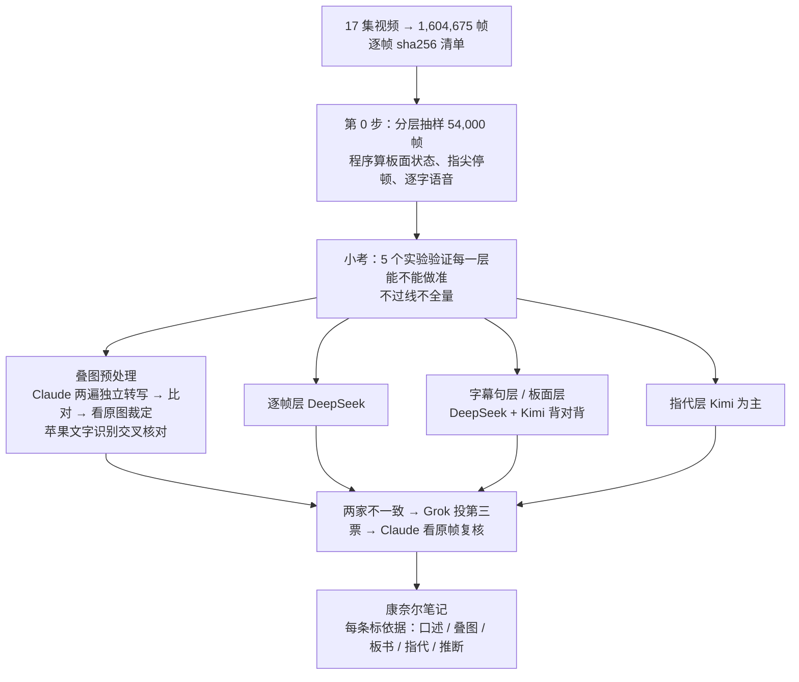

# 倪师《天纪》紫微斗数 · 160 万帧逐帧精读

用多家大模型，把倪海厦老师《天纪》紫微斗数 17 集讲课视频**一帧不漏**地读一遍（1,604,675 帧），把他讲的方法、板书、命盘、「这里 / 这个」指的是哪，整理成可追溯到帧号的康奈尔笔记。

这个仓库公开的是**方法和全过程**：方案、每一步怎么处理信息、全部脚本、提示词、考试设计、成绩、失败的尝试和踩过的坑。**正在进行中**，边做边更新。

> 本仓库不含视频画面、帧图片，也不含倪师讲课原话的整段转写。原视频见 B 站合辑 [BV1KJsLekEfA](https://www.bilibili.com/video/BV1KJsLekEfA/)。

## 为什么这么做

倪师说过，他的课和视频里怎么断、怎么算都讲够了。可视频里大量信息不在字幕里：他在黑板上写什么、指着哪一宫说「这里」、后期贴上去的电子命盘标了什么。只看字幕会丢一半。所以我们逐帧看，而且每一条结论都要能指回集号、时间码和帧号。

## 怎么做

几条铁规矩：
- **只依据视频本身**，不掺《紫微斗数全书》等外来材料；看不清就写「视频未显示」，不猜、不按紫微知识补字。
- **分清四层**：黑板手写（倪师）、后期电子命盘（剪辑加的，不算倪师的话）、烧录字幕、水印。
- **先考试再全量**：每一层都先用小样本考，门槛事先定好，不过线就改方案，**不降标准**。
- **公开误差**：认不出多少、剔除多少、裁定了多少，全部写明。

## 现在做到哪了（2026-11-08）

| 步骤 | 状态 |
|---|---|
| 方案 + 两轮独立终审 | ✅ |
| 预检、第 0 步抽样与程序预处理 | ✅ |
| 小考 5 个实验（约 ¥115） | ✅ 逐帧层过线；粉笔板书逐字转写做不到；指代层要改；Grok 只当第三票 |
| 电子叠图预处理 | ✅ 2,645 个叠图状态定稿（两遍一致 / 看原图裁定），看不清 0.92% |
| 苹果文字识别交叉核对、去重复查 | 🔄 进行中 |
| 指代层重测 | 🔄 进行中 |
| 试点两集 → 全量 17 集 | ⏳ |

详细经过见 [`docs/工作记录.md`](docs/工作记录.md)。

## 目录

| 位置 | 内容 |
|---|---|
| `docs/工作记录.md` | 按时间的全过程：做了什么、数字、弯路 |
| `docs/方案补充-v3-20261107.md`、`docs/Fable终审意见-20261107.md` | 方案与独立终审意见 |
| `docs/小考报告-20261108.md`、`docs/小考进展-20261108.md` | 五个实验的设计、成绩、结论 |
| `docs/标注说明-实验*.md`、`docs/任务说明-实验5-Grok裁决.md` | 标准答案怎么标、裁决怎么做 |
| `docs/叠图定稿说明.md` | 电子叠图两遍转写 + 裁定的做法、结果、局限 |
| `docs/康奈尔笔记模板.md` | 笔记格式 |
| `prompts/` | 逐帧层提示词 v1、v2（其余提示词写在各脚本里） |
| `scripts/第0步/` | 抽样、片段预处理（MediaPipe / whisper）、五个实验的出题、调用、评分 |
| `scripts/叠图/` | 叠图找状态、去重、Claude 转写、两遍比对、裁定、合成定稿、去重复查、苹果识别核对 |
| `scripts/vision_ocr/` | 调用苹果系统文字识别的命令行小工具（Swift） |
| `scripts/命例反推/` | 用叠图露出的宫位反推命例整盘（实验中） |
| `scripts/预检/` | 各家接口的 token 预检 |

## 用到的模型和工具

DeepSeek（deepseek-flash）、Kimi（kimi-k3.1-pro）、Grok 4.7（经 Cursor 命令行）、Claude（Opus 5.5 / Fable 5.1）、苹果系统文字识别（Vision）、MediaPipe、whisper.cpp（large-v3-turbo）、ffmpeg、OpenCV。

各家接口的钥匙都从本机文件读取，不在仓库里。脚本里的路径按我们本机的目录写，复现时请改成自己的。

## 版权与隐私

- 视频画面和讲课内容的著作权属于原权利人；本仓库只放我们自己写的方法、代码和统计结果。
- 笔记公开版只引短句，配图用「跳到 B 站原视频那一秒」的链接和我们用自己的排盘程序重画的命盘，不放截图。
- 视频里的命例都是真人，我们不公开由命盘反推出的生辰。

## 许可

代码：MIT（见 `LICENSE`）。文档：CC BY 4.0，转载请注明出处。

排盘引擎见姊妹仓库 [ziwei-doushu](https://github.com/Renhuai123/ziwei-doushu)。
