<div align="center">

# 紫微斗数 · 开源排盘引擎

### 算法是公开的传统智慧，不应该被锁在围墙里

[](https://github.com/Renhuai123/ziwei-doushu/actions/workflows/ci.yml)
[](./LICENSE)
[](./DATASET-LICENSE)

**简体中文** · [繁體中文](./README.zh-Hant.md) · [English](./README.en.md) · [日本語](./README.ja.md)

</div>

**一、项目理念**：紫微斗数是中国传统命理学的瑰宝，倪海厦老师在《天纪》中系统梳理了正宗的紫微斗数体系。我们希望通过技术手段让更多人接触和学习这门学问。

开源排盘算法和知识库，是因为我们相信：**算法是公开的传统智慧，不应该被锁在围墙里**。真正的价值在于解读的深度、用户体验的打磨、以及持续运营的积累。

**二、项目信息**：基于<strong>倪海厦《天纪》</strong>教学体系的紫微斗数排盘系统，包含完整排盘算法、四化系统、格局知识库、古籍原文数据，以及一套完整开源的紫微斗数解读数据：**v4.0 解读数据集——67.5 万张命盘 × 13 维 = 877 万段解读，正文约 204 亿字，解压后 56.6 GB**（2026-10-15 发布）。

| 数据集 | 命盘 | 解读段数 | 解压后 | 覆盖年份 | 每张盘解读字数 |
|---|---|---|---|---|---|
| **v4.0 解读数据集**（2026-10-15） | **674,976** | **8,774,688** | **56.6 GB** | **1950–2026**（只含真实日期） | **约 3.0 万字** |
| v3.0 样本数据集 | 518,400 | 6,739,200 | 33.1 GB | 1924–1983 | 约 2.1 万字 |
| 变化 | +30% | +30% | **+71%** | +17 年 | +44% |

<sub>v3.0 每张盘解读字数按 2,160 张盘抽样估算，其余数字为全量统计；两版每张盘都是 13 维。</sub>

在线体验：[ouranic.cn](https://ouranic.cn/?from=gh-readme)，排盘、AI 解读、命盘历史全部开放。

> **注：关于六亲判断**
>
> 紫微斗数在六亲（父母、兄弟、子女等）判断上存在一定局限。倪师在《天纪》中指出：“斗数批六亲本来就比较差一点。”（[2上 · 00:25:27](https://www.bilibili.com/video/BV1KJsLekEfA?p=3&t=1527)）在传统术数中，铁板神数在核对六亲方面有其独特优势（[2上 · 00:03:15](https://www.bilibili.com/video/BV1KJsLekEfA?p=3&t=195)）；倪师仍以紫微斗数为核心，是因为它能结合地理、环境与人事进行综合判断，形成“上知天文、下知地理、中知人事”的完整体系（[2上 · 00:25:43](https://www.bilibili.com/video/BV1KJsLekEfA?p=3&t=1543)）。因此，与六亲相关的分析仅供参考；[ouranic.cn](https://ouranic.cn/?from=gh-readme) 上父母、兄弟、子女三个维度也附有同样的说明。

---

## 目录

| | 章节 | 一句话 |
|---|------|--------|
| 一 | [本轮更新](#一本轮更新2026-11-21) | 17 集康奈尔笔记全文公开；193 幅黑板示意图、26 张命盘逐格重画；研究目录首页改成图文版（11-13：160 万帧逐帧精读并入本仓） |
| 二·新 | [13 维解读数据集 v4.0](#二新13-维解读数据集-v402026-10-15) | 2026-10-15 新版断语，67.5 万命盘，按年份下载 |
| 二 | [51.8 万命盘样本数据集](#二518-万命盘样本数据集) | 规格、下载、用途、许可 |
| 三 | [快速开始](#三快速开始) | 克隆到跑起来 |
| 四 | [排盘引擎](#四排盘引擎) | 能做到什么、文件怎么分、古籍数据 |
| 五 | [倪师《天纪·紫微斗数》原话](#五倪师天纪紫微斗数原话) | 14 讲 + 2 段补充、1848 条，一图看全，每条可回放 |
| 五·新 | [160 万帧逐帧精读](#五新160-万帧逐帧精读2026-11-13) | 17 集 1,604,675 帧怎么读、成绩与片源上限、公开摘要、研究目录导览 |
| 六 | [界面是一份 Demo](#六界面是一份-demo) | 不是线上那套，差距写明 |
| 七 | [开源边界](#七开源边界什么不在里面) | 什么开源、什么不开源 |
| 八 | [维护节奏与贡献](#八维护节奏与贡献) | 同步节奏、issue / PR 口径 |
| 九 | [协议](#九协议) | 代码 MIT / 数据 CC BY 4.0 / 古籍公版 / 倪师原话非商用 / 研究目录代码 MIT、文档 CC BY 4.0 |
| 十 | [关于与联系](#十关于与联系) | 项目理念、技术栈、联系方式 |

---

## 一、本轮更新（2026-11-21）

本轮把倪师《天纪》紫微 17 集的**康奈尔笔记全文公开**，并给笔记配上我们**照讲课重画的图**：黑板示意图 **193 幅**、命例命盘 **26 张**，图插在对应问答旁边，图文对照着读。下面是 17 集里挑出的 **16 个图文案例**（每集 1 个）。

<div align="center">

<table>
<tr>
<td align="center" valign="top" width="25%"><a href="./research/nishi-video-reading/康奈尔笔记/P03/P03-康奈尔笔记.md">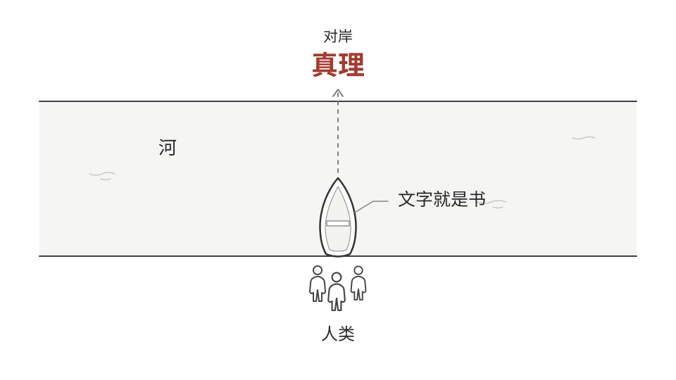</a><br><b>1 · 渡河之喻</b><br><sub>P03 · 渡河之喻里，河、船、对岸各代表什么？</sub></td>
<td align="center" valign="top" width="25%"><a href="./research/nishi-video-reading/康奈尔笔记/P05/P05-康奈尔笔记.md">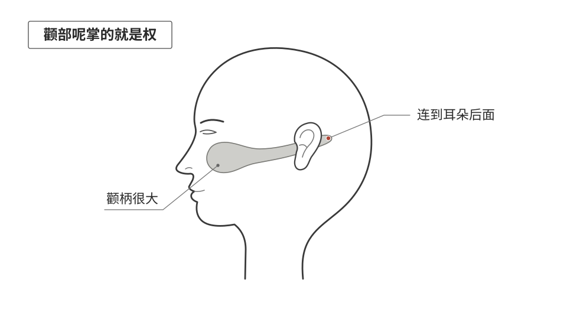</a><br><b>2 · 颧部</b><br><sub>P05 · 权在脸上第一个看哪里？颧要长成什么样？</sub></td>
<td align="center" valign="top" width="25%"><a href="./research/nishi-video-reading/康奈尔笔记/P07/P07-康奈尔笔记.md">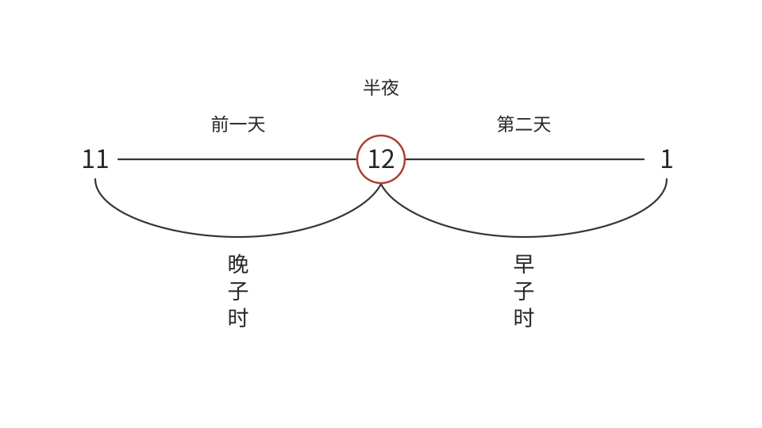</a><br><b>3 · 晚子时和早子时</b><br><sub>P07 · 晚子时和早子时怎么分？日子什么时候换？</sub></td>
<td align="center" valign="top" width="25%"><a href="./research/nishi-video-reading/康奈尔笔记/P09/P09-康奈尔笔记.md"></a><br><b>4 · 火贪格与火贵格</b><br><sub>P09 · 什么叫火贪格、火贵格？主什么？</sub></td>
</tr>
<tr>
<td align="center" valign="top" width="25%"><a href="./research/nishi-video-reading/康奈尔笔记/P11/P11-康奈尔笔记.md">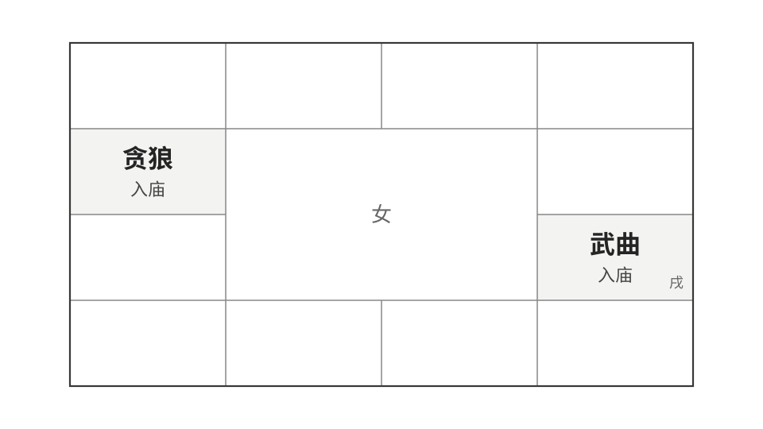</a><br><b>5 · 武贪入庙</b><br><sub>P11 · 本盘武曲、贪狼在哪里，是庙是陷？</sub></td>
<td align="center" valign="top" width="25%"><a href="./research/nishi-video-reading/康奈尔笔记/P13/P13-康奈尔笔记.md">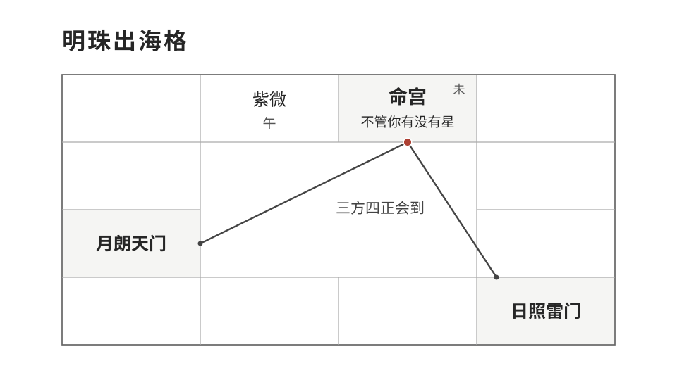</a><br><b>6 · 明珠出海格</b><br><sub>P13 · 什么是明珠出海格？要不要有主星？</sub></td>
<td align="center" valign="top" width="25%"><a href="./research/nishi-video-reading/康奈尔笔记/P15/P15-康奈尔笔记.md">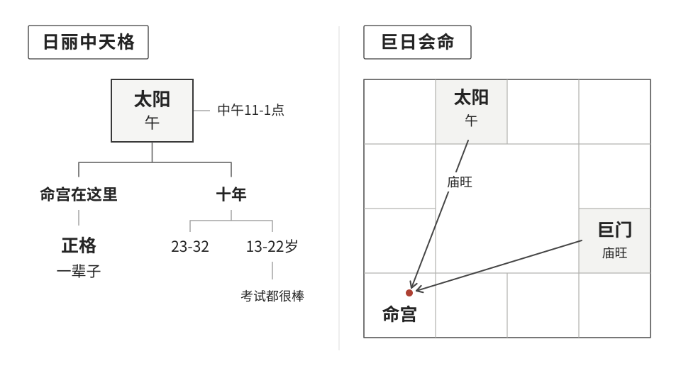</a><br><b>7 · 日丽中天与巨日会命</b><br><sub>P15 · 紫微在酉时太阳在哪？为什么叫日丽中天？</sub></td>
<td align="center" valign="top" width="25%"><a href="./research/nishi-video-reading/康奈尔笔记/P17/P17-康奈尔笔记.md">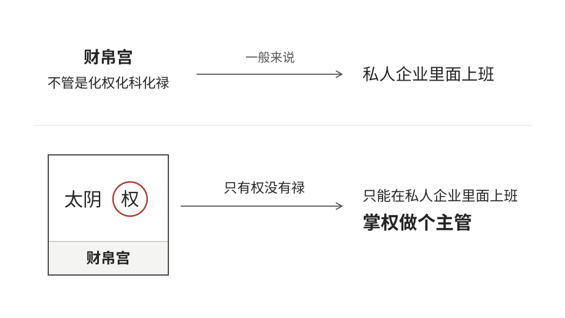</a><br><b>8 · 化权在财帛宫</b><br><sub>P17 · 化权在财帛宫，这种人做什么工作？</sub></td>
</tr>
<tr>
<td align="center" valign="top" width="25%"><a href="./research/nishi-video-reading/康奈尔笔记/P19/P19-康奈尔笔记.md">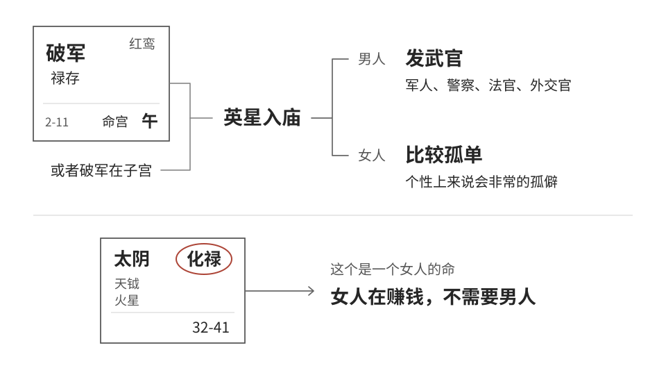</a><br><b>9 · 英星入庙与太阴化禄</b><br><sub>P19 · 英星入庙对男命、女命各主什么？</sub></td>
<td align="center" valign="top" width="25%"><a href="./research/nishi-video-reading/康奈尔笔记/P21/P21-康奈尔笔记.md">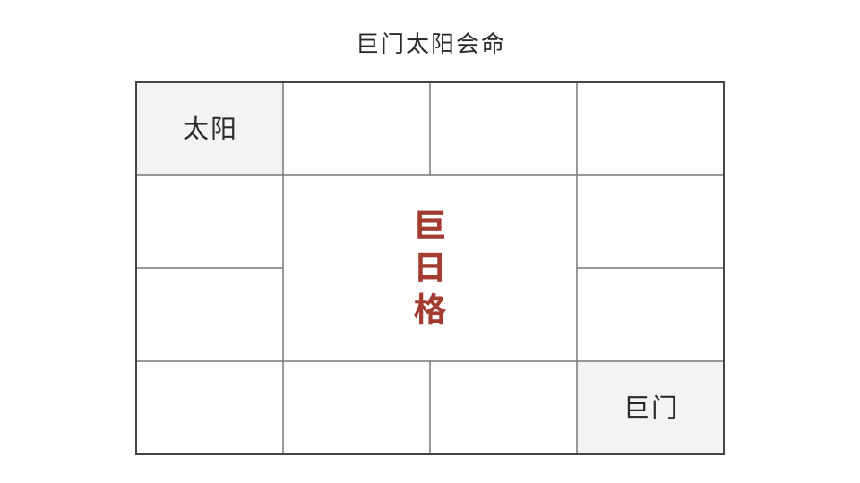</a><br><b>10 · 巨门太阳会命</b><br><sub>P21 · 例二换了哪张盘？倪师把它叫什么格？</sub></td>
<td align="center" valign="top" width="25%"><a href="./research/nishi-video-reading/康奈尔笔记/P23/P23-康奈尔笔记.md">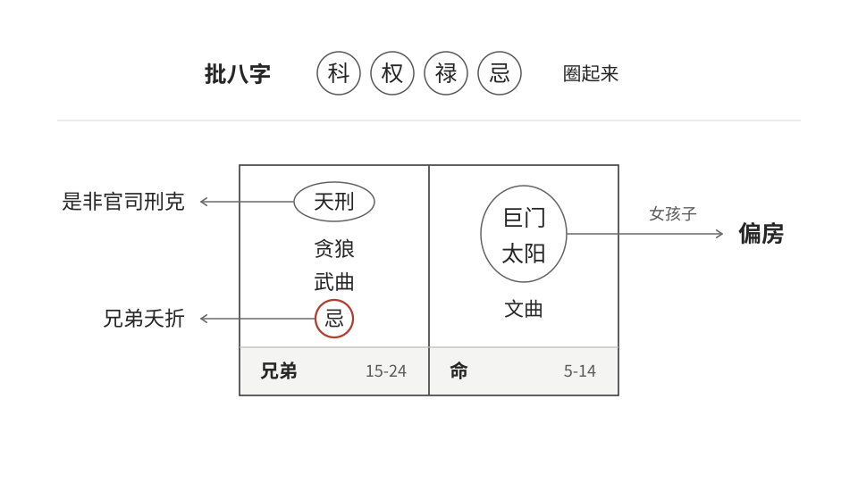</a><br><b>11 · 科权禄忌</b><br><sub>P23 · 批八字时为什么先把科权禄忌圈起来？</sub></td>
<td align="center" valign="top" width="25%"><a href="./research/nishi-video-reading/康奈尔笔记/P25/P25-康奈尔笔记.md">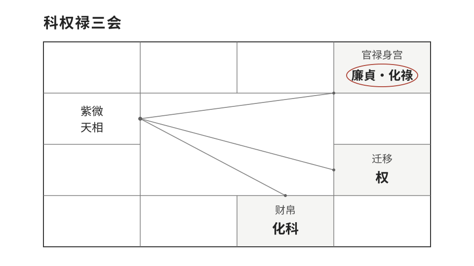</a><br><b>12 · 科权禄三会</b><br><sub>P25 · 什么叫科权禄三会？本例化科、化权、化禄各在哪宫？</sub></td>
</tr>
<tr>
<td align="center" valign="top" width="25%"><a href="./research/nishi-video-reading/康奈尔笔记/P27/P27-康奈尔笔记.md"></a><br><b>13 · 天文地理一起参照</b><br><sub>P27 · 例三的阳宅图怎么画，怎么跟命盘一起看？</sub></td>
<td align="center" valign="top" width="25%"><a href="./research/nishi-video-reading/康奈尔笔记/P29/P29-康奈尔笔记.md">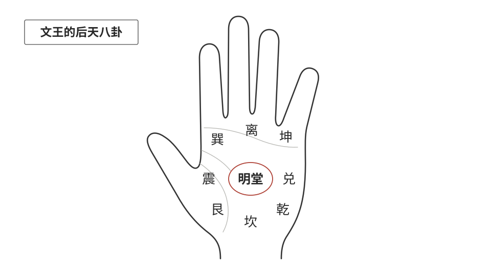</a><br><b>14 · 手相入后天八卦</b><br><sub>P29 · 看手相要放进哪一套八卦？</sub></td>
<td align="center" valign="top" width="25%"><a href="./research/nishi-video-reading/康奈尔笔记/P37/P37-康奈尔笔记.md"></a><br><b>15 · 斗君看月令</b><br><sub>P37 · 斗君是什么？从哪一宫起？为什么能管十二个月？</sub></td>
<td align="center" valign="top" width="25%"><a href="./research/nishi-video-reading/康奈尔笔记/P48/P48-康奈尔笔记.md">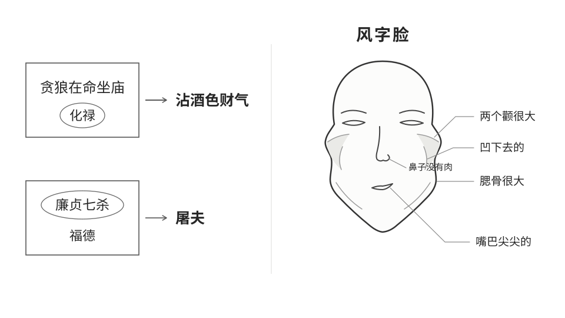</a><br><b>16 · 贪狼化禄与风字脸</b><br><sub>P48 · 贪狼在命坐庙，又刚好化禄，主什么？</sub></td>
</tr>
</table>

<sub>16 个图文案例，每集 1 个；示意图都是我们照讲课重画的，不是视频截图。点图进那一集的图文全文</sub>

</div>

<details>
<summary><b>展开 16 个案例的倪师原话</b></summary>

**1 · 渡河之喻**：渡河之喻里，河、船、对岸各代表什么？（P03 00:01:05）

> 〔口述〕介绍之前，「开宗明义我要先跟诸位讲个观念」：「首先这是一条河诸位用想的哈」，河上有一艘船停在这里。  
> 〔口述〕船的名字「叫做文字就是书」；全世界的人类都站在这边，「我们人要过河要到对岸」，对岸「它的名字叫做真理」。

[看 P03 图文全文 →](./research/nishi-video-reading/康奈尔笔记/P03/P03-康奈尔笔记.md)

**2 · 颧部**：权在脸上第一个看哪里？颧要长成什么样？（P05 00:07:51）

> 〔口述〕有权的人可以从脸上看出来，第一处是颧部：「这个颧柄很大」「这个颧啊要连到后面」「要像那个烟斗一样到后面去」「连到耳朵后面」，在脸相上「叫做颧部」，「颧部呢掌的就是权」「这是第一个」。

[看 P05 图文全文 →](./research/nishi-video-reading/康奈尔笔记/P05/P05-康奈尔笔记.md)

**3 · 晚子时和早子时**：晚子时和早子时怎么分？日子什么时候换？（P07 00:30:43）

> 〔口述〕「如果你刚好是12点11点到12点」「这一段时间生的」，「这一段叫做晚子」；「晚子时这个是根据前一天来的」，「就是这前面这一天呢最晚的时间」，「最晚的子时叫晚子时」。  
> 〔口述〕「过了12点以后」这一段时间「叫做早子时」，「所以后面呢要日子要换」，「12点换第二天的」。

[看 P07 图文全文 →](./research/nishi-video-reading/康奈尔笔记/P07/P07-康奈尔笔记.md)

**4 · 火贪格与火贵格**：什么叫火贪格、火贵格？主什么？（P09 00:03:53）

> 〔口述〕「所以你们看书上有一句话」，叫做火贪格；「火贪相聚的话我们叫做火贵」，「火贵格」。  
> 〔口述〕为什么叫火贵格？「这就是出武贵」，「武贵武官」。

[看 P09 图文全文 →](./research/nishi-video-reading/康奈尔笔记/P09/P09-康奈尔笔记.md)

**5 · 武贪入庙**：本盘武曲、贪狼在哪里，是庙是陷？（P11 00:50:59）

> 〔口述〕「还有一个」，「武曲星在这边」，「诸位看武曲在这边入庙」；「贪狼啊也是入庙」，贪狼隔壁一个宫也是庙旺，「完全不一样」。

[看 P11 图文全文 →](./research/nishi-video-reading/康奈尔笔记/P11/P11-康奈尔笔记.md)

**6 · 明珠出海格**：什么是明珠出海格？要不要有主星？（P13 00:40:28）

> 〔口述〕「那你有一天不小心刚好命……在这里」「三方四正会到」「左边是月朗天门」「右边是日照雷门」，命在这一格时「不管你有没有星」「我们就叫做明珠出海格」。

[看 P13 图文全文 →](./research/nishi-video-reading/康奈尔笔记/P13/P13-康奈尔笔记.md)

**7 · 日丽中天与巨日会命**：紫微在酉时太阳在哪？为什么叫日丽中天？（P15 00:01:03）

> 〔口述〕接着讲紫微在酉：紫微在这里时，太阳一定在午。「紫微在这个地方的时候」「第一个太阳一定在这里」……「这叫太阳在午宫」。  
> 〔口述〕午是中午 11 点到 1 点，是太阳最当头的时候：「午是中午11-1点」「那中午的时间呢」「是太阳最当头的时候」「刚刚好叫做德桓」「就是说」「太阳出的最好的时机」。  
> 〔口述〕只管这一个宫就有一个格：「所以这个有个格」「我们就是光管这个宫」「它就有个格叫做日丽中天」；又说「太阳正午的时候最热最高」「这是一个这个这个范围」「我们叫做日丽中天格」。

[看 P15 图文全文 →](./research/nishi-video-reading/康奈尔笔记/P15/P15-康奈尔笔记.md)

**8 · 化权在财帛宫**：化权在财帛宫，这种人做什么工作？（P17 00:45:07）

> 〔口述〕倪师说「你看他这个化权在财帛宫」。  
> 〔口述〕规则：财帛宫「不管是化权化科化禄」，「一般来说他都会在私人企业里面」，在私人公司、私人企业上班。  
> 〔口述〕本例「因为他的命里面只有权没有禄」，「所以他只能在私人企业里面上班」，「掌权做个主管」。

[看 P17 图文全文 →](./research/nishi-video-reading/康奈尔笔记/P17/P17-康奈尔笔记.md)

**9 · 英星入庙与太阴化禄**：英星入庙对男命、女命各主什么？（P19 00:01:11）

> 〔口述〕英星入庙「那给男人最好」，男人的话「这个英星入庙发武官」，即「武官的军人警察法官外交官这种人」。  
> 〔口述〕女人拿到破军在午宫或子宫的英星入庙，「主的是会比较孤单」「还有呢比较孤僻」「个性上来说会非常的孤僻」。

[看 P19 图文全文 →](./research/nishi-video-reading/康奈尔笔记/P19/P19-康奈尔笔记.md)

**10 · 巨门太阳会命**：例二换了哪张盘？倪师把它叫什么格？（P21 00:12:38）

> 〔口述〕倪师给这个格起名：「这个八字就叫做什么巨日会命」「巨门太阳会命」「叫做巨日格」。

[看 P21 图文全文 →](./research/nishi-video-reading/康奈尔笔记/P21/P21-康奈尔笔记.md)

**11 · 科权禄忌**：批八字时为什么先把科权禄忌圈起来？（P23 00:14:01）

> 〔口述〕倪师让大家看这一格，说批八字时要先把四化圈出来：「我们批八字的时候……科权禄忌……所以我们要把她的这个……这个科权禄忌呢……给她圈起来」。

[看 P23 图文全文 →](./research/nishi-video-reading/康奈尔笔记/P23/P23-康奈尔笔记.md)

**12 · 科权禄三会**：什么叫科权禄三会？本例化科、化权、化禄各在哪宫？（P25 00:10:22）

> 〔口述〕倪师拿出新一张盘说：「这个八字的就叫做科权禄三会」，又说讲例子要拿极好的，「普通的都没什么」。  
> 〔口述〕本盘三化的位置：「化科在财帛」，权在迁移（字幕作「杈」），「化禄在官禄身宫」，「这叫科权禄」。

[看 P25 图文全文 →](./research/nishi-video-reading/康奈尔笔记/P25/P25-康奈尔笔记.md)

**13 · 天文地理一起参照**：例三的阳宅图怎么画，怎么跟命盘一起看？（P27 00:18:31）

> 〔口述〕倪师换看这张命，说要把阳宅一起参照：「诸位看这个命哦」「阳宅的部分呢」「我们天文地理一起参照」「东南西北」「她的地理位置呢」「一画出来的时候」。  
> 〔口述〕边画边讲宅图：「本人在这里」「……两个浴室厕所」「然后这里是厨房」「儿子住这边」；又说「八字拿到我们手上」「排出来是这样子」「然后她住的阳宅是这样子」「就天文和地理配在一起看」。

[看 P27 图文全文 →](./research/nishi-video-reading/康奈尔笔记/P27/P27-康奈尔笔记.md)

**14 · 手相入后天八卦**：看手相要放进哪一套八卦？（P29 00:34:14）

> 〔口述〕倪师转入手相：「诸位看这个手相」，要把手掌「放到」「文王的后天八卦里面」，并说「这是后天卦啊」「后天卦为用」「所以我们就用后天卦来看的」。

[看 P29 图文全文 →](./research/nishi-video-reading/康奈尔笔记/P29/P29-康奈尔笔记.md)

**15 · 斗君看月令**：斗君是什么？从哪一宫起？为什么能管十二个月？（P37 00:36:12）

> 〔口述〕倪师说前面没有介绍斗君，现在补上：「斗君呢都是起子在子宫起」，「所谓斗君呢就是看月令」。  
> 〔口述〕他说一个宫管一年（「像我们知道一个一个宫一个宫」「一年一年对不对」），而「一年不是12个月」，「12个宫刚好12个月」，所以斗君用来看月。

[看 P37 图文全文 →](./research/nishi-video-reading/康奈尔笔记/P37/P37-康奈尔笔记.md)

**16 · 贪狼化禄与风字脸**：贪狼在命坐庙，又刚好化禄，主什么？（P48 00:38:39）

> 〔口述〕「比如说贪狼贪狼在命」「在子子时啊」「刚好贪狼在命坐庙」；倪师说「那如果一颗星没有关系」，接着「那如果他刚好化禄呢」。  
> 〔口述〕贪狼在命坐庙又化禄，「就是赌财酒色财沾酒色财气的」。

[看 P48 图文全文 →](./research/nishi-video-reading/康奈尔笔记/P48/P48-康奈尔笔记.md)

</details>

**1. 17 集康奈尔笔记全文公开**（2026-11-20）—— 在 [`research/nishi-video-reading/康奈尔笔记/`](./research/nishi-video-reading/康奈尔笔记/)，1,734 个提示、6,413 条笔记，每条标依据（口述 / 叠图 / 板书 / 指代 / 推断），能指回集号、时间码和帧号；倪师原话照字幕原字引在「」里。

**2. 193 幅黑板示意图** —— 17 集 921 条板书分成 410 组，其中 215 组是纯文字（圈字、划线、字间箭头），不画；有图的组由 Astra 照讲课要讲明白的原理画成示意图，每个标注都能在板书或同段字幕里找到原词，再由 Grok 对着原画面逐幅核。画了 195 幅，193 幅核过放进笔记；2 幅两轮没核过（都是阳宅图），暂不放。

**3. 26 张命盘逐格重画**（2026-11-20）—— 命例的命盘按视频里贴出的那张逐格重画，宫名、宫干支、主星、辅星取逐帧核过的叠图转写，每张都由 Astra 和 Grok 各自对着视频帧核过。不公开由命盘反推出的生辰。

**4. 研究目录首页改成图文版** —— [`research/nishi-video-reading/`](./research/nishi-video-reading/README.md) 首页现在是：17 集图文笔记目录（每集几幅图、几张命盘）、**16 个图文案例画廊**（每集 1 个，点图进那一集）、数字总览、流程、片源上限、现状与展望。

### 上一轮更新（2026-11-13）

本轮把倪师《天纪》紫微 **17 集、1,604,675 帧**的逐帧精读做完并入本仓：逐帧层 **133,731 窗全部跑满**，17 集康奈尔笔记全部出稿，公开摘要 **344 条要点**发布。原姊妹仓 nishi-ziwei-video-reading 连同提交历史并到 [`research/nishi-video-reading/`](./research/nishi-video-reading/)，原仓库归档只读，后续更新都在本仓。

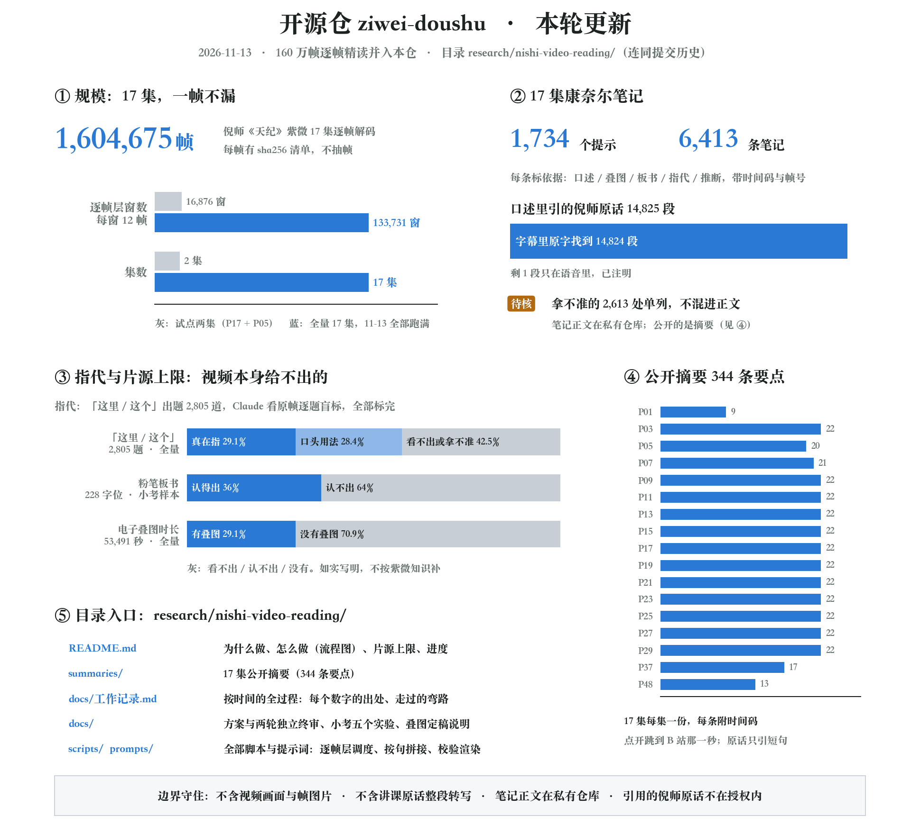

**1. 规模：一帧不漏** —— 17 集共 1,604,675 帧，每帧有 sha256 清单，不抽帧；逐帧层（DeepSeek，每窗 12 帧）共 133,731 窗，2026-11-13 全部跑满（试点时只有 P17、P05 两集 16,876 窗）。指代层 2,805 道题由 Claude 看原帧逐题盲标，全部标完。

**2. 17 集康奈尔笔记出稿** —— 1,734 个提示、6,413 条笔记，每条标依据（口述 / 叠图 / 板书 / 指代 / 推断）和帧号。〔口述〕里引的倪师原话 14,825 段，14,824 段在字幕里原字找到（剩 1 段只在语音里，已注明）；拿不准的 2,613 处单列「待核」，不混进正文。笔记正文当时放在私有仓库，2026-11-20 起全文公开（见本轮更新）。

**3. 公开摘要 17 集、344 条要点** —— 在 [`research/nishi-video-reading/summaries/`](./research/nishi-video-reading/summaries/README.md)，每集一份，每条附时间码，点开跳到 B 站原视频那一秒；倪师原话只引短句，不放截图。

**4. 写明片源上限** —— 视频本身给不出的三项：「这里 / 这个」约四成看不出指哪（全量 2,805 题里 42.5%）；粉笔板书六成多认不出（小考样本 228 个字位里 64%）；最清楚的电子叠图只占全片 29.1% 时长（全量）。详见[第五·新章](#五新160-万帧逐帧精读2026-11-13)。

**5. 目录与边界** —— [`research/nishi-video-reading/`](./research/nishi-video-reading/README.md) 里是方案与两轮独立终审、小考五个实验的设计与成绩、全部脚本和提示词、按时间的工作记录（每个数字的出处）和公开摘要；不含视频画面、帧图片和讲课原话的整段转写。`tsconfig.json` 已把 `research/` 排除在类型检查之外。许可见[第九章](#九协议)。

> **2026-11-19 补充**：新增 [繁體中文](./README.zh-Hant.md) 与 [日本語](./README.ja.md) 说明页。日文版由 @eltociear 贡献（#76）；繁体版由本页按 ouranic.cn 繁体模式同一套规则转换。

### 再上一轮更新（2026-10-15）

本轮跟随网站 2026-10-15 发版（网站内容版本 `ca268829f7a9`）：

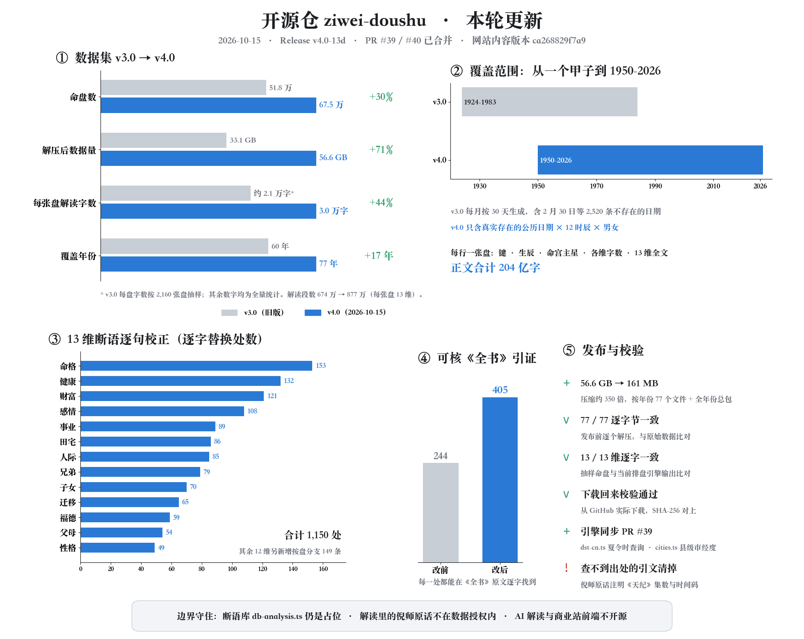

**1. 发布 13 维解读数据集 v4.0** —— 674,976 张命盘（公历 1950–2026 年每一个真实日期 × 12 时辰 × 男女）× 13 维 = **8,774,688 段解读**，正文约 204 亿字。解压后 56.6 GB（v3.0 为 33.1 GB，增加 71%），压缩后只有 161 MB，按年份分 77 个文件，可以只下需要的年份，也可以一次下全年份总包。下载见 [Release v4.0-13d](https://github.com/Renhuai123/ziwei-doushu/releases/tag/v4.0-13d)，规格和字段见[第二·新章](#二新13-维解读数据集-v402026-10-15)。发布前 77 个文件逐个解压，与原始数据逐字节比对一致。

**2. 13 维断语按倪师原话与《全书》原文逐句校正**（断语库仍不开源，校正结果体现在 v4.0 数据集里）：

- 标着倪师或《全书》却查不到出处的引文，删掉或换成逐字可查的原话；倪师原话注明《天纪》第几集、几分几秒
- 不会发生的四化（如七杀化权、紫微化忌）相关的句子删去；只在某种条件下才成立的断语补上条件
- 「力量强时……落陷时……」这类两头说的句子，改为按命盘只显示成立的那一种
- 健康：哪个脏腑要留意，改按倪师的看法——全盘杀星最集中的那一宫，按它的地支对应脏腑；不再按星的五行推脏器
- 网站知识库「古籍引证」由 244 处增至 405 处，每一处都能在《紫微斗数全书》原文里逐字找到

**3. 排盘引擎同步**（[PR #39](https://github.com/Renhuai123/ziwei-doushu/pull/39)）—— `dst-cn.ts` 新增 `chinaDSTSpan(year)`，查某年中国夏令时起止；`cities.ts` 补全省直辖县级单位与新疆兵团各市的经度（神农架、海南各市县、阿拉尔等），出生地选这些城市时真太阳时校正可用。

**4. 许可** —— [`DATASET-LICENSE`](./DATASET-LICENSE) 适用范围加上 v4.0；写明解读里引用的倪师原话不在数据授权范围内，与第五章倪师原话的 CC BY-NC-SA 4.0 一致。v3.0 样本数据集及其条款不变。

> **2026-11-08 补充**：新开公开仓 **[nishi-ziwei-video-reading](./research/nishi-video-reading/)**——用多家大模型把倪师《天纪》紫微 17 集共 160 万帧逐帧精读一遍，方案、脚本、考试成绩和踩过的坑全过程公开，边做边更新，近期动态看那里。（11-13 已并入本仓 research/nishi-video-reading/）

> **2026-11-02 补充**：晚子时换日改按**真太阳时**判断，与时辰支同一口径（#63）——填了出生地时，东经 100° 钟表 23:30（真太阳时 22:10，亥时）留在本日，不再排成「次日亥时」；不填出生地不做校正，结果不变，线上 ouranic.cn 也是这个口径。闰月归属参数写错时当场报错，不再静默按「归本月」排盘（#71）。感谢 Bortlesboat、xunguangzlj-cloud 提交，Verchiel666 复核。

> **2026-10-31 补充**：线上平台更名 **OURANIC**，网址由 metisziwei.com 迁到 **[ouranic.cn](https://ouranic.cn/?from=gh-readme)**（运营主体北京王多鱼科技有限责任公司，京ICP备2026069066号-1）；旧网址会自动跳转，本仓库的代码、数据集与许可都不变。

> **2026-10-27 补充**：排盘引擎同步——`true-solar-time.ts` 支持海外出生地：传 `utcOffsetMinutes`（出生地时区的固定标准偏移），按当地时区中央经线做经度修正，国内不传时结果逐位不变；新增 `clock-adjust.ts`，把夏令时、或当年时区与现在不同时的**钟表读数换成标准时间**（跨日不改，交给用户），建议做成用户亲手点、可撤销的按钮，不要自动改。顺带更正：中国夏令时引擎**只判定、从不自动扣除**，此前「引擎能力」表写成「自动扣除」，有误。

> **2026-10-24 补充**：项目理念移到页首——标题下居中一句「算法是公开的传统智慧，不应该被锁在围墙里」，紧接两段理念原文（前标「项目理念」），原有介绍段前标「项目信息」；第十章「项目理念」改为指向页首。

> **2026-10-20 补充**：星曜亮度默认改为《斗数全书》，与主流排盘软件默认一致，此前默认的「现代修正 v2」仍可在流派设置里选；补齐天姚、天刑、天喜、大耗、解神、截空、副截、旬空的亮度，月德不再标亮度。用 5 张金标准盘逐宫核对，星曜落宫与亮度全部吻合。注意：v4.0 数据集（10-15）是按旧默认「现代修正 v2」生成的，其中亮度字和少量随亮度变化的解读句会与新默认不同。

> **2026-10-06 ~ 10-07 补充**：README 加「注：关于六亲判断」（倪师原话 + 出处链接，中英两份）；网站链接加渠道码 `?from=`；同步倪师原话语料勘误（主星南斗、北斗归属）。

### 更早的更新（2026-09-21）


> **2026-10-03 补充**：倪师《天纪·紫微斗数》原话 1848 条单独成章（第五章）；合并外部贡献 #29（时辰序号校验）；引擎拒绝不存在的公历日期，数据集补字段口径与已知问题；提交 package-lock.json；站点地址改为可配置；合盘演示改用本地引擎起盘、AI 接口缺失时明确提示；补齐贡献指南、行为准则、问题与 PR 模板；新增英文简介 [README.en.md](./README.en.md)；去掉两个用不上的部署工具包（vercel CLI、@cloudflare/next-on-pages），依赖从 483 个减到 185 个；随后升级到 Next.js 16 修掉 postcss 漏洞，GitHub 安全提醒从 51 条清零。

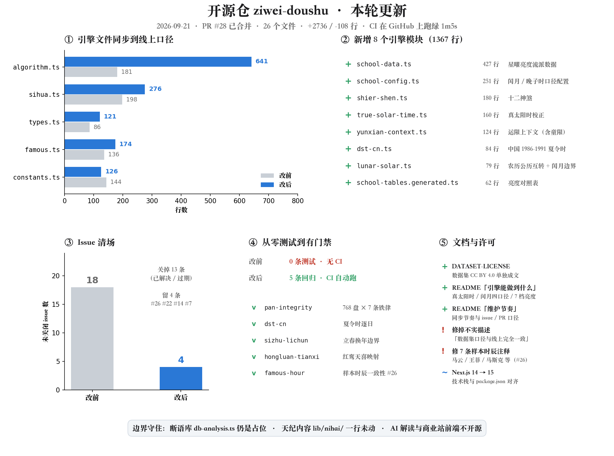

时隔三个月，本仓库完成一次完整更新（[PR #28](https://github.com/Renhuai123/ziwei-doushu/pull/28)，26 个文件、+2736 / −108 行）：

**1. 排盘引擎同步到线上口径** —— `algorithm.ts` 从 181 行到 641 行，另更新 sihua / types / constants / patterns / cities / famous；新增 8 个模块（1367 行）：

| 模块 | 作用 |
|------|------|
| `true-solar-time.ts` | 真太阳时校正（经度差 + 均时差） |
| `dst-cn.ts` | 中国 1986–1991 夏令时 |
| `clock-adjust.ts` | 钟表读数换成标准时间（夏令时 / 当年时区不同） |
| `lunar-solar.ts` | 农历 / 公历互转与闰月边界 clamp |
| `school-data.ts` / `school-tables.generated.ts` / `school-config.ts` | 星曜亮度流派数据与对照表、闰月与晚子时口径配置 |
| `shier-shen.ts` | 十二神煞 |
| `yunxian-context.ts` | 运限上下文（含童限） |

**2. 补上回归测试与 CI** —— 此前本仓库没有任何测试。现在 5 条排盘回归，`npm test` 一条命令跑完，每次 push 与 PR 在 GitHub Actions 上自动跑。

**3. 修掉样本时辰注释错位**（[#26](https://github.com/Renhuai123/ziwei-doushu/issues/26)）—— `famous.ts` 里 11 条名人样本有 7 条的时辰注释与 `hour` 索引不符（`hour` 一直是**时辰地支索引 0–11**，不是 0–23 的小时数）。已改正并加回归钉住。

**4. 积压 issue 从 18 条清到 4 条**，留下的都是还在走的。

**5. 文档与许可** —— 新增 [`DATASET-LICENSE`](./DATASET-LICENSE)；README 补齐引擎能力清单、维护节奏、开源边界；修正两处不实描述（数据集「口径与线上完全一致」、界面「完整的 Next.js 15 前端」）。

---

## 二·新、13 维解读数据集 v4.0（2026-10-15）

> **下载位置：本仓库右侧 [Releases → v4.0-13d](https://github.com/Renhuai123/ziwei-doushu/releases/tag/v4.0-13d)**

v4.0 用 2026-10-15 版网站断语库重新生成：13 个分析维度的断语已按倪海厦《天纪》逐字稿与《紫微斗数全书》原文逐句校正——查不到出处的引文删去或换成逐字可查的原话（倪师原话注明《天纪》集数与时间码），不会发生的四化相关句子删去，有条件的断语写明条件。

### 规格

| 项目 | 说明 |
|------|------|
| 命盘数 | **674,976 张**（公历 1950–2026 年 × 真实每月天数 × 12 时辰 × 男女） |
| 解读段数 | **8,774,688 段**（每张盘 13 维） |
| 维度 | 命格总览、性格、感情、事业、财运、健康、兄弟、子女、迁移、人际、田宅、福德、父母 |
| 大小 | 解压后 56.6 GB；压缩后 161 MB（77 个年份文件，zstd；另有一个全年份总包 `ziwei-interp-v4-all.tar`） |
| 正文 | 约 204 亿字，每张盘约 3.0 万字 |
| 生成方式 | 排盘引擎 + 断语库确定性生成，不经 AI，同一输入恒得同一输出 |
| 内容版本 | `ca268829f7a9`（与网站同期的 ANALYSIS_CONTENT_VERSION） |

**每行一张盘**（JSON Lines），字段：

| 字段 | 含义 |
|------|------|
| `k` | 键：`YYYY-MM-DD-时辰序号-性别`，如 `1990-01-01-0-male` |
| `y` / `m` / `d` | **公历**出生日期；只含真实存在的日期（不再有 2 月 30 日之类） |
| `h` | **时辰序号 0–11**（子 = 0 …… 亥 = 11），不是钟点；对照表见上一节 |
| `g` | `male` / `female` |
| `ms` | 命宫第一颗主星；命宫无主星时为 `null` |
| `t` | 各维字数 |
| `c` | 13 维解读全文（Markdown），键为 `overview` / `personality` / `love` / `career` / `wealth` / `health` / `family` / `children` / `move` / `friends` / `home` / `spirit` / `parents` |

**口径说明**
- 是本命盘视图的解读；网站上按读者当前年龄改写的句子、各维末尾附加的倪师法则段、AI 解读都不在数据集里。
- 按时辰序号直接排盘，未按出生地做真太阳时校正。

### 下载与解压

```bash
# 一次下全部：gh release download v4.0-13d --repo Renhuai123/ziwei-doushu -p "ziwei-interp-v4-all.tar"
# 只要某几年就只下那几年，例如 1990 年
zstd -d --long=27 year-1990.jsonl.zst          # 得到 year-1990.jsonl
shasum -a 256 -c SHA256SUMS.txt --ignore-missing # 校验
```

`--long=27` 必须带上（压缩时用了长窗口）。Windows 可用 [zstd 官方发布包](https://github.com/facebook/zstd/releases) 里的 zstd.exe，参数相同。

### 引文说明

解读里引用的倪海厦《天纪》原话**不属于本数据集的授权范围**：它们是为说明断语出处而注明集数与时间码的简短引用，著作权归原权利人；要把这些原话单独成批使用，按第五章倪师原话的 [CC BY-NC-SA 4.0](./docs/tianji-ziwei/LICENSE.md) 处理。《紫微斗数全书》原文属公有领域。

### 许可

与 v3.0 相同：**CC BY 4.0，可自由商用，唯一要求是保留来源标注**（上面「引文说明」里的倪师原话除外），完整条款见 [DATASET-LICENSE](./DATASET-LICENSE)。引用时请写：

> 本项目使用了 **紫微斗数开源解读数据集 v4.0**（674,976 张命盘 × 13 维）
> 来源：https://github.com/Renhuai123/ziwei-doushu
> 作者：王多鱼AI

---

## 二、51.8 万命盘样本数据集

> **下载位置：本仓库右侧 [Releases](https://github.com/Renhuai123/ziwei-doushu/releases/tag/v3.0-samples) 页面**

我们开源了一套完整的紫微斗数命盘样本数据集，覆盖 **51.8 万种排盘组合**（年 60 × 月 12 × 日 30 × 时 12 × 性别 2），每条样本包含完整的命盘结构和基于倪海厦体系的解读文本。

### 2.1 数据规格

| 项目 | 说明 |
|------|------|
| 样本数量 | **518,400 条** |
| 总大小 | 压缩后 5.5 GB（分 3 卷），解压后 33.1 GB |
| 体系 | 倪海厦《天纪》正统（纯飞星派已下线） |
| 内容 | 命盘 JSON + 13 主题解读文本（命格总览、财运、事业、感情、健康等） |
| 验证 | 男女命差异化 100%、健康含子午流注 100%、女命含妇科保养 100% |
| 口径 | 由 **v3 版排盘引擎 + 当期断语库**生成；线上引擎在持续更新，新版输出与本数据集可能有差异 |

**字段口径**（每条样本由 `birthInfo` 生成，常被看错的是 `hour`）：

| 字段 | 含义 |
|------|------|
| `birthInfo.year` / `month` / `day` | **公历**出生日期：1924–1983 年（一个完整甲子），每月取 1–30 日 |
| `birthInfo.hour` | **时辰序号 0–11**，不是 0–23 点钟：子 = 0、丑 = 1 …… 亥 = 11 |
| `birthInfo.gender` | `male` / `female` |
| `birthInfo.longitude` | 固定 120（东经 120°，未做各地真太阳时校正） |
| 文件名 `YYYY-MM-DD-hHH-性别.json` | 其中 `hHH` 同样是时辰序号，例如 `h11` 是亥时，不是上午 11 点 |

时辰序号与钟点对照：

| 序号 | 0 | 1 | 2 | 3 | 4 | 5 | 6 | 7 | 8 | 9 | 10 | 11 |
|---|---|---|---|---|---|---|---|---|---|---|---|---|
| 时辰 | 子 | 丑 | 寅 | 卯 | 辰 | 巳 | 午 | 未 | 申 | 酉 | 戌 | 亥 |
| 钟点 | 23–1 | 1–3 | 3–5 | 5–7 | 7–9 | 9–11 | 11–13 | 13–15 | 15–17 | 17–19 | 19–21 | 21–23 |

23:00–23:59 出生（晚子时）按次日排盘、时辰取 0；00:00–00:59 出生（早子时）按当日排盘、时辰同样取 0。

**已知问题：约 2,520 条样本的日期并不存在。** 生成时每个月都取了 1–30 日，所以 2 月 30 日，以及非闰年的 2 月 29 日也生成了样本，共 105 个日期 × 12 时辰 × 2 性别 = 2,520 条，占 0.49%。v3 引擎遇到这类日期不报错，而是顺延成 3 月 1–2 日排盘，所以这些样本的内容与对应的 3 月 1–2 日样本重复。使用时请过滤掉：`month = 2` 且 `day = 30`，或 `month = 2` 且 `day = 29` 且该年不是闰年。引擎从 2026-10-03 起会直接拒绝不存在的日期，下一版数据集不会再有这类样本。

### 2.2 下载方式

前往 [Releases](https://github.com/Renhuai123/ziwei-doushu/releases/tag/v3.0-samples) 下载以下文件：

```
ziwei-samples-v3-part1.zip.001  (1.9 GB)
ziwei-samples-v3-part2.zip.002  (1.9 GB)
ziwei-samples-v3-part3.zip.003  (1.8 GB)
SHA256SUMS.txt                  (校验文件)
```

下载后合并解压：

```bash
# macOS / Linux
cat ziwei-samples-v3-part*.zip.* > combined.zip
unzip combined.zip

# Windows (PowerShell)
Get-Content ziwei-samples-v3-part*.zip.* -Encoding Byte -ReadCount 0 | Set-Content combined.zip -Encoding Byte
Expand-Archive combined.zip
```

### 2.3 用途

- 微调小模型的训练语料（51.8 万 input-output 配对）
- AI 对话的 RAG 检索源
- 修改 `patterns.ts` 后做 A/B 基线对比
- 紫微斗数研究与数据分析

### 2.4 数据许可与引用

📂 **完全开源 · 可自由商用** —— 你可以在任何项目里使用这套数据，包括但不限于：

- 商业产品 / SaaS / 付费应用
- AI 模型微调（开源或闭源模型均可）
- 二次开发、再分发、衍生数据集
- 学术研究、技术博客、教学课程

无需付费、无需申请、无需事先告知。

**唯一的要求是保留数据来源标注（attribution）**：

> 本项目使用了 **紫微斗数开源样本数据集 v3.0**（518,400 条）
> 来源：https://github.com/Renhuai123/ziwei-doushu
> 作者：王多鱼AI

放在哪里都行：

- **网页 / 产品**：About 页 / 关于我们 / 数据来源 / 页脚，写一行链接即可
- **AI 模型**：模型卡（Model Card）或数据集卡（Dataset Card）的 "Training Data" 字段
- **学术论文**：参考文献或致谢章节
- **二次发布的数据集**：README 或 metadata 文件里注明上游来源

仅此一条，其余都自由。完整条款见 [DATASET-LICENSE](./DATASET-LICENSE)。希望这套数据能帮你做出好东西 —— 做出来记得来小红书 / 抖音 / 闲鱼 **@王多鱼AI** 打个招呼 👋

---

## 三、快速开始

```bash
# 克隆
git clone https://github.com/Renhuai123/ziwei-doushu.git
cd ziwei-doushu

# 安装依赖
npm install

# 配置环境变量（只看排盘可以跳过；AI 配置仅在你自己实现了 /api/* 接口时才用得上）
cp .env.example .env.local

# 启动开发服务器
npm run dev
```

本地验证：

```bash
npm run typecheck   # TypeScript 全量类型检查
npm test            # 排盘引擎回归（768 盘 × 紫微铁律、夏令时、立春边界、红鸾天喜、样本时辰一致性、时辰序号边界、日期合法性、同宫双四化）
```

每次 push 与 PR 都会在 GitHub Actions 上跑同一套（见 [`.github/workflows/ci.yml`](./.github/workflows/ci.yml)）。

> **注意：开源版不含后端 API 路由。**排盘、命盘展示、合盘起盘都在浏览器里用本仓库的引擎完成，**不需要任何 API Key**。AI 解读（`/api/interpret`）和合盘 AI 分析（`/api/heming`）需要你自己实现接口；没实现之前，这两处会直接提示「开源版不含该接口」，配置 API Key 也不会变成可用（#30 就是这个原因）。

---

## 四、排盘引擎

排盘内核全部在 `lib/ziwei/`。

### 4.1 能做到什么（与常见排盘库的差异）

| 能力 | 说明 |
|------|------|
| **真太阳时校正** | 按出生地经度算时差 + 均时差，避免东西向差一个时辰 |
| **中国夏令时** | 1986–1991 年的夏令时区间自动判定（只判定、不自动扣除；钟表读数由用户确认后用 `clock-adjust.ts` 换成标准时间） |
| **闰月四种口径** | 闰月归前月 / 归后月 / 按日切分 / 按本月，可配置，不写死一派 |
| **晚子时换日** | 23:00–23:59 按次日排盘、00:00–00:59 按本日；填了出生地时按真太阳时判断（与时辰同一口径）；换日策略可切换 |
| **星曜亮度 7 档** | 庙 / 旺 / 得 / 利 / 平 / 不 / 陷，另保留 3 档粗分类做显示降级 |
| **亮度流派可切换** | 不同流派（含主流排盘软件的不同版本）对辅星亮度判法不一致，做成开关而非写死 |
| **四化与飞星** | 生年四化、大限 / 流年四化、飞星自化 |
| **十二神煞** | 本命层按生年支起，流年层改按流年支起 |
| **格局判定** | 1100+ 行规则库（紫府同宫、日月并明、七杀朝斗等） |

### 4.2 文件怎么分

| 文件 | 说明 |
|------|------|
| `algorithm.ts` | 完整排盘流程：安命宫、定五行局、安十四主星、安辅星、排大限流年 |
| `constants.ts` | 天干地支、十四主星、辅星常量 |
| `sihua.ts` | 四化飞星系统（禄权科忌），含各天干四化对照表 |
| `patterns.ts` | **1100+ 行格局知识库**：紫府同宫、日月并明、七杀朝斗等经典格局判定规则 |
| `heming-knowledge.ts` | 合盘方法论：倪师体系下双盘比对逻辑 |
| `types.ts` | TypeScript 类型定义 |
| `cities.ts` | 中国城市经纬度，用于真太阳时校正 |
| `famous.ts` | 历史名人命盘示例数据 |
| `school-data.ts` / `school-tables.generated.ts` / `school-config.ts` | 星曜亮度流派数据与对照表、闰月与晚子时口径配置 |
| `shier-shen.ts` | 十二神煞（本命按生年支起、流年层按流年支起） |
| `true-solar-time.ts` | 真太阳时校正（经度差 + 均时差） |
| `dst-cn.ts` | 中国 1986–1991 夏令时年份与区间 |
| `clock-adjust.ts` | 钟表读数按分钟平移成标准时间（跨日不改） |
| `yunxian-context.ts` | 运限上下文（含童限处理） |
| `lunar-solar.ts` | 农历 / 公历互转与闰月边界 clamp |

### 4.3 古籍原文（`lib/classics/`）

- **骨髓赋**（`gusuifu.ts`）— 紫微斗数核心歌诀
- **紫微斗数全集**（`quanji.ts`）— 清代古本
- **紫微斗数全书**（`quanshu.ts`）— 陈希夷传本

### 4.4 SEO 知识图谱（`lib/seo/`）

14 主星 × 12 宫位的结构化知识数据，可用于内容生成或知识库构建。

---

## 五、倪师《天纪·紫微斗数》原话


倪海厦《天纪》紫微斗数部分的原话共 **1848 条**：正课 14 讲（第 2–15 讲上半）加 2 段补充，按讲分成 16 个文件，放在 [`docs/tianji-ziwei/`](./docs/tianji-ziwei/)。每条都带出处时间，点一下就跳回 B 站原视频的那一秒。

- **怎么读**：先在上图里找到想看的主题，再点进对应那一讲，比如 [5上](./docs/tianji-ziwei/5%E4%B8%8A.md)（紫微在子）、[13上](./docs/tianji-ziwei/13%E4%B8%8A.md)（杀破狼、科权禄三会）。
- **从哪来**：取自姊妹仓库 [nihai-tianji-corpus](https://github.com/Renhuai123/nihai-tianji-corpus)，以语料库为准，会随语料库同步。
- **能不能商用**：**不能**。这一章的内容单独采用 CC BY-NC-SA 4.0，详见[九、协议](#九协议)。

---

## 五·新、160 万帧逐帧精读（2026-11-13）

> **目录：[`research/nishi-video-reading/`](./research/nishi-video-reading/README.md)**（原姊妹仓 nishi-ziwei-video-reading，2026-11-13 连同提交历史并入本仓）

**做了什么**：用多家大模型把倪海厦《天纪》紫微斗数 17 集讲课视频一帧不漏地读一遍（**1,604,675 帧**），把他讲的方法、板书、后期贴上的电子命盘、「这里 / 这个」指的是哪，整理成每条都能指回集号、时间码和帧号的康奈尔笔记。之所以逐帧：视频里大量信息不在字幕里——黑板上写了什么、指着哪一宫说「这里」、剪辑贴上的命盘标了什么，只看字幕会丢一半。

**怎么做**（一句一层）：

- **逐帧层**：DeepSeek 每窗 12 帧逐帧读，记下每一帧在做什么（写板书、用手指、字幕说了什么），17 集 133,731 窗全部跑满；帧号按窗口位置对回，不用模型抄的。
- **叠图层**：剪辑后期贴上的电子命盘是印刷字、全片最清楚，由 Claude 两遍独立转写 → 逐格比对 → 看原图裁定，再用苹果系统文字识别交叉核对；定稿 1,726 个叠图状态、16.3 万字，看不清的占 0.98%。
- **指代层**：程序找出「这里 / 这个 / 这边」2,869 处，出题 2,805 道，Claude 看说出前后的原帧、指尖停顿帧和手部裁片逐题盲标。
- **按句拼接**：以苹果字幕参照轨为时间轴，程序给每句字幕挂上逐帧层、逐字语音、叠图、板书、指代，不调接口、不靠模型。
- **康奈尔笔记**：按讲题、命例切块，每块一个 Claude 子代理照材料写，程序逐条核对引文、板书、指代、叠图；每条标依据〔口述〕〔叠图〕〔板书〕〔指代〕〔推断〕。

几条规矩：只依据视频本身，不掺《紫微斗数全书》等外来材料；看不清就写「视频未显示」，不猜、不按紫微知识补字；每一层先用小样本考（小考 5 个实验），门槛事先定好，不过线就改方案、不降标准。

**成绩**

| 项 | 结果 |
|---|---|
| 逐帧层 | 133,731 / 133,731 窗，2026-11-13 全部跑满 |
| 指代层 | 2,805 / 2,805 道题标完 |
| 康奈尔笔记 | 17 / 17 集出稿：1,734 个提示、6,413 条 |
| 引文核对 | 〔口述〕里引的原话 14,825 段，14,824 段在字幕里原字找到（剩 1 段只在语音里，已注明） |
| 待核 | 拿不准的 2,613 处单列，不混进正文 |

**片源上限**：有些信息视频本身就给不出，不是没做，全部写明。

| 项 | 数字 | 样本 |
|---|---|---|
| 「这里 / 这个」看不出指哪 | 2,805 道题里 1,191 道（42.5%）看不出或拿不准；能确定的 1,614 道里，真在指 816 道（占全部 29.1%）、口头用法 798 道（28.4%） | 全量：17 集全部题目 |
| 粉笔板书认不出 | 228 个字位里 146 个（64%） | 只有小考样本（30 个板书格）；全量没有逐字转写板书，笔记只录看得清的 |
| 电子叠图（印刷字，最清楚）只占时长 | 53,491 秒里 15,586 秒（29.1%） | 全量：17 集每秒 1 帧打分 |

**公开摘要**：17 集每集一份、共 344 条要点，见 [`summaries/`](./research/nishi-video-reading/summaries/README.md)。倪师原话只引短句，每条附时间码，点开跳到 B 站那一秒；不放截图和视频画面，不公开从命盘反推的生辰。摘要是对讲课内容的学习整理，不代表我们的判断，也不构成医疗、婚姻、投资等建议。

**康奈尔笔记全文**（2026-11-20 起公开）：见 [`康奈尔笔记/`](./research/nishi-video-reading/康奈尔笔记/)，图文合一——每条〔板书〕后面紧跟一幅我们重画的示意图（共 193 幅），命例旁边是逐格重画的命盘（共 26 张），都不是视频截图。

**研究目录导览**

| 位置 | 内容 |
|---|---|
| [`README.md`](./research/nishi-video-reading/README.md) | 首页：16 个图文案例画廊、17 集图文笔记目录、流程、片源上限、现状 |
| [`康奈尔笔记/`](./research/nishi-video-reading/康奈尔笔记/) | 17 集笔记全文，图文合一；每集 `图/` 里是示意图（`图NN.svg`）和命盘（`命盘-*.svg`） |
| [`summaries/`](./research/nishi-video-reading/summaries/README.md) | 17 集公开摘要 |
| [`docs/工作记录.md`](./research/nishi-video-reading/docs/%E5%B7%A5%E4%BD%9C%E8%AE%B0%E5%BD%95.md) | 按时间的全过程：做了什么、每个数字的出处、走过的弯路 |
| `docs/` 其余文件 | 方案与两轮独立终审、小考五个实验的报告、标注说明、叠图定稿说明、康奈尔笔记模板 |
| `prompts/`、`scripts/` | 提示词与全部脚本：抽样、逐帧层调度、本机预处理、指代盲标、按句拼接、切块、校验渲染、叠图处理、出图 |

各家接口的钥匙不在仓库里；脚本里的路径按我们本机的目录写，复现时请改成自己的。许可见[九、协议](#九协议)。

---

## 六、界面是一份 Demo

界面代码在 `app/` 与 `components/`。仓库里的界面是**一套最小可运行示例**，作用是把排盘引擎跑起来、把盘画出来，方便你在它基础上做自己的产品。**线上商业版的界面不在开源范围内**，两者差距很大：

| 页面 / 组件 | 本仓库（Demo） | 线上商业版 |
|------|------|------|
| 排盘页 `app/chart/page.tsx` | 75 行 | 1227 行 |
| 解读面板 `InsightPanel` | 467 行 | 5088 行 |
| 命盘方格 `ChartBoard` | 285 行 | 1334 行 |
| 宫位格 `PalaceCell` | 201 行 | 1192 行 |
| 合盘页 `app/heming/page.tsx` | 368 行 | 1937 行 |

**Demo 能跑通的**：出生信息表单、命盘方格与宫位详情、本命 / 大限 / 流年切换、古籍阅读器（全文搜索）、命理百科（14 主星 × 12 宫位）、亮暗主题、移动端适配。

**Demo 里没有的**：线上重做过的交互界面、AI 流式解读、合盘图谱、分享卡片，以及**断语内容本身**（`db-analysis.ts` 是占位实现）。也就是说，Demo 画得出盘，但给不出线上那套解读。

---

## 七、开源边界：什么不在里面

| | 内容 |
|---|---|
| ✅ **开源** | 排盘引擎（`lib/ziwei/`）、古籍公版原文（`lib/classics/`）、SEO 知识图谱（`lib/seo/`）、Demo 界面、51.8 万样本数据集、13 维解读数据集 v4.0、160 万帧逐帧精读的方法 / 脚本 / 提示词与 17 集公开摘要（`research/nishi-video-reading/`） |
| ❌ **不开源** | 断语库（`lib/ziwei/db-analysis.ts` 是占位，线上是上万行的 13 主题断语）、AI 解读 prompt、后端 API（`/api/interpret` 等）、用户系统（登录 / 会员 / 支付）、服务端安全（签名、防刷、水印）、部署配置、160 万帧精读用到的视频画面 / 帧图片（康奈尔笔记全文 2026-11-20 起已公开） |

如果你需要 AI 解读能力，可以参考 `lib/ziwei/patterns.ts` 和 `heming-knowledge.ts` 里的知识库，结合任意 LLM 自行构建 prompt。

---

## 八、维护节奏与贡献

这个仓库是**排盘引擎 + 数据集的开放快照**，不是一个全职维护的开源产品，说清楚免得大家猜：

- **引擎同步**：随线上发版同步 `lib/ziwei/` 的引擎层并打 tag；断语库、AI 解读、商业站前端不在同步范围内。
- **Issue**：会看，但回复可能不及时；带复现步骤或具体盘例（年月日时 + 性别 + 哪一条不对）的问题优先处理。
- **PR**：欢迎，尤其是回归测试、口径修正、文档。动到排盘口径的改动请附上依据（古籍原文或可核对的对照）。

---

## 九、协议

本仓库分五部分授权。除倪师原话目录**不许商用**外，其余都是宽松协议，**商用没有限制**：

| 内容 | 协议 | 简单说 |
|------|------|--------|
| **代码**（`lib/`、`app/`、`components/`） | [MIT License](./LICENSE) | 拿去随便用，保留 LICENSE 文件即可 |
| **数据**（Releases 中的 51.8 万样本数据集 v3.0、13 维解读数据集 v4.0） | [CC BY 4.0](./DATASET-LICENSE) · 要求 attribution | 商用也行，**注明数据来源即可** |
| **古籍原文**（骨髓赋、紫微斗数全集 / 全书等） | Public Domain | 古书都是公有领域，不存在版权 |
| **倪师原话**（[`docs/tianji-ziwei/`](./docs/tianji-ziwei/)） | [CC BY-NC-SA 4.0](./docs/tianji-ziwei/LICENSE.md) | 可以引用、转载，注明出处；**不许商用**，改编后用同样协议 |
| **研究目录**（[`research/nishi-video-reading/`](./research/nishi-video-reading/)，160 万帧逐帧精读） | 代码 [MIT](./research/nishi-video-reading/LICENSE)；文档 CC BY 4.0（沿用原仓库） | 代码拿去随便用；文档转载注明出处；**其中引用的倪师原话短句不在授权内** |

**研究目录里的倪师原话**：公开摘要和文档里引用的倪师原话短句不在上表 MIT / CC BY 4.0 的授权范围内，著作权归原权利人，只作学习引用；要把这些原话单独成批使用，按第五章倪师原话的 [CC BY-NC-SA 4.0](./docs/tianji-ziwei/LICENSE.md) 处理。

**一句话**：代码和数据拿去用，商用也行，把来源链接带上就行；倪师原话只限非商业的学习研究（数据集解读、研究目录里引用的倪师原话同样不在授权范围内）。

---

## 十、关于与联系

### 项目理念

见本页开头。想自己搭？代码都在这里，拿去用。嫌麻烦？来 [ouranic.cn](https://ouranic.cn/?from=gh-readme) 直接用。

### 技术栈

- **框架**：Next.js 16（App Router）
- **语言**：TypeScript
- **样式**：Tailwind CSS + CSS Variables 设计系统
- **排盘**：基于 [iztro](https://github.com/SylarLong/iztro) + lunar-javascript
- **动画**：Framer Motion

### 联系

- 线上平台：[ouranic.cn](https://ouranic.cn/?from=gh-readme)（已完成 ICP 备案：京ICP备2026069066号-1）
- 提问题、提修复：见 [CONTRIBUTING.md](./CONTRIBUTING.md)；使用交流请到 [讨论区](https://github.com/Renhuai123/ziwei-doushu/discussions)
- 💕 发财的小手点一下：小红书 / 抖音 / 闲鱼 / X 关注 **王多鱼AI**，第一时间看上线 + 解锁更多紫微干货～
