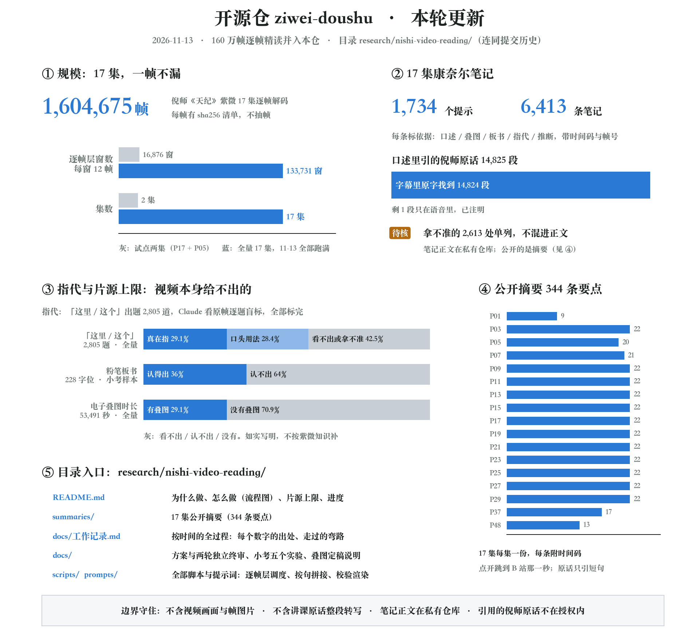
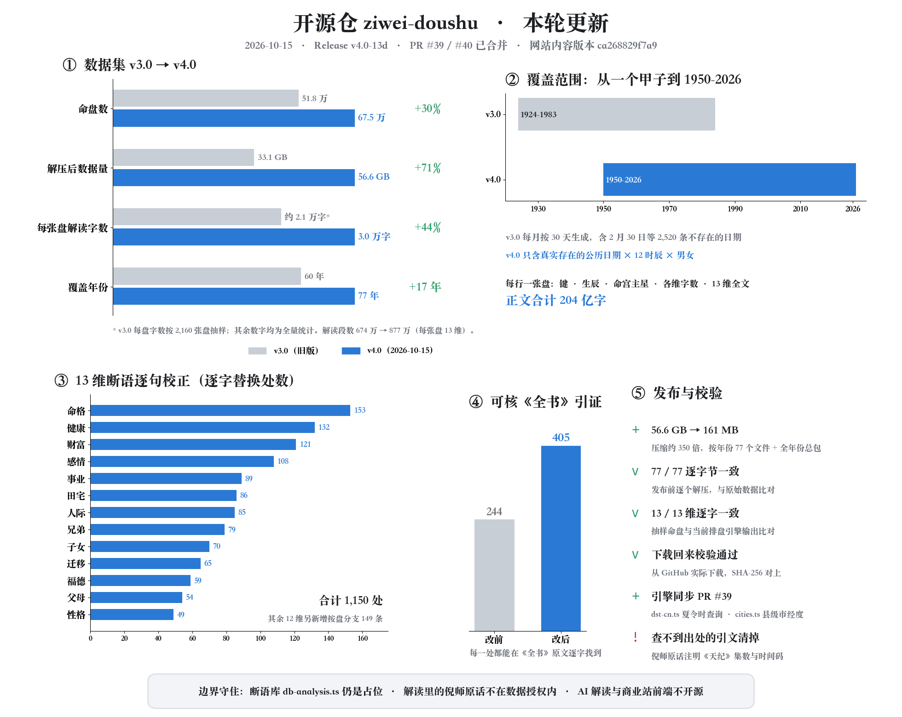
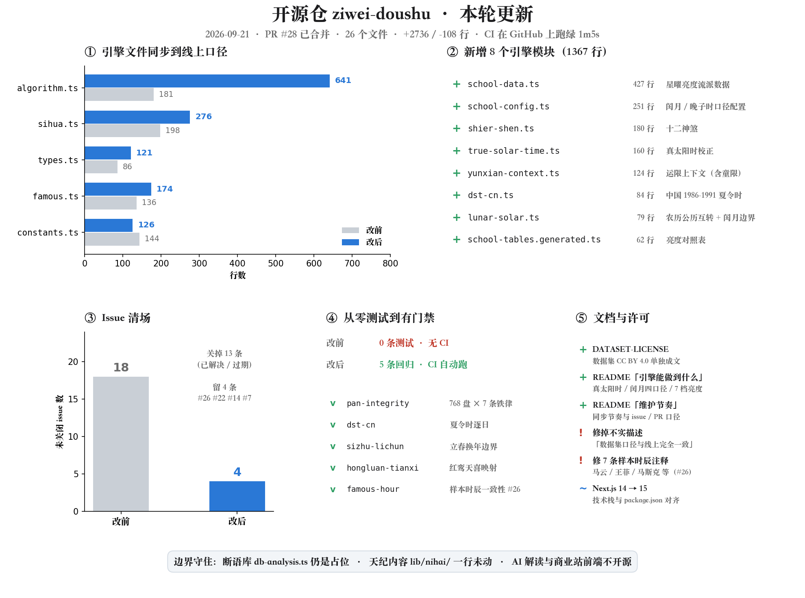

<div align="center">

# 紫微斗數 · 開源排盤引擎

### 算法是公開的傳統智慧，不應該被鎖在圍牆裡

[](https://github.com/Renhuai123/ziwei-doushu/actions/workflows/ci.yml)
[](./LICENSE)
[](./DATASET-LICENSE)

[简体中文](./README.md) · **繁體中文** · [English](./README.en.md) · [日本語](./README.ja.md)

</div>

> 本頁由[簡體中文版](./README.md)按 ouranic.cn 繁體模式同一套規則轉換而成；內容如有出入，以簡體中文版為準。

**一、項目理念**：紫微斗數是中國傳統命理學的瑰寶，倪海廈老師在《天紀》中系統梳理了正宗的紫微斗數體系。我們希望通過技術手段讓更多人接觸和學習這門學問。

開源排盤算法和知識庫，是因為我們相信：**算法是公開的傳統智慧，不應該被鎖在圍牆裡**。真正的價值在於解讀的深度、用戶體驗的打磨、以及持續運營的積累。

**二、項目信息**：基於<strong>倪海廈《天紀》</strong>教學體系的紫微斗數排盤系統，包含完整排盤算法、四化系統、格局知識庫、古籍原文數據，以及一套完整開源的紫微斗數解讀數據：**v4.0 解讀數據集——67.5 萬張命盤 × 13 維 = 877 萬段解讀，正文約 204 億字，解壓後 56.6 GB**（2026-10-15 發佈）。

| 數據集 | 命盤 | 解讀段數 | 解壓後 | 覆蓋年份 | 每張盤解讀字數 |
|---|---|---|---|---|---|
| **v4.0 解讀數據集**（2026-10-15） | **674,976** | **8,774,688** | **56.6 GB** | **1950–2026**（只含真實日期） | **約 3.0 萬字** |
| v3.0 樣本數據集 | 518,400 | 6,739,200 | 33.1 GB | 1924–1983 | 約 2.1 萬字 |
| 變化 | +30% | +30% | **+71%** | +17 年 | +44% |

<sub>v3.0 每張盤解讀字數按 2,160 張盤抽樣估算，其餘數字為全量統計；兩版每張盤都是 13 維。</sub>

在線體驗：[ouranic.cn](https://ouranic.cn/?from=gh-readme-hant)，排盤、AI 解讀、命盤歷史全部開放。

> **注：關於六親判斷**
>
> 紫微斗數在六親（父母、兄弟、子女等）判斷上存在一定侷限。倪師在《天紀》中指出：“斗數批六親本來就比較差一點。”（[2上 · 00:25:27](https://www.bilibili.com/video/BV1KJsLekEfA?p=3&t=1527)）在傳統術數中，鐵板神數在核對六親方面有其獨特優勢（[2上 · 00:03:15](https://www.bilibili.com/video/BV1KJsLekEfA?p=3&t=195)）；倪師仍以紫微斗數為核心，是因為它能結合地理、環境與人事進行綜合判斷，形成“上知天文、下知地理、中知人事”的完整體系（[2上 · 00:25:43](https://www.bilibili.com/video/BV1KJsLekEfA?p=3&t=1543)）。因此，與六親相關的分析僅供參考；[ouranic.cn](https://ouranic.cn/?from=gh-readme-hant) 上父母、兄弟、子女三個維度也附有同樣的說明。

---

## 目錄

| | 章節 | 一句話 |
|---|------|--------|
| 一 | [本輪更新](#一本輪更新2026-11-13) | 倪師《天紀》紫微 17 集 160 萬幀逐幀精讀做完併入本倉：17 集康奈爾筆記、344 條公開摘要、片源上限 |
| 二·新 | [13 維解讀數據集 v4.0](#二新13-維解讀數據集-v402026-10-15) | 2026-10-15 新版斷語，67.5 萬命盤，按年份下載 |
| 二 | [51.8 萬命盤樣本數據集](#二518-萬命盤樣本數據集) | 規格、下載、用途、許可 |
| 三 | [快速開始](#三快速開始) | 克隆到跑起來 |
| 四 | [排盤引擎](#四排盤引擎) | 能做到什麼、文件怎麼分、古籍數據 |
| 五 | [倪師《天紀·紫微斗數》原話](#五倪師天紀紫微斗數原話) | 14 講 + 2 段補充、1848 條，一圖看全，每條可回放 |
| 五·新 | [160 萬幀逐幀精讀](#五新160-萬幀逐幀精讀2026-11-13) | 17 集 1,604,675 幀怎麼讀、成績與片源上限、公開摘要、研究目錄導覽 |
| 六 | [界面是一份 Demo](#六界面是一份-demo) | 不是線上那套，差距寫明 |
| 七 | [開源邊界](#七開源邊界什麼不在裡面) | 什麼開源、什麼不開源 |
| 八 | [維護節奏與貢獻](#八維護節奏與貢獻) | 同步節奏、issue / PR 口徑 |
| 九 | [協議](#九協議) | 代碼 MIT / 數據 CC BY 4.0 / 古籍公版 / 倪師原話非商用 / 研究目錄代碼 MIT、文檔 CC BY 4.0 |
| 十 | [關於與聯繫](#十關於與聯繫) | 項目理念、技術棧、聯繫方式 |

---

## 一、本輪更新（2026-11-13）

本輪把倪師《天紀》紫微 **17 集、1,604,675 幀**的逐幀精讀做完併入本倉：逐幀層 **133,731 窗全部跑滿**，17 集康奈爾筆記全部出稿，公開摘要 **344 條要點**發佈。原姊妹倉 nishi-ziwei-video-reading 連同提交歷史併到 [`research/nishi-video-reading/`](./research/nishi-video-reading/)，原倉庫歸檔只讀，後續更新都在本倉。



**1. 規模：一幀不漏** —— 17 集共 1,604,675 幀，每幀有 sha256 清單，不抽幀；逐幀層（DeepSeek，每窗 12 幀）共 133,731 窗，2026-11-13 全部跑滿（試點時只有 P17、P05 兩集 16,876 窗）。指代層 2,805 道題由 Claude 看原幀逐題盲標，全部標完。

**2. 17 集康奈爾筆記出稿** —— 1,734 個提示、6,413 條筆記，每條標依據（口述 / 疊圖 / 板書 / 指代 / 推斷）和幀號。〔口述〕裡引的倪師原話 14,825 段，14,824 段在字幕裡原字找到（剩 1 段只在語音裡，已註明）；拿不準的 2,613 處單列「待核」，不混進正文。筆記正文放在私有倉庫。

**3. 公開摘要 17 集、344 條要點** —— 在 [`research/nishi-video-reading/summaries/`](./research/nishi-video-reading/summaries/README.md)，每集一份，每條附時間碼，點開跳到 B 站原視頻那一秒；倪師原話只引短句，不放截圖。

**4. 寫明片源上限** —— 視頻本身給不出的三項：「這裡 / 這個」約四成看不出指哪（全量 2,805 題裡 42.5%）；粉筆板書六成多認不出（小考樣本 228 個字位裡 64%）；最清楚的電子疊圖只佔全片 29.1% 時長（全量）。詳見[第五·新章](#五新160-萬幀逐幀精讀2026-11-13)。

**5. 目錄與邊界** —— [`research/nishi-video-reading/`](./research/nishi-video-reading/README.md) 裡是方案與兩輪獨立終審、小考五個實驗的設計與成績、全部腳本和提示詞、按時間的工作記錄（每個數字的出處）和公開摘要；不含視頻畫面、幀圖片和講課原話的整段轉寫。`tsconfig.json` 已把 `research/` 排除在類型檢查之外。許可見[第九章](#九協議)。

> **2026-11-19 補充**：新增 [繁體中文](./README.zh-Hant.md) 與 [日本語](./README.ja.md) 說明頁。日文版由 @eltociear 貢獻（#76）；繁體版由本頁按 ouranic.cn 繁體模式同一套規則轉換。

### 上一輪更新（2026-10-15）

本輪跟隨網站 2026-10-15 發版（網站內容版本 `ca268829f7a9`）：



**1. 發佈 13 維解讀數據集 v4.0** —— 674,976 張命盤（公曆 1950–2026 年每一個真實日期 × 12 時辰 × 男女）× 13 維 = **8,774,688 段解讀**，正文約 204 億字。解壓後 56.6 GB（v3.0 為 33.1 GB，增加 71%），壓縮後只有 161 MB，按年份分 77 個文件，可以只下需要的年份，也可以一次下全年份總包。下載見 [Release v4.0-13d](https://github.com/Renhuai123/ziwei-doushu/releases/tag/v4.0-13d)，規格和字段見[第二·新章](#二新13-維解讀數據集-v402026-10-15)。發佈前 77 個文件逐個解壓，與原始數據逐字節比對一致。

**2. 13 維斷語按倪師原話與《全書》原文逐句校正**（斷語庫仍不開源，校正結果體現在 v4.0 數據集裡）：

- 標著倪師或《全書》卻查不到出處的引文，刪掉或換成逐字可查的原話；倪師原話註明《天紀》第幾集、幾分幾秒
- 不會發生的四化（如七殺化權、紫微化忌）相關的句子刪去；只在某種條件下才成立的斷語補上條件
- 「力量強時……落陷時……」這類兩頭說的句子，改為按命盤只顯示成立的那一種
- 健康：哪個臟腑要留意，改按倪師的看法——全盤殺星最集中的那一宮，按它的地支對應臟腑；不再按星的五行推臟器
- 網站知識庫「古籍引證」由 244 處增至 405 處，每一處都能在《紫微斗數全書》原文裡逐字找到

**3. 排盤引擎同步**（[PR #39](https://github.com/Renhuai123/ziwei-doushu/pull/39)）—— `dst-cn.ts` 新增 `chinaDSTSpan(year)`，查某年中國夏令時起止；`cities.ts` 補全省直轄縣級單位與新疆兵團各市的經度（神農架、海南各市縣、阿拉爾等），出生地選這些城市時真太陽時校正可用。

**4. 許可** —— [`DATASET-LICENSE`](./DATASET-LICENSE) 適用範圍加上 v4.0；寫明解讀裡引用的倪師原話不在數據授權範圍內，與第五章倪師原話的 CC BY-NC-SA 4.0 一致。v3.0 樣本數據集及其條款不變。

> **2026-11-08 補充**：新開公開倉 **[nishi-ziwei-video-reading](./research/nishi-video-reading/)**——用多家大模型把倪師《天紀》紫微 17 集共 160 萬幀逐幀精讀一遍，方案、腳本、考試成績和踩過的坑全過程公開，邊做邊更新，近期動態看那裡。（11-13 已併入本倉 research/nishi-video-reading/）

> **2026-11-02 補充**：晚子時換日改按**真太陽時**判斷，與時辰支同一口徑（#63）——填了出生地時，東經 100° 鐘錶 23:30（真太陽時 22:10，亥時）留在本日，不再排成「次日亥時」；不填出生地不做校正，結果不變，線上 ouranic.cn 也是這個口徑。閏月歸屬參數寫錯時當場報錯，不再靜默按「歸本月」排盤（#71）。感謝 Bortlesboat、xunguangzlj-cloud 提交，Verchiel666 複核。

> **2026-10-31 補充**：線上平臺更名 **OURANIC**，網址由 metisziwei.com 遷到 **[ouranic.cn](https://ouranic.cn/?from=gh-readme-hant)**（運營主體北京王多魚科技有限責任公司，京ICP備2026069066號-1）；舊網址會自動跳轉，本倉庫的代碼、數據集與許可都不變。

> **2026-10-27 補充**：排盤引擎同步——`true-solar-time.ts` 支持海外出生地：傳 `utcOffsetMinutes`（出生地時區的固定標準偏移），按當地時區中央經線做經度修正，國內不傳時結果逐位不變；新增 `clock-adjust.ts`，把夏令時、或當年時區與現在不同時的**鐘錶讀數換成標準時間**（跨日不改，交給用戶），建議做成用戶親手點、可撤銷的按鈕，不要自動改。順帶更正：中國夏令時引擎**只判定、從不自動扣除**，此前「引擎能力」表寫成「自動扣除」，有誤。

> **2026-10-24 補充**：項目理念移到頁首——標題下居中一句「算法是公開的傳統智慧，不應該被鎖在圍牆裡」，緊接兩段理念原文（前標「項目理念」），原有介紹段前標「項目信息」；第十章「項目理念」改為指向頁首。

> **2026-10-20 補充**：星曜亮度默認改為《斗數全書》，與主流排盤軟件默認一致，此前默認的「現代修正 v2」仍可在流派設置裡選；補齊天姚、天刑、天喜、大耗、解神、截空、副截、旬空的亮度，月德不再標亮度。用 5 張金標準盤逐宮核對，星曜落宮與亮度全部吻合。注意：v4.0 數據集（10-15）是按舊默認「現代修正 v2」生成的，其中亮度字和少量隨亮度變化的解讀句會與新默認不同。

> **2026-10-06 ~ 10-07 補充**：README 加「注：關於六親判斷」（倪師原話 + 出處鏈接，中英兩份）；網站鏈接加渠道碼 `?from=`；同步倪師原話語料勘誤（主星南斗、北斗歸屬）。

### 再上一輪更新（2026-09-21）


> **2026-10-03 補充**：倪師《天紀·紫微斗數》原話 1848 條單獨成章（第五章）；合併外部貢獻 #29（時辰序號校驗）；引擎拒絕不存在的公曆日期，數據集補字段口徑與已知問題；提交 package-lock.json；站點地址改為可配置；合盤演示改用本地引擎起盤、AI 接口缺失時明確提示；補齊貢獻指南、行為準則、問題與 PR 模板；新增英文簡介 [README.en.md](./README.en.md)；去掉兩個用不上的部署工具包（vercel CLI、@cloudflare/next-on-pages），依賴從 483 個減到 185 個；隨後升級到 Next.js 16 修掉 postcss 漏洞，GitHub 安全提醒從 51 條清零。



時隔三個月，本倉庫完成一次完整更新（[PR #28](https://github.com/Renhuai123/ziwei-doushu/pull/28)，26 個文件、+2736 / −108 行）：

**1. 排盤引擎同步到線上口徑** —— `algorithm.ts` 從 181 行到 641 行，另更新 sihua / types / constants / patterns / cities / famous；新增 8 個模塊（1367 行）：

| 模塊 | 作用 |
|------|------|
| `true-solar-time.ts` | 真太陽時校正（經度差 + 均時差） |
| `dst-cn.ts` | 中國 1986–1991 夏令時 |
| `clock-adjust.ts` | 鐘錶讀數換成標準時間（夏令時 / 當年時區不同） |
| `lunar-solar.ts` | 農曆 / 公曆互轉與閏月邊界 clamp |
| `school-data.ts` / `school-tables.generated.ts` / `school-config.ts` | 星曜亮度流派數據與對照表、閏月與晚子時口徑配置 |
| `shier-shen.ts` | 十二神煞 |
| `yunxian-context.ts` | 運限上下文（含童限） |

**2. 補上回歸測試與 CI** —— 此前本倉庫沒有任何測試。現在 5 條排盤迴歸，`npm test` 一條命令跑完，每次 push 與 PR 在 GitHub Actions 上自動跑。

**3. 修掉樣本時辰註釋錯位**（[#26](https://github.com/Renhuai123/ziwei-doushu/issues/26)）—— `famous.ts` 裡 11 條名人樣本有 7 條的時辰註釋與 `hour` 索引不符（`hour` 一直是**時辰地支索引 0–11**，不是 0–23 的小時數）。已改正並加回歸釘住。

**4. 積壓 issue 從 18 條清到 4 條**，留下的都是還在走的。

**5. 文檔與許可** —— 新增 [`DATASET-LICENSE`](./DATASET-LICENSE)；README 補齊引擎能力清單、維護節奏、開源邊界；修正兩處不實描述（數據集「口徑與線上完全一致」、界面「完整的 Next.js 15 前端」）。

---

## 二·新、13 維解讀數據集 v4.0（2026-10-15）

> **下載位置：本倉庫右側 [Releases → v4.0-13d](https://github.com/Renhuai123/ziwei-doushu/releases/tag/v4.0-13d)**

v4.0 用 2026-10-15 版網站斷語庫重新生成：13 個分析維度的斷語已按倪海廈《天紀》逐字稿與《紫微斗數全書》原文逐句校正——查不到出處的引文刪去或換成逐字可查的原話（倪師原話註明《天紀》集數與時間碼），不會發生的四化相關句子刪去，有條件的斷語寫明條件。

### 規格

| 項目 | 說明 |
|------|------|
| 命盤數 | **674,976 張**（公曆 1950–2026 年 × 真實每月天數 × 12 時辰 × 男女） |
| 解讀段數 | **8,774,688 段**（每張盤 13 維） |
| 維度 | 命格總覽、性格、感情、事業、財運、健康、兄弟、子女、遷移、人際、田宅、福德、父母 |
| 大小 | 解壓後 56.6 GB；壓縮後 161 MB（77 個年份文件，zstd；另有一個全年份總包 `ziwei-interp-v4-all.tar`） |
| 正文 | 約 204 億字，每張盤約 3.0 萬字 |
| 生成方式 | 排盤引擎 + 斷語庫確定性生成，不經 AI，同一輸入恆得同一輸出 |
| 內容版本 | `ca268829f7a9`（與網站同期的 ANALYSIS_CONTENT_VERSION） |

**每行一張盤**（JSON Lines），字段：

| 字段 | 含義 |
|------|------|
| `k` | 鍵：`YYYY-MM-DD-时辰序号-性别`，如 `1990-01-01-0-male` |
| `y` / `m` / `d` | **公曆**出生日期；只含真實存在的日期（不再有 2 月 30 日之類） |
| `h` | **時辰序號 0–11**（子 = 0 …… 亥 = 11），不是鐘點；對照表見上一節 |
| `g` | `male` / `female` |
| `ms` | 命宮第一顆主星；命宮無主星時為 `null` |
| `t` | 各維字數 |
| `c` | 13 維解讀全文（Markdown），鍵為 `overview` / `personality` / `love` / `career` / `wealth` / `health` / `family` / `children` / `move` / `friends` / `home` / `spirit` / `parents` |

**口徑說明**
- 是本命盤視圖的解讀；網站上按讀者當前年齡改寫的句子、各維末尾附加的倪師法則段、AI 解讀都不在數據集裡。
- 按時辰序號直接排盤，未按出生地做真太陽時校正。

### 下載與解壓

```bash
# 一次下全部：gh release download v4.0-13d --repo Renhuai123/ziwei-doushu -p "ziwei-interp-v4-all.tar"
# 只要某几年就只下那几年，例如 1990 年
zstd -d --long=27 year-1990.jsonl.zst          # 得到 year-1990.jsonl
shasum -a 256 -c SHA256SUMS.txt --ignore-missing # 校验
```

`--long=27` 必須帶上（壓縮時用了長窗口）。Windows 可用 [zstd 官方發佈包](https://github.com/facebook/zstd/releases) 裡的 zstd.exe，參數相同。

### 引文說明

解讀裡引用的倪海廈《天紀》原話**不屬於本數據集的授權範圍**：它們是為說明斷語出處而註明集數與時間碼的簡短引用，著作權歸原權利人；要把這些原話單獨成批使用，按第五章倪師原話的 [CC BY-NC-SA 4.0](./docs/tianji-ziwei/LICENSE.md) 處理。《紫微斗數全書》原文屬公有領域。

### 許可

與 v3.0 相同：**CC BY 4.0，可自由商用，唯一要求是保留來源標註**（上面「引文說明」裡的倪師原話除外），完整條款見 [DATASET-LICENSE](./DATASET-LICENSE)。引用時請寫：

> 本項目使用了 **紫微斗數開源解讀數據集 v4.0**（674,976 張命盤 × 13 維）
> 來源：https://github.com/Renhuai123/ziwei-doushu
> 作者：王多魚AI

---

## 二、51.8 萬命盤樣本數據集

> **下載位置：本倉庫右側 [Releases](https://github.com/Renhuai123/ziwei-doushu/releases/tag/v3.0-samples) 頁面**

我們開源了一套完整的紫微斗數命盤樣本數據集，覆蓋 **51.8 萬種排盤組合**（年 60 × 月 12 × 日 30 × 時 12 × 性別 2），每條樣本包含完整的命盤結構和基於倪海廈體系的解讀文本。

### 2.1 數據規格

| 項目 | 說明 |
|------|------|
| 樣本數量 | **518,400 條** |
| 總大小 | 壓縮後 5.5 GB（分 3 卷），解壓後 33.1 GB |
| 體系 | 倪海廈《天紀》正統（純飛星派已下線） |
| 內容 | 命盤 JSON + 13 主題解讀文本（命格總覽、財運、事業、感情、健康等） |
| 驗證 | 男女命差異化 100%、健康含子午流注 100%、女命含婦科保養 100% |
| 口徑 | 由 **v3 版排盤引擎 + 當期斷語庫**生成；線上引擎在持續更新，新版輸出與本數據集可能有差異 |

**字段口徑**（每條樣本由 `birthInfo` 生成，常被看錯的是 `hour`）：

| 字段 | 含義 |
|------|------|
| `birthInfo.year` / `month` / `day` | **公曆**出生日期：1924–1983 年（一個完整甲子），每月取 1–30 日 |
| `birthInfo.hour` | **時辰序號 0–11**，不是 0–23 點鐘：子 = 0、丑 = 1 …… 亥 = 11 |
| `birthInfo.gender` | `male` / `female` |
| `birthInfo.longitude` | 固定 120（東經 120°，未做各地真太陽時校正） |
| 文件名 `YYYY-MM-DD-hHH-性别.json` | 其中 `hHH` 同樣是時辰序號，例如 `h11` 是亥時，不是上午 11 點 |

時辰序號與鐘點對照：

| 序號 | 0 | 1 | 2 | 3 | 4 | 5 | 6 | 7 | 8 | 9 | 10 | 11 |
|---|---|---|---|---|---|---|---|---|---|---|---|---|
| 時辰 | 子 | 丑 | 寅 | 卯 | 辰 | 巳 | 午 | 未 | 申 | 酉 | 戌 | 亥 |
| 鐘點 | 23–1 | 1–3 | 3–5 | 5–7 | 7–9 | 9–11 | 11–13 | 13–15 | 15–17 | 17–19 | 19–21 | 21–23 |

23:00–23:59 出生（晚子時）按次日排盤、時辰取 0；00:00–00:59 出生（早子時）按當日排盤、時辰同樣取 0。

**已知問題：約 2,520 條樣本的日期並不存在。** 生成時每個月都取了 1–30 日，所以 2 月 30 日，以及非閏年的 2 月 29 日也生成了樣本，共 105 個日期 × 12 時辰 × 2 性別 = 2,520 條，佔 0.49%。v3 引擎遇到這類日期不報錯，而是順延成 3 月 1–2 日排盤，所以這些樣本的內容與對應的 3 月 1–2 日樣本重複。使用時請過濾掉：`month = 2` 且 `day = 30`，或 `month = 2` 且 `day = 29` 且該年不是閏年。引擎從 2026-10-03 起會直接拒絕不存在的日期，下一版數據集不會再有這類樣本。

### 2.2 下載方式

前往 [Releases](https://github.com/Renhuai123/ziwei-doushu/releases/tag/v3.0-samples) 下載以下文件：

```
ziwei-samples-v3-part1.zip.001  (1.9 GB)
ziwei-samples-v3-part2.zip.002  (1.9 GB)
ziwei-samples-v3-part3.zip.003  (1.8 GB)
SHA256SUMS.txt                  (校验文件)
```

下載後合併解壓：

```bash
# macOS / Linux
cat ziwei-samples-v3-part*.zip.* > combined.zip
unzip combined.zip

# Windows (PowerShell)
Get-Content ziwei-samples-v3-part*.zip.* -Encoding Byte -ReadCount 0 | Set-Content combined.zip -Encoding Byte
Expand-Archive combined.zip
```

### 2.3 用途

- 微調小模型的訓練語料（51.8 萬 input-output 配對）
- AI 對話的 RAG 檢索源
- 修改 `patterns.ts` 後做 A/B 基線對比
- 紫微斗數研究與數據分析

### 2.4 數據許可與引用

📂 **完全開源 · 可自由商用** —— 你可以在任何項目裡使用這套數據，包括但不限於：

- 商業產品 / SaaS / 付費應用
- AI 模型微調（開源或閉源模型均可）
- 二次開發、再分發、衍生數據集
- 學術研究、技術博客、教學課程

無需付費、無需申請、無需事先告知。

**唯一的要求是保留數據來源標註（attribution）**：

> 本項目使用了 **紫微斗數開源樣本數據集 v3.0**（518,400 條）
> 來源：https://github.com/Renhuai123/ziwei-doushu
> 作者：王多魚AI

放在哪裡都行：

- **網頁 / 產品**：About 頁 / 關於我們 / 數據來源 / 頁腳，寫一行鏈接即可
- **AI 模型**：模型卡（Model Card）或數據集卡（Dataset Card）的 "Training Data" 字段
- **學術論文**：參考文獻或致謝章節
- **二次發佈的數據集**：README 或 metadata 文件裡註明上游來源

僅此一條，其餘都自由。完整條款見 [DATASET-LICENSE](./DATASET-LICENSE)。希望這套數據能幫你做出好東西 —— 做出來記得來小紅書 / 抖音 / 閒魚 **@王多魚AI** 打個招呼 👋

---

## 三、快速開始

```bash
# 克隆
git clone https://github.com/Renhuai123/ziwei-doushu.git
cd ziwei-doushu

# 安装依赖
npm install

# 配置环境变量（只看排盘可以跳过；AI 配置仅在你自己实现了 /api/* 接口时才用得上）
cp .env.example .env.local

# 启动开发服务器
npm run dev
```

本地驗證：

```bash
npm run typecheck   # TypeScript 全量类型检查
npm test            # 排盘引擎回归（768 盘 × 紫微铁律、夏令时、立春边界、红鸾天喜、样本时辰一致性、时辰序号边界、日期合法性、同宫双四化）
```

每次 push 與 PR 都會在 GitHub Actions 上跑同一套（見 [`.github/workflows/ci.yml`](./.github/workflows/ci.yml)）。

> **注意：開源版不含後端 API 路由。**排盤、命盤展示、合盤起盤都在瀏覽器裡用本倉庫的引擎完成，**不需要任何 API Key**。AI 解讀（`/api/interpret`）和合盤 AI 分析（`/api/heming`）需要你自己實現接口；沒實現之前，這兩處會直接提示「開源版不含該接口」，配置 API Key 也不會變成可用（#30 就是這個原因）。

---

## 四、排盤引擎

排盤內核全部在 `lib/ziwei/`。

### 4.1 能做到什麼（與常見排盤庫的差異）

| 能力 | 說明 |
|------|------|
| **真太陽時校正** | 按出生地經度算時差 + 均時差，避免東西向差一個時辰 |
| **中國夏令時** | 1986–1991 年的夏令時區間自動判定（只判定、不自動扣除；鐘錶讀數由用戶確認後用 `clock-adjust.ts` 換成標準時間） |
| **閏月四種口徑** | 閏月歸前月 / 歸後月 / 按日切分 / 按本月，可配置，不寫死一派 |
| **晚子時換日** | 23:00–23:59 按次日排盤、00:00–00:59 按本日；填了出生地時按真太陽時判斷（與時辰同一口徑）；換日策略可切換 |
| **星曜亮度 7 檔** | 廟 / 旺 / 得 / 利 / 平 / 不 / 陷，另保留 3 檔粗分類做顯示降級 |
| **亮度流派可切換** | 不同流派（含主流排盤軟件的不同版本）對輔星亮度判法不一致，做成開關而非寫死 |
| **四化與飛星** | 生年四化、大限 / 流年四化、飛星自化 |
| **十二神煞** | 本命層按生年支起，流年層改按流年支起 |
| **格局判定** | 1100+ 行規則庫（紫府同宮、日月並明、七殺朝斗等） |

### 4.2 文件怎麼分

| 文件 | 說明 |
|------|------|
| `algorithm.ts` | 完整排盤流程：安命宮、定五行局、安十四主星、安輔星、排大限流年 |
| `constants.ts` | 天干地支、十四主星、輔星常量 |
| `sihua.ts` | 四化飛星系統（祿權科忌），含各天干四化對照表 |
| `patterns.ts` | **1100+ 行格局知識庫**：紫府同宮、日月並明、七殺朝斗等經典格局判定規則 |
| `heming-knowledge.ts` | 合盤方法論：倪師體系下雙盤比對邏輯 |
| `types.ts` | TypeScript 類型定義 |
| `cities.ts` | 中國城市經緯度，用於真太陽時校正 |
| `famous.ts` | 歷史名人命盤示例數據 |
| `school-data.ts` / `school-tables.generated.ts` / `school-config.ts` | 星曜亮度流派數據與對照表、閏月與晚子時口徑配置 |
| `shier-shen.ts` | 十二神煞（本命按生年支起、流年層按流年支起） |
| `true-solar-time.ts` | 真太陽時校正（經度差 + 均時差） |
| `dst-cn.ts` | 中國 1986–1991 夏令時年份與區間 |
| `clock-adjust.ts` | 鐘錶讀數按分鐘平移成標準時間（跨日不改） |
| `yunxian-context.ts` | 運限上下文（含童限處理） |
| `lunar-solar.ts` | 農曆 / 公曆互轉與閏月邊界 clamp |

### 4.3 古籍原文（`lib/classics/`）

- **骨髓賦**（`gusuifu.ts`）— 紫微斗數核心歌訣
- **紫微斗數全集**（`quanji.ts`）— 清代古本
- **紫微斗數全書**（`quanshu.ts`）— 陳希夷傳本

### 4.4 SEO 知識圖譜（`lib/seo/`）

14 主星 × 12 宮位的結構化知識數據，可用於內容生成或知識庫構建。

---

## 五、倪師《天紀·紫微斗數》原話


倪海廈《天紀》紫微斗數部分的原話共 **1848 條**：正課 14 講（第 2–15 講上半）加 2 段補充，按講分成 16 個文件，放在 [`docs/tianji-ziwei/`](./docs/tianji-ziwei/)。每條都帶出處時間，點一下就跳回 B 站原視頻的那一秒。

- **怎麼讀**：先在上圖裡找到想看的主題，再點進對應那一講，比如 [5上](./docs/tianji-ziwei/5%E4%B8%8A.md)（紫微在子）、[13上](./docs/tianji-ziwei/13%E4%B8%8A.md)（殺破狼、科權祿三會）。
- **從哪來**：取自姊妹倉庫 [nihai-tianji-corpus](https://github.com/Renhuai123/nihai-tianji-corpus)，以語料庫為準，會隨語料庫同步。
- **能不能商用**：**不能**。這一章的內容單獨採用 CC BY-NC-SA 4.0，詳見[九、協議](#九協議)。

---

## 五·新、160 萬幀逐幀精讀（2026-11-13）

> **目錄：[`research/nishi-video-reading/`](./research/nishi-video-reading/README.md)**（原姊妹倉 nishi-ziwei-video-reading，2026-11-13 連同提交歷史併入本倉）

**做了什麼**：用多家大模型把倪海廈《天紀》紫微斗數 17 集講課視頻一幀不漏地讀一遍（**1,604,675 幀**），把他講的方法、板書、後期貼上的電子命盤、「這裡 / 這個」指的是哪，整理成每條都能指回集號、時間碼和幀號的康奈爾筆記。之所以逐幀：視頻裡大量信息不在字幕裡——黑板上寫了什麼、指著哪一宮說「這裡」、剪輯貼上的命盤標了什麼，只看字幕會丟一半。

**怎麼做**（一句一層）：

- **逐幀層**：DeepSeek 每窗 12 幀逐幀讀，記下每一幀在做什麼（寫板書、用手指、字幕說了什麼），17 集 133,731 窗全部跑滿；幀號按窗口位置對回，不用模型抄的。
- **疊圖層**：剪輯後期貼上的電子命盤是印刷字、全片最清楚，由 Claude 兩遍獨立轉寫 → 逐格比對 → 看原圖裁定，再用蘋果系統文字識別交叉核對；定稿 1,726 個疊圖狀態、16.3 萬字，看不清的佔 0.98%。
- **指代層**：程序找出「這裡 / 這個 / 這邊」2,869 處，出題 2,805 道，Claude 看說出前後的原幀、指尖停頓幀和手部裁片逐題盲標。
- **按句拼接**：以蘋果字幕參照軌為時間軸，程序給每句字幕掛上逐幀層、逐字語音、疊圖、板書、指代，不調接口、不靠模型。
- **康奈爾筆記**：按講題、命例切塊，每塊一個 Claude 子代理照材料寫，程序逐條核對引文、板書、指代、疊圖；每條標依據〔口述〕〔疊圖〕〔板書〕〔指代〕〔推斷〕。

幾條規矩：只依據視頻本身，不摻《紫微斗數全書》等外來材料；看不清就寫「視頻未顯示」，不猜、不按紫微知識補字；每一層先用小樣本考（小考 5 個實驗），門檻事先定好，不過線就改方案、不降標準。

**成績**

| 項 | 結果 |
|---|---|
| 逐幀層 | 133,731 / 133,731 窗，2026-11-13 全部跑滿 |
| 指代層 | 2,805 / 2,805 道題標完 |
| 康奈爾筆記 | 17 / 17 集出稿：1,734 個提示、6,413 條 |
| 引文核對 | 〔口述〕裡引的原話 14,825 段，14,824 段在字幕裡原字找到（剩 1 段只在語音裡，已註明） |
| 待核 | 拿不準的 2,613 處單列，不混進正文 |

**片源上限**：有些信息視頻本身就給不出，不是沒做，全部寫明。

| 項 | 數字 | 樣本 |
|---|---|---|
| 「這裡 / 這個」看不出指哪 | 2,805 道題裡 1,191 道（42.5%）看不出或拿不準；能確定的 1,614 道里，真在指 816 道（佔全部 29.1%）、口頭用法 798 道（28.4%） | 全量：17 集全部題目 |
| 粉筆板書認不出 | 228 個字位裡 146 個（64%） | 只有小考樣本（30 個板書格）；全量沒有逐字轉寫板書，筆記只錄看得清的 |
| 電子疊圖（印刷字，最清楚）只佔時長 | 53,491 秒裡 15,586 秒（29.1%） | 全量：17 集每秒 1 幀打分 |

**公開摘要**：17 集每集一份、共 344 條要點，見 [`summaries/`](./research/nishi-video-reading/summaries/README.md)。倪師原話只引短句，每條附時間碼，點開跳到 B 站那一秒；不放截圖和視頻畫面，不公開從命盤反推的生辰。摘要是對講課內容的學習整理，不代表我們的判斷，也不構成醫療、婚姻、投資等建議。筆記正文在私有倉庫。

**研究目錄導覽**

| 位置 | 內容 |
|---|---|
| [`README.md`](./research/nishi-video-reading/README.md) | 總說明：為什麼做、流程圖、片源上限、各步進度 |
| [`summaries/`](./research/nishi-video-reading/summaries/README.md) | 17 集公開摘要 |
| [`docs/工作记录.md`](./research/nishi-video-reading/docs/%E5%B7%A5%E4%BD%9C%E8%AE%B0%E5%BD%95.md) | 按時間的全過程：做了什麼、每個數字的出處、走過的彎路 |
| `docs/` 其餘文件 | 方案與兩輪獨立終審、小考五個實驗的報告、標註說明、疊圖定稿說明、康奈爾筆記模板 |
| `prompts/`、`scripts/` | 提示詞與全部腳本：抽樣、逐幀層調度、本機預處理、指代盲標、按句拼接、切塊、校驗渲染、疊圖處理、出圖 |

各家接口的鑰匙不在倉庫裡；腳本里的路徑按我們本機的目錄寫，復現時請改成自己的。許可見[九、協議](#九協議)。

---

## 六、界面是一份 Demo

界面代碼在 `app/` 與 `components/`。倉庫裡的界面是**一套最小可運行示例**，作用是把排盤引擎跑起來、把盤畫出來，方便你在它基礎上做自己的產品。**線上商業版的界面不在開源範圍內**，兩者差距很大：

| 頁面 / 組件 | 本倉庫（Demo） | 線上商業版 |
|------|------|------|
| 排盤頁 `app/chart/page.tsx` | 75 行 | 1227 行 |
| 解讀面板 `InsightPanel` | 467 行 | 5088 行 |
| 命盤方格 `ChartBoard` | 285 行 | 1334 行 |
| 宮位格 `PalaceCell` | 201 行 | 1192 行 |
| 合盤頁 `app/heming/page.tsx` | 368 行 | 1937 行 |

**Demo 能跑通的**：出生信息表單、命盤方格與宮位詳情、本命 / 大限 / 流年切換、古籍閱讀器（全文搜索）、命理百科（14 主星 × 12 宮位）、亮暗主題、移動端適配。

**Demo 裡沒有的**：線上重做過的交互界面、AI 流式解讀、合盤圖譜、分享卡片，以及**斷語內容本身**（`db-analysis.ts` 是佔位實現）。也就是說，Demo 畫得出盤，但給不出線上那套解讀。

---

## 七、開源邊界：什麼不在裡面

| | 內容 |
|---|---|
| ✅ **開源** | 排盤引擎（`lib/ziwei/`）、古籍公版原文（`lib/classics/`）、SEO 知識圖譜（`lib/seo/`）、Demo 界面、51.8 萬樣本數據集、13 維解讀數據集 v4.0、160 萬幀逐幀精讀的方法 / 腳本 / 提示詞與 17 集公開摘要（`research/nishi-video-reading/`） |
| ❌ **不開源** | 斷語庫（`lib/ziwei/db-analysis.ts` 是佔位，線上是上萬行的 13 主題斷語）、AI 解讀 prompt、後端 API（`/api/interpret` 等）、用戶系統（登錄 / 會員 / 支付）、服務端安全（簽名、防刷、水印）、部署配置、160 萬幀精讀的康奈爾筆記正文（私有倉庫）與視頻畫面 / 幀圖片 |

如果你需要 AI 解讀能力，可以參考 `lib/ziwei/patterns.ts` 和 `heming-knowledge.ts` 裡的知識庫，結合任意 LLM 自行構建 prompt。

---

## 八、維護節奏與貢獻

這個倉庫是**排盤引擎 + 數據集的開放快照**，不是一個全職維護的開源產品，說清楚免得大家猜：

- **引擎同步**：隨線上發版同步 `lib/ziwei/` 的引擎層並打 tag；斷語庫、AI 解讀、商業站前端不在同步範圍內。
- **Issue**：會看，但回覆可能不及時；帶復現步驟或具體盤例（年月日時 + 性別 + 哪一條不對）的問題優先處理。
- **PR**：歡迎，尤其是迴歸測試、口徑修正、文檔。動到排盤口徑的改動請附上依據（古籍原文或可核對的對照）。

---

## 九、協議

本倉庫分五部分授權。除倪師原話目錄**不許商用**外，其餘都是寬鬆協議，**商用沒有限制**：

| 內容 | 協議 | 簡單說 |
|------|------|--------|
| **代碼**（`lib/`、`app/`、`components/`） | [MIT License](./LICENSE) | 拿去隨便用，保留 LICENSE 文件即可 |
| **數據**（Releases 中的 51.8 萬樣本數據集 v3.0、13 維解讀數據集 v4.0） | [CC BY 4.0](./DATASET-LICENSE) · 要求 attribution | 商用也行，**註明數據來源即可** |
| **古籍原文**（骨髓賦、紫微斗數全集 / 全書等） | Public Domain | 古書都是公有領域，不存在版權 |
| **倪師原話**（[`docs/tianji-ziwei/`](./docs/tianji-ziwei/)） | [CC BY-NC-SA 4.0](./docs/tianji-ziwei/LICENSE.md) | 可以引用、轉載，註明出處；**不許商用**，改編後用同樣協議 |
| **研究目錄**（[`research/nishi-video-reading/`](./research/nishi-video-reading/)，160 萬幀逐幀精讀） | 代碼 [MIT](./research/nishi-video-reading/LICENSE)；文檔 CC BY 4.0（沿用原倉庫） | 代碼拿去隨便用；文檔轉載註明出處；**其中引用的倪師原話短句不在授權內** |

**研究目錄裡的倪師原話**：公開摘要和文檔裡引用的倪師原話短句不在上表 MIT / CC BY 4.0 的授權範圍內，著作權歸原權利人，只作學習引用；要把這些原話單獨成批使用，按第五章倪師原話的 [CC BY-NC-SA 4.0](./docs/tianji-ziwei/LICENSE.md) 處理。

**一句話**：代碼和數據拿去用，商用也行，把來源鏈接帶上就行；倪師原話只限非商業的學習研究（數據集解讀、研究目錄裡引用的倪師原話同樣不在授權範圍內）。

---

## 十、關於與聯繫

### 項目理念

見本頁開頭。想自己搭？代碼都在這裡，拿去用。嫌麻煩？來 [ouranic.cn](https://ouranic.cn/?from=gh-readme-hant) 直接用。

### 技術棧

- **框架**：Next.js 16（App Router）
- **語言**：TypeScript
- **樣式**：Tailwind CSS + CSS Variables 設計系統
- **排盤**：基於 [iztro](https://github.com/SylarLong/iztro) + lunar-javascript
- **動畫**：Framer Motion

### 聯繫

- 線上平臺：[ouranic.cn](https://ouranic.cn/?from=gh-readme-hant)（已完成 ICP 備案：京ICP備2026069066號-1）
- 提問題、提修復：見 [CONTRIBUTING.md](./CONTRIBUTING.md)；使用交流請到 [討論區](https://github.com/Renhuai123/ziwei-doushu/discussions)
- 💕 發財的小手點一下：小紅書 / 抖音 / 閒魚 / X 關注 **王多魚AI**，第一時間看上線 + 解鎖更多紫微乾貨～
