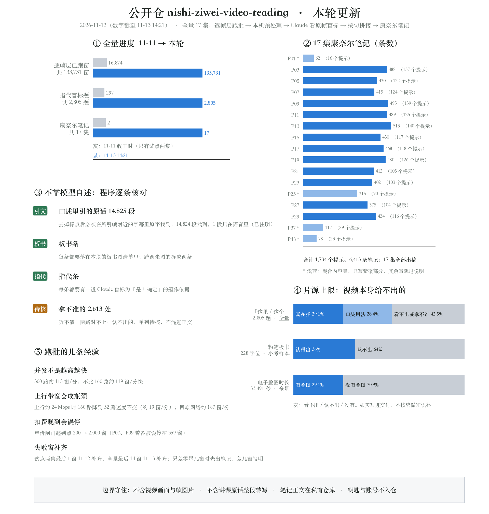
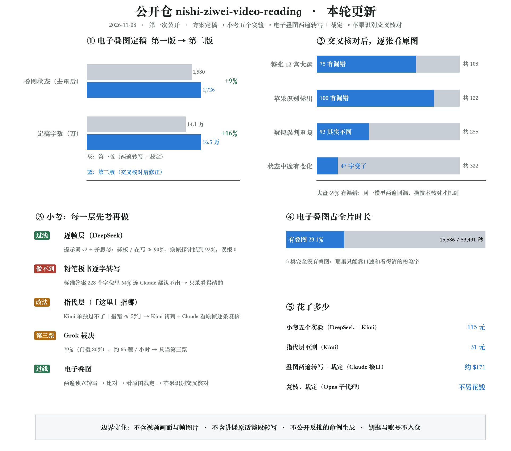
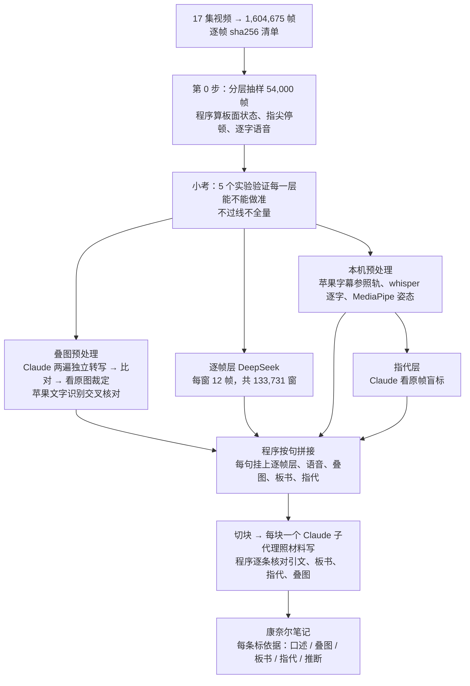

# 倪师《天纪》紫微斗数 · 160 万帧逐帧精读

> **2026-11-13 起，本目录归入主仓**：本目录原为独立仓库 nishi-ziwei-video-reading，2026-11-13 连同提交历史并入 [ziwei-doushu](https://github.com/Renhuai123/ziwei-doushu) 的 `research/nishi-video-reading/`；原仓库已归档只读，后续更新都在这里。许可同主仓[第九章](../../README.md#九协议)。下文是并入时的原文，其中「本仓库」「姊妹仓库」按原独立仓库的口径。

用多家大模型，把倪海厦老师《天纪》紫微斗数 17 集讲课视频**一帧不漏**地读一遍（1,604,675 帧），把他讲的方法、板书、命盘、「这里 / 这个」指的是哪，整理成可追溯到帧号的康奈尔笔记。

这个仓库公开的是**方法和全过程**：方案、每一步怎么处理信息、全部脚本、提示词、考试设计、成绩、失败的尝试和踩过的坑。**正在进行中**，边做边更新。

> 本仓库不含视频画面、帧图片，也不含倪师讲课原话的整段转写。原视频见 B 站合辑 [BV1KJsLekEfA](https://www.bilibili.com/video/BV1KJsLekEfA/)。

**17 集公开摘要已发布（344 条要点，每条带时间码）**：见 [`summaries/`](summaries/README.md)。

## 本轮更新（2026-11-12）

（数字截至 2026-11-13 14:21。）

1. **全量跑完**：17 集逐帧层（DeepSeek，每窗 12 帧）共 133,731 窗，11-13 13:48 全部跑满（5 集里零星反复失败的 14 个窗已补齐）。试点两集原先各剩的 1 个失败窗，11-12 已补齐。
2. **17 集康奈尔笔记出稿**：1,734 个提示、6,413 条笔记；〔口述〕里引的倪师原话 14,825 段，14,824 段在字幕里原字找到（剩 1 段只在语音里，已注明）；拿不准的 2,613 处单列「待核」，不混进正文。最后一集 P29 在逐帧层跑满后补写，11-13 14:20 出稿。笔记正文放私有仓库；公开摘要 17 集（344 条要点）11-13 已发布，见 [`summaries/`](summaries/README.md)。
3. **指代层改由 Claude 看原帧盲标**：17 集 2,805 道题全部标完。全量没有用 Kimi、Grok（这两家只在小考和重测里用过）。
4. **写明片源上限**：「这里 / 这个」约四成看不出指哪（全量 2,805 题里 42.5%）；粉笔板书六成多认不出（小考样本 228 个字位里 64%）；最清楚的电子叠图只占全片 29.1% 时长（全量）。见下方[「片源上限」](#片源上限)。
5. **跑批的几条经验**：并发不是越高越快（300 路不比 160 路快）；换到上行小的网络后，瓶颈在上传、降并发不减速；单价闸门要躲开上一集晚到的扣费。
6. **新增脚本与提示词**：全量调度、本机预处理（语音 / 字幕参照轨 / 姿态 / 出题）、盲标分批、进度页刷新，以及盲标、分段、选总结三份子代理提示词模板，都在 `scripts/第0步/`。

详细经过、每个数字的出处见 [`docs/工作记录.md`](docs/工作记录.md)。

## 上一轮更新（2026-11-08）

1. **第一次公开**：方案与两轮独立终审、全部脚本和提示词、小考五个实验的设计与成绩、走过的弯路，都在这里。
2. **小考结论**：逐帧层（DeepSeek）提示词改到 v2、开思考后过线；粉笔板书逐字转写做不到（标准答案 228 个字位里 64% 连 Claude 都认不出），改为只录看得清的；指代层 Kimi 单独过不了「指错 ≤ 5%」，改为 Kimi 初判 + Claude 看原帧逐条复核；Grok 裁决 79%，只当第三票。
3. **电子叠图定稿第二版**：Claude 两遍独立转写 → 逐格比对 → 看原图裁定，再用苹果系统文字识别交叉核对。交叉核对抓出了「两遍同漏」：整张 12 宫大盘 108 张里 75 张有漏错（69%），已逐格补全；去重时被误判为重复的 93 个状态（剪辑改宫名、大限来举例）已拆开单独定稿；322 个「持续期间画面有变化」的状态逐个看了起止帧，47 个确实中途改了字，拆出 53 段。现有 1,726 个叠图状态、16.3 万字，看不清的只占 0.98%。
4. **一条教训**：同一个模型做两遍再比对，挡不住它自己的系统性漏抄；换一种技术交叉核对，才抓得出来。之后每一层都照这个原则做。

详细经过、每个数字的出处见 [`docs/工作记录.md`](docs/工作记录.md)。

## 为什么这么做

倪师说过，他的课和视频里怎么断、怎么算都讲够了。可视频里大量信息不在字幕里：他在黑板上写什么、指着哪一宫说「这里」、后期贴上去的电子命盘标了什么。只看字幕会丢一半。所以我们逐帧看，而且每一条结论都要能指回集号、时间码和帧号。

## 怎么做

原方案里「字幕句层、板面层由 DeepSeek 和 Kimi 背对背各读一遍，Grok 投第三票」在试点后改掉了：句的时间轴和要挂的材料都已现成，改由程序拼接；指代层 Kimi 单独过不了线，改由 Claude 看原帧标。理由见工作记录 11-08、11-11。

几条铁规矩：
- **只依据视频本身**，不掺《紫微斗数全书》等外来材料；看不清就写「视频未显示」，不猜、不按紫微知识补字。
- **分清四层**：黑板手写（倪师）、后期电子命盘（剪辑加的，不算倪师的话）、烧录字幕、水印。
- **先考试再全量**：每一层都先用小样本考，门槛事先定好，不过线就改方案，**不降标准**。
- **公开误差**：认不出多少、剔除多少、裁定了多少，全部写明。

## 片源上限

有些信息视频本身就给不出，不是没做。全部写明：

| 项 | 数字 | 样本 |
|---|---|---|
| 「这里 / 这个」看不出指哪 | 出题的 2,805 道里 1,191 道（42.5%）看不出或拿不准；能确定的 1,614 道里，真在指 816 道（占全部 29.1%），口头用法 798 道（28.4%）。没出题的 64 处（手不在画面）也算进去，看不出的是 1,255 / 2,869（43.7%） | 全量：17 集全部题目的 Claude 盲标结果（小考 90 道题时是 42%） |
| 粉笔板书认不出 | 228 个字位里 146 个（64%） | 只有小考样本：30 个板书格。全量没有逐字转写板书，笔记只录看得清的 |
| 电子叠图（印刷字，最清楚）只占时长 | 53,491 秒里 15,586 秒（29.1%）；P03、P05、P07 没有叠图，P01、P37 几乎没有 | 全量：17 集每秒 1 帧打分 |

## 现在做到哪了（2026-11-13 13:30）

| 步骤 | 状态 |
|---|---|
| 方案 + 两轮独立终审 | ✅ |
| 预检、第 0 步抽样与程序预处理 | ✅ |
| 小考 5 个实验（约 ¥115） | ✅ 逐帧层过线；粉笔板书逐字转写做不到；指代层要改；Grok 只当第三票 |
| 电子叠图预处理 | ✅ 2,645 个叠图状态定稿（两遍一致 / 看原图裁定），看不清 0.92% |
| 苹果文字识别交叉核对、去重复查 | ✅ 第二版定稿：大盘 108 张逐格重核（69% 有漏错已补），去重拆出 93 个，状态内改字拆出 53 段 |
| 指代层重测 | ✅ Kimi 单独过不了线，改为 Kimi 初判 + Claude 看原帧逐条复核 |
| 试点两集（P17 + P05） | ✅ 康奈尔笔记两集完成：P17 118 个提示 / 468 条，P05 122 个提示 / 430 条；引的原话 1,949 段，1,948 段在字幕里原字找到。逐帧层两集各剩的 1 个失败窗 11-12 已补齐，两集全满 |
| 全量：本机预处理（15 集） | ✅ 11-12 完成：苹果字幕参照轨、whisper 逐字语音、MediaPipe 姿态、指代出题 |
| 全量：指代层盲标 | ✅ 17 集 2,805 道题，Claude 看原帧逐题标完 |
| 全量：逐帧层（DeepSeek） | ✅ 133,731 / 133,731 窗，11-13 13:48 全部跑满 |
| 全量：康奈尔笔记 | ✅ 17 / 17 集出稿（1,734 个提示 / 6,413 条），笔记在私有仓库 |
| 公开摘要版笔记 | ✅ 17 集、344 条要点（11-13 发布），倪师原话只引短句，见 [`summaries/`](summaries/README.md) |

详细经过见 [`docs/工作记录.md`](docs/工作记录.md)。

## 目录

| 位置 | 内容 |
|---|---|
| `summaries/` | 17 集公开摘要：每集要点 + 时间码（点开跳 B 站那一秒），倪师原话只引短句 |
| `docs/工作记录.md` | 按时间的全过程：做了什么、数字、弯路 |
| `docs/方案补充-v3-20261107.md`、`docs/Fable终审意见-20261107.md` | 方案与独立终审意见 |
| `docs/小考报告-20261108.md`、`docs/小考进展-20261108.md` | 五个实验的设计、成绩、结论 |
| `docs/标注说明-实验*.md`、`docs/任务说明-实验5-Grok裁决.md` | 标准答案怎么标、裁决怎么做 |
| `docs/叠图定稿说明.md` | 电子叠图两遍转写 + 裁定的做法、结果、局限 |
| `docs/康奈尔笔记模板.md` | 笔记格式 |
| `prompts/` | 逐帧层提示词 v1、v2（其余提示词写在各脚本里） |
| `scripts/第0步/` | 抽样、片段预处理（MediaPipe / whisper）、五个实验的出题、调用、评分；试点与全量的逐帧层调度、本机预处理（`run_prep_full.sh`）、指代出题与盲标分批、按句拼接、切块、校验渲染、进度页刷新 |
| `scripts/第0步/提示词/`、`scripts/第0步/康奈尔写手提示词.md` | 子代理提示词模板：指代盲标、分段读手、写手、选总结读手 |
| `scripts/图/` | README 总览图的出图脚本 |
| `scripts/叠图/` | 叠图找状态、去重、Claude 转写、两遍比对、裁定、合成定稿、去重复查、苹果识别核对 |
| `scripts/vision_ocr/` | 调用苹果系统文字识别的命令行小工具（Swift） |
| `scripts/命例反推/` | 用叠图露出的宫位反推命例整盘（实验中） |
| `scripts/预检/` | 各家接口的 token 预检 |

## 用到的模型和工具

DeepSeek（deepseek-flash）、Kimi（kimi-k3.1-pro）、Grok 4.7（经 Cursor 命令行）、Claude（Opus 5.5 / Fable 5.1）、苹果系统文字识别（Vision）、MediaPipe、whisper.cpp（large-v3-turbo）、ffmpeg、OpenCV。Kimi、Grok 只用在小考和重测，全量没有用。

各家接口的钥匙都从本机文件读取，不在仓库里。脚本里的路径按我们本机的目录写，复现时请改成自己的。

## 版权与隐私

- 视频画面和讲课内容的著作权属于原权利人；本仓库只放我们自己写的方法、代码和统计结果。
- 笔记公开版只引短句，配图用「跳到 B 站原视频那一秒」的链接和我们用自己的排盘程序重画的命盘，不放截图。
- 视频里的命例都是真人，我们不公开由命盘反推出的生辰。

## 许可

代码：MIT（见 `LICENSE`）。文档：CC BY 4.0，转载请注明出处。

排盘引擎见姊妹仓库 [ziwei-doushu](https://github.com/Renhuai123/ziwei-doushu)。
