

# 倪海厦·天纪紫微斗数 17 集逐帧精读

**ziwei-doushu / research / nishi-video-reading**

      

把倪海厦先生讲紫微斗数的 17 集课<b>一帧不漏</b>地读一遍（1,604,675 帧）， 把他口述的方法、黑板上写的字、后期贴的命盘、手指着说「这里 / 这个」指的是哪，整理成图文合一的康奈尔笔记。 每条笔记都标依据，能指回集号、时间码和帧号；193 幅示意图和 26 张命盘都是我们照讲课重画的。

<table>
<tr>
<td align="center"><a href="康奈尔笔记/P07/P07-康奈尔笔记.md">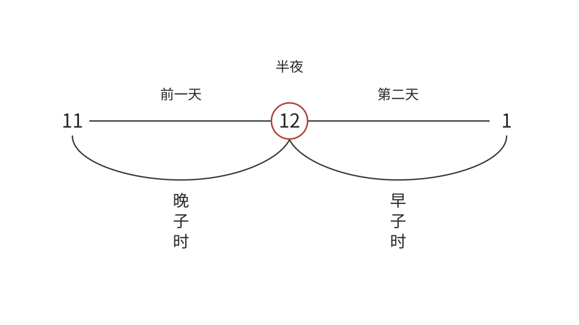</a> <b>P07</b> · 晚子时和早子时</td>
<td align="center"><a href="康奈尔笔记/P13/P13-康奈尔笔记.md">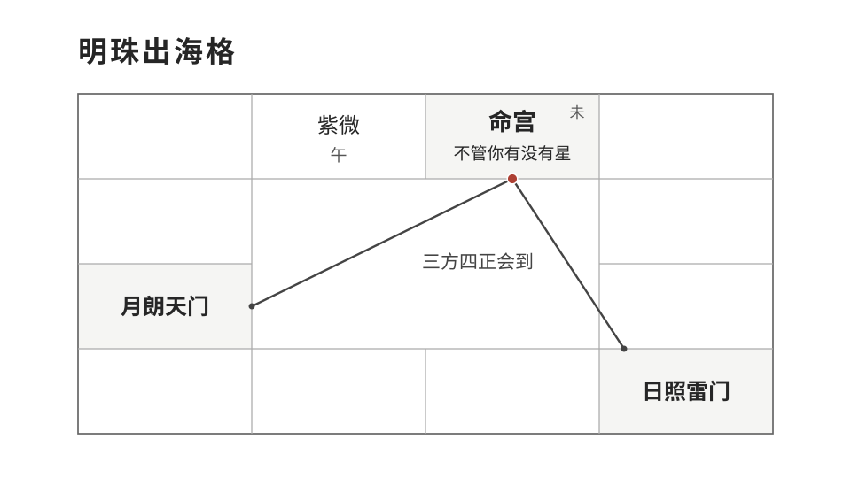</a> <b>P13</b> · 明珠出海格</td>
<td align="center"><a href="康奈尔笔记/P19/P19-康奈尔笔记.md">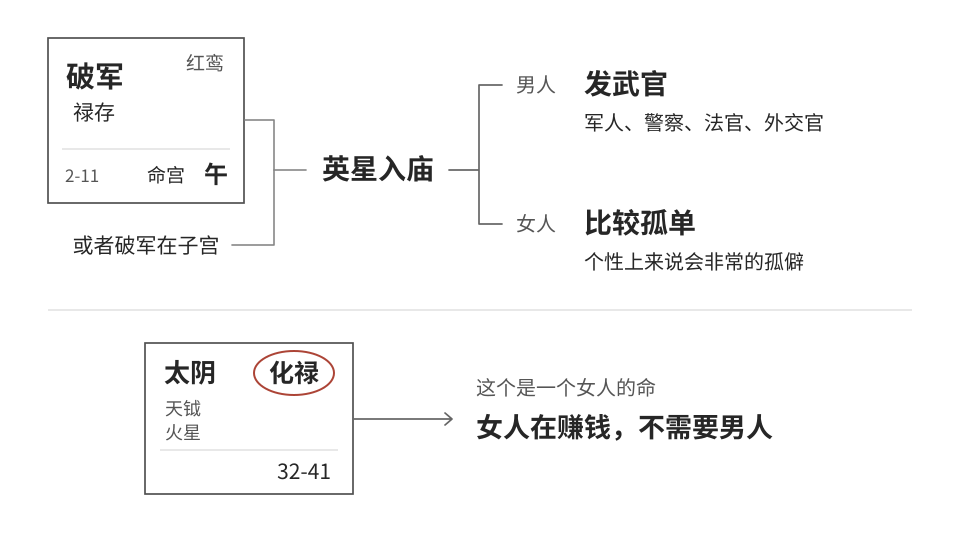</a> <b>P19</b> · 英星入庙</td>
<td align="center"><a href="康奈尔笔记/P29/P29-康奈尔笔记.md">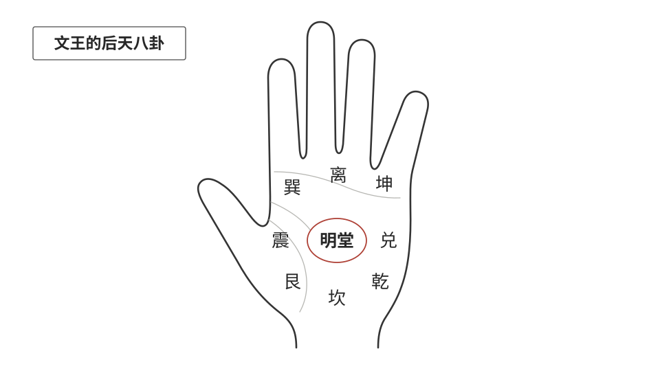</a> <b>P29</b> · 手相入后天八卦</td>
</tr>
</table>

点图直接进那一集的图文全文

---

倪师把学问分为天纪、地纪、人纪，紫微斗数属**天纪**。这 17 集出自倪师《天纪》课程（B 站合辑 [BV1KJsLekEfA](https://www.bilibili.com/video/BV1KJsLekEfA/)），本目录专门整理紫微斗数这一块。

**17 集公开摘要已发布（344 条要点，每条带时间码）**：见 [`summaries/`](summaries/README.md)。**17 集康奈尔笔记全文**（图文合一）：见 [`康奈尔笔记/`](康奈尔笔记/)，每条标依据，可指回时间码和帧号。

姊妹库：[nihai-diji-corpus](https://github.com/Renhuai123/nihai-diji-corpus)（地纪堪舆四讲，同一套方法）· [nihai-tianji-corpus](https://github.com/Renhuai123/nihai-tianji-corpus)（天纪十一册 4886 条判语）· [nihai-renji-corpus](https://github.com/Renhuai123/nihai-renji-corpus)（人纪六部 19,294 条判语）。排盘引擎在本仓根目录（[ziwei-doushu](https://github.com/Renhuai123/ziwei-doushu)）。

> 本目录原为独立仓库 nishi-ziwei-video-reading，2026-11-13 连同提交历史并入 [ziwei-doushu](https://github.com/Renhuai123/ziwei-doushu) 的 `research/nishi-video-reading/`；原仓库已归档只读，后续更新都在这里。

## 目录

| | 章节 | 一句话 |
|---|---|---|
| 一 | [项目理念](#一项目理念) | 一帧不漏、每条有据、只记倪师讲过的、图是我们自己画的 |
| 二 | [项目背景](#二项目背景) | 为什么紫微斗数要逐帧读 |
| 三 | [图文笔记](#三图文笔记从这里开始读) | 17 集目录，点进去从头到尾图文对照着读 |
| 四 | [16 个图文案例](#四16-个图文案例) | 每集 1 个，16 幅图一屏铺开，点图进那一集；原话折叠在下面 |
| 五 | [数字总览](#五数字总览) | 帧数、笔记、引文、示意图、命盘 |
| 六 | [怎么做](#六怎么做) | 从逐帧到配图的全流程 |
| 七 | [片源上限](#七片源上限) | 视频本身给不出的信息，全部写明 |
| 八 | [现状](#八现状) | 做到哪了 |
| 九 | [未来展望](#九未来展望) | 接下来做什么 |
| 十 | [文件在哪](#十文件在哪) | 每个目录放什么 |
| 十一 | [版权、隐私与许可](#十一版权隐私与许可) | 公开与不公开的边界 |
| 十二 | [更新记录](#十二更新记录) | 每一轮做了什么 |

## 一、项目理念

和本仓的排盘引擎是同一个想法：**传统学问是公开的智慧，不应该被锁在围墙里。** 具体到这份精读，有六条：

1. **一帧不漏**：17 集 1,604,675 帧逐帧读，不跳读、不凭印象。倪师边讲边画、边指黑板，后期还贴电子命盘，只看字幕会丢一半。
2. **每条有据**：笔记每条标明依据——〔口述〕〔叠图〕〔板书〕〔指代〕〔推断〕——都能回放到集号、时间码和帧号；拿不准的单列「待核」，不混进正文。
3. **只记倪师讲过的**：只依据视频本身，不掺《紫微斗数全书》等外来材料；看不清就写「视频未显示」，不按紫微知识补字。
4. **图是我们自己画的**：不放视频截图。黑板上的图按讲课要讲明白的原理重画成示意图，命例的命盘按视频里贴出的那张逐格重画。
5. **多家互校**：一家模型写，程序逐条核引文原字和帧号；画图是一家画、另一家对着原画面核，没过的图不放。
6. **全部公开**：方法、脚本、提示词、考试设计与成绩、笔记、摘要、示意图都在这里，任何人都能照着复现、纠错、接着做。

## 二、项目背景

倪师说过，他的课和视频里怎么断、怎么算都讲够了。可视频里大量信息不在字幕里：他在黑板上写什么、指着哪一宫说「这里」、后期贴上去的电子命盘标了什么。只看字幕，常常不知道他在说哪一颗星、哪一宫——所以要逐帧看，把口述、板书、叠图和手指的位置对在一起。

我们在 [Ouranic](https://ouranic.cn/?from=gh-ziwei-research) 做紫微斗数排盘与解读，排盘引擎开源在本仓。这 17 集是倪师紫微斗数的核心内容，先把它逐帧读完，再用同一套方法做了地纪堪舆四讲（[nihai-diji-corpus](https://github.com/Renhuai123/nihai-diji-corpus)）。

## 三、图文笔记（从这里开始读）

17 集笔记是**图文合一**的：每条〔板书〕后面紧跟一幅我们照讲课重画的示意图（共 **193 幅**），命例旁边是逐格重画的命盘（共 **26 张**），都不是视频截图。点下面任一集，就能从头到尾图文对照着读。

| 集 | 内容 | 示意图 | 命盘 | 图文全文 |
|---|---|---|---|---|
| P01 | 1 上：天纪思维（正名 / 读图 / 姓名学 / 以果决其行 / 假设验证） | — | — | [看全文](康奈尔笔记/P01/P01-康奈尔笔记.md) |
| P03 | 2 上：十二宫 / 经脉流注图 | 10 | — | [看全文](康奈尔笔记/P03/P03-康奈尔笔记.md) |
| P05 | 3 上：四化星 / 北斗星系 / 南斗星系 | 6 | — | [看全文](康奈尔笔记/P05/P05-康奈尔笔记.md) |
| P07 | 4 上：南斗星系 / 六杀星 / 副星 / 总格 / 离日绝日 | 8 | — | [看全文](康奈尔笔记/P07/P07-康奈尔笔记.md) |
| P09 | 5 上：紫微在子 / 死夫 / 无子宅 | 18 | 1 | [看全文](康奈尔笔记/P09/P09-康奈尔笔记.md) |
| P11 | 6 上：发旋定时辰 / 紫微在丑 / 日月反背 / 合八字 / 紫微在寅 | 15 | 1 | [看全文](康奈尔笔记/P11/P11-康奈尔笔记.md) |
| P13 | 7 上：紫微在卯 / 辰 / 巳 / 午 / 未 / 申 | 20 | 1 | [看全文](康奈尔笔记/P13/P13-康奈尔笔记.md) |
| P15 | 8 上：紫微在酉 / 戌 / 亥 / 夫妻生离死别 | 12 | 1 | [看全文](康奈尔笔记/P15/P15-康奈尔笔记.md) |
| P17 | 9 上：再婚改运法 / 挑子女时间 / 中年丧偶面相 / 化忌冲命 | 17 | 2 | [看全文](康奈尔笔记/P17/P17-康奈尔笔记.md) |
| P19 | 10 上：紫微在申 / 辰 / 子案例 / 女身男命 / 破军居子午 / 安床 / 杀破狼个性 / 晚婚 | 20 | 2 | [看全文](康奈尔笔记/P19/P19-康奈尔笔记.md) |
| P21 | 11 上：右弼坐父母宫 / 科忌屠夫 / 女命巨日偏房格 / 克妻命 | 12 | 3 | [看全文](康奈尔笔记/P21/P21-康奈尔笔记.md) |
| P23 | 12 上：化忌冲命 / 六亲不靠 / 兄弟夭折相 / 过忌结婚 / 多婚 | 12 | 4 | [看全文](康奈尔笔记/P23/P23-康奈尔笔记.md) |
| P25 | 13 上：杀破狼 / 科权禄三会 / 小六壬 / 太阴陷化忌 / 红鸾天喜化忌 | 10 | 2 | [看全文](康奈尔笔记/P25/P25-康奈尔笔记.md) |
| P27 | 14 上：忌冲太阳 / 男命太阴陷 / 太阴化忌入命 / 孤鸾命 | 12 | 4 | [看全文](康奈尔笔记/P27/P27-康奈尔笔记.md) |
| P29 | 15 上：刑夫剋子 / 女命太阳陷 / 廉贪在巳亥 / 六亲不靠 / 手相 | 13 | 4 | [看全文](康奈尔笔记/P29/P29-康奈尔笔记.md) |
| P37 | 19 上：六神紫微（六神占断法 / 紫微堪舆应用 / 斗君 / 流月流日） | 6 | 1 | [看全文](康奈尔笔记/P37/P37-康奈尔笔记.md) |
| P48 | 24 下：易经推命 8（兑为泽 / 风水涣 / 风泽中孚 / 雷山小过 / 水火既济 / 火水未济） | 2 | — | [看全文](康奈尔笔记/P48/P48-康奈尔笔记.md) |

P01 是开篇讲天纪思维，板书只有 3 组文字，没有要画的图。

## 四、16 个图文案例

P03 到 P48 每集挑 1 个，16 幅图铺在一起；**点图进那一集的图文全文**。每个案例的倪师原话折叠在下面。

<table>
<tr>
<td align="center" valign="top" width="25%"><a href="康奈尔笔记/P03/P03-康奈尔笔记.md">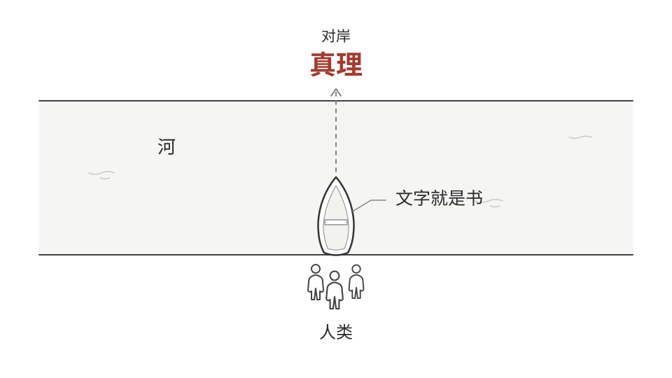</a> <b>1 · 渡河之喻</b> P03 · 渡河之喻里，河、船、对岸各代表什么？</td>
<td align="center" valign="top" width="25%"><a href="康奈尔笔记/P05/P05-康奈尔笔记.md">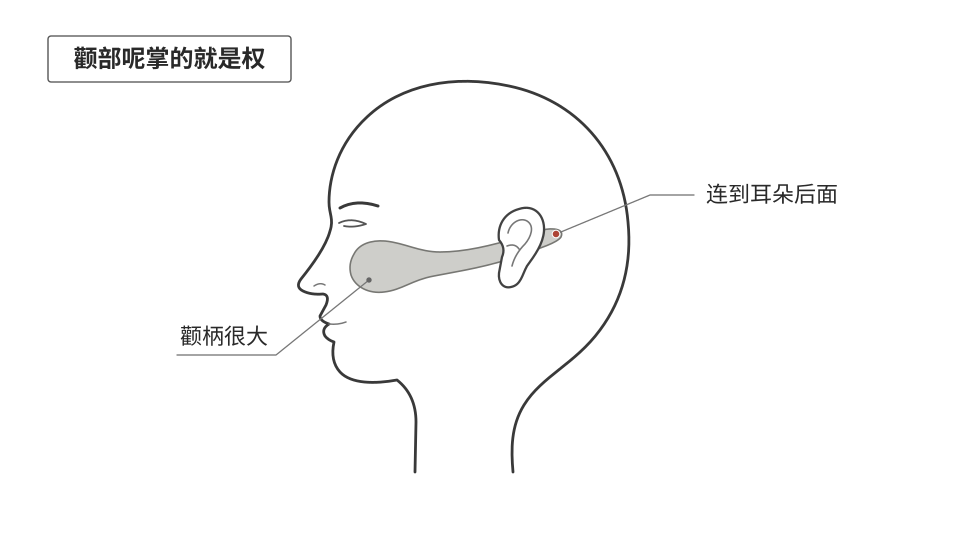</a> <b>2 · 颧部</b> P05 · 权在脸上第一个看哪里？颧要长成什么样？</td>
<td align="center" valign="top" width="25%"> <b>3 · 晚子时和早子时</b> P07 · 晚子时和早子时怎么分？日子什么时候换？</td>
<td align="center" valign="top" width="25%"><a href="康奈尔笔记/P09/P09-康奈尔笔记.md">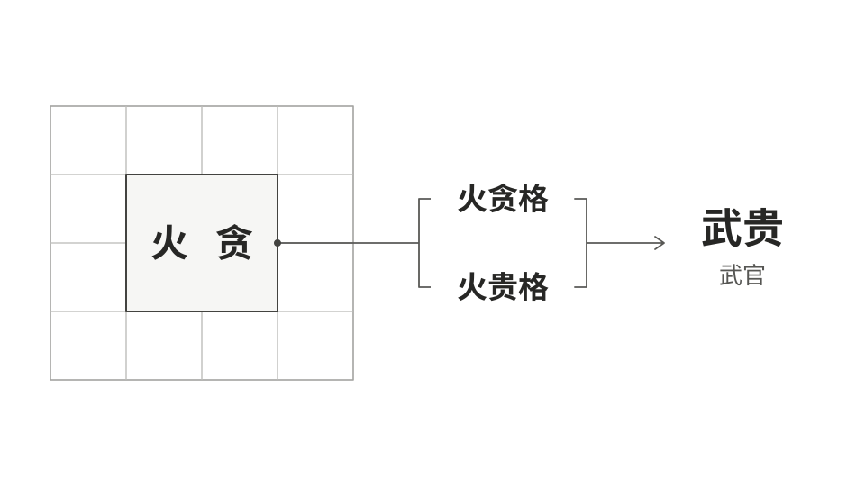</a> <b>4 · 火贪格与火贵格</b> P09 · 什么叫火贪格、火贵格？主什么？</td>
</tr>
<tr>
<td align="center" valign="top" width="25%"><a href="康奈尔笔记/P11/P11-康奈尔笔记.md">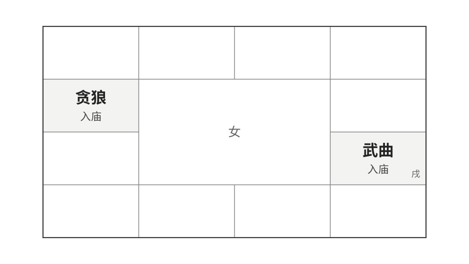</a> <b>5 · 武贪入庙</b> P11 · 本盘武曲、贪狼在哪里，是庙是陷？</td>
<td align="center" valign="top" width="25%"> <b>6 · 明珠出海格</b> P13 · 什么是明珠出海格？要不要有主星？</td>
<td align="center" valign="top" width="25%"><a href="康奈尔笔记/P15/P15-康奈尔笔记.md">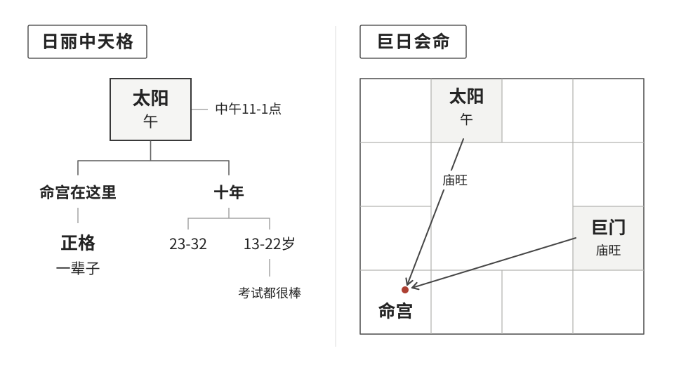</a> <b>7 · 日丽中天与巨日会命</b> P15 · 紫微在酉时太阳在哪？为什么叫日丽中天？</td>
<td align="center" valign="top" width="25%"><a href="康奈尔笔记/P17/P17-康奈尔笔记.md">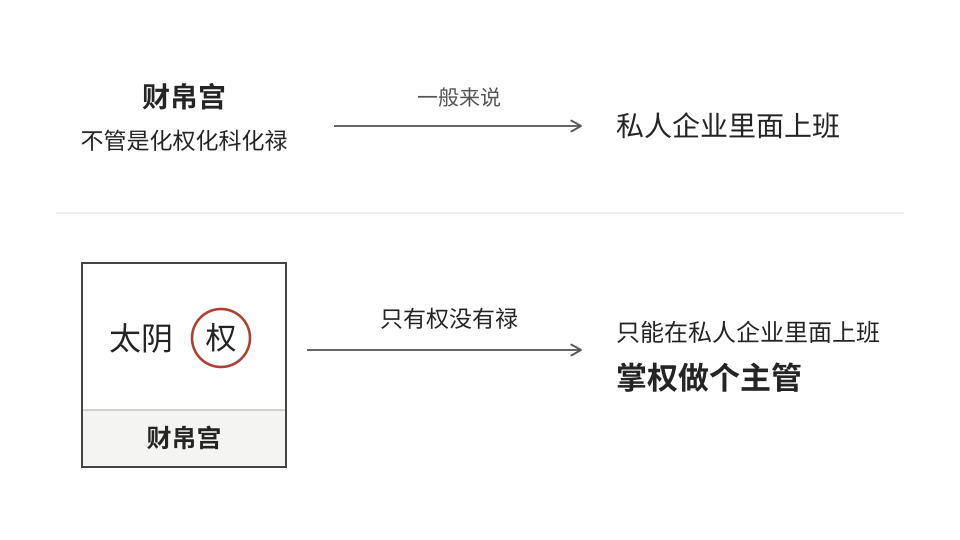</a> <b>8 · 化权在财帛宫</b> P17 · 化权在财帛宫，这种人做什么工作？</td>
</tr>
<tr>
<td align="center" valign="top" width="25%"> <b>9 · 英星入庙与太阴化禄</b> P19 · 英星入庙对男命、女命各主什么？</td>
<td align="center" valign="top" width="25%"><a href="康奈尔笔记/P21/P21-康奈尔笔记.md">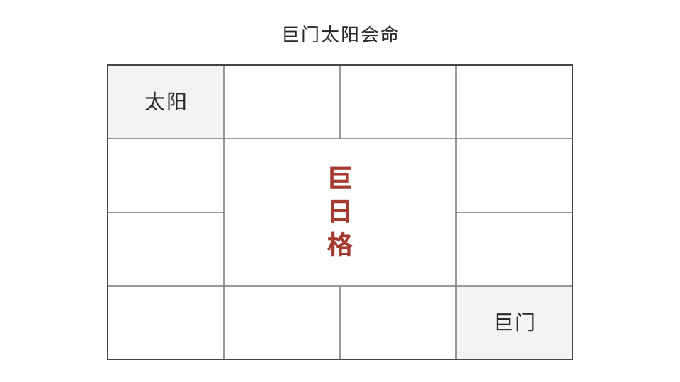</a> <b>10 · 巨门太阳会命</b> P21 · 例二换了哪张盘？倪师把它叫什么格？</td>
<td align="center" valign="top" width="25%"><a href="康奈尔笔记/P23/P23-康奈尔笔记.md">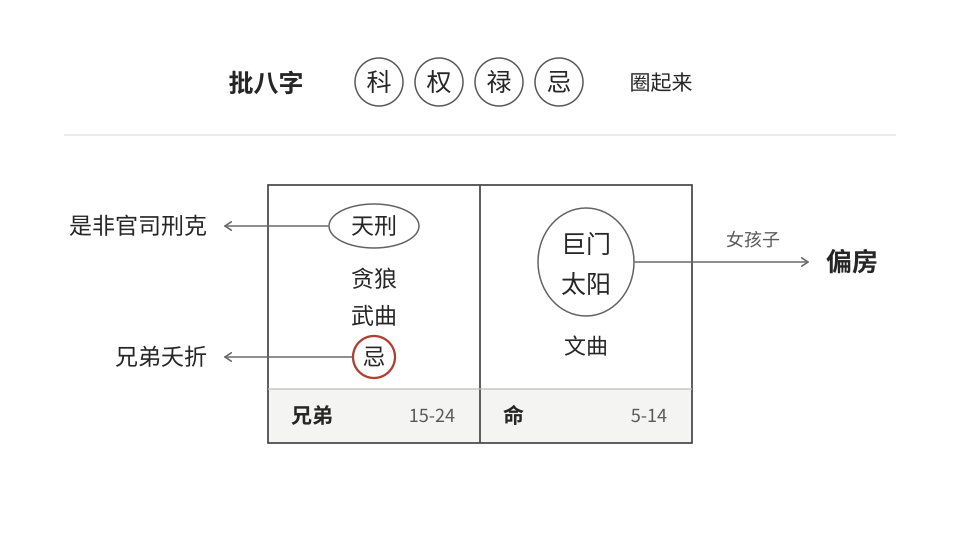</a> <b>11 · 科权禄忌</b> P23 · 批八字时为什么先把科权禄忌圈起来？</td>
<td align="center" valign="top" width="25%"><a href="康奈尔笔记/P25/P25-康奈尔笔记.md">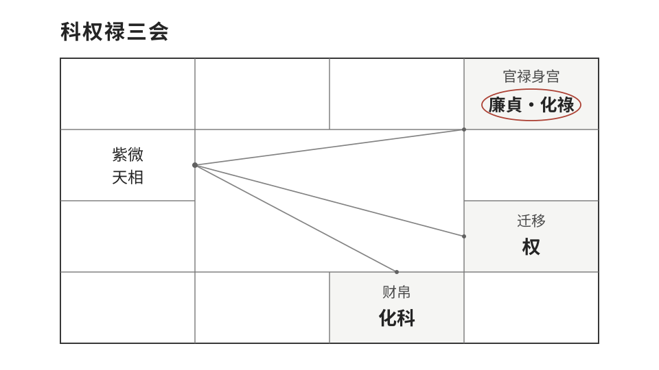</a> <b>12 · 科权禄三会</b> P25 · 什么叫科权禄三会？本例化科、化权、化禄各在哪宫？</td>
</tr>
<tr>
<td align="center" valign="top" width="25%"><a href="康奈尔笔记/P27/P27-康奈尔笔记.md">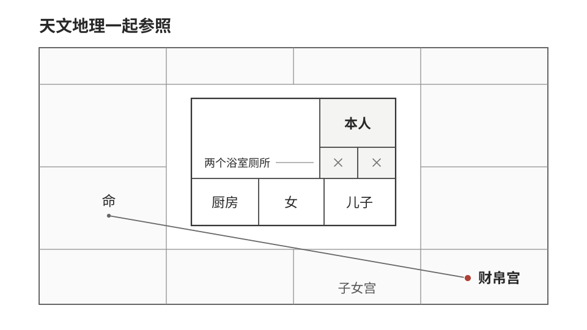</a> <b>13 · 天文地理一起参照</b> P27 · 例三的阳宅图怎么画，怎么跟命盘一起看？</td>
<td align="center" valign="top" width="25%"> <b>14 · 手相入后天八卦</b> P29 · 看手相要放进哪一套八卦？</td>
<td align="center" valign="top" width="25%"><a href="康奈尔笔记/P37/P37-康奈尔笔记.md">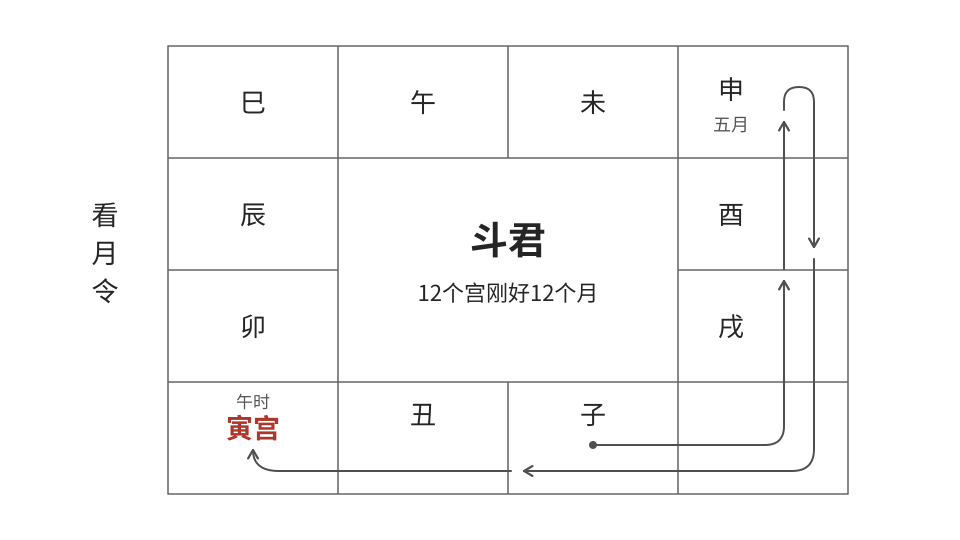</a> <b>15 · 斗君看月令</b> P37 · 斗君是什么？从哪一宫起？为什么能管十二个月？</td>
<td align="center" valign="top" width="25%"><a href="康奈尔笔记/P48/P48-康奈尔笔记.md">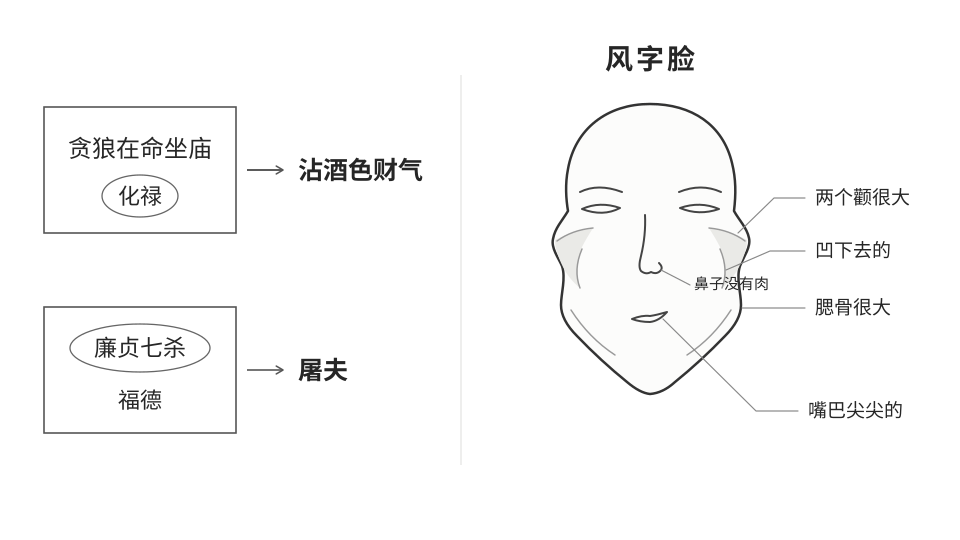</a> <b>16 · 贪狼化禄与风字脸</b> P48 · 贪狼在命坐庙，又刚好化禄，主什么？</td>
</tr>
</table>

<b>展开 16 个案例的倪师原话</b>

**1 · 渡河之喻**：渡河之喻里，河、船、对岸各代表什么？（P03 00:01:05）

> 〔口述〕介绍之前，「开宗明义我要先跟诸位讲个观念」：「首先这是一条河诸位用想的哈」，河上有一艘船停在这里。  
> 〔口述〕船的名字「叫做文字就是书」；全世界的人类都站在这边，「我们人要过河要到对岸」，对岸「它的名字叫做真理」。

[看 P03 图文全文 →](康奈尔笔记/P03/P03-康奈尔笔记.md)

**2 · 颧部**：权在脸上第一个看哪里？颧要长成什么样？（P05 00:07:51）

> 〔口述〕有权的人可以从脸上看出来，第一处是颧部：「这个颧柄很大」「这个颧啊要连到后面」「要像那个烟斗一样到后面去」「连到耳朵后面」，在脸相上「叫做颧部」，「颧部呢掌的就是权」「这是第一个」。

[看 P05 图文全文 →](康奈尔笔记/P05/P05-康奈尔笔记.md)

**3 · 晚子时和早子时**：晚子时和早子时怎么分？日子什么时候换？（P07 00:30:43）

> 〔口述〕「如果你刚好是12点11点到12点」「这一段时间生的」，「这一段叫做晚子」；「晚子时这个是根据前一天来的」，「就是这前面这一天呢最晚的时间」，「最晚的子时叫晚子时」。  
> 〔口述〕「过了12点以后」这一段时间「叫做早子时」，「所以后面呢要日子要换」，「12点换第二天的」。

[看 P07 图文全文 →](康奈尔笔记/P07/P07-康奈尔笔记.md)

**4 · 火贪格与火贵格**：什么叫火贪格、火贵格？主什么？（P09 00:03:53）

> 〔口述〕「所以你们看书上有一句话」，叫做火贪格；「火贪相聚的话我们叫做火贵」，「火贵格」。  
> 〔口述〕为什么叫火贵格？「这就是出武贵」，「武贵武官」。

[看 P09 图文全文 →](康奈尔笔记/P09/P09-康奈尔笔记.md)

**5 · 武贪入庙**：本盘武曲、贪狼在哪里，是庙是陷？（P11 00:50:59）

> 〔口述〕「还有一个」，「武曲星在这边」，「诸位看武曲在这边入庙」；「贪狼啊也是入庙」，贪狼隔壁一个宫也是庙旺，「完全不一样」。

[看 P11 图文全文 →](康奈尔笔记/P11/P11-康奈尔笔记.md)

**6 · 明珠出海格**：什么是明珠出海格？要不要有主星？（P13 00:40:28）

> 〔口述〕「那你有一天不小心刚好命……在这里」「三方四正会到」「左边是月朗天门」「右边是日照雷门」，命在这一格时「不管你有没有星」「我们就叫做明珠出海格」。

[看 P13 图文全文 →](康奈尔笔记/P13/P13-康奈尔笔记.md)

**7 · 日丽中天与巨日会命**：紫微在酉时太阳在哪？为什么叫日丽中天？（P15 00:01:03）

> 〔口述〕接着讲紫微在酉：紫微在这里时，太阳一定在午。「紫微在这个地方的时候」「第一个太阳一定在这里」……「这叫太阳在午宫」。  
> 〔口述〕午是中午 11 点到 1 点，是太阳最当头的时候：「午是中午11-1点」「那中午的时间呢」「是太阳最当头的时候」「刚刚好叫做德桓」「就是说」「太阳出的最好的时机」。  
> 〔口述〕只管这一个宫就有一个格：「所以这个有个格」「我们就是光管这个宫」「它就有个格叫做日丽中天」；又说「太阳正午的时候最热最高」「这是一个这个这个范围」「我们叫做日丽中天格」。

[看 P15 图文全文 →](康奈尔笔记/P15/P15-康奈尔笔记.md)

**8 · 化权在财帛宫**：化权在财帛宫，这种人做什么工作？（P17 00:45:07）

> 〔口述〕倪师说「你看他这个化权在财帛宫」。  
> 〔口述〕规则：财帛宫「不管是化权化科化禄」，「一般来说他都会在私人企业里面」，在私人公司、私人企业上班。  
> 〔口述〕本例「因为他的命里面只有权没有禄」，「所以他只能在私人企业里面上班」，「掌权做个主管」。

[看 P17 图文全文 →](康奈尔笔记/P17/P17-康奈尔笔记.md)

**9 · 英星入庙与太阴化禄**：英星入庙对男命、女命各主什么？（P19 00:01:11）

> 〔口述〕英星入庙「那给男人最好」，男人的话「这个英星入庙发武官」，即「武官的军人警察法官外交官这种人」。  
> 〔口述〕女人拿到破军在午宫或子宫的英星入庙，「主的是会比较孤单」「还有呢比较孤僻」「个性上来说会非常的孤僻」。

[看 P19 图文全文 →](康奈尔笔记/P19/P19-康奈尔笔记.md)

**10 · 巨门太阳会命**：例二换了哪张盘？倪师把它叫什么格？（P21 00:12:38）

> 〔口述〕倪师给这个格起名：「这个八字就叫做什么巨日会命」「巨门太阳会命」「叫做巨日格」。

[看 P21 图文全文 →](康奈尔笔记/P21/P21-康奈尔笔记.md)

**11 · 科权禄忌**：批八字时为什么先把科权禄忌圈起来？（P23 00:14:01）

> 〔口述〕倪师让大家看这一格，说批八字时要先把四化圈出来：「我们批八字的时候……科权禄忌……所以我们要把她的这个……这个科权禄忌呢……给她圈起来」。

[看 P23 图文全文 →](康奈尔笔记/P23/P23-康奈尔笔记.md)

**12 · 科权禄三会**：什么叫科权禄三会？本例化科、化权、化禄各在哪宫？（P25 00:10:22）

> 〔口述〕倪师拿出新一张盘说：「这个八字的就叫做科权禄三会」，又说讲例子要拿极好的，「普通的都没什么」。  
> 〔口述〕本盘三化的位置：「化科在财帛」，权在迁移（字幕作「杈」），「化禄在官禄身宫」，「这叫科权禄」。

[看 P25 图文全文 →](康奈尔笔记/P25/P25-康奈尔笔记.md)

**13 · 天文地理一起参照**：例三的阳宅图怎么画，怎么跟命盘一起看？（P27 00:18:31）

> 〔口述〕倪师换看这张命，说要把阳宅一起参照：「诸位看这个命哦」「阳宅的部分呢」「我们天文地理一起参照」「东南西北」「她的地理位置呢」「一画出来的时候」。  
> 〔口述〕边画边讲宅图：「本人在这里」「……两个浴室厕所」「然后这里是厨房」「儿子住这边」；又说「八字拿到我们手上」「排出来是这样子」「然后她住的阳宅是这样子」「就天文和地理配在一起看」。

[看 P27 图文全文 →](康奈尔笔记/P27/P27-康奈尔笔记.md)

**14 · 手相入后天八卦**：看手相要放进哪一套八卦？（P29 00:34:14）

> 〔口述〕倪师转入手相：「诸位看这个手相」，要把手掌「放到」「文王的后天八卦里面」，并说「这是后天卦啊」「后天卦为用」「所以我们就用后天卦来看的」。

[看 P29 图文全文 →](康奈尔笔记/P29/P29-康奈尔笔记.md)

**15 · 斗君看月令**：斗君是什么？从哪一宫起？为什么能管十二个月？（P37 00:36:12）

> 〔口述〕倪师说前面没有介绍斗君，现在补上：「斗君呢都是起子在子宫起」，「所谓斗君呢就是看月令」。  
> 〔口述〕他说一个宫管一年（「像我们知道一个一个宫一个宫」「一年一年对不对」），而「一年不是12个月」，「12个宫刚好12个月」，所以斗君用来看月。

[看 P37 图文全文 →](康奈尔笔记/P37/P37-康奈尔笔记.md)

**16 · 贪狼化禄与风字脸**：贪狼在命坐庙，又刚好化禄，主什么？（P48 00:38:39）

> 〔口述〕「比如说贪狼贪狼在命」「在子子时啊」「刚好贪狼在命坐庙」；倪师说「那如果一颗星没有关系」，接着「那如果他刚好化禄呢」。  
> 〔口述〕贪狼在命坐庙又化禄，「就是赌财酒色财沾酒色财气的」。

[看 P48 图文全文 →](康奈尔笔记/P48/P48-康奈尔笔记.md)

## 五、数字总览

| 项 | 数字 |
|---|---|
| 视频 | 17 集，53,491 秒（约 14.9 小时），1,604,675 帧 |
| 逐帧层 | 133,731 窗（每窗 12 帧），全部跑满 |
| 指代层 | 2,805 道「这里 / 这个」指哪的题，逐题看原帧标完 |
| 电子叠图 | 1,726 个叠图状态、16.3 万字定稿，看不清 0.98% |
| 康奈尔笔记 | 1,734 个提示、6,413 条笔记；拿不准的 2,613 处单列「待核」 |
| 引用的倪师原话 | 14,825 段，其中 14,824 段在字幕里原字找到（剩 1 段只在语音里，已注明） |
| 公开摘要 | 17 集、344 条要点，每条带时间码 |
| 示意图 | 921 条板书分成 410 组，215 组是纯文字（圈字、划线、字间箭头）不画；画了 195 幅，193 幅核过放进笔记 |
| 重画命盘 | 26 张，逐格照视频叠图重画 |

## 六、怎么做

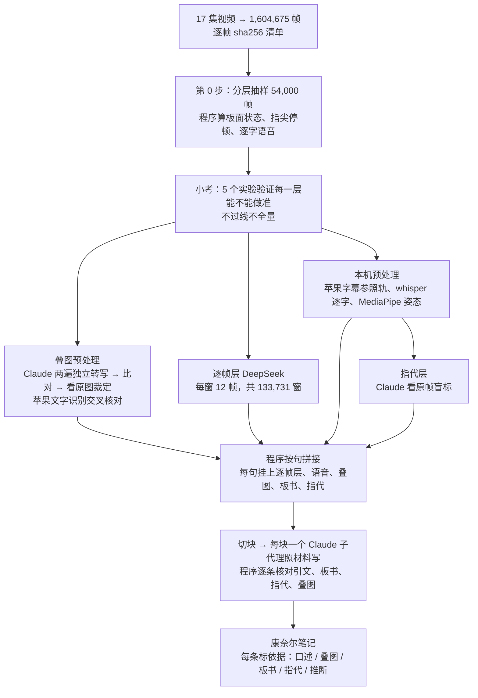

原方案里「字幕句层、板面层由 DeepSeek 和 Kimi 背对背各读一遍，Grok 投第三票」在试点后改掉了：句的时间轴和要挂的材料都已现成，改由程序拼接；指代层 Kimi 单独过不了线，改由 Claude 看原帧标。理由见工作记录 11-08、11-11。

几条铁规矩：
- **只依据视频本身**，不掺《紫微斗数全书》等外来材料；看不清就写「视频未显示」，不猜、不按紫微知识补字。
- **分清四层**：黑板手写（倪师）、后期电子命盘（剪辑加的，不算倪师的话）、烧录字幕、水印。
- **先考试再全量**：每一层都先用小样本考，门槛事先定好，不过线就改方案，**不降标准**。
- **公开误差**：认不出多少、剔除多少、裁定了多少，全部写明。

**示意图怎么画**：先把每集的板书按时间分组，纯文字的不画；有图的组由 Astra（gpt-6.2-astra）照讲课要讲明白的原理画成示意图，每个标注都要能在板书或同段字幕里找到原词；再由 Grok 4.7 对着原画面逐幅核，要改就改一稿再核，两轮还不过的不放进笔记（本轮 2 幅）。插进笔记后，程序核对：去掉插图，笔记正文和插图前逐字一致；图里没有位图、没有外链。

## 七、片源上限

有些信息视频本身就给不出，不是没做。全部写明：

| 项 | 数字 | 样本 |
|---|---|---|
| 「这里 / 这个」看不出指哪 | 出题的 2,805 道里 1,191 道（42.5%）看不出或拿不准；能确定的 1,614 道里，真在指 816 道（占全部 29.1%），口头用法 798 道（28.4%）。没出题的 64 处（手不在画面）也算进去，看不出的是 1,255 / 2,869（43.7%） | 全量：17 集全部题目的 Claude 盲标结果（小考 90 道题时是 42%） |
| 粉笔板书认不出 | 228 个字位里 146 个（64%） | 只有小考样本：30 个板书格。全量没有逐字转写板书，笔记只录看得清的 |
| 电子叠图（印刷字，最清楚）只占时长 | 53,491 秒里 15,586 秒（29.1%）；P03、P05、P07 没有叠图，P01、P37 几乎没有 | 全量：17 集每秒 1 帧打分 |

## 八、现状

| 步骤 | 状态 |
|---|---|
| 方案 + 两轮独立终审、小考 5 个实验 | ✅ |
| 电子叠图预处理与交叉核对 | ✅ 1,726 个叠图状态定稿 |
| 全量：本机预处理、指代层盲标、逐帧层 | ✅ 17 集全部跑满 |
| 康奈尔笔记 | ✅ 17 / 17 集，全文 11-20 公开 |
| 公开摘要 | ✅ 17 集、344 条要点（11-13 发布） |
| 命盘逐格重画 | ✅ 26 张，11-20 放进笔记 |
| 黑板示意图重画 | ✅ 193 幅，11-21 放进笔记；2 幅两轮没核过，暂不放（P11、P25 各 1 幅，都是阳宅图） |

详细经过、每个数字的出处见 [`docs/工作记录.md`](docs/工作记录.md)。

## 九、未来展望

1. **两幅没过的图**：人工对着原画面再核一遍，过了就补进笔记。
2. **拿笔记校排盘**：把笔记里倪师讲的排法、断法，逐条对照本仓的排盘引擎和我们的解读，有出入的改引擎。
3. **天纪、人纪接着做**：同一套「逐帧 → 笔记 → 示意图」的流程，接着用到天纪其他课和人纪（中医）。
4. **欢迎纠错**：发现笔记、图或数字有错，直接开 issue 或 PR，注明集号和时间码。

## 十、文件在哪

| 位置 | 内容 |
|---|---|
| `康奈尔笔记/` | 17 集康奈尔笔记全文：每条标依据，倪师原话照字幕原字引在「」里，可指回时间码和帧号 |
| `康奈尔笔记/Pxx/图/` | 那一集的示意图（`图NN.svg`）、重画命盘（`命盘-*.svg`，同名 json 是每格数据）、`图说明.json`（每幅图的标注和出处） |
| `summaries/` | 17 集公开摘要：每集要点 + 时间码（点开跳 B 站那一秒），倪师原话只引短句 |
| `docs/工作记录.md` | 按时间的全过程：做了什么、数字、弯路 |
| `docs/方案补充-v3-20261107.md`、`docs/Fable终审意见-20261107.md` | 方案与独立终审意见 |
| `docs/小考报告-20261108.md`、`docs/小考进展-20261108.md` | 五个实验的设计、成绩、结论 |
| `docs/标注说明-实验*.md`、`docs/任务说明-实验5-Grok裁决.md` | 标准答案怎么标、裁决怎么做 |
| `docs/叠图定稿说明.md` | 电子叠图两遍转写 + 裁定的做法、结果、局限 |
| `docs/康奈尔笔记模板.md` | 笔记格式 |
| `prompts/` | 逐帧层提示词 v1、v2（其余提示词写在各脚本里） |
| `scripts/第0步/` | 抽样、预处理、五个实验、逐帧层调度、指代出题与盲标、按句拼接、切块、校验渲染、进度页刷新 |
| `scripts/第0步/提示词/`、`scripts/第0步/康奈尔写手提示词.md` | 子代理提示词模板：指代盲标、分段读手、写手、选总结读手 |
| `scripts/图/` | 总览图的出图脚本 |
| `scripts/叠图/` | 叠图找状态、去重、转写、两遍比对、裁定、合成定稿、去重复查、苹果识别核对 |
| `scripts/vision_ocr/` | 调用苹果系统文字识别的命令行小工具（Swift） |
| `scripts/命例反推/` | 用叠图露出的宫位反推命例整盘（实验中） |
| `scripts/预检/` | 各家接口的 token 预检 |

**用到的模型和工具**：DeepSeek（deepseek-flash）、Kimi（kimi-k3.1-pro）、Grok 4.7（经 Cursor 命令行）、Claude（Opus 5.5 / Fable 5.1）、Astra（gpt-6.2-astra）、苹果系统文字识别（Vision）、MediaPipe、whisper.cpp（large-v3-turbo）、ffmpeg、OpenCV。Kimi 只用在小考和重测；Grok 在小考里当第三票，全量里用来核示意图和命盘；示意图和命盘由 Astra 画。各家接口的钥匙都从本机文件读取，不在仓库里；脚本里的路径按我们本机的目录写，复现时请改成自己的。

## 十一、版权、隐私与许可

- 视频画面和讲课内容的著作权属于原权利人；这里只放我们自己写的方法、代码、笔记、统计结果和重画的图。
- 不放视频截图和帧图片。示意图按讲课原理重画；命例的命盘按视频里贴出的那张盘逐格重画，宫名、宫干支、主星、辅星取逐帧核过的「据视频叠图重排」表，杂曜取同一格的叠图转写，每张都由 Astra 和 Grok 各自对着视频帧核过。
- 视频里的命例都是真人，我们不公开由命盘反推出的生辰。
- 这是对讲课内容的学习整理，不代表我们的判断，也不构成医疗、婚姻、投资等建议。
- 许可：代码 MIT（见 `LICENSE`），文档 CC BY 4.0，转载请注明出处；同主仓[第九章](../../README.md#九协议)。

## 十二、更新记录

**2026-11-21**：17 集黑板示意图重画完成，193 幅放进笔记（2 幅没核过暂不放）；首页改成图文版，加 16 个图文案例。**2026-11-20**：17 集康奈尔笔记全文公开；26 张命盘逐格重画放进笔记。

2026-11-12 那一轮

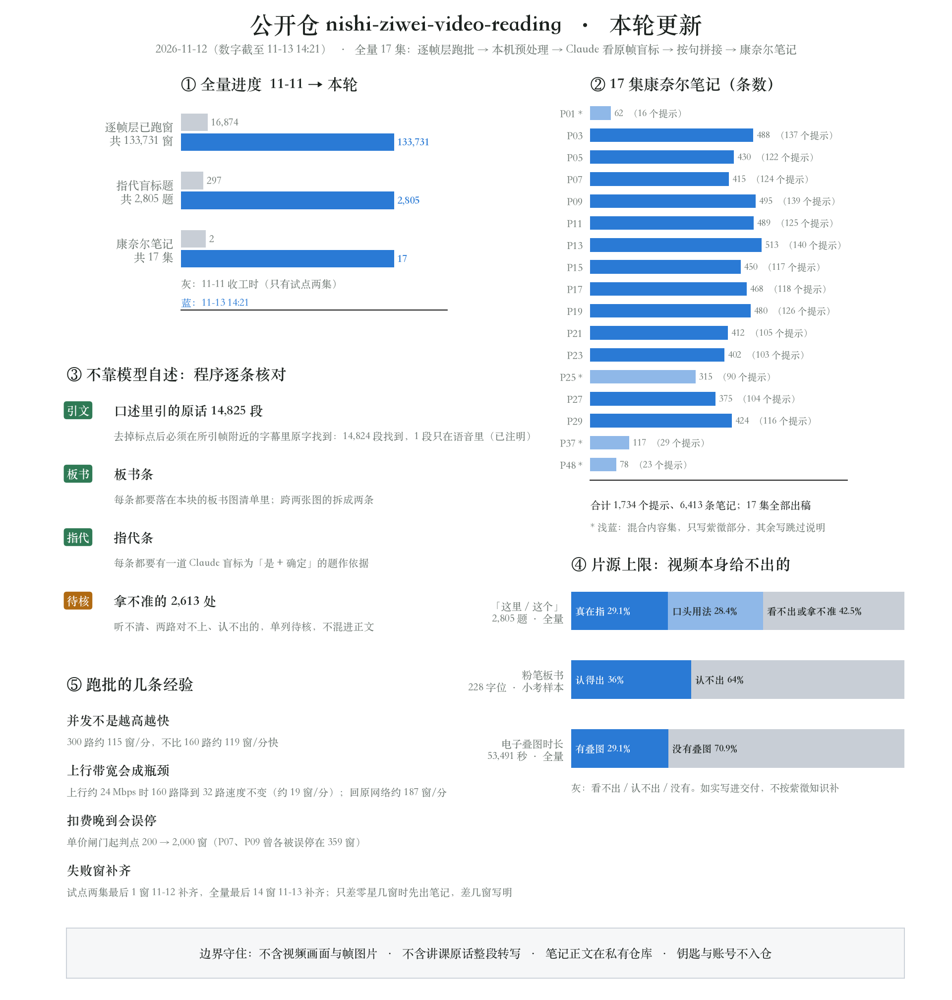

（数字截至 2026-11-13 14:21。）

1. **全量跑完**：17 集逐帧层（DeepSeek，每窗 12 帧）共 133,731 窗，11-13 13:48 全部跑满（5 集里零星反复失败的 14 个窗已补齐）。试点两集原先各剩的 1 个失败窗，11-12 已补齐。
2. **17 集康奈尔笔记出稿**：1,734 个提示、6,413 条笔记；〔口述〕里引的倪师原话 14,825 段，14,824 段在字幕里原字找到（剩 1 段只在语音里，已注明）；拿不准的 2,613 处单列「待核」，不混进正文。最后一集 P29 在逐帧层跑满后补写，11-13 14:20 出稿。笔记正文 11-20 起公开，见 [`康奈尔笔记/`](康奈尔笔记/)；公开摘要 17 集（344 条要点）11-13 已发布，见 [`summaries/`](summaries/README.md)。
3. **指代层改由 Claude 看原帧盲标**：17 集 2,805 道题全部标完。全量没有用 Kimi、Grok（这两家只在小考和重测里用过）。
4. **写明片源上限**：「这里 / 这个」约四成看不出指哪（全量 2,805 题里 42.5%）；粉笔板书六成多认不出（小考样本 228 个字位里 64%）；最清楚的电子叠图只占全片 29.1% 时长（全量）。见下方[「片源上限」](#片源上限)。
5. **跑批的几条经验**：并发不是越高越快（300 路不比 160 路快）；换到上行小的网络后，瓶颈在上传、降并发不减速；单价闸门要躲开上一集晚到的扣费。
6. **新增脚本与提示词**：全量调度、本机预处理（语音 / 字幕参照轨 / 姿态 / 出题）、盲标分批、进度页刷新，以及盲标、分段、选总结三份子代理提示词模板，都在 `scripts/第0步/`。

详细经过、每个数字的出处见 [`docs/工作记录.md`](docs/工作记录.md)。

2026-11-08 那一轮（第一次公开）

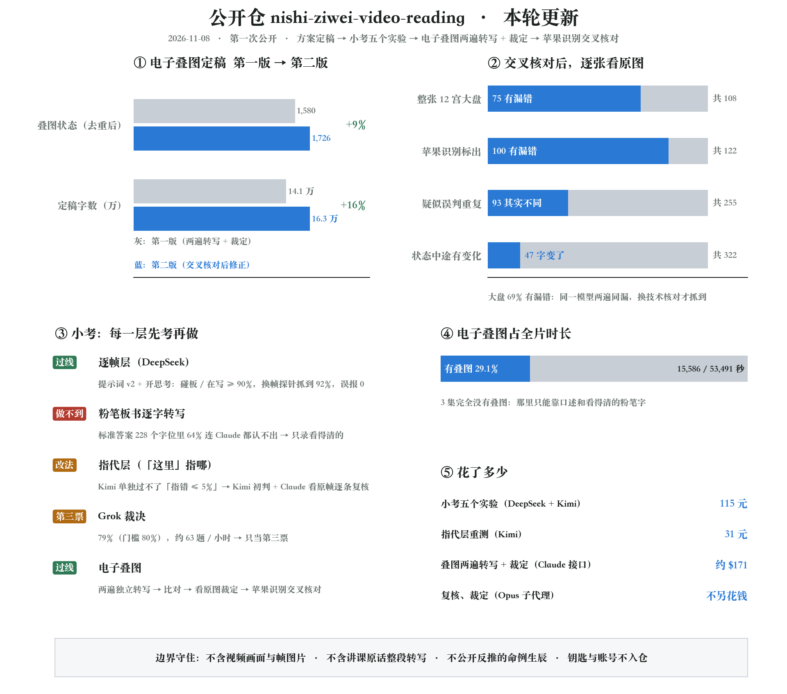

1. **第一次公开**：方案与两轮独立终审、全部脚本和提示词、小考五个实验的设计与成绩、走过的弯路，都在这里。
2. **小考结论**：逐帧层（DeepSeek）提示词改到 v2、开思考后过线；粉笔板书逐字转写做不到（标准答案 228 个字位里 64% 连 Claude 都认不出），改为只录看得清的；指代层 Kimi 单独过不了「指错 ≤ 5%」，改为 Kimi 初判 + Claude 看原帧逐条复核；Grok 裁决 79%，只当第三票。
3. **电子叠图定稿第二版**：Claude 两遍独立转写 → 逐格比对 → 看原图裁定，再用苹果系统文字识别交叉核对。交叉核对抓出了「两遍同漏」：整张 12 宫大盘 108 张里 75 张有漏错（69%），已逐格补全；去重时被误判为重复的 93 个状态（剪辑改宫名、大限来举例）已拆开单独定稿；322 个「持续期间画面有变化」的状态逐个看了起止帧，47 个确实中途改了字，拆出 53 段。现有 1,726 个叠图状态、16.3 万字，看不清的只占 0.98%。
4. **一条教训**：同一个模型做两遍再比对，挡不住它自己的系统性漏抄；换一种技术交叉核对，才抓得出来。之后每一层都照这个原则做。

详细经过、每个数字的出处见 [`docs/工作记录.md`](docs/工作记录.md)。

