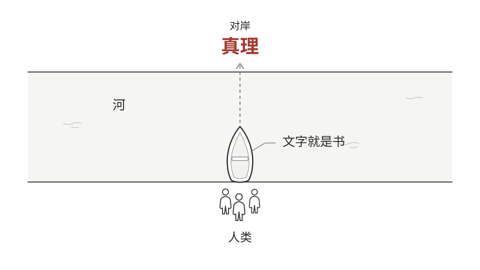
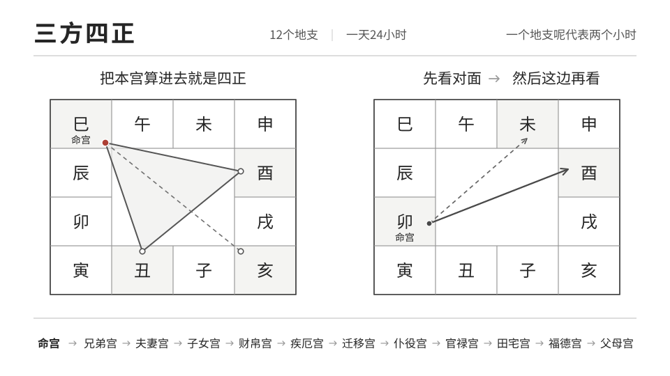
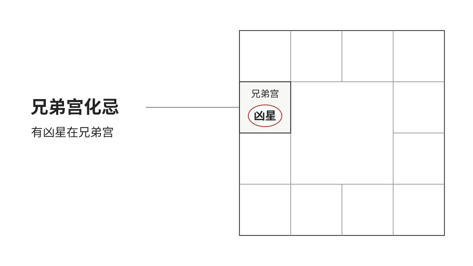
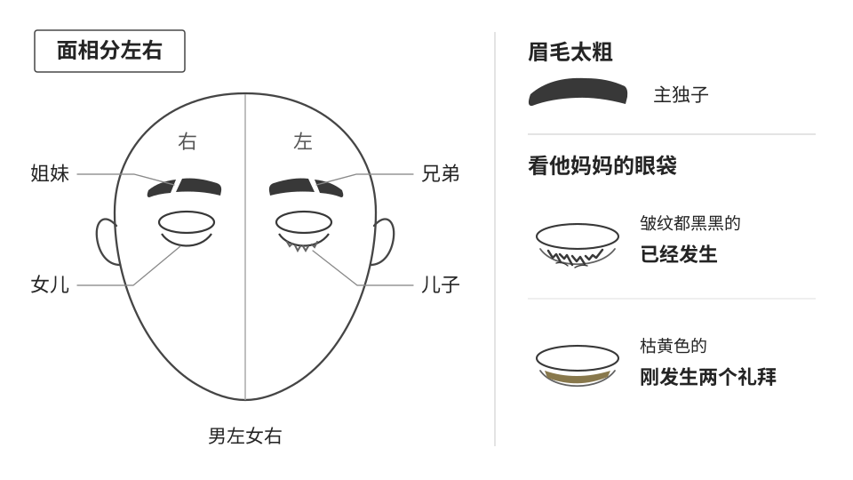
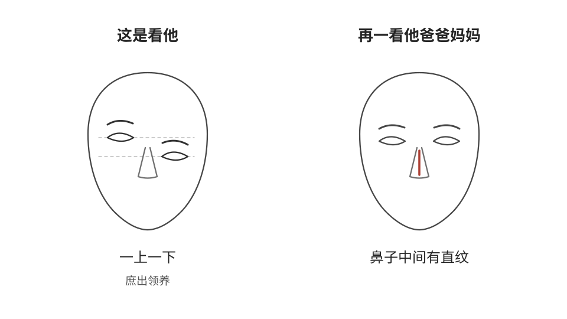
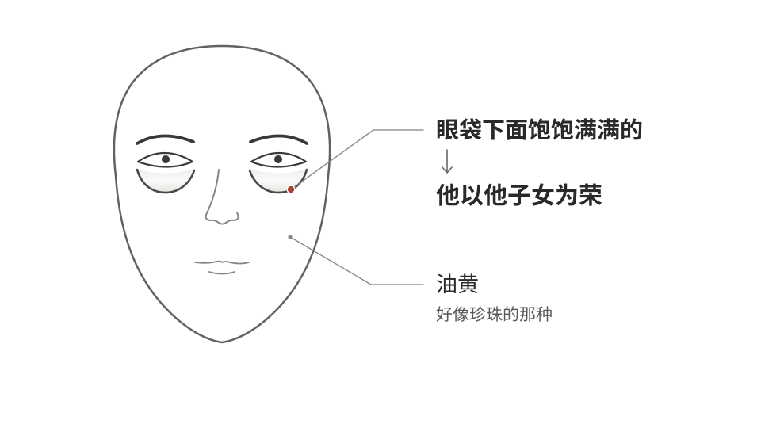
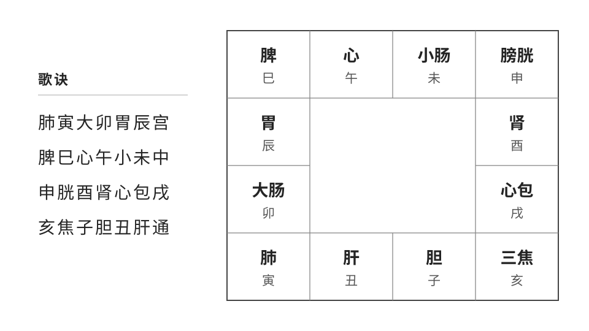
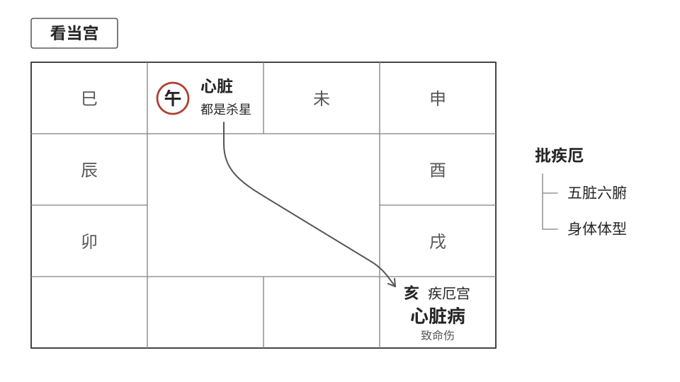
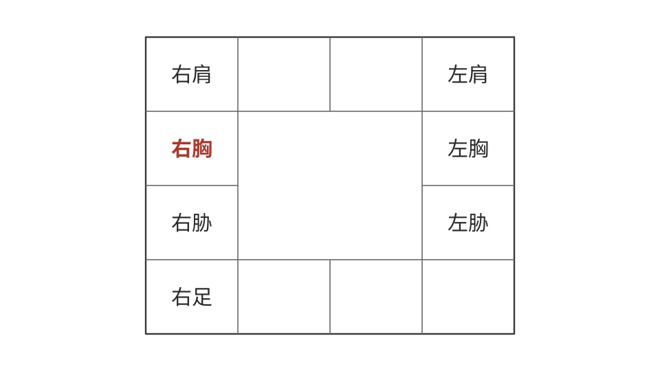
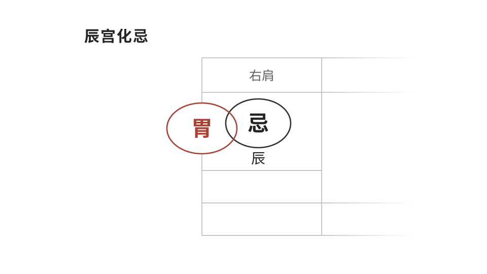

# P03 · 2 上：十二宫 / 经脉流注图（00:00:00–01:08:40，共 123,615 帧）

> 2026-11-12 整理。依据 DeepSeek 逐帧记录与现成的五层材料（字幕、语音、叠图、板书、指代），由 Claude（Opus 5.5 子代理）分段起草，引文由程序逐段对过字幕。流程 2026-11-11 经站长认可。
> 依据标记：〔口述〕字幕与语音两路对得上的话，「」里是字幕原字 ·〔叠图〕后期贴的电子命盘，**不算倪师的话** ·〔板书〕粉笔字（看过那一帧原图才写）·〔指代〕「这里 / 这个」指哪（只收核过、确定的）·〔推断〕笔记作者自己的推断。每条后面的时间码可以点，跳到 B 站那一秒。

## 全集总结

**通用规则**

- 天、人、地各占三分之一，算命看天；人事加地理占三分之二，自然大于天命（[00:08:27–00:09:30](https://www.bilibili.com/video/BV1KJsLekEfA/?p=3&t=507)，第 15234–17129 帧）
- 看命宫时一定要同时兼看财帛、官禄、迁移三个宫（[00:12:58–00:13:19](https://www.bilibili.com/video/BV1KJsLekEfA/?p=3&t=778)，第 23358–23999 帧）
- 宫有宫性：批流年不能只看那一年有哪些星，要看流年落在哪一宫；落财帛宫主今年主力在财帛，落迁移宫就代表驿马会动，不必等看到天马星（[00:19:31–00:20:23](https://www.bilibili.com/video/BV1KJsLekEfA/?p=3&t=1171)，第 35130–36713 帧）
- 斗数看命一定看三方四正：命宫对会出来的三个宫叫三方，把本宫算进去就是四正；命宫换位时先看对面，再看三方（[00:21:59–00:22:49](https://www.bilibili.com/video/BV1KJsLekEfA/?p=3&t=1319)，第 39588–41081 帧）
- 十二宫从命宫起依次为兄弟、夫妻、子女、财帛、疾厄、迁移、仆役、官禄、田宅、福德、父母；不管命宫在哪，顺序永远不变，只是整盘像轮轴皮带一样转动（[00:22:55–00:23:58](https://www.bilibili.com/video/BV1KJsLekEfA/?p=3&t=1375)，第 41256–43169 帧）
- 斗数批六亲本来就比较差，六亲部分要用相来辅助（[00:25:10–00:25:37](https://www.bilibili.com/video/BV1KJsLekEfA/?p=3&t=1510)，第 45324–46115 帧）
- 看婚姻不能光看夫妻宫，一定要同时看福德宫；很多人批紫微斗数不会批福德（[00:38:11–00:38:29](https://www.bilibili.com/video/BV1KJsLekEfA/?p=3&t=2291)，第 68742–69281 帧）
- 判病不必拘泥疾厄宫里的星，要看杀星集中在哪个地支宫，再按内经歌诀对到脏腑（[00:47:08–00:47:49](https://www.bilibili.com/video/BV1KJsLekEfA/?p=3&t=2828)，第 84858–86075 帧）
- 仆役宫太凶太差都是耗星，合伙必败；都是吉星贵星则合伙大吉，时机看流年财星来会，流年破财不要合伙（[00:57:44–00:58:30](https://www.bilibili.com/video/BV1KJsLekEfA/?p=3&t=3464)，第 103938–105323 帧）
- 紫微斗数田宅宫两个意义：祖业祖产多少、置产吉与不吉；田宅有官司是非的星的人不利置产（[01:06:57–01:08:02](https://www.bilibili.com/video/BV1KJsLekEfA/?p=3&t=4017)，第 120528–122465 帧）

**只在本例**

- 倪师的两个弟弟是同年同月同日同时生的双胞胎，一个结婚三年有两个孩子、一个至今未婚，职业一个医师一个厨师（[00:03:29–00:03:55](https://www.bilibili.com/video/BV1KJsLekEfA/?p=3&t=209)，第 6276–7067 帧）
- 丁肇中、李政道要到外地才能拿诺贝尔奖，回台湾大不了当大学教授（[00:13:30–00:13:41](https://www.bilibili.com/video/BV1KJsLekEfA/?p=3&t=810)，第 24306–24647 帧）
- 30 岁来问做生意的男子，额头日角突然变黑，倪师断他爸爸重病，劝他先化解父亲的灾，阳宅其次（[00:33:07–00:34:17](https://www.bilibili.com/video/BV1KJsLekEfA/?p=3&t=1987)，第 59610–61715 帧）
- 倪师曾批过一个夫妻宫很好、福德宫很烂的人，断夫妻要散（[00:38:58–00:39:06](https://www.bilibili.com/video/BV1KJsLekEfA/?p=3&t=2338)，第 70164–70385 帧）
- 举例某人疾厄宫在亥，但午宫非常凶、都是杀星，就在疾厄宫写心脏病为他的致命伤（[00:48:52–00:49:04](https://www.bilibili.com/video/BV1KJsLekEfA/?p=3&t=2932)，第 87960–88325 帧）
- 倪师的好朋友辰宫化忌，辰代表胃；37 年出生、73 年来算刚好 37 岁，流年命上显现是胃（[00:51:18–00:52:08](https://www.bilibili.com/video/BV1KJsLekEfA/?p=3&t=3078)，第 92346–93851 帧）
- 倪师对执意合伙的客户说开幕那天送花篮，写「必败」两字（[00:58:03–00:58:18](https://www.bilibili.com/video/BV1KJsLekEfA/?p=3&t=3483)，第 104496–104957 帧）

**不是排盘规则，是处世方法**

- 文字和书只是渡河的船，抱着书不等于拿到真理；学完不要还扛着船在马路上跑（[00:01:07–00:01:34](https://www.bilibili.com/video/BV1KJsLekEfA/?p=3&t=67)，第 2016–2825 帧、[00:02:08–00:02:18](https://www.bilibili.com/video/BV1KJsLekEfA/?p=3&t=128)，第 3852–4145 帧）
- 父母的想法不能强加给子女，要看出发展模式后鼓励、诱导他走最适合的路（[00:15:53–00:16:18](https://www.bilibili.com/video/BV1KJsLekEfA/?p=3&t=953)，第 28590–29345 帧）
- 看出庶出、领养等身世，父母想隐瞒的不要说破，有些话知道但不要讲（[00:35:11–00:35:28](https://www.bilibili.com/video/BV1KJsLekEfA/?p=3&t=2111)，第 63354–63851 帧）
- 批命时不要太直，心里知道就好，用诱导的方式讲（[00:39:06–00:39:36](https://www.bilibili.com/video/BV1KJsLekEfA/?p=3&t=2346)，第 70386–71291 帧）
- 算命要讲致命伤，说人会感冒、有两只脚这类话是废话（[00:45:16–00:45:30](https://www.bilibili.com/video/BV1KJsLekEfA/?p=3&t=2716)，第 81498–81905 帧）

## 目录

**开场：渡河之喻、各派算命比较、为何讲紫微与易经**

1. 渡河之喻与几种算命方法的比较（00:00:00–00:05:02）
2. 以果决行、子平之短与天人地三才（00:05:02–00:10:07）

**斗数入门：十二宫、命宫兼看三宫、宫性、三方四正**

3. 只教批、十二宫与命宫兼看三宫（00:10:07–00:17:34）
4. 宫性释义、十二宫排法与三方四正（00:17:34–00:25:03）

**兄弟宫：六亲总说、眉相与气色**

5. 兄弟宫：六亲、化忌与眉相气色（00:25:03–00:30:53）

**父母、夫妻（兼看福德）、子女、疾厄（经络时辰）**

6. 父母宫：庶出领养与日月角看父母（00:30:53–00:37:00）
7. 手相、福德宫看婚姻与子女数（00:37:00–00:43:17）
8. 眼袋看子女；疾厄宫与经脉时辰（00:43:17–00:49:40）
9. 人身分区、辰忌胃癌例与奸门看夫妻（00:49:41–00:55:38）

**仆役宫（命犯小人、观人术）、田宅宫**

10. 仆役宫、命犯小人与观人术（00:55:38–01:01:55）
11. 仆役宫观人识小人，田宅宫两意义（01:01:55–01:08:40）

## 开场：渡河之喻、各派算命比较、为何讲紫微与易经

### 1　渡河之喻与几种算命方法的比较（[00:00:00–00:05:02](https://www.bilibili.com/video/BV1KJsLekEfA/?p=3&t=0)，第 0–9071 帧）

| 提示区 | 笔记区 |
|---|---|
| **这堂课要讲什么？前后半段怎么安排？** | 〔口述〕倪师说上堂课只给了基本概念，「今天我们正式进入」介绍天文地理。（[00:00:03–00:00:13](https://www.bilibili.com/video/BV1KJsLekEfA/?p=3&t=3)，第 90–401 帧） 〔口述〕照过去的方法安排：「前半段我们介绍天文」，「下半段介绍易经八卦」。（[00:00:13–00:00:24](https://www.bilibili.com/video/BV1KJsLekEfA/?p=3&t=13)，第 402–737 帧） 〔口述〕先讲易经八卦的原因：「因为易经八卦我们用的地方非常多」，不只是算命，将来讲阳宅风水，「排八字都会用到易经八卦」。（[00:00:24–00:00:35](https://www.bilibili.com/video/BV1KJsLekEfA/?p=3&t=24)，第 738–1079 帧） |
| **渡河之喻里，河、船、对岸各代表什么？** | 〔口述〕介绍之前，「开宗明义我要先跟诸位讲个观念」：「首先这是一条河诸位用想的哈」，河上有一艘船停在这里。（[00:00:36–00:00:53](https://www.bilibili.com/video/BV1KJsLekEfA/?p=3&t=36)，第 1080–1595 帧） 〔口述〕船的名字「叫做文字就是书」；全世界的人类都站在这边，「我们人要过河要到对岸」，对岸「它的名字叫做真理」。（[00:00:53–00:01:07](https://www.bilibili.com/video/BV1KJsLekEfA/?p=3&t=53)，第 1596–2015 帧） 〔指代〕说「这河上面有一艘船停在这里」时，手指的是：粉笔点着黑板上两条横线之间画的椭圆形（船）。（[00:00:52](https://www.bilibili.com/video/BV1KJsLekEfA/?p=3&t=52)，第 1560 帧） 〔指代〕说「这个对岸呢」时，手指的是：上横线上方刚写下的字（对岸的位置）。（[00:01:02](https://www.bilibili.com/video/BV1KJsLekEfA/?p=3&t=62)，第 1860 帧） 〔板书〕可辨：两条平行横线，下横线上画一个椭圆，椭圆右侧一个草写字像「河」；上横线上方两个草字，第二字可辨「理」，第一字认不全；椭圆左侧可辨「文字」，再往左一个圈起来的字认不出；下横线下方可辨几个「人」字。其余认不出。（[00:01:05](https://www.bilibili.com/video/BV1KJsLekEfA/?p=3&t=65)，第 1968 帧）  |
| **为什么说很多人「以为拿到真理」，其实还在船上？** | 〔口述〕「现在世界上十之八九的人上了船以后」，就以为拿到真理了。（[00:01:07–00:01:12](https://www.bilibili.com/video/BV1KJsLekEfA/?p=3&t=67)，第 2016–2171 帧） 〔口述〕「所以马路上很多人抱着书」，看易经的、看书的人很多，「各种流派的注解都有」，「结果就以为拿到真理」，「实际上呢还是在船上面」。（[00:01:12–00:01:25](https://www.bilibili.com/video/BV1KJsLekEfA/?p=3&t=72)，第 2172–2567 帧） 〔板书〕这一段只补写了几笔，新写的部分被手挡住，认不出。板面其余与前一张相同。（[00:01:12](https://www.bilibili.com/video/BV1KJsLekEfA/?p=3&t=72)，第 2184 帧） |
| **文字和书在学习里是什么地位？真理又是什么？** | 〔口述〕所以文字和书，倪师说「文字只是协助诸位达到这个部分」。前一句两路识别对不上，见待核。（[00:01:25–00:01:34](https://www.bilibili.com/video/BV1KJsLekEfA/?p=3&t=85)，第 2568–2825 帧） 〔口述〕「所以真理就是我们宗教家讲的神」，「我们完全在用神」。（[00:01:34–00:01:39](https://www.bilibili.com/video/BV1KJsLekEfA/?p=3&t=94)，第 2826–2987 帧） 〔板书〕可辨：右上方「神」「用」两字；板面其余大半被倪师身体挡住，认不出。（[00:01:41](https://www.bilibili.com/video/BV1KJsLekEfA/?p=3&t=101)，第 3033 帧） |
| **听课时该怎么学？什么叫「学而后思」？** | 〔口述〕听课时「各位不要把书上有的东西来问我」，不要问老师书上是怎么写的，「诸位不要去」「问这些问题」。（[00:01:39–00:01:49](https://www.bilibili.com/video/BV1KJsLekEfA/?p=3&t=99)，第 2988–3275 帧） 〔口述〕通通学完以后再说：「学而后思」，「学了以后再去思考」「才是对的」。（[00:01:49–00:01:56](https://www.bilibili.com/video/BV1KJsLekEfA/?p=3&t=109)，第 3276–3509 帧） 〔口述〕还没学就去思考，「这叫做胡思乱想」，「胡思乱想就会浪费很多时间」去想不必要的东西；人类常常「浪费很多时间去做不必要的事情」。（[00:01:57–00:02:08](https://www.bilibili.com/video/BV1KJsLekEfA/?p=3&t=117)，第 3510–3851 帧） 〔板书〕可辨：「神用」下方新写一行，前三字可辨「学」「而」「后」，第四字被圈起、又被头挡住，认不出；行尾有一道斜线。左侧椭圆旁原来的字被涂改过，认不出。（[00:01:57](https://www.bilibili.com/video/BV1KJsLekEfA/?p=3&t=117)，第 3528 帧） |
| **「扛着船在马路上跑」是在提醒什么？** | 〔口述〕「所以诸位一个观念要先修正」：千万不要「三个月出去以后怎么还是扛着」——「扛着船在马路上跑」。（[00:02:08–00:02:18](https://www.bilibili.com/video/BV1KJsLekEfA/?p=3&t=128)，第 3852–4145 帧） 〔推断〕推断：前文把船叫做「文字就是书」，所以「扛着船在马路上跑」是接着渡河之喻说的，指学完了还抱着书本文字不放、没有到对岸；「三个月」指什么本块没说。（[00:00:53–00:02:18](https://www.bilibili.com/video/BV1KJsLekEfA/?p=3&t=53)，第 1596–4145 帧） |
| **中国的算命方法有哪几种？** | 〔口述〕中国的算命方法「有非常多种」：「一种是铁板神数」。（[00:02:18–00:02:30](https://www.bilibili.com/video/BV1KJsLekEfA/?p=3&t=138)，第 4146–4517 帧） 〔口述〕「一种是子平法」，「就是徐子平啊」，倪师说这个人著书出来。（[00:02:30–00:02:40](https://www.bilibili.com/video/BV1KJsLekEfA/?p=3&t=150)，第 4518–4811 帧） 〔口述〕「还有呢叫做紫微斗数」，「那还有这西洋的那个星相学」，「看相啊一大堆等等等」。（[00:02:40–00:02:57](https://www.bilibili.com/video/BV1KJsLekEfA/?p=3&t=160)，第 4812–5315 帧） 〔板书〕黑板擦过后写了三竖列草字。可辨：左列第三字「神」，中列第二字「平」，右列第二字「微」；中列底部一字被圈起来。其余认不出。（[00:02:52](https://www.bilibili.com/video/BV1KJsLekEfA/?p=3&t=172)，第 5168 帧） 〔板书〕与上一张相同，只是中列底部那个圈起来的字下方多了一道弧线。（[00:02:54](https://www.bilibili.com/video/BV1KJsLekEfA/?p=3&t=174)，第 5220 帧） |
| **目前哪一种能把天文和地理融合起来看？** | 〔口述〕在我们这里，「能够目前能够把天文」「和地理」「这两个融合在一起看的」，「只有这个可以做到」，另外「这两个」「没有办法做到」。（[00:02:57–00:03:14](https://www.bilibili.com/video/BV1KJsLekEfA/?p=3&t=177)，第 5316–5825 帧） 〔指代〕说「只有这个可以做到」时，手指的是：手掌按在板上最右一竖列文字的底部，随即沿这一列画大椭圆把它圈起来。（[00:03:08](https://www.bilibili.com/video/BV1KJsLekEfA/?p=3&t=188)，第 5640 帧） 〔板书〕可辨：左侧新写「天」「地」两字（各带一个草字），中间画一个「>」形符号；左列和中列顶上各打一个「×」，最右一列被大椭圆圈起来。其余草字认不出。（[00:03:11](https://www.bilibili.com/video/BV1KJsLekEfA/?p=3&t=191)，第 5742 帧） 〔推断〕推断：倪师先前按「铁板神数、子平法、紫微斗数」的顺序从左到右写了三列，被圈起的最右一列就是写紫微斗数的那一列，所以「只有这个」指紫微斗数，打叉的两列是铁板神数和子平法。（[00:02:18–00:03:14](https://www.bilibili.com/video/BV1KJsLekEfA/?p=3&t=138)，第 4146–5825 帧） |
| **铁板神数好用在哪？拿来算命为什么有误差？** | 〔口述〕铁板神数，「如果你用它你去核对六亲」，「核对六亲的时候很好」。（[00:03:14–00:03:21](https://www.bilibili.com/video/BV1KJsLekEfA/?p=3&t=194)，第 5826–6059 帧） 〔口述〕「但是你如果拿来算命的话」，「第一个会有很大的误差」，「为什么因为跟你同时间生的人很多」。（[00:03:22–00:03:29](https://www.bilibili.com/video/BV1KJsLekEfA/?p=3&t=202)，第 6060–6275 帧） 〔板书〕左边写铁板神数那一列的下方又添了几个草字，认不出；左侧「天」「地」两字被身体挡住。（[00:03:19](https://www.bilibili.com/video/BV1KJsLekEfA/?p=3&t=199)，第 5978 帧） |
| **倪师的双胞胎弟弟说明了什么？** | 〔口述〕「我两个弟弟是双胞胎」，「同年同月同日同时生」，父母、兄弟姐妹这些属性当然一样。可是「一个弟弟结婚三年」「然后孩子两个」，「一个弟弟到现在还没结婚我亲弟弟」，「这第一个疑问」。（[00:03:29–00:03:45](https://www.bilibili.com/video/BV1KJsLekEfA/?p=3&t=209)，第 6276–6755 帧） 〔口述〕「我讲过有例外就不叫做理论」。（[00:03:45–00:03:50](https://www.bilibili.com/video/BV1KJsLekEfA/?p=3&t=225)，第 6756–6911 帧） 〔口述〕「还有我弟的职业一个是医师」，「一个是厨师」，「差那么多」。（[00:03:50–00:03:55](https://www.bilibili.com/video/BV1KJsLekEfA/?p=3&t=230)，第 6912–7067 帧） 〔口述〕「所以它只是核对六亲可以」：如果「你是不是怀疑你是领养的」，「找他们核核可以」。（[00:03:55–00:04:05](https://www.bilibili.com/video/BV1KJsLekEfA/?p=3&t=235)，第 7068–7361 帧） 〔板书〕可辨：左边写铁板神数那一列上部多出一道长斜笔，列中「数」字被圈起来；下方草字认不出。（[00:03:48](https://www.bilibili.com/video/BV1KJsLekEfA/?p=3&t=228)，第 6863 帧） |
| **子平法过去怎么用？四柱和「根苗花果」是什么？** | 〔口述〕子平法「过去沿用了很多年」，「大家一直在用渊海子平啊」、「三命通会在那边算」。（[00:04:05–00:04:11](https://www.bilibili.com/video/BV1KJsLekEfA/?p=3&t=245)，第 7362–7559 帧） 〔口述〕「诸位要有个观念」：子平法「它有年月日时」，「年有年柱」「月有月柱」「日有日柱」「时有时柱」，「那叫根苗花果啊」。（[00:04:12–00:04:32](https://www.bilibili.com/video/BV1KJsLekEfA/?p=3&t=252)，第 7560–8177 帧） 〔板书〕可辨：黑板右侧新写的竖排字里有两个「柱」字；右上一字草写认不全，其余被身体挡住。左边被圈的一列还在。（[00:04:25](https://www.bilibili.com/video/BV1KJsLekEfA/?p=3&t=265)，第 7956 帧） 〔板书〕可辨：右上「时」「柱」；左边一列第二字「柱」，第一字草写认不全；中间一格被圈起来，大半被身体挡住，认不出。（[00:04:33](https://www.bilibili.com/video/BV1KJsLekEfA/?p=3&t=273)，第 8217 帧） |
| **子平法以哪一柱为标杆？研究久了会改用哪一柱？紫微斗数呢？** | 〔口述〕「一般所有的子平法开始算的时候」，「它以日柱做标的标杆来算」。（[00:04:32–00:04:37](https://www.bilibili.com/video/BV1KJsLekEfA/?p=3&t=272)，第 8178–8339 帧） 〔口述〕「可是你如果子平法研究到十几年」「二十年以上以后」，「你到头来你会以年柱来开始批」，「他就用年柱开始批会比较准」。（[00:04:38–00:04:46](https://www.bilibili.com/video/BV1KJsLekEfA/?p=3&t=278)，第 8340–8603 帧） 〔口述〕「紫微斗数呢一开始就是年柱」。（[00:04:46–00:04:52](https://www.bilibili.com/video/BV1KJsLekEfA/?p=3&t=286)，第 8604–8765 帧） 〔口述〕接着打一个比喻：「我常常形容如果我们研究子平法」，「就好像研究计算机的结构内容」，「你学电脑我不教你电脑如何用」。比喻在本块还没讲完。（[00:04:52–00:05:02](https://www.bilibili.com/video/BV1KJsLekEfA/?p=3&t=292)，第 8766–9071 帧） |

**总结区**

- 通用规则：铁板神数只适合核对六亲，拿来算命会有很大误差，因为同时间生的人很多（[00:03:14–00:03:29](https://www.bilibili.com/video/BV1KJsLekEfA/?p=3&t=194)，第 5826–6275 帧、[00:03:55–00:03:58](https://www.bilibili.com/video/BV1KJsLekEfA/?p=3&t=235)，第 7068–7169 帧）；有例外就不叫做理论（[00:03:45–00:03:50](https://www.bilibili.com/video/BV1KJsLekEfA/?p=3&t=225)，第 6756–6911 帧）；子平法一般以日柱为标杆起算，研究十几二十年后会改以年柱开始批、比较准；紫微斗数一开始就是年柱（[00:04:32–00:04:52](https://www.bilibili.com/video/BV1KJsLekEfA/?p=3&t=272)，第 8178–8765 帧）；目前能把天文和地理融合在一起看的只有一种，按板书推断为紫微斗数，另外两种做不到（[00:02:59–00:03:14](https://www.bilibili.com/video/BV1KJsLekEfA/?p=3&t=179)，第 5376–5825 帧）
- 只在本例：倪师的两个弟弟是同年同月同日同时生的双胞胎，一个结婚三年有两个孩子、一个至今未婚，职业一个医师一个厨师（[00:03:29–00:03:55](https://www.bilibili.com/video/BV1KJsLekEfA/?p=3&t=209)，第 6276–7067 帧）
- 不是排盘规则，是处世方法：学而后思：学完了再去思考才对，没学就思考是胡思乱想、浪费时间（[00:01:49–00:02:08](https://www.bilibili.com/video/BV1KJsLekEfA/?p=3&t=109)，第 3276–3851 帧）；听课时不要拿书上有的东西来问老师（[00:01:39–00:01:49](https://www.bilibili.com/video/BV1KJsLekEfA/?p=3&t=99)，第 2988–3275 帧）；文字和书只是渡河的船，抱着书不等于拿到真理；学完不要还扛着船在马路上跑（[00:01:07–00:01:34](https://www.bilibili.com/video/BV1KJsLekEfA/?p=3&t=67)，第 2016–2825 帧、[00:02:08–00:02:18](https://www.bilibili.com/video/BV1KJsLekEfA/?p=3&t=128)，第 3852–4145 帧）

**待核**

1. [00:01:10](https://www.bilibili.com/video/BV1KJsLekEfA/?p=3&t=70)，第 2112 帧：字幕「就以沩拿到真理」，「沩」按上下文应为「为」，语音作「唯一拿到真理」；转述里写作「以为」，引文改用[00:01:21](https://www.bilibili.com/video/BV1KJsLekEfA/?p=3&t=81)，第 2430 帧的「结果就以为拿到真理」
2. [00:01:27](https://www.bilibili.com/video/BV1KJsLekEfA/?p=3&t=87)，第 2616 帧：字幕「我们在这里不强调我们有立著述没错」，语音「都很强调我们有利注数没错」，「不强调」与「很强调」两路相反，「立著述」也拿不准，原话待核，笔记未引
3. [00:01:33](https://www.bilibili.com/video/BV1KJsLekEfA/?p=3&t=93)，第 2799 帧：说「文字只是协助诸位达到这个部分」时「这个部分」指什么，手势看不出
4. [00:00:52](https://www.bilibili.com/video/BV1KJsLekEfA/?p=3&t=52)，第 1560 帧：「这个船」的「这个」算不算手势指代拿不准；[00:01:01](https://www.bilibili.com/video/BV1KJsLekEfA/?p=3&t=61)，第 1849 帧「通通站在这边」的「这边」指向不确定，均未作依据
5. [00:02:13](https://www.bilibili.com/video/BV1KJsLekEfA/?p=3&t=133)，第 3996 帧：「三个月出去以后」的「三个月」指什么，本块没有解释
6. [00:02:40](https://www.bilibili.com/video/BV1KJsLekEfA/?p=3&t=160)，第 4812 帧：字幕「还有呢叫做紫微斗数」可信度 0.5，语音作「指挥斗术」，按上下文从字幕
7. [00:02:36](https://www.bilibili.com/video/BV1KJsLekEfA/?p=3&t=156)，第 4698 帧：字幕「这个人呐著书出来徐子平呐」可信度 0.5，语音只听到「人啊徐指评呢」，「著书出来」待核
8. [00:02:59](https://www.bilibili.com/video/BV1KJsLekEfA/?p=3&t=179)，第 5376 帧：字幕「能够目前能够把天文」可信度 0.57，有重复字
9. [00:04:31](https://www.bilibili.com/video/BV1KJsLekEfA/?p=3&t=271)，第 8136 帧：「根苗花果」倪师用了但本块没有解释，和年月日时四柱怎么对应没说
10. [00:00:46](https://www.bilibili.com/video/BV1KJsLekEfA/?p=3&t=46)，第 1400 帧、[00:01:05](https://www.bilibili.com/video/BV1KJsLekEfA/?p=3&t=65)，第 1968 帧：椭圆右侧草写字只是像「河」；上横线上方第一字、椭圆左侧圈起来的字认不出
11. [00:01:12](https://www.bilibili.com/video/BV1KJsLekEfA/?p=3&t=72)，第 2184 帧、[00:03:19](https://www.bilibili.com/video/BV1KJsLekEfA/?p=3&t=199)，第 5978 帧、[00:03:48](https://www.bilibili.com/video/BV1KJsLekEfA/?p=3&t=228)，第 6863 帧：新写的草字认不出
12. [00:04:25](https://www.bilibili.com/video/BV1KJsLekEfA/?p=3&t=265)，第 7956 帧、[00:04:33](https://www.bilibili.com/video/BV1KJsLekEfA/?p=3&t=273)，第 8217 帧：中间被圈起的一格大半被身体挡住，写的是什么认不出
13. [00:03:11](https://www.bilibili.com/video/BV1KJsLekEfA/?p=3&t=191)，第 5742 帧：三列草字只认出少数几个字，「三列依次是铁板神数、子平法、紫微斗数」是按口述顺序推断，不是认出来的

### 2　以果决行、子平之短与天人地三才（[00:05:02–00:10:07](https://www.bilibili.com/video/BV1KJsLekEfA/?p=3&t=302)，第 9072–18221 帧）

| 提示区 | 笔记区 |
|---|---|
| **学电脑的比喻，倪师想说学算命该学到哪一层？** | 〔推断〕推断：前文倪师把研究子平法比作研究电脑的结构内容；本块开头接着说，他教的是「而我在教你电脑结构……里面的结构是什么」，可是「你会用就好了」，比喻研究结构并非必需。（[00:05:02–00:05:06](https://www.bilibili.com/video/BV1KJsLekEfA/?p=3&t=302)，第 9072–9209 帧） 〔口述〕他举日常例子：大家天天用电脑，「你已经用了很习惯了……你不需要去研究内部的结构」。（[00:05:07–00:05:15](https://www.bilibili.com/video/BV1KJsLekEfA/?p=3&t=307)，第 9210–9461 帧） 〔推断〕推断：这个比喻紧接着引出下一句「我们算命的目的是只要知道果」，意思是算命像用电脑，重在会用、知道结果，而不在钻研内部原理。（[00:05:02–00:05:18](https://www.bilibili.com/video/BV1KJsLekEfA/?p=3&t=302)，第 9072–9563 帧） |
| **算命的目的是什么？什么叫「以果决行」？** | 〔口述〕倪师说「我们算命的目的是只要知道果」，「叫做以果決行」：用果来决定一个人行为的模式和方法。（[00:05:15–00:05:23](https://www.bilibili.com/video/BV1KJsLekEfA/?p=3&t=315)，第 9462–9701 帧） 〔口述〕他补充：「决定行的模式行为的方法」「用果来決定」「而不是一味探讨因」。（[00:05:25–00:05:31](https://www.bilibili.com/video/BV1KJsLekEfA/?p=3&t=325)，第 9750–9959 帧） 〔口述〕总结成一句：「算命呢……就是一个谈果的哲学……它不谈因」。（[00:05:32–00:05:36](https://www.bilibili.com/video/BV1KJsLekEfA/?p=3&t=332)，第 9960–10085 帧） 〔板书〕黑板左侧新写一列竖排字，可辨「以」「果」「決」「行」四字，即「以果決行」。（[00:05:28](https://www.bilibili.com/video/BV1KJsLekEfA/?p=3&t=328)，第 9860 帧） 〔板书〕「果」字已被圈起来；黑板上方中间另有一个圆圈，圈内字被讲者头部挡住，认不出。（[00:05:35](https://www.bilibili.com/video/BV1KJsLekEfA/?p=3&t=335)，第 10068 帧） |
| **宗教谈因为什么会有偏差？倪师为何赞成禅宗？** | 〔口述〕倪师说「所有宗教家的理论」，例如佛教，「他是谈因论……通通在谈因」。（[00:05:36–00:05:42](https://www.bilibili.com/video/BV1KJsLekEfA/?p=3&t=336)，第 10086–10277 帧） 〔口述〕谈因会有偏差的原因：「你跟他好好讲的时候他听进去了……听完回家他就忘了」。（[00:05:42–00:05:52](https://www.bilibili.com/video/BV1KJsLekEfA/?p=3&t=342)，第 10278–10577 帧） 〔口述〕所以真正的高度到了佛家的禅宗，他「个人是非常赞成禅宗的……赞成顿悟」。顿悟就是「如果你通通想通了你领悟了以后」，真正想通了，「它真的对你有帮助」。（[00:05:52–00:06:15](https://www.bilibili.com/video/BV1KJsLekEfA/?p=3&t=352)，第 10578–11255 帧） |
| **用子平法算命，倪师指出哪两个缺点？** | 〔口述〕用子平法去算，「算出来的东西……也是变成同时间生人都一样」，流年再怎么算，「可是同时间发生的事情就不一样」。（[00:06:15–00:06:27](https://www.bilibili.com/video/BV1KJsLekEfA/?p=3&t=375)，第 11256–11621 帧） 〔口述〕「还有第二个缺点……算出来问题的时候没有办法化解」。（[00:06:27–00:06:33](https://www.bilibili.com/video/BV1KJsLekEfA/?p=3&t=387)，第 11622–11795 帧） 〔推断〕推断：倪师没有明说「第一个缺点」，从紧接着的「还有第二个缺点」看，前面讲的同时生人算出来都一样，就是第一个缺点。（[00:06:15–00:06:29](https://www.bilibili.com/video/BV1KJsLekEfA/?p=3&t=375)，第 11256–11675 帧） |
| **社会上两派对化解各怎么说？倪师如何评价？** | 〔口述〕现在社会上只有两派。一派「两派人一派说命就是命的不能解」，倪师给的评语「叫做心肠好……书读不够」。（[00:06:33–00:06:44](https://www.bilibili.com/video/BV1KJsLekEfA/?p=3&t=393)，第 11796–12137 帧） 〔口述〕理由是问读书人一个逻辑问题：「我们人类会发明个东西没有作用吗……算命如果不能解的算命干嘛」。（[00:06:44–00:06:54](https://www.bilibili.com/video/BV1KJsLekEfA/?p=3&t=404)，第 12138–12437 帧） 〔口述〕另一派「他说命可以化解」，靠「我给画符念咒……买个鱼缸买个风铃做个法」，倪师说「这叫做胡说八道」。（[00:06:54–00:07:05](https://www.bilibili.com/video/BV1KJsLekEfA/?p=3&t=414)，第 12438–12773 帧） 〔口述〕两派「这都不对」，他这次讲课、卖录影带，「叫正本清源」；「没有理论的东西……读书人是不会接受的」，「我讲过只要有理我们大家都会接受」。（[00:07:05–00:07:20](https://www.bilibili.com/video/BV1KJsLekEfA/?p=3&t=425)，第 12774–13217 帧） |
| **排紫微斗数要知道什么？子平派为何排斥它？** | 〔口述〕「排紫微斗数的时候你只是需要……你只需要知道年的干支就好了」，又重复一遍「年的干支」。（[00:07:24–00:07:30](https://www.bilibili.com/video/BV1KJsLekEfA/?p=3&t=444)，第 13338–13523 帧） 〔板书〕黑板中间「紫微斗数」字样右边新写竖排三字，可辨「年」「干」「支」。（[00:07:29](https://www.bilibili.com/video/BV1KJsLekEfA/?p=3&t=449)，第 13488 帧） 〔口述〕很多子平法的人非常排斥紫微斗数，「因为他研究子平法已经弄了十几年……弄的很复杂……好不容易弄通了……结果看人家紫微斗数算出来……搞不好比他还准……他当然说那个没有用啊」。（[00:07:30–00:07:42](https://www.bilibili.com/video/BV1KJsLekEfA/?p=3&t=450)，第 13524–13871 帧） 〔口述〕倪师说「这叫做偏才」，「偏才的人呢他不能看人家好」，「总是有理由」；但「嘴巴长到人家脸上……人家爱怎么说怎么说」。（[00:07:42–00:07:54](https://www.bilibili.com/video/BV1KJsLekEfA/?p=3&t=462)，第 13872–14225 帧） |
| **为什么在这里讲紫微斗数？第一个重点是什么？** | 〔口述〕倪师自问为什么在这里讲紫微斗数：「紫微斗数这个东西呢……易学难精……很容易进入状况很难精」。（[00:07:54–00:08:02](https://www.bilibili.com/video/BV1KJsLekEfA/?p=3&t=474)，第 14226–14477 帧） 〔口述〕「那你如果有地理位置帮你配合」，「第一个我们可以找到很合理……而且能让世界上……各国的人都能够接受的方法」，「而不是一味的认为画符念咒」，「这是第一个重点」。（[00:08:02–00:08:18](https://www.bilibili.com/video/BV1KJsLekEfA/?p=3&t=482)，第 14478–14963 帧） |
| **为什么要研究易经？天、人、地各占几分？** | 〔口述〕「第二个重点我们为什么要去研究易经……因为我们的地理完全根据易经来的」。（[00:08:18–00:08:27](https://www.bilibili.com/video/BV1KJsLekEfA/?p=3&t=498)，第 14964–15233 帧） 〔口述〕「我们中国人说天人地三才……叫三才」；「如果算命的话我们来算它是1/3……人事是1/3地理是1/3……加起来等于一」。（[00:08:27–00:08:41](https://www.bilibili.com/video/BV1KJsLekEfA/?p=3&t=507)，第 15234–15647 帧） 〔口述〕其中「算命呢是看天」。（[00:08:41–00:08:44](https://www.bilibili.com/video/BV1KJsLekEfA/?p=3&t=521)，第 15648–15725 帧） 〔板书〕可辨：圈起来的「天 1/3」，其右「人 1/3」，最右边缘有「三」「才」（部分出画）；左边方框内第一字是「易」，第二字潦草，其下有「=」号；「地」那一列被身体挡住，其余认不出。（[00:08:43](https://www.bilibili.com/video/BV1KJsLekEfA/?p=3&t=523)，第 15696 帧） |
| **知道了天命之后，地理位置为什么能化解？** | 〔口述〕算命看天，「知道它的管道知道它的脉络……事先察觉到会发生什么事情……然后我们知道以后……我们就用地理位置去帮他化解」。（[00:08:44–00:08:54](https://www.bilibili.com/video/BV1KJsLekEfA/?p=3&t=524)，第 15726–16031 帧） 〔口述〕「地理位置为什么可以化解……因为改他的念……他的念会改变……我们人在不同的位置上想法不一样」。（[00:08:54–00:09:03](https://www.bilibili.com/video/BV1KJsLekEfA/?p=3&t=534)，第 16032–16301 帧） 〔口述〕倪师说「以后我会陆续证实给各位看」。（[00:09:03–00:09:06](https://www.bilibili.com/video/BV1KJsLekEfA/?p=3&t=543)，第 16302–16397 帧） 〔板书〕可辨：「天 1/3」「人 1/3」「地 1/3」三列并排，右边「三」「才」（「才」部分出画）；右下方新写一个「念」字并圈起来。（[00:08:59](https://www.bilibili.com/video/BV1KJsLekEfA/?p=3&t=539)，第 16181 帧） |
| **人事上要做到什么？什么叫「人间道」？** | 〔口述〕「改了地理位置以后再加上人事上」，「第一个我们脑筋观念清楚」，「所以我们在易经里面会跟诸位介绍……何谓人间道」。（[00:09:06–00:09:14](https://www.bilibili.com/video/BV1KJsLekEfA/?p=3&t=546)，第 16398–16643 帧） 〔口述〕人间道「这是一种自然法则存在人与人之间的」，他要教大家如何「判读一个事情判读一个人」。（[00:09:14–00:09:22](https://www.bilibili.com/video/BV1KJsLekEfA/?p=3&t=554)，第 16644–16883 帧） 〔板书〕「人」字已被圈起来；「人 1/3」下方新写一列竖排字，末字可辨为「道」，其上一字被水印压住认不全，其余认不出。（[00:09:13](https://www.bilibili.com/video/BV1KJsLekEfA/?p=3&t=553)，第 16611 帧） |
| **人事加地理为什么能大于天命？** | 〔口述〕「当你人也看得很清楚……地理位置又住得好……两个加起来是什么样……2/3他自然而然就会怎么样……大于天命」。（[00:09:22–00:09:30](https://www.bilibili.com/video/BV1KJsLekEfA/?p=3&t=562)，第 16884–17129 帧） 〔口述〕「而且绝对是很合理的」，讲出来「请任何宗教来批断都没有关系」，「因为理是走遍天下」。（[00:09:31–00:09:42](https://www.bilibili.com/video/BV1KJsLekEfA/?p=3&t=571)，第 17130–17471 帧） 〔板书〕可辨：「人 1/3」与「地 1/3」之间加了「+」号，并用一个大圈把两者圈在一起；「天 1/3」仍单独圈着，右下仍是圈起来的「念」。（[00:09:26](https://www.bilibili.com/video/BV1KJsLekEfA/?p=3&t=566)，第 16997 帧） |
| **斗数为何易学难精？倪师为何说现在敢讲？** | 〔口述〕「所以我们从紫微斗数开始介绍」。（[00:09:42–00:09:45](https://www.bilibili.com/video/BV1KJsLekEfA/?p=3&t=582)，第 17472–17561 帧） 〔口述〕斗数易学难精，「就因为外面坊间的著作太多了……当然没有一个中心」，「有一个东家抄抄西家抄……然后统统拿出来……然后变成他的」。（[00:09:45–00:09:55](https://www.bilibili.com/video/BV1KJsLekEfA/?p=3&t=585)，第 17562–17873 帧） 〔口述〕「我们中国人犯最大的毛病在这里……因为没有著作权嘛……但是最近这一两年著作权通过了……所以我们敢讲」。（[00:09:55–00:10:07](https://www.bilibili.com/video/BV1KJsLekEfA/?p=3&t=595)，第 17874–18221 帧） |

**总结区**

- 通用规则：算命的目的只要知道果，以果决定行为的模式与方法，不一味探讨因（[00:05:15–00:05:36](https://www.bilibili.com/video/BV1KJsLekEfA/?p=3&t=315)，第 9462–10085 帧）；排紫微斗数只需要知道年的干支（[00:07:24–00:07:30](https://www.bilibili.com/video/BV1KJsLekEfA/?p=3&t=444)，第 13338–13523 帧）；天、人、地各占三分之一，算命看天；人事加地理占三分之二，自然大于天命（[00:08:27–00:09:30](https://www.bilibili.com/video/BV1KJsLekEfA/?p=3&t=507)，第 15234–17129 帧）；地理位置能化解，是因为人在不同位置想法不一样，改的是他的念（[00:08:54–00:09:03](https://www.bilibili.com/video/BV1KJsLekEfA/?p=3&t=534)，第 16032–16301 帧）
- 只在本例：倪师称这次讲课、卖录影带是「正本清源」（[00:07:05–00:07:13](https://www.bilibili.com/video/BV1KJsLekEfA/?p=3&t=425)，第 12774–13013 帧）；倪师说最近一两年著作权通过了，所以他敢讲（[00:09:59–00:10:07](https://www.bilibili.com/video/BV1KJsLekEfA/?p=3&t=599)，第 17982–18221 帧）
- 不是排盘规则，是处世方法：好好讲道理，对方听完回家就忘；真正想通、顿悟了才对人有帮助（[00:05:42–00:06:15](https://www.bilibili.com/video/BV1KJsLekEfA/?p=3&t=342)，第 10278–11255 帧）；没有理论的东西读书人不会接受，只要有理大家都会接受，理走遍天下（[00:07:13–00:07:20](https://www.bilibili.com/video/BV1KJsLekEfA/?p=3&t=433)，第 13014–13217 帧、[00:09:38–00:09:42](https://www.bilibili.com/video/BV1KJsLekEfA/?p=3&t=578)，第 17358–17471 帧）；别人怎么说由他去：嘴巴长在人家脸上，人家爱怎么说怎么说（[00:07:48–00:07:54](https://www.bilibili.com/video/BV1KJsLekEfA/?p=3&t=468)，第 14058–14225 帧）

**待核**

1. [00:05:07](https://www.bilibili.com/video/BV1KJsLekEfA/?p=3&t=307)，第 9210 帧：字幕「手打的计算机」，语音作「手打到计算机」，意思不明。
2. [00:05:18](https://www.bilibili.com/video/BV1KJsLekEfA/?p=3&t=318)，第 9564 帧：字幕「以果決行」识别可信度仅 0.31，语音作「以果觉醒」；板书 f009860 可见「以果決行」，按字幕和板书取。
3. [00:05:23](https://www.bilibili.com/video/BV1KJsLekEfA/?p=3&t=323)，第 9702 帧：字幕「决定他的行行径」有重字，语音作「行进」，原话待核，未引用。
4. [00:06:05](https://www.bilibili.com/video/BV1KJsLekEfA/?p=3&t=365)，第 10956 帧：字幕「你的念对了以后」，语音作「你能面对了以后」，两路不一致，未引用。
5. [00:06:57–00:07:00](https://www.bilibili.com/video/BV1KJsLekEfA/?p=3&t=417)，第 12528–12629 帧：字幕「画符念咒」「买个鱼缸买个风铃」，语音作「福电奏」「风泥」，字幕可信度 0.5，按上下文取字幕。
6. [00:07:42](https://www.bilibili.com/video/BV1KJsLekEfA/?p=3&t=462)，第 13872 帧：「偏才」语音作「偏财」；倪师只说偏才的人「不能看人家好」，没有解释这个词的出处。
7. [00:08:27](https://www.bilibili.com/video/BV1KJsLekEfA/?p=3&t=507)，第 15234 帧：字幕「天人地三才」可信度 0.54，语音作「天然地三财」，按上下文和板书取「三才」。
8. [00:08:34–00:08:39](https://www.bilibili.com/video/BV1KJsLekEfA/?p=3&t=514)，第 15420–15581 帧：字幕「我们来算它是1/3」「人事是1/3」，语音作「人是三分之一」；「它」指天是按板书「天 1/3」推断的。
9. [00:09:17](https://www.bilibili.com/video/BV1KJsLekEfA/?p=3&t=557)，第 16722 帧：字幕「我教诸位如何读」漏字，语音作「如何判读」，下一句字幕也作「判读」。
10. [00:09:45](https://www.bilibili.com/video/BV1KJsLekEfA/?p=3&t=585)，第 17562 帧：字幕「沩什么」应为「为什么」，已按此理解，未引用原句。
11. [00:05:28](https://www.bilibili.com/video/BV1KJsLekEfA/?p=3&t=328)，第 9860 帧、[00:05:35](https://www.bilibili.com/video/BV1KJsLekEfA/?p=3&t=335)，第 10068 帧：黑板最左边缘还有几个字被画面切掉，认不全；[00:05:35](https://www.bilibili.com/video/BV1KJsLekEfA/?p=3&t=335)，第 10068 帧上方圆圈内的字被头部挡住，认不出。
12. [00:08:43](https://www.bilibili.com/video/BV1KJsLekEfA/?p=3&t=523)，第 15696 帧：「易」字下面的第二字潦草，可能是「经」，认不准。
13. [00:09:13](https://www.bilibili.com/video/BV1KJsLekEfA/?p=3&t=553)，第 16611 帧：「道」字上面一字被水印压住，认不全。

## 斗数入门：十二宫、命宫兼看三宫、宫性、三方四正

### 3　只教批、十二宫与命宫兼看三宫（[00:10:07–00:17:34](https://www.bilibili.com/video/BV1KJsLekEfA/?p=3&t=607)，第 18222–31637 帧）

| 提示区 | 笔记区 |
|---|---|
| **这门课为什么只教批、不教排？** | 〔口述〕倪师说在介绍紫微斗数之前先交代：这门课「我们完全介绍批」「如何批」；至于「排列的方式呢」，「诸位如果有疑问」「我们书里面会有」，或者另外找时间。（[00:10:07–00:10:22](https://www.bilibili.com/video/BV1KJsLekEfA/?p=3&t=607)，第 18222–18689 帧） 〔口述〕上课不花时间教怎么排：「我们在上课不浪费这个时间」「教诸位如何排」「因为那是死的功夫」「那是属于文字上面……文字上的东西」。（[00:10:23–00:10:30](https://www.bilibili.com/video/BV1KJsLekEfA/?p=3&t=623)，第 18690–18923 帧） 〔板书〕本块开头黑板空白，还没有粉笔字。（[00:10:07](https://www.bilibili.com/video/BV1KJsLekEfA/?p=3&t=607)，第 18222 帧） |
| **为什么说星座、血型对算命帮助不大？** | 〔口述〕开讲前要「诸位脑筋要放空」：以前看过很多紫微斗数的书、自己研究，甚至去听十二星座、血型，「一样差不了多少」「于事没有什么大帮助了」。（[00:10:30–00:10:53](https://www.bilibili.com/video/BV1KJsLekEfA/?p=3&t=630)，第 18924–19619 帧） 〔口述〕中国人算命讲八字，「我们是要看年看月看日看时」；「如果光是看星座才两个而已」。（[00:10:54–00:11:06](https://www.bilibili.com/video/BV1KJsLekEfA/?p=3&t=654)，第 19620–19991 帧） 〔口述〕同年同月同日生的人已经很多，月日相同的人更多，「要把他统统绑在一起不合理嘛」「所以当你知道越少的时候你是越错的」。（[00:11:06–00:11:20](https://www.bilibili.com/video/BV1KJsLekEfA/?p=3&t=666)，第 19992–20405 帧） 〔板书〕可辨：左边几笔草书、中间一个圆圈里有两个字、右边还有一个字，具体是什么字都认不出。（[00:11:03](https://www.bilibili.com/video/BV1KJsLekEfA/?p=3&t=663)，第 19916 帧） |
| **「斗数」二字怎么讲？学批之前先要懂什么？** | 〔口述〕开宗明义：「这个叫做斗数」「斗讲的是星斗」「里面还有数的变化在里面」。（[00:11:20–00:11:34](https://www.bilibili.com/video/BV1KJsLekEfA/?p=3&t=680)，第 20406–20825 帧） 〔板书〕上下两个圈：上圈里可辨「斗」，下圈里的字认不全。（[00:11:30](https://www.bilibili.com/video/BV1KJsLekEfA/?p=3&t=690)，第 20700 帧） 〔口述〕要学会批之前，「诸位要先对各个宫」「所有的星座要有个了解」；并强调「下面介绍的呢就是书上完全没有的」「诸位注意听」。（[00:11:34–00:11:48](https://www.bilibili.com/video/BV1KJsLekEfA/?p=3&t=694)，第 20826–21263 帧） |
| **斗数为什么分成十二宫？** | 〔口述〕「我们斗数有12宫」，从宫开始介绍。老祖宗认为一个人「除了本身把自己加进去以外」「会受到周围环境」「有另外11个层面的影响」。（[00:11:48–00:12:09](https://www.bilibili.com/video/BV1KJsLekEfA/?p=3&t=708)，第 21264–21893 帧） 〔板书〕可辨：「斗」字圈旁竖写「十」「二」等字，下方有「12」；右上新写一个「命」字。（[00:11:52](https://www.bilibili.com/video/BV1KJsLekEfA/?p=3&t=712)，第 21367 帧） 〔推断〕推断：本身一个层面加上周围另外 11 个层面，正好凑成 12 宫；倪师没有把这笔数明说出来。（[00:11:56–00:12:09](https://www.bilibili.com/video/BV1KJsLekEfA/?p=3&t=716)，第 21504–21893 帧） |
| **命宫讲什么？从命宫能看出哪些东西？** | 〔口述〕「命宫讲的是怎样」「就是你本人你自己」「讲的你的先天」；什么叫先天？「生下来你是什么咖」。（[00:12:09–00:12:26](https://www.bilibili.com/video/BV1KJsLekEfA/?p=3&t=729)，第 21894–22385 帧） 〔板书〕可辨：「命宫」二字；右边括号里两个字，下字是「人」，上字认不全。（[00:12:24](https://www.bilibili.com/video/BV1KJsLekEfA/?p=3&t=744)，第 22349 帧） 〔口述〕介绍命宫时可以看到这个人的长相、个性，从个性「可以知道这个人的行为模式」；「其实开始从命宫一看就已经知道成败」，但「诸位还没有这个功力」「慢慢来慢慢来」。（[00:12:29–00:12:47](https://www.bilibili.com/video/BV1KJsLekEfA/?p=3&t=749)，第 22494–23021 帧） 〔口述〕命宫探讨的就是一般的个性、「我们的动作还有我们的长相」「这些外相而已」。（[00:12:47–00:12:58](https://www.bilibili.com/video/BV1KJsLekEfA/?p=3&t=767)，第 23022–23357 帧） |
| **看命宫一定要同时兼看哪三个宫？** | 〔口述〕「那我们看命宫的时候一定要同时兼看」「另外三个宫」：「一个呢我们叫做财帛」「一个叫做官禄」「一个叫做迁移迁移」；再重申「看命宫的时候一定兼看这三个宫」。（[00:12:58–00:13:19](https://www.bilibili.com/video/BV1KJsLekEfA/?p=3&t=778)，第 23358–23999 帧） 〔板书〕「命宫」被圈起来，右侧上方写「财帛」、下方写「官禄」。（[00:13:11](https://www.bilibili.com/video/BV1KJsLekEfA/?p=3&t=791)，第 23736 帧） 〔板书〕右上方框里可辨「迁」字，后一个字被倪师身体挡住。（[00:13:23](https://www.bilibili.com/video/BV1KJsLekEfA/?p=3&t=803)，第 24108 帧） 〔板书〕从右上方框画一条带箭头的线指向「命宫」圈。（[00:13:56](https://www.bilibili.com/video/BV1KJsLekEfA/?p=3&t=836)，第 25080 帧） |
| **为什么有人要出去才成、有人要回来才成？** | 〔口述〕有的人「他命中注定」「他要到迁移」：丁肇中、李政道「他到外地去啊」「他才能拿诺贝尔奖」；叫他拿博士后回台湾，「大不了当个大学教授」「搞不到大学校长都干不到」。（[00:13:20–00:13:41](https://www.bilibili.com/video/BV1KJsLekEfA/?p=3&t=800)，第 24000–24647 帧） 〔口述〕有的人「必须要到外地经历一圈」「回来以后他才会好」，举「我们现在的中医院的院长」为例（语音作中研院，两路对不上，见待核）。（[00:13:43–00:13:52](https://www.bilibili.com/video/BV1KJsLekEfA/?p=3&t=823)，第 24702–24989 帧） 〔口述〕有的人「一开始拿了博士他马上要回到本地来」，「我们总统就是这样子」；很多农业博士待在美国「不见得每个人都可以拿到诺贝尔奖哦」，「可是他要回台湾才能拿到当总统哦」。（[00:13:53–00:14:12](https://www.bilibili.com/video/BV1KJsLekEfA/?p=3&t=833)，第 24990–25571 帧） 〔口述〕「这就是为什么我们去讨论迁移」；至于怎么判定要出去一趟才回来，「这就是我们批的方法」，后面介绍星座时陆续讲。（[00:14:12–00:14:25](https://www.bilibili.com/video/BV1KJsLekEfA/?p=3&t=852)，第 25572–25967 帧） |
| **行业千变万化，凭什么只分财帛、官禄？** | 〔口述〕要同时看财帛与官禄，两者怎么比较？行业「你3600行都不止啊」，时代在变、行业在变；但在易经上看「事情从来没有重复过」「但是所有的事情呢」「它的神是一样」，所以不管 3600 行、3 万多行都没有关系。（[00:14:25–00:15:03](https://www.bilibili.com/video/BV1KJsLekEfA/?p=3&t=865)，第 25968–27113 帧） 〔板书〕「财帛」「官禄」各自圈起，两圈之间画上下双向箭头。（[00:14:38](https://www.bilibili.com/video/BV1KJsLekEfA/?p=3&t=878)，第 26352 帧） 〔板书〕右上方新圈里写一个「性」字。（[00:14:55](https://www.bilibili.com/video/BV1KJsLekEfA/?p=3&t=895)，第 26868 帧） |
| **财帛和官禄各指什么样的出路？** | 〔口述〕「财帛是什么」：「你到私人企业」「你自己去做生意当老板」；「官禄呢你到公家单位去领固定的薪水」。（[00:15:03–00:15:14](https://www.bilibili.com/video/BV1KJsLekEfA/?p=3&t=903)，第 27114–27449 帧） |
| **星曜怎样跟「官」「财」对应起来？** | 〔口述〕后面会陆续介绍很多星：「有的星呢代表官」「他带个印所以当官的有个官印」；「有的星呢代表财」。（[00:15:15–00:15:25](https://www.bilibili.com/video/BV1KJsLekEfA/?p=3&t=915)，第 27450–27773 帧） 〔口述〕把各种星分类以后，看排出来「命入住什么星」，就可以知道这个人「会往哪个方向发展」；「这是第一个」：「他的命宫比较倾向哪一边」。（[00:15:25–00:15:36](https://www.bilibili.com/video/BV1KJsLekEfA/?p=3&t=925)，第 27774–28109 帧） |
| **财帛旺、官禄旺的人各有什么倾向？** | 〔口述〕「有的人呢命宫生下来他财帛很旺」，「他就会比较倾向喜欢做生意」。（[00:15:37–00:15:42](https://www.bilibili.com/video/BV1KJsLekEfA/?p=3&t=937)，第 28110–28277 帧） 〔口述〕有的人「他官禄宫很旺从小就被耳提面命」，「爸妈说你将来长大就当公务员」「效法我就好了」；「爸爸是军人就要儿子当军人」「就要有个人继承」。（[00:15:42–00:15:52](https://www.bilibili.com/video/BV1KJsLekEfA/?p=3&t=942)，第 28278–28589 帧） 〔口述〕但「你的想法不能影响到对方」：你说小儿子应该当军人，「有没有经过儿子的同意呢」「儿子不见得喜欢」。（[00:15:53–00:16:04](https://www.bilibili.com/video/BV1KJsLekEfA/?p=3&t=953)，第 28590–28943 帧） |
| **看出发展模式之后，论命拿来做什么？** | 〔口述〕「我们为什么要去论命」：看到命宫一个人发展的模式以后，「我们可以鼓励他」「可以诱导他往他最适合路上面走」「他这一辈子就很愉快」。（[00:16:04–00:16:18](https://www.bilibili.com/video/BV1KJsLekEfA/?p=3&t=964)，第 28944–29345 帧） 〔板书〕可辨：右上方新添一个圆圈，里面是「神」；它左边另一个圈被倪师挡住；「命宫」下方新画一个圈，圈内字认不出。（[00:16:09](https://www.bilibili.com/video/BV1KJsLekEfA/?p=3&t=969)，第 29072 帧） |
| **倪师说人生该求什么？他的「宝贝」是什么？** | 〔口述〕人生就算每人都有一百年，「愉快就好了」「求的是这个能够平安」；「你有1亿」「我有100块钱」「我们吃的卤肉饭都是一样的」「那外在东西不重要」。（[00:16:18–00:16:33](https://www.bilibili.com/video/BV1KJsLekEfA/?p=3&t=978)，第 29346–29819 帧） 〔口述〕「我常常跟我的客户跟我的学生讲」：「不贪啊」「不贪不要贪心啊不贪心」「这就是我的宝贝」；别人的宝贝可能是玉、手表，「我的宝贝就是不贪心」「所以我们知足常乐」。（[00:16:34–00:16:51](https://www.bilibili.com/video/BV1KJsLekEfA/?p=3&t=994)，第 29820–30359 帧） 〔板书〕左下方竖写一行：可辨首字「不」、末字「心」，中间的字认不全。（[00:16:41](https://www.bilibili.com/video/BV1KJsLekEfA/?p=3&t=1001)，第 30048 帧） |
| **论命为什么像刻玉？走错路会怎样？** | 〔口述〕知道方向以后，就知道怎样做会对社会某方面有贡献；「就好像一块玉一样」，好的刻玉师傅「看到玉外面就知道里面的纹路」，「就知道这块玉要刻成观世音」「还是刻成弥勒佛」。（[00:16:52–00:17:07](https://www.bilibili.com/video/BV1KJsLekEfA/?p=3&t=1012)，第 30360–30839 帧） 〔口述〕「那我们研究八字就是这样子」：看到八字可以知道「这个人将来适合扮演什么角色」。（[00:17:08–00:17:14](https://www.bilibili.com/video/BV1KJsLekEfA/?p=3&t=1028)，第 30840–31037 帧） 〔口述〕「超越过他的角色他就会很痛苦」「很多人走错路就很痛苦」；对和错「完全在一念之间」，「那一念一错回头的时候已经百年生了」，想重来也不行，「人家时机不会等你的」。（[00:17:14–00:17:30](https://www.bilibili.com/video/BV1KJsLekEfA/?p=3&t=1034)，第 31038–31523 帧） 〔口述〕收尾：「这都是我们算命的一些必要的东西」。（[00:17:30–00:17:34](https://www.bilibili.com/video/BV1KJsLekEfA/?p=3&t=1050)，第 31524–31637 帧） |

**总结区**

- 通用规则：看命宫时一定要同时兼看财帛、官禄、迁移三个宫（[00:12:58–00:13:19](https://www.bilibili.com/video/BV1KJsLekEfA/?p=3&t=778)，第 23358–23999 帧）；命宫讲的是本人、先天，从命宫可看长相、个性与行为模式（[00:12:09–00:12:37](https://www.bilibili.com/video/BV1KJsLekEfA/?p=3&t=729)，第 21894–22733 帧）；财帛指到私人企业或自己做生意当老板，官禄指到公家单位领固定薪水；行业再多，「神」是一样的（[00:14:25–00:15:14](https://www.bilibili.com/video/BV1KJsLekEfA/?p=3&t=865)，第 25968–27449 帧）；看命宫所入的星属官还是属财，可知这个人往哪个方向发展（[00:15:15–00:15:36](https://www.bilibili.com/video/BV1KJsLekEfA/?p=3&t=915)，第 27450–28109 帧）
- 只在本例：丁肇中、李政道要到外地才能拿诺贝尔奖，回台湾大不了当大学教授（[00:13:30–00:13:41](https://www.bilibili.com/video/BV1KJsLekEfA/?p=3&t=810)，第 24306–24647 帧）；院长（字幕「中医院」、语音「中研院」）是到外地经历一圈回来才好的例子（[00:13:44–00:13:52](https://www.bilibili.com/video/BV1KJsLekEfA/?p=3&t=824)，第 24720–24989 帧）；「我们总统」是拿了博士马上回本地、回台湾才能当总统的例子（[00:13:53–00:14:12](https://www.bilibili.com/video/BV1KJsLekEfA/?p=3&t=833)，第 24990–25571 帧）
- 不是排盘规则，是处世方法：父母的想法不能强加给子女，要看出发展模式后鼓励、诱导他走最适合的路（[00:15:53–00:16:18](https://www.bilibili.com/video/BV1KJsLekEfA/?p=3&t=953)，第 28590–29345 帧）；倪师常跟客户和学生讲：不贪心、知足常乐，外在东西不重要（[00:16:18–00:16:51](https://www.bilibili.com/video/BV1KJsLekEfA/?p=3&t=978)，第 29346–30359 帧）；超越自己的角色、走错路都会很痛苦，时机不等人（[00:17:14–00:17:30](https://www.bilibili.com/video/BV1KJsLekEfA/?p=3&t=1034)，第 31038–31523 帧）

**待核**

1. [00:10:33](https://www.bilibili.com/video/BV1KJsLekEfA/?p=3&t=633)，第 18996 帧：字幕「天文之前呢」、语音「听文之前」，这里「天文」所指未解释。
2. [00:11:06](https://www.bilibili.com/video/BV1KJsLekEfA/?p=3&t=666)，第 19992 帧：字幕「我们同年同月同日生的人已经很多了」识别可信度仅 0.34，语音作「童年童年童年童日」。
3. [00:11:15](https://www.bilibili.com/video/BV1KJsLekEfA/?p=3&t=675)，第 20250 帧：字幕「当你知道越少的时候」，语音作「当你资料越少的时候」，两路不一致。
4. [00:11:24](https://www.bilibili.com/video/BV1KJsLekEfA/?p=3&t=684)，第 20520 帧：说「这个叫做斗数」时的指代标为「是（不确定）」，未作依据。
5. [00:11:34](https://www.bilibili.com/video/BV1KJsLekEfA/?p=3&t=694)，第 20826 帧：字幕「紫薇斗数」按上下文应为「紫微斗数」，笔记未引此句原文。
6. [00:12:22](https://www.bilibili.com/video/BV1KJsLekEfA/?p=3&t=742)，第 22266 帧：「生下来你是什么咖」中「咖」为口语，倪师未解释。
7. [00:13:47](https://www.bilibili.com/video/BV1KJsLekEfA/?p=3&t=827)，第 24822 帧：字幕「中医院的院长」，语音「中研院的院长」，两路对不上，也未点名是谁。
8. [00:13:57](https://www.bilibili.com/video/BV1KJsLekEfA/?p=3&t=837)，第 25122 帧：「我们总统就是这样子」未说明指哪位总统。
9. [00:14:52–00:14:59](https://www.bilibili.com/video/BV1KJsLekEfA/?p=3&t=892)，第 26772–26975 帧：字幕只有「它的神是一样」，语音多出「他的性是一样的精神是一样的」；板书写了「性」（[00:14:55](https://www.bilibili.com/video/BV1KJsLekEfA/?p=3&t=895)，第 26868 帧）和「神」（[00:16:09](https://www.bilibili.com/video/BV1KJsLekEfA/?p=3&t=969)，第 29072 帧），两字含义本块未解释。
10. [00:15:20](https://www.bilibili.com/video/BV1KJsLekEfA/?p=3&t=920)，第 27606 帧：「他带个印所以当官的有个官印」，哪些星带印本块未讲。
11. [00:15:28](https://www.bilibili.com/video/BV1KJsLekEfA/?p=3&t=928)，第 27846 帧：字幕「命入住什么星」，语音「命入主」，按上下文疑为「入主」。
12. [00:17:23](https://www.bilibili.com/video/BV1KJsLekEfA/?p=3&t=1043)，第 31302 帧：「回头的时候已经百年生了」中「百年生」意思不明。
13. 板书认不全：[00:11:03](https://www.bilibili.com/video/BV1KJsLekEfA/?p=3&t=663)，第 19916 帧整块认不出；[00:11:30](https://www.bilibili.com/video/BV1KJsLekEfA/?p=3&t=690)，第 20700 帧下圈字；[00:12:24](https://www.bilibili.com/video/BV1KJsLekEfA/?p=3&t=744)，第 22349 帧括号内上字；[00:13:23](https://www.bilibili.com/video/BV1KJsLekEfA/?p=3&t=803)，第 24108 帧「迁」后一字被挡；[00:16:09](https://www.bilibili.com/video/BV1KJsLekEfA/?p=3&t=969)，第 29072 帧命宫下方圈内字及右上被挡的圈；[00:16:41](https://www.bilibili.com/video/BV1KJsLekEfA/?p=3&t=1001)，第 30048 帧左下竖行中间的字。

### 4　宫性释义、十二宫排法与三方四正（[00:17:34–00:25:03](https://www.bilibili.com/video/BV1KJsLekEfA/?p=3&t=1054)，第 31638–45113 帧）

| 提示区 | 笔记区 |
|---|---|
| **宫除了宫名，还有什么？「性」怎么定义？** | 〔口述〕讲完命宫等几个宫后，倪师说其余的宫以后再陆续介绍，并提出宫还有「宫性」：「还有其他的宫我们陆续跟诸位介绍」「宫还有一个宫性」。（[00:17:36–00:17:43](https://www.bilibili.com/video/BV1KJsLekEfA/?p=3&t=1056)，第 31704–31919 帧） 〔口述〕倪师给「性」下定义，并说这是最难讲的：「这个性是物所受为性的是最难介绍」「我们现在在教用神就讲这个」「物所受啊为性」。（[00:17:44–00:17:55](https://www.bilibili.com/video/BV1KJsLekEfA/?p=3&t=1064)，第 31920–32267 帧） 〔指代〕说「这个性」时手指的是：粉笔正在黑板左下新写的「宫性」处写「性」字。（[00:17:43](https://www.bilibili.com/video/BV1KJsLekEfA/?p=3&t=1063)，第 31890 帧） 〔板书〕本块开头的板面（沿用前文）：可辨圈内「命宫」、上方「财」、右上圈内「神」，其余认不出。（[00:17:34](https://www.bilibili.com/video/BV1KJsLekEfA/?p=3&t=1054)，第 31644 帧） 〔板书〕可辨：左下新写竖排「物」「所」「受」三字，一个箭头指向右边写着「宫」「性」的圆圈（「性」在圈内），其余认不出。（[00:17:53](https://www.bilibili.com/video/BV1KJsLekEfA/?p=3&t=1073)，第 32215 帧） |
| **「性」为什么不能靠看、靠分析，要靠验？** | 〔口述〕倪师举例：在山里迷路口渴肚子饿，看到一大片花花绿绿的野果，「请问你你怎么知道它是毒还是不毒」。（[00:17:55–00:18:15](https://www.bilibili.com/video/BV1KJsLekEfA/?p=3&t=1075)，第 32268–32855 帧） 〔口述〕答案很简单：「你把水果丢在水上面」，「浮在上面的都是无毒的」「沉下去都是有毒的」，「这句话就讲完了」。（[00:18:15–00:18:23](https://www.bilibili.com/video/BV1KJsLekEfA/?p=3&t=1095)，第 32856–33119 帧） 〔口述〕所以「性」看不出来：「所以性你没有办法用显微镜」「没有办法用这东西去看的」。（[00:18:24–00:18:29](https://www.bilibili.com/video/BV1KJsLekEfA/?p=3&t=1104)，第 33120–33287 帧） 〔口述〕再举水为例：科学家、化学家都研究出水的成分（字幕作「H20」），「那你想办法做水出来好了」，「为什么水还是做不出来」，「你光分析没有用啊」。（[00:18:29–00:18:54](https://www.bilibili.com/video/BV1KJsLekEfA/?p=3&t=1109)，第 33288–34049 帧） 〔推断〕推断：倪师用「丢进水里看浮沉」对比「显微镜、化学分析」，是在说明「物所受为性」——性要从东西受到作用后的反应去判断，光拆开成分看不出来。（[00:18:15–00:18:54](https://www.bilibili.com/video/BV1KJsLekEfA/?p=3&t=1095)，第 32856–34049 帧） |
| **鱼骨卡喉怎么办？「物性」与阴阳有什么关系？** | 〔口述〕第二个例子：吃鱼被鱼骨卡住咳不出来，「你拿同一条鱼」桌上的鱼骨头，「你用火一烧把它烧黑了」「把它打碎磨粉」「当场吃下去」「它就一起下去」。（[00:18:55–00:19:12](https://www.bilibili.com/video/BV1KJsLekEfA/?p=3&t=1135)，第 34050–34577 帧） 〔口述〕解释原因：「因为前一根鱼骨头没有烧过」「后一根烧过它的物性不一样」「烧过了变阳」「没有烧过就阴」「然后磁铁一吸它就冲下去了」。（[00:19:12–00:19:21](https://www.bilibili.com/video/BV1KJsLekEfA/?p=3&t=1152)，第 34578–34853 帧） 〔口述〕倪师由此讲学习的次序：「没有做不知道」「学而后思」「先去做哎」「假设我是对的去做哎有效啊」「然后再来问我为什么物性」。（[00:19:21–00:19:30](https://www.bilibili.com/video/BV1KJsLekEfA/?p=3&t=1161)，第 34854–35129 帧） |
| **一般人批流年，漏掉了什么？** | 〔口述〕回到宫：「宫有宫性」「这宫性怎么讲」。倪师说现在很多人算命产生一个大问题。（[00:19:31–00:19:37](https://www.bilibili.com/video/BV1KJsLekEfA/?p=3&t=1171)，第 35130–35333 帧） 〔口述〕「一般人在算命的时候批流年」「批流年的时候他不会去看什么宫」，斗数有 12 个宫，他不看落在哪一个宫，「他只看那一年哪些星」「然后就帮你论成败」，其实宫有宫性（这句字幕作「其实官有宫性」，语音作公有公性，按上下文取「宫」，见待核）。（[00:19:37–00:19:58](https://www.bilibili.com/video/BV1KJsLekEfA/?p=3&t=1177)，第 35334–35951 帧） |
| **流年落在财帛宫、迁移宫，各代表什么？** | 〔口述〕举例：今年流年「刚好落在财帛宫里面」，「代表今年你的主力在财帛上面」。（[00:19:58–00:20:08](https://www.bilibili.com/video/BV1KJsLekEfA/?p=3&t=1198)，第 35952–36245 帧） 〔口述〕「你的流年刚好落在迁移宫上面」「就代表你的驿马星会动」。很多人算命「都要看到天马星看到天马星才动」，「不晓得进入迁移宫他就会动」，「这个宫有宫性」。（[00:20:08–00:20:23](https://www.bilibili.com/video/BV1KJsLekEfA/?p=3&t=1208)，第 36246–36713 帧） |
| **斗数十二宫怎么用地支排？一宫管多少时间？** | 〔口述〕倪师说刚入门会讲慢一点，「慢慢慢由浅入深给诸位听」；又说「这宫性还有第二个」「就是我刚刚讲的宫性」，接着「我画个命盘给大家看」。（[00:20:23–00:20:56](https://www.bilibili.com/video/BV1KJsLekEfA/?p=3&t=1223)，第 36714–37685 帧） 〔板书〕黑板上画出命盘的格线：外框加内部横竖线，格内还没有写字。（[00:20:54](https://www.bilibili.com/video/BV1KJsLekEfA/?p=3&t=1254)，第 37641 帧）  〔口述〕「我们一共有12个宫」，依次念「子宫丑宫寅宫卯宫辰宫」「午宫未宫申宫酉宫戌亥宫」；中间插一句「已宫不要念己哈」「念己也没有关系啊」「你知道那个意思就好了」。（[00:20:56–00:21:23](https://www.bilibili.com/video/BV1KJsLekEfA/?p=3&t=1256)，第 37686–38513 帧） 〔口述〕「它是利用12个地支排起来的」「一个地支呢代表两个小时」「所以一天24小时排在里面」「那这个是时辰定出来的东西」；后面还有很重要的意义（字幕作「意必」，语音作意义，取语音，见待核），留到举例、例证时再讲，「现在讲你一定会忘掉」。（[00:21:23–00:21:52](https://www.bilibili.com/video/BV1KJsLekEfA/?p=3&t=1283)，第 38514–39377 帧） 〔板书〕可辨：顶行「巳」「午」「未」「申」，左列「辰」，右列「酉」「戌」，右下「亥」，底行「丑」「子」；左列下方两格被倪师身体挡住，认不出。（[00:21:21](https://www.bilibili.com/video/BV1KJsLekEfA/?p=3&t=1281)，第 38453 帧） |
| **命宫在巳时，斗数一定要看什么？** | 〔口述〕举例：「比如说如果有一个人你的命宫在这里」「命宫在这里」。（[00:21:54–00:21:59](https://www.bilibili.com/video/BV1KJsLekEfA/?p=3&t=1314)，第 39420–39587 帧） 〔指代〕说「你的命宫在这里」时手指的是：盘左上格「巳」字左侧，倪师在那里添写一笔（即巳宫）。（[00:21:55](https://www.bilibili.com/video/BV1KJsLekEfA/?p=3&t=1315)，第 39471 帧） 〔板书〕可辨：左上格写成「命巳」，顶行「午」「未」「申」，左列「辰」「卯」，底行「丑」「子」；左下格的字认不准。（[00:21:57](https://www.bilibili.com/video/BV1KJsLekEfA/?p=3&t=1317)，第 39528 帧） 〔口述〕「那我们斗数看的时候」「一定是看三方四正」，并说「诸位都不用看书听我讲就好」。（[00:21:59–00:22:07](https://www.bilibili.com/video/BV1KJsLekEfA/?p=3&t=1319)，第 39588–39821 帧） |
| **手电筒比喻怎么说明「三方」「四正」？** | 〔口述〕「诸位心里想有一个人站在这边」，「你站在墙角这边手电筒拿出来一照」，「这边都照不到只能照到光」，「光源只到这边」，「就已经讲完了」。（[00:22:14–00:22:26](https://www.bilibili.com/video/BV1KJsLekEfA/?p=3&t=1334)，第 40038–40409 帧） 〔指代〕说「有一个人站在这边」「你站在墙角这边」时手指的是：左上格「命巳」（巳宫）的右下角；说「这边都照不到」时指尖在顶行「午」格底边处，随后平扫向右到未格；说「光源只到这边」时食指指在底行「丑」格左上角、橙色连线的交汇处。（[00:22:15–00:22:21](https://www.bilibili.com/video/BV1KJsLekEfA/?p=3&t=1335)，第 40077–40249 帧） 〔口述〕「命宫在这边对会出来的宫」「这三个宫叫三方这叫四正」「把本宫算进去就是四正」。（[00:22:27–00:22:37](https://www.bilibili.com/video/BV1KJsLekEfA/?p=3&t=1347)，第 40410–40721 帧） 〔板书〕可辨：从「命巳」格右下角引出橙色连线，一条连到右列「酉」格一带，一条连到底行「丑」格一带，丑、酉之间也有连线；另有一条斜向右下方，终点落在哪一格认不准。（[00:22:09](https://www.bilibili.com/video/BV1KJsLekEfA/?p=3&t=1329)，第 39888 帧） |
| **命宫换到卯宫，先看哪里、再看哪里？** | 〔口述〕「那如果你的命宫在这里」「那一定先看对面懂不懂我意思」，「然后这边再看这叫三方三方」。（[00:22:37–00:22:49](https://www.bilibili.com/video/BV1KJsLekEfA/?p=3&t=1357)，第 40722–41081 帧） 〔指代〕说「你的命宫在这里」时手指的是：左列第三格「卯」字左侧，粉笔在那里点画（即卯宫）。（[00:22:39](https://www.bilibili.com/video/BV1KJsLekEfA/?p=3&t=1359)，第 40789 帧） 〔指代〕说「这边」（接「然后这边再看」）时手指的是：粉笔按在顶行「未」字上（未宫），粉红色连线从未格引出。（[00:22:43](https://www.bilibili.com/video/BV1KJsLekEfA/?p=3&t=1363)，第 40900 帧） 〔板书〕可辨：在原橙色连线之外，又添了一组粉红色连线，从顶行「未」格引出，与橙线交错；粉红线连到哪几格认不准。顶行「午」「未」「申」、右列「酉」「戌」、底行「子」可辨。（[00:22:45](https://www.bilibili.com/video/BV1KJsLekEfA/?p=3&t=1365)，第 40956 帧） |
| **从命宫起，十二宫依次叫什么？** | 〔口述〕「那如果我们现在把它弄成程式」排出来，「很快一下子诸位就排满了很快」。（[00:22:49–00:22:55](https://www.bilibili.com/video/BV1KJsLekEfA/?p=3&t=1369)，第 41082–41255 帧） 〔口述〕「那排满的时候如果命宫在这边」，依次是「兄弟宫」「这就变成什么夫妻宫子女宫」「财帛宫疾厄宫迁移宫仆役宫」「官禄宫田宅宫福德宫父母宫」。（[00:22:55–00:23:31](https://www.bilibili.com/video/BV1KJsLekEfA/?p=3&t=1375)，第 41256–42359 帧） 〔指代〕说「如果命宫在这边」时手指的是：右手按在左上角写「命巳」的格上（巳宫）。（[00:22:55](https://www.bilibili.com/video/BV1KJsLekEfA/?p=3&t=1375)，第 41257 帧） 〔板书〕可辨：各地支格旁添写了宫名，左上格「命巳」可辨；其余宫名字迹潦草，认不出，无法据板面确定每个宫名写在哪一格。（[00:23:30](https://www.bilibili.com/video/BV1KJsLekEfA/?p=3&t=1410)，第 42300 帧） |
| **命宫换了位置，十二宫顺序会变吗？** | 〔口述〕「不管你的宫在哪里」，「比如说你把命宫移到这边来」，「这个宫全部动一下而已」，「懂不懂这个宫的顺序不会变的」「永远是这样子的」。（[00:23:32–00:23:42](https://www.bilibili.com/video/BV1KJsLekEfA/?p=3&t=1412)，第 42360–42677 帧） 〔指代〕说「你把命宫移到这边来」（第二次）时手指的是：手掌从「命巳」格移到右边一格，按在写「午」的格上（午宫）。（[00:23:42](https://www.bilibili.com/video/BV1KJsLekEfA/?p=3&t=1422)，第 42669 帧） 〔口述〕「这个所有宫都这样移一位就好了」，「就好像一个轮轴一样」「你外面的皮带在转一样」，「了解我意思吧永远不会变的」。（[00:23:42–00:23:50](https://www.bilibili.com/video/BV1KJsLekEfA/?p=3&t=1422)，第 42678–42923 帧） 〔口述〕「我是举例」，「不是每一个人命宫都在这里」，「脑筋不要那么死啊」「我只是举例」，「我高兴写这边的话」「你把它转过来就是了」。（[00:23:50–00:23:58](https://www.bilibili.com/video/BV1KJsLekEfA/?p=3&t=1430)，第 42924–43169 帧） 〔指代〕说「不是每一个人命宫都在这里」时手指的是：右手食指指着左上角「命巳」格的下沿（巳宫）。（[00:23:53](https://www.bilibili.com/video/BV1KJsLekEfA/?p=3&t=1433)，第 42990 帧） |
| **命宫定出来后，看本命要看哪几宫？** | 〔口述〕「命宫出来时候我们看官禄跟财帛」「看迁移这是看他的本命」。（[00:23:59–00:24:05](https://www.bilibili.com/video/BV1KJsLekEfA/?p=3&t=1439)，第 43170–43361 帧） 〔口述〕「那看他的本命的时候」「我们注意几件事情」，随后以「家财万贯」为例展开。（[00:24:05–00:24:09](https://www.bilibili.com/video/BV1KJsLekEfA/?p=3&t=1445)，第 43362–43499 帧） |
| **家财万贯有哪几种？先天财与后天财怎么分？** | 〔口述〕「有的人呢命一生出来家财万贯」，有几种现象：「第一个命里面就是财星」「你看他就是财星啊这个人家财万贯」；「还有呢财帛宫就是财星」「也是家财万贯」。（[00:24:10–00:24:28](https://www.bilibili.com/video/BV1KJsLekEfA/?p=3&t=1450)，第 43500–44063 帧） 〔口述〕「那有的人呐是后天的财」：「就是家里面没有」「就像我瓦达库西一样」「我们什么都没有」，「然后我们后面慢慢慢慢开始去做」，「那个财就不会会到财帛」「它会到对面迁移啊或者会到官禄」「后天赚回来」。（[00:24:28–00:24:46](https://www.bilibili.com/video/BV1KJsLekEfA/?p=3&t=1468)，第 44064–44591 帧） 〔口述〕后天财的人「那命宫都是空的」；有的人一生下来「哇命宫好大哇命宫都是财星」，「那个生下来就很有祖业先天」。（[00:24:46–00:24:56](https://www.bilibili.com/video/BV1KJsLekEfA/?p=3&t=1486)，第 44592–44903 帧） 〔口述〕「那至于财星啊官星啊」，「我们宫介绍完」「我开始跟诸位介绍星座」——宫的部分到此告一段落，下面转讲星。（[00:24:56–00:25:03](https://www.bilibili.com/video/BV1KJsLekEfA/?p=3&t=1496)，第 44904–45113 帧） |

**总结区**

- 通用规则：宫有宫性：批流年不能只看那一年有哪些星，要看流年落在哪一宫；落财帛宫主今年主力在财帛，落迁移宫就代表驿马会动，不必等看到天马星（[00:19:31–00:20:23](https://www.bilibili.com/video/BV1KJsLekEfA/?p=3&t=1171)，第 35130–36713 帧）；斗数看命一定看三方四正：命宫对会出来的三个宫叫三方，把本宫算进去就是四正；命宫换位时先看对面，再看三方（[00:21:59–00:22:49](https://www.bilibili.com/video/BV1KJsLekEfA/?p=3&t=1319)，第 39588–41081 帧）；十二宫从命宫起依次为兄弟、夫妻、子女、财帛、疾厄、迁移、仆役、官禄、田宅、福德、父母；不管命宫在哪，顺序永远不变，只是整盘像轮轴皮带一样转动（[00:22:55–00:23:58](https://www.bilibili.com/video/BV1KJsLekEfA/?p=3&t=1375)，第 41256–43169 帧）；看本命时命宫出来要看官禄、财帛、迁移；命宫或财帛宫是财星主先天家财万贯，后天赚来的财不到财帛而到迁移或官禄，这类人命宫是空的（[00:23:59–00:24:56](https://www.bilibili.com/video/BV1KJsLekEfA/?p=3&t=1439)，第 43170–44903 帧）
- 只在本例：倪师以自己为例说明后天的财：家里什么都没有，后面慢慢开始去做（[00:24:31–00:24:39](https://www.bilibili.com/video/BV1KJsLekEfA/?p=3&t=1471)，第 44154–44393 帧）
- 不是排盘规则，是处世方法：学而后思：先假设自己是对的去做，做了有效，再回头问为什么（[00:19:21–00:19:30](https://www.bilibili.com/video/BV1KJsLekEfA/?p=3&t=1161)，第 34854–35129 帧）；光分析没有用：化学家知道水的成分，水还是做不出来（[00:18:29–00:18:54](https://www.bilibili.com/video/BV1KJsLekEfA/?p=3&t=1109)，第 33288–34049 帧）；学习时脑筋不要那么死，老师举例只是举例，要会把盘转过来用（[00:23:50–00:23:58](https://www.bilibili.com/video/BV1KJsLekEfA/?p=3&t=1430)，第 42924–43169 帧）

**待核**

1. 「用神」（[00:17:47](https://www.bilibili.com/video/BV1KJsLekEfA/?p=3&t=1067)，第 32028 帧）：倪师说「我们现在在教用神就讲这个」，本块没有解释用神是什么。
2. 「物所受为性」（[00:17:44–00:17:55](https://www.bilibili.com/video/BV1KJsLekEfA/?p=3&t=1064)，第 31920–32267 帧）：倪师说这是最难介绍的，本块只用浮沉试毒、鱼骨烧过两例说明，没有给出更多定义。
3. [00:19:00](https://www.bilibili.com/video/BV1KJsLekEfA/?p=3&t=1140)，第 34218 帧字幕「味咔」是拟声，语音栏没有对应字，原话待核。
4. [00:19:16–00:19:19](https://www.bilibili.com/video/BV1KJsLekEfA/?p=3&t=1156)，第 34692–34775 帧字幕「烧过了变阳」「没有烧过就阴」，语音为「那边痒」「烧过瘾」，同音不同字，按字幕收录。
5. [00:19:19](https://www.bilibili.com/video/BV1KJsLekEfA/?p=3&t=1159)，第 34776 帧「然后磁铁一吸它就冲下去了」：此处「磁铁」比喻什么，本块没有解释。
6. [00:19:42](https://www.bilibili.com/video/BV1KJsLekEfA/?p=3&t=1182)，第 35472 帧板书：命宫下方新写了几笔竖排字（当时字幕在讲「批流年」），字认不出；[00:20:25](https://www.bilibili.com/video/BV1KJsLekEfA/?p=3&t=1225)，第 36773 帧在同一处画了圆圈，圈内字也认不出。
7. [00:19:56](https://www.bilibili.com/video/BV1KJsLekEfA/?p=3&t=1196)，第 35880 帧字幕「其实官有宫性」，语音为「公有公性」，按上下文改为「其实宫有宫性」。
8. [00:20:03](https://www.bilibili.com/video/BV1KJsLekEfA/?p=3&t=1203)，第 36114 帧字幕「主力在财帛上面」，语音为「阻力在财博上面」，两路对不上，按字幕收录待核。
9. [00:20:11–00:20:22](https://www.bilibili.com/video/BV1KJsLekEfA/?p=3&t=1211)，第 36354–36677 帧：「驿马星」（语音「一马星」）与「天马星」的关系，倪师用了但没解释。
10. [00:21:09](https://www.bilibili.com/video/BV1KJsLekEfA/?p=3&t=1269)，第 38076 帧字幕「已宫不要念己哈」，语音为「四公不要练几」：到底是哪个字不要念成「己」，字幕的「已」是否即「巳」，待核。
11. [00:21:37](https://www.bilibili.com/video/BV1KJsLekEfA/?p=3&t=1297)，第 38922 帧字幕「意必」，语音为「意义」，按语音改为「意义」。
12. [00:21:47](https://www.bilibili.com/video/BV1KJsLekEfA/?p=3&t=1307)，第 39228 帧字幕「批大堆案例的八字」，语音为「咖啡安迪的」，两路对不上，未收录。
13. [00:22:49](https://www.bilibili.com/video/BV1KJsLekEfA/?p=3&t=1369)，第 41082 帧字幕「程式」，语音为「城市」，按字幕收录。
14. [00:22:27–00:22:37](https://www.bilibili.com/video/BV1KJsLekEfA/?p=3&t=1347)，第 40410–40721 帧「命宫在这边对会出来的宫」「这三个宫叫三方」：口述没有点名是哪三个宫、是否含本宫；板书橙线可见连到酉、丑一带，另一条斜线终点认不准。
15. [00:23:30](https://www.bilibili.com/video/BV1KJsLekEfA/?p=3&t=1410)，第 42300 帧板书：各格宫名字迹潦草认不出，无法据板面核对每个宫名落在哪一格；[00:21:21](https://www.bilibili.com/video/BV1KJsLekEfA/?p=3&t=1281)，第 38453 帧左列下方两格（应为卯、寅）被身体挡住。
16. [00:24:34](https://www.bilibili.com/video/BV1KJsLekEfA/?p=3&t=1474)，第 44220 帧「瓦达库西」：倪师用了但没解释，语音为「瓦塔哭气」，待核。
17. [00:24:52](https://www.bilibili.com/video/BV1KJsLekEfA/?p=3&t=1492)，第 44772 帧字幕「很有祖业先天」，语音为「很有主意」，两路对不上，按字幕收录待核。
18. 看不出或不确定的指代：[00:17:49](https://www.bilibili.com/video/BV1KJsLekEfA/?p=3&t=1069)，第 32085 帧「这个物」（书写伴随）、[00:21:31](https://www.bilibili.com/video/BV1KJsLekEfA/?p=3&t=1291)，第 38749 帧「那这个是时辰定出来的」、[00:21:58](https://www.bilibili.com/video/BV1KJsLekEfA/?p=3&t=1318)，第 39547 帧「命宫在这里」、[00:22:25](https://www.bilibili.com/video/BV1KJsLekEfA/?p=3&t=1345)，第 40374 帧「命宫在这边」、[00:23:36](https://www.bilibili.com/video/BV1KJsLekEfA/?p=3&t=1416)，第 42486 帧「移到这边来」、[00:23:37](https://www.bilibili.com/video/BV1KJsLekEfA/?p=3&t=1417)，第 42510 帧和[00:23:39](https://www.bilibili.com/video/BV1KJsLekEfA/?p=3&t=1419)，第 42570 帧和[00:23:43](https://www.bilibili.com/video/BV1KJsLekEfA/?p=3&t=1423)，第 42690 帧「这个宫」（手在整盘比划）、[00:23:56](https://www.bilibili.com/video/BV1KJsLekEfA/?p=3&t=1436)，第 43080 帧「我高兴写这边」，均未作依据。

## 兄弟宫：六亲总说、眉相与气色

### 5　兄弟宫：六亲、化忌与眉相气色（[00:25:03–00:30:53](https://www.bilibili.com/video/BV1KJsLekEfA/?p=3&t=1503)，第 45114–55601 帧）

| 提示区 | 笔记区 |
|---|---|
| **斗数批六亲准不准？倪师拿什么来补？** | 〔口述〕倪师接着讲兄弟宫和父母宫：「兄弟和父母」「这就是所谓的六亲」。（[00:25:03–00:25:10](https://www.bilibili.com/video/BV1KJsLekEfA/?p=3&t=1503)，第 45114–45323 帧） 〔口述〕斗数「它批六亲的时候并不是很准」；铁板神数「真的是非常准」「六亲核得真是很准」，「可是其他不一定准哦」，两者「各有各的利弊」，「斗数批六亲本来就比较差一点」。（[00:25:10–00:25:31](https://www.bilibili.com/video/BV1KJsLekEfA/?p=3&t=1510)，第 45324–45959 帧） 〔口述〕所以在六亲这部分，「我会用相方面帮诸位辅助上去」。（[00:25:32–00:25:37](https://www.bilibili.com/video/BV1KJsLekEfA/?p=3&t=1532)，第 45960–46115 帧） 〔口述〕倪师说「上谈天文俯察地理」，「中知人事就必须要靠斗数」；「那命格缺失的部分呢」，「我会用别的方法来想办法辅助你」。（[00:25:43–00:25:53](https://www.bilibili.com/video/BV1KJsLekEfA/?p=3&t=1543)，第 46302–46619 帧） 〔板书〕命盘左边新写了一个红圈，圈里两个红粉笔字，上面一字形似「六」，下面一字认不出；命盘各格可辨「命」「巳」「午」「未」「申」「酉」「戌」「辰」「卯」等字，其余宫名潦草认不出。（[00:25:11](https://www.bilibili.com/video/BV1KJsLekEfA/?p=3&t=1511)，第 45332 帧） |
| **四柱命卦怎么排？能算什么、不能算什么？** | 〔口述〕斗数介绍完以后，「最后面我们会一部分叫四柱命卦」，「用易经来推命」。（[00:25:54–00:26:00](https://www.bilibili.com/video/BV1KJsLekEfA/?p=3&t=1554)，第 46620–46829 帧） 〔口述〕排法：「也是排子平法一样排出来」，「四柱根苗花果排出来」，「然后我们把它排成先天卦后天卦」，「然后流年年卦月卦日卦」。（[00:26:01–00:26:09](https://www.bilibili.com/video/BV1KJsLekEfA/?p=3&t=1561)，第 46830–47075 帧） 〔口述〕倪师举例：「那你排到水风井就买单了」，「很快很很准」。（[00:26:09–00:26:13](https://www.bilibili.com/video/BV1KJsLekEfA/?p=3&t=1569)，第 47076–47195 帧） 〔口述〕但它的局限是「那个只是算一个人流年啊」，「也不能算六亲」。（[00:26:13–00:26:16](https://www.bilibili.com/video/BV1KJsLekEfA/?p=3&t=1573)，第 47196–47303 帧） |
| **兄弟宫化忌是什么意思？** | 〔口述〕六亲的部分倪师再次说「我们可以用相来帮你找出路」，「但是斗数可以看出来很很多的」，接着举兄弟宫化忌为例。（[00:26:18–00:26:25](https://www.bilibili.com/video/BV1KJsLekEfA/?p=3&t=1578)，第 47352–47579 帧） 〔口述〕「兄弟宫化忌」，「这个忌我们意思就是说」「有凶星在兄弟宫」。（[00:26:28–00:26:39](https://www.bilibili.com/video/BV1KJsLekEfA/?p=3&t=1588)，第 47640–47981 帧） 〔指代〕说「这个」时，倪师的粉笔正压在命盘左列第二格（辰宫）里书写新字。（[00:26:30](https://www.bilibili.com/video/BV1KJsLekEfA/?p=3&t=1590)，第 47700 帧） 〔板书〕辰宫格内新写一个字并画圈，字形似「忌」，不能完全确认。（[00:26:30](https://www.bilibili.com/video/BV1KJsLekEfA/?p=3&t=1590)，第 47724 帧）  〔板书〕在上一个圈字右边又写一个字并画圈，可辨「凶」。（[00:26:37](https://www.bilibili.com/video/BV1KJsLekEfA/?p=3&t=1597)，第 47930 帧） |
| **兄弟宫化忌有哪几种解释？** | 〔口述〕第一种：「第一个有兄弟不和」，「非常不和睦」。（倪师口头说「有两个解释」，实际讲了三个。）（[00:26:39–00:26:49](https://www.bilibili.com/video/BV1KJsLekEfA/?p=3&t=1599)，第 47982–48287 帧） 〔口述〕第二种：「那第二个解释呢」，有兄弟夭折。（[00:26:49–00:26:55](https://www.bilibili.com/video/BV1KJsLekEfA/?p=3&t=1609)，第 48288–48455 帧） 〔口述〕第三种：「第三个解释呢」「兄弟姐妹合伙破财」。（[00:26:55–00:26:59](https://www.bilibili.com/video/BV1KJsLekEfA/?p=3&t=1615)，第 48456–48587 帧） |
| **兄弟不和、兄弟夭折，在眉毛上怎么看？** | 〔口述〕兄弟在一起不和，看他的眉毛：「那个眉毛乱七八糟长得」前后，倪师说「你看我眉毛很顺嘛」，而「那他突然都是颠倒左叉右叉」。（[00:27:01–00:27:12](https://www.bilibili.com/video/BV1KJsLekEfA/?p=3&t=1621)，第 48642–48983 帧） 〔口述〕「兄弟不和他就写在脸上」，一看就晓得他兄弟不和。（[00:27:12–00:27:17](https://www.bilibili.com/video/BV1KJsLekEfA/?p=3&t=1632)，第 48984–49139 帧） 〔口述〕兄弟夭折看什么：「眉毛断掉断眉」。（[00:27:18–00:27:23](https://www.bilibili.com/video/BV1KJsLekEfA/?p=3&t=1638)，第 49140–49307 帧） 〔口述〕以人的正向来说，「左边眉毛代表兄兄弟」，「右边眉毛代表姐妹」，这是「在相上面给你辅助」。（[00:27:23–00:27:36](https://www.bilibili.com/video/BV1KJsLekEfA/?p=3&t=1643)，第 49308–49709 帧） |
| **眉毛太粗主什么？断眉在哪一边主谁？** | 〔口述〕如果眉毛「像志村健那么大」，「眉毛太粗」，「如果六亲来说的话主独子」。（[00:27:52–00:28:09](https://www.bilibili.com/video/BV1KJsLekEfA/?p=3&t=1672)，第 50178–50687 帧） 〔口述〕「如果眉毛是断裂的」，「这边断裂或者这边断裂这边主兄弟」，「这边主姐妹」。（[00:28:09–00:28:17](https://www.bilibili.com/video/BV1KJsLekEfA/?p=3&t=1689)，第 50688–50927 帧） 〔指代〕第一个「这边」（说「这边断裂」时）粉笔正按在画面右侧那道眉毛上画断裂斜线；说「这边主姐妹」时食指一直指着画面左侧那道眉毛。（[00:28:11–00:28:14](https://www.bilibili.com/video/BV1KJsLekEfA/?p=3&t=1691)，第 50730–50820 帧） 〔板书〕命盘右边画了一张脸：圆脸、两耳，两道涂成粗块的眉毛，每道眉上各有一道斜线截断。是图画，没有文字。（[00:28:17](https://www.bilibili.com/video/BV1KJsLekEfA/?p=3&t=1697)，第 50915 帧）  〔推断〕推断：后面板书在脸图画面右上写「左」、画面左上写「右」（第52037帧），可见画面左侧是脸的右边；「这边主姐妹」指画面左侧眉毛，与前面「右边眉毛代表姐妹」一致。（[00:28:14–00:28:54](https://www.bilibili.com/video/BV1KJsLekEfA/?p=3&t=1694)，第 50820–52037 帧） |
| **眼袋在哪？来算命者母亲的眼袋要看什么？** | 〔口述〕「眉毛下面是不是一定有两个眼睛呢」，「眼睛下面呢我们叫眼袋」。（[00:28:20–00:28:24](https://www.bilibili.com/video/BV1KJsLekEfA/?p=3&t=1700)，第 51006–51149 帧） 〔指代〕说「这个叫眼袋」前后，倪师说「这个」时粉笔一直停在刚画的眼睛下方弧线（眼袋）上。（[00:28:24](https://www.bilibili.com/video/BV1KJsLekEfA/?p=3&t=1704)，第 51120 帧） 〔板书〕脸图两眉下各画一个椭圆（眼睛），椭圆下再画一道弧线（眼袋）。是图画，没有文字。（[00:28:29](https://www.bilibili.com/video/BV1KJsLekEfA/?p=3&t=1709)，第 51276 帧） 〔口述〕「如果他来找你算命的时候」「他妈妈坐在旁边」，「你看他妈妈的眼袋」，「这地方有黑青的」「黑黑的一块」，「或者是已经干枯了枯枯燥燥的纹这样子」，「然后他的眉毛又断掉」。（[00:28:27–00:28:41](https://www.bilibili.com/video/BV1KJsLekEfA/?p=3&t=1707)，第 51216–51641 帧） 〔板书〕画面右侧那只眼的眼袋下添了一排锯齿状短线；指代标注说「这边有黑青」时粉笔点在画面右侧眼袋下沿（第51330帧）。是图画，没有文字。（[00:28:40](https://www.bilibili.com/video/BV1KJsLekEfA/?p=3&t=1720)，第 51600 帧） |
| **面相怎么分左右？左右各代表谁？** | 〔口述〕「这边呢我们面相分左右」，「这是兄兄弟这是姐妹」，「男左女右嘛」，「然后这是女儿」，「这是什么儿子」。（[00:28:41–00:28:56](https://www.bilibili.com/video/BV1KJsLekEfA/?p=3&t=1721)，第 51642–52109 帧） 〔板书〕脸图正中画一条竖线分成两半；画面左上可辨「右」，画面右上可辨「左」，画面右侧脸边可辨「兄弟」；画面左侧眉上两字可辨后一字「妹」，前一字潦草认不出；两眼下方各有字，认不出。（[00:28:54](https://www.bilibili.com/video/BV1KJsLekEfA/?p=3&t=1734)，第 52037 帧） 〔推断〕推断：板书把「兄弟」写在标「左」的一侧，与口述「左边眉毛代表兄兄弟」及「男左女右」一致；但「这是女儿」「这是儿子」各指哪一边，材料里没有确定的指代。（[00:28:41–00:28:56](https://www.bilibili.com/video/BV1KJsLekEfA/?p=3&t=1721)，第 51648–52109 帧） |
| **母亲眼袋加兄弟断眉，能断出什么？** | 〔口述〕「那你看他妈妈的眼袋这样子」，「知道她有丧子」；「再一看他兄弟坏掉知道他有兄弟」，是哥哥夭折或弟弟夭折。（[00:28:57–00:29:04](https://www.bilibili.com/video/BV1KJsLekEfA/?p=3&t=1737)，第 52110–52337 帧） 〔口述〕「旁边人相都会看到了」，「所以一票家里一票人坐在一起」，「眼睛一望过去」「通通就晓得了」。（[00:29:05–00:29:11](https://www.bilibili.com/video/BV1KJsLekEfA/?p=3&t=1745)，第 52356–52553 帧） 〔口述〕倪师说他教的就是「看到外面知道里面藏什么」。（[00:29:11–00:29:18](https://www.bilibili.com/video/BV1KJsLekEfA/?p=3&t=1751)，第 52554–52757 帧） 〔推断〕推断：画了锯齿纹的是画面右侧眼袋（第51600帧），板书该侧标「左」（第52037帧），按「男左女右」属男，和「知道她有丧子」对得上；倪师本人没有把这几点连起来明说。（[00:28:40–00:28:59](https://www.bilibili.com/video/BV1KJsLekEfA/?p=3&t=1720)，第 51600–52199 帧） |
| **看气色：已经发生、刚发生，各是什么样？** | 〔口述〕「那看相的时候有几种情形」：「如果你已经看到枯」，「那个枯焦了这个皱纹都黑黑的」，「这就已经发生」。（[00:29:18–00:29:32](https://www.bilibili.com/video/BV1KJsLekEfA/?p=3&t=1758)，第 52758–53189 帧） 〔指代〕说「这个皱纹」时，粉笔点在脸图画面右半边眼睛下方，正在画几道短线（皱纹记号）。（[00:29:27](https://www.bilibili.com/video/BV1KJsLekEfA/?p=3&t=1767)，第 53010 帧） 〔口述〕「如果这一带黄黄的一条」气色，是枯黄色的；「知道枯黄的意思啊」，「就是黄的没有光暗暗的黑黑的暗暗的」，「这就是刚发生两个礼拜」。（[00:29:33–00:29:51](https://www.bilibili.com/video/BV1KJsLekEfA/?p=3&t=1773)，第 53190–53747 帧） 〔板书〕画面右侧眼下涂了一横条阴影块，倪师手指着它。是图画，没有文字。（[00:29:36](https://www.bilibili.com/video/BV1KJsLekEfA/?p=3&t=1776)，第 53309 帧） 〔板书〕脸图画面右侧外缘新写一个圈，圈内可辨「枯」，下面一两个字认不全。（[00:29:44](https://www.bilibili.com/video/BV1KJsLekEfA/?p=3&t=1784)，第 53532 帧） |
| **气色能维持多久？** | 〔口述〕「气色看相最难看的是气色」，「气色主一个节气」，「以后我们后面就介绍节令」。（[00:29:51–00:29:58](https://www.bilibili.com/video/BV1KJsLekEfA/?p=3&t=1791)，第 53748–53969 帧） 〔口述〕倪师举节气为例：小雨、夏至，「立夏这种都是属于节气」，露水，「春分啊都是属于节气」。（[00:29:59–00:30:07](https://www.bilibili.com/video/BV1KJsLekEfA/?p=3&t=1799)，第 53970–54233 帧） 〔口述〕「气色主两个礼拜两个星期」，相刚发生时两个星期内看得到，「两个星期过了气色就没了」。（[00:30:07–00:30:16](https://www.bilibili.com/video/BV1KJsLekEfA/?p=3&t=1807)，第 54234–54503 帧） 〔指代〕说「这个相刚发生的时候」时，食指指向脸图画面右半边眼睛下方涂的阴影块。（[00:30:11](https://www.bilibili.com/video/BV1KJsLekEfA/?p=3&t=1811)，第 54330 帧） 〔口述〕倪师感叹人被写得很可怕：「这个人悲伤不过两个礼拜这样子」。（[00:30:18–00:30:25](https://www.bilibili.com/video/BV1KJsLekEfA/?p=3&t=1818)，第 54540–54773 帧） |
| **将发生还未发生的气色什么样？** | 〔口述〕如果已经重病，「小孩子重病呢」，「危险呢还没有走」，「担忧有没有担忧的时候」，「这个颜色就是暗暗」「黑黑暗暗的」，「就将发生的还未发生」。（[00:30:25–00:30:45](https://www.bilibili.com/video/BV1KJsLekEfA/?p=3&t=1825)，第 54774–55373 帧） 〔指代〕说「这个颜色」时，粉笔正在脸图画面右半边眼睛下方涂阴影，指的就是这块颜色。（[00:30:34](https://www.bilibili.com/video/BV1KJsLekEfA/?p=3&t=1834)，第 55020 帧） 〔板书〕脸图下缘及画面右侧新添了几笔，认不出是什么字或记号。（[00:30:41](https://www.bilibili.com/video/BV1KJsLekEfA/?p=3&t=1841)，第 55236 帧） 〔口述〕收尾回到兄弟宫：「是兄弟」，「所以看化忌看看他就知道」。（[00:30:45–00:30:53](https://www.bilibili.com/video/BV1KJsLekEfA/?p=3&t=1845)，第 55374–55601 帧） |

**总结区**

- 通用规则：斗数批六亲本来就比较差，六亲部分要用相来辅助（[00:25:10–00:25:37](https://www.bilibili.com/video/BV1KJsLekEfA/?p=3&t=1510)，第 45324–46115 帧）；兄弟宫化忌即有凶星在兄弟宫，可解为兄弟非常不和睦、兄弟夭折、兄弟姐妹合伙破财（[00:26:28–00:26:59](https://www.bilibili.com/video/BV1KJsLekEfA/?p=3&t=1588)，第 47640–48587 帧）；左眉代表兄弟、右眉代表姐妹；眉毛乱主兄弟不和，断眉主兄弟夭折，眉毛太粗以六亲论主独子（[00:27:01–00:28:09](https://www.bilibili.com/video/BV1KJsLekEfA/?p=3&t=1621)，第 48642–50687 帧）；气色：枯焦、皱纹黑是已经发生，枯黄无光是刚发生两个礼拜，黑黑暗暗是将发生未发生；气色主一个节气、两个星期（[00:29:18–00:30:45](https://www.bilibili.com/video/BV1KJsLekEfA/?p=3&t=1758)，第 52758–55373 帧）
- 只在本例：四柱命卦举例：排到水风井就买单了（[00:26:09–00:26:13](https://www.bilibili.com/video/BV1KJsLekEfA/?p=3&t=1569)，第 47076–47195 帧）；来算命者的母亲坐在旁边，眼袋黑青或枯纹，再看他眉毛断，就知道她丧子、他有兄弟夭折（[00:28:27–00:29:04](https://www.bilibili.com/video/BV1KJsLekEfA/?p=3&t=1707)，第 51216–52337 帧）
- 不是排盘规则，是处世方法：命格缺失的部分，倪师会用别的方法想办法辅助来算命的人（[00:25:48–00:25:53](https://www.bilibili.com/video/BV1KJsLekEfA/?p=3&t=1548)，第 46452–46619 帧）

**待核**

1. [00:25:37–00:25:43](https://www.bilibili.com/video/BV1KJsLekEfA/?p=3&t=1537)，第 46116–46301 帧「因为什么我们不要用要用这个」「因为能够配合地理是这个」意思不清，其中「这个」的指代（D051）不确定（[00:25:37](https://www.bilibili.com/video/BV1KJsLekEfA/?p=3&t=1537)，第 46116 帧）
2. [00:25:43](https://www.bilibili.com/video/BV1KJsLekEfA/?p=3&t=1543)，第 46302 帧 字幕「上谈天文」，语音为「上看天文」，两路不一致（[00:25:43](https://www.bilibili.com/video/BV1KJsLekEfA/?p=3&t=1543)，第 46302 帧）
3. [00:25:56](https://www.bilibili.com/video/BV1KJsLekEfA/?p=3&t=1556)，第 46686 帧「四柱命卦」语音为「命瓜」；「根苗花果」（[00:26:02](https://www.bilibili.com/video/BV1KJsLekEfA/?p=3&t=1562)，第 46884 帧）、「先天卦后天卦」（[00:26:04](https://www.bilibili.com/video/BV1KJsLekEfA/?p=3&t=1564)，第 46938 帧）倪师未解释（[00:25:56](https://www.bilibili.com/video/BV1KJsLekEfA/?p=3&t=1556)，第 46686 帧）
4. [00:26:09](https://www.bilibili.com/video/BV1KJsLekEfA/?p=3&t=1569)，第 47076 帧「水风井」「买单」未解释，所指何意待核（[00:26:09](https://www.bilibili.com/video/BV1KJsLekEfA/?p=3&t=1569)，第 47076 帧）
5. [00:26:28](https://www.bilibili.com/video/BV1KJsLekEfA/?p=3&t=1588)，第 47640 帧 字幕可信度 0.53，语音「兄弟公画祭」，按上下文定为「兄弟宫化忌」（[00:26:28](https://www.bilibili.com/video/BV1KJsLekEfA/?p=3&t=1588)，第 47640 帧）
6. [00:26:39](https://www.bilibili.com/video/BV1KJsLekEfA/?p=3&t=1599)，第 47982 帧 倪师说「有两个解释」，随后讲了三个（[00:26:39](https://www.bilibili.com/video/BV1KJsLekEfA/?p=3&t=1599)，第 47982 帧）
7. 字幕「天折」按上下文改为「夭折」，语音分别为「高折」「夭折」「腰肘」（[00:26:52](https://www.bilibili.com/video/BV1KJsLekEfA/?p=3&t=1612)，第 48360 帧、[00:27:18](https://www.bilibili.com/video/BV1KJsLekEfA/?p=3&t=1638)，第 49140 帧、[00:29:02](https://www.bilibili.com/video/BV1KJsLekEfA/?p=3&t=1742)，第 52260 帧）
8. [00:27:55](https://www.bilibili.com/video/BV1KJsLekEfA/?p=3&t=1675)，第 50274 帧「志村健」是人名，倪师未解释（[00:27:55](https://www.bilibili.com/video/BV1KJsLekEfA/?p=3&t=1675)，第 50274 帧）
9. [00:28:11](https://www.bilibili.com/video/BV1KJsLekEfA/?p=3&t=1691)，第 50742 帧 第二、三个「这边」（D055、D056）指左眉还是右眉拿不准（[00:28:11](https://www.bilibili.com/video/BV1KJsLekEfA/?p=3&t=1691)，第 50742 帧）
10. [00:28:44](https://www.bilibili.com/video/BV1KJsLekEfA/?p=3&t=1724)，第 51720 帧 字幕「这是左这是有」，语音为「这是右」，「有」疑为「右」；「这是左」「这是女儿」「这是儿子」各指哪里，没有确定指代（[00:28:44](https://www.bilibili.com/video/BV1KJsLekEfA/?p=3&t=1724)，第 51720 帧）
11. [00:29:00](https://www.bilibili.com/video/BV1KJsLekEfA/?p=3&t=1740)，第 52200 帧 字幕「兄弟坏掉」，语音「兄弟化掉」，两路不一致（[00:29:00](https://www.bilibili.com/video/BV1KJsLekEfA/?p=3&t=1740)，第 52200 帧）
12. [00:29:59–00:30:05](https://www.bilibili.com/video/BV1KJsLekEfA/?p=3&t=1799)，第 53970–54173 帧 倪师举的「小雨」「露水」是否口误或识别有误，照原样记录（[00:29:59](https://www.bilibili.com/video/BV1KJsLekEfA/?p=3&t=1799)，第 53970 帧）
13. [00:30:18](https://www.bilibili.com/video/BV1KJsLekEfA/?p=3&t=1818)，第 54540 帧「上帝也这个把人写的也很可怕」字幕可信度 0.48，语音「上帝也把人也很可怕」（[00:30:18](https://www.bilibili.com/video/BV1KJsLekEfA/?p=3&t=1818)，第 54540 帧）
14. [00:30:31](https://www.bilibili.com/video/BV1KJsLekEfA/?p=3&t=1831)，第 54930 帧 字幕「这家伙原来还没有走」，语音「指甲无用力」，两路对不上，未收（[00:30:31](https://www.bilibili.com/video/BV1KJsLekEfA/?p=3&t=1831)，第 54930 帧）
15. 板书认不全：[00:25:11](https://www.bilibili.com/video/BV1KJsLekEfA/?p=3&t=1511)，第 45332 帧红圈下字认不出；[00:26:30](https://www.bilibili.com/video/BV1KJsLekEfA/?p=3&t=1590)，第 47724 帧圈字形似「忌」不能确认；[00:27:40](https://www.bilibili.com/video/BV1KJsLekEfA/?p=3&t=1660)，第 49812 帧画面内看不到新写内容；[00:28:54](https://www.bilibili.com/video/BV1KJsLekEfA/?p=3&t=1734)，第 52037 帧左眉上前一字与两眼下的字认不出；[00:29:44](https://www.bilibili.com/video/BV1KJsLekEfA/?p=3&t=1784)，第 53532 帧圈内「枯」下字认不全；[00:30:41](https://www.bilibili.com/video/BV1KJsLekEfA/?p=3&t=1841)，第 55236 帧新添笔画认不出（[00:25:11](https://www.bilibili.com/video/BV1KJsLekEfA/?p=3&t=1511)，第 45332 帧）

## 父母、夫妻（兼看福德）、子女、疾厄（经络时辰）

### 6　父母宫：庶出领养与日月角看父母（[00:30:53–00:37:00](https://www.bilibili.com/video/BV1KJsLekEfA/?p=3&t=1853)，第 55602–66611 帧）

| 提示区 | 笔记区 |
|---|---|
| **父母宫看什么？黯淡无光可能是什么出身？** | 〔口述〕倪师开讲父母宫：「父母这个父母宫……本身就是说我们看他之间的关系」，看「父母对你的影响」，并说「这是一定很大」「这是废话」。（[00:30:53–00:31:05](https://www.bilibili.com/video/BV1KJsLekEfA/?p=3&t=1853)，第 55602–55955 帧） 〔指代〕说「父母这个父母宫」的「这个」时，手指的是黑板命盘上排写有「午」、带红圈的那一格。（[00:30:53–00:30:57](https://www.bilibili.com/video/BV1KJsLekEfA/?p=3&t=1853)，第 55602–55727 帧） 〔口述〕父母宫「有几种情形」：「有的人出来的时候父母宫是黯淡无光的，那这个有可能是庶出，就是给人家养的，或者螟蛉子」。（[00:31:06–00:31:22](https://www.bilibili.com/video/BV1KJsLekEfA/?p=3&t=1866)，第 56004–56489 帧） 〔口述〕他解释「螟」字是「幽冥的冥啊」，螟蛉子就是抱来领养的孩子（字幕作「螟蛉子抱领养的」）。（[00:31:23–00:31:28](https://www.bilibili.com/video/BV1KJsLekEfA/?p=3&t=1883)，第 56490–56663 帧） 〔板书〕命盘左边竖写，可辨「庶出」「螟蛉」，下面的「子」字只看得到一部分。（[00:31:26](https://www.bilibili.com/video/BV1KJsLekEfA/?p=3&t=1886)，第 56585 帧） |
| **坐对面一看，怎么从眼睛和鼻纹看出领养？** | 〔口述〕「那你坐他对面一看，你怎么知道他领养的，他的眼睛啊」。（[00:31:28–00:31:35](https://www.bilibili.com/video/BV1KJsLekEfA/?p=3&t=1888)，第 56664–56867 帧） 〔口述〕倪师画夸张给学生看：「一上一下，左右不对称……我们眼睛是平的哎，他怎么一上一下」，这就是「庶出领养」。（[00:31:38–00:31:49](https://www.bilibili.com/video/BV1KJsLekEfA/?p=3&t=1898)，第 56964–57281 帧） 〔口述〕再看他的父母：「那你再一看他爸爸妈妈，他父母亲本身的鼻子中间有直纹」。（[00:31:50–00:31:56](https://www.bilibili.com/video/BV1KJsLekEfA/?p=3&t=1910)，第 57300–57485 帧） 〔口述〕倪师拿自己作比：「我养不是我的儿子我这个领养过来的儿子」，为他「烦恼的时候皱的纹路不一样，鼻子变成一条直纹」，所以看到直纹，就知道家里有抱领养的人。（[00:31:56–00:32:12](https://www.bilibili.com/video/BV1KJsLekEfA/?p=3&t=1916)，第 57486–57977 帧） 〔板书〕黑板右侧画了一张人脸：两道眉、两只眼，鼻子画成三角形，三角形中间有一道竖线；脸上方可辨「右」「左」两字，其余字认不出。（[00:31:54](https://www.bilibili.com/video/BV1KJsLekEfA/?p=3&t=1914)，第 57442 帧）  |
| **什么叫「命相同参」？** | 〔口述〕「我把我的秘密都告诉你们了」，又说「我现在讲的都是相书里面都有」。（[00:32:12–00:32:19](https://www.bilibili.com/video/BV1KJsLekEfA/?p=3&t=1932)，第 57978–58175 帧） 〔口述〕「所以我说我把相一起讲进去就叫命相同参」。（[00:32:19–00:32:25](https://www.bilibili.com/video/BV1KJsLekEfA/?p=3&t=1939)，第 58176–58355 帧） 〔推断〕推断：本块讲父母宫时，倪师一路用眼睛、鼻纹、印堂、额角、山林等面相来辅助判断父母和出身，这就是他说的「命相同参」的做法。（[00:31:28–00:32:25](https://www.bilibili.com/video/BV1KJsLekEfA/?p=3&t=1888)，第 56664–58355 帧） |
| **印堂一带，哪里叫「日」、哪里叫「月」？** | 〔口述〕「还有有的人呢，印堂这一块……这一块这叫做日」「这叫做月」，把印堂一带分成日、月两处。（[00:32:25–00:32:34](https://www.bilibili.com/video/BV1KJsLekEfA/?p=3&t=1945)，第 58356–58637 帧） 〔口述〕倪师拿自己示范：「诸位看我两个印堂」「抬起来给你看，你看这光」「有没有看到我两个凸起来的」。（[00:32:34–00:32:41](https://www.bilibili.com/video/BV1KJsLekEfA/?p=3&t=1954)，第 58638–58853 帧） 〔指代〕说「你看这光」（语音作「这个光」）时，手指按在自己额头两眉之间，指的是自己脸上的部位。（[00:32:37–00:32:38](https://www.bilibili.com/video/BV1KJsLekEfA/?p=3&t=1957)，第 58722–58751 帧） 〔板书〕黑板右侧人脸图额头左上方有一个圈起来的字，像「日」又像「回」，认不准；其余部分被老师身体挡住。（[00:32:34](https://www.bilibili.com/video/BV1KJsLekEfA/?p=3&t=1954)，第 58629 帧） |
| **日月两处亮、平、凸，怎么断父母在不在？** | 〔口述〕「你看看有没有有没有亮亮的」「有亮亮的对不对，父母双全」。（[00:32:46–00:32:53](https://www.bilibili.com/video/BV1KJsLekEfA/?p=3&t=1966)，第 58980–59201 帧） 〔口述〕「有一天呢这个平下去了，这个凸起来，妈妈在爸爸不在」，因为「我们左边都讲男的」；「两个都平下去了父母双亡」。（[00:32:53–00:33:04](https://www.bilibili.com/video/BV1KJsLekEfA/?p=3&t=1973)，第 59202–59525 帧） 〔指代〕说「这个平下去了」「这个凸起来」时，手都按在自己额头上，指的是自己额头，不是黑板。（[00:32:53–00:32:57](https://www.bilibili.com/video/BV1KJsLekEfA/?p=3&t=1973)，第 59202–59327 帧） |
| **来问做生意的男子，倪师为何先说他爸爸重病？** | 〔口述〕例子：「上次有个男的带他未婚妻进来」，说倪师两年前讲他「30岁会结婚」，「现在我这个未婚妻在这我要结婚」，又来问「帮我看看我做生意好不好」。（[00:33:07–00:33:23](https://www.bilibili.com/video/BV1KJsLekEfA/?p=3&t=1987)，第 59610–60101 帧） 〔口述〕倪师说他「我两年前都讲可以的，现在还问重复问问题」，却先说「先生你等一下」「你爸爸重病了」；对方问「你怎么知道」，「因为我没有跟他讲」。（[00:33:24–00:33:36](https://www.bilibili.com/video/BV1KJsLekEfA/?p=3&t=2004)，第 60126–60491 帧） 〔口述〕依据是「因为他的额头上这个日角这个地方」「突然变成黑黑的一块」，「暗暗的嘛就代表他在担心他在忧虑」。（[00:33:36–00:33:43](https://www.bilibili.com/video/BV1KJsLekEfA/?p=3&t=2016)，第 60492–60719 帧） 〔指代〕说「这个日角这个地方」时，右手按在自己额头一侧（右上方），指的是自己额头，不是黑板。（[00:33:36–00:33:38](https://www.bilibili.com/video/BV1KJsLekEfA/?p=3&t=2016)，第 60492–60569 帧） 〔口述〕「那气色刚起来时发生了还没有走人」；「走人的话我们可以看到丧色」，丧色待会再讲。（[00:33:44–00:33:52](https://www.bilibili.com/video/BV1KJsLekEfA/?p=3&t=2024)，第 60720–60965 帧） |
| **倪师接着怎么跟他说？担心不同人气色为何不同？** | 〔口述〕「那我就跟他说先生等一下，你做生意婚前那个阳宅我帮你给改还是其次，我说我先把你爸爸化解你爸爸有灾」。（[00:33:53–00:34:02](https://www.bilibili.com/video/BV1KJsLekEfA/?p=3&t=2033)，第 61014–61289 帧） 〔口述〕对方问怎么知道，倪师说「我说就写在你脸上啊」，他「就站起来跑到我们家厕所，那个洗手台镜子看，写在哪里啊」；倪师说「就是写在这里，黑的代表目前在担心爸爸重病」。（[00:34:03–00:34:17](https://www.bilibili.com/video/BV1KJsLekEfA/?p=3&t=2043)，第 61290–61715 帧） 〔指代〕说「就是写在这里」时，右手按在自己额头上，指的是自己额头。（[00:34:12–00:34:14](https://www.bilibili.com/video/BV1KJsLekEfA/?p=3&t=2052)，第 61572–61625 帧） 〔口述〕「所以我们人在担心谁的时候，因为对象不一样，我们脑筋反应出来的不一样，气色就不一样」。（[00:34:17–00:34:22](https://www.bilibili.com/video/BV1KJsLekEfA/?p=3&t=2057)，第 61716–61889 帧） 〔口述〕学法：「诸位学过以后不要讲为什么，先去看，验证以后回去以后再研究为什么」，再「从医学的角度来看」。（[00:34:23–00:34:32](https://www.bilibili.com/video/BV1KJsLekEfA/?p=3&t=2063)，第 61890–62189 帧） |
| **眼睛一上一下、日月两处都凹，说明什么？** | 〔口述〕「那反过来以此类推，这边就代表妈妈」。（[00:34:33–00:34:36](https://www.bilibili.com/video/BV1KJsLekEfA/?p=3&t=2073)，第 62190–62309 帧） 〔指代〕说「这边」时，手按在自己额头一侧，指的是自己身上的部位，不是黑板。（[00:34:33–00:34:34](https://www.bilibili.com/video/BV1KJsLekEfA/?p=3&t=2073)，第 62190–62225 帧） 〔口述〕「那有一个人跑过来的时候，对不对他眼睛一上一下，然后两个都凹下去了」，就是「他是父母生下来以后父母亲双亡，然后他被人家去领养的」，「写在脸上了」。（[00:34:37–00:34:48](https://www.bilibili.com/video/BV1KJsLekEfA/?p=3&t=2077)，第 62310–62645 帧） 〔推断〕推断：这里是把前面两条合起来用——眼睛一上一下对应领养，日月两处都凹下去对应父母双亡，合起来断为父母双亡后被人领养。（[00:34:37–00:34:48](https://www.bilibili.com/video/BV1KJsLekEfA/?p=3&t=2077)，第 62310–62645 帧） 〔口述〕「看马上要知道」，「所以我们算命的时候最好本人来」。（[00:34:51–00:34:56](https://www.bilibili.com/video/BV1KJsLekEfA/?p=3&t=2091)，第 62748–62903 帧） |
| **命格里的庶出、偏房，算命时该不该说破？** | 〔口述〕「当然我们讲命格的时候，有些是庶出的命，没错，我会跟诸位陆续的介绍」，还有「偏房的命」，「就是这个别人生的或者在外面生的」。（[00:34:56–00:35:11](https://www.bilibili.com/video/BV1KJsLekEfA/?p=3&t=2096)，第 62904–63353 帧） 〔口述〕「当然这个是我们在算命的时候要保留一下，不要乱讲啊」：「你要讲出来他不知道，但他爸妈想隐瞒他，最后一算命给他，我们扯穿了」，「如果他知道还好」。（[00:35:11–00:35:23](https://www.bilibili.com/video/BV1KJsLekEfA/?p=3&t=2111)，第 63354–63719 帧） 〔口述〕「所以有些话我们知道但是不要讲，我们算命的时候有部分要保留的」。（[00:35:24–00:35:28](https://www.bilibili.com/video/BV1KJsLekEfA/?p=3&t=2124)，第 63720–63851 帧） 〔口述〕「但是我在教不能保留啊」，「可是我觉得我做不到」，「我一定尽全力教诸位」。（[00:35:28–00:35:39](https://www.bilibili.com/video/BV1KJsLekEfA/?p=3&t=2128)，第 63852–64181 帧） |
| **日角月角看父母；印堂起、天庭饱满又怎么看？** | 〔口述〕「这就是我们看这个日角月角，就可以看他父母」。（[00:35:39–00:35:45](https://www.bilibili.com/video/BV1KJsLekEfA/?p=3&t=2139)，第 64182–64361 帧） 〔指代〕说「这个日角月角」时，倪师拿粉笔点黑板右侧人脸图的额头和眉眼一带（那里只有画、没有字）。（[00:35:39–00:35:43](https://www.bilibili.com/video/BV1KJsLekEfA/?p=3&t=2139)，第 64182–64295 帧） 〔口述〕「如果这个人的印堂哈这样子起来，然后两个天庭啊顶上饱满的」；又说「中间凸起来那是我们老总统啊，我讲的是两边都挺起来」。（[00:35:45–00:35:59](https://www.bilibili.com/video/BV1KJsLekEfA/?p=3&t=2145)，第 64362–64799 帧） 〔推断〕推断：印堂起来、天庭两边饱满主什么，本块里倪师没有说出结论，话头随即转到「山林」。（[00:35:45–00:36:05](https://www.bilibili.com/video/BV1KJsLekEfA/?p=3&t=2145)，第 64362–64955 帧） 〔板书〕人脸图左上方有一个圈起来的字，认不出；脸右侧的几处字也认不出。（[00:35:56](https://www.bilibili.com/video/BV1KJsLekEfA/?p=3&t=2156)，第 64704 帧） |
| **山林在头上哪里？山林突起主什么？** | 〔口述〕「有的人呢两边扁扁的，这个部分叫做山林」，「拉开来像我两边扁扁的」。（[00:36:00–00:36:08](https://www.bilibili.com/video/BV1KJsLekEfA/?p=3&t=2160)，第 64800–65051 帧） 〔指代〕说「这个部分叫做山林」时，双手按在自己头顶两侧，指的是自己头部。（[00:36:02–00:36:05](https://www.bilibili.com/video/BV1KJsLekEfA/?p=3&t=2162)，第 64872–64955 帧） 〔口述〕「有的人山林很突这两边哈，这两边崩起来的，你一摸头」，「山林呢代表祖业很大」，并说「后面我会介绍到为什么山林」。（[00:36:08–00:36:24](https://www.bilibili.com/video/BV1KJsLekEfA/?p=3&t=2168)，第 65052–65537 帧） 〔口述〕山林要和风水连起来讲：「我们在风水上面我们一看这条地脉，我们就可以知道，他这一代长成什么样子，是哪一代哪一个人吃到这个风水」，「这跟我们相有关系」，「这些都是判断，我们知道他有没有祖业的」。（[00:36:35–00:36:50](https://www.bilibili.com/video/BV1KJsLekEfA/?p=3&t=2195)，第 65868–66317 帧） 〔板书〕黑板右上角可辨「祖」「山」两字，其余认不出。（[00:36:18](https://www.bilibili.com/video/BV1KJsLekEfA/?p=3&t=2178)，第 65355 帧） |
| **握手时摸到手软如棉花，下一个看法是什么？** | 〔口述〕「还有握手」：「一握手你握过去，对啊你摸到不是手啊棉花一块，怎么那么软呢」。（[00:36:50–00:37:00](https://www.bilibili.com/video/BV1KJsLekEfA/?p=3&t=2210)，第 66318–66611 帧） 〔推断〕推断：本块只讲到握手时摸到的手软得像棉花，这种手主什么、男女有何不同，本块没有讲完。（[00:36:50–00:37:00](https://www.bilibili.com/video/BV1KJsLekEfA/?p=3&t=2210)，第 66318–66611 帧） |

**总结区**

- 通用规则：父母宫黯淡无光，有可能是庶出、给人家养的或螟蛉子（[00:31:06–00:31:22](https://www.bilibili.com/video/BV1KJsLekEfA/?p=3&t=1866)，第 56004–56489 帧）；印堂日月两处亮亮的是父母双全；一处平下去一处凸起是一亲在一亲不在（左边讲男的）；两处都平下去是父母双亡（[00:32:25–00:33:04](https://www.bilibili.com/video/BV1KJsLekEfA/?p=3&t=1945)，第 58356–59525 帧）；人担心谁，对象不一样，气色就不一样；额头日角突然黑暗代表在担心忧虑（[00:33:36–00:34:22](https://www.bilibili.com/video/BV1KJsLekEfA/?p=3&t=2016)，第 60492–61889 帧）；山林两边突起代表祖业很大（[00:36:00–00:36:24](https://www.bilibili.com/video/BV1KJsLekEfA/?p=3&t=2160)，第 64800–65537 帧）
- 只在本例：30 岁来问做生意的男子，额头日角突然变黑，倪师断他爸爸重病，劝他先化解父亲的灾，阳宅其次（[00:33:07–00:34:17](https://www.bilibili.com/video/BV1KJsLekEfA/?p=3&t=1987)，第 59610–61715 帧）；倪师为自己领养的儿子烦恼时，鼻子中间变成一条直纹（[00:31:56–00:32:07](https://www.bilibili.com/video/BV1KJsLekEfA/?p=3&t=1916)，第 57486–57815 帧）
- 不是排盘规则，是处世方法：学过以后先去看、先验证，回去再研究为什么（[00:34:23–00:34:32](https://www.bilibili.com/video/BV1KJsLekEfA/?p=3&t=2063)，第 61890–62189 帧）；算命最好本人来，看面相马上就知道（[00:34:51–00:34:56](https://www.bilibili.com/video/BV1KJsLekEfA/?p=3&t=2091)，第 62748–62903 帧）；看出庶出、领养等身世，父母想隐瞒的不要说破，有些话知道但不要讲（[00:35:11–00:35:28](https://www.bilibili.com/video/BV1KJsLekEfA/?p=3&t=2111)，第 63354–63851 帧）

**待核**

1. [00:31:25](https://www.bilibili.com/video/BV1KJsLekEfA/?p=3&t=1885)，第 56562 帧：字幕「螟蛉子抱领养的」识别可信度 0.52，语音对不上，「抱领养」原字待核
2. [00:31:46](https://www.bilibili.com/video/BV1KJsLekEfA/?p=3&t=1906)，第 57198 帧：字幕「庶出领养」可信度 0.43，语音作「素领养」
3. [00:31:52](https://www.bilibili.com/video/BV1KJsLekEfA/?p=3&t=1912)，第 57372 帧：字幕「直纹」，语音作「指纹」，按上下文取「直纹」，待核
4. [00:32:05](https://www.bilibili.com/video/BV1KJsLekEfA/?p=3&t=1925)，第 57768 帧：字幕「所以看到他的直纹你有你有」可信度 0.5，后半句原话不清
5. [00:32:17](https://www.bilibili.com/video/BV1KJsLekEfA/?p=3&t=1937)，第 58122 帧：字幕「相书」可信度 0.5，语音作「像素」
6. [00:32:29](https://www.bilibili.com/video/BV1KJsLekEfA/?p=3&t=1949)，第 58488 帧：「这叫做日」「这叫做月」各指印堂哪一边，本块没说清；「我们左边都讲男的」（[00:32:58](https://www.bilibili.com/video/BV1KJsLekEfA/?p=3&t=1978)，第 59364 帧）与日、月的对应也没明说
7. [00:32:42](https://www.bilibili.com/video/BV1KJsLekEfA/?p=3&t=1962)，第 58884 帧：字幕乱码「￥回上幽回旦」，已略过
8. [00:33:09](https://www.bilibili.com/video/BV1KJsLekEfA/?p=3&t=1989)，第 59688 帧：字幕「倪先生」，语音作「你先生」
9. [00:33:44](https://www.bilibili.com/video/BV1KJsLekEfA/?p=3&t=2024)，第 60720 帧：字幕「气色」可信度 0.59，语音作「汽车」；「丧色」倪师说待会讲，本块未解释
10. [00:33:55](https://www.bilibili.com/video/BV1KJsLekEfA/?p=3&t=2035)，第 61056 帧：字幕「婚前那个阳宅」，语音作「婚姻那个羊长」，原话待核；「化解」怎么做本块没讲
11. [00:34:48](https://www.bilibili.com/video/BV1KJsLekEfA/?p=3&t=2088)，第 62646 帧：「你这个八字还是胡说八道」所指不明
12. [00:34:58](https://www.bilibili.com/video/BV1KJsLekEfA/?p=3&t=2098)，第 62958 帧、[00:35:04](https://www.bilibili.com/video/BV1KJsLekEfA/?p=3&t=2104)，第 63120 帧：「庶出」语音作「宿出」，「偏房」语音作「偏防」；「偏房的命」怎么看，倪师说会陆续介绍，本块没讲
13. [00:35:45–00:35:59](https://www.bilibili.com/video/BV1KJsLekEfA/?p=3&t=2145)，第 64362–64799 帧：印堂起来、天庭饱满、「老总统」头顶中间凸起各主什么，本块未说完
14. [00:36:13](https://www.bilibili.com/video/BV1KJsLekEfA/?p=3&t=2173)，第 65196 帧：字幕「祖业」可信度 0.45，语音作「主业」
15. [00:36:28](https://www.bilibili.com/video/BV1KJsLekEfA/?p=3&t=2188)，第 65658 帧：字幕「山林我讲话山林」意思不明
16. [00:31:02](https://www.bilibili.com/video/BV1KJsLekEfA/?p=3&t=1862)，第 55872 帧：板书本次新写的内容认不出，只辨得命盘上排「命巳」「□午」及左上格旁一道朝上的箭头线
17. [00:35:56](https://www.bilibili.com/video/BV1KJsLekEfA/?p=3&t=2156)，第 64704 帧：人脸图左上方圈起来的字认不出
18. [00:36:34](https://www.bilibili.com/video/BV1KJsLekEfA/?p=3&t=2194)，第 65844 帧：板书本次新写的内容认不出
19. [00:33:05](https://www.bilibili.com/video/BV1KJsLekEfA/?p=3&t=1985)，第 59550 帧、[00:33:14](https://www.bilibili.com/video/BV1KJsLekEfA/?p=3&t=1994)，第 59838 帧、[00:33:15](https://www.bilibili.com/video/BV1KJsLekEfA/?p=3&t=1995)，第 59850 帧、[00:33:56](https://www.bilibili.com/video/BV1KJsLekEfA/?p=3&t=2036)，第 61080 帧、[00:35:46](https://www.bilibili.com/video/BV1KJsLekEfA/?p=3&t=2146)，第 64380 帧、[00:36:44](https://www.bilibili.com/video/BV1KJsLekEfA/?p=3&t=2204)，第 66127 帧：这几处「这边 / 这个 / 这里」的指代标为不确定，未当依据

### 7　手相、福德宫看婚姻与子女数（[00:37:00–00:43:17](https://www.bilibili.com/video/BV1KJsLekEfA/?p=3&t=2220)，第 66612–77921 帧）

| 提示区 | 笔记区 |
|---|---|
| **握手时摸到男人的手软如棉，主什么？** | 〔口述〕接着前面握手的话题，倪师形容握到的手比女人的手还软，软到「他的肉都从你感觉到从指缝流出来」，这种是「大富巨富啊」。（[00:37:00–00:37:08](https://www.bilibili.com/video/BV1KJsLekEfA/?p=3&t=2220)，第 66612–66869 帧） 〔口述〕他把这条归纳成一句：「男人呐手软如棉」。（[00:37:09–00:37:12](https://www.bilibili.com/video/BV1KJsLekEfA/?p=3&t=2229)，第 66870–66965 帧） 〔板书〕本块开头的板面（倪师站在右侧，挡住命盘右半）：左侧竖写可辨「出」「螟蛉子」，第一个字认不出；命盘上方写「山林」；格中可辨「巳」「午」「卯」，左栏有一个画圈的「凶」字，其余认不出。（[00:37:06](https://www.bilibili.com/video/BV1KJsLekEfA/?p=3&t=2226)，第 66800 帧） |
| **女孩子的手怎样才有福气？以前长辈怎么挑媳妇？** | 〔口述〕女孩子正好相反：「女孩子手不能软啊」，「那风月场所手都是软的」，所以「男女刚好相反」。（[00:37:12–00:37:17](https://www.bilibili.com/video/BV1KJsLekEfA/?p=3&t=2232)，第 66966–67115 帧） 〔口述〕「女孩子手伸出来越丑越好」，「见筋见骨这种越有福气」；手都是筋和骨的，「都是旺夫」，「都是很好的太太」。（[00:37:17–00:37:26](https://www.bilibili.com/video/BV1KJsLekEfA/?p=3&t=2237)，第 67116–67403 帧） 〔口述〕以前妈妈、祖母替儿子选媳妇，会「叫女孩背过来看看她屁股」，看「会不会生小孩」；倪师说其实「我们眼睛一看就晓得」。（[00:37:26–00:37:40](https://www.bilibili.com/video/BV1KJsLekEfA/?p=3&t=2246)，第 67404–67805 帧） |
| **倪师为什么平常不愿意给人看相？** | 〔口述〕倪师说「只是我平常不愿意看」，「为什么因为看很用神」。（[00:37:40–00:37:43](https://www.bilibili.com/video/BV1KJsLekEfA/?p=3&t=2260)，第 67806–67895 帧） 〔口述〕「因为看了你我还要去救你」，可救的时候对方说不定还没领会，「你还以为我要讹你财」。（[00:37:45–00:37:51](https://www.bilibili.com/video/BV1KJsLekEfA/?p=3&t=2265)，第 67956–68159 帧） |
| **父母、兄弟这些怎么学？要不要先问书？** | 〔口述〕「这父母这些都可以看到」；倪师叮嘱「所以诸位不要问书不要讲书」，等「统统了解以后」，「回头看书就很简单」。（[00:37:52–00:38:04](https://www.bilibili.com/video/BV1KJsLekEfA/?p=3&t=2272)，第 68160–68537 帧） 〔口述〕「这是父母和兄弟」；「真的我在批的时候他关系更多」，后面「会慢慢陆续介绍」。（[00:38:04–00:38:11](https://www.bilibili.com/video/BV1KJsLekEfA/?p=3&t=2284)，第 68538–68741 帧） |
| **看婚姻为什么不能只看夫妻宫？** | 〔口述〕夫妻宫「顾名思义就是看她的婚姻」；但看婚姻时「如果是光论宫的时候」，「你光看夫妻宫你大错特错」，「一定要看福德宫」。（[00:38:11–00:38:23](https://www.bilibili.com/video/BV1KJsLekEfA/?p=3&t=2291)，第 68742–69113 帧） 〔口述〕倪师批评：「很多人批紫微斗数」，「福德不会批」。（[00:38:23–00:38:29](https://www.bilibili.com/video/BV1KJsLekEfA/?p=3&t=2303)，第 69114–69281 帧） |
| **什么叫福德？倪师送的那句话是什么？** | 〔口述〕「什么叫做福德」——「一个人一辈子的福禄」。（[00:38:29–00:38:34](https://www.bilibili.com/video/BV1KJsLekEfA/?p=3&t=2309)，第 69282–69449 帧） 〔口述〕倪师「送诸位一句话」：「祸福无门」，「咎由自取」；「很多咎是咎在易经里面」，「就是悔恨后悔懊恼」，「都是自找的」。（[00:38:35–00:38:55](https://www.bilibili.com/video/BV1KJsLekEfA/?p=3&t=2315)，第 69450–70079 帧） 〔板书〕写完后，黑板右上角命盘外新写的字可辨「咎由」，再往下被倪师身体挡住，其余认不出。命盘格中可辨「巳」「午」「申」「酉」「戌」「卯」，左栏画圈的「凶」字仍在。（[00:38:46](https://www.bilibili.com/video/BV1KJsLekEfA/?p=3&t=2326)，第 69804 帧） |
| **夫妻宫很好、福德宫很烂，婚姻会怎样？** | 〔口述〕「我们这个福德就可以判断我们」；倪师说「我曾经批过夫妻宫啊」，「夫妻宫很好啊」，「那福德宫很烂」，断的是「散夫妻要散」。（[00:38:56–00:39:06](https://www.bilibili.com/video/BV1KJsLekEfA/?p=3&t=2336)，第 70080–70385 帧） 〔推断〕推断：这是前面「光看夫妻宫你大错特错，一定要看福德宫」的实例——夫妻宫本身好，仍因福德宫差而断夫妻要散；倪师没有把两处逐字连起来讲。（[00:38:18–00:39:06](https://www.bilibili.com/video/BV1KJsLekEfA/?p=3&t=2298)，第 68940–70385 帧） |
| **看出夫妻有问题，批命时怎么跟客人说？** | 〔口述〕「那我们帮他批的时候」「不要太直啊」，「心里知道」就好；「我在教的时候我是直言无讳」，「谁对谁错我看的很清楚啊」，「可是在批的时候不好啊」。（[00:39:06–00:39:20](https://www.bilibili.com/video/BV1KJsLekEfA/?p=3&t=2346)，第 70386–70823 帧） 〔口述〕举例：若直说「小姐你先生是强盗你先生很坏」，「他先生在旁边不把你干掉啊」；况且「谁会承认」，到法官面前不承认，到倪师面前也不会承认。（[00:39:20–00:39:31](https://www.bilibili.com/video/BV1KJsLekEfA/?p=3&t=2360)，第 70824–71147 帧） 〔口述〕所以「不要去讲这些我们用别的诱导的方式」，「我后面会陆续介绍」。（[00:39:31–00:39:36](https://www.bilibili.com/video/BV1KJsLekEfA/?p=3&t=2371)，第 71148–71291 帧） 〔口述〕「我教我会直接讲」；找他算过命的人会说「这个倪海厦好奇怪」，「跟别人讲的讲很多跟我讲就讲很少」——「不是不讲的是不能讲」，「不能讲你反而可以避祸」，「讲了反而不能避祸」。（[00:39:36–00:39:53](https://www.bilibili.com/video/BV1KJsLekEfA/?p=3&t=2376)，第 71292–71795 帧） |
| **福德宫除了夫妻关系，还代表什么？** | 〔口述〕「所以我们看到探讨夫妻宫又要看看」「同时看看福德宫」；福德宫「代表夫妻的关系也代表一世的福禄」，「他的财禄他的事业」。（[00:39:53–00:40:02](https://www.bilibili.com/video/BV1KJsLekEfA/?p=3&t=2393)，第 71796–72089 帧） 〔口述〕「所以福德宫很差的人很累」。（[00:40:03–00:40:05](https://www.bilibili.com/video/BV1KJsLekEfA/?p=3&t=2403)，第 72090–72179 帧） 〔口述〕倪师批完八字的「最后一句话」，比如「你是一子送终」「你是半空折翅」，「通通从福德宫里面批出来的」，「一个宫就可以批出来」，「批可以批终身」。（[00:40:06–00:40:19](https://www.bilibili.com/video/BV1KJsLekEfA/?p=3&t=2406)，第 72180–72593 帧） |
| **过去算子女为什么只算男的？** | 〔口述〕讲到子女：中国人算命兴盛起来「是农业社会上的产物」，「算命它只是个工具」；过去农业社会的人想生很多男的，倪师强调「不是重男轻女哦」。（[00:40:19–00:40:40](https://www.bilibili.com/video/BV1KJsLekEfA/?p=3&t=2419)，第 72594–73211 帧） 〔口述〕倪师自问「这个为什么过去算男人」「怎么福德宫介绍男的不介绍女孩子」：因为这是「两千多年下统计下来一个东西」，人们「希望壮丁越多种田的人越多」，有田种、有东西吃就满足，「所以统计男的没有统计女的」。（[00:40:55–00:41:23](https://www.bilibili.com/video/BV1KJsLekEfA/?p=3&t=2455)，第 73656–74501 帧） 〔口述〕「所以外面很多相书上去统计几男几女」，「实际上你不用去光算男的就好了」「算男的有几个」；如何判断有几个，「我们从里面的宫里面的星可以知道」。（[00:41:26–00:41:36](https://www.bilibili.com/video/BV1KJsLekEfA/?p=3&t=2486)，第 74580–74891 帧） |
| **夫妻俩命里各有几个儿子，怎么合起来看？** | 〔口述〕「而且然后这是一个还有第二个呢」：「这个一个八字是独立的」。（[00:41:36–00:41:41](https://www.bilibili.com/video/BV1KJsLekEfA/?p=3&t=2496)，第 74892–75047 帧） 〔指代〕说「这个一个八字是独立的」时，说『这个』时手指的是命盘中央的彩色连线交汇处（下排格线上方），食指多帧点在同一位置，指尖处没有可读的字。（[00:41:39](https://www.bilibili.com/video/BV1KJsLekEfA/?p=3&t=2499)，第 74970 帧） 〔口述〕比如一个女孩子「她的命里面子女是两个儿子」，嫁给一个先生；「跟这个女孩子同时间生的很多」，「不见得嫁到同样的先生呐」；同时间生的男人也「那不一定」「娶的都是那年那月那日那时生的太太」。（[00:41:41–00:42:04](https://www.bilibili.com/video/BV1KJsLekEfA/?p=3&t=2501)，第 75048–75731 帧） 〔口述〕「好了那你的命里面两个」，太太命里也两个，「加起来的话四个儿子」：他命上两个，「他就会生到两个脸孔像他」，另外一半「命里两个生的另外两个脸孔像她」，「所以一共有4个」。（[00:42:06–00:42:21](https://www.bilibili.com/video/BV1KJsLekEfA/?p=3&t=2526)，第 75786–76241 帧） |
| **子女长相像爸还是像妈？要论子女将来看什么？** | 〔口述〕「所以有时候儿子生出来脸孔像爸爸」，「有时候儿子脸孔像妈妈这是经验」，「这是我们的中国人统计出来的」「经验的累积起来的东西」。（[00:42:21–00:42:32](https://www.bilibili.com/video/BV1KJsLekEfA/?p=3&t=2541)，第 76242–76565 帧） 〔口述〕「还没有看到八字的时候」，「大部分不能说全部」，「绝大多数女孩子长得很漂亮」「都是像爸爸」，「儿子长得很帅的都是像妈妈」；「当然有小部分女孩长得比较像妈妈」，「因为妈妈太漂亮了爸爸太丑了」，「那大部分呢都是这样的」。（[00:42:36–00:42:58](https://www.bilibili.com/video/BV1KJsLekEfA/?p=3&t=2556)，第 76692–77363 帧） 〔口述〕「不管是像父还是像母」，「但是基本上都是夫妻两个人生的」；「那真的要讨论子女宫的将来如何」，「最好的方式就是看子女的八字」。（[00:42:58–00:43:12](https://www.bilibili.com/video/BV1KJsLekEfA/?p=3&t=2578)，第 77364–77771 帧） 〔口述〕「然后如果你要看夫妻他子女没来」，例如六十几岁的爸爸来，「他来算他儿子」——本块在这里切断，怎么看下一块接着讲。（[00:43:12–00:43:17](https://www.bilibili.com/video/BV1KJsLekEfA/?p=3&t=2592)，第 77772–77921 帧） |

**总结区**

- 通用规则：看婚姻不能光看夫妻宫，一定要同时看福德宫；很多人批紫微斗数不会批福德（[00:38:11–00:38:29](https://www.bilibili.com/video/BV1KJsLekEfA/?p=3&t=2291)，第 68742–69281 帧）；福德宫代表夫妻关系，也代表一世的福禄、财禄、事业；福德宫很差的人很累，一个宫就可以批终身（[00:39:57–00:40:19](https://www.bilibili.com/video/BV1KJsLekEfA/?p=3&t=2397)，第 71922–72593 帧）；男人手软如棉主大富巨富；女孩子相反，手见筋见骨越有福气、旺夫（[00:37:03–00:37:26](https://www.bilibili.com/video/BV1KJsLekEfA/?p=3&t=2223)，第 66702–67403 帧）；夫妻各自命里的儿子数相加；各自命里的那几个，脸孔像各自（[00:42:06–00:42:21](https://www.bilibili.com/video/BV1KJsLekEfA/?p=3&t=2526)，第 75786–76241 帧）
- 只在本例：倪师曾批过一个夫妻宫很好、福德宫很烂的人，断夫妻要散（[00:38:58–00:39:06](https://www.bilibili.com/video/BV1KJsLekEfA/?p=3&t=2338)，第 70164–70385 帧）
- 不是排盘规则，是处世方法：批命时不要太直，心里知道就好，用诱导的方式讲（[00:39:06–00:39:36](https://www.bilibili.com/video/BV1KJsLekEfA/?p=3&t=2346)，第 70386–71291 帧）；有的话不能讲，不讲反而可以避祸，讲了反而不能避祸（[00:39:46–00:39:53](https://www.bilibili.com/video/BV1KJsLekEfA/?p=3&t=2386)，第 71580–71795 帧）；平常不愿意看相，因为看了还要去救人，对方反以为要讹他的钱（[00:37:40–00:37:51](https://www.bilibili.com/video/BV1KJsLekEfA/?p=3&t=2260)，第 67806–68159 帧）；学习时不要问书讲书，统统了解以后回头看书就很简单（[00:37:59–00:38:04](https://www.bilibili.com/video/BV1KJsLekEfA/?p=3&t=2279)，第 68370–68537 帧）

**待核**

1. [00:37:06](https://www.bilibili.com/video/BV1KJsLekEfA/?p=3&t=2226)，第 66800 帧板书：左侧竖写第一个字认不出，「螟蛉子」三字按字形辨认，倪师未在本块讲到；命盘右半被身体挡住
2. [00:38:46](https://www.bilibili.com/video/BV1KJsLekEfA/?p=3&t=2326)，第 69804 帧板书：右上角只认得「咎由」，其下被身体挡住，认不出
3. [00:38:56](https://www.bilibili.com/video/BV1KJsLekEfA/?p=3&t=2336)，第 70087 帧：「我们这个福德」的指代标注为「是（不确定）」，不作依据
4. [00:39:04](https://www.bilibili.com/video/BV1KJsLekEfA/?p=3&t=2344)，第 70320 帧：字幕「散夫妻要散」，语音作「夫妻要算」，「散」字待核
5. [00:40:09–00:40:13](https://www.bilibili.com/video/BV1KJsLekEfA/?p=3&t=2409)，第 72270–72395 帧：「一子送终」「半空折翅」倪师未解释；语音作「一子送中」「半空则是」
6. [00:40:57](https://www.bilibili.com/video/BV1KJsLekEfA/?p=3&t=2457)，第 73728 帧：正在讲子女，字幕却是「怎么福德宫介绍男的不介绍女孩子」，「福德宫」是口误还是识别错，待核
7. [00:41:26](https://www.bilibili.com/video/BV1KJsLekEfA/?p=3&t=2486)，第 74580 帧：字幕「相书」，语音作「像书」，待核
8. [00:41:46](https://www.bilibili.com/video/BV1KJsLekEfA/?p=3&t=2506)，第 75187 帧、[00:41:50](https://www.bilibili.com/video/BV1KJsLekEfA/?p=3&t=2510)，第 75307 帧：两处「这个」指代均为「是（不确定）」，不作依据
9. [00:41:49](https://www.bilibili.com/video/BV1KJsLekEfA/?p=3&t=2509)，第 75270 帧：字幕「小姐什么要加减哈」可信度 0.47，语音作「为什么要加减」，原话待核
10. [00:42:35](https://www.bilibili.com/video/BV1KJsLekEfA/?p=3&t=2555)，第 76656 帧：讲子女长相时说「我们在看病的时候」，此处「看病」所指未解释
11. [00:38:50](https://www.bilibili.com/video/BV1KJsLekEfA/?p=3&t=2330)，第 69906 帧：「很多咎是咎在易经里面」字幕可信度 0.5，语音作「旧在一经里面」，按上下文取字幕

### 8　眼袋看子女；疾厄宫与经脉时辰（[00:43:17–00:49:40](https://www.bilibili.com/video/BV1KJsLekEfA/?p=3&t=2597)，第 77922–89429 帧）

| 提示区 | 笔记区 |
|---|---|
| **父亲眼袋饱满、脸色油黄，代表什么？** | 〔口述〕接着看来算儿子的这位爸爸，倪师在黑板上边画脸形边说眼睛、眉毛、鼻子，重点落在眼袋：「他眼袋下面饱饱满满的」「很饱满眼袋很饱」。（[00:43:21–00:43:32](https://www.bilibili.com/video/BV1KJsLekEfA/?p=3&t=2601)，第 78036–78377 帧） 〔口述〕颜色要黄：「然后黄光光我们脸上的黄色」「最好黄色啊」「比较这个油黄」，「不是那种暗黄枯黄」，而是「比较丰腴那个好像珍珠的那种」「暗暗的那种黄色」。（[00:43:32–00:43:45](https://www.bilibili.com/video/BV1KJsLekEfA/?p=3&t=2612)，第 78378–78779 帧） 〔口述〕眼袋这样鼓起来的含义：「饱起来就代表他……他以他子女为荣」。（[00:43:46–00:43:50](https://www.bilibili.com/video/BV1KJsLekEfA/?p=3&t=2626)，第 78780–78905 帧） 〔板书〕命盘右侧空白处画了一张简笔脸形：一道大弧线、一个三角形和几道短横线，没有写字。（[00:43:30](https://www.bilibili.com/video/BV1KJsLekEfA/?p=3&t=2610)，第 78312 帧）  〔板书〕黑板右上角新写了字，可辨「黄」，其后一字似「油」，其余认不出；脸形旁又添了线条。（[00:43:39](https://www.bilibili.com/video/BV1KJsLekEfA/?p=3&t=2619)，第 78591 帧） |
| **眼袋左右大小、黑点各主什么？看的是谁的相？** | 〔口述〕「那如果左边很大」「右边平平的就代表有儿子没有女儿嘛」，倪师说这是「就写在脸上」。（[00:43:50–00:43:54](https://www.bilibili.com/video/BV1KJsLekEfA/?p=3&t=2630)，第 78906–79025 帧） 〔指代〕说两个「这边」（「这边很大这边没有」）时，倪师食指按在自己一侧眼下的脸颊上，指的是自己的脸，不是黑板。（[00:43:54–00:43:55](https://www.bilibili.com/video/BV1KJsLekEfA/?p=3&t=2634)，第 79020–79050 帧） 〔口述〕「这边很大这边没有」「代表有女儿没有儿子」；「两边都有代表儿子女儿都棒」，「看眼袋就晓得」「他为他儿子很满意」。（[00:43:54–00:44:02](https://www.bilibili.com/video/BV1KJsLekEfA/?p=3&t=2634)，第 79026–79277 帧） 〔口述〕有人来看相，「上面有个黑点」「你就知道他为他儿子烦恼死了」；「里面有个黑点他女儿在造反」。随后玩笑说「造反和造福一念之间啊」。（[00:44:02–00:44:15](https://www.bilibili.com/video/BV1KJsLekEfA/?p=3&t=2642)，第 79278–79655 帧） 〔口述〕这些是「相上面可以得到一些资料」，但强调「但是这是从父母的相」「你不要看当事人了」——看的是父母，不是子女本人。（[00:44:21–00:44:27](https://www.bilibili.com/video/BV1KJsLekEfA/?p=3&t=2661)，第 79854–80039 帧） |
| **斗数书上疾厄宫的星曜断语能直接用吗？** | 〔口述〕转入疾厄宫：「诸位看斗数上面的疾厄宫啊」「参考可以」「这个参考无伤」，「但是你真的批的时候」「他就没有用」。（[00:44:34–00:44:58](https://www.bilibili.com/video/BV1KJsLekEfA/?p=3&t=2674)，第 80244–80957 帧） 〔口述〕「举例给你听」：「斗数书上面写啊七杀在疾厄」「七杀在疾厄宫代表痔疮」，倪师评「这个不重要嘛」「痔疮发作连急诊挂号都不给你去」「不合急诊的标准」。（[00:44:58–00:45:15](https://www.bilibili.com/video/BV1KJsLekEfA/?p=3&t=2698)，第 80958–81467 帧） 〔板书〕擦掉旧盘后新画了一个空的宫格框；上排一格里竖写两字，可辨「疾」，下一字被倪师头部挡住认不出。（[00:45:08](https://www.bilibili.com/video/BV1KJsLekEfA/?p=3&t=2708)，第 81246 帧）  |
| **算命为什么要讲致命伤、要有医学常识？** | 〔口述〕「我们算命要讲致命伤」；「我说你会感冒是不是讲废话」，就像说你有爸爸妈妈、「先生你一定有两只脚」，「这个没有用」。（[00:45:16–00:45:30](https://www.bilibili.com/video/BV1KJsLekEfA/?p=3&t=2716)，第 81498–81905 帧） 〔口述〕由此引出：「这里呢我要教诸位」「所以一定要」「为什么要有医学的常识」。（[00:45:30–00:45:40](https://www.bilibili.com/video/BV1KJsLekEfA/?p=3&t=2730)，第 81906–82229 帧） |
| **内经里的经脉时辰歌诀怎么念？** | 〔口述〕「中医呢在内经里有个歌诀」，共四句：「叫做肺寅大卯胃辰宫」「脾巳心午小未中」「申胱酉肾心包戌」「亥焦子胆丑肝通」。（[00:45:41–00:46:14](https://www.bilibili.com/video/BV1KJsLekEfA/?p=3&t=2741)，第 82230–83243 帧） 〔板书〕新黑板左上先写了一个「肺」字，右边是空的宫格框。（[00:45:41](https://www.bilibili.com/video/BV1KJsLekEfA/?p=3&t=2741)，第 82236 帧） 〔板书〕左侧竖写四行歌诀：第一行可辨「肺」「寅」「大」「卯」「胃」「辰」「宫」；第二行可辨「脾」「巳」「午」「未」「中」；第三行可辨「申」「酉」；第四行可辨「亥」「子」；其余草书认不全。右边宫格可辨「巳」「午」「未」「辰」「寅」。（[00:46:23](https://www.bilibili.com/video/BV1KJsLekEfA/?p=3&t=2783)，第 83496 帧） |
| **歌诀的意思：哪个时辰开哪条经？** | 〔口述〕先对着宫格点十二地支「我们刚跟诸位介绍了子丑寅卯」「辰巳午未」，再解释「他的意思是告诉诸位」「子时开胆丑时开肝寅时开肺」「大肠开卯时胃开辰时」。（[00:46:14–00:46:42](https://www.bilibili.com/video/BV1KJsLekEfA/?p=3&t=2774)，第 83244–84089 帧） 〔口述〕接着脾开巳时、「心开午时小肠开未时」「申时开膀胱酉时呢开肾酉宫啊」，再指「这是心包这是三焦」，说「那把它列为歌诀就这样子」。（[00:46:43–00:47:06](https://www.bilibili.com/video/BV1KJsLekEfA/?p=3&t=2803)，第 84090–84809 帧） 〔板书〕右边宫格各格上方补写橙色字：巳格似「脾」、辰格似「胃」、卯格似「大肠」、寅格似「肺」、丑格似「肝」；其余被倪师身体挡住或认不出。（[00:46:53](https://www.bilibili.com/video/BV1KJsLekEfA/?p=3&t=2813)，第 84408 帧） |
| **只看疾厄宫里的星来判病，会出什么错？** | 〔口述〕设问「说老师啊」「我们如何判定他是哪个」，答「你不用去看他疾厄宫是哪个宫」，不必照「疾厄宫在哪里」「疾厄宫里面什么星主什么病」去判。（[00:47:08–00:47:19](https://www.bilibili.com/video/BV1KJsLekEfA/?p=3&t=2828)，第 84858–85187 帧） 〔口述〕反问「那有一天那个排在疾厄官没有星呢」，自答「有啊没有星那就没有病」「你就完了」「自己给自己卖了懂吗」。（[00:47:19–00:47:28](https://www.bilibili.com/video/BV1KJsLekEfA/?p=3&t=2839)，第 85188–85445 帧） 〔口述〕「所以书给你参考当小点心」，「我送给诸位这是正餐」。（[00:47:28–00:47:35](https://www.bilibili.com/video/BV1KJsLekEfA/?p=3&t=2848)，第 85446–85679 帧） |
| **杀星集中的宫说明什么？心包和心脏有何不同？** | 〔口述〕「我们命里面都有杀星跟吉星」「后面会陆续介绍」；接着「我们看杀星如果杀星统统集中在这里胆」，一边说一边在宫格上连点几处。（[00:47:36–00:47:49](https://www.bilibili.com/video/BV1KJsLekEfA/?p=3&t=2856)，第 85680–86075 帧） 〔指代〕连说三个「这里」：第一次食指指下排第三格白字「子」；第二次手落在下排第二格，字被手挡住；第三次食指指上排第二格白字「午」。（[00:47:41–00:47:46](https://www.bilibili.com/video/BV1KJsLekEfA/?p=3&t=2861)，第 85850–85995 帧） 〔推断〕推断：对照歌诀「子胆」「心午」，倪师是在依次点出歌诀对应的脏腑宫位——子格是胆、午格是心；第二格因字被挡、字幕与语音又对不上，不作定论。（[00:47:41–00:47:49](https://www.bilibili.com/video/BV1KJsLekEfA/?p=3&t=2861)，第 85850–86075 帧） 〔口述〕「这个心包呢和心脏不一样」「心包是后天的发的心脏病这是先天的」「生下来心脏就有问题」，「其他依此类推」。（[00:47:49–00:47:59](https://www.bilibili.com/video/BV1KJsLekEfA/?p=3&t=2869)，第 86076–86399 帧） 〔指代〕说「这是先天的」（语音作「这个是先天的」）时，食指指向上排第二格白字「午」，即心脏所在的午格。（[00:47:54](https://www.bilibili.com/video/BV1KJsLekEfA/?p=3&t=2874)，第 86220 帧） |
| **三焦是什么？三焦有问题多见什么病？** | 〔口述〕「三焦诸位比较不懂」「因为诸位没有念过中医」；「三焦就是我们人身上的油网」「我们的那组织间隔很多间隔膜间隔腔」。（[00:48:00–00:48:08](https://www.bilibili.com/video/BV1KJsLekEfA/?p=3&t=2880)，第 86400–86645 帧） 〔口述〕「很多人被打一拳就伤到三焦上面」「糖尿病也是属于三焦的」，「所以三焦有问题的」「糖尿病呢这种比较多」，「这个是所谓的致命伤」。（[00:48:08–00:48:18](https://www.bilibili.com/video/BV1KJsLekEfA/?p=3&t=2888)，第 86646–86963 帧） |
| **批疾厄先找什么？两宫都差、何时发病怎么看？** | 〔口述〕「首先我们看疾厄宫的时候」「我们先看这样子一看」「我们找到哪一个宫最差」。（[00:48:18–00:48:23](https://www.bilibili.com/video/BV1KJsLekEfA/?p=3&t=2898)，第 86964–87101 帧） 〔口述〕「那如果两个宫都差呢」「那肝肾一起病嘛对不对」；举生活所见：「前一分钟那种感冒感冒完了然后肝病」「肝病完了以后肾脏病」「偶尔有时候一起发的」。（[00:48:23–00:48:37](https://www.bilibili.com/video/BV1KJsLekEfA/?p=3&t=2903)，第 87102–87521 帧） 〔口述〕「那什么时候发」「就是看流年」，流年要等宫位都讲完，「最后教诸位如何批流年」，「这是基本上一个观念」。（[00:48:37–00:48:47](https://www.bilibili.com/video/BV1KJsLekEfA/?p=3&t=2917)，第 87522–87827 帧） |
| **疾厄宫在亥、午宫全是杀星，怎么断？** | 〔口述〕「所以看当宫」「所以你不用看疾厄宫」；举例「他排出来八字即使疾厄宫是在这边」。（[00:48:47–00:48:56](https://www.bilibili.com/video/BV1KJsLekEfA/?p=3&t=2927)，第 87828–88091 帧） 〔指代〕说第二个「这边」时，手指落在命盘右下角格，格内白字「亥」，即举例中疾厄宫所在的宫。（[00:48:55](https://www.bilibili.com/video/BV1KJsLekEfA/?p=3&t=2935)，第 88069 帧） 〔口述〕「结果心脏午时这个宫非常的凶都是杀星」「那你就是心脏病」「你在疾厄宫里写心脏病是他的致命伤」；至于「那几岁会致命」，「几岁批到后面」「我们现在先讲宫嘛」。（[00:48:56–00:49:10](https://www.bilibili.com/video/BV1KJsLekEfA/?p=3&t=2936)，第 88092–88529 帧） 〔板书〕宫格已写满地支：上排「巳」「午」「未」「申」，右列「酉」「戌」，下排右角「亥」，左列「辰」「卯」；午格外画了一个橙色大圆圈，格内橙字疑似「凶」，各格橙色脏腑字多数认不清。（[00:48:59](https://www.bilibili.com/video/BV1KJsLekEfA/?p=3&t=2939)，第 88171 帧）  |
| **疾厄宫除了五脏六腑还管什么？** | 〔口述〕「批疾厄」，「这是内脏五脏六腑」，「还有身体体型」；说完擦掉宫格，开始在黑板上画图，讲解在下一块。（[00:49:11–00:49:40](https://www.bilibili.com/video/BV1KJsLekEfA/?p=3&t=2951)，第 88530–89429 帧） 〔板书〕右边宫格已擦掉，只剩淡橙色格线痕迹，左侧歌诀表仍在；倪师背对镜头挡住正在画的地方，新画内容认不出。（[00:49:38](https://www.bilibili.com/video/BV1KJsLekEfA/?p=3&t=2978)，第 89352 帧） |

**总结区**

- 通用规则：父亲眼袋饱满、颜色油黄有光而不暗枯，代表以子女为荣；一边大一边平看有儿或有女，两边都有则儿女都好（[00:43:27–00:44:02](https://www.bilibili.com/video/BV1KJsLekEfA/?p=3&t=2607)，第 78234–79277 帧）；判病不必拘泥疾厄宫里的星，要看杀星集中在哪个地支宫，再按内经歌诀对到脏腑（[00:47:08–00:47:49](https://www.bilibili.com/video/BV1KJsLekEfA/?p=3&t=2828)，第 84858–86075 帧）；心包病是后天发的心脏病，心脏病是先天的、生下来就有问题（[00:47:49–00:47:57](https://www.bilibili.com/video/BV1KJsLekEfA/?p=3&t=2869)，第 86076–86333 帧）；批疾厄先找哪一宫最差，两宫都差就两脏一起病，什么时候发看流年（[00:48:18–00:48:47](https://www.bilibili.com/video/BV1KJsLekEfA/?p=3&t=2898)，第 86964–87827 帧）
- 只在本例：斗数书「七杀在疾厄宫代表痔疮」被倪师举为不重要、真批命时没用的例子（[00:44:58–00:45:15](https://www.bilibili.com/video/BV1KJsLekEfA/?p=3&t=2698)，第 80958–81467 帧）；举例某人疾厄宫在亥，但午宫非常凶、都是杀星，就在疾厄宫写心脏病为他的致命伤（[00:48:52–00:49:04](https://www.bilibili.com/video/BV1KJsLekEfA/?p=3&t=2932)，第 87960–88325 帧）
- 不是排盘规则，是处世方法：算命要讲致命伤，说人会感冒、有两只脚这类话是废话（[00:45:16–00:45:30](https://www.bilibili.com/video/BV1KJsLekEfA/?p=3&t=2716)，第 81498–81905 帧）

**待核**

1. 「暗暗的那种黄色」与前句「不是那种暗黄枯黄」看似矛盾，语音作「暗的那种黄色包起来」，原话待核（[00:43:44](https://www.bilibili.com/video/BV1KJsLekEfA/?p=3&t=2624)，第 78732 帧）
2. 「饱起来就代表他」字幕可信度 0.5，语音没有「饱起来」，待核（[00:43:46](https://www.bilibili.com/video/BV1KJsLekEfA/?p=3&t=2626)，第 78780 帧）
3. 「上面有个黑点」「里面有个黑点」具体指眼袋哪个位置没有说清，指代也无标注（[00:44:04](https://www.bilibili.com/video/BV1KJsLekEfA/?p=3&t=2644)，第 79326 帧、[00:44:07](https://www.bilibili.com/video/BV1KJsLekEfA/?p=3&t=2647)，第 79428 帧）
4. 「这是子嘛这是女」说时手在板上，没有指代标注，所指不明，未写入正文（[00:44:28](https://www.bilibili.com/video/BV1KJsLekEfA/?p=3&t=2668)，第 80040 帧）
5. 「疾厄宫在这里」的「这里」指代为不确定，所指格看不出（[00:45:02](https://www.bilibili.com/video/BV1KJsLekEfA/?p=3&t=2702)，第 81060 帧）
6. 歌诀四句字幕可信度仅 0.3–0.46，语音同音错字多（如「废影大卯未成功」「由胜新包序亥交」），原字待对照（[00:45:45–00:46:14](https://www.bilibili.com/video/BV1KJsLekEfA/?p=3&t=2745)，第 82362–83243 帧）
7. 字幕「申酉成亥」的「成」按上下文应为「戌」，正文未引此句（[00:46:23](https://www.bilibili.com/video/BV1KJsLekEfA/?p=3&t=2783)，第 83508 帧）
8. 字幕「脾开已时」的「已」按上下文改作「巳」（[00:46:43](https://www.bilibili.com/video/BV1KJsLekEfA/?p=3&t=2803)，第 84090 帧）
9. 字幕「疾厄官」按上下文应为「疾厄宫」，引文保留原字（[00:47:19](https://www.bilibili.com/video/BV1KJsLekEfA/?p=3&t=2839)，第 85188 帧）
10. 「杀星统统集中在这里胆」字幕只一句，语音是「这里肝……这里肝……这里心脏」，两路对不上（[00:47:39](https://www.bilibili.com/video/BV1KJsLekEfA/?p=3&t=2859)，第 85782 帧）
11. 「杀星」「吉星」本块未解释，倪师说后面会陆续介绍（[00:47:36](https://www.bilibili.com/video/BV1KJsLekEfA/?p=3&t=2856)，第 85680 帧）
12. 说「这个」时手在戌格与亥格之间移动，指代不确定（[00:47:49](https://www.bilibili.com/video/BV1KJsLekEfA/?p=3&t=2869)，第 86070 帧）
13. 「心包是后天的发的心脏病」语音作「心脏没有这个是先天的」，原话待核（[00:47:51](https://www.bilibili.com/video/BV1KJsLekEfA/?p=3&t=2871)，第 86154 帧）
14. 「间隔腔」语音作「间隔膜」，待核（[00:48:04](https://www.bilibili.com/video/BV1KJsLekEfA/?p=3&t=2884)，第 86544 帧）
15. 「这个是所谓的致命伤」的「这个」手掌泛指左侧歌诀表，指代不确定（[00:48:16](https://www.bilibili.com/video/BV1KJsLekEfA/?p=3&t=2896)，第 86880 帧）
16. 「我们找到哪一个宫最差」语音作「哪一种功能最差」，「宫」与「功能」待核（[00:48:21](https://www.bilibili.com/video/BV1KJsLekEfA/?p=3&t=2901)，第 87054 帧）
17. 「即使的举例」字幕不通，待核；第一个「这边」所指看不见（[00:48:50](https://www.bilibili.com/video/BV1KJsLekEfA/?p=3&t=2930)，第 87918 帧、[00:48:52](https://www.bilibili.com/video/BV1KJsLekEfA/?p=3&t=2932)，第 87979 帧）
18. 「当宫」一词本块没有解释（[00:48:47](https://www.bilibili.com/video/BV1KJsLekEfA/?p=3&t=2927)，第 87828 帧）
19. 板书认不全：[00:43:39](https://www.bilibili.com/video/BV1KJsLekEfA/?p=3&t=2619)，第 78591 帧「黄」后一字似「油」；[00:45:08](https://www.bilibili.com/video/BV1KJsLekEfA/?p=3&t=2708)，第 81246 帧「疾」下一字被挡；[00:46:23](https://www.bilibili.com/video/BV1KJsLekEfA/?p=3&t=2783)，第 83496 帧歌诀草书多字认不全；[00:46:53](https://www.bilibili.com/video/BV1KJsLekEfA/?p=3&t=2813)，第 84408 帧橙字多处被挡；[00:48:59](https://www.bilibili.com/video/BV1KJsLekEfA/?p=3&t=2939)，第 88171 帧午格橙字疑似「凶」；[00:49:38](https://www.bilibili.com/video/BV1KJsLekEfA/?p=3&t=2978)，第 89352 帧新画内容被挡

### 9　人身分区、辰忌胃癌例与奸门看夫妻（[00:49:41–00:55:38](https://www.bilibili.com/video/BV1KJsLekEfA/?p=3&t=2981)，第 89430–100157 帧）

| 提示区 | 笔记区 |
|---|---|
| **人身分区格盘的中间格和上面各代表什么？** | 〔口述〕倪师说新画的格盘是「这是我们人身上的」分区：「中间是肚脐」，就是「肚脐的洞」。（[00:49:49–00:49:57](https://www.bilibili.com/video/BV1KJsLekEfA/?p=3&t=2989)，第 89688–89939 帧） 〔口述〕上面要用「象」来看：「上面呢象来了」「用象来看」；「上面这两个」是「头」。（[00:49:58–00:50:06](https://www.bilibili.com/video/BV1KJsLekEfA/?p=3&t=2998)，第 89940–90191 帧） 〔指代〕说「肚脐这个是头的话这就是什么」时，手指的是新格盘上排中间格（格内橙字「数」），随后接着讲右肩。（[00:50:13](https://www.bilibili.com/video/BV1KJsLekEfA/?p=3&t=3013)，第 90397 帧） 〔板书〕新画的橙色格盘中间格可辨「脐」，其余格还空着；格盘左边的白字是前文板书，不属本块。（[00:49:52](https://www.bilibili.com/video/BV1KJsLekEfA/?p=3&t=2992)，第 89778 帧） |
| **两肩、两胸、两胁、两足各落在格盘哪里？** | 〔口述〕倪师逐格点名：「右肩」「左肩」「左胸」「右胸」，「这一块」是「右胁」，再是「左胁」，「然后这是右足」，并说「易经八卦上面也是这样写的」。（[00:50:16–00:50:48](https://www.bilibili.com/video/BV1KJsLekEfA/?p=3&t=3016)，第 90486–91469 帧） 〔指代〕说「这个呢」时手按在格盘右上格（当时无字），随后在该格写字，紧接着说「左肩」。（[00:50:19](https://www.bilibili.com/video/BV1KJsLekEfA/?p=3&t=3019)，第 90570 帧） 〔指代〕说「那这个呢」时手掌贴在自己胸口一侧，指的是自己身上，随后说「左胸」。（[00:50:22](https://www.bilibili.com/video/BV1KJsLekEfA/?p=3&t=3022)，第 90667 帧） 〔指代〕说「这个」时（字幕此句为「左胸」，语音已进到下一句）手指格盘左列中间格，随后在该格写字，下一句字幕为「右胸」。（[00:50:27](https://www.bilibili.com/video/BV1KJsLekEfA/?p=3&t=3027)，第 90810 帧） 〔板书〕可辨：左上格「右肩」，左列中间格正在写的「右胸」；右上格、右列中间格可辨「肩」「胸」，前一字认不全；格盘右侧另有一个大字「象」。（[00:50:29](https://www.bilibili.com/video/BV1KJsLekEfA/?p=3&t=3029)，第 90884 帧）  |
| **格盘下面两格管什么？女孩子看哪里知妇科？** | 〔口述〕「下面这两个呢」是「膀胱子宫」「妇科的地方」，「这个子宫卵巢都在这里」「这两个同样算」，「子宫在中间这两个卵巢」。（[00:50:49–00:50:59](https://www.bilibili.com/video/BV1KJsLekEfA/?p=3&t=3049)，第 91470–91787 帧） 〔口述〕这一处分男女：「这是妇人的」，「男子的膀胱妇人的（子宫卵巢）」。（[00:50:59–00:51:07](https://www.bilibili.com/video/BV1KJsLekEfA/?p=3&t=3059)，第 91788–92015 帧） 〔指代〕说「妇科的地方」前后，粉笔一直按在格盘底部中间的小格，格内没有粉笔字。（[00:50:53](https://www.bilibili.com/video/BV1KJsLekEfA/?p=3&t=3053)，第 91590 帧） 〔口述〕「所以你大部分能看到下面」，「你你不用看他什么宫」，「你只要看到女孩子这两这个宫比较差」，「大部分都妇科都很差」。（[00:51:07–00:51:18](https://www.bilibili.com/video/BV1KJsLekEfA/?p=3&t=3067)，第 92016–92345 帧） 〔指代〕说「这个宫」时手指黑板右下部，所指格里的字被手和画面边缘挡住，看不清。（[00:51:12](https://www.bilibili.com/video/BV1KJsLekEfA/?p=3&t=3072)，第 92160 帧） |
| **倪师朋友的例子：辰宫化忌对应身上哪里？** | 〔口述〕举「我们很好的朋友」为例，「在这里我们不指名道姓」。倪师说「她呢我们不要管她疾厄宫哦」，「她是辰宫化忌」，「这忌是一个杀星」，「我们后面会介绍」。（[00:51:18–00:51:35](https://www.bilibili.com/video/BV1KJsLekEfA/?p=3&t=3078)，第 92346–92873 帧） 〔口述〕随即问学生：「那诸位看辰是代表什么胃」。（[00:51:38–00:51:42](https://www.bilibili.com/video/BV1KJsLekEfA/?p=3&t=3098)，第 92952–93077 帧） 〔板书〕格盘左列第二格（前一张图里正在写「右胸」的那格）现为白粉笔圈起的「忌」，下方写「辰」；左上格「右肩」仍在，左列下面两格可辨「右」字，后字认不全。（[00:51:33](https://www.bilibili.com/video/BV1KJsLekEfA/?p=3&t=3093)，第 92819 帧）  〔板书〕在「忌」「辰」那个圈的左边又写了白字「胃」并圈起，两个圈相交。（[00:51:44](https://www.bilibili.com/video/BV1KJsLekEfA/?p=3&t=3104)，第 93126 帧） |
| **她 37 岁胃出事，岁数是怎么对上的？** | 〔口述〕「八字上面显示出来胃大小限刚好胃37岁」。（[00:51:46–00:51:51](https://www.bilibili.com/video/BV1KJsLekEfA/?p=3&t=3106)，第 93192–93347 帧） 〔口述〕她 73 年来算、37 年出生：「37岁然后她73年来找我们算她37年出世的」，「37年至73年是刚好37（虚岁）」。（[00:51:51–00:51:58](https://www.bilibili.com/video/BV1KJsLekEfA/?p=3&t=3111)，第 93348–93563 帧） 〔口述〕「那结果她的流年命里」，「命上面明明显现出来是胃」。（[00:52:03–00:52:08](https://www.bilibili.com/video/BV1KJsLekEfA/?p=3&t=3123)，第 93696–93851 帧） 〔板书〕上排中间格「数」字旁边和下方写了几组白色数字，可辨「37」，另外两组数字认不全，其中一组被圈起。（[00:51:57](https://www.bilibili.com/video/BV1KJsLekEfA/?p=3&t=3117)，第 93528 帧） |
| **她先后被两家医院诊成什么？最后查出什么？** | 〔口述〕她肚子痛去医院，「第一家医院检查盲肠炎呐」。（[00:52:08–00:52:15](https://www.bilibili.com/video/BV1KJsLekEfA/?p=3&t=3128)，第 93852–94073 帧） 〔口述〕好朋友在旁边问「哎你是不是确定盲肠炎」，结果「就送进去一刀下去不是盲肠炎」。（[00:52:15–00:52:25](https://www.bilibili.com/video/BV1KJsLekEfA/?p=3&t=3135)，第 94074–94355 帧） 〔口述〕「出来以后再送第二家还是痛啊」，「第二家说输卵管阻塞」，「再一刀下去又不是」。（[00:52:25–00:52:34](https://www.bilibili.com/video/BV1KJsLekEfA/?p=3&t=3145)，第 94356–94625 帧） 〔口述〕「开了两刀了实在没有办法」，「送到台大医院一查胃癌」。（[00:52:34–00:52:44](https://www.bilibili.com/video/BV1KJsLekEfA/?p=3&t=3154)，第 94626–94931 帧） |
| **倪师怎么断出她只剩 17 天？** | 〔口述〕说到她来算命的日子：「来找我算命的时候」「2月17号」，接着又说「来找我算命的2月11号」，两个日期见待核。（[00:52:44–00:52:54](https://www.bilibili.com/video/BV1KJsLekEfA/?p=3&t=3164)，第 94932–95249 帧） 〔口述〕「这个八字一算只到二月底」，「所以只剩17天寿命了」。（[00:52:55–00:52:58](https://www.bilibili.com/video/BV1KJsLekEfA/?p=3&t=3175)，第 95250–95369 帧） 〔口述〕「我一口咬定胃17天」，「走人了碗打破了」。（[00:52:59–00:53:06](https://www.bilibili.com/video/BV1KJsLekEfA/?p=3&t=3179)，第 95370–95609 帧） 〔口述〕学生问「你说老师你怎么知道啊那么厉害」，倪师答「这就是术的应用」。（[00:53:07–00:53:13](https://www.bilibili.com/video/BV1KJsLekEfA/?p=3&t=3187)，第 95610–95813 帧） |
| **看相时眼尾（奸门）代表哪一宫？** | 〔口述〕倪师在黑板上画眉眼：「眉毛啊这是眉毛两个眼睛」，「眼尾这里呢」「代表是什么夫妻宫」。（[00:53:13–00:53:22](https://www.bilibili.com/video/BV1KJsLekEfA/?p=3&t=3193)，第 95814–96089 帧） 〔指代〕说「眼尾这里」时，粉笔停在黑板右上方新画的眼形简笔图右端，即眼尾处，那里只有图形没有文字。（[00:53:18](https://www.bilibili.com/video/BV1KJsLekEfA/?p=3&t=3198)，第 95947 帧） 〔板书〕黑板右上方新画了白粉笔的两道眉、两只眼形简笔图，没有文字。（[00:53:23](https://www.bilibili.com/video/BV1KJsLekEfA/?p=3&t=3203)，第 96095 帧） 〔口述〕叫学生把「相书这张纸拿出来」：「眼尾奸门看到没有奸门」，「奸门呐奸门讲的就是夫妻宫」。（[00:53:23–00:53:37](https://www.bilibili.com/video/BV1KJsLekEfA/?p=3&t=3203)，第 96090–96515 帧） |
| **奸门的纹往下走、有两三条、翘起，各主什么？** | 〔口述〕「有几种情形」：「纹往下走代表妻不贤」，「太太非常的不好他对太太不满意」，「主生离离婚」。（[00:53:42–00:53:51](https://www.bilibili.com/video/BV1KJsLekEfA/?p=3&t=3222)，第 96666–96953 帧） 〔口述〕「如果是纹有两条或者是三条纹」，「鱼尾纹有两条三条代表妻大富大贤」，「太太非常的好非常的贤能」。（[00:53:51–00:54:00](https://www.bilibili.com/video/BV1KJsLekEfA/?p=3&t=3231)，第 96954–97211 帧） 〔口述〕「然后先生对太太很满意的时候」「后面纹都翘起来了」，「对这不满意纹都下去了」。（[00:54:00–00:54:07](https://www.bilibili.com/video/BV1KJsLekEfA/?p=3&t=3240)，第 97212–97415 帧） 〔板书〕右上角眼形图上方有一行白色粉笔字，可辨似「生」，其余认不出。（[00:53:59](https://www.bilibili.com/video/BV1KJsLekEfA/?p=3&t=3239)，第 97176 帧） |
| **奸门发暗代表什么？暗在别的宫又怎样？** | 〔口述〕「那如果你的对方重病的时候」，看「这个夫妻宫奸门这一块地方」，「眼睛后面这块暗暗黑黑的」。（[00:54:07–00:54:16](https://www.bilibili.com/video/BV1KJsLekEfA/?p=3&t=3247)，第 97416–97709 帧） 〔口述〕「你只要看到颜色突然有块暗掉」，「代表那个部位有问题懂不懂我意思」。（[00:54:17–00:54:20](https://www.bilibili.com/video/BV1KJsLekEfA/?p=3&t=3257)，第 97710–97829 帧） 〔口述〕换到别处：「那如果是财帛那破财嘛」，「在子女就是子女会有伤嘛」，「在父亲就是爸爸要走人妈妈要走人」。（[00:54:21–00:54:26](https://www.bilibili.com/video/BV1KJsLekEfA/?p=3&t=3261)，第 97830–97997 帧） 〔口述〕「黑黑暗暗的都代表将就在发生进行中」。（[00:54:27–00:54:31](https://www.bilibili.com/video/BV1KJsLekEfA/?p=3&t=3267)，第 98034–98153 帧） 〔推断〕推断：倪师把「颜色突然暗掉」这一看法从夫妻宫奸门推到财帛、子女、父亲，暗在哪宫的部位就应在哪宫的事；本块没有说明财帛、子女、父亲在脸上的具体位置。（[00:54:17–00:54:31](https://www.bilibili.com/video/BV1KJsLekEfA/?p=3&t=3257)，第 97710–98153 帧） |
| **别人都说她没事，倪师为何一口咬定、怎么回应？** | 〔口述〕「眼睛都看到了在他大限到」，所以「一口咬定」。（[00:54:33–00:54:37](https://www.bilibili.com/video/BV1KJsLekEfA/?p=3&t=3273)，第 98196–98333 帧） 〔口述〕她说「哎呀我找了很多人算了」，「包括找什么大师去看啊」，「都说她没事啊都说她很好啊」，「你一进来就一口咬定我」。（[00:54:37–00:54:45](https://www.bilibili.com/video/BV1KJsLekEfA/?p=3&t=3277)，第 98334–98561 帧） 〔口述〕倪师回：「我说我只问这个八字是不是你的」，「是讲完了」，「你你觉得没有讲完是你没有收到嘛」，「我讲完了你懂不懂我意思」。（[00:54:45–00:54:57](https://www.bilibili.com/video/BV1KJsLekEfA/?p=3&t=3285)，第 98562–98915 帧） |
| **大限到了还能化解吗？学生该怎么学？** | 〔口述〕「一般来说大限到了」，「如果是我们来改」，「三年前一定有办法化解」。（[00:54:57–00:55:03](https://www.bilibili.com/video/BV1KJsLekEfA/?p=3&t=3297)，第 98916–99101 帧） 〔口述〕「到了时候我们再去弄的时候都是事倍」，「就是碗碗打破我们再去解」。（[00:55:03–00:55:07](https://www.bilibili.com/video/BV1KJsLekEfA/?p=3&t=3303)，第 99102–99239 帧） 〔口述〕「诸位放心诸位这班出去」「我都会让你有这个能力」，「除非呢你抱你扛着船在马路上跑」，「你如果跟着我走就不会扛船了」。（[00:55:08–00:55:16](https://www.bilibili.com/video/BV1KJsLekEfA/?p=3&t=3308)，第 99240–99503 帧） 〔口述〕「千万不要每天打着老师书上怎么写的」，「我把你好不容易带到对岸」，「你还在船上」，「你学会这个就好了」。（[00:55:16–00:55:27](https://www.bilibili.com/video/BV1KJsLekEfA/?p=3&t=3316)，第 99504–99827 帧） 〔口述〕收尾：「这就是跟诸位介绍疾厄」，「所以我们在批的时候就很生龙活虎了哈」。（[00:55:27–00:55:38](https://www.bilibili.com/video/BV1KJsLekEfA/?p=3&t=3327)，第 99828–100157 帧） |

**总结区**

- 通用规则：格盘下面两格管膀胱、子宫卵巢，女孩子只要看到这个宫比较差，大部分妇科都很差（[00:50:49–00:51:18](https://www.bilibili.com/video/BV1KJsLekEfA/?p=3&t=3049)，第 91470–92345 帧）；眼尾奸门讲的就是夫妻宫：纹往下走主妻不贤、生离离婚，鱼尾纹两三条主妻大富大贤（[00:53:23–00:54:07](https://www.bilibili.com/video/BV1KJsLekEfA/?p=3&t=3203)，第 96090–97415 帧）；只要看到颜色突然有块暗掉，就代表那个部位有问题，黑黑暗暗都代表正在发生进行中（[00:54:17–00:54:31](https://www.bilibili.com/video/BV1KJsLekEfA/?p=3&t=3257)，第 97710–98153 帧）；大限到了，三年前一定有办法化解，到时候再去弄都是事倍（[00:54:57–00:55:07](https://www.bilibili.com/video/BV1KJsLekEfA/?p=3&t=3297)，第 98916–99239 帧）
- 只在本例：倪师的好朋友辰宫化忌，辰代表胃；37 年出生、73 年来算刚好 37 岁，流年命上显现是胃（[00:51:18–00:52:08](https://www.bilibili.com/video/BV1KJsLekEfA/?p=3&t=3078)，第 92346–93851 帧）；她先被诊为盲肠炎、再被诊为输卵管阻塞，各开一刀都不是，台大医院一查是胃癌（[00:52:08–00:52:44](https://www.bilibili.com/video/BV1KJsLekEfA/?p=3&t=3128)，第 93852–94931 帧）；她 2 月来算命，八字只到二月底，倪师一口咬定只剩 17 天，结果应验（[00:52:44–00:53:06](https://www.bilibili.com/video/BV1KJsLekEfA/?p=3&t=3164)，第 94932–95609 帧）；她找了很多人和大师都说没事，倪师凭眼睛和大限到一口咬定（[00:54:33–00:54:45](https://www.bilibili.com/video/BV1KJsLekEfA/?p=3&t=3273)，第 98196–98561 帧）
- 不是排盘规则，是处世方法：讲朋友的例子不指名道姓（[00:51:18–00:51:25](https://www.bilibili.com/video/BV1KJsLekEfA/?p=3&t=3078)，第 92346–92579 帧）；只问八字是不是对方的，是就讲完了，没讲完是对方没收到（[00:54:45–00:54:57](https://www.bilibili.com/video/BV1KJsLekEfA/?p=3&t=3285)，第 98562–98915 帧）；过了河就别扛着船在马路上跑，跟着老师学会就好，别每天搬出书上怎么写（[00:55:08–00:55:27](https://www.bilibili.com/video/BV1KJsLekEfA/?p=3&t=3308)，第 99240–99827 帧）

**待核**

1. [00:49:58–00:50:02](https://www.bilibili.com/video/BV1KJsLekEfA/?p=3&t=2998)，第 89940–90083 帧：「上面呢象来了」「用象来看」里的「象」指什么，本块没有解释；格盘右侧大字也写「象」（[00:50:29](https://www.bilibili.com/video/BV1KJsLekEfA/?p=3&t=3029)，第 90884 帧）。
2. [00:50:13](https://www.bilibili.com/video/BV1KJsLekEfA/?p=3&t=3013)，第 90397 帧：倪师口述上面是「头」，但格盘上排中间格的橙字字形似「数」，两者对不上，待看原帧。
3. [00:50:29](https://www.bilibili.com/video/BV1KJsLekEfA/?p=3&t=3029)，第 90884 帧：右上格、右列中间格「肩」「胸」前面那一字认不全，是「左」还是「右」不能确定。
4. [00:50:43](https://www.bilibili.com/video/BV1KJsLekEfA/?p=3&t=3043)，第 91290 帧：字幕只有「然后这是右足」，「左足」只出现在语音（「这是左竹」），字幕没有。
5. [00:50:37](https://www.bilibili.com/video/BV1KJsLekEfA/?p=3&t=3037)，第 91128 帧：「右胁」字幕可信度 0.78，语音为「斜」，按字幕作「胁」。
6. [00:51:08](https://www.bilibili.com/video/BV1KJsLekEfA/?p=3&t=3068)，第 92046 帧：板书图里格盘大半被身体挡住或模糊，下面两格的字认不出。
7. [00:51:26](https://www.bilibili.com/video/BV1KJsLekEfA/?p=3&t=3086)，第 92580 帧：语音「吉二公」，按字幕作「疾厄宫」；「我们不要管她疾厄宫哦」是什么意思，本块没有解释。
8. [00:51:30](https://www.bilibili.com/video/BV1KJsLekEfA/?p=3&t=3090)，第 92712 帧：语音「成功画记」，按字幕作「辰宫化忌」。
9. [00:51:33](https://www.bilibili.com/video/BV1KJsLekEfA/?p=3&t=3093)，第 92802 帧：「这忌是一个杀星」，倪师说后面会介绍，本块没有解释。
10. [00:51:46](https://www.bilibili.com/video/BV1KJsLekEfA/?p=3&t=3106)，第 93192 帧：「八字上面显示出来胃大小限刚好胃37岁」句子不顺（可信度 0.73），「大小限」本块没有解释。
11. [00:51:58–00:52:03](https://www.bilibili.com/video/BV1KJsLekEfA/?p=3&t=3118)，第 93564–93695 帧：「数学会加我们后面」「没关系不会加我等下会再教你」可信度低，所指何事不明。
12. [00:51:57](https://www.bilibili.com/video/BV1KJsLekEfA/?p=3&t=3117)，第 93528 帧：画面下方有红色印刷字「73-37+1=37」，是后期加的注释，不是粉笔字，未当依据；粉笔数字除「37」外认不全。
13. [00:52:42](https://www.bilibili.com/video/BV1KJsLekEfA/?p=3&t=3162)，第 94883 帧：圈起的「胃」「忌」「辰」下方新写的几笔白字认不出。
14. [00:52:48–00:52:54](https://www.bilibili.com/video/BV1KJsLekEfA/?p=3&t=3168)，第 95052–95249 帧：来算命的日期，字幕和语音都先说「2月17号」、后说「2月11号」，哪个是来算日期待核。
15. [00:53:02](https://www.bilibili.com/video/BV1KJsLekEfA/?p=3&t=3182)，第 95484 帧：「碗打破了」是比喻，本块没有直接解释，后面[00:55:05](https://www.bilibili.com/video/BV1KJsLekEfA/?p=3&t=3305)，第 99168 帧「就是碗碗打破我们再去解」可参看。
16. [00:53:28–00:53:37](https://www.bilibili.com/video/BV1KJsLekEfA/?p=3&t=3208)，第 96240–96515 帧：「奸门」字幕可信度 0.41–0.5，语音为「接门」，按字幕作「奸门」。
17. [00:53:37](https://www.bilibili.com/video/BV1KJsLekEfA/?p=3&t=3217)，第 96516 帧：「好门这边如果凹那个纹往纹往下走」可信度 0.5，「好门」疑为「奸门」，「凹」字待核，未单独引用。
18. [00:53:43](https://www.bilibili.com/video/BV1KJsLekEfA/?p=3&t=3223)，第 96702 帧：语音「妻不嫌」，按字幕作「妻不贤」；[00:53:54](https://www.bilibili.com/video/BV1KJsLekEfA/?p=3&t=3234)，第 97038 帧语音「大负大贤」，按字幕作「大富大贤」。
19. [00:53:59](https://www.bilibili.com/video/BV1KJsLekEfA/?p=3&t=3239)，第 97176 帧：眼形图上方的白色粉笔字只辨出似「生」，其余认不出。
20. [00:54:33](https://www.bilibili.com/video/BV1KJsLekEfA/?p=3&t=3273)，第 98196 帧：「眼睛都看到了在他大限到」可信度 0.5，语音「看到大陷道」，句义待核。
21. [00:55:03](https://www.bilibili.com/video/BV1KJsLekEfA/?p=3&t=3303)，第 99102 帧：「都是事倍」后面似乎没说完，原话待核。

## 仆役宫（命犯小人、观人术）、田宅宫

### 10　仆役宫、命犯小人与观人术（[00:55:38–01:01:55](https://www.bilibili.com/video/BV1KJsLekEfA/?p=3&t=3338)，第 100158–111473 帧）

| 提示区 | 笔记区 |
|---|---|
| **仆役宫又叫什么？凭什么断吉凶？** | 〔口述〕倪师开讲仆役宫，写完说「仆字写错了哈」，随即擦改。（[00:55:38–00:55:49](https://www.bilibili.com/video/BV1KJsLekEfA/?p=3&t=3338)，第 100158–100499 帧） 〔口述〕仆役宫的名称不重要：「仆役呢也可以叫朋友宫啊」「交友宫随便啊这个名词不重要」，「你要知道它的意义最重要」。（[00:55:50–00:56:00](https://www.bilibili.com/video/BV1KJsLekEfA/?p=3&t=3350)，第 100500–100811 帧） 〔口述〕断法：「这个宫里面落入了星」，「我们看它的星辰的吉凶来断定」。（[00:56:00–00:56:06](https://www.bilibili.com/video/BV1KJsLekEfA/?p=3&t=3360)，第 100812–100997 帧） 〔板书〕可辨：黑板右侧方框内竖写繁体「僕役」「朋友」两组字；框外右下有一字疑为「宫」，认不清。（[00:56:02](https://www.bilibili.com/video/BV1KJsLekEfA/?p=3&t=3362)，第 100872 帧） 〔板书〕可辨：方框右边又竖写「交」「友」二字；右上方可辨「命犯」，后面的字被倪师身体挡住，认不出。（[00:56:16](https://www.bilibili.com/video/BV1KJsLekEfA/?p=3&t=3376)，第 101292 帧） |
| **外面算命说「你命犯小人」，倪师为什么说是废话？** | 〔口述〕外面很多算命的人说「先生你命犯小人」，被算的人说「你好准」；倪师说「我告诉你这是废话」。（[00:56:09–00:56:24](https://www.bilibili.com/video/BV1KJsLekEfA/?p=3&t=3369)，第 101076–101549 帧） 〔口述〕他自嘲：「我讲你命犯小人你就会想踩我」，对方也会说「倪海厦讲得很对」，「这就是外面讲」的那一套。（[00:56:25–00:56:34](https://www.bilibili.com/video/BV1KJsLekEfA/?p=3&t=3385)，第 101550–101825 帧） |
| **小人的定义是什么？借十万的例子怎么说？** | 〔口述〕先给小人下定义：在路上向不认识的小姐借十万买车，人家会当你神经病；但若是儿子打电话给妈妈，说开车撞了人在警察局，不马上给十万就要坐牢，妈妈就得给。（[00:56:34–00:56:56](https://www.bilibili.com/video/BV1KJsLekEfA/?p=3&t=3394)，第 101826–102509 帧） 〔口述〕结论：「害的到你的叫作小人」。「所以小人叫广义的」，「他不是刻意要害你」，小人可能就是你的爸爸妈妈、兄弟姐妹，「而是你不能不被他害」。（[00:56:57–00:57:12](https://www.bilibili.com/video/BV1KJsLekEfA/?p=3&t=3417)，第 102510–102977 帧） 〔口述〕反过来，「你可以预防的不是小人」；即使某人在家里是小人，可是没有害到你，对你来说就不是小人。（[00:57:12–00:57:21](https://www.bilibili.com/video/BV1KJsLekEfA/?p=3&t=3432)，第 102978–103241 帧） |
| **什么叫「命犯小人」？小人可能落在哪些宫？** | 〔口述〕命犯小人「就是你命中注定有小人」，「然后你就会相信他然后被犯」。（[00:57:21–00:57:30](https://www.bilibili.com/video/BV1KJsLekEfA/?p=3&t=3441)，第 103242–103511 帧） 〔口述〕「那小人可能是父母宫可能是兄弟」，也可能落在仆役宫。（[00:57:30–00:57:35](https://www.bilibili.com/video/BV1KJsLekEfA/?p=3&t=3450)，第 103512–103667 帧） 〔口述〕落在仆役宫时，别人对你说「哎呀你命犯小人」，讲了一大堆，「他还是没有用」。（这几句语意跳跃，转述从宽。）（[00:57:33–00:57:38](https://www.bilibili.com/video/BV1KJsLekEfA/?p=3&t=3453)，第 103590–103745 帧） |
| **客户来问能不能合伙，仆役宫凶时怎么断？** | 〔口述〕客户说「我今天来就是要给你看看」「可不可以合伙」。倪师说「算命呢以果决行我们只论成败」。（[00:57:38–00:57:44](https://www.bilibili.com/video/BV1KJsLekEfA/?p=3&t=3458)，第 103746–103937 帧） 〔口述〕「仆役宫太凶太差都是耗星的话」，「合伙你还想赚钱啊」，「必败懂不懂我意思」；并叮嘱学生「你要写必哦一定哦」。（[00:57:44–00:57:52](https://www.bilibili.com/video/BV1KJsLekEfA/?p=3&t=3464)，第 103938–104189 帧） |
| **客户抱侥幸心理不肯听，倪师怎么应对？** | 〔口述〕现在的人「你跟他讲一次他收不到的」，「他说是还抱着侥幸心理」，「因为他的命正好破财」，「然后他不破还很难过」，还要再来确认一次。（[00:57:53–00:58:03](https://www.bilibili.com/video/BV1KJsLekEfA/?p=3&t=3473)，第 104190–104495 帧） 〔口述〕倪师就跟他说您去开幕好了，「开幕那天我送你个花篮」，「送你两个字必败」。（[00:58:03–00:58:09](https://www.bilibili.com/video/BV1KJsLekEfA/?p=3&t=3483)，第 104496–104693 帧） 〔口述〕理由：「你送人家这个一帆风顺」，「让人家破财赔一百万」；「还是先预防你不要赔一百万」，「我宁可送你必败」。（[00:58:09–00:58:18](https://www.bilibili.com/video/BV1KJsLekEfA/?p=3&t=3489)，第 104694–104957 帧） |
| **仆役宫吉时合伙看什么时机？怎么预防小人？** | 〔口述〕「那你仆役宫都是吉星都是贵星」，「合伙大吉嘛」。（[00:58:18–00:58:22](https://www.bilibili.com/video/BV1KJsLekEfA/?p=3&t=3498)，第 104958–105089 帧） 〔口述〕「然后什么时候合伙看流年」：「流年财星来会的时候合伙大利嘛」；「流年是破财的时候不要说合伙」，「你一个人去做都赔钱懂不懂」。（[00:58:23–00:58:30](https://www.bilibili.com/video/BV1KJsLekEfA/?p=3&t=3503)，第 105090–105323 帧） 〔口述〕「这叫作命犯小人没有用啊」，要讲的是如何预防、避免它：「那你如果朋友宫有小人」，「好了那你再去给他做保」，「都不行了」。（[00:58:30–00:58:39](https://www.bilibili.com/video/BV1KJsLekEfA/?p=3&t=3510)，第 105324–105575 帧） |
| **课间休息后，倪师怎么引出「观人术」？** | 〔口述〕休息后回到「刚刚小人的部分」：算命时「就可以从八字的格上知道这个时候的」（小人），再来判定如何对付。（[00:58:39–00:58:55](https://www.bilibili.com/video/BV1KJsLekEfA/?p=3&t=3519)，第 105576–106061 帧） 〔口述〕接着讲观人术如何看：客户问你跟人合伙会赔钱，「那到底谁是小人谁是君子如何去看」，「这里你们要有这种修养」，客户或朋友问，就告诉他。（[00:58:55–00:59:22](https://www.bilibili.com/video/BV1KJsLekEfA/?p=3&t=3535)，第 106062–106865 帧） 〔板书〕可辨：黑板左上写「观人术」（繁体草写「觀人術」）。（[00:59:05](https://www.bilibili.com/video/BV1KJsLekEfA/?p=3&t=3545)，第 106368 帧） |
| **晏婴是谁？齐景公问了他什么？** | 〔口述〕春秋战国时，齐国齐景公「他用了个宰相叫做晏婴」，「他做了40年」，「历齐朝的齐国的三代」。（[00:59:22–00:59:42](https://www.bilibili.com/video/BV1KJsLekEfA/?p=3&t=3562)，第 106866–107477 帧） 〔口述〕有一天景公问晏婴：「如何识才如何看这个人好坏」，「君子小人如何分」。（[00:59:42–00:59:51](https://www.bilibili.com/video/BV1KJsLekEfA/?p=3&t=3582)，第 107478–107735 帧） 〔板书〕可辨：「观人术」下一行写「齐景公、」。（[00:59:28](https://www.bilibili.com/video/BV1KJsLekEfA/?p=3&t=3568)，第 107056 帧） 〔板书〕可辨：第二行续写成「齐景公、晏婴」，其后有「40」，再后一字被身体挡住认不出。（[01:00:07](https://www.bilibili.com/video/BV1KJsLekEfA/?p=3&t=3607)，第 108228 帧） |
| **晏婴怎么分君子、庸才、奴才？** | 〔口述〕「君子呢顾名思义讲的就是人才」，「他说君子啊难进易出」；「这个庸才呢叫做易进易出」；「这个奴才奴才讲的就是小人」，小人叫做易进难出。（[00:59:51–01:00:38](https://www.bilibili.com/video/BV1KJsLekEfA/?p=3&t=3591)，第 107736–109145 帧） 〔板书〕可辨：第三行「君子（人才）难进易出」，「出」字只露一半。（[01:00:19](https://www.bilibili.com/video/BV1KJsLekEfA/?p=3&t=3619)，第 108576 帧） 〔板书〕可辨：第四行「庸才 易进易……」，首字草写、行尾被挡，认不全；第五行可辨「奴才（小人）」，后面的字模糊认不出。（[01:00:37](https://www.bilibili.com/video/BV1KJsLekEfA/?p=3&t=3637)，第 109124 帧） 〔推断〕推断：倪师说「12个字就讲完了」，指的应是「难进易出」「易进易出」「易进难出」三句共十二字。（[01:00:38–01:00:43](https://www.bilibili.com/video/BV1KJsLekEfA/?p=3&t=3638)，第 109146–109319 帧） |
| **人才「难进易出」、庸才「易进易出」怎么举例？** | 〔口述〕人才：你是公司老板去请总经理，「三请四请都不容易请到」，「可是你心知肚明」，「他随时离开你都会离开你」，「请到一定是人才对不对」；「所以以前刘备三访诸葛亮」。（[01:00:44–01:01:06](https://www.bilibili.com/video/BV1KJsLekEfA/?p=3&t=3644)，第 109344–110003 帧） 〔口述〕庸才：客户、你的儿子或兄弟，每天说时运不济、找不到适合的工作，「一年12个月呢他换了13个工作」，「易进易出这是庸才」，「一点用都没有」。（[01:01:06–01:01:24](https://www.bilibili.com/video/BV1KJsLekEfA/?p=3&t=3666)，第 110004–110537 帧） |
| **小人「易进难出」怎么举例？** | 〔口述〕「女孩子交个男朋友」，「刚开始来往很简单啊」；要分手时说「不适合在一起我们分手好了」，「不行他不同意」。（[01:01:24–01:01:39](https://www.bilibili.com/video/BV1KJsLekEfA/?p=3&t=3684)，第 110538–110987 帧） 〔口述〕接着「开始了到你家去闹啊打电话进来啊」，到办公室、上下课去围堵，「然后到处去讲你的坏话」，说你伤害他的感情，「闹得鸡犬不宁闹到警察局去」——「易进难出」。（这个动作就是小人的结论句在下一块开头。）（[01:01:39–01:01:55](https://www.bilibili.com/video/BV1KJsLekEfA/?p=3&t=3699)，第 110988–111473 帧） |

**总结区**

- 通用规则：仆役宫（朋友宫、交友宫）看宫中所落星辰的吉凶来断定（[00:56:00–00:56:06](https://www.bilibili.com/video/BV1KJsLekEfA/?p=3&t=3360)，第 100812–100997 帧）；小人是害得到你、你不能不被他害的人，不一定刻意，可能是父母兄弟；可以预防的不算小人（[00:56:57–00:57:21](https://www.bilibili.com/video/BV1KJsLekEfA/?p=3&t=3417)，第 102510–103241 帧）；仆役宫太凶太差都是耗星，合伙必败；都是吉星贵星则合伙大吉，时机看流年财星来会，流年破财不要合伙（[00:57:44–00:58:30](https://www.bilibili.com/video/BV1KJsLekEfA/?p=3&t=3464)，第 103938–105323 帧）；观人术十二字：君子（人才）难进易出，庸才易进易出，奴才（小人）易进难出（[00:59:51–01:01:55](https://www.bilibili.com/video/BV1KJsLekEfA/?p=3&t=3591)，第 107736–111473 帧）
- 只在本例：儿子撞人后向妈妈要十万，妈妈不能不给，用来说明什么叫小人（[00:56:48–00:57:00](https://www.bilibili.com/video/BV1KJsLekEfA/?p=3&t=3408)，第 102240–102623 帧）；倪师对执意合伙的客户说开幕那天送花篮，写「必败」两字（[00:58:03–00:58:18](https://www.bilibili.com/video/BV1KJsLekEfA/?p=3&t=3483)，第 104496–104957 帧）；儿子或兄弟一年12个月换13个工作，是庸才的例子（[01:01:09–01:01:24](https://www.bilibili.com/video/BV1KJsLekEfA/?p=3&t=3669)，第 110076–110537 帧）；女孩子交男朋友，分手时对方不同意、闹到警察局，是易进难出的小人例子（[01:01:24–01:01:55](https://www.bilibili.com/video/BV1KJsLekEfA/?p=3&t=3684)，第 110538–111473 帧）
- 不是排盘规则，是处世方法：算命以果决行、只论成败，仆役宫凶就直说合伙必败（[00:57:41–00:57:52](https://www.bilibili.com/video/BV1KJsLekEfA/?p=3&t=3461)，第 103848–104189 帧）；宁可送客户「必败」也不送「一帆风顺」，先预防破财（[00:58:09–00:58:18](https://www.bilibili.com/video/BV1KJsLekEfA/?p=3&t=3489)，第 104694–104957 帧）；朋友宫有小人，就不要再去给人做保（[00:58:35–00:58:39](https://www.bilibili.com/video/BV1KJsLekEfA/?p=3&t=3515)，第 105450–105575 帧）；客户或朋友问谁是小人谁是君子，要有修养，用观人术告诉他（[00:59:10–00:59:22](https://www.bilibili.com/video/BV1KJsLekEfA/?p=3&t=3550)，第 106512–106865 帧）

**待核**

1. 「仆字写错了哈」：写错的是哪个字、怎么改的，板书图看不出（[00:55:42](https://www.bilibili.com/video/BV1KJsLekEfA/?p=3&t=3342)，第 100266 帧）
2. 板书：方框外右下一字疑为「宫」，认不清（[00:56:02](https://www.bilibili.com/video/BV1KJsLekEfA/?p=3&t=3362)，第 100872 帧）；右上「命犯」后面的字被身体挡住（[00:56:16](https://www.bilibili.com/video/BV1KJsLekEfA/?p=3&t=3376)，第 101292 帧）
3. 字幕「那落在仆役官的时候你不要去管」中「仆役官」按语音上下文改为「仆役宫」；整句与下两句语意跳跃，原意待核（[00:57:33](https://www.bilibili.com/video/BV1KJsLekEfA/?p=3&t=3453)，第 103590 帧）
4. 「以果决行」语音作「以果绝行」，倪师未解释（[00:57:41](https://www.bilibili.com/video/BV1KJsLekEfA/?p=3&t=3461)，第 103848 帧）
5. 「耗星」语音作「好心」，耗星具体指哪些星本块没讲（[00:57:44](https://www.bilibili.com/video/BV1KJsLekEfA/?p=3&t=3464)，第 103938 帧）
6. 字幕原文夹英文词 reconfirm（语音「去亢奔」），转述为再来确认一次（[00:58:01](https://www.bilibili.com/video/BV1KJsLekEfA/?p=3&t=3481)，第 104436 帧）
7. 字幕「预兔避兔」改为「预防、避免」（语音「预免避免」）（[00:58:32](https://www.bilibili.com/video/BV1KJsLekEfA/?p=3&t=3512)，第 105366 帧）
8. 「就可以从八字的格上知道这个时候的」句子没说完，「这个时候的」后接什么不清（[00:58:48](https://www.bilibili.com/video/BV1KJsLekEfA/?p=3&t=3528)，第 105846 帧）
9. 字幕「客户间」按上下文改为「客户问」（[00:59:15](https://www.bilibili.com/video/BV1KJsLekEfA/?p=3&t=3555)，第 106674 帧）
10. 「历齐朝的齐国的三代」语句不顺，三代指哪三代未讲（[00:59:39](https://www.bilibili.com/video/BV1KJsLekEfA/?p=3&t=3579)，第 107394 帧）
11. [01:00:28–01:00:38](https://www.bilibili.com/video/BV1KJsLekEfA/?p=3&t=3628)，第 108864–109145 帧三句字幕识别成乱码，语音仅「叫做义进男主」；「小人叫做易进难出」按语音和[01:01:52](https://www.bilibili.com/video/BV1KJsLekEfA/?p=3&t=3712)，第 111360 帧字幕补，未当原话引（[01:00:28](https://www.bilibili.com/video/BV1KJsLekEfA/?p=3&t=3628)，第 108864 帧）
12. 板书：庸才一行首字草写、行尾被挡；奴才（小人）后面的字模糊认不出（[01:00:19](https://www.bilibili.com/video/BV1KJsLekEfA/?p=3&t=3619)，第 108576 帧、[01:00:37](https://www.bilibili.com/video/BV1KJsLekEfA/?p=3&t=3637)，第 109124 帧）
13. 「时不与我」语音作「食物与我」，原词待核，转述为时运不济（[01:01:12](https://www.bilibili.com/video/BV1KJsLekEfA/?p=3&t=3672)，第 110172 帧）
14. 字幕「易进一下来往了」与语音「子来往」对不上（[01:01:31](https://www.bilibili.com/video/BV1KJsLekEfA/?p=3&t=3691)，第 110742 帧）
15. 指代 P03-D148「这个动作」是否指着黑板「易进难出」，标为不确定，未当依据（[01:01:53](https://www.bilibili.com/video/BV1KJsLekEfA/?p=3&t=3713)，第 111393 帧）

### 11　仆役宫观人识小人，田宅宫两意义（[01:01:55–01:08:40](https://www.bilibili.com/video/BV1KJsLekEfA/?p=3&t=3715)，第 111474–123614 帧）

| 提示区 | 笔记区 |
|---|---|
| **什么样的举动就算小人？员工的例子怎么讲？** | 〔口述〕承接前面女孩子交男朋友、分手后对方到处去闹的例子，倪师下结论：「这个动作就是小人」。（[01:01:55–01:01:57](https://www.bilibili.com/video/BV1KJsLekEfA/?p=3&t=3715)，第 111474–111527 帧） 〔口述〕再举公司的例子：你是董事长，员工「每天在想董事长公司应该要对我怎么样」，「他的心思都不放在公司上面」「不把公司做好」。（[01:01:57–01:02:06](https://www.bilibili.com/video/BV1KJsLekEfA/?p=3&t=3717)，第 111528–111791 帧） 〔口述〕有一天董事长开除他，他搬出劳工的法规来讲，「你开除他还开除不掉」，「他照样来上班小人」。（[01:02:06–01:02:20](https://www.bilibili.com/video/BV1KJsLekEfA/?p=3&t=3726)，第 111792–112229 帧） |
| **君子小人从哪里看出来？** | 〔口述〕「这就是教你如何看君子小人」「看行为就知道了」；「小人不会写在脸上我是小人」，要「看他行为」。（[01:02:21–01:02:30](https://www.bilibili.com/video/BV1KJsLekEfA/?p=3&t=3741)，第 112230–112523 帧） 〔口述〕看相看得高的人「一看就知道」：对方「没有开口他也没有在你面前表演」，男女之间的纠纷也没表演，问题是「你如何看过去知道他是小人」。（[01:02:30–01:02:47](https://www.bilibili.com/video/BV1KJsLekEfA/?p=3&t=3750)，第 112524–113027 帧） |
| **从讲话怎么看出小人？什么是言语的相法？** | 〔口述〕第一看讲话：「第一个讲话语无伦次」，「颠三倒四的跟你讲话」，「听不懂他在讲什么」；「这种人呢心生毒计」，「一定是要骗你一定要害你」。（[01:02:47–01:03:08](https://www.bilibili.com/video/BV1KJsLekEfA/?p=3&t=3767)，第 113028–113645 帧） 〔口述〕「这是言语的相法」，「听他讲话内容就知道」。（[01:03:08–01:03:14](https://www.bilibili.com/video/BV1KJsLekEfA/?p=3&t=3788)，第 113646–113837 帧） 〔板书〕可辨：黑板左上「语无」二字，其余被身体挡住。（[01:02:50](https://www.bilibili.com/video/BV1KJsLekEfA/?p=3&t=3770)，第 113112 帧） 〔板书〕可辨：一行字，左边「语无伦次」、右边「生毒计」，下面画一道横线；中间被身体挡住，认不出。（[01:03:08](https://www.bilibili.com/video/BV1KJsLekEfA/?p=3&t=3788)，第 113666 帧） |
| **看眼睛：眼珠一直闪动说明什么？** | 〔口述〕「看眼睛最容易看到」。眼睛「正常是不是有两个大眼珠子在里面」。（[01:03:14–01:03:25](https://www.bilibili.com/video/BV1KJsLekEfA/?p=3&t=3794)，第 113838–114179 帧） 〔口述〕「有一天你看到这个人眼珠在闪动」，「一直在动不好」，「这个心心术不好」。（[01:03:26–01:03:37](https://www.bilibili.com/video/BV1KJsLekEfA/?p=3&t=3806)，第 114180–114521 帧） 〔板书〕「语无伦次」横线下方画了两只眼睛，眼珠涂白、占了眼眶的大部分。（[01:03:25](https://www.bilibili.com/video/BV1KJsLekEfA/?p=3&t=3805)，第 114168 帧） |
| **黑珠子在中间、四周全是白的眼睛主什么？** | 〔口述〕「两个眼睛呢」「黑珠子在中间旁边是通通白的」，「这个也是不好」，倪师称之为四白眼（字幕作「四自眼」），并说「横死」。（[01:03:37–01:03:50](https://www.bilibili.com/video/BV1KJsLekEfA/?p=3&t=3817)，第 114522–114905 帧） 〔指代〕说「这个也是不好」前一句「这个」时，手指的是黑板下排左边那只画的眼睛（眼珠在中间、四周留白）。（[01:03:46](https://www.bilibili.com/video/BV1KJsLekEfA/?p=3&t=3826)，第 114789 帧） 〔口述〕「这会杀人的」，「杀人以后他被枪毙的不是横死」；又说「不杀我要去杀他」的也算，「被杀那个也有问题懂不懂」。（[01:03:50–01:04:00](https://www.bilibili.com/video/BV1KJsLekEfA/?p=3&t=3830)，第 114906–115217 帧） 〔板书〕两排眼睛：上排两只眼珠大；下排两只眼眶大、眼珠小，居中，四周留白。（[01:03:43](https://www.bilibili.com/video/BV1KJsLekEfA/?p=3&t=3823)，第 114694 帧） |
| **三角眼为什么是小人？三角眼怎么来的？** | 〔口述〕「还有呢叫三角眼」，「眼睛是三角形的」，「三角眼也是小人」。（[01:04:00–01:04:08](https://www.bilibili.com/video/BV1KJsLekEfA/?p=3&t=3840)，第 115218–115451 帧） 〔口述〕成因：他心里「一天到晚想妒忌别人」「想想争别人的东西」，「但是他担心他的心思给人家知道啊」，眼睛一直往上拉，「拉起来就变三角眼」。（[01:04:08–01:04:24](https://www.bilibili.com/video/BV1KJsLekEfA/?p=3&t=3848)，第 115452–115931 帧） 〔口述〕「你去试试看就知道」，「这都是小人」。（[01:04:24–01:04:30](https://www.bilibili.com/video/BV1KJsLekEfA/?p=3&t=3864)，第 115932–116111 帧） 〔板书〕可辨：上方「伦次，心生毒」等字（左端被身体挡住）；下方在先前画的眼睛右边画了两个三角形。（[01:04:06](https://www.bilibili.com/video/BV1KJsLekEfA/?p=3&t=3846)，第 115403 帧） |
| **真正好的眼睛看什么？伯乐与美国车子的比喻说明什么？** | 〔口述〕「真正好的眼睛」：「我们看相望人呐要望神」。（[01:04:30–01:04:36](https://www.bilibili.com/video/BV1KJsLekEfA/?p=3&t=3870)，第 116112–116309 帧） 〔口述〕「伯乐一看就知道千里马」：「你马长得很高很壮」，「你看似很好不见得好用」；就像美国车子「买来很漂亮」，两三年以后「淘汰的很快」。（[01:04:37–01:04:51](https://www.bilibili.com/video/BV1KJsLekEfA/?p=3&t=3877)，第 116310–116747 帧） 〔口述〕「我们研究望神看他的眼神」，「这个神要正眼珠子要正这是好的」。（[01:04:55–01:05:06](https://www.bilibili.com/video/BV1KJsLekEfA/?p=3&t=3895)，第 116874–117191 帧） 〔板书〕「语无伦次」横线下方写「望神」。（[01:04:36](https://www.bilibili.com/video/BV1KJsLekEfA/?p=3&t=3876)，第 116292 帧） |
| **眼睛大好不好？什么样的眼睛主大智慧？** | 〔口述〕「眼睛啊不必要大」，「眼睛大的人不见得好啊也不见得不好」，「眼珠不在大要有神」，「眼睛在有没有神」；举演电影的人眼睛都很大为例。（[01:05:06–01:05:25](https://www.bilibili.com/video/BV1KJsLekEfA/?p=3&t=3906)，第 117192–117779 帧） 〔口述〕举郝婆婆为例：眼睛细细的，「你几乎看不到她眼睛一颗黑珠子都在里面」。（[01:05:26–01:05:31](https://www.bilibili.com/video/BV1KJsLekEfA/?p=3&t=3926)，第 117780–117959 帧） 〔口述〕举立法院长为例：「你看他眼睛那叫龙眼」，「龙眼大大的黑珠子在这边」，「动都不动两个眼珠这种都很好」。（[01:05:33–01:05:44](https://www.bilibili.com/video/BV1KJsLekEfA/?p=3&t=3933)，第 118008–118343 帧） 〔口述〕「那眼睛呢越细越长越好」，「这眼珠子黑黑的几乎都看不到眼白」，「这种都是大智慧判断力很强」；细节说讲到相学的时候再慢慢介绍。（[01:05:44–01:06:04](https://www.bilibili.com/video/BV1KJsLekEfA/?p=3&t=3944)，第 118344–118931 帧） 〔板书〕可辨：上方「语无伦次」「生毒计」同前；下方有一道细长弧线，大半被身体挡住，认不全。（[01:05:58](https://www.bilibili.com/video/BV1KJsLekEfA/?p=3&t=3958)，第 118752 帧） |
| **学了相法以后，看人该用力瞪眼吗？** | 〔口述〕「眼睛以后就不要瞪那么大那很耗神的」，「就轻轻的看人家就好了」；「你看他用力看了半天你还是给他骗」。（[01:06:06–01:06:17](https://www.bilibili.com/video/BV1KJsLekEfA/?p=3&t=3966)，第 118986–119321 帧） 〔口述〕「按照我们的相法去看用心去看」，「反而不会给骗」；「我看到被骗的眼睛都是最大的」。（[01:06:18–01:06:27](https://www.bilibili.com/video/BV1KJsLekEfA/?p=3&t=3978)，第 119346–119621 帧） 〔口述〕「不要擦眼睛要擦心眼」，「心的眼睛要擦干净用心去看人」；以后批八字时会陆续介绍案例。（[01:06:30–01:06:43](https://www.bilibili.com/video/BV1KJsLekEfA/?p=3&t=3990)，第 119712–120101 帧） |
| **紫微斗数的田宅宫有哪两个意义？** | 〔口述〕讲田宅宫「有几种意义」。过去有一派讲「东四命西四命啊」、房子怎么坐，倪师说「那个不需要那么复杂」。（[01:06:43–01:06:57](https://www.bilibili.com/video/BV1KJsLekEfA/?p=3&t=4003)，第 120102–120527 帧） 〔口述〕「紫微斗数的田宅有两个意义」：「第一个代表你的祖业祖产有多少」；「第二个田宅呢代表你置产吉与不吉」。（[01:06:57–01:07:13](https://www.bilibili.com/video/BV1KJsLekEfA/?p=3&t=4017)，第 120528–121001 帧） 〔板书〕可辨：「田宅宫」（下有横线），后面一个「祖」字，再后面的字被手挡住，认不出。（[01:07:03](https://www.bilibili.com/video/BV1KJsLekEfA/?p=3&t=4023)，第 120712 帧） |
| **火星落田宅会怎样？房子起火有哪些原因？** | 〔口述〕「这个置产为什么会有吉凶」：「比如说有的人火星落在田宅」，「结果他买了房子一把火烧了」，「救火队一天到晚到他家去」。（[01:07:13–01:07:22](https://www.bilibili.com/video/BV1KJsLekEfA/?p=3&t=4033)，第 121002–121265 帧） 〔口述〕原因：「第一个他可能做人做的很不好」，「得罪了别人别人到他家去放火」；「还有他自己是个粗枝大叶的人」，「常常去自己点火他忘掉了」，「这都是原因」。（[01:07:24–01:07:33](https://www.bilibili.com/video/BV1KJsLekEfA/?p=3&t=4044)，第 121326–121607 帧） 〔板书〕可辨：「田宅宫」（下有横线），右边的字被身体挡住，认不出。（[01:07:17](https://www.bilibili.com/video/BV1KJsLekEfA/?p=3&t=4037)，第 121128 帧） |
| **田宅宫有小人星、官司是非星，各应在什么事上？** | 〔口述〕「还有的人田宅宫呢是小人星」，是「看不到的小人」，后面介绍星辰时再讲；「那就是小偷怎么会让你看到」，「看到就是强盗了不叫小偷了」，所以家里遭窃。（[01:07:33–01:07:50](https://www.bilibili.com/video/BV1KJsLekEfA/?p=3&t=4053)，第 121608–122129 帧） 〔口述〕「那还有官司是非的星」：「那你田宅宫就被贴在法院民事厅上」，房子被拍卖，「那就是命里面田宅有官司是非的」。（[01:07:51–01:07:59](https://www.bilibili.com/video/BV1KJsLekEfA/?p=3&t=4071)，第 122130–122375 帧） |
| **田宅有官司是非的人，房子该放谁名下？** | 〔口述〕「那像这种人呢不利置产」，「不要用他的名字来置产」。（[01:07:59–01:08:02](https://www.bilibili.com/video/BV1KJsLekEfA/?p=3&t=4079)，第 122376–122465 帧） 〔口述〕「所以我们算命啊」「跟现在的法律很有关系啊」：法律查的是你名下的，「结果不是你的名字不管你」。（[01:08:02–01:08:09](https://www.bilibili.com/video/BV1KJsLekEfA/?p=3&t=4082)，第 122466–122687 帧） 〔口述〕举例：支票是你的，「结果太太房子是老婆的名字」，「或者是其他人的名字」。（[01:08:09–01:08:15](https://www.bilibili.com/video/BV1KJsLekEfA/?p=3&t=4089)，第 122688–122879 帧） |
| **房屋坐向从哪一宫看？下堂课讲什么？** | 〔口述〕「这是田宅这个主要的功能」；「还有坐向房屋的坐向如何」，「我们也是从田宅来看的」。（[01:08:16–01:08:28](https://www.bilibili.com/video/BV1KJsLekEfA/?p=3&t=4096)，第 122880–123245 帧） 〔口述〕问学生「这几个宫有没有问题」，回答「都没有问题」后预告：「下堂课的时候我们会介绍星辰」，从紫微、天机、太阳慢慢介绍下来。（[01:08:28–01:08:40](https://www.bilibili.com/video/BV1KJsLekEfA/?p=3&t=4108)，第 123246–123614 帧） |

**总结区**

- 通用规则：看一个人是不是小人要看行为，小人不会写在脸上（[01:02:21–01:02:30](https://www.bilibili.com/video/BV1KJsLekEfA/?p=3&t=3741)，第 112230–112523 帧）；讲话语无伦次、颠三倒四的人心生毒计，一定要骗你、害你（[01:02:47–01:03:08](https://www.bilibili.com/video/BV1KJsLekEfA/?p=3&t=3767)，第 113028–113645 帧）；眼珠一直闪动心术不好；四白眼、三角眼也不好，眼睛不在大小在有没有神，越细越长越好（[01:03:26–01:06:04](https://www.bilibili.com/video/BV1KJsLekEfA/?p=3&t=3806)，第 114180–118931 帧）；紫微斗数田宅宫两个意义：祖业祖产多少、置产吉与不吉；田宅有官司是非的星的人不利置产（[01:06:57–01:08:02](https://www.bilibili.com/video/BV1KJsLekEfA/?p=3&t=4017)，第 120528–122465 帧）
- 只在本例：员工心思不在公司、被开除还照样来上班，就是小人（[01:01:57–01:02:20](https://www.bilibili.com/video/BV1KJsLekEfA/?p=3&t=3717)，第 111528–112229 帧）；郝婆婆眼睛细细、黑珠子都在里面（[01:05:26–01:05:31](https://www.bilibili.com/video/BV1KJsLekEfA/?p=3&t=3926)，第 117780–117959 帧）；立法院长的眼睛叫龙眼，黑珠子大、动都不动，这种都很好（[01:05:33–01:05:44](https://www.bilibili.com/video/BV1KJsLekEfA/?p=3&t=3933)，第 118008–118343 帧）
- 不是排盘规则，是处世方法：看人不要瞪大眼睛用力看，轻轻看、按相法用心看反而不会被骗（[01:06:06–01:06:27](https://www.bilibili.com/video/BV1KJsLekEfA/?p=3&t=3966)，第 118986–119621 帧）；不要擦眼睛要擦心眼，用心去看人（[01:06:30–01:06:36](https://www.bilibili.com/video/BV1KJsLekEfA/?p=3&t=3990)，第 119712–119891 帧）；不利置产的人，房子不要用他的名字，放太太或其他人名下（[01:07:59–01:08:15](https://www.bilibili.com/video/BV1KJsLekEfA/?p=3&t=4079)，第 122376–122879 帧）

**待核**

1. [01:02:07](https://www.bilibili.com/video/BV1KJsLekEfA/?p=3&t=3727)，第 111834 帧字幕「劳这个我们这个劳纪法」、语音「劳机一法」，所指法规名称听不清
2. [01:02:26](https://www.bilibili.com/video/BV1KJsLekEfA/?p=3&t=3746)，第 112386 帧字幕乱码「kext（M人）呈」，语音无，已略过
3. [01:03:46](https://www.bilibili.com/video/BV1KJsLekEfA/?p=3&t=3826)，第 114804 帧字幕「四自眼」、语音「四把眼」，按上下文（黑珠子在中间、旁边通通白）改作「四白眼」，待核
4. [01:03:46](https://www.bilibili.com/video/BV1KJsLekEfA/?p=3&t=3826)，第 114804 帧「横死」倪师未解释含义，只举杀人被枪毙、被杀为例
5. [01:04:05](https://www.bilibili.com/video/BV1KJsLekEfA/?p=3&t=3845)，第 115368 帧字幕「上面两个眼纹这样」、语音「上面两个眼往上」，两路不一致
6. [01:04:18](https://www.bilibili.com/video/BV1KJsLekEfA/?p=3&t=3858)，第 115740 帧「就眼中眼眼袋中间就一直拉起来」原话含混，具体部位不清
7. [01:05:33](https://www.bilibili.com/video/BV1KJsLekEfA/?p=3&t=3933)，第 118008 帧字幕「立法院长李总管」，语音只有「现在立法院呢」，人名待核
8. [01:07:22](https://www.bilibili.com/video/BV1KJsLekEfA/?p=3&t=4042)，第 121266 帧字幕「那他会在的房子会烧火没什么」、语音「回家房子会烧火为什么」，两路对不上
9. [01:07:33](https://www.bilibili.com/video/BV1KJsLekEfA/?p=3&t=4053)，第 121608 帧「小人星」、[01:07:51](https://www.bilibili.com/video/BV1KJsLekEfA/?p=3&t=4071)，第 122130 帧「官司是非的星」，都没说是哪颗星
10. [01:07:53](https://www.bilibili.com/video/BV1KJsLekEfA/?p=3&t=4073)，第 122190 帧字幕「民事厅」、语音「民事停车」，以字幕为准
11. [01:08:05](https://www.bilibili.com/video/BV1KJsLekEfA/?p=3&t=4085)，第 122556 帧「法律管你你就是你的看着就是要查你的」原话含混
12. [01:08:12](https://www.bilibili.com/video/BV1KJsLekEfA/?p=3&t=4092)，第 122766 帧字幕「那还是离远点懂不懂我的意思」、语音「那还与你原点怎么那么为止」，两路对不上，未收
13. [01:06:52](https://www.bilibili.com/video/BV1KJsLekEfA/?p=3&t=4012)，第 120378 帧「东四命西四命」倪师未解释，只说不需要那么复杂
14. 板书：[01:01:55](https://www.bilibili.com/video/BV1KJsLekEfA/?p=3&t=3715)，第 111474 帧右侧几行可辨「易进」「难出」等字，大半被身体挡住；[01:06:48](https://www.bilibili.com/video/BV1KJsLekEfA/?p=3&t=4008)，第 120240 帧只见「田」字与横线，其余被身体挡住；[01:05:58](https://www.bilibili.com/video/BV1KJsLekEfA/?p=3&t=3958)，第 118752 帧下方弧线认不全
15. 指代：[01:01:58](https://www.bilibili.com/video/BV1KJsLekEfA/?p=3&t=3718)，第 111562 帧、[01:02:20](https://www.bilibili.com/video/BV1KJsLekEfA/?p=3&t=3740)，第 112203 帧、[01:03:26](https://www.bilibili.com/video/BV1KJsLekEfA/?p=3&t=3806)，第 114203 帧、[01:04:20](https://www.bilibili.com/video/BV1KJsLekEfA/?p=3&t=3860)，第 115812 帧、[01:04:58](https://www.bilibili.com/video/BV1KJsLekEfA/?p=3&t=3898)，第 116960 帧、[01:08:16](https://www.bilibili.com/video/BV1KJsLekEfA/?p=3&t=4096)，第 122899 帧的「这个 / 这里 / 这边」标注为否、看不出或不确定，未作依据

