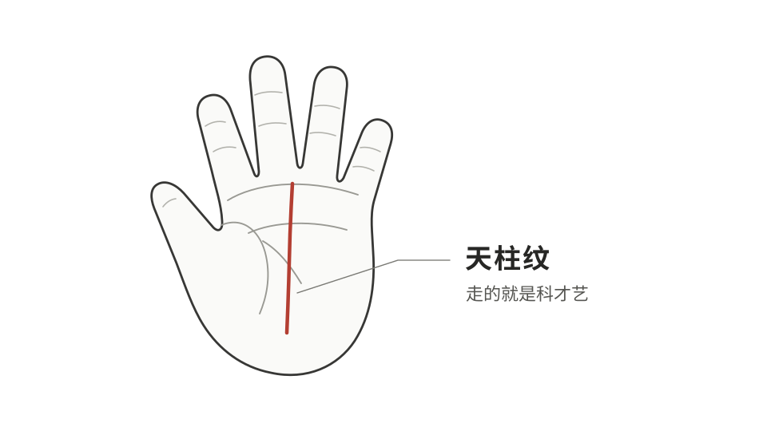
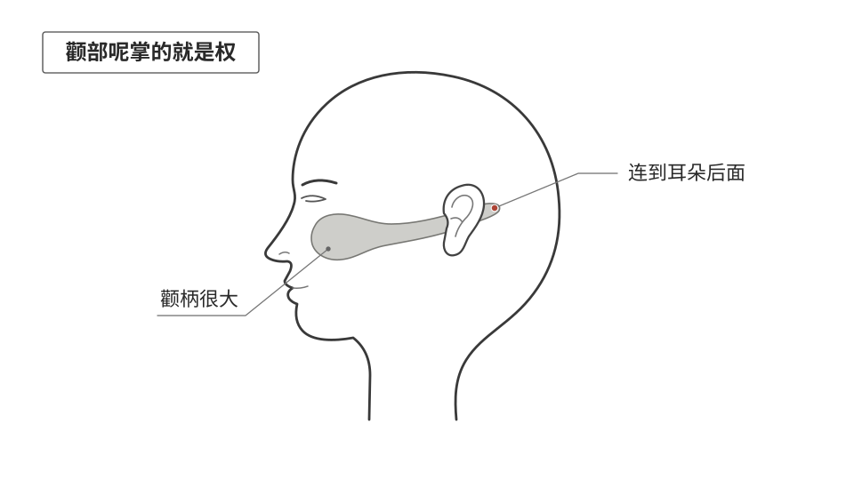
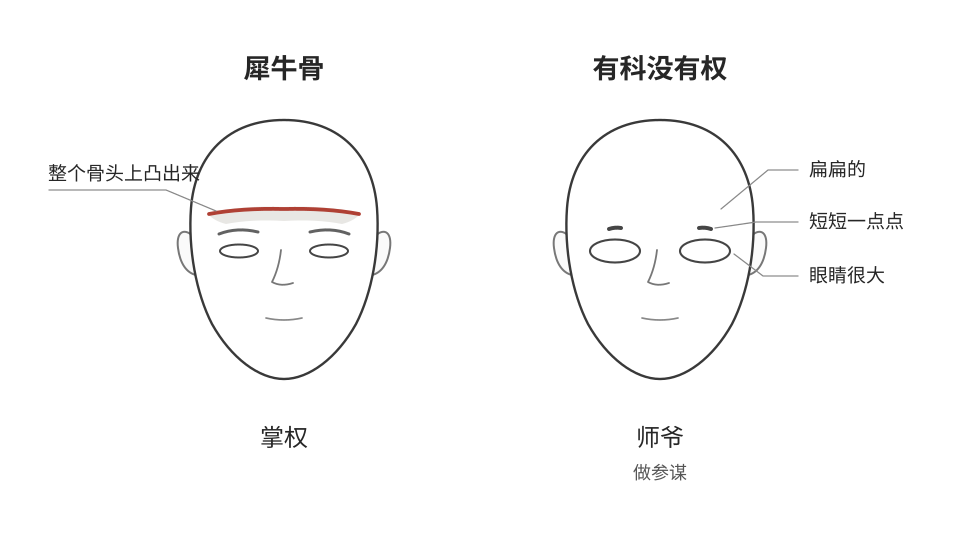
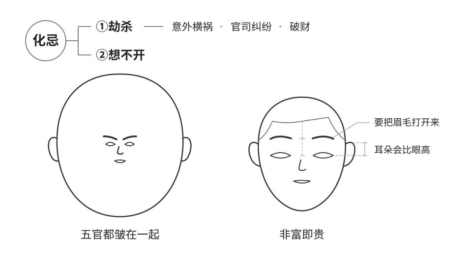
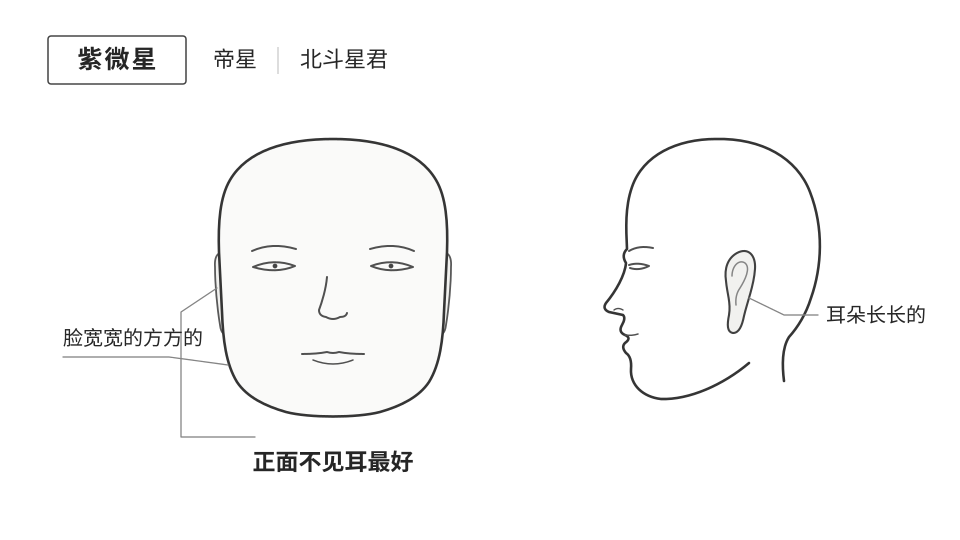
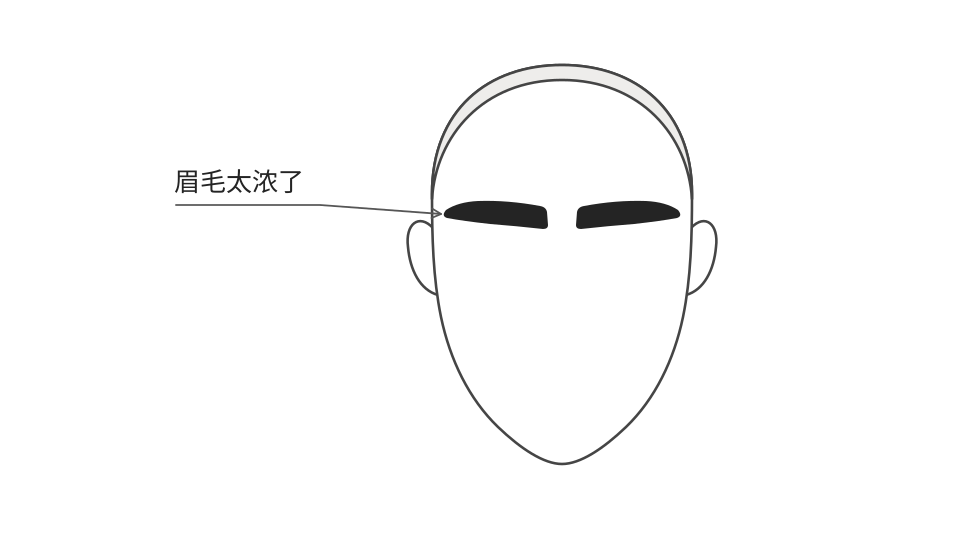

# P05 · 3 上：四化星 / 北斗星系 / 南斗星系（00:00:00–00:58:16，共 104,902 帧）

> 2026-11-11 整理。依据 DeepSeek 逐帧记录与现成的五层材料（字幕、语音、叠图、板书、指代），由 Claude（Opus 5.5 子代理）分段起草，引文由程序逐段对过字幕。流程 2026-11-11 经站长认可。
> 依据标记：〔口述〕字幕与语音两路对得上的话，「」里是字幕原字 ·〔叠图〕后期贴的电子命盘，**不算倪师的话** ·〔板书〕粉笔字（看过那一帧原图才写）·〔指代〕「这里 / 这个」指哪（只收核过、确定的）·〔推断〕笔记作者自己的推断。每条后面的时间码可以点，跳到 B 站那一秒。

## 全集总结

**通用规则**

- 四化排出来后永远固定在那个宫上不动，每年动的是流年，飞来飞去的做法都不对（[00:01:16–00:01:45](https://www.bilibili.com/video/BV1KJsLekEfA/?p=5&t=76)，第 2286–3167 帧）。
- 科第一主科名（考试、文笔、才艺、当老师），第二代表名气很大；命宫有科、54-63 有科、90 岁以后有科，分别对应出名的早晚（[00:01:59–00:03:25](https://www.bilibili.com/video/BV1KJsLekEfA/?p=5&t=119)，第 3576–6179 帧）。
- 命里有化权的人天生是领导者；只有科没有权的人有专长，但不见得能统御，只能做军师、参谋、顾问（[00:06:37–00:07:16](https://www.bilibili.com/video/BV1KJsLekEfA/?p=5&t=397)，第 11910–13085 帧）
- 禄就是钱财；禄在父母宫父母从商，在财帛宫自己会做生意，在命宫先天有祖业，命宫本身无禄则不靠祖业起家；男人的禄看鼻（[00:10:21–00:12:07](https://www.bilibili.com/video/BV1KJsLekEfA/?p=5&t=621)，第 18630–21839 帧）
- 化忌代表两样：一是劫杀（意外横祸、官司纠纷、破财），二是想不开（[00:13:48–00:14:24](https://www.bilibili.com/video/BV1KJsLekEfA/?p=5&t=828)，第 24852–25925 帧）
- 人逢权、科、禄时气色黄润，像黄玉一样润，主喜事来临（[00:18:48–00:19:13](https://www.bilibili.com/video/BV1KJsLekEfA/?p=5&t=1128)，第 33846–34619 帧）。
- 命坐紫微而两边没有左辅右弼，紫微就是孤星，代表孤单：人厚重厚道、性本孤、喜欢一个人（[00:29:33–00:30:43](https://www.bilibili.com/video/BV1KJsLekEfA/?p=5&t=1773)，第 53208–55307 帧）
- 命好不如限好：命宫财帛官禄迁移普通而十年大运全是科权禄也好，命好限不好会半空折翅（[00:32:58–00:33:30](https://www.bilibili.com/video/BV1KJsLekEfA/?p=5&t=1978)，第 59340–60311 帧）
- 紫微星有解厄制化的功能，凶星煞星逢紫微可以解掉、逢凶化吉；天机星本身没有这个功能（[00:33:36–00:34:17](https://www.bilibili.com/video/BV1KJsLekEfA/?p=5&t=2016)，第 60486–61721 帧；[00:36:04–00:36:14](https://www.bilibili.com/video/BV1KJsLekEfA/?p=5&t=2164)，第 64920–65249 帧）
- 天同星是人和的星，有的事情一定要人和才能成事（[00:42:32–00:43:04](https://www.bilibili.com/video/BV1KJsLekEfA/?p=5&t=2552)，第 76560–77525 帧、[00:45:22–00:45:32](https://www.bilibili.com/video/BV1KJsLekEfA/?p=5&t=2722)，第 81666–81977 帧）

**只在本例**

- 倪师举毕加索等有名画家、音乐家为例，说他们手上一定有天柱纹（[00:04:20–00:04:27](https://www.bilibili.com/video/BV1KJsLekEfA/?p=5&t=260)，第 7806–8027 帧）。
- 举例的这个人 22–31 岁很好、32–41 岁化忌不好，原因是大学毕业后太顺利、志得意满（[00:16:50–00:17:18](https://www.bilibili.com/video/BV1KJsLekEfA/?p=5&t=1010)，第 30300–31163 帧）
- 一位客户的先生脸上发青、每年体检都没问题，礼拜六在淡水打高尔夫多打一洞时当场倒下、脖子扭断而死（[00:23:07–00:23:50](https://www.bilibili.com/video/BV1KJsLekEfA/?p=5&t=1387)，第 41628–42911 帧）。
- 倪师在大陆旅游，看到飞机、码头、火车站的人气色都枯黑，就不走了，睡在旅馆里（[00:24:42–00:25:02](https://www.bilibili.com/video/BV1KJsLekEfA/?p=5&t=1482)，第 44478–45071 帧）。
- 楚庄王的丞相在身边 15 年从未举荐良才，被王后评为不忠、不贤，第二天辞官退休（[00:49:41–00:51:03](https://www.bilibili.com/video/BV1KJsLekEfA/?p=5&t=2981)，第 89442–91895 帧）

**不是排盘规则，是处世方法**

- 学习时先不看书上的翻译，听课到能批了再回头看书，书只作参考（[00:00:17–00:00:47](https://www.bilibili.com/video/BV1KJsLekEfA/?p=5&t=17)，第 522–1415 帧）。
- 算命不是检讨别人而是检讨自己；替别人看要找出问题去掉，告诉他想得开（[00:15:56–00:16:08](https://www.bilibili.com/video/BV1KJsLekEfA/?p=5&t=956)，第 28692–29069 帧）
- 欲念越强反弹越大，志得意满会招小人先下手攻击（[00:17:18–00:17:43](https://www.bilibili.com/video/BV1KJsLekEfA/?p=5&t=1038)，第 31164–31907 帧）
- 学看气色是为了遇到客户、朋友时事先预警，只要有戒心，再大的灾都可以去掉（[00:23:50–00:24:14](https://www.bilibili.com/video/BV1KJsLekEfA/?p=5&t=1430)，第 42912–43631 帧）。
- 敢当着你面、有旁人在场讲你不好的是真话；你不在时讲你的都是假话，不用听（[00:28:58–00:29:08](https://www.bilibili.com/video/BV1KJsLekEfA/?p=5&t=1738)，第 52146–52457 帧）

## 目录

**开场 + 四化：科、权、禄、忌**

1. 四化固定不飞，科与权的意义（00:00:00–00:06:16）
2. 化权、化科、化禄的性情与面相（00:06:16–00:12:33）
3. 鼻相手相，化忌主劫杀与想不开（00:12:33–00:18:48）

**四化的气色与看色避祸**

4. 权科禄与化忌的气色，望死色与避祸（00:18:48–00:25:56）

**诸星（上）：紫微、天机、太阳、武曲、天同、廉贞**

5. 紫微帝星：相貌、辅弼、孤星与主官（00:25:56–00:31:35）
6. 官带星、命好不如限好与天机太阳（00:31:35–00:36:54）
7. 太阳财禄六亲相貌，武曲五短与贵人（00:36:54–00:42:31）
8. 天同主人和，廉贞主桃花与武官（00:42:32–00:47:57）

**诸星（下）：南斗起，天府、太阴、天梁、天相**

9. 天府星：不能解厄、文官教星、心眼多（00:47:57–00:53:05）
10. 天府解厄无用；太阴、天梁、天相（00:53:06–00:58:16）

## 开场 + 四化：科、权、禄、忌

### 1　四化固定不飞，科与权的意义（[00:00:00–00:06:16](https://www.bilibili.com/video/BV1KJsLekEfA/?p=5&t=0)，第 0–11297 帧）

| 提示区 | 笔记区 |
|---|---|
| **这堂课讲什么？书该什么时候看？** | 〔口述〕倪师说上次介绍了各个宫，今天第一堂课介绍星座，并交代课程次序：「前面是天文后面下堂课是地理」。（[00:00:02–00:00:12](https://www.bilibili.com/video/BV1KJsLekEfA/?p=5&t=2)，第 60–365 帧） 〔口述〕倪师要学生先别看书上的翻译：「诸位你不用看书上翻译的」「说什么紫微星主什么这样子」，先听课；听完以后「你能够批了就已经很强了」，「这时候你再回头看看书」，「书是给你参考的」。（[00:00:17–00:00:35](https://www.bilibili.com/video/BV1KJsLekEfA/?p=5&t=17)，第 522–1061 帧） 〔口述〕倪师用念《出师表》作比，说一味看书就像「可能你念完出师表……你还不知道去念出师表干什么的」，所以「所以书先把它舍开一边」。（[00:00:35–00:00:47](https://www.bilibili.com/video/BV1KJsLekEfA/?p=5&t=35)，第 1062–1415 帧） |
| **为什么先讲四化星？四化是哪四个？** | 〔口述〕倪师说「我们斗数里面呢有四化」，「这个四化星呢是我们的主力星」，「所以要从四化星开始介绍」；「所谓四化星呢有科权禄忌」。（[00:00:48–00:01:08](https://www.bilibili.com/video/BV1KJsLekEfA/?p=5&t=48)，第 1458–2051 帧） 〔板书〕可辨：黑板左上写「四化星：」，下一行「科、权、禄、」，第四个字被倪师身体挡住，认不出。（[00:01:06](https://www.bilibili.com/video/BV1KJsLekEfA/?p=5&t=66)，第 2003 帧） 〔板书〕同一行后段可辨「权、禄、忌」，第四个字是「忌」。（[00:02:49](https://www.bilibili.com/video/BV1KJsLekEfA/?p=5&t=169)，第 5087 帧） |
| **四化要不要每年飞来飞去地换宫？** | 〔口述〕倪师说科权禄忌「外面有很多派」，「有的人要飞」「飞来飞去」，每年都在化，「都不知道哪颗星在化来化去」。（[00:01:08–00:01:16](https://www.bilibili.com/video/BV1KJsLekEfA/?p=5&t=68)，第 2052–2285 帧） 〔口述〕倪师说「诸位不需要」：「我们教诸位排的方式」「排出来以后」「就永远固定在那个宫上面不要动了」。举例「比如说武曲星里头有武曲化禄啊」，「这个固定好我们就不要动」。（[00:01:16–00:01:27](https://www.bilibili.com/video/BV1KJsLekEfA/?p=5&t=76)，第 2286–2627 帧） 〔口述〕每年科、权、禄都在不同位置的说法，倪师说「这个都不对的」；「我们每年的时候是流年在动」，「其实那些星都不动流年在动而已」。（[00:01:27–00:01:35](https://www.bilibili.com/video/BV1KJsLekEfA/?p=5&t=87)，第 2628–2879 帧） 〔口述〕倪师再强调「所以千万不要说外面有一种飞来飞去啊」，「今年科在这边明年科在那边」「飞来飞去都不对」「越弄越复杂」「你其实没有那么复杂」。（[00:01:36–00:01:45](https://www.bilibili.com/video/BV1KJsLekEfA/?p=5&t=96)，第 2880–3167 帧） |
| **讲四化时，最要紧先抓住什么？** | 〔口述〕倪师说介绍科、权、禄、忌时，「诸位要晓得呢」「这四颗星代表的意义是什么」，并说「星的性最重要」。（[00:01:45–00:01:57](https://www.bilibili.com/video/BV1KJsLekEfA/?p=5&t=105)，第 3168–3527 帧） 〔板书〕可辨：「科、权、禄」一行左下方写着「星性」二字。（[00:01:56](https://www.bilibili.com/video/BV1KJsLekEfA/?p=5&t=116)，第 3487 帧） 〔指代〕说「这个科呢」时，手指的是黑板「科、权、禄、忌」一行中的「科」字。（[00:01:57](https://www.bilibili.com/video/BV1KJsLekEfA/?p=5&t=117)，第 3527 帧） |
| **科的第一个意义是什么？包括哪些情形？** | 〔口述〕倪师说「科本身啊」「第一个」「它主的是科名」，例如「比如说我们参加考试」「金榜题名」「这是一个科」。（[00:01:59–00:02:14](https://www.bilibili.com/video/BV1KJsLekEfA/?p=5&t=119)，第 3576–4025 帧） 〔口述〕倪师列举其他情形：文章写得好，「文笔写的很好也是科」；画画好、才艺出众，「才艺超人也是科」；「还有呢我当老师」「也是科」。（[00:02:14–00:02:31](https://www.bilibili.com/video/BV1KJsLekEfA/?p=5&t=134)，第 4026–4547 帧） 〔口述〕至于到底是哪一种，倪师说「到时候我们整体的批的时候」「你就会知道」，「我现在只是介绍科的意义而已」。（[00:02:31–00:02:38](https://www.bilibili.com/video/BV1KJsLekEfA/?p=5&t=151)，第 4548–4769 帧） 〔指代〕说「这个科名」时，倪师手持粉笔指的是黑板右侧刚写的「科名」二字，正在它下方划底线。（[00:02:39](https://www.bilibili.com/video/BV1KJsLekEfA/?p=5&t=159)，第 4786 帧） 〔板书〕可辨：「①科名」，「科名」下有一道横线；①前面还有一个字，认不出。（[00:02:49](https://www.bilibili.com/video/BV1KJsLekEfA/?p=5&t=169)，第 5087 帧） |
| **科的第二个意义？有科来得早晚怎么讲？** | 〔口述〕倪师说「第二个」「这个科呢」「代表名气很大」。（[00:02:43–00:02:53](https://www.bilibili.com/video/BV1KJsLekEfA/?p=5&t=163)，第 4890–5213 帧） 〔板书〕可辨：「①科名」下一行写「②名」和「大」，中间一个字认不全。（[00:02:49](https://www.bilibili.com/video/BV1KJsLekEfA/?p=5&t=169)，第 5087 帧） 〔口述〕倪师说有的人「他的命宫出来命宫里面就有科」；有的人「到54-63 到晚年才有科」，「不是说54-63才会去读书不是」，「而是说他54-63的时候声名远播」。（[00:02:53–00:03:07](https://www.bilibili.com/video/BV1KJsLekEfA/?p=5&t=173)，第 5214–5633 帧） 〔口述〕声名远播的情形，倪师举「可能他每天做善事做好事」「然后一天到晚报道他」，「或者50岁以后出了大事」，做了很大的事然后声名远播，「那之前是默默无闻的」。（[00:03:07–00:03:17](https://www.bilibili.com/video/BV1KJsLekEfA/?p=5&t=187)，第 5634–5939 帧） 〔口述〕还有的人科「是到了90岁100岁以后才有科」，倪师说这「就代表说这个画家死了以后才有名的」。（[00:03:18–00:03:25](https://www.bilibili.com/video/BV1KJsLekEfA/?p=5&t=198)，第 5940–6179 帧） |
| **怎样从人身上一眼看出他有科？** | 〔口述〕倪师说「那这时我们看八字的时候排出来有科」，又问「那你知不知道」「人身上看过去就知道他有科」，「怎么看第一个」，「我们在手上手掌上面」。（[00:03:33–00:03:52](https://www.bilibili.com/video/BV1KJsLekEfA/?p=5&t=213)，第 6396–6989 帧） 〔口述〕倪师在黑板上画手，说「我画肥一点」「你不要看这个肥的手」，又说「这种男人如果有这种手啊太好了」。（[00:03:53–00:04:00](https://www.bilibili.com/video/BV1KJsLekEfA/?p=5&t=233)，第 6990–7223 帧） 〔指代〕说「这个肥的手」时，粉笔正落在黑板右上角画的手掌图上，指的是这幅图，不是文字。（[00:03:54](https://www.bilibili.com/video/BV1KJsLekEfA/?p=5&t=234)，第 7047 帧） 〔板书〕黑板右上角画了一只手掌，手指画成一节节圆弧，没有写字。（[00:03:59](https://www.bilibili.com/video/BV1KJsLekEfA/?p=5&t=239)，第 7176 帧）  |
| **什么叫天柱纹？有它的人走什么路？** | 〔口述〕倪师说「当你看他的纹啊有一条纹啊」「一直通天」，「手上这条纹叫做天柱纹」「一路通天」。（[00:04:03–00:04:15](https://www.bilibili.com/video/BV1KJsLekEfA/?p=5&t=243)，第 7290–7667 帧） 〔板书〕手掌图掌心中间加了一条竖线，往上通到手指根部，没有写字。（[00:04:06](https://www.bilibili.com/video/BV1KJsLekEfA/?p=5&t=246)，第 7391 帧） 〔板书〕可辨：手掌图右侧竖写「天柱纹」三字，旁边另有一道竖线。（[00:04:16](https://www.bilibili.com/video/BV1KJsLekEfA/?p=5&t=256)，第 7707 帧） 〔口述〕倪师说「天柱纹的人呢」「走的就是科才艺」，「所以过去看到很多有名的画家音乐家」「像毕加索他们手上一定有这条线」。（[00:04:15–00:04:27](https://www.bilibili.com/video/BV1KJsLekEfA/?p=5&t=255)，第 7668–8027 帧） 〔口述〕倪师说「没有那条线是徒有其名的」，「那你手上有这条线的就是主科」。（[00:04:27–00:04:35](https://www.bilibili.com/video/BV1KJsLekEfA/?p=5&t=267)，第 8028–8255 帧） |
| **什么是博士眼？倪师怎么评价拿博士的人？** | 〔口述〕倪师转述外面相书的说法：「那外面相书上写的是哎呀」，「这个指头有个眼的叫博士眼呐」。（[00:04:35–00:04:39](https://www.bilibili.com/video/BV1KJsLekEfA/?p=5&t=275)，第 8256–8399 帧） 〔指代〕说「这个我们有个眼啊」和「这个这个指头」时，粉笔落在手掌图的拇指位置，正在描一个眼形记号；指的是图形，没有文字。（[00:04:36–00:04:37](https://www.bilibili.com/video/BV1KJsLekEfA/?p=5&t=276)，第 8297–8339 帧） 〔板书〕手掌图左侧拇指位置画了一个眼形记号，没有写字。（[00:04:39](https://www.bilibili.com/video/BV1KJsLekEfA/?p=5&t=279)，第 8394 帧） 〔口述〕倪师评论：「有的人拿到博士是空的」「不拿了还好」「拿了以后从此变成笨蛋」，「教不会了他认为他就什么都懂了」，「问个路到哪里去都不会啊」。（[00:04:41–00:04:49](https://www.bilibili.com/video/BV1KJsLekEfA/?p=5&t=281)，第 8430–8699 帧） |
| **看科该看手上哪条纹？别的纹要不要管？** | 〔口述〕倪师说「这个中国人讲的是这条天柱纹」，「执掌的是科甲」，「手上就可以看到」「手上看的最清楚」。（[00:04:53–00:05:05](https://www.bilibili.com/video/BV1KJsLekEfA/?p=5&t=293)，第 8796–9167 帧） 〔口述〕倪师说「你不要管什么事业线嘛」，「你不要去想它嘛」，「所以诸位不要把我们丢掉的东西」「你又把它从头再找回来」。（[00:05:05–00:05:20](https://www.bilibili.com/video/BV1KJsLekEfA/?p=5&t=305)，第 9168–9629 帧） |
| **权代表什么？** | 〔口述〕讲到权，倪师说「这个东西呢第一个」「它代表的是官印」；「什么叫官印」，「当官的时候我们有个印盖一下」「那个就是官印」。（[00:05:23–00:05:40](https://www.bilibili.com/video/BV1KJsLekEfA/?p=5&t=323)，第 9696–10211 帧） 〔板书〕可辨：「科、权、禄、忌」一行里的「权」字被画了圈；下方写「①官印」，①前面一字形似「校」，认不准。（[00:05:30](https://www.bilibili.com/video/BV1KJsLekEfA/?p=5&t=330)，第 9908 帧） 〔口述〕倪师说「那第一个第二个呢」，「它代表的是性刚」「个性很刚」。（[00:05:40–00:05:52](https://www.bilibili.com/video/BV1KJsLekEfA/?p=5&t=340)，第 10212–10571 帧） 〔板书〕可辨：「①官印」下方写「②性刚」。（[00:05:47](https://www.bilibili.com/video/BV1KJsLekEfA/?p=5&t=347)，第 10429 帧） |
| **权落在不同宫位要怎么批？** | 〔口述〕倪师说「那这个权在不同的位置上」，「我们知道它代表官印」「也代表性刚」，「那在不同的位置上它发生不同的事情」，「我们决定它在哪个位置上来批」。（[00:05:52–00:06:07](https://www.bilibili.com/video/BV1KJsLekEfA/?p=5&t=352)，第 10572–11015 帧） 〔口述〕倪师举例：「比如说你的命宫没有」「就你的夫妻宫有」，接着问「那夫妻宫是代表什么性刚」。本块在这句问话处结束，解释在下一块。（[00:06:07–00:06:16](https://www.bilibili.com/video/BV1KJsLekEfA/?p=5&t=367)，第 11016–11297 帧） |

**总结区**

- 通用规则：四化星科、权、禄、忌是斗数的主力星，所以先从四化讲起（[00:00:48–00:01:08](https://www.bilibili.com/video/BV1KJsLekEfA/?p=5&t=48)，第 1458–2051 帧）。；四化排出来后永远固定在那个宫上不动，每年动的是流年，飞来飞去的做法都不对（[00:01:16–00:01:45](https://www.bilibili.com/video/BV1KJsLekEfA/?p=5&t=76)，第 2286–3167 帧）。；科第一主科名（考试、文笔、才艺、当老师），第二代表名气很大；命宫有科、54-63 有科、90 岁以后有科，分别对应出名的早晚（[00:01:59–00:03:25](https://www.bilibili.com/video/BV1KJsLekEfA/?p=5&t=119)，第 3576–6179 帧）。；权第一代表官印、第二代表性刚，落在不同宫位发生不同的事，要看它在哪一宫来批（[00:05:23–00:06:16](https://www.bilibili.com/video/BV1KJsLekEfA/?p=5&t=323)，第 9696–11297 帧）。
- 只在本例：倪师举毕加索等有名画家、音乐家为例，说他们手上一定有天柱纹（[00:04:20–00:04:27](https://www.bilibili.com/video/BV1KJsLekEfA/?p=5&t=260)，第 7806–8027 帧）。
- 不是排盘规则，是处世方法：学习时先不看书上的翻译，听课到能批了再回头看书，书只作参考（[00:00:17–00:00:47](https://www.bilibili.com/video/BV1KJsLekEfA/?p=5&t=17)，第 522–1415 帧）。；拿到博士就自认什么都懂、从此教不会，倪师把这当作反面样子来讲（[00:04:41–00:04:49](https://www.bilibili.com/video/BV1KJsLekEfA/?p=5&t=281)，第 8430–8699 帧）。；课上已经丢掉的东西（如事业线）不要再从书里找回来（[00:05:05–00:05:20](https://www.bilibili.com/video/BV1KJsLekEfA/?p=5&t=305)，第 9168–9629 帧）。

**待核**

1. [00:00:26](https://www.bilibili.com/video/BV1KJsLekEfA/?p=5&t=26)，第 804 帧：字幕作「三个月以后」，语音作「三个课以后」，两路不一致，暂未引用。
2. [00:00:07](https://www.bilibili.com/video/BV1KJsLekEfA/?p=5&t=7)，第 228 帧、[00:00:09](https://www.bilibili.com/video/BV1KJsLekEfA/?p=5&t=9)，第 282 帧：倪师用「星座」指要介绍的星，又说「前面是天文后面下堂课是地理」，「天文」「地理」各指什么本块没有解释。
3. [00:00:40–00:00:44](https://www.bilibili.com/video/BV1KJsLekEfA/?p=5&t=40)，第 1212–1325 帧：字幕作「出师表」，语音作「初始表」，按字幕取。
4. [00:01:22](https://www.bilibili.com/video/BV1KJsLekEfA/?p=5&t=82)，第 2472 帧：「比如说武曲星里头有武曲化禄啊」字幕可信度 0.68，语音作「无起硬通有无起画路」，「武曲」按上下文取，「里头」待核。
5. [00:01:31](https://www.bilibili.com/video/BV1KJsLekEfA/?p=5&t=91)，第 2754 帧：「流年」倪师用了但本块没有解释。
6. [00:01:38](https://www.bilibili.com/video/BV1KJsLekEfA/?p=5&t=98)，第 2964 帧：「今年科在这边明年科在那边」字幕可信度 0.48，语音后半作「柯群里面」，对不上。
7. [00:01:52](https://www.bilibili.com/video/BV1KJsLekEfA/?p=5&t=112)，第 3372 帧：字幕作「星的性最重要」，语音作「它的性心性最重要心的性最重要」，「星」与「心」待核。
8. [00:01:56](https://www.bilibili.com/video/BV1KJsLekEfA/?p=5&t=116)，第 3487 帧：板书「星性」二字是按原图辨认，字迹较草。
9. [00:02:49](https://www.bilibili.com/video/BV1KJsLekEfA/?p=5&t=169)，第 5087 帧：板书「①」前一个字认不出；「②名」与「大」之间一字认不全（像「氣」，不确定）。
10. [00:03:27–00:03:30](https://www.bilibili.com/video/BV1KJsLekEfA/?p=5&t=207)，第 6228–6329 帧：「这是命的」「这是科」两句语音只有「命呢好是」「柯还有」，意思不明，未写入。
11. [00:03:33](https://www.bilibili.com/video/BV1KJsLekEfA/?p=5&t=213)，第 6396 帧：倪师说「我们看八字的时候排出来有科」，此处「八字」与斗数排盘的关系本块没有解释；字幕可信度 0.57。
12. [00:04:00](https://www.bilibili.com/video/BV1KJsLekEfA/?p=5&t=240)，第 7224 帧：字幕「不是我自己我没有啊」，语音作「有没有啊当然」，两路对不上，未写入。
13. [00:04:24](https://www.bilibili.com/video/BV1KJsLekEfA/?p=5&t=264)，第 7926 帧：字幕作「毕加索」，语音作「卡扎」，人名待核。
14. [00:04:31](https://www.bilibili.com/video/BV1KJsLekEfA/?p=5&t=271)，第 8154 帧：字幕「主科」，语音作「主客」，按字幕取；「主科」的确切含义本块没有解释。
15. [00:04:35](https://www.bilibili.com/video/BV1KJsLekEfA/?p=5&t=275)，第 8256 帧：字幕「相书」，语音作「像书」，按字幕取。
16. [00:04:40](https://www.bilibili.com/video/BV1KJsLekEfA/?p=5&t=280)，第 8400 帧：字幕「这个就是博士这个问题（？）」本身带问号、可信度 0.46，未写入。
17. [00:04:52](https://www.bilibili.com/video/BV1KJsLekEfA/?p=5&t=292)，第 8772 帧：字幕「这个不知道啊」，语音作「不是东西」，两路对不上，未写入。
18. [00:04:57](https://www.bilibili.com/video/BV1KJsLekEfA/?p=5&t=297)，第 8934 帧：「执掌的是科甲」字幕可信度 0.53，语音作「柯家」，「执掌」二字语音里没有；「科甲」本块没有解释。
19. [00:05:06](https://www.bilibili.com/video/BV1KJsLekEfA/?p=5&t=306)，第 9204 帧：「我讲的有的就你书上有的」语义不明，未写入。
20. [00:05:21](https://www.bilibili.com/video/BV1KJsLekEfA/?p=5&t=321)，第 9630 帧：字幕「这是科」，语音作「拳」，对不上，未写入。
21. [00:05:25](https://www.bilibili.com/video/BV1KJsLekEfA/?p=5&t=325)，第 9761 帧、[00:05:30](https://www.bilibili.com/video/BV1KJsLekEfA/?p=5&t=330)，第 9908 帧：「权」下方①前面一字形似「校」，含义不明；相关指代标为不确定，未当依据。
22. [00:05:48](https://www.bilibili.com/video/BV1KJsLekEfA/?p=5&t=348)，第 10452 帧：字幕「个性很刚」，语音作「那这个」，按前一句语音「各性」与字幕大体对上而收。
23. [00:06:08–00:06:10](https://www.bilibili.com/video/BV1KJsLekEfA/?p=5&t=368)，第 11040–11129 帧：语音作「名字」「夫妻公」，按字幕取「命宫」「夫妻宫」。
24. [00:00:00](https://www.bilibili.com/video/BV1KJsLekEfA/?p=5&t=0)，第 0 帧：板书图清单里的第一张是片头画面（「天纪3上」等后期字），没有粉笔字。
25. [00:01:24](https://www.bilibili.com/video/BV1KJsLekEfA/?p=5&t=84)，第 2546 帧、[00:02:43](https://www.bilibili.com/video/BV1KJsLekEfA/?p=5&t=163)，第 4906 帧、[00:03:27](https://www.bilibili.com/video/BV1KJsLekEfA/?p=5&t=207)，第 6211 帧、[00:04:39](https://www.bilibili.com/video/BV1KJsLekEfA/?p=5&t=279)，第 8395 帧、[00:04:53](https://www.bilibili.com/video/BV1KJsLekEfA/?p=5&t=293)，第 8794 帧、[00:05:51](https://www.bilibili.com/video/BV1KJsLekEfA/?p=5&t=351)，第 10541 帧：这几处「这个」的指向标为不确定、否或看不出，未当依据。

### 2　化权、化科、化禄的性情与面相（[00:06:16–00:12:33](https://www.bilibili.com/video/BV1KJsLekEfA/?p=5&t=376)，第 11298–22601 帧）

| 提示区 | 笔记区 |
|---|---|
| **化权落在哪颗星上，决定什么？** | 〔口述〕倪师说要看哪一颗星化权，由那颗星决定这个人是做生意还是走官场：「什么哪一颗星开始化权」「那颗星化权我们看那颗星决定」「决定他到底是在做生意还是在官场上面」，并说「这是在星座上面来决定」。（[00:06:17–00:06:27](https://www.bilibili.com/video/BV1KJsLekEfA/?p=5&t=377)，第 11322–11627 帧） 〔板书〕黑板上写着「四化星：」，下面一行「科、權、祿、忌」，其中「權」字用圆圈圈起。下方另有擦过的残字，认不全。（[00:06:23](https://www.bilibili.com/video/BV1KJsLekEfA/?p=5&t=383)，第 11508 帧） |
| **夫妻宫化权，说明另一半是什么样的人？** | 〔口述〕夫妻宫化权，代表配偶在个性上领导力强、主见强：「如果你的夫妻宫化权」「代表你的那一半」「在个性上面」「领导力很强主见很强的一个人」。（[00:06:28–00:06:36](https://www.bilibili.com/video/BV1KJsLekEfA/?p=5&t=388)，第 11640–11909 帧） |
| **命里有化权的人，先天是什么样的人？** | 〔口述〕命里有化权的人，先天就是领导者：「这种人命里面有化权的人呢」「先天上面来说」「这种人天生的就是一个领导者」。（[00:06:37–00:06:43](https://www.bilibili.com/video/BV1KJsLekEfA/?p=5&t=397)，第 11910–12095 帧） 〔口述〕举的人群有将领、总经理、银行经理、厂长：「很多银行的经理很多厂长」「就是命中他就有权的人」。（[00:06:43–00:06:52](https://www.bilibili.com/video/BV1KJsLekEfA/?p=5&t=403)，第 12096–12365 帧） |
| **当老板用人时，有权和只有科差在哪？** | 〔口述〕倪师用老板用人说明为什么要学算命：「那你为什么要学会算命」「如果你是老板的时候」「在用厂长之前八字一看」「这人化权」「天生的将领」「你可以放手让他去做」。（[00:06:53–00:07:01](https://www.bilibili.com/video/BV1KJsLekEfA/?p=5&t=413)，第 12408–12641 帧） 〔口述〕只有科没有权的人只能当辅佐：「像光只有科他都没有权的时候」「他只能做佐才」「因为这个人有专业知识有专长」「但是不见得能够统御领导」「所以只能做军师啊参谋顾问」。（[00:07:03–00:07:16](https://www.bilibili.com/video/BV1KJsLekEfA/?p=5&t=423)，第 12714–13085 帧） 〔指代〕说「因为这个人」时，粉笔停在黑板「科、權、祿、忌」一行最左边的「科」字上，也就是说这里讲的是有科的人。（[00:07:08](https://www.bilibili.com/video/BV1KJsLekEfA/?p=5&t=428)，第 12841 帧） |
| **权在脸上第一个看哪里？颧要长成什么样？** | 〔口述〕有权的人可以从脸上看出来，第一处是颧部：「这个颧柄很大」「这个颧啊要连到后面」「要像那个烟斗一样到后面去」「连到耳朵后面」，在脸相上「叫做颧部」，「颧部呢掌的就是权」「这是第一个」。（[00:07:33–00:07:56](https://www.bilibili.com/video/BV1KJsLekEfA/?p=5&t=453)，第 13602–14285 帧） 〔指代〕说「没有这个耳朵」时，粉笔点在脸部简笔画右侧画耳朵的位置；说「这个颧柄很大」前，粉笔移到右眼下方、鼻子右侧的颊部（第13555帧）。（[00:07:27–00:07:31](https://www.bilibili.com/video/BV1KJsLekEfA/?p=5&t=447)，第 13427–13555 帧） 〔指代〕说「这个在我们脸相上面」时，粉笔在简笔画右颊涂抹处、靠近右耳的位置来回涂画，指的就是颧连到耳后这一片。（[00:07:42](https://www.bilibili.com/video/BV1KJsLekEfA/?p=5&t=462)，第 13873 帧） 〔板书〕黑板上画了一张脸：圆头、两道横眉、三角鼻、两耳，两颊涂了阴影。左下方圈起一个字「颧」，用线连到脸颊涂抹处，圈下还有一字像「部」。（[00:07:51](https://www.bilibili.com/video/BV1KJsLekEfA/?p=5&t=471)，第 14136 帧）  |
| **颧部掌权最忌讳什么？什么叫孤权？** | 〔口述〕颧部掌权，颧上一定要有肉：「但这个颧部掌权的时候这个权一定要」「有肉」；最忌讳的「叫做皮骨相连」。（[00:07:56–00:08:12](https://www.bilibili.com/video/BV1KJsLekEfA/?p=5&t=476)，第 14286–14765 帧） 〔指代〕说「这个权一定要」时，右手掌平贴在简笔画左颊涂抹处（左眼下方、左耳内侧），指的是颧部那一块。（[00:07:57](https://www.bilibili.com/video/BV1KJsLekEfA/?p=5&t=477)，第 14327 帧） 〔口述〕颧很大但没有肉、骨头和皮连在一起，就叫孤权，一辈子孤单，尤其是女孩子：「这个颧很大」「但是他没有肉」「是骨头和皮连在一起」……「孤单孤权呐」「尤其女孩子要是这样子的话」「一辈子孤单」。（[00:08:13–00:08:27](https://www.bilibili.com/video/BV1KJsLekEfA/?p=5&t=493)，第 14796–15221 帧） 〔指代〕说「这个颧很大」前，倪师转身面向镜头，用右手手指碰自己脸上的颧骨处，不是指黑板。（[00:08:12](https://www.bilibili.com/video/BV1KJsLekEfA/?p=5&t=492)，第 14785 帧） 〔板书〕第14751帧：「部」右边新写一字，可辨「肉」；下方斜写一行字，认不全。第15113帧：又添一字，可辨「孤」，其下一字认不出。（[00:08:11–00:08:23](https://www.bilibili.com/video/BV1KJsLekEfA/?p=5&t=491)，第 14751–15113 帧） |
| **权的第二处在哪？犀牛骨怎么认？** | 〔口述〕第二个看权的地方是犀牛骨：「第二个权的地方在哪里呢」「犀牛骨的地方」；懂的话「你还没有开始帮他算命的时候」「就已经看到了」。（[00:08:32–00:08:47](https://www.bilibili.com/video/BV1KJsLekEfA/?p=5&t=512)，第 15378–15833 帧） 〔口述〕犀牛骨在眉毛这一条，但不要只看眉毛，要看眉后整块骨头凸出来：「什么叫犀牛骨」「前面这一条」「这个眉毛」……「你不要老是看他那眉毛」「整个骨头上凸出来」「这一条叫做犀牛骨」。（[00:08:47–00:09:00](https://www.bilibili.com/video/BV1KJsLekEfA/?p=5&t=527)，第 15834–16229 帧） 〔指代〕说「前面这一条」时，粉笔正落在用红色粉笔在简笔画额头、眉上方画的那条横线上。（[00:08:49](https://www.bilibili.com/video/BV1KJsLekEfA/?p=5&t=529)，第 15877 帧） 〔板书〕简笔画的额头、两眉上方加了一条红色粉笔横线，横贯两眼之上；这是图，没有字。（[00:08:54](https://www.bilibili.com/video/BV1KJsLekEfA/?p=5&t=534)，第 16020 帧）  |
| **哪些人常有犀牛骨？它掌什么？** | 〔口述〕犀牛骨也掌权：「很多司法官会有这个犀牛骨」「那犀牛骨呢掌权」「权柄很多武将」……「军人警察都有这个权」。（[00:09:01–00:09:23](https://www.bilibili.com/video/BV1KJsLekEfA/?p=5&t=541)，第 16248–16913 帧） 〔指代〕说「很多司法官会有这个犀牛骨」时，手指点在简笔画额头那条红色横线附近。（[00:09:02](https://www.bilibili.com/video/BV1KJsLekEfA/?p=5&t=542)，第 16274 帧） |
| **有科没有权的人长什么样？能做什么？** | 〔口述〕把科和权放在一起看，有科没有权的人没有犀牛骨，眼睛大、眉毛短短一点：「有的人有科没有权」「就这个犀牛骨就没有扁扁的」「然后眼睛在这里」「眼睛很大」「眉毛这样的短短一点点」「这就是师爷」。（[00:09:24–00:09:46](https://www.bilibili.com/video/BV1KJsLekEfA/?p=5&t=564)，第 16944–17585 帧） 〔口述〕这种人只能做参谋：「师爷两个眉毛短短的一点点」「那这种人有科没有权做参谋」……「只能做参谋」。（[00:09:48–00:10:00](https://www.bilibili.com/video/BV1KJsLekEfA/?p=5&t=588)，第 17652–18029 帧） 〔板书〕简笔画的眼睛改画成两个椭圆，上方用红色粉笔画了两道短眉；画面左侧有红色粉笔竖写的两字，第一字像「师」，第二字认不出。（[00:09:48](https://www.bilibili.com/video/BV1KJsLekEfA/?p=5&t=588)，第 17667 帧） 〔口述〕倪师说之后算命时会顺带讲相法：「陆续我在算命的时候」「顺便把相法统统给诸位讲了」。（[00:10:05–00:10:09](https://www.bilibili.com/video/BV1KJsLekEfA/?p=5&t=605)，第 18174–18287 帧） |
| **禄代表什么？板书上列了哪两项？** | 〔口述〕讲完科和权，第三个介绍禄，禄就是钱财：「这是科和权」「第三个我要介绍禄」「大家顾名思义禄就是什么」「财嘛」「钱财」。（[00:10:10–00:10:31](https://www.bilibili.com/video/BV1KJsLekEfA/?p=5&t=610)，第 18324–18953 帧） 〔板书〕第18812帧写「禄 ① 财」。第19187帧「禄」字被圈起，右边两行：「① 财」「② 性守」，「守」字也圈起。（[00:10:27–00:10:39](https://www.bilibili.com/video/BV1KJsLekEfA/?p=5&t=627)，第 18812–19187 帧） 〔口述〕写第二项时说「如果还有它的禄是」「性守」，两路对不上，具体说法听不清。（[00:10:34–00:10:42](https://www.bilibili.com/video/BV1KJsLekEfA/?p=5&t=634)，第 19026–19265 帧） |
| **命宫化禄的人有什么天性？** | 〔口述〕命宫生来化禄的人小气、守财：「比如说有个人命里面就生下来」「命宫就是化禄」「就是」「小气鬼啦」「守财奴啦一毛不拔啦」。（[00:10:42–00:10:52](https://www.bilibili.com/video/BV1KJsLekEfA/?p=5&t=642)，第 19266–19577 帧） 〔口述〕举孩子为例：「你如果发现你的孩子是这样子」「你给他压岁钱他就藏起来了」「他连银行都不相信」……「就先天的本性」。（[00:10:52–00:11:02](https://www.bilibili.com/video/BV1KJsLekEfA/?p=5&t=652)，第 19578–19871 帧） 〔口述〕由此说人性不能只论善恶：「所以你说性本善性本恶都不一定的」「有的人性本权性本禄」「善恶很难讲」，禄「它代表财的意思」。（[00:11:02–00:11:14](https://www.bilibili.com/video/BV1KJsLekEfA/?p=5&t=662)，第 19872–20231 帧） 〔推断〕推断：这段守财奴的例子紧接在板书「② 性守」之后，像是在说明禄的第二项（性情上守），但倪师没有明说两者对应。（[00:10:39–00:11:00](https://www.bilibili.com/video/BV1KJsLekEfA/?p=5&t=639)，第 19187–19811 帧） |
| **禄在父母宫、财帛宫、命宫各主什么？** | 〔口述〕禄在父母宫，父母从商：「那这个禄如果在父母宫」「顾名思义父母亲一定从商的」「一是做生意的」。（[00:11:14–00:11:19](https://www.bilibili.com/video/BV1KJsLekEfA/?p=5&t=674)，第 20232–20399 帧） 〔指代〕说「这个禄」时，粉笔从圈起来的「禄」字圆圈底部往下画竖线，指的是这个「禄」。（[00:11:14](https://www.bilibili.com/video/BV1KJsLekEfA/?p=5&t=674)，第 20238 帧） 〔口述〕禄在财帛宫自己会做生意；禄在命宫先天有祖业：「有的人禄在财帛宫他自己会做生意」「有的人禄在命宫」「先天就会有祖业到他身上去」。（[00:11:20–00:11:26](https://www.bilibili.com/video/BV1KJsLekEfA/?p=5&t=680)，第 20400–20597 帧） 〔口述〕父母宫有禄而命宫本身没有禄时，祖业再大也不靠祖业起家：「但他命宫本身没有禄」「命宫里面没有禄的时候」「代表说即使祖业再大」「他不靠祖业起家」。之后会陆续讲很多案例给大家批。（[00:11:26–00:11:41](https://www.bilibili.com/video/BV1KJsLekEfA/?p=5&t=686)，第 20598–21041 帧） 〔板书〕「禄」的圆圈下画一条竖线连到下方一个圈，圈里的字被身体挡住，认不出；右边「财」字也被圈起。（[00:11:17](https://www.bilibili.com/video/BV1KJsLekEfA/?p=5&t=677)，第 20329 帧） |
| **禄在面相上看哪里？最好的鼻子有哪两种？** | 〔口述〕禄在相上，男人看鼻，鼻子就是财帛宫：「那禄在人的相上面呢从哪里看到」……「第一个男人呢」「看鼻」「男人的鼻子呢」「就是财帛宫」。（[00:11:48–00:12:07](https://www.bilibili.com/video/BV1KJsLekEfA/?p=5&t=708)，第 21252–21839 帧） 〔口述〕最好的鼻子有两种：「第一个叫狮鼻」「第二个叫悬胆鼻」；狮鼻是「鼻子很肉很大」。本块到这里结束，后面接着描述。（[00:12:08–00:12:28](https://www.bilibili.com/video/BV1KJsLekEfA/?p=5&t=728)，第 21840–22469 帧） 〔板书〕黑板上写「男」，下面圈起一个「鼻」字，右边竖写「财帛宫」。（[00:12:05](https://www.bilibili.com/video/BV1KJsLekEfA/?p=5&t=725)，第 21768 帧） |

**总结区**

- 通用规则：哪一颗星化权，就由那颗星决定这个人是做生意还是在官场（[00:06:17–00:06:27](https://www.bilibili.com/video/BV1KJsLekEfA/?p=5&t=377)，第 11322–11627 帧）；命里有化权的人天生是领导者；只有科没有权的人有专长，但不见得能统御，只能做军师、参谋、顾问（[00:06:37–00:07:16](https://www.bilibili.com/video/BV1KJsLekEfA/?p=5&t=397)，第 11910–13085 帧）；相上权看两处：颧部要大、连到耳后、有肉，皮骨相连叫孤权，一辈子孤单；眉后骨头凸出的犀牛骨也掌权（[00:07:33–00:09:23](https://www.bilibili.com/video/BV1KJsLekEfA/?p=5&t=453)，第 13602–16913 帧）；禄就是钱财；禄在父母宫父母从商，在财帛宫自己会做生意，在命宫先天有祖业，命宫本身无禄则不靠祖业起家；男人的禄看鼻（[00:10:21–00:12:07](https://www.bilibili.com/video/BV1KJsLekEfA/?p=5&t=621)，第 18630–21839 帧）
- 不是排盘规则，是处世方法：当老板用厂长前先看命：化权的可放手让他做，只有科没有权的只能当参谋顾问（[00:06:53–00:07:16](https://www.bilibili.com/video/BV1KJsLekEfA/?p=5&t=413)，第 12408–13085 帧）；孩子守财、压岁钱藏起来是先天本性，人性不能只用善恶来论（[00:10:52–00:11:12](https://www.bilibili.com/video/BV1KJsLekEfA/?p=5&t=652)，第 19578–20171 帧）

**待核**

1. [00:06:16](https://www.bilibili.com/video/BV1KJsLekEfA/?p=5&t=376)，第 11304 帧：字幕识别为乱码「显¥Z+ 壬盂唯」，语音为「东西什么」，原话待核。
2. [00:06:25–00:06:27](https://www.bilibili.com/video/BV1KJsLekEfA/?p=5&t=385)，第 11562–11639 帧：「这是在星座上面来决定」中的「星座」倪师没有解释，字幕三次重复，语音也作「星座」。
3. [00:06:32](https://www.bilibili.com/video/BV1KJsLekEfA/?p=5&t=392)，第 11766 帧：字幕乱码「一 $沙¥4」，语音只有「性」。
4. 第12096、12894、12948帧：字幕句尾多出「恺刚」，语音没有，疑为识别杂字。
5. [00:06:55](https://www.bilibili.com/video/BV1KJsLekEfA/?p=5&t=415)，第 12462 帧：字幕「八字一看」，语音「八十一看」；倪师在讲紫微时说「八字」，没有解释。
6. [00:07:01](https://www.bilibili.com/video/BV1KJsLekEfA/?p=5&t=421)，第 12642 帧：字幕「你就不能做～」末字不清，可信度0.55。
7. [00:07:06](https://www.bilibili.com/video/BV1KJsLekEfA/?p=5&t=426)，第 12804 帧：字幕「佐才」，语音「左财」，词义倪师没有解释。
8. 第13602、14520帧：字幕「颧柄」，语音「拳柄」，词待核。
9. [00:08:05](https://www.bilibili.com/video/BV1KJsLekEfA/?p=5&t=485)，第 14568 帧：字幕「皮骨相连」可信度0.4，语音「皮骨相邻」，按字幕与后句「骨头和皮连在一起」取「相连」。
10. [00:08:18](https://www.bilibili.com/video/BV1KJsLekEfA/?p=5&t=498)，第 14946 帧：字幕「孤杈」已按[00:08:20](https://www.bilibili.com/video/BV1KJsLekEfA/?p=5&t=500)，第 15018 帧字幕「孤权」与语音「孤拳」改为「孤权」。
11. [00:08:24–00:08:25](https://www.bilibili.com/video/BV1KJsLekEfA/?p=5&t=504)，第 15138–15155 帧：字幕乱码「東V 靠一」「甫遊壬靠一」，语音「子孤」，原话待核。
12. [00:09:30](https://www.bilibili.com/video/BV1KJsLekEfA/?p=5&t=570)，第 17124 帧：「就这个犀牛骨就没有扁扁的」意思不清，可信度0.63。
13. [00:09:55](https://www.bilibili.com/video/BV1KJsLekEfA/?p=5&t=595)，第 17856 帧：字幕「你看那个日本人前面两个点化的」，语音「那个日本那个前八蛋里面那个两个点话」，两路对不上，所指不明，未写入笔记。
14. [00:10:34–00:10:42](https://www.bilibili.com/video/BV1KJsLekEfA/?p=5&t=634)，第 19026–19265 帧：字幕「如果还有它的禄是」「性守」，语音「守信不要守」，对不上；板书写「② 性守」，含义倪师本块未讲清。
15. [00:11:16–00:11:19](https://www.bilibili.com/video/BV1KJsLekEfA/?p=5&t=676)，第 20304–20399 帧：字幕「父母亲一定从商的」「一是做生意的」，语音「父母是义从商的」「也许是做生意的」，是「一定」还是「也许」待核。
16. [00:11:24](https://www.bilibili.com/video/BV1KJsLekEfA/?p=5&t=684)，第 20526 帧：字幕「祖业」，语音「主意」，按字幕取「祖业」。
17. [00:11:26](https://www.bilibili.com/video/BV1KJsLekEfA/?p=5&t=686)，第 20598 帧：字幕「有的人命宫父母宫是有禄」与下句「但他命宫本身没有禄」矛盾，「命宫」二字疑为多出，笔记按父母宫有禄理解。
18. [00:11:28](https://www.bilibili.com/video/BV1KJsLekEfA/?p=5&t=688)，第 20646 帧：语音「病中」，按字幕作「命宫」。
19. 板书认不全：[00:08:11](https://www.bilibili.com/video/BV1KJsLekEfA/?p=5&t=491)，第 14751 帧下方斜写一行；[00:08:23](https://www.bilibili.com/video/BV1KJsLekEfA/?p=5&t=503)，第 15113 帧「孤」下一字；[00:08:34](https://www.bilibili.com/video/BV1KJsLekEfA/?p=5&t=514)，第 15420 帧被身体挡住，看不到新写的字；[00:09:48](https://www.bilibili.com/video/BV1KJsLekEfA/?p=5&t=588)，第 17667 帧左侧红字第二字；[00:11:17](https://www.bilibili.com/video/BV1KJsLekEfA/?p=5&t=677)，第 20329 帧圈中字被挡。
20. 指代看不准，未作依据：第11628、13657、14290、14533、16600、17101、17254帧为「是（不确定）」，[00:12:28](https://www.bilibili.com/video/BV1KJsLekEfA/?p=5&t=748)，第 22450 帧「看不出」。
21. [00:12:25–00:12:33](https://www.bilibili.com/video/BV1KJsLekEfA/?p=5&t=745)，第 22374–22601 帧：狮鼻的描述在块尾被切断，悬胆鼻本块没有展开。

### 3　鼻相手相，化忌主劫杀与想不开（[00:12:33–00:18:48](https://www.bilibili.com/video/BV1KJsLekEfA/?p=5&t=753)，第 22602–33845 帧）

| 提示区 | 笔记区 |
|---|---|
| **狮鼻、悬胆鼻各长什么样？主什么？** | 〔口述〕狮鼻是远远就看得到的大鼻子，肉很多、一层层堆起来：「老远就看到个大鼻子」「还一层一层千层肉一样的肉」「那是大富啊」。（[00:12:33–00:12:43](https://www.bilibili.com/video/BV1KJsLekEfA/?p=5&t=753)，第 22602–22907 帧） 〔口述〕悬胆鼻细长，像挂着的猪胆：「很细长像个胆啊」「那个猪胆啊」「挂在那边那样子」「悬胆鼻」；「很长细细的一根下来」，同样「也是大富」。（[00:12:45–00:13:03](https://www.bilibili.com/video/BV1KJsLekEfA/?p=5&t=765)，第 22962–23513 帧） 〔板书〕可辨：上方画一张脸，鼻子画得又宽又大；下方「①」「②」两个圈号，①下竖写「狮鼻」，②下竖写「悬胆鼻」，左边竖写「财帛宫」；左侧被身体挡住的字认不出。（[00:12:38](https://www.bilibili.com/video/BV1KJsLekEfA/?p=5&t=758)，第 22752 帧） 〔板书〕第一张脸右边又画了第二张脸，鼻子画成一条细长的水滴形，位置在「②悬胆鼻」正上方。（[00:12:56](https://www.bilibili.com/video/BV1KJsLekEfA/?p=5&t=776)，第 23309 帧） |
| **鼻子在男人、女人身上各主什么？** | 〔口述〕讲完两种鼻子说「这是财禄」；接着分男女：「男人的鼻子呢」「主事业」，「女人的鼻子呢」「主的是夫妻」。（[00:13:03–00:13:11](https://www.bilibili.com/video/BV1KJsLekEfA/?p=5&t=783)，第 23514–23759 帧） 〔口述〕强调男女「这两个不太一样」，并说「这是后面我们批的时候」「还会跟诸位介绍到」，本块没有展开。（[00:13:12–00:13:18](https://www.bilibili.com/video/BV1KJsLekEfA/?p=5&t=792)，第 23760–23945 帧） 〔板书〕可辨：「男」「女」二字，「女」加圈，从「女」拉一条线指到加圈的「鼻」字，「鼻」左边写「夫妻」；右边竖写的「财帛宫」三字也加了圈。（[00:13:12](https://www.bilibili.com/video/BV1KJsLekEfA/?p=5&t=792)，第 23784 帧） 〔推断〕推断：「财帛宫」在第 23309 帧时还没有圈，到第 23784 帧已加圈，圈应是在说「这是财禄」前后加上的；但倪师本块没有口头说明鼻子与财帛宫的关系。（[00:12:56–00:13:12](https://www.bilibili.com/video/BV1KJsLekEfA/?p=5&t=776)，第 23309–23784 帧） |
| **手相上什么样的手是大富？** | 〔口述〕转入新题目：「我们现在来介绍禄」，先从「在手相上面呢」讲起。（[00:13:20–00:13:25](https://www.bilibili.com/video/BV1KJsLekEfA/?p=5&t=800)，第 24024–24155 帧） 〔口述〕女人的手伸出来枯干干燥，男人的手伸出来软如棉：「女人的手伸出来」「枯枯干干燥燥的」「男人的手伸出来软如棉」，「这种都是大富」。（[00:13:25–00:13:48](https://www.bilibili.com/video/BV1KJsLekEfA/?p=5&t=805)，第 24156–24851 帧） |
| **化忌代表哪两样？劫杀包括哪些事？** | 〔口述〕「下面我们介绍化忌的」：第一，「化忌呢代表劫杀」；第二，化忌「代表想不开」。他说这是「我用最简单最浅的名字」「来解释最深的东西」。（[00:13:48–00:14:10](https://www.bilibili.com/video/BV1KJsLekEfA/?p=5&t=828)，第 24852–25523 帧） 〔口述〕第一项劫杀的内容：「中间呢有意外横祸」「官司纠纷呢」，破财也算，「破财了都在属于化忌」。（[00:14:13–00:14:24](https://www.bilibili.com/video/BV1KJsLekEfA/?p=5&t=853)，第 25590–25925 帧） 〔指代〕说「第一个劫杀这个忌呢」时，手先在黑板上的「忌」字外画圈，随后手指停在圈内「忌」字下沿，所指就是这个「忌」字。（[00:14:13](https://www.bilibili.com/video/BV1KJsLekEfA/?p=5&t=853)，第 25610 帧） 〔板书〕可辨：左上一个加圈的「忌」字，右边写「①劫杀」，下一行写「想不開」，前面的圈号与部分笔画被身体挡住。（[00:14:16](https://www.bilibili.com/video/BV1KJsLekEfA/?p=5&t=856)，第 25704 帧）  |
| **化忌、想不开的人长什么样？** | 〔口述〕第二项是个性上想不开：「还有一种个性上面想不开」「所以化忌的人长的样子啊」——脸、头很大，「这个五官要挤在一起」。（[00:14:24–00:14:37](https://www.bilibili.com/video/BV1KJsLekEfA/?p=5&t=864)，第 25926–26333 帧） 〔口述〕再说一遍：「意思就跟你讲五官都皱在一起」，「这种人啊一辈子想不开」。（[00:14:37–00:14:46](https://www.bilibili.com/video/BV1KJsLekEfA/?p=5&t=877)，第 26334–26597 帧） 〔板书〕画了一张大圆脸，眉、眼、鼻、口都画得小而挤在脸中间，脸的上方与加圈的「忌」字相叠；右边可辨「①劫杀」「②想不開」。（[00:14:42](https://www.bilibili.com/video/BV1KJsLekEfA/?p=5&t=882)，第 26486 帧） |
| **富贵之人的相有什么特征？** | 〔口述〕对照来看最好的相：「所以你看到过最好的相的人怎样」「你看那大官」，相上「要把眉毛打开来」。（[00:14:46–00:14:58](https://www.bilibili.com/video/BV1KJsLekEfA/?p=5&t=886)，第 26598–26969 帧） 〔口述〕布置观察功课：「从今天以后你们就看那个新闻报道」「那出来讲话的时候你注意看」「有的人高到什么样子」。（[00:14:59–00:15:07](https://www.bilibili.com/video/BV1KJsLekEfA/?p=5&t=899)，第 26994–27233 帧） 〔指代〕说「脸在这边」时粉笔停在刚画出的新脸形轮廓上（板面中下部、「②想不開」下方）；说「眼睛在这边」时粉笔落在这张小脸里画眼睛的位置。（[00:15:09–00:15:17](https://www.bilibili.com/video/BV1KJsLekEfA/?p=5&t=909)，第 27294–27523 帧） 〔口述〕两个特征：一是「他耳朵会比眼高」；二是「他的眉毛呢」「刚好在额头跟眼睛的中间」「非常的高」。结论：「这种呢非富即贵」。（[00:15:19–00:15:36](https://www.bilibili.com/video/BV1KJsLekEfA/?p=5&t=919)，第 27582–28109 帧） 〔板书〕在「②想不開」下方画一张小脸，两侧画耳朵，脸内画两只眼，眼上有横线；与左边五官挤在一起的大脸形成对照。（[00:15:20](https://www.bilibili.com/video/BV1KJsLekEfA/?p=5&t=920)，第 27629 帧） |
| **看相为什么能看出想得开、想不开？** | 〔口述〕「那我们为什么要去看相」——为了「知道这个人是这样子」：富贵相的人「本来就想得开」，「他大开大合」「做事情有担当有魄力」。（[00:15:37–00:15:48](https://www.bilibili.com/video/BV1KJsLekEfA/?p=5&t=937)，第 28110–28445 帧） 〔口述〕反过来，五官挤在一起的人「就想不开」「一辈子想不开」，「那这种人呢永远是化忌的」。（[00:15:48–00:15:53](https://www.bilibili.com/video/BV1KJsLekEfA/?p=5&t=948)，第 28446–28607 帧） |
| **命里有化忌，算命该检讨谁？** | 〔口述〕有化忌要从自己本身看：「我们算命不是要去检讨别人啊」「要检讨自己」；「我们如果帮自己看病要检讨自己」。（[00:15:53–00:16:03](https://www.bilibili.com/video/BV1KJsLekEfA/?p=5&t=953)，第 28608–28901 帧） 〔口述〕替别人看时，「要知道别人问题在哪里」「把它去掉」，「那要告诉他想得开」。（[00:16:03–00:16:08](https://www.bilibili.com/video/BV1KJsLekEfA/?p=5&t=963)，第 28902–29069 帧） 〔板书〕可辨：板面左侧竖写「本身」二字；其余大半被身体挡住，认不出。（[00:15:58](https://www.bilibili.com/video/BV1KJsLekEfA/?p=5&t=958)，第 28761 帧） |
| **想不开怎样一步步影响到命？怎么避免乱想？** | 〔口述〕一条链：「他想不开他的念就不对」，「他的念就影响到他的做法」，「做法就影响到命了」。（[00:16:09–00:16:22](https://www.bilibili.com/video/BV1KJsLekEfA/?p=5&t=969)，第 29070–29471 帧） 〔口述〕所以劝大家别乱想：「最正确的任何做事情的方法」「都是学而后思」「学完以后再去想」；「还没有学到就会乱想想出来都不对」。（[00:16:22–00:16:43](https://www.bilibili.com/video/BV1KJsLekEfA/?p=5&t=982)，第 29472–30095 帧） 〔板书〕可辨：板面上方横写「学而後思」，下面画一条底线。（[00:16:36](https://www.bilibili.com/video/BV1KJsLekEfA/?p=5&t=996)，第 29891 帧） |
| **22–31 岁很好、32–41 化忌不好的人，错在哪？** | 〔口述〕流年遇到化忌时，问题在自己：「所以化忌流年遇到这种化忌的时候」「本身他自己想不开」。（[00:16:43–00:16:49](https://www.bilibili.com/video/BV1KJsLekEfA/?p=5&t=1003)，第 30096–30275 帧） 〔口述〕举例：「有一个人在22-31岁他非常的好」，「32-41化忌不好」；一看他为什么不好，33 岁后眉眼皱在一起。（[00:16:50–00:17:04](https://www.bilibili.com/video/BV1KJsLekEfA/?p=5&t=1010)，第 30300–30737 帧） 〔口述〕原因是「大学毕业出来以后」「到社会上过得太顺利了」，「他志得意满」，觉得「我应该怎么样」；「结果你应该人家不应该啊」「人家不会给你的」。（[00:17:04–00:17:18](https://www.bilibili.com/video/BV1KJsLekEfA/?p=5&t=1024)，第 30738–31163 帧） |
| **为什么欲念越强，反弹越大？** | 〔口述〕「当你欲念越强的时候」「你会遭遇到反弹性越大」。（[00:17:18–00:17:24](https://www.bilibili.com/video/BV1KJsLekEfA/?p=5&t=1038)，第 31164–31325 帧） 〔口述〕因为「社会上不见得每个人都是君子」「小人很多」；别人看你志得意满，「他知道你想要求什么」「他事先就开始攻击你」，结果「就该轮到的时候轮不到」。他说「那这是我们人事上的说法」。（[00:17:24–00:17:43](https://www.bilibili.com/video/BV1KJsLekEfA/?p=5&t=1044)，第 31326–31907 帧） |
| **道理讲了就忘，为什么要靠阳宅？易经教什么？** | 〔口述〕跟人讲道理，「他当时听懂了」「回家出去马上就忘掉了」——「没有悟啊」「没有想通」。（[00:17:43–00:17:56](https://www.bilibili.com/video/BV1KJsLekEfA/?p=5&t=1063)，第 31908–32297 帧） 〔板书〕可辨：右下画一个圈，圈内一字形似「悟」，写的时间与说「没有悟啊」同时；字形不完全确定，其余右上的弧线画认不出。（[00:17:55](https://www.bilibili.com/video/BV1KJsLekEfA/?p=5&t=1075)，第 32256 帧） 〔口述〕「所以我们为什么要靠阳宅去培养他」：「我们阳宅把他位置摆对了以后」，「他自然而然就会想通」。（[00:17:56–00:18:03](https://www.bilibili.com/video/BV1KJsLekEfA/?p=5&t=1076)，第 32298–32495 帧） 〔口述〕想通了就懂易经讲的「戒之初戒盛」「什么时候要戒盛」；易经的道理「通通是教我们如何把这些忌啊」这些东西去掉。（[00:18:03–00:18:13](https://www.bilibili.com/video/BV1KJsLekEfA/?p=5&t=1083)，第 32496–32807 帧） |
| **为什么说很多灾是自己引来的？凶杀案怎么讲？** | 〔口述〕总说一句：「因为很多灾本身是自己引来的」。（[00:18:13–00:18:16](https://www.bilibili.com/video/BV1KJsLekEfA/?p=5&t=1093)，第 32808–32885 帧） 〔口述〕举凶杀案：凶手「为什么不杀我」「要去杀他」？先不管动机，两人之间一定有问题，「两个人才会去杀他嘛」。（[00:18:16–00:18:27](https://www.bilibili.com/video/BV1KJsLekEfA/?p=5&t=1096)，第 32886–33233 帧） 〔口述〕若走在路上被不认识的人杀，是「见财起意」——「那你可能裙子穿太短」「或者是手上带什么金表带什么」，「你去害他来杀你的嘛」。（[00:18:27–00:18:41](https://www.bilibili.com/video/BV1KJsLekEfA/?p=5&t=1107)，第 33234–33635 帧） 〔口述〕收束：「这些都是要我们要从自身开始检讨」，「这就简单讲我们科、权、禄、忌」。（[00:18:41–00:18:48](https://www.bilibili.com/video/BV1KJsLekEfA/?p=5&t=1121)，第 33636–33845 帧） |

**总结区**

- 通用规则：男人的鼻子主事业，女人的鼻子主夫妻，两者不一样（[00:13:06–00:13:18](https://www.bilibili.com/video/BV1KJsLekEfA/?p=5&t=786)，第 23592–23945 帧）；化忌代表两样：一是劫杀（意外横祸、官司纠纷、破财），二是想不开（[00:13:48–00:14:24](https://www.bilibili.com/video/BV1KJsLekEfA/?p=5&t=828)，第 24852–25925 帧）；五官挤在一起的人一辈子想不开、永远是化忌的；耳比眼高、眉毛在额头与眼睛正中且很高的人非富即贵（[00:14:27–00:15:53](https://www.bilibili.com/video/BV1KJsLekEfA/?p=5&t=867)，第 26028–28607 帧）；想不开则念不对，念影响做法，做法影响命（[00:16:09–00:16:22](https://www.bilibili.com/video/BV1KJsLekEfA/?p=5&t=969)，第 29070–29471 帧）
- 只在本例：举例的这个人 22–31 岁很好、32–41 岁化忌不好，原因是大学毕业后太顺利、志得意满（[00:16:50–00:17:18](https://www.bilibili.com/video/BV1KJsLekEfA/?p=5&t=1010)，第 30300–31163 帧）；凶杀案举例：路上被不认识的人杀是见财起意，可能是裙子太短或戴金表招来的（[00:18:16–00:18:41](https://www.bilibili.com/video/BV1KJsLekEfA/?p=5&t=1096)，第 32886–33635 帧）
- 不是排盘规则，是处世方法：算命不是检讨别人而是检讨自己；替别人看要找出问题去掉，告诉他想得开（[00:15:56–00:16:08](https://www.bilibili.com/video/BV1KJsLekEfA/?p=5&t=956)，第 28692–29069 帧）；做事要学而后思，没学到就乱想，想出来都不对（[00:16:22–00:16:43](https://www.bilibili.com/video/BV1KJsLekEfA/?p=5&t=982)，第 29472–30095 帧）；欲念越强反弹越大，志得意满会招小人先下手攻击（[00:17:18–00:17:43](https://www.bilibili.com/video/BV1KJsLekEfA/?p=5&t=1038)，第 31164–31907 帧）；道理讲了对方回家就忘，要靠阳宅把位置摆对让他自然想通（[00:17:43–00:18:03](https://www.bilibili.com/video/BV1KJsLekEfA/?p=5&t=1063)，第 31908–32495 帧）

**待核**

1. [00:12:34](https://www.bilibili.com/video/BV1KJsLekEfA/?p=5&t=754)，第 22644 帧「肉肉肉肉的很多的」字幕可信度 0.5，语音为「肉肉的很多的」，叠字个数待核。
2. [00:13:16](https://www.bilibili.com/video/BV1KJsLekEfA/?p=5&t=796)，第 23886 帧「这是后面我们批的时候」，语音作「踢的时候」，「批」字待核。
3. [00:13:27](https://www.bilibili.com/video/BV1KJsLekEfA/?p=5&t=807)，第 24228 帧「枯枯干干燥燥的」字幕可信度 0.5，语音为「呼呼干 干燥燥燥的」，原话待核。
4. [00:13:20](https://www.bilibili.com/video/BV1KJsLekEfA/?p=5&t=800)，第 24024 帧起说「我们现在来介绍禄」再讲手相；此前的狮鼻、悬胆鼻是归在哪一化之下讲的，本块看不出，要看前一块。
5. [00:14:10](https://www.bilibili.com/video/BV1KJsLekEfA/?p=5&t=850)，第 25524 帧「在性上面来讲」两路都有「性」字，所指（个性？）倪师没有解释。
6. [00:14:15](https://www.bilibili.com/video/BV1KJsLekEfA/?p=5&t=855)，第 25674 帧「中间呢有意外横祸」字幕可信度 0.61，语音为「意外横破官司」，大意一致。
7. [00:14:50](https://www.bilibili.com/video/BV1KJsLekEfA/?p=5&t=890)，第 26712 帧「很多财禄事业上有成的人相都是这样的」字幕可信度 0.5，语音为「财路有事业上有成人下肚子这样子」，两路对不上，笔记未引用。
8. [00:15:11](https://www.bilibili.com/video/BV1KJsLekEfA/?p=5&t=911)，第 27342 帧「这是头耳朵」字幕可信度 0.48；[00:15:14](https://www.bilibili.com/video/BV1KJsLekEfA/?p=5&t=914)，第 27420 帧字幕「发髻」，语音为「法际」，可能是「发际」，待核。
9. [00:16:23](https://www.bilibili.com/video/BV1KJsLekEfA/?p=5&t=983)，第 29508 帧字幕「胡思乱根」，语音为「胡思乱想」，按上下文应是「胡思乱想」，笔记未引用原句。
10. [00:16:43](https://www.bilibili.com/video/BV1KJsLekEfA/?p=5&t=1003)，第 30096 帧字幕「化忌流年」可信度 0.5，语音为「化际榴莲」，按上下文读作「化忌流年」。
11. [00:16:59](https://www.bilibili.com/video/BV1KJsLekEfA/?p=5&t=1019)，第 30582 帧「一看他的八字为什么不好」可信度 0.5，两路都作「八字」，倪师在紫微课里说「八字」，未解释。
12. [00:17:01](https://www.bilibili.com/video/BV1KJsLekEfA/?p=5&t=1021)，第 30648 帧「他33岁后眼睛是皱在一起」可信度 0.87，语音为「岁后也就就皱在一起」，「眼睛」二字语音里没有，笔记转述为眉眼皱在一起，待核。
13. [00:18:03–00:18:08](https://www.bilibili.com/video/BV1KJsLekEfA/?p=5&t=1083)，第 32496–32645 帧「戒之初戒盛」「什么时候要戒盛」字幕可信度 0.5，语音作「戒胜」，出自易经哪里倪师没有说明。
14. [00:18:23](https://www.bilibili.com/video/BV1KJsLekEfA/?p=5&t=1103)，第 33102 帧字幕「他一定有something 有问题」可信度 0.5，语音为「伤心」，原话待核，笔记未引用。
15. [00:18:32](https://www.bilibili.com/video/BV1KJsLekEfA/?p=5&t=1112)，第 33360 帧字幕「见色、！ 见财起意」有乱码，语音只有「见财起义」，是否说了「见色」待核。
16. 板书：[00:15:58](https://www.bilibili.com/video/BV1KJsLekEfA/?p=5&t=958)，第 28761 帧只认得「本身」；第 29891、32256 帧右下另有一个加圈的字（指代 D044 说形似「相」）认不出；[00:17:55](https://www.bilibili.com/video/BV1KJsLekEfA/?p=5&t=1075)，第 32256 帧右侧竖写四字只认得「非」与「贵」，中间两字形似「富」「即」，可能是口述的「非富即贵」，待核；板面右上角若干弧线画认不出。
17. 第 29136–29231、29316–29387、30096–30196 帧有三段短板书没有抽图，内容不明。
18. 指代 D040（[00:14:33](https://www.bilibili.com/video/BV1KJsLekEfA/?p=5&t=873)，第 26191 帧）、D041（[00:15:08](https://www.bilibili.com/video/BV1KJsLekEfA/?p=5&t=908)，第 27261 帧）、D044（[00:15:38](https://www.bilibili.com/video/BV1KJsLekEfA/?p=5&t=938)，第 28162 帧）、D047（[00:18:14](https://www.bilibili.com/video/BV1KJsLekEfA/?p=5&t=1094)，第 32842 帧）为不确定或否，未作依据；其中 D047 处字幕作「自己引来的」，语音作「这里引来的」。

## 四化的气色与看色避祸

### 4　权科禄与化忌的气色，望死色与避祸（[00:18:48–00:25:56](https://www.bilibili.com/video/BV1KJsLekEfA/?p=5&t=1128)，第 33846–46691 帧）

| 提示区 | 笔记区 |
|---|---|
| **人逢权、科、禄时，气色是什么样？** | 〔口述〕倪师说人在「逢到权、科、禄的时候」，看客户的「气色呢都是黄润的」，「黄的像有一种黄玉一样润润的」。（[00:18:48–00:19:09](https://www.bilibili.com/video/BV1KJsLekEfA/?p=5&t=1128)，第 33846–34481 帧） 〔口述〕这种黄润的气色，「这种呢主喜事」「喜事来临」。（[00:19:09–00:19:13](https://www.bilibili.com/video/BV1KJsLekEfA/?p=5&t=1149)，第 34482–34619 帧） 〔板书〕可辨：「气色」「黄润」「喜事」三组字；「气色」上方还有几笔小字，认不出。（[00:19:12](https://www.bilibili.com/video/BV1KJsLekEfA/?p=5&t=1152)，第 34584 帧） |
| **结婚、升官、赚钱的黄各看哪里？对方否认怎么辨？** | 〔口述〕结婚时也看得到这种黄：「所以我们在结婚的时候也可以看到」「看到尤其在鼻子上面」，「结婚的时候看的很清楚」，又说「夫妻宫夫妻眼角黄很黄」。（[00:19:14–00:19:26](https://www.bilibili.com/video/BV1KJsLekEfA/?p=5&t=1154)，第 34620–34991 帧） 〔口述〕升官的看法：「如果有一个人的印在里面一直黄」「印在这里一直黄那官就升官了」，并说「就是在权上面」「在地方不一样」。（[00:19:26–00:19:36](https://www.bilibili.com/video/BV1KJsLekEfA/?p=5&t=1166)，第 34992–35297 帧） 〔口述〕赚大钱的看法：「那赚大钱的时候眼睛根本是眯着的」，因为太愉快、「太兴奋了」，「然后脸上黄了」。（[00:19:36–00:19:44](https://www.bilibili.com/video/BV1KJsLekEfA/?p=5&t=1176)，第 35298–35543 帧） 〔口述〕你跟他说赚了很多钱，他说没有、在骗你：「他讲没有的时候眼睛闪一下」「就知道假的」。（[00:19:44–00:19:51](https://www.bilibili.com/video/BV1KJsLekEfA/?p=5&t=1184)，第 35544–35747 帧） 〔口述〕由此说「所以你看有时候人家讲的话不见得人家心里想的」，「眼睛要看得准」。（[00:19:51–00:19:56](https://www.bilibili.com/video/BV1KJsLekEfA/?p=5&t=1191)，第 35748–35909 帧） |
| **化忌的气色是什么颜色？** | 〔口述〕「化忌的颜色大部分都是黑」「黑暗」「非常的黑非常的暗」，「甚至好像有灰尘在身上一样」。（[00:19:57–00:20:07](https://www.bilibili.com/video/BV1KJsLekEfA/?p=5&t=1197)，第 35910–36233 帧） 〔口述〕又比作「好像没有洗脸」，奇怪他怎么「每天看他好像没有洗脸」，归结为「就是晦暗化忌啊就是晦暗了」。（[00:20:09–00:20:17](https://www.bilibili.com/video/BV1KJsLekEfA/?p=5&t=1209)，第 36270–36533 帧） 〔口述〕接着说「这个白虎星高照啊」「这种火」「非常的晦暗」；白虎星、火指什么，本块没有解释。（[00:20:17–00:20:24](https://www.bilibili.com/video/BV1KJsLekEfA/?p=5&t=1217)，第 36534–36743 帧） 〔板书〕可辨：画圈的「忌」字，旁边写「黑暗」，再往下一字只认得出「灰」，其余认不出。（[00:20:37](https://www.bilibili.com/video/BV1KJsLekEfA/?p=5&t=1237)，第 37116 帧） |
| **望死色：人将死时脸上是哪两种颜色？** | 〔口述〕「顺便介绍到望死色」，即「这个人要死的时候」「我们可以看到的气色」；说这对诸位有帮助，「因为死的时候有时候不见得是因为生病而死的」。（[00:20:24–00:20:46](https://www.bilibili.com/video/BV1KJsLekEfA/?p=5&t=1224)，第 36744–37385 帧） 〔口述〕「你怎么知道他死掉了」——「枯萎了」「枯萎色」，以及「青蓝色」。（[00:20:46–00:21:01](https://www.bilibili.com/video/BV1KJsLekEfA/?p=5&t=1246)，第 37386–37841 帧） 〔板书〕可辨：黑板左上新写「死」，下方写「色」。（[00:20:28](https://www.bilibili.com/video/BV1KJsLekEfA/?p=5&t=1228)，第 36840 帧） 〔板书〕可辨：两列「枯萎色」「青蓝色」；左上「死」字旁有一个箭头，箭头上方一字疑似「将」，认不全。（[00:21:00](https://www.bilibili.com/video/BV1KJsLekEfA/?p=5&t=1260)，第 37812 帧） |
| **从头发、皮肤怎么看出死色？** | 〔口述〕举例朋友正跟你打麻将打得很愉快，突然看他的头发：「哪一个人头发上面没有油的」，「油突然没了」，「然后干干枯枯整个头发蓬起来」。（[00:21:01–00:21:24](https://www.bilibili.com/video/BV1KJsLekEfA/?p=5&t=1261)，第 37842–38543 帧） 〔口述〕「然后脸上你看他脸上他不反光」「皮肤都不会反光」，人好好地坐着，「诸位就要开始计算」。（[00:21:24–00:21:35](https://www.bilibili.com/video/BV1KJsLekEfA/?p=5&t=1284)，第 38544–38867 帧） 〔指代〕第二次说「人好好的坐在这边」（语音一路为「这边」）时，手指的是台下听众：右手食指一直朝前方台下指着，所指在画外，不是板面。（[00:21:31](https://www.bilibili.com/video/BV1KJsLekEfA/?p=5&t=1291)，第 38755 帧） |
| **看到死色后，怎么推算哪天大凶？** | 〔口述〕举例：「举例今天是十四号」「你看到他这种气色」，「十九号的时候是立春」，那就知道「到十九号大凶」「最凶」。（[00:21:35–00:21:55](https://www.bilibili.com/video/BV1KJsLekEfA/?p=5&t=1295)，第 38868–39455 帧） 〔板书〕可辨：「14日」，下面一个斜箭头指向「青蓝色」那一列；右边被身体挡住，认不出。（[00:21:44](https://www.bilibili.com/video/BV1KJsLekEfA/?p=5&t=1304)，第 39144 帧） 〔板书〕可辨：「14日」用弧形箭头指到「19日」，「19日」下写「立春」，旁边画圈写「凶」。（[00:21:53](https://www.bilibili.com/video/BV1KJsLekEfA/?p=5&t=1313)，第 39408 帧） |
| **一个节气管几天？从哪一天开始算？** | 〔口述〕「我们一年呢有24个节气」，「那一个节气呢主两个星期」，「就是讲的是十四天嘛」「就是第一天到第十四天嘛」。（[00:21:55–00:22:18](https://www.bilibili.com/video/BV1KJsLekEfA/?p=5&t=1315)，第 39474–40169 帧） 〔口述〕但「那他哪那么凑巧第一天给你看到啊」，「那可能是第七天看到第八天看到」，所以「实际上从看到之后算」「第一个节气是什么」。（[00:22:19–00:22:27](https://www.bilibili.com/video/BV1KJsLekEfA/?p=5&t=1339)，第 40170–40415 帧） 〔板书〕可辨：「24」，下面还有字被身体挡住，认不出。（[00:22:01](https://www.bilibili.com/video/BV1KJsLekEfA/?p=5&t=1321)，第 39636 帧） 〔板书〕可辨：「14天」，「1」到「14」的横线，画圈的「1」后接「7」「8」和一个弧形箭头；上方「2」后两字疑似「星期」，认不全。（[00:22:26](https://www.bilibili.com/video/BV1KJsLekEfA/?p=5&t=1346)，第 40380 帧） 〔推断〕推断：把上一行 14 号看到、19 号立春大凶的例子，和「从看到之后算第一个节气」合起来看，算法是从看到气色那天往后找遇到的第一个节气，那天最凶；材料只举了这一个例子。（[00:21:37–00:22:27](https://www.bilibili.com/video/BV1KJsLekEfA/?p=5&t=1297)，第 38934–40415 帧） |
| **为什么要随身带黄历？气色多久应验？** | 〔口述〕「所以我们要随时要各位带本黄历在身上」，「以后我们这派人出去啊」「这个口袋放个黄历这个里面放个罗盘」，「口袋里放6个铜板」「就够了」。（[00:22:27–00:22:44](https://www.bilibili.com/video/BV1KJsLekEfA/?p=5&t=1347)，第 40416–40931 帧） 〔口述〕「所以一个气色出去的时候」，「两个礼拜内你会有发现」。（[00:22:45–00:22:48](https://www.bilibili.com/video/BV1KJsLekEfA/?p=5&t=1365)，第 40974–41045 帧） 〔推断〕推断：带黄历是用「所以」接在「从看到之后算第一个节气」之后说的，应是为了随时查下一个节气在哪天；罗盘和六个铜板做什么用，本块没有讲。（[00:22:24–00:22:44](https://www.bilibili.com/video/BV1KJsLekEfA/?p=5&t=1344)，第 40326–40931 帧） |
| **客户的先生脸上发青，后来怎样了？** | 〔口述〕倪师讲一位客户：太太和先生「在同一个单位做事情」，共事已经30年；「因为我们这录音带发行」「所以这个人我要去掉」，不说是谁。（[00:22:48–00:23:07](https://www.bilibili.com/video/BV1KJsLekEfA/?p=5&t=1368)，第 41046–41627 帧） 〔口述〕「有一天他先生进办公室一看」「他先生怎么脸上发青了」；太太觉得奇怪，「我先生每年我们都去体检啊」「这个都没有问题」。（[00:23:07–00:23:18](https://www.bilibili.com/video/BV1KJsLekEfA/?p=5&t=1387)，第 41628–41945 帧） 〔口述〕结果礼拜六先生按惯例跟好朋友去「淡水第一高尔夫球场打球」，打完18个洞兴致很高，要再打一个洞，「结果他就那边球一发出去」「人当场躺下去」「脖子扭断掉」「就这样子死掉了」。（[00:23:20–00:23:50](https://www.bilibili.com/video/BV1KJsLekEfA/?p=5&t=1400)，第 42012–42911 帧） 〔推断〕推断：这个例子紧接在死色「青蓝色」之后讲，「脸上发青」对应的应是青蓝一类死色；材料没说从发青到出事隔了几天，也没把这天和节气联系起来。（[00:23:09–00:23:50](https://www.bilibili.com/video/BV1KJsLekEfA/?p=5&t=1389)，第 41688–42911 帧） |
| **学看气色到底有什么用？** | 〔口述〕「我们为什么要去看这些东西」——遇到客户或朋友时，「这些东西都提供我们事先的资料」，「一看要预警」。（[00:23:50–00:24:02](https://www.bilibili.com/video/BV1KJsLekEfA/?p=5&t=1430)，第 42912–43277 帧） 〔口述〕「你只要有戒心」「再大的灾都可以去掉」，「灾发生就是你没有戒心」。（[00:24:02–00:24:14](https://www.bilibili.com/video/BV1KJsLekEfA/?p=5&t=1442)，第 43278–43631 帧） 〔口述〕说这些都是看了很多得来的，「以后陆续会有很多好例子跟诸位介绍」。（[00:24:16–00:24:21](https://www.bilibili.com/video/BV1KJsLekEfA/?p=5&t=1456)，第 43692–43847 帧） |
| **死色为什么能一眼认出？倪师自己怎么用？** | 〔口述〕回顾：「这是看死色所以一种是青蓝色一种是枯萎」「整个枯黄掉了」；像春天「整个树木是绿的」，「突然他一个是枯黄的」，在人群里一眼就看到。（[00:24:21–00:24:36](https://www.bilibili.com/video/BV1KJsLekEfA/?p=5&t=1461)，第 43848–44309 帧） 〔口述〕「那他可能出事的他去世的原因」「可能车祸死掉」「或者怎样都会看到这种气色」。（[00:24:37–00:24:42](https://www.bilibili.com/video/BV1KJsLekEfA/?p=5&t=1477)，第 44310–44477 帧） 〔口述〕「平常我都很少去看气色啊」；在大陆旅游「上飞机前我就去看看」，「我看不到自己我看看别人嘛」，「如果每一个人都枯了」，就改坐船。（[00:24:42–00:24:54](https://www.bilibili.com/video/BV1KJsLekEfA/?p=5&t=1482)，第 44478–44831 帧） 〔口述〕「一登上码头一看又是黑的」，又跑到火车站，「跑到火车站一看黑的」，于是「老子今天不坐了睡在旅游馆里面」，「宁可信其有啊」。（[00:24:54–00:25:02](https://www.bilibili.com/video/BV1KJsLekEfA/?p=5&t=1494)，第 44832–45071 帧） |
| **学精以后，看人为什么没有美丑？** | 〔口述〕「这个麻烦就是说诸位要是学精了以后哈」「看人就没有美丑了」。（[00:25:09–00:25:16](https://www.bilibili.com/video/BV1KJsLekEfA/?p=5&t=1509)，第 45294–45503 帧） 〔口述〕别人说这个女孩子「好难看」「鼻子那么大」，倪师看到的是「哇大富」；别人说「好漂亮你看眼睛多大」，倪师看「是个笨蛋」「是偏房」，或「我看这个没有子嗣将来到老孤单的」。（[00:25:16–00:25:35](https://www.bilibili.com/video/BV1KJsLekEfA/?p=5&t=1516)，第 45504–46079 帧） 〔口述〕「你们看到形」……「没有神嘛」；「上帝有没有说」「你穿着西装打领带就没有癌症」「两回事啊」；「我们要研究的是看神」。（[00:25:36–00:25:56](https://www.bilibili.com/video/BV1KJsLekEfA/?p=5&t=1536)，第 46080–46691 帧） 〔板书〕黑板已擦净，新画一个大圈。可辨：圈的左下方一字，笔形近「形」，不能确定；圈里的字认不出。（[00:25:43](https://www.bilibili.com/video/BV1KJsLekEfA/?p=5&t=1543)，第 46309 帧） |

**总结区**

- 通用规则：人逢权、科、禄时气色黄润，像黄玉一样润，主喜事来临（[00:18:48–00:19:13](https://www.bilibili.com/video/BV1KJsLekEfA/?p=5&t=1128)，第 33846–34619 帧）。；化忌的颜色大多是黑暗，像身上有灰尘、像没洗脸，就是晦暗（[00:19:57–00:20:17](https://www.bilibili.com/video/BV1KJsLekEfA/?p=5&t=1197)，第 35910–36533 帧）。；死色有两种：青蓝色和枯萎（枯黄）色，不论病死还是车祸，都会看到这种气色（[00:20:46–00:21:01](https://www.bilibili.com/video/BV1KJsLekEfA/?p=5&t=1246)，第 37386–37841 帧、[00:24:21–00:24:42](https://www.bilibili.com/video/BV1KJsLekEfA/?p=5&t=1461)，第 43848–44477 帧）。；一个节气主两个星期，看到气色后从看到之后算第一个节气，一个气色出去两个礼拜内会有发现（[00:21:55–00:22:48](https://www.bilibili.com/video/BV1KJsLekEfA/?p=5&t=1315)，第 39474–41045 帧）。
- 只在本例：举例 14 号看到死色、19 号立春，则到 19 号大凶、最凶（[00:21:35–00:21:55](https://www.bilibili.com/video/BV1KJsLekEfA/?p=5&t=1295)，第 38868–39455 帧）。；一位客户的先生脸上发青、每年体检都没问题，礼拜六在淡水打高尔夫多打一洞时当场倒下、脖子扭断而死（[00:23:07–00:23:50](https://www.bilibili.com/video/BV1KJsLekEfA/?p=5&t=1387)，第 41628–42911 帧）。；倪师在大陆旅游，看到飞机、码头、火车站的人气色都枯黑，就不走了，睡在旅馆里（[00:24:42–00:25:02](https://www.bilibili.com/video/BV1KJsLekEfA/?p=5&t=1482)，第 44478–45071 帧）。；别人嫌鼻子大的女孩难看，倪师看是大富；别人夸眼睛大的漂亮，倪师看是笨蛋、偏房或到老孤单（[00:25:16–00:25:35](https://www.bilibili.com/video/BV1KJsLekEfA/?p=5&t=1516)，第 45504–46079 帧）。
- 不是排盘规则，是处世方法：人讲的话不见得是心里想的，对方否认时眼睛闪一下就是假话，眼睛要看得准（[00:19:44–00:19:56](https://www.bilibili.com/video/BV1KJsLekEfA/?p=5&t=1184)，第 35544–35909 帧）。；学看气色是为了遇到客户、朋友时事先预警，只要有戒心，再大的灾都可以去掉（[00:23:50–00:24:14](https://www.bilibili.com/video/BV1KJsLekEfA/?p=5&t=1430)，第 42912–43631 帧）。；录音带要发行，讲客户的事时把当事人隐去（[00:22:57–00:23:03](https://www.bilibili.com/video/BV1KJsLekEfA/?p=5&t=1377)，第 41328–41513 帧）。；看人不论美丑，要研究的是看神，不是看形（[00:25:09–00:25:56](https://www.bilibili.com/video/BV1KJsLekEfA/?p=5&t=1509)，第 45294–46691 帧）。

**待核**

1. [00:18:49](https://www.bilibili.com/video/BV1KJsLekEfA/?p=5&t=1129)，第 33881 帧：本块开头黑板上方残留几个字，被身体挡住，认不出。
2. [00:18:53](https://www.bilibili.com/video/BV1KJsLekEfA/?p=5&t=1133)，第 33990 帧：字幕「我们的病人看到这个客户啊」，两路都是「病人」，但语义不顺，原话待核。
3. [00:18:59](https://www.bilibili.com/video/BV1KJsLekEfA/?p=5&t=1139)，第 34176 帧：字幕「看相气色最难看」可信度 0.67，语音为「下气色最难看」，「看相」二字待核，未收入笔记。
4. [00:19:22](https://www.bilibili.com/video/BV1KJsLekEfA/?p=5&t=1162)，第 34860 帧：字幕「夫妻宫夫妻眼角黄很黄」可信度 0.32；「夫妻宫」与「眼角」的关系倪师本块没有解释。
5. [00:19:26–00:19:32](https://www.bilibili.com/video/BV1KJsLekEfA/?p=5&t=1166)，第 34992–35177 帧：「印」是脸上哪个部位本块没有解释；说「印在这里」时手指哪里，材料没有指代题；「官就升官了」语音为「都关着身关有」，对不上。
6. [00:19:33](https://www.bilibili.com/video/BV1KJsLekEfA/?p=5&t=1173)，第 35196 帧：字幕「就是在权上面」可信度 0.58，语音为「在拳上面」，按上下文取「权」。
7. [00:20:17–00:20:24](https://www.bilibili.com/video/BV1KJsLekEfA/?p=5&t=1217)，第 36534–36743 帧：「白虎星高照」（语音为「白骨心高照」）、「这种火」倪师用了但没解释；「非常的晦暗」语音为「悲哀」，对不上。
8. [00:20:14–00:20:16](https://www.bilibili.com/video/BV1KJsLekEfA/?p=5&t=1214)，第 36444–36503 帧：有一段很短的写板书没有抽图，写的什么不知道。
9. [00:20:26](https://www.bilibili.com/video/BV1KJsLekEfA/?p=5&t=1226)，第 36786 帧：字幕「望死色」，语音为「旺石舍」；板书只看到「死」「色」，「望」字未见。
10. [00:21:00](https://www.bilibili.com/video/BV1KJsLekEfA/?p=5&t=1260)，第 37812 帧：板书「死」字旁箭头上方一字疑似「将」（语音[00:20:29](https://www.bilibili.com/video/BV1KJsLekEfA/?p=5&t=1229)，第 36888 帧有「将死的时候」），认不全。
11. [00:20:37](https://www.bilibili.com/video/BV1KJsLekEfA/?p=5&t=1237)，第 37116 帧：板书「黑暗」下方一字只认得「灰」字形，后一字疑为「尘」，认不出。
12. [00:21:16](https://www.bilibili.com/video/BV1KJsLekEfA/?p=5&t=1276)，第 38298 帧：字幕「有油你要没有油就死掉了」可信度 0.55；[00:21:22](https://www.bilibili.com/video/BV1KJsLekEfA/?p=5&t=1282)，第 38472 帧字幕「干干枯枯整个头发蓬起来」，语音为「干干净整个头发碰起来」，按上下文取字幕。
13. [00:21:29](https://www.bilibili.com/video/BV1KJsLekEfA/?p=5&t=1289)，第 38698 帧：指代 D053「这边」标为是（不确定），未采用。
14. [00:22:01](https://www.bilibili.com/video/BV1KJsLekEfA/?p=5&t=1321)，第 39636 帧：板书「24」下方的字被身体挡住，认不出；[00:22:26](https://www.bilibili.com/video/BV1KJsLekEfA/?p=5&t=1346)，第 40380 帧「2」后两字疑似「星期」，认不全。
15. [00:22:27](https://www.bilibili.com/video/BV1KJsLekEfA/?p=5&t=1347)，第 40416 帧：字幕「黄历」，语音为「皇帝」，按字幕取「黄历」；[00:22:32–00:22:41](https://www.bilibili.com/video/BV1KJsLekEfA/?p=5&t=1352)，第 40560–40841 帧罗盘、六个铜板的用处本块未讲。
16. [00:22:47](https://www.bilibili.com/video/BV1KJsLekEfA/?p=5&t=1367)，第 41010 帧：字幕「两个礼拜内你会有发现」可信度 0.5，语音为「两个礼拜一定会发现」，大意相同、措辞待核。
17. [00:24:07](https://www.bilibili.com/video/BV1KJsLekEfA/?p=5&t=1447)，第 43411 帧：板书上方画圈处有一字（写于说「你只要有戒心」时），被身体挡住，认不出。
18. [00:24:34](https://www.bilibili.com/video/BV1KJsLekEfA/?p=5&t=1474)，第 44244 帧：字幕「一人群中一只眼就看到了嘛」可信度 0.72，语音为「群众一简就看到了嘛」，只按大意转述。
19. [00:24:58](https://www.bilibili.com/video/BV1KJsLekEfA/?p=5&t=1498)，第 44964 帧：字幕「旅游馆」，语音为「旅馆」，待核。
20. [00:25:04](https://www.bilibili.com/video/BV1KJsLekEfA/?p=5&t=1504)，第 45138 帧：字幕「诸位会看色可以逃掉很多事情」，语音为「看事可以讨论很多事情」，两路对不上，未收入笔记。
21. [00:25:17](https://www.bilibili.com/video/BV1KJsLekEfA/?p=5&t=1517)，第 45534 帧：指代 D062「这个」标为否（不确定），未采用。
22. [00:25:19](https://www.bilibili.com/video/BV1KJsLekEfA/?p=5&t=1519)，第 45582 帧：字幕「大富」，语音为「大夫」；[00:25:27](https://www.bilibili.com/video/BV1KJsLekEfA/?p=5&t=1527)，第 45810 帧字幕「偏房」，语音为「偏方」，均可信度约 0.5，待核；「偏房」倪师没有解释。
23. [00:25:43](https://www.bilibili.com/video/BV1KJsLekEfA/?p=5&t=1543)，第 46309 帧：板书圈内字认不出，圈下一字疑似「形」（与口述「你们看到形」对应），不能确定。

## 诸星（上）：紫微、天机、太阳、武曲、天同、廉贞

### 5　紫微帝星：相貌、辅弼、孤星与主官（[00:25:56–00:31:35](https://www.bilibili.com/video/BV1KJsLekEfA/?p=5&t=1556)，第 46692–56867 帧）

| 提示区 | 笔记区 |
|---|---|
| **诸星分成哪两个星系？先讲哪一个？** | 〔口述〕倪师开始介绍诸星：「现在我们介绍诸星啊」，「所有的星」「我们分」「南斗」「还有北斗」。（[00:25:56–00:26:08](https://www.bilibili.com/video/BV1KJsLekEfA/?p=5&t=1556)，第 46692–47063 帧） 〔口述〕两个星系里先从北斗讲起：「我们从北斗星开始分两个星系」「北斗星开始介绍」。（[00:26:08–00:26:12](https://www.bilibili.com/video/BV1KJsLekEfA/?p=5&t=1568)，第 47064–47189 帧） 〔板书〕黑板中间一条竖线，右侧写「南斗」，下方写「北斗」；竖线左侧上方还有两三个字，认不出。（[00:26:06](https://www.bilibili.com/video/BV1KJsLekEfA/?p=5&t=1566)，第 47004 帧） |
| **北斗第一颗星叫什么？「微」字写法要紧吗？** | 〔口述〕「北斗星系呢」「第一颗星我们叫做紫微星」。（[00:26:13–00:26:18](https://www.bilibili.com/video/BV1KJsLekEfA/?p=5&t=1573)，第 47190–47345 帧） 〔口述〕外面也有一派把「微」写成「薇」：「他这个微呢他写成薇」，倪师的态度是「哎呀随便了无所谓了」。（[00:26:18–00:26:24](https://www.bilibili.com/video/BV1KJsLekEfA/?p=5&t=1578)，第 47346–47549 帧） 〔指代〕说「他这个微」时，手指的是黑板中间竖写两字的下面一字「微」，随后在右侧另写一字。（[00:26:19](https://www.bilibili.com/video/BV1KJsLekEfA/?p=5&t=1579)，第 47398 帧） 〔板书〕竖写「紫」「微」两字，右边另写一个「薇」。（[00:26:22](https://www.bilibili.com/video/BV1KJsLekEfA/?p=5&t=1582)，第 47472 帧） 〔口述〕星名写法、念法都不要紧：「名呢都不重要」，重要的是了解它的含义（字幕作「含必」）；「甚至你念错了叫紫珍也无所谓了」。（[00:26:27–00:26:39](https://www.bilibili.com/video/BV1KJsLekEfA/?p=5&t=1587)，第 47634–47987 帧） |
| **紫微星是什么星？书上怎么称呼它？** | 〔口述〕「那这颗星呢」「它是帝星」，是皇帝的星（字幕作「黄帝的星」）。（[00:26:39–00:26:46](https://www.bilibili.com/video/BV1KJsLekEfA/?p=5&t=1599)，第 47988–48203 帧） 〔口述〕「它是北斗星君呢」「在我们书上写哎」「它是北斗星君它是个帝星」。（[00:26:46–00:26:51](https://www.bilibili.com/video/BV1KJsLekEfA/?p=5&t=1606)，第 48204–48359 帧） 〔板书〕圆圈里写一个「帝」，下方横写「北斗星」，第四字草写像「君」，不能完全确定。（[00:26:51](https://www.bilibili.com/video/BV1KJsLekEfA/?p=5&t=1611)，第 48336 帧）  |
| **标准帝星的脸型和耳朵长什么样？** | 〔口述〕让大家想国画里「中国古代把皇帝画成什么样子」：「哇脸宽宽的方方的啊」，「耳朵长长的」；边画边自嘲「我画起来像怪胎啊」「因为我不是画家」。（[00:26:52–00:27:10](https://www.bilibili.com/video/BV1KJsLekEfA/?p=5&t=1612)，第 48360–48917 帧） 〔口述〕「耳朵不在大」「但是要正面不见耳最好」：人家正面对着你，只看到一点点耳朵，甚至整个看不到，「这个是标准的帝星紫微星」。（[00:27:10–00:27:32](https://www.bilibili.com/video/BV1KJsLekEfA/?p=5&t=1630)，第 48918–49565 帧） 〔板书〕画了一张大脸轮廓，两侧画耳朵；脸上方有两个小圈，圈上方各打一个叉，圈里的字认不出。（[00:27:15](https://www.bilibili.com/video/BV1KJsLekEfA/?p=5&t=1635)，第 49055 帧） 〔板书〕脸上补画了眼、鼻、嘴；右侧竖写一列字，可辨首字「正」，往下有「不」，其余被身体挡住，认不出。（[00:27:42](https://www.bilibili.com/video/BV1KJsLekEfA/?p=5&t=1662)，第 49872 帧） |
| **帝星的五官气质怎样？「不苟言笑」作何解？** | 〔口述〕五官「平平和和的」；每个人都有眼睛鼻子嘴巴，「但他的比较很开」，「整个脸宽宽大大的厚重」，人非常厚重。（[00:27:33–00:27:53](https://www.bilibili.com/video/BV1KJsLekEfA/?p=5&t=1653)，第 49602–50201 帧） 〔板书〕脸图上方写「厚」「重」两字。（[00:27:59](https://www.bilibili.com/video/BV1KJsLekEfA/?p=5&t=1679)，第 50384 帧） 〔口述〕「然后他不苟言笑」，不是跟狗开玩笑，意思是「不随便这个开口」「不随便开口」。（[00:27:53–00:28:09](https://www.bilibili.com/video/BV1KJsLekEfA/?p=5&t=1673)，第 50202–50699 帧） 〔板书〕右侧竖写「不苟言笑」四字，旁边画一道括线；最右边新起的字被身体挡住，认不出。（[00:28:12](https://www.bilibili.com/video/BV1KJsLekEfA/?p=5&t=1692)，第 50784 帧） |
| **反过来，「未言先笑」的是什么人？** | 〔口述〕「那提到一个我就顺便讲一个反的」：「未言先笑」，「小人这种人是」「毒计百出」。（[00:28:10–00:28:28](https://www.bilibili.com/video/BV1KJsLekEfA/?p=5&t=1690)，第 50700–51251 帧） 〔口述〕不管认不认识，跟你讲话时没事就笑：「未言先笑」「有什么好笑的」，并学那副样子「哎呀陈小姐嘿嘿陈小姐」。（[00:28:28–00:28:45](https://www.bilibili.com/video/BV1KJsLekEfA/?p=5&t=1708)，第 51252–51755 帧） 〔口述〕「这人心生毒计」，在背后做人家看不到的事情，「他就想用笑去掩饰他」。（[00:28:47–00:28:56](https://www.bilibili.com/video/BV1KJsLekEfA/?p=5&t=1727)，第 51816–52109 帧） |
| **当面讲你和背后讲你，哪种是真话？** | 〔口述〕「敢面对你讲话然后讲你不好的话」「有第三者第四者通通在场」「敢当着你的面讲你这是真话」。（[00:28:58–00:29:04](https://www.bilibili.com/video/BV1KJsLekEfA/?p=5&t=1738)，第 52146–52337 帧） 〔口述〕「你不在的时候讲你这都是假话」「不用听」。（[00:29:04–00:29:08](https://www.bilibili.com/video/BV1KJsLekEfA/?p=5&t=1744)，第 52338–52457 帧） 〔口述〕随后一句「紫微星的人就是先天这样」，这里的「这样」指前面哪一段，倪师没有明说。（[00:29:08–00:29:12](https://www.bilibili.com/video/BV1KJsLekEfA/?p=5&t=1748)，第 52458–52589 帧） |
| **帝星为什么要有辅弼？配合它的是哪两颗星？** | 〔口述〕「当然顾名（思义）是帝星」「那既然是皇帝」「那一定有辅弼喽」「有文武百官了」。（[00:29:14–00:29:22](https://www.bilibili.com/video/BV1KJsLekEfA/?p=5&t=1754)，第 52620–52889 帧） 〔口述〕「所以我们有两颗星是配合紫微星的」「一个叫左辅」；另一颗在这句字幕里没出现，语音作「右臂」，下文字幕作「左辅右弼」（第 53424 帧起）。（[00:29:28–00:29:33](https://www.bilibili.com/video/BV1KJsLekEfA/?p=5&t=1768)，第 53052–53207 帧） 〔板书〕写了「左輔」两字；圆圈「帝」附近和右边新添的几个字认不出。（[00:29:33](https://www.bilibili.com/video/BV1KJsLekEfA/?p=5&t=1773)，第 53196 帧） |
| **命坐紫微而两边没有左辅右弼，会怎样？** | 〔口述〕「皇帝要有两边两颗星」，「所以同样是命坐紫微的人」「如果没有左辅右弼在他两边的时候」「紫微星也是皇帝啊」。（[00:29:33–00:29:46](https://www.bilibili.com/video/BV1KJsLekEfA/?p=5&t=1773)，第 53208–53591 帧） 〔口述〕「但是紫微星是孤星」「孤帝孤独的皇帝」「所以是僧道」「这个僧道和尚尼姑啊」。（[00:29:46–00:29:56](https://www.bilibili.com/video/BV1KJsLekEfA/?p=5&t=1786)，第 53592–53885 帧） 〔板书〕上方写「孤星」，左下竖写「僧」「道」（「道」字草写）。（[00:29:55](https://www.bilibili.com/video/BV1KJsLekEfA/?p=5&t=1795)，第 53856 帧） |
| **为什么拿僧道来比孤星？** | 〔口述〕僧道「他的教规」「宗教的法规比法律还严」，每天动都不能动，早课五点起床，还扫地、讲清规。（[00:29:56–00:30:06](https://www.bilibili.com/video/BV1KJsLekEfA/?p=5&t=1796)，第 53886–54185 帧） 〔口述〕「他的法规清规比国家的法律还严」，引一句「帝力于我何有哉」，解释为「因为我把我自己管的更严了」「皇帝都管不到我了」。（[00:30:09–00:30:17](https://www.bilibili.com/video/BV1KJsLekEfA/?p=5&t=1809)，第 54282–54515 帧） 〔口述〕「这是孤星」「也就是孤军」。（[00:30:17–00:30:19](https://www.bilibili.com/video/BV1KJsLekEfA/?p=5&t=1817)，第 54516–54587 帧） |
| **紫微一颗星守命、或在女命福德宫，主什么？** | 〔口述〕「所以紫微星一颗星在那边的时候」「它代表的是什么孤单」「以此类推」。（[00:30:19–00:30:26](https://www.bilibili.com/video/BV1KJsLekEfA/?p=5&t=1819)，第 54588–54803 帧） 〔口述〕「如果你的命」「紫微星在命周围辅弼星没有」，「代表你这个人很厚重」「人很厚道」「性本孤啊」。（[00:30:26–00:30:34](https://www.bilibili.com/video/BV1KJsLekEfA/?p=5&t=1826)，第 54804–55043 帧） 〔口述〕这种人「喜欢呢一个人」「不太喜欢去跟别人来往」「喜欢一个人打仗」。（[00:30:36–00:30:43](https://www.bilibili.com/video/BV1KJsLekEfA/?p=5&t=1836)，第 55092–55307 帧） 〔口述〕「我讲过福德最难批对不对」「很多人福德宫不会批」；「如果你福德宫一颗紫微星在里面」「你又是女孩子的话」「那就不太好了」「你一辈子是孤星」。（[00:30:45–00:30:58](https://www.bilibili.com/video/BV1KJsLekEfA/?p=5&t=1845)，第 55362–55769 帧） 〔板书〕把「孤」字圈起来，下面是「星」；「紫」字左边添了一个字，认不出。（[00:30:28](https://www.bilibili.com/video/BV1KJsLekEfA/?p=5&t=1828)，第 54840 帧） |
| **紫微在事业上主什么？官星最好进哪一宫？** | 〔口述〕「紫微星在事业上面来说的话」「紫微星主的是官」「官带」。（[00:31:02–00:31:10](https://www.bilibili.com/video/BV1KJsLekEfA/?p=5&t=1862)，第 55860–56105 帧） 〔口述〕「所以有紫微星出现的时候」「它代表的是官印」「官的命」。（[00:31:10–00:31:14](https://www.bilibili.com/video/BV1KJsLekEfA/?p=5&t=1870)，第 56106–56243 帧） 〔口述〕「那我们第一堂课介绍的时候」「有跟诸位介绍过」「我们有财帛宫」「还有官禄宫」。（[00:31:14–00:31:25](https://www.bilibili.com/video/BV1KJsLekEfA/?p=5&t=1874)，第 56244–56561 帧） 〔口述〕「官星呢一定要进入官禄宫最好」；同句语音接着说财星要进入财帛宫最好，材料这一行字幕没有收这半句。（[00:31:26–00:31:35](https://www.bilibili.com/video/BV1KJsLekEfA/?p=5&t=1886)，第 56604–56867 帧） 〔板书〕左边圆圈里竖写「官」「帶」，一道箭头指向「官祿」；上方写「財」，箭头指向「財帛」。（[00:31:33](https://www.bilibili.com/video/BV1KJsLekEfA/?p=5&t=1893)，第 56808 帧） |

**总结区**

- 通用规则：紫微是北斗第一颗星，是帝星、北斗星君，配合它的是左辅、右弼两颗星（[00:26:13–00:29:33](https://www.bilibili.com/video/BV1KJsLekEfA/?p=5&t=1573)，第 47190–53207 帧）；标准帝星的相：脸宽方厚重、五官平和而开、耳朵正面看不见最好、不苟言笑（[00:26:52–00:28:09](https://www.bilibili.com/video/BV1KJsLekEfA/?p=5&t=1612)，第 48360–50699 帧）；命坐紫微而两边没有左辅右弼，紫微就是孤星，代表孤单：人厚重厚道、性本孤、喜欢一个人（[00:29:33–00:30:43](https://www.bilibili.com/video/BV1KJsLekEfA/?p=5&t=1773)，第 53208–55307 帧）；福德宫一颗紫微星又是女命，不太好，一辈子是孤星；紫微星主官，官星一定要进入官禄宫最好（[00:30:48–00:31:35](https://www.bilibili.com/video/BV1KJsLekEfA/?p=5&t=1848)，第 55464–56867 帧）
- 不是排盘规则，是处世方法：未言先笑、没事就笑的人，倪师说是小人、心生毒计，用笑来掩饰（[00:28:10–00:28:56](https://www.bilibili.com/video/BV1KJsLekEfA/?p=5&t=1690)，第 50700–52109 帧）；敢当着你面、有旁人在场讲你不好的是真话；你不在时讲你的都是假话，不用听（[00:28:58–00:29:08](https://www.bilibili.com/video/BV1KJsLekEfA/?p=5&t=1738)，第 52146–52457 帧）

**待核**

1. [00:26:30](https://www.bilibili.com/video/BV1KJsLekEfA/?p=5&t=1590)，第 47706 帧：字幕「含必」，语音「含义」，按上下文改作「含义」。
2. [00:26:33](https://www.bilibili.com/video/BV1KJsLekEfA/?p=5&t=1593)，第 47796 帧：「紫珍」语音作「紫针」，是念错星名的举例，原字待核。
3. [00:26:44](https://www.bilibili.com/video/BV1KJsLekEfA/?p=5&t=1604)，第 48132 帧：字幕「黄帝的星」，前句语音「地星皇帝」，上下文讲的是皇帝，疑应作「皇帝」，笔记按「皇帝」转述。
4. [00:27:58](https://www.bilibili.com/video/BV1KJsLekEfA/?p=5&t=1678)，第 50340 帧：字幕「不苟自笑」，语音「言笑」，按上下文应为「不苟言笑」，未直接引用。
5. [00:28:16](https://www.bilibili.com/video/BV1KJsLekEfA/?p=5&t=1696)，第 50880 帧：「未言先笑」这句字幕可信度只有 0.3，[00:28:34](https://www.bilibili.com/video/BV1KJsLekEfA/?p=5&t=1714)，第 51426 帧再次出现时可信度 1.0。
6. [00:28:21](https://www.bilibili.com/video/BV1KJsLekEfA/?p=5&t=1701)，第 51030 帧：「小人这种人是」语音作「这轮是独计」，两路对不上。
7. [00:28:48](https://www.bilibili.com/video/BV1KJsLekEfA/?p=5&t=1728)，第 51846 帧：字幕「恶毒设计」语音作「二度设计」，原词待核。
8. [00:28:57](https://www.bilibili.com/video/BV1KJsLekEfA/?p=5&t=1737)，第 52110 帧：「真的不会骗你的」和前后句怎么衔接不清楚，未收。
9. [00:29:08](https://www.bilibili.com/video/BV1KJsLekEfA/?p=5&t=1748)，第 52458 帧：「紫微星的人就是先天这样」，「这样」指前面哪一段没有明说。
10. [00:29:30](https://www.bilibili.com/video/BV1KJsLekEfA/?p=5&t=1770)，第 53112 帧：「右弼」只在语音里（作「右臂」），这句字幕只有「一个叫左辅」。
11. [00:30:03](https://www.bilibili.com/video/BV1KJsLekEfA/?p=5&t=1803)，第 54108 帧：「早课5点钟要起床」字幕可信度 0.64，语音作「找课无敌中的喜床」，待核。
12. [00:30:06](https://www.bilibili.com/video/BV1KJsLekEfA/?p=5&t=1806)，第 54186 帧：「他根本不能戒六戒什么十戒还不管他」两路都难解，未收。
13. [00:30:13](https://www.bilibili.com/video/BV1KJsLekEfA/?p=5&t=1813)，第 54396 帧：「帝力于我何有哉」字幕可信度 0.57，语音作「利于我和友在」；倪师只用自己的话解释了一句，没讲出处。
14. [00:30:18](https://www.bilibili.com/video/BV1KJsLekEfA/?p=5&t=1818)，第 54558 帧：字幕「孤军」，语音「孤君」，前文说「孤帝」，究竟是哪个字待核。
15. [00:30:41](https://www.bilibili.com/video/BV1KJsLekEfA/?p=5&t=1841)，第 55254 帧：「喜欢一个人打仗」具体指什么，没有解释。
16. [00:30:45](https://www.bilibili.com/video/BV1KJsLekEfA/?p=5&t=1845)，第 55362 帧：「我讲过福德最难批」，指的是前面哪一课，不在本块。
17. [00:31:08](https://www.bilibili.com/video/BV1KJsLekEfA/?p=5&t=1868)，第 56040 帧：「官带」语音作「单」，这个词倪师没有解释。
18. [00:31:12](https://www.bilibili.com/video/BV1KJsLekEfA/?p=5&t=1872)，第 56160 帧：字幕「官印」，语音「官运」，待核。
19. [00:31:14](https://www.bilibili.com/video/BV1KJsLekEfA/?p=5&t=1874)，第 56244 帧：字幕「第一堂课」，语音「这一堂课」，待核。
20. [00:31:26](https://www.bilibili.com/video/BV1KJsLekEfA/?p=5&t=1886)，第 56604 帧：「财星要进入财帛宫最好」只在语音和画面烧录字幕里，材料字幕行没有收，笔记未直接引用。
21. [00:26:06](https://www.bilibili.com/video/BV1KJsLekEfA/?p=5&t=1566)，第 47004 帧：竖线左侧两三个字认不出。
22. [00:26:51](https://www.bilibili.com/video/BV1KJsLekEfA/?p=5&t=1611)，第 48336 帧：「北斗星」后一字像「君」，不能完全确定。
23. [00:27:15](https://www.bilibili.com/video/BV1KJsLekEfA/?p=5&t=1635)，第 49055 帧：脸上方两个小圈里的字和圈上的叉认不出含义。
24. [00:27:42](https://www.bilibili.com/video/BV1KJsLekEfA/?p=5&t=1662)，第 49872 帧：右侧竖写一列只认得「正」「不」，其余被身体挡住。
25. [00:29:33](https://www.bilibili.com/video/BV1KJsLekEfA/?p=5&t=1773)，第 53196 帧：「左輔」以外新添的几个字认不出。
26. [00:30:28](https://www.bilibili.com/video/BV1KJsLekEfA/?p=5&t=1828)，第 54840 帧：「紫」字左边添的一个字认不出。
27. [00:31:14](https://www.bilibili.com/video/BV1KJsLekEfA/?p=5&t=1874)，第 56223 帧：板面大半被身体挡住，只隐约见左侧「官」字，未收作依据。
28. [00:31:00](https://www.bilibili.com/video/BV1KJsLekEfA/?p=5&t=1860)，第 55817 帧：说「这个长相」时摊掌扫过黑板，指代标注为不确定，未用。

### 6　官带星、命好不如限好与天机太阳（[00:31:35–00:36:54](https://www.bilibili.com/video/BV1KJsLekEfA/?p=5&t=1895)，第 56868–66425 帧）

| 提示区 | 笔记区 |
|---|---|
| **官带星落在官禄宫，叫什么？** | 〔口述〕倪师给出两个叫法：「叫做适得其所」「叫做正位」，随后又重复一遍「适得其所」。（[00:31:35–00:31:42](https://www.bilibili.com/video/BV1KJsLekEfA/?p=5&t=1895)，第 56868–57089 帧） 〔口述〕后面讲官带星时把这层意思说明白：「如果官带星在官禄宫的时候我们叫适得其所」。（[00:32:43–00:32:47](https://www.bilibili.com/video/BV1KJsLekEfA/?p=5&t=1963)，第 58908–59015 帧） 〔板书〕可辨：「財帛」「官帶」（「官帶」被圈起）「官祿」，有箭头指向「官祿」；右侧竖写一行像「適得其所」，中间两字不太清，旁边还有字认不出。板右侧另有一张人脸简笔画。（[00:31:41](https://www.bilibili.com/video/BV1KJsLekEfA/?p=5&t=1901)，第 57053 帧） |
| **财星跑进官星里，一定是贪官吗？** | 〔口述〕第一种情形：「有一天呢你的财星呢跑到官星里面就是贪官」，倪师说「这是第一个」。（[00:31:43–00:31:52](https://www.bilibili.com/video/BV1KJsLekEfA/?p=5&t=1903)，第 57090–57383 帧） 〔板书〕可辨：「財」字被圈起，从「財」画一条箭头指向「官祿」一带；「官帶」圈下方新写的字被倪师身体挡住，认不全。（[00:31:50](https://www.bilibili.com/video/BV1KJsLekEfA/?p=5&t=1910)，第 57319 帧） 〔口述〕第二种情形要小心：「第二个你不要随便给他批贪官哦」「有一种人财帛也是长在官禄的」。（[00:31:52–00:31:58](https://www.bilibili.com/video/BV1KJsLekEfA/?p=5&t=1912)，第 57384–57551 帧） 〔口述〕倪师以中央银行总裁打比方：「我在中央银行总裁我一批好几百亿可不是我的」「那叫财权」。（[00:31:58–00:32:04](https://www.bilibili.com/video/BV1KJsLekEfA/?p=5&t=1918)，第 57552–57737 帧） |
| **财权从脸上怎么看？鼻子和颧骨怎么比？** | 〔口述〕「财权从脸上可以看到」，倪师让学生「下次看看我们中央银行总裁谢振东」，「你看他鼻子」，「他的鼻子和他的颧两个是呼应的」。（[00:32:04–00:32:16](https://www.bilibili.com/video/BV1KJsLekEfA/?p=5&t=1924)，第 57738–58109 帧） 〔口述〕鼻大颧小：「有的人鼻子很大这两个颧很小只是有钱在他自己身上」。（[00:32:17–00:32:22](https://www.bilibili.com/video/BV1KJsLekEfA/?p=5&t=1937)，第 58110–58283 帧） 〔口述〕鼻子大、两颧也大且等高：「这三个是相等的高度的所以他掌财权」。（[00:32:22–00:32:29](https://www.bilibili.com/video/BV1KJsLekEfA/?p=5&t=1942)，第 58284–58493 帧） 〔口述〕颧大鼻小：「有的人颧很大鼻子很小就是贸易公司的财务经理」。（[00:32:29–00:32:37](https://www.bilibili.com/video/BV1KJsLekEfA/?p=5&t=1949)，第 58494–58715 帧） |
| **官带星进来的大小，和官位高低有什么关系？** | 〔口述〕官带星越大，官越大：「那官带星进来的越大越大这个官就越大」。（[00:32:47–00:32:54](https://www.bilibili.com/video/BV1KJsLekEfA/?p=5&t=1967)，第 59016–59237 帧） 〔口述〕官带星越小，官越差：「那官带星进来越小官就越差」。（[00:32:54–00:32:57](https://www.bilibili.com/video/BV1KJsLekEfA/?p=5&t=1974)，第 59238–59339 帧） |
| **「命好不如限好」是什么意思？限指什么？** | 〔口述〕倪师引出一句话：「那我们有一句话叫做命好不如限好」。（[00:32:58–00:33:06](https://www.bilibili.com/video/BV1KJsLekEfA/?p=5&t=1978)，第 59340–59585 帧） 〔板书〕可辨：竖写两行「命好不如」「限好」，即「命好不如限好」。左侧「財」字与半擦的「官帶」仍在。（[00:33:06](https://www.bilibili.com/video/BV1KJsLekEfA/?p=5&t=1986)，第 59586 帧） 〔口述〕举所见：「我就看过很多人他的命会出来命宫、财帛、官禄、迁移本身很差普普通通」，「可是他十年大运全部是科、权、禄」。（[00:33:06–00:33:15](https://www.bilibili.com/video/BV1KJsLekEfA/?p=5&t=1986)，第 59586–59855 帧） 〔口述〕解释限：「十年大运那个流年排出去那个时候就是限」，所以「命好不重要那个限好比命好还好」。（[00:33:16–00:33:22](https://www.bilibili.com/video/BV1KJsLekEfA/?p=5&t=1996)，第 59892–60083 帧） 〔口述〕反过来：「有的人命很好就限不好就半空折翅不到30岁就走人了」，并说「都有的都有的」「我会举各种不同的例子让你们看」。（[00:33:22–00:33:36](https://www.bilibili.com/video/BV1KJsLekEfA/?p=5&t=2002)，第 60084–60485 帧） |
| **紫微星还有什么功能？遇凶星、煞星会怎样？** | 〔口述〕「那紫微星还有一个功能呢它有解厄制化的功能」。（[00:33:36–00:33:49](https://www.bilibili.com/video/BV1KJsLekEfA/?p=5&t=2016)，第 60486–60881 帧） 〔板书〕可辨：「解厄制化」，下面画了横线；再下一行末字是「星」，前面两字像「北斗」，不确定。（[00:33:55](https://www.bilibili.com/video/BV1KJsLekEfA/?p=5&t=2035)，第 61068 帧） 〔口述〕「就是我们命中逢凶星的时候」，凶星出现，「它遇到紫微星都可以解掉」；又说「北斗星君就有这个功能」。（[00:33:49–00:33:58](https://www.bilibili.com/video/BV1KJsLekEfA/?p=5&t=2029)，第 60882–61157 帧） 〔口述〕「煞星逢到紫微星的时候这个煞星要去掉只有紫微星可以解这个事情能够逢凶化吉」。（[00:33:58–00:34:17](https://www.bilibili.com/video/BV1KJsLekEfA/?p=5&t=2038)，第 61158–61721 帧） |
| **北斗第二颗天机星，属阴还是阳？是不是官带星？** | 〔口述〕「那北斗星系呢第二个叫做天机」，「这个天机星呢也是属于一个官带星」。（[00:34:17–00:34:30](https://www.bilibili.com/video/BV1KJsLekEfA/?p=5&t=2057)，第 61722–62129 帧） 〔板书〕可辨：「天機」二字。（[00:34:21](https://www.bilibili.com/video/BV1KJsLekEfA/?p=5&t=2061)，第 61848 帧） 〔板书〕可辨：「天機」右边新写「官帶」。（[00:34:28](https://www.bilibili.com/video/BV1KJsLekEfA/?p=5&t=2068)，第 62063 帧） 〔口述〕「刚刚讲这个天机星是属于阴星紫微星是属于阳星星分阴阳就好了」。（[00:34:31–00:34:36](https://www.bilibili.com/video/BV1KJsLekEfA/?p=5&t=2071)，第 62130–62291 帧） 〔口述〕阴阳星后面要用：「待会我会跟诸位我们批到子女宫的时候就会用到这个阴阳星」。（[00:34:36–00:34:41](https://www.bilibili.com/video/BV1KJsLekEfA/?p=5&t=2076)，第 62292–62441 帧） |
| **文官带是哪些人？天机和紫微各算哪种官带？** | 〔口述〕「但是天机星是文官带」，而紫微星「武官文官都是紫微星」。（[00:34:41–00:34:48](https://www.bilibili.com/video/BV1KJsLekEfA/?p=5&t=2081)，第 62442–62669 帧） 〔板书〕可辨：「官帶」上方加了「文」字；「天機」左方和上方各有一个草写字，上方那个左边像「阝」旁，都认不清。（[00:34:43](https://www.bilibili.com/video/BV1KJsLekEfA/?p=5&t=2083)，第 62495 帧） 〔口述〕「文官带讲的干公务人员」；「你要到那个户政事务所把里面的小姐一票八字拿来大部分都是这种命的」，「那外交部里面的办事的小姐都是这种命」，「当部长就不是这种命了」。（[00:34:49–00:35:05](https://www.bilibili.com/video/BV1KJsLekEfA/?p=5&t=2089)，第 62670–63173 帧） 〔口述〕「那天机星有人当老师」；「一般的公家单位银行的做事在银行里面做账啊那些小姐都是属于文官带」，「还有老师也可以看到这种」。（[00:35:05–00:35:17](https://www.bilibili.com/video/BV1KJsLekEfA/?p=5&t=2105)，第 63174–63521 帧） |
| **天机星要坐在哪里，才看得出外相？** | 〔口述〕「如果这个天机星如果坐在命宫才有所谓的相出现」，「他的外相出现」。（[00:35:17–00:35:26](https://www.bilibili.com/video/BV1KJsLekEfA/?p=5&t=2117)，第 63522–63785 帧） 〔指代〕说「这个天机星」时，手持粉笔指着板左侧的「天機」，在「天」「機」上扫过。（[00:35:18](https://www.bilibili.com/video/BV1KJsLekEfA/?p=5&t=2118)，第 63557 帧） 〔板书〕可辨：新写一个「命」字，右上方另有一个圈起的「相」字。（[00:35:23](https://www.bilibili.com/video/BV1KJsLekEfA/?p=5&t=2123)，第 63711 帧） |
| **天机坐命的人，皮肤和身材有什么特征？** | 〔口述〕「天机星呢这个是阴星天机星长得黑黑的」；「这个女孩子皮肤黑黑的不是染色」「也没有去非洲她晒太阳回来天生的皮肤比较黑暗一点」。（[00:35:26–00:35:38](https://www.bilibili.com/video/BV1KJsLekEfA/?p=5&t=2126)，第 63786–64145 帧） 〔指代〕说「这个是阴星」时，食指指着「天」字右上方的草写字（左边像「阝」旁，字认不清）。（[00:35:26](https://www.bilibili.com/video/BV1KJsLekEfA/?p=5&t=2126)，第 63803 帧） 〔口述〕「第二个个矮个小然后体格呢是很精壮男女都一样」，归结为「短小精干」。（[00:35:38–00:35:49](https://www.bilibili.com/video/BV1KJsLekEfA/?p=5&t=2138)，第 64146–64493 帧） 〔板书〕可辨：「命」「相」（圈起）仍在，「命」字下方新写了几个字，认不出。（[00:35:46](https://www.bilibili.com/video/BV1KJsLekEfA/?p=5&t=2146)，第 64404 帧） |
| **天机的「机」指什么？天机能不能解厄？** | 〔口述〕「天机这个机的意思就是这样他反应很快随机而动这种很聪明智慧很高的人」。（[00:35:51–00:35:59](https://www.bilibili.com/video/BV1KJsLekEfA/?p=5&t=2151)，第 64548–64799 帧） 〔口述〕「那天机星本身没有解厄制化的功能只是代表这个意义而已」。（[00:36:04–00:36:14](https://www.bilibili.com/video/BV1KJsLekEfA/?p=5&t=2164)，第 64920–65249 帧） 〔推断〕推断：本块里解厄制化只说给紫微星（逢凶化吉），讲到天机时明说没有，两者在这一点上有区别。（[00:33:36–00:36:14](https://www.bilibili.com/video/BV1KJsLekEfA/?p=5&t=2016)，第 60486–65249 帧） |
| **北斗第三颗太阳星是什么官带？包括哪些人？** | 〔口述〕「北斗星系呢太阳第三颗星是太阳」。（[00:36:15–00:36:19](https://www.bilibili.com/video/BV1KJsLekEfA/?p=5&t=2175)，第 65250–65393 帧） 〔口述〕「官来说的话太阳星是武官啊武官这是武官的官带武官带常常有枪啊有刀」。（[00:36:22–00:36:31](https://www.bilibili.com/video/BV1KJsLekEfA/?p=5&t=2182)，第 65478–65753 帧） 〔板书〕可辨：「太陽」，下方新写「武官帶」。（[00:36:30](https://www.bilibili.com/video/BV1KJsLekEfA/?p=5&t=2190)，第 65724 帧） 〔口述〕「那现在的武官来说的话就是所谓的军人」，「警察、法官都是属于武官带」，并说「这是第一个」。（[00:36:37–00:36:54](https://www.bilibili.com/video/BV1KJsLekEfA/?p=5&t=2197)，第 65910–66425 帧） 〔板书〕可辨：「太陽」右边新写「軍」「警」，下面一字像「法」，不确定，其余认不出。（[00:36:46](https://www.bilibili.com/video/BV1KJsLekEfA/?p=5&t=2206)，第 66197 帧） |

**总结区**

- 通用规则：官带星在官禄宫叫适得其所；官带星进来越大官越大，越小官越差（[00:32:43–00:32:57](https://www.bilibili.com/video/BV1KJsLekEfA/?p=5&t=1963)，第 58908–59339 帧）；财星跑到官星里面是贪官，但有一种人财帛长在官禄是掌财权，不要随便批贪官（[00:31:43–00:32:04](https://www.bilibili.com/video/BV1KJsLekEfA/?p=5&t=1903)，第 57090–57737 帧）；命好不如限好：命宫财帛官禄迁移普通而十年大运全是科权禄也好，命好限不好会半空折翅（[00:32:58–00:33:30](https://www.bilibili.com/video/BV1KJsLekEfA/?p=5&t=1978)，第 59340–60311 帧）；紫微星有解厄制化的功能，凶星煞星逢紫微可以解掉、逢凶化吉；天机星本身没有这个功能（[00:33:36–00:34:17](https://www.bilibili.com/video/BV1KJsLekEfA/?p=5&t=2016)，第 60486–61721 帧；[00:36:04–00:36:14](https://www.bilibili.com/video/BV1KJsLekEfA/?p=5&t=2164)，第 64920–65249 帧）
- 只在本例：倪师让学生看中央银行总裁谢振东，他的鼻子和两颧是呼应的（[00:32:08–00:32:16](https://www.bilibili.com/video/BV1KJsLekEfA/?p=5&t=1928)，第 57846–58109 帧）；户政事务所、外交部办事的小姐、银行做账的小姐大多是文官带的命，当部长就不是（[00:34:55–00:35:14](https://www.bilibili.com/video/BV1KJsLekEfA/?p=5&t=2095)，第 62862–63449 帧）

**待核**

1. [00:31:55](https://www.bilibili.com/video/BV1KJsLekEfA/?p=5&t=1915)，第 57456 帧「有一种人财帛也是长在官禄的」：语音为「也是在官路的」，「长」字待核。
2. [00:32:08](https://www.bilibili.com/video/BV1KJsLekEfA/?p=5&t=1928)，第 57846 帧人名「谢振东」：语音为「谢胜众」，两路不一致，人名待核。
3. [00:32:22](https://www.bilibili.com/video/BV1KJsLekEfA/?p=5&t=1942)，第 58284 帧「鼻子很大两个又很大相等的」：字幕可信度 0.38，语音为「两个权就很大」，原话待核。
4. [00:32:14](https://www.bilibili.com/video/BV1KJsLekEfA/?p=5&t=1934)，第 58020 帧起字幕作「颧」，语音作「权」，按上下文取「颧」。
5. [00:32:51](https://www.bilibili.com/video/BV1KJsLekEfA/?p=5&t=1971)，第 59136 帧「越大这个官就越大」、[00:32:56](https://www.bilibili.com/video/BV1KJsLekEfA/?p=5&t=1976)，第 59292 帧「官就越差」：语音分别为「管局越大」「越长」，两路有出入。
6. [00:32:43–00:32:48](https://www.bilibili.com/video/BV1KJsLekEfA/?p=5&t=1963)，第 58908–59050 帧有一段短板书没有抽图，内容未知。
7. [00:33:13](https://www.bilibili.com/video/BV1KJsLekEfA/?p=5&t=1993)，第 59790 帧「科、权、禄」：语音为「科学路」，取字幕；[00:33:16](https://www.bilibili.com/video/BV1KJsLekEfA/?p=5&t=1996)，第 59892 帧「流年排出去」语音为「榴莲排水」，确切说法待核。
8. [00:33:39](https://www.bilibili.com/video/BV1KJsLekEfA/?p=5&t=2019)，第 60570 帧「解厄制化」：字幕可信度 0.51，语音为「解恶好字化」，板书写作「解厄制化」；「制化」二字倪师本块未解释。
9. [00:33:57](https://www.bilibili.com/video/BV1KJsLekEfA/?p=5&t=2037)，第 61116 帧「北斗星君」：倪师用了但本块未解释。
10. [00:32:42](https://www.bilibili.com/video/BV1KJsLekEfA/?p=5&t=1962)，第 58872 帧起「官带星」一词：本块未定义，只说天机、太阳属官带星。
11. [00:35:45](https://www.bilibili.com/video/BV1KJsLekEfA/?p=5&t=2145)，第 64368 帧「男女都一样」：语音为「哪里都一样」，两路不一致。
12. [00:35:55](https://www.bilibili.com/video/BV1KJsLekEfA/?p=5&t=2155)，第 64674 帧「随机而动」：字幕可信度 0.5，语音为「神奇耳朵」，待核。
13. [00:36:40](https://www.bilibili.com/video/BV1KJsLekEfA/?p=5&t=2200)，第 66024 帧「军人。 警察、法官」：语音为「法官外交官都是」，是否还提到「外交官」待核。
14. 板书认不全：[00:31:41](https://www.bilibili.com/video/BV1KJsLekEfA/?p=5&t=1901)，第 57053 帧竖写一行像「適得其所」；[00:31:50](https://www.bilibili.com/video/BV1KJsLekEfA/?p=5&t=1910)，第 57319 帧下方字被身体挡住；[00:33:55](https://www.bilibili.com/video/BV1KJsLekEfA/?p=5&t=2035)，第 61068 帧「北斗」不确定；[00:34:43](https://www.bilibili.com/video/BV1KJsLekEfA/?p=5&t=2083)，第 62495 帧「天機」左方、上方两个草写字；[00:35:46](https://www.bilibili.com/video/BV1KJsLekEfA/?p=5&t=2146)，第 64404 帧「命」下方新字；[00:36:46](https://www.bilibili.com/video/BV1KJsLekEfA/?p=5&t=2206)，第 66197 帧「警」下一字像「法」。
15. [00:35:26](https://www.bilibili.com/video/BV1KJsLekEfA/?p=5&t=2126)，第 63803 帧指代：所指的草写字认不出。
16. 指代看不出：[00:35:51](https://www.bilibili.com/video/BV1KJsLekEfA/?p=5&t=2151)，第 64556 帧「这个机」、[00:36:09](https://www.bilibili.com/video/BV1KJsLekEfA/?p=5&t=2169)，第 65097 帧「这个意义」、[00:36:34](https://www.bilibili.com/video/BV1KJsLekEfA/?p=5&t=2194)，第 65824 帧「指的是这个」均为不确定，未作依据。

### 7　太阳财禄六亲相貌，武曲五短与贵人（[00:36:54–00:42:31](https://www.bilibili.com/video/BV1KJsLekEfA/?p=5&t=2214)，第 66426–76559 帧）

| 提示区 | 笔记区 |
|---|---|
| **太阳星的第二个意义是什么？在财帛、官禄宫各主什么？** | 〔口述〕倪师接着讲太阳星的第二个意义：「第二个太阳的意义呢」「也代表财禄」。（[00:36:54–00:36:59](https://www.bilibili.com/video/BV1KJsLekEfA/?p=5&t=2214)，第 66426–66599 帧） 〔口述〕太阳星落财帛宫就主财，落官禄宫就主官：「所以如果……太阳星在财帛宫……它就主财……官禄宫它就主官」。（[00:37:00–00:37:10](https://www.bilibili.com/video/BV1KJsLekEfA/?p=5&t=2220)，第 66600–66917 帧） 〔板书〕本块开头的板面，可辨：左边「天」「機」，中间「太陽」，其余认不出（右半被老师身体挡住）。（[00:36:55](https://www.bilibili.com/video/BV1KJsLekEfA/?p=5&t=2215)，第 66456 帧） |
| **财分哪两种？太阳与紫微、天机各属哪种？** | 〔口述〕讲财禄时说财分两种，太阳属横财，紫微、天机属正财：「有一个叫做横财……像太阳星呢……就是属于横财……像刚刚讲的紫微星天机星……它都属于正财」。（[00:37:15–00:37:25](https://www.bilibili.com/video/BV1KJsLekEfA/?p=5&t=2235)，第 67074–67379 帧） 〔口述〕正财的定义是替人做事、领固定薪水：「那什么叫做正财」「就是你帮人家做领固定的薪水叫正财」。（[00:37:31–00:37:36](https://www.bilibili.com/video/BV1KJsLekEfA/?p=5&t=2251)，第 67548–67709 帧） 〔口述〕横财是做生意当老板，大老板、门口杂货店老板都算，下个月赚多少不知道；知道下月领多少的才是正财：「他都不知道下个月赚多少钱」「那叫做横财」「你知道下个月要领1万块」「那个是正财」。（[00:37:37–00:37:51](https://www.bilibili.com/video/BV1KJsLekEfA/?p=5&t=2257)，第 67710–68141 帧） 〔板书〕可辨：右侧圈起的「2」，其下写「財」「祿」；最右边括号里两字，下字是「財」，上字疑为「横」，其余认不出。（[00:37:21](https://www.bilibili.com/video/BV1KJsLekEfA/?p=5&t=2241)，第 67248 帧） 〔板书〕可辨：左边「天」「機」，一条箭头从「機」下方指向右下一个圆圈；圈里的字认不全（疑为「正財」）。（[00:37:34](https://www.bilibili.com/video/BV1KJsLekEfA/?p=5&t=2254)，第 67632 帧） |
| **算命时偏财（六合彩、跑马）算不算？** | 〔口述〕倪师说批八字时不算偏财：「我们算命」「光批八字的时候我们不算偏财」。（[00:37:51–00:37:55](https://www.bilibili.com/video/BV1KJsLekEfA/?p=5&t=2271)，第 68142–68255 帧） 〔口述〕六合彩中奖、跑马赢钱都不算，跑马看气色就行：「什么六合彩中奖了」「这跑马赢了都不算」「跑马我们看气色就可以了」。（[00:37:55–00:38:01](https://www.bilibili.com/video/BV1KJsLekEfA/?p=5&t=2275)，第 68256–68453 帧） |
| **太阳星的第三个意义，指哪三种人？** | 〔口述〕第三个意义是指人。字幕只出「指的是儿子」，语音则是父亲、丈夫、儿子三项连说：「第三个呢」「太阳星呢」「指的是儿子」。（[00:38:01–00:38:09](https://www.bilibili.com/video/BV1KJsLekEfA/?p=5&t=2281)，第 68454–68693 帧） 〔口述〕女孩子拿到太阳星，太阳代表她爸爸、她先生、她儿子，三个意义都有：「太阳代表的意义她爸爸」「代表她先生」「三个意义都有」。（[00:38:09–00:38:19](https://www.bilibili.com/video/BV1KJsLekEfA/?p=5&t=2289)，第 68694–68999 帧） 〔板书〕第70812帧的板面可辨：圈起的「2」下「財」「祿」，圈起的「3」下一字疑为「父」，右边被老师身体挡住，其余认不出。（[00:39:20](https://www.bilibili.com/video/BV1KJsLekEfA/?p=5&t=2360)，第 70812 帧） |
| **十二宫与时辰怎么对应？太阳白天、晚上出有何不同？** | 〔口述〕回到前面介绍的十二宫，十二宫代表十二个时辰；一天只有一半出太阳，六个时辰出太阳，另外六个时辰是月亮：「12个宫代表12个时辰」「出12个小时6个时辰出太阳」「另外6个时辰月亮」。（[00:38:20–00:38:36](https://www.bilibili.com/video/BV1KJsLekEfA/?p=5&t=2300)，第 69000–69491 帧） 〔口述〕太阳白天出来最好（字幕作「自天」，按语音改为白天），晚上出来就比较差；到底怎么不好，要临阵看命再定：「那晚上出来就比较差」「那到底是怎么样子不好」「我们临阵的时候」「我们看命的时候再来決定」。（[00:38:36–00:38:47](https://www.bilibili.com/video/BV1KJsLekEfA/?p=5&t=2316)，第 69492–69815 帧） |
| **女命找不到太阳星、太阳晚上才出，该怎么办？** | 〔口述〕太阳代表人时就代表这三个人；女孩子把自己的八字排开，太阳星找不到，或太阳晚上才出：「基本上太阳都代表人的话」「代表这三个人」……「你自己的八字排开一看呀」「太阳星找不到」「太阳是晚上出来」……「晚上才出太阳」。（[00:38:47–00:38:59](https://www.bilibili.com/video/BV1KJsLekEfA/?p=5&t=2327)，第 69816–70187 帧） 〔口述〕这时要讨论这个太阳，追问原因，这就要去研究了：「那我们就要讨论这个太阳」「到底原因是什么」「讨论就是要去研究了」。（[00:38:59–00:39:14](https://www.bilibili.com/video/BV1KJsLekEfA/?p=5&t=2339)，第 70188–70637 帧） 〔推断〕推断：「这三个人」承接前面说的她爸爸、她先生、她儿子；倪师本块没有说找不到太阳时具体怎么断。（[00:38:13–00:38:50](https://www.bilibili.com/video/BV1KJsLekEfA/?p=5&t=2293)，第 68790–69923 帧） |
| **太阳星坐命的人长什么样？** | 〔口述〕讲武曲前倪师折回补充太阳的相貌：「哎呀刚刚忘了补充一下」「太阳星长了人的相红光满面」，接着说双目圆大、圆脸：「双目圆大」「然后又是个圆脸圆脸之人」。（[00:39:24–00:39:53](https://www.bilibili.com/video/BV1KJsLekEfA/?p=5&t=2364)，第 70920–71795 帧） 〔口述〕太阳星坐命皮肤白，两眼大，脸圆近乎圆形，脸色红润：「这太阳星坐命肤白」……「两个眼睛大大」「脸圆圆的像个圆几乎接近圆形」「然后脸色很红」「很红润」。（[00:39:53–00:40:08](https://www.bilibili.com/video/BV1KJsLekEfA/?p=5&t=2393)，第 71796–72269 帧） 〔口述〕太阳星的人身材中等、不高但很壮：「个子中等身材并不是很高啊」「中等身材也是很壮很壮的人」。（[00:40:09–00:40:19](https://www.bilibili.com/video/BV1KJsLekEfA/?p=5&t=2409)，第 72270–72575 帧） 〔板书〕可辨：左列「滿」「面」，最上一字疑为「紅」，第二字认不出；右列「目」「圓」可辨，「目」上方一字认不出。（[00:39:50](https://www.bilibili.com/video/BV1KJsLekEfA/?p=5&t=2390)，第 71707 帧） 〔板书〕在上一组字左边新写一列，可辨「膚」，其下一字疑为「白」。（[00:39:58](https://www.bilibili.com/video/BV1KJsLekEfA/?p=5&t=2398)，第 71958 帧） |
| **武曲星的第一、第二个意义是什么？** | 〔口述〕倪师刚开讲武曲又停下来补太阳：「再来呢我们叫武曲」「武曲星这颗星呢」「哎呀刚刚忘了补充一下」。（[00:39:14–00:39:26](https://www.bilibili.com/video/BV1KJsLekEfA/?p=5&t=2354)，第 70638–70985 帧） 〔口述〕武曲第一代表武官，第二代表财星，而且是财星之王、很大的财星：「第一个它代表的是武官」「第二个它也代表财星」「而且它是财星的王」「也是很大的财星」。（[00:40:19–00:40:38](https://www.bilibili.com/video/BV1KJsLekEfA/?p=5&t=2419)，第 72576–73169 帧） 〔板书〕可辨：黑板左边新写「武」「曲」两字。（[00:40:13](https://www.bilibili.com/video/BV1KJsLekEfA/?p=5&t=2413)，第 72406 帧） 〔板书〕可辨：「武曲」右边写一个圆圈记号（像圈起的「1」），其下「武」「官」。（[00:40:28](https://www.bilibili.com/video/BV1KJsLekEfA/?p=5&t=2428)，第 72840 帧） 〔板书〕可辨：「武官」右边圈起的「2」，其下「財」「星」「王」三字，右侧画一条竖线。（[00:40:35](https://www.bilibili.com/video/BV1KJsLekEfA/?p=5&t=2435)，第 73074 帧） |
| **武曲星的人个性、身材如何？做到将领的是什么样？** | 〔口述〕武曲的人个性跟太阳一样火爆，但一发就过去：「个性跟太阳一样很火爆」「但是这种呢一发就过去了」「随发随走」。（[00:40:39–00:40:50](https://www.bilibili.com/video/BV1KJsLekEfA/?p=5&t=2439)，第 73170–73505 帧） 〔口述〕武曲的人个子比较矮、比较壮；真正做到将领的，都是里面最矮的出头：「个子比较矮比较壮」「诸位你注意看」「真正干到将领的」「都是里面最矮的跑出来」。（[00:40:50–00:40:57](https://www.bilibili.com/video/BV1KJsLekEfA/?p=5&t=2450)，第 73506–73739 帧） 〔口述〕举一位空军人物为例（人名两路对不上，见待核），说最矮的就是他，五短：「最矮的就是他五短」。（[00:40:58–00:41:03](https://www.bilibili.com/video/BV1KJsLekEfA/?p=5&t=2458)，第 73740–73895 帧） 〔板书〕可辨：「財星王」右边竖线旁新写「五」「短」两字。（[00:41:08](https://www.bilibili.com/video/BV1KJsLekEfA/?p=5&t=2468)，第 74044 帧） |
| **五短、五长在相上主什么？** | 〔口述〕相上五短主贵也主富，是有富有贵的星：「我们相上五短的主贵亦主富」「有富而且有贵的星」。（[00:41:03–00:41:21](https://www.bilibili.com/video/BV1KJsLekEfA/?p=5&t=2463)，第 73896–74447 帧） 〔口述〕要么五短，要么五长；以当时的总统为五长之例，并说明这是从外相来看：「这是五短」「要不然就是五长」……「我们现在的总统就是五长」「五长这是从外相来看」。（[00:41:21–00:41:34](https://www.bilibili.com/video/BV1KJsLekEfA/?p=5&t=2481)，第 74448–74843 帧） 〔板书〕可辨：「五短」；下方新写的字有一个疑为「貴」，其余被老师身体挡住，认不出。（[00:41:18](https://www.bilibili.com/video/BV1KJsLekEfA/?p=5&t=2478)，第 74352 帧） 〔板书〕可辨：「武曲」左下新写「五」，其下一字疑为「長」。（[00:41:26](https://www.bilibili.com/video/BV1KJsLekEfA/?p=5&t=2486)，第 74580 帧） |
| **武曲坐命为什么要配合看相？什么叫命相同参？** | 〔口述〕武曲星的人一定应该拿到五短；武曲坐命又五短才成格：「但是武曲星的人呢」「一定是应该拿到五短」「那我们为什么要配合看相」「这个人如果武曲星坐命」「一来五短成格」。（[00:41:34–00:41:44](https://www.bilibili.com/video/BV1KJsLekEfA/?p=5&t=2494)，第 74844–75143 帧） 〔口述〕武曲坐命却长得瘦瘦高高，就不成格；举校园警卫也是武曲星为例：「武曲星一拿来看这个人瘦瘦高高的」「不成格」「这个我们校园的警卫也是武曲星呀」「对吧要成格」。（[00:41:44–00:41:56](https://www.bilibili.com/video/BV1KJsLekEfA/?p=5&t=2504)，第 75144–75491 帧） 〔口述〕一颗星出来不单看命，看命时就要命相同参：「所以一个星出来的时候」「我们不单单看命」「我们看命的时候就已经要命相同参了」「这个命相同参还是实际上真的严格」。（[00:41:56–00:42:05](https://www.bilibili.com/video/BV1KJsLekEfA/?p=5&t=2516)，第 75492–75761 帧） 〔指代〕说「懂我意思吧」后那个「这个」时，手指的是黑板上方写的「命相」二字。（[00:42:01–00:42:02](https://www.bilibili.com/video/BV1KJsLekEfA/?p=5&t=2521)，第 75654–75689 帧） 〔口述〕倪师说他教的内容里天文部分只占三分之一：「我在教诸位的时候」「天文部分只占了1/3」。（[00:42:05–00:42:14](https://www.bilibili.com/video/BV1KJsLekEfA/?p=5&t=2525)，第 75762–76043 帧） |
| **武曲的第三个意义？哪些星是贵人星？** | 〔口述〕武曲的第三个意义是贵人：「那武曲呢也代表贵人」「第三个呢」「它武曲星也代表贵人」。（[00:42:14–00:42:21](https://www.bilibili.com/video/BV1KJsLekEfA/?p=5&t=2534)，第 76044–76241 帧） 〔口述〕紫微、太阳、武曲这类都是贵人星：「像紫微呢太阳啊武曲啊」「这种通通是贵人星」。（[00:42:21–00:42:31](https://www.bilibili.com/video/BV1KJsLekEfA/?p=5&t=2541)，第 76242–76559 帧） |

**总结区**

- 通用规则：太阳星在财帛宫主财，在官禄宫主官（[00:37:00–00:37:10](https://www.bilibili.com/video/BV1KJsLekEfA/?p=5&t=2220)，第 66600–66917 帧）；财分正财、横财：领固定薪水为正财，做生意不知下月赚多少为横财；太阳属横财，紫微、天机属正财（[00:37:15–00:37:51](https://www.bilibili.com/video/BV1KJsLekEfA/?p=5&t=2235)，第 67074–68141 帧）；太阳代表父亲、丈夫、儿子三种人，女命太阳即她爸爸、先生、儿子（[00:38:01–00:38:19](https://www.bilibili.com/video/BV1KJsLekEfA/?p=5&t=2281)，第 68454–68999 帧）；武曲星的人一定应拿到五短才成格，看命时要命相同参（[00:41:34–00:42:05](https://www.bilibili.com/video/BV1KJsLekEfA/?p=5&t=2494)，第 74844–75761 帧）
- 只在本例：举一位空军人物为武曲五短、最矮却做到将领之例，人名待核（[00:40:58–00:41:03](https://www.bilibili.com/video/BV1KJsLekEfA/?p=5&t=2458)，第 73740–73895 帧）；举当时的总统为五长之例（[00:41:28–00:41:31](https://www.bilibili.com/video/BV1KJsLekEfA/?p=5&t=2488)，第 74664–74753 帧）；举校园警卫也是武曲星，用来说明要成格（[00:41:49–00:41:56](https://www.bilibili.com/video/BV1KJsLekEfA/?p=5&t=2509)，第 75294–75491 帧）

**待核**

1. [00:37:15](https://www.bilibili.com/video/BV1KJsLekEfA/?p=5&t=2235)，第 67074 帧：字幕「两种财分两种」可信度 0.5；前一句「我们有两颗」随即改口为「两种」。
2. [00:37:52](https://www.bilibili.com/video/BV1KJsLekEfA/?p=5&t=2272)，第 68178 帧：这里说的是「光批八字的时候」不算偏财，是八字的做法，本块没说紫微是否同理。
3. [00:37:58](https://www.bilibili.com/video/BV1KJsLekEfA/?p=5&t=2278)，第 68364 帧：「看气色」语音作「看汽车」，按字幕取「气色」；跑马怎么看气色没有解释。
4. [00:38:04](https://www.bilibili.com/video/BV1KJsLekEfA/?p=5&t=2284)，第 68526 帧：字幕只出「指的是儿子」，父亲、丈夫两项只见于语音；后面[00:38:13–00:38:16](https://www.bilibili.com/video/BV1KJsLekEfA/?p=5&t=2293)，第 68790–68909 帧两路都有爸爸、先生。
5. [00:38:25](https://www.bilibili.com/video/BV1KJsLekEfA/?p=5&t=2305)，第 69162 帧：「子丑寅卯辰巳午未申酉戌亥」字幕可信度 0.47，语音乱码。
6. [00:38:36](https://www.bilibili.com/video/BV1KJsLekEfA/?p=5&t=2316)，第 69492 帧、[00:38:56](https://www.bilibili.com/video/BV1KJsLekEfA/?p=5&t=2336)，第 70086 帧：字幕「自天」，按语音改为「白天」。
7. [00:38:43](https://www.bilibili.com/video/BV1KJsLekEfA/?p=5&t=2323)，第 69714 帧：「临阵」（语音「临正」）是什么意思，倪师没有解释。
8. [00:38:52–00:38:55](https://www.bilibili.com/video/BV1KJsLekEfA/?p=5&t=2332)，第 69972–70055 帧：说「拿到一个八字」「八字排开」却找「太阳星」，讲的是八字还是紫微命盘，本块没说清。
9. [00:39:02](https://www.bilibili.com/video/BV1KJsLekEfA/?p=5&t=2342)，第 70284 帧：「讨论就是要去研究了」字幕可信度 0.64，语音作「这就要去研究了」。
10. [00:39:53](https://www.bilibili.com/video/BV1KJsLekEfA/?p=5&t=2393)，第 71796 帧：「坐命」语音作「照片」，字幕可信度 0.52。
11. [00:39:58](https://www.bilibili.com/video/BV1KJsLekEfA/?p=5&t=2398)，第 71946 帧：字幕「皮肤呢很自」，按语音改为「很白」，未直接引用。
12. [00:40:47](https://www.bilibili.com/video/BV1KJsLekEfA/?p=5&t=2447)，第 73434 帧：「随发随走」字幕可信度 0.5，语音作「谁发谁走」。
13. [00:40:58](https://www.bilibili.com/video/BV1KJsLekEfA/?p=5&t=2458)，第 73740 帧：字幕人名「林文礼」，语音作「东西灵魂里」，两路对不上，人名未收。
14. [00:41:03](https://www.bilibili.com/video/BV1KJsLekEfA/?p=5&t=2463)，第 73896 帧：「武官呢发在五短」字幕可信度 0.5，语音作「八代五短」，意思不明，未收。
15. [00:41:09](https://www.bilibili.com/video/BV1KJsLekEfA/?p=5&t=2469)，第 74094 帧：「我们相上五短的主贵亦主富」字幕可信度 0.5，语音作「上五短呢主贵好一主负有」。
16. [00:41:27](https://www.bilibili.com/video/BV1KJsLekEfA/?p=5&t=2487)，第 74622 帧：「手掌都很长」语音作「长不能长」，两路对不上，未收。
17. [00:41:42](https://www.bilibili.com/video/BV1KJsLekEfA/?p=5&t=2502)，第 75066 帧：「五短」「五长」各指哪五处、「成格」怎么判定，本块都没有解释。
18. [00:42:06](https://www.bilibili.com/video/BV1KJsLekEfA/?p=5&t=2526)，第 75798 帧：「天文部分只占了1/3」，其余部分指什么本块没说。
19. 板书[00:36:55](https://www.bilibili.com/video/BV1KJsLekEfA/?p=5&t=2215)，第 66456 帧：只认出「天」「機」「太陽」，其余认不出。
20. 板书[00:37:21](https://www.bilibili.com/video/BV1KJsLekEfA/?p=5&t=2241)，第 67248 帧：最右括号里上字疑为「横」；[00:37:34](https://www.bilibili.com/video/BV1KJsLekEfA/?p=5&t=2254)，第 67632 帧圈里的字疑为「正財」，都认不全。
21. 板书[00:39:20](https://www.bilibili.com/video/BV1KJsLekEfA/?p=5&t=2360)，第 70812 帧：圈「3」下一字疑为「父」，该图写字时段与讲太阳第三意义不同时，何时写的不确定。
22. 板书[00:39:50](https://www.bilibili.com/video/BV1KJsLekEfA/?p=5&t=2390)，第 71707 帧：左列首字疑为「紅」、第二字认不出，「目」上方一字认不出；[00:39:58](https://www.bilibili.com/video/BV1KJsLekEfA/?p=5&t=2398)，第 71958 帧「膚」下一字疑为「白」。
23. 板书[00:40:28](https://www.bilibili.com/video/BV1KJsLekEfA/?p=5&t=2428)，第 72840 帧、[00:40:35](https://www.bilibili.com/video/BV1KJsLekEfA/?p=5&t=2435)，第 73074 帧：「武官」「財星王」上方的圆圈记号疑为序号「1」「2」。
24. 板书[00:41:18](https://www.bilibili.com/video/BV1KJsLekEfA/?p=5&t=2478)，第 74352 帧：疑为「貴」的字及其余被挡；[00:41:26](https://www.bilibili.com/video/BV1KJsLekEfA/?p=5&t=2486)，第 74580 帧「五」下一字疑为「長」。
25. [00:41:33–00:41:37](https://www.bilibili.com/video/BV1KJsLekEfA/?p=5&t=2493)，第 74796–74915 帧、[00:41:59–00:42:03](https://www.bilibili.com/video/BV1KJsLekEfA/?p=5&t=2519)，第 75576–75719 帧两段写板书没有抽图，写了什么不知。
26. 指代第66912、66928、71115帧：「这个」指向不确定或没在指，未作依据。

### 8　天同主人和，廉贞主桃花与武官（[00:42:32–00:47:57](https://www.bilibili.com/video/BV1KJsLekEfA/?p=5&t=2552)，第 76560–86321 帧）

| 提示区 | 笔记区 |
|---|---|
| **北斗星系讲到天同星，天同星代表什么？** | 〔口述〕北斗星系接着讲天同星，一句话定性：「天同星呢是一个人和的星」。（[00:42:32–00:42:42](https://www.bilibili.com/video/BV1KJsLekEfA/?p=5&t=2552)，第 76560–76865 帧） 〔板书〕黑板左侧竖写「天同」，旁边写「人和」，两处都认得出。（[00:42:43](https://www.bilibili.com/video/BV1KJsLekEfA/?p=5&t=2563)，第 76892 帧） |
| **客户问今年能不能合伙做生意，天同怎么断？** | 〔口述〕倪师用客户提问举例说明什么时候需要人和：「有一个客户来问你……合伙做生意可不可以」，答案是「一看今年正好天同合伙吉」。（[00:42:42–00:42:53](https://www.bilibili.com/video/BV1KJsLekEfA/?p=5&t=2562)，第 76866–77195 帧） 〔口述〕又举「我今年可不可以出兵打仗」，讲要「有人同此心」「同舟共济」，并总结「有的事情一定要人和才能成事」。（[00:42:53–00:43:04](https://www.bilibili.com/video/BV1KJsLekEfA/?p=5&t=2573)，第 77196–77525 帧） |
| **治天下时，天时、地利、人和怎么排先后？** | 〔口述〕倪师说治天下与平天下不一样：「在治天下的时候……天时……大于……地利……然后地利呢……大于人和」。（[00:43:06–00:43:30](https://www.bilibili.com/video/BV1KJsLekEfA/?p=5&t=2586)，第 77592–78305 帧） 〔板书〕黑板中间竖写「治天下」三字，认得出；右上角另有一字被身体挡住一半，认不出。（[00:43:10](https://www.bilibili.com/video/BV1KJsLekEfA/?p=5&t=2590)，第 77724 帧） 〔板书〕「治天下」下方写了几列草字，可辨：「天」「地」「大」，其余草写认不全；按口述应是天时、地利、人和的排序，但粉笔字本身认不全。（[00:43:28](https://www.bilibili.com/video/BV1KJsLekEfA/?p=5&t=2608)，第 78252 帧） |
| **平天下时为什么反过来，人和排第一？** | 〔口述〕平天下刚好倒过来：「我们在平天下的时候刚好反过来……人和……大于地利……然后呢……地利……大于天时」。（[00:43:30–00:43:46](https://www.bilibili.com/video/BV1KJsLekEfA/?p=5&t=2610)，第 78306–78803 帧） 〔口述〕解释平天下就是乱世要去收拾局面：「所谓平天下就是说天下大乱的时候……我们要去把天下犁平……一定要人和……没有人和什么都不要谈」，「天下都乱了还谈什么时机」。（[00:43:46–00:43:57](https://www.bilibili.com/video/BV1KJsLekEfA/?p=5&t=2626)，第 78804–79139 帧） 〔板书〕黑板右上新写一列，可辨「平」「天」二字，第三字被身体挡住一半，其余认不出。（[00:43:42](https://www.bilibili.com/video/BV1KJsLekEfA/?p=5&t=2622)，第 78684 帧） 〔板书〕后来同一处黑板露出较多：可辨「平天下」，旁边几列可辨「人和」「地利」「大」，其余草写认不全。（[00:46:22](https://www.bilibili.com/video/BV1KJsLekEfA/?p=5&t=2782)，第 83484 帧） |
| **治世为什么要「动之以时」？孟子那句话是什么？** | 〔口述〕治世反过来要讲时机：「治世来临的时候……一定要动之以时」，接着自问「什么叫动之以时」，以「如果我是总统」起头。（[00:43:58–00:44:08](https://www.bilibili.com/video/BV1KJsLekEfA/?p=5&t=2638)，第 79140–79463 帧） 〔口述〕引孟子：「我们中国人孟子讲一句话……他说无罪岁啊……斯天下之民啊聚焉……百姓都来了」。（[00:44:08–00:44:27](https://www.bilibili.com/video/BV1KJsLekEfA/?p=5&t=2648)，第 79464–80039 帧） 〔板书〕黑板左侧写孟子句，可辨：「罪」「岁」「斯」「天」「下」「民」；左列首字像草写的「无」，不确定；末字认不出。（[00:44:28](https://www.bilibili.com/video/BV1KJsLekEfA/?p=5&t=2668)，第 80064 帧） |
| **什么叫「无罪岁」？为政者遇天灾该怎么说？** | 〔口述〕倪师解释：旱灾水灾是年岁之变，「你不要去怪老天爷不好」；为政者要说「把罪怪到我的身上……对不起全国的百姓……所以错在我跟老天爷没有关系」。（[00:44:28–00:44:57](https://www.bilibili.com/video/BV1KJsLekEfA/?p=5&t=2668)，第 80040–80921 帧） 〔口述〕这样讲反而得民心：「你越讲这种话……天下百姓通通来了」。（[00:44:57–00:45:01](https://www.bilibili.com/video/BV1KJsLekEfA/?p=5&t=2697)，第 80922–81041 帧） 〔口述〕反之若「一天到晚把罪怪给别人怪给老天爷……那你在干什么」，等于老天爷和百姓在做事、你只是做官，「角色就忘了」；并说「这本来就是千古不变的道理」。（[00:45:01–00:45:22](https://www.bilibili.com/video/BV1KJsLekEfA/?p=5&t=2701)，第 81042–81665 帧） |
| **算命见35岁起那十年是天同，自己创业会怎样？** | 〔口述〕回到天同：「所以天同星代表……人和……所以说我们在平天下的时候……一定要人和」。（[00:45:22–00:45:32](https://www.bilibili.com/video/BV1KJsLekEfA/?p=5&t=2722)，第 81666–81977 帧） 〔口述〕举算命的情形：「如果你算一个人的命……他今年要开始要开始自己做事业……当老板了……35岁一看哇……十年是天同星代表他外面人和做大赚」。（[00:45:32–00:45:44](https://www.bilibili.com/video/BV1KJsLekEfA/?p=5&t=2732)，第 81978–82349 帧） |
| **倪师说的「天纪」是什么意思？** | 〔口述〕倪师把上面的道理称作基本规则：「这是一个基本的规则……我们人间的游戏……也就是我们所谓的天纪……老天爷给我们的纪律……这种不会改变的」。（[00:45:45–00:46:05](https://www.bilibili.com/video/BV1KJsLekEfA/?p=5&t=2745)，第 82350–82979 帧） 〔板书〕黑板右上写「天纪」二字，认得出；左侧另有一笔带弧的字，认不出。（[00:45:59](https://www.bilibili.com/video/BV1KJsLekEfA/?p=5&t=2759)，第 82771 帧） |
| **廉贞星第一层意思是什么？是主桃花吗？** | 〔口述〕转讲廉贞星，说是女同学最爱研究的「桃花星」：「第一个指的是桃花……但是这个还是次桃花还不是主桃花」。（[00:46:06–00:46:23](https://www.bilibili.com/video/BV1KJsLekEfA/?p=5&t=2766)，第 82980–83501 帧） 〔指代〕说「第一个指的是桃花」句尾那个「这个」时，手持粉笔点在黑板「桃花」的「桃」字上，指的是板书「桃花」。（[00:46:19–00:46:20](https://www.bilibili.com/video/BV1KJsLekEfA/?p=5&t=2779)，第 83382–83429 帧） 〔板书〕黑板左侧写「廉贞」，其右写「桃花」，「桃花」上方标「①」；「桃花」左侧有一小字像「次」，不确定。（[00:46:22](https://www.bilibili.com/video/BV1KJsLekEfA/?p=5&t=2782)，第 83484 帧） 〔口述〕提醒还有更严重的桃花，「不要老是去看这个」。（[00:46:26–00:46:29](https://www.bilibili.com/video/BV1KJsLekEfA/?p=5&t=2786)，第 83586–83675 帧） 〔指代〕说「不要老是去看这个」时，手指贴在黑板「桃花」的「花」字右下旁，指的是板书「桃花」。（[00:46:26–00:46:29](https://www.bilibili.com/video/BV1KJsLekEfA/?p=5&t=2786)，第 83586–83675 帧） |
| **廉贞星第二层意思「武官带」讲什么？** | 〔口述〕廉贞「也代表什么」，答「武官带武官星」。（[00:46:32–00:46:39](https://www.bilibili.com/video/BV1KJsLekEfA/?p=5&t=2792)，第 83778–83975 帧） 〔板书〕「桃花」右边标「②」，下写「武官带」三字，认得出。（[00:46:38](https://www.bilibili.com/video/BV1KJsLekEfA/?p=5&t=2798)，第 83940 帧） 〔口述〕说「廉贞星在武官带」，又讲「那廉贞星进来武官带的时候……一般来说他是到边疆去打仗……一个人去打」。（[00:47:12–00:47:21](https://www.bilibili.com/video/BV1KJsLekEfA/?p=5&t=2832)，第 84960–85253 帧） 〔板书〕「廉贞」下方到「武官带」之间画了一条弧线；「廉」字上方和左下方各有小字，认不出。（[00:47:13](https://www.bilibili.com/video/BV1KJsLekEfA/?p=5&t=2833)，第 84996 帧） 〔推断〕推断：这条弧线的书写时段（第84888–84989帧）正对着「廉贞星在武官带」那几句，应是把廉贞与武官带连起来；倪师没有口头说明弧线的意思。（[00:47:09–00:47:13](https://www.bilibili.com/video/BV1KJsLekEfA/?p=5&t=2829)，第 84888–85001 帧） |
| **廉贞星的人长相、神态有什么特征？** | 〔口述〕相貌：「那廉贞星的人呢……咪咪眼……眼睛看过去一条线……那就是廉贞星」。（[00:46:39–00:46:46](https://www.bilibili.com/video/BV1KJsLekEfA/?p=5&t=2799)，第 83976–84191 帧） 〔口述〕举一群人聊天的场面：「有个男的他一本正经讲话……突然有个女的一出现……然后开始笑了」，接着说「这就是廉贞」。（[00:46:49–00:46:59](https://www.bilibili.com/video/BV1KJsLekEfA/?p=5&t=2809)，第 84270–84593 帧） 〔指代〕说「这就是廉贞」时（语音里先出现「这个」），手由身侧伸向左侧，点在黑板「廉贞」的「贞」字下方，指的是板书「廉贞」。（[00:46:54–00:46:55](https://www.bilibili.com/video/BV1KJsLekEfA/?p=5&t=2814)，第 84432–84473 帧） 〔口述〕断语：「他还没跟女的讲话先笑……你就知道他想什么……未言先笑……就是他对这个女孩子有所阴谋」。（[00:46:59–00:47:09](https://www.bilibili.com/video/BV1KJsLekEfA/?p=5&t=2819)，第 84594–84899 帧） 〔口述〕补充长相「长得就很清秀」，自嘲「我自己也长得不错」，又说看到女孩子「或者这个眼睛眯起来」。（[00:47:24–00:47:34](https://www.bilibili.com/video/BV1KJsLekEfA/?p=5&t=2844)，第 85332–85643 帧） |
| **女孩子也看桃花吗？看桃花该看谁？** | 〔口述〕倪师说「其实有的时候真的真的我们发现了……女孩子比男孩子还色一点」，举「怎么林志颖一跑出来哇……女孩子都不行了」。（[00:47:34–00:47:44](https://www.bilibili.com/video/BV1KJsLekEfA/?p=5&t=2854)，第 85644–85937 帧） 〔口述〕对照女明星出场时，「有没有看到男人上去没有啊……老是在看男人」。（[00:47:44–00:47:50](https://www.bilibili.com/video/BV1KJsLekEfA/?p=5&t=2864)，第 85938–86123 帧） 〔口述〕最后劝学员：「你看你老公看你男朋友有没有桃花……要只看自己……我们不要去看别人」。（[00:47:50–00:47:57](https://www.bilibili.com/video/BV1KJsLekEfA/?p=5&t=2870)，第 86124–86321 帧） |

**总结区**

- 通用规则：天同星是人和的星，有的事情一定要人和才能成事（[00:42:32–00:43:04](https://www.bilibili.com/video/BV1KJsLekEfA/?p=5&t=2552)，第 76560–77525 帧、[00:45:22–00:45:32](https://www.bilibili.com/video/BV1KJsLekEfA/?p=5&t=2722)，第 81666–81977 帧）；治天下时天时大于地利大于人和；平天下时反过来，人和大于地利大于天时（[00:43:06–00:43:46](https://www.bilibili.com/video/BV1KJsLekEfA/?p=5&t=2586)，第 77592–78803 帧）；廉贞星第一指桃花，但只是次桃花、不是主桃花；第二代表武官带、武官星（[00:46:06–00:46:39](https://www.bilibili.com/video/BV1KJsLekEfA/?p=5&t=2766)，第 82980–83975 帧）；廉贞星的人咪咪眼、眼睛看过去一条线，见到女性未言先笑（[00:46:39–00:47:09](https://www.bilibili.com/video/BV1KJsLekEfA/?p=5&t=2799)，第 83976–84899 帧）
- 只在本例：倪师举林志颖一出场女孩子都不行了，说明女孩子有时比男孩子还色（[00:47:34–00:47:44](https://www.bilibili.com/video/BV1KJsLekEfA/?p=5&t=2854)，第 85644–85937 帧）；倪师自称长得也不错，用来接廉贞星的人长得清秀（[00:47:25–00:47:29](https://www.bilibili.com/video/BV1KJsLekEfA/?p=5&t=2845)，第 85374–85499 帧）
- 不是排盘规则，是处世方法：为政者遇天灾不怪老天、把罪揽到自己身上，百姓反而都来归附（[00:44:28–00:45:22](https://www.bilibili.com/video/BV1KJsLekEfA/?p=5&t=2668)，第 80040–81665 帧）；看桃花只看自己，不要去看老公、男朋友等别人（[00:47:50–00:47:57](https://www.bilibili.com/video/BV1KJsLekEfA/?p=5&t=2870)，第 86124–86321 帧）

**待核**

1. [00:42:58–00:43:06](https://www.bilibili.com/video/BV1KJsLekEfA/?p=5&t=2578)，第 77364–77591 帧：字幕为「流年要到化禄才能成事」，语音却是「有的事情要天时才能成事」（重复两遍），两路对不上，未收入笔记。
2. [00:43:52](https://www.bilibili.com/video/BV1KJsLekEfA/?p=5&t=2632)，第 78978 帧：字幕「没有人和什么都不要谈」，语音为「什么都要谈」，一字之差意思相反，按上下文取字幕，待核。
3. [00:44:14–00:44:26](https://www.bilibili.com/video/BV1KJsLekEfA/?p=5&t=2654)，第 79626–80009 帧：孟子引文字幕「无罪岁」「斯天下之民啊聚焉」，语音为「无罪税」「天下之名巨烟」，「聚」字待核；板书[00:44:28](https://www.bilibili.com/video/BV1KJsLekEfA/?p=5&t=2668)，第 80064 帧末字认不出，左列首字是否「无」不确定。
4. [00:44:36](https://www.bilibili.com/video/BV1KJsLekEfA/?p=5&t=2676)，第 80292 帧：字幕「这是岁变」，语音为「碎链」，「岁变」待核。
5. [00:45:39](https://www.bilibili.com/video/BV1KJsLekEfA/?p=5&t=2739)，第 82176 帧：字幕「做大赚」，语音「做大转」，末字待核；「35岁……十年是天同星」指哪一宫、哪一段运，本块没有说明。
6. [00:46:21](https://www.bilibili.com/video/BV1KJsLekEfA/?p=5&t=2781)，第 83430 帧：「次桃花」「主桃花」，主桃花是哪颗星本块没有讲。
7. [00:46:29](https://www.bilibili.com/video/BV1KJsLekEfA/?p=5&t=2789)，第 83676 帧：字幕「这个呢也是桃花星」，语音「只要桃花心也代」，两路对不上，未收入笔记。
8. [00:46:34](https://www.bilibili.com/video/BV1KJsLekEfA/?p=5&t=2794)，第 83838 帧：「武官带」一词倪师用了但没有解释；字幕「武官带武官星」，语音「五官代五官心」。
9. [00:47:13](https://www.bilibili.com/video/BV1KJsLekEfA/?p=5&t=2833)，第 85002 帧：字幕「主武官的带兵打仗」，语音「官代代名打仗」，对不上，未引原话。
10. [00:46:40](https://www.bilibili.com/video/BV1KJsLekEfA/?p=5&t=2800)，第 84012 帧：字幕「咪咪眼」，语音「秘秘一点眼睛」，按后文「眼睛眯起来」可能指眯眼，原字待核。
11. [00:47:36](https://www.bilibili.com/video/BV1KJsLekEfA/?p=5&t=2856)，第 85698 帧：字幕「还色一点」，语音「还涉及」，按上下文取字幕，待核。
12. [00:47:41](https://www.bilibili.com/video/BV1KJsLekEfA/?p=5&t=2861)，第 85842 帧：人名字幕「林志颖」，语音「林志行」；[00:47:44](https://www.bilibili.com/video/BV1KJsLekEfA/?p=5&t=2864)，第 85938 帧字幕「官泽理惠」，语音「那个什么工作你会来」，人名对不上，「官」字是否为错字待核。
13. 指代看不出：[00:46:24](https://www.bilibili.com/video/BV1KJsLekEfA/?p=5&t=2784)，第 83539 帧「还有比这个更严重的」（否、不确定）、[00:46:27](https://www.bilibili.com/video/BV1KJsLekEfA/?p=5&t=2787)，第 83616 帧「这个这个」（是、不确定）、[00:47:21](https://www.bilibili.com/video/BV1KJsLekEfA/?p=5&t=2841)，第 85247 帧「所以这个廉贞星」（否、不确定）、[00:47:26](https://www.bilibili.com/video/BV1KJsLekEfA/?p=5&t=2846)，第 85405 帧（是、不确定），均未当依据。
14. 板书认不全：[00:43:28](https://www.bilibili.com/video/BV1KJsLekEfA/?p=5&t=2608)，第 78252 帧、[00:43:42](https://www.bilibili.com/video/BV1KJsLekEfA/?p=5&t=2622)，第 78684 帧天时地利人和几列草字认不全；[00:45:59](https://www.bilibili.com/video/BV1KJsLekEfA/?p=5&t=2759)，第 82771 帧「天纪」左侧带弧笔画认不出；[00:47:13](https://www.bilibili.com/video/BV1KJsLekEfA/?p=5&t=2833)，第 84996 帧「廉」字上方、左下方小字认不出；[00:46:22](https://www.bilibili.com/video/BV1KJsLekEfA/?p=5&t=2782)，第 83484 帧「桃花」左侧小字像「次」，不确定。

## 诸星（下）：南斗起，天府、太阴、天梁、天相

### 9　天府星：不能解厄、文官教星、心眼多（[00:47:57–00:53:05](https://www.bilibili.com/video/BV1KJsLekEfA/?p=5&t=2877)，第 86322–95579 帧）

| 提示区 | 笔记区 |
|---|---|
| **南斗星系的第一颗星是哪颗？它是什么身份？** | 〔口述〕倪师从北斗转讲南斗，说南斗第一颗星是天府星，是南斗星君，统帅南方诸星：「南斗星系第一颗星呢……叫做天府星……天府星是南斗星君……它统帅南方的南方的诸星」。（[00:47:57–00:48:21](https://www.bilibili.com/video/BV1KJsLekEfA/?p=5&t=2877)，第 86322–87035 帧） 〔板书〕黑板左侧竖写可辨「南斗星」三字，第四字认不全；右边用圈圈住「天府」二字，圈下可辨「君」字。（[00:48:16](https://www.bilibili.com/video/BV1KJsLekEfA/?p=5&t=2896)，第 86906 帧） |
| **天府星能不能解厄制化？哪些星才能解灾？** | 〔口述〕倪师说天府星没有解厄制化的功能，命里能解灾的只有大贵星：「但这个天府星呢……没有解厄制化的功能……我们命里面所有解厄制化的功能……除非是大贵大贵星……大贵的星才会有解灾的功能……才能够解灾」。（[00:48:21–00:48:35](https://www.bilibili.com/video/BV1KJsLekEfA/?p=5&t=2901)，第 87036–87473 帧） 〔口述〕举例大贵星有太阳、武曲、天同，再次强调天府不行：「比如说太阳……武曲……这种星……天同……那这个天府星君呢……根本就不能解厄制化」。（[00:48:35–00:48:51](https://www.bilibili.com/video/BV1KJsLekEfA/?p=5&t=2915)，第 87474–87953 帧） 〔板书〕黑板右侧竖写可辨「大贵星」，下一行可辨「解灾」。（[00:49:35](https://www.bilibili.com/video/BV1KJsLekEfA/?p=5&t=2975)，第 89268 帧） 〔板书〕黑板最右一列「大贵」下方，可辨分别以「太」「武」「天」起头的几个字，被画面右缘截断，其余认不出。（[00:50:51](https://www.bilibili.com/video/BV1KJsLekEfA/?p=5&t=3051)，第 91536 帧） |
| **倪师拿什么经验说天府解厄力量不够？** | 〔口述〕倪师讲个人经验：很多人流年走到天府星，照样出事，「个人的经验呢……看到很多流年走到天府星……照样买单走人了」。（[00:48:51–00:48:57](https://www.bilibili.com/video/BV1KJsLekEfA/?p=5&t=2931)，第 87954–88127 帧） 〔口述〕由此下结论：「这南斗星君本身解厄制化力量不够」。（[00:48:57–00:49:00](https://www.bilibili.com/video/BV1KJsLekEfA/?p=5&t=2937)，第 88128–88229 帧） |
| **天府星温和，就代表这个人是好人吗？** | 〔口述〕倪师说南斗星君是温和的星，但温和只说明个性，不等于人好：「南斗星君是一个很温和的星……温和代表这个人个性温和而已……不见得代表他是好人哦」。（[00:49:01–00:49:10](https://www.bilibili.com/video/BV1KJsLekEfA/?p=5&t=2941)，第 88230–88511 帧） 〔口述〕接着反问：「上帝有说过温和的就是好人有没有」。（[00:49:10–00:49:14](https://www.bilibili.com/video/BV1KJsLekEfA/?p=5&t=2950)，第 88512–88631 帧） |
| **书上说天府是良臣贤臣，倪师怎么看？真正的良臣是什么？** | 〔口述〕倪师否定书上的说法：「在书上面记载天府星是良臣贤臣……其实不对……良臣贤臣……其实不对」。（[00:49:14–00:49:28](https://www.bilibili.com/video/BV1KJsLekEfA/?p=5&t=2954)，第 88632–89045 帧） 〔口述〕他给的标准是会举荐人才：「真正的是良臣贤臣的人呢……是知道……如何怎么样……举荐人才」。（[00:49:28–00:49:41](https://www.bilibili.com/video/BV1KJsLekEfA/?p=5&t=2968)，第 89046–89441 帧） 〔板书〕从「天府」圈拉出一条箭头，指向一个方框，框里可辨「良臣」，框下可辨「贤臣」。（[00:49:24](https://www.bilibili.com/video/BV1KJsLekEfA/?p=5&t=2964)，第 88944 帧） 〔板书〕「良臣」框右边斜写一串字，其中可辨「人才」二字，其余认不出。（[00:50:37](https://www.bilibili.com/video/BV1KJsLekEfA/?p=5&t=3037)，第 91116 帧） |
| **楚庄王的故事里，王后为什么说丞相不忠？** | 〔口述〕倪师讲楚庄王（他说是战国时代的事）一天下朝很晚才回寝宫，太太问他为何晚归：「有一天庄王楚庄王呢……下了朝这是战国时代的事情……结果他转到3点多才回到寝宫里面」。（[00:49:41–00:49:59](https://www.bilibili.com/video/BV1KJsLekEfA/?p=5&t=2981)，第 89442–89975 帧） 〔口述〕庄王说下朝后跟宰相几个人喝酒，「喝喝喝从五点钟喝到晚上三点钟……我趁他们睡了才能回来」。（[00:49:59–00:50:13](https://www.bilibili.com/video/BV1KJsLekEfA/?p=5&t=2999)，第 89976–90395 帧） 〔口述〕王后的第一条批评：丞相在身边多年从不举荐人才，就是不忠，「这个你这个丞相啊……在你身边做了15年……我从来没有听说……他举荐良才到你身边来为你所用……这个叫做……不忠」。（[00:50:13–00:50:40](https://www.bilibili.com/video/BV1KJsLekEfA/?p=5&t=3013)，第 90396–91205 帧） 〔板书〕黑板上方可辨「不忠」二字。（[00:50:37](https://www.bilibili.com/video/BV1KJsLekEfA/?p=5&t=3037)，第 91116 帧） |
| **王后的第二条批评是什么？丞相结局如何？** | 〔口述〕第二条是丞相发现不了天下良才，说明他自己不贤，这种人不能用：「第二个我从来没有看到他去发现……他无法去发现天下有良才……这都是他自己不是贤人的人不贤……所以这种人怎么可以用呢」。（[00:50:40–00:50:51](https://www.bilibili.com/video/BV1KJsLekEfA/?p=5&t=3040)，第 91206–91559 帧） 〔口述〕王后又说「你怎么跟他混那么晚呢」；第二天楚庄王上朝把太太的话转告丞相，丞相「第二天就辞官回家退休了」。（[00:50:52–00:51:03](https://www.bilibili.com/video/BV1KJsLekEfA/?p=5&t=3052)，第 91560–91895 帧） 〔口述〕倪师由此评论当下：「现在我们国家这种人也很多……不是好事」。（[00:51:03–00:51:16](https://www.bilibili.com/video/BV1KJsLekEfA/?p=5&t=3063)，第 91896–92291 帧） 〔板书〕「不忠」下方斜写一串字，可辨末尾「不贤」二字，其余认不出。（[00:50:51](https://www.bilibili.com/video/BV1KJsLekEfA/?p=5&t=3051)，第 91536 帧） |
| **天府是什么性质的星？天府坐命的人多做什么职业？** | 〔口述〕倪师说天府是文官星、教星，所以天府坐命的人多当公务人员或教员：「天府星的人呢……它是个文官星……也是一个教星……所以很多天府坐命的人呢……去当公务人员当教员……甚至于两个职业兼顾在内」。（[00:51:16–00:51:37](https://www.bilibili.com/video/BV1KJsLekEfA/?p=5&t=3076)，第 92292–92921 帧） 〔口述〕又补一句南斗星君属文官带：「南斗星君……因为它是属于文官带文官带」。（[00:51:37–00:51:42](https://www.bilibili.com/video/BV1KJsLekEfA/?p=5&t=3097)，第 92922–93071 帧） 〔板书〕擦黑板后重写：圈住「天府」，右边写「文官」，圈下拉箭头指向「教」字。（[00:51:36](https://www.bilibili.com/video/BV1KJsLekEfA/?p=5&t=3096)，第 92880 帧） 〔板书〕「文官」后面添了一个「带」字，可辨「文官带」。（[00:52:29](https://www.bilibili.com/video/BV1KJsLekEfA/?p=5&t=3149)，第 94488 帧） |
| **天府坐命的人去当武官，倪师怎么说？怎么劝？** | 〔口述〕倪师把天府坐命当武官比作方圆不合：「如果你看到一个人呢……他的命是天府星跑去当武官……就叫做圆的放到方的里面」。（[00:51:42–00:51:48](https://www.bilibili.com/video/BV1KJsLekEfA/?p=5&t=3102)，第 93072–93263 帧） 〔口述〕看到斯斯文文却穿军服的人，就劝他转去当公务员：「你可以当公务员……你不必继续待下去了……你当武官的话前途黯淡无光……懂不懂不要继续干下去了」。（[00:51:48–00:52:02](https://www.bilibili.com/video/BV1KJsLekEfA/?p=5&t=3108)，第 93264–93689 帧） 〔口述〕理由是：「谁说每一个当武官的都可以干到将军啊……对不对」。（[00:52:03–00:52:07](https://www.bilibili.com/video/BV1KJsLekEfA/?p=5&t=3123)，第 93690–93821 帧） |
| **天府星的人在心性上有什么毛病？** | 〔口述〕倪师说天府星的人心眼多：「但天府星的人呢……这个心眼比较多」。（[00:52:09–00:52:15](https://www.bilibili.com/video/BV1KJsLekEfA/?p=5&t=3129)，第 93888–94061 帧） 〔口述〕随后提问怎么辨认：「如何确定他这个人……这个心眼很重」，说完就走到黑板前开始画图。（[00:52:16–00:52:22](https://www.bilibili.com/video/BV1KJsLekEfA/?p=5&t=3136)，第 94104–94283 帧） |
| **倪师在黑板上画了什么面相？** | 〔口述〕边画边说：「头发这样子这是一个人的脸耳朵……眉毛太浓了」。（[00:52:22–00:52:31](https://www.bilibili.com/video/BV1KJsLekEfA/?p=5&t=3142)，第 94284–94559 帧） 〔板书〕黑板上画了一张脸的轮廓，两侧有耳朵，两道横眉用粉笔涂得很粗很实；左侧有一支箭头指向眉毛。（[00:52:29](https://www.bilibili.com/video/BV1KJsLekEfA/?p=5&t=3149)，第 94488 帧）  〔推断〕推断：倪师先问「如何确定他这个人这个心眼很重」，紧接着画脸、说眉毛太浓，像是要用面相辨认心眼重的人；但本块里他没有明说浓眉就等于心眼重。（[00:52:16–00:52:31](https://www.bilibili.com/video/BV1KJsLekEfA/?p=5&t=3136)，第 94104–94559 帧） |
| **倪师自己不跟哪些面相的人来往？** | 〔口述〕倪师说自己不跟浓眉、三角眼的人来往：「本人呢……不会永远不会跟浓眉的人来往……还有三角眼的人来往」。（[00:52:32–00:52:44](https://www.bilibili.com/video/BV1KJsLekEfA/?p=5&t=3152)，第 94560–94949 帧） 〔口述〕见到就躲开：「这种人……看到我就闪脱了跑路了……我不惹你总好吧……我没时间理你了……懒得理你」。（[00:52:45–00:52:56](https://www.bilibili.com/video/BV1KJsLekEfA/?p=5&t=3165)，第 94950–95285 帧） 〔口述〕收尾说「眉毛太浓了不好」，细节「以后陆续会跟诸位介绍……我们去讲那星的时候……陆续跟诸位介绍」。（[00:52:56–00:53:05](https://www.bilibili.com/video/BV1KJsLekEfA/?p=5&t=3176)，第 95286–95579 帧） 〔板书〕黑板右侧画了两个三角形，对应口述的三角眼。（[00:52:40](https://www.bilibili.com/video/BV1KJsLekEfA/?p=5&t=3160)，第 94805 帧） |

**总结区**

- 通用规则：天府星（南斗星君）没有解厄制化的功能，只有太阳、武曲、天同这类大贵星才能解灾（[00:48:21–00:49:00](https://www.bilibili.com/video/BV1KJsLekEfA/?p=5&t=2901)，第 87036–88229 帧）；温和只代表个性温和，不见得代表是好人（[00:49:01–00:49:14](https://www.bilibili.com/video/BV1KJsLekEfA/?p=5&t=2941)，第 88230–88631 帧）；天府是文官星、教星，很多天府坐命的人当公务人员、教员，甚至两者兼顾（[00:51:16–00:51:42](https://www.bilibili.com/video/BV1KJsLekEfA/?p=5&t=3076)，第 92292–93071 帧）；天府星的人心眼比较多（[00:52:09–00:52:15](https://www.bilibili.com/video/BV1KJsLekEfA/?p=5&t=3129)，第 93888–94061 帧）
- 只在本例：楚庄王的丞相在身边 15 年从未举荐良才，被王后评为不忠、不贤，第二天辞官退休（[00:49:41–00:51:03](https://www.bilibili.com/video/BV1KJsLekEfA/?p=5&t=2981)，第 89442–91895 帧）
- 不是排盘规则，是处世方法：真正的良臣贤臣要懂得举荐人才，发现不了也举荐不了贤才的人不可用（[00:49:28–00:50:51](https://www.bilibili.com/video/BV1KJsLekEfA/?p=5&t=2968)，第 89046–91559 帧）；看到天府坐命、斯斯文文却当武官的人，劝他转去当公务员（[00:51:42–00:52:07](https://www.bilibili.com/video/BV1KJsLekEfA/?p=5&t=3102)，第 93072–93821 帧）；倪师自己不跟浓眉、三角眼的人来往，见了就避开（[00:52:32–00:52:56](https://www.bilibili.com/video/BV1KJsLekEfA/?p=5&t=3152)，第 94560–95285 帧）

**待核**

1. [00:48:22](https://www.bilibili.com/video/BV1KJsLekEfA/?p=5&t=2902)，第 87084 帧起「解厄制化」：语音作「解二字化」，按字幕取「解厄制化」；这个词本块没有解释。
2. [00:48:28–00:48:34](https://www.bilibili.com/video/BV1KJsLekEfA/?p=5&t=2908)，第 87240–87449 帧「大贵星」：语音作「大跪」，按字幕取「大贵」。
3. [00:48:53](https://www.bilibili.com/video/BV1KJsLekEfA/?p=5&t=2933)，第 87990 帧「流年」：语音作「榴莲」，按字幕取「流年」。
4. [00:48:54–00:48:57](https://www.bilibili.com/video/BV1KJsLekEfA/?p=5&t=2934)，第 88044–88127 帧「照样买单走人了」：字幕可信度 0.48，语音为「买乱走人的」，两路不完全对得上；「买单走人」是什么意思本块没有解释。
5. [00:49:41](https://www.bilibili.com/video/BV1KJsLekEfA/?p=5&t=2981)，第 89442 帧起「楚庄王」：语音作「张王」，按字幕取「庄王」。
6. [00:49:48–00:49:52](https://www.bilibili.com/video/BV1KJsLekEfA/?p=5&t=2988)，第 89646–89777 帧「结果他转到3点多才回到寝宫里面」：「转到」语音作「张王」，「3点多」与后面「喝到晚上三点钟」说法略有出入，原话待核。
7. [00:49:54–00:49:59](https://www.bilibili.com/video/BV1KJsLekEfA/?p=5&t=2994)，第 89832–89975 帧「熊啊」：字幕可信度 0.6，语音里没有这两个字，存疑。
8. [00:50:02](https://www.bilibili.com/video/BV1KJsLekEfA/?p=5&t=3002)，第 90072 帧说「宰相」、[00:50:19](https://www.bilibili.com/video/BV1KJsLekEfA/?p=5&t=3019)，第 90582 帧说「丞相」，两个称呼都照字幕原字记录。
9. [00:50:23–00:50:26](https://www.bilibili.com/video/BV1KJsLekEfA/?p=5&t=3023)，第 90702–90791 帧字幕「做了15年」，语音作「坐了」，引文照字幕原字。
10. [00:51:28](https://www.bilibili.com/video/BV1KJsLekEfA/?p=5&t=3088)，第 92640 帧「教星」、[00:51:38](https://www.bilibili.com/video/BV1KJsLekEfA/?p=5&t=3098)，第 92952 帧「文官带」：本块没有解释含义（语音作「文官代」，板书[00:52:29](https://www.bilibili.com/video/BV1KJsLekEfA/?p=5&t=3149)，第 94488 帧可见「带」字）。
11. [00:51:54–00:51:55](https://www.bilibili.com/video/BV1KJsLekEfA/?p=5&t=3114)，第 93420–93467 帧字幕「转复公务员」，语音作「转服」，原字待核，引文已避开这几个字。
12. [00:52:37–00:52:44](https://www.bilibili.com/video/BV1KJsLekEfA/?p=5&t=3157)，第 94734–94949 帧语音里有「还有四百眼的人这种」，字幕没有这句，听不清，待核。
13. 板书[00:48:16](https://www.bilibili.com/video/BV1KJsLekEfA/?p=5&t=2896)，第 86906 帧：左侧竖写第四字认不全。
14. 板书[00:48:35](https://www.bilibili.com/video/BV1KJsLekEfA/?p=5&t=2915)，第 87468 帧：右侧「贵星」「解…」被身体挡住一部分；[00:48:49](https://www.bilibili.com/video/BV1KJsLekEfA/?p=5&t=2929)，第 87892 帧镜头只拍到左半块黑板，没有新字。
15. 板书[00:49:24](https://www.bilibili.com/video/BV1KJsLekEfA/?p=5&t=2964)，第 88944 帧：方框右上方有一词带下划线，认不全。
16. 板书[00:49:35](https://www.bilibili.com/video/BV1KJsLekEfA/?p=5&t=2975)，第 89268 帧：「良臣」框右边斜写的字被身体挡住，认不出。
17. 板书[00:51:23](https://www.bilibili.com/video/BV1KJsLekEfA/?p=5&t=3083)，第 92496 帧：只见「天」字，其余被身体挡住。
18. 板书[00:52:45](https://www.bilibili.com/video/BV1KJsLekEfA/?p=5&t=3165)，第 94978 帧：黑板中间画了一个椭圆，中间涂实一小块，口述没有说明画的是什么。
19. 指代：第 86999、87772、88366、90303、90530、90597、90964、91380、93935、94139、94163 帧的「这个」都判为没有指向或不确定；[00:53:01](https://www.bilibili.com/video/BV1KJsLekEfA/?p=5&t=3181)，第 95437 帧手掌扫过人脸图眉毛一带，标为「是（不确定）」，不作依据。

### 10　天府解厄无用；太阴、天梁、天相（[00:53:06–00:58:16](https://www.bilibili.com/video/BV1KJsLekEfA/?p=5&t=3186)，第 95580–104901 帧）

| 提示区 | 笔记区 |
|---|---|
| **煞星跟天府同宫，天府真能解厄吗？** | 〔口述〕讲煞星跟天府星在一起的情形：「书上说天府星可以解厄制化」，倪师说「实际上是一点用都没有」「照样发生」。（[00:53:06–00:53:23](https://www.bilibili.com/video/BV1KJsLekEfA/?p=5&t=3186)，第 95580–96107 帧） 〔板书〕本块开头的板面：上方圈起两字，像「天府」，字上压着一道叉形笔画；圈右侧可辨「文官」。其余认不出。（[00:53:12](https://www.bilibili.com/video/BV1KJsLekEfA/?p=5&t=3192)，第 95768 帧） 〔板书〕说「照样发生」时，在上方圈的左下方新写一个「天」字，可辨；其余是原有字迹。（[00:53:18](https://www.bilibili.com/video/BV1KJsLekEfA/?p=5&t=3198)，第 95958 帧） |
| **南斗接下来是哪颗星？太阴星什么时候出来最好？** | 〔口述〕「南斗星君呢」「再接下来是太阴星」；太阴星「顾名思义就是天上的月亮」。（[00:53:23–00:53:34](https://www.bilibili.com/video/BV1KJsLekEfA/?p=5&t=3203)，第 96108–96431 帧） 〔板书〕可辨「太陰」两字（繁体），写在前面那个「天」字的位置，那个「天」已不见；上方「文官」右边可见「带」字。（[00:53:27](https://www.bilibili.com/video/BV1KJsLekEfA/?p=5&t=3207)，第 96227 帧） 〔口述〕「既然叫亮月亮嘛那就要亮」，「所以太阴星在晚上出来比较好」。（[00:53:36–00:53:41](https://www.bilibili.com/video/BV1KJsLekEfA/?p=5&t=3216)，第 96492–96635 帧） 〔口述〕先说「如果白天出月亮」「有的人在卯时月亮跑出来」，没往下给断语，接着说「月亮在子时、丑时、亥时的时候最好嘛」「深更半夜的时候出月亮最好」。（[00:53:41–00:53:53](https://www.bilibili.com/video/BV1KJsLekEfA/?p=5&t=3221)，第 96636–96995 帧） 〔板书〕「太陰」两字加了方框，框下方写「月亮」，其中「亮」字另画圈圈起。（[00:53:37](https://www.bilibili.com/video/BV1KJsLekEfA/?p=5&t=3217)，第 96516 帧） |
| **女命太阴坐命，长相如何？** | 〔口述〕「如果女命女孩子坐太阴星」「很漂亮」「美的像月里嫦娥一样」。（[00:53:53–00:54:00](https://www.bilibili.com/video/BV1KJsLekEfA/?p=5&t=3233)，第 96996–97229 帧） 〔口述〕「那不管是白天晚上出来」「只要是月亮坐命的女孩子都很长得很漂亮」。（[00:54:02–00:54:07](https://www.bilibili.com/video/BV1KJsLekEfA/?p=5&t=3242)，第 97260–97421 帧） 〔板书〕从「太陰」方框右下角引出一条线，线端有一个草书字，认不出（形状有点像「女」，不确定）。（[00:53:55](https://www.bilibili.com/video/BV1KJsLekEfA/?p=5&t=3235)，第 97056 帧） 〔推断〕推断：前面说太阴晚上出来比较好，这里又说长相漂亮不分白天晚上，可见就相貌这一点，倪师没有把月亮出来的时辰当条件。（[00:53:39–00:54:07](https://www.bilibili.com/video/BV1KJsLekEfA/?p=5&t=3219)，第 96570–97421 帧） |
| **太阴星在事业上属哪一类？** | 〔口述〕「那太阴星这个人呢」，在事业上「也是属于文官带」，「带的财禄都是正禄」。（[00:54:07–00:54:18](https://www.bilibili.com/video/BV1KJsLekEfA/?p=5&t=3247)，第 97422–97769 帧） 〔口述〕「正财当公务人员」，帮人家做事领固定的薪水，「都是属于这个文官带」「不会干武官」。（[00:54:19–00:54:39](https://www.bilibili.com/video/BV1KJsLekEfA/?p=5&t=3259)，第 97770–98399 帧） 〔板书〕「太陰」方框右侧画出两道箭头：上面一道指向一串草书，像「文官带」三字，不十分确定；下面一道指向前面那个认不出的字。（[00:54:14](https://www.bilibili.com/video/BV1KJsLekEfA/?p=5&t=3254)，第 97627 帧） 〔板书〕右侧那串草书下方又添了一行草书，并画了圈，认不出。（[00:54:20](https://www.bilibili.com/video/BV1KJsLekEfA/?p=5&t=3260)，第 97800 帧） 〔推断〕推断：板面上方原本就有圈起的两字（像「天府」）连着「文官」，倪师说太阴「也是」文官带，这个「也」像是承接上面那一条；本块正文没有明说。（[00:54:09–00:54:14](https://www.bilibili.com/video/BV1KJsLekEfA/?p=5&t=3249)，第 97488–97625 帧） |
| **天梁星又叫什么？在官禄宫、走到它的大限主什么？** | 〔口述〕「再过来呢」「天梁星」「这都南斗星系的」，「我们算命呢又把它叫做食神」。（[00:54:40–00:54:56](https://www.bilibili.com/video/BV1KJsLekEfA/?p=5&t=3280)，第 98400–98903 帧） 〔板书〕左上可辨「天梁星」，下方方框里写「食神」。（[00:54:54](https://www.bilibili.com/video/BV1KJsLekEfA/?p=5&t=3294)，第 98834 帧） 〔口述〕「什么叫食神」：「比如说我的天梁星在官禄宫」，「本人当官的一天到晚一天到晚」「应酬交际很多」。（[00:54:56–00:55:04](https://www.bilibili.com/video/BV1KJsLekEfA/?p=5&t=3296)，第 98904–99143 帧） 〔指代〕说「那我这个食神在」时，手指的是黑板左侧方框里的「食神」。（[00:55:05](https://www.bilibili.com/video/BV1KJsLekEfA/?p=5&t=3305)，第 99163 帧） 〔口述〕「假如这个食神是在22-31」，「代表这段时间工作忙碌」，「这个要应付外面的事情很多」。（[00:55:04–00:55:14](https://www.bilibili.com/video/BV1KJsLekEfA/?p=5&t=3304)，第 99144–99449 帧） |
| **大限里食神星非常亮，有病是内发还是外来？** | 〔口述〕「那为什么要出现食神」：「如果你的八字大限到了」「结果这个食神星非常的亮」，「代表你吃的好得很能吃能喝能拉还能睡」。（[00:55:15–00:55:26](https://www.bilibili.com/video/BV1KJsLekEfA/?p=5&t=3315)，第 99450–99797 帧） 〔口述〕「那你这个大限一定不是内发的病」「很可能是外来的灾」「了解我意思吧」。（[00:55:26–00:55:34](https://www.bilibili.com/video/BV1KJsLekEfA/?p=5&t=3326)，第 99798–100031 帧） 〔推断〕推断：倪师的思路是食神星亮，人吃喝拉睡都好，身体内部不出毛病，所以这个大限若有事，多半从外面来。「非常的亮」怎么判定，本块没讲。（[00:55:18–00:55:33](https://www.bilibili.com/video/BV1KJsLekEfA/?p=5&t=3318)，第 99540–99995 帧） |
| **天梁星为什么说允文允武？** | 〔口述〕天梁星「是文武双全」，「我们星斗里面就这颗星是」「允文允武的星」。（[00:55:34–00:55:41](https://www.bilibili.com/video/BV1KJsLekEfA/?p=5&t=3334)，第 100032–100247 帧） 〔口述〕所以武官有天梁星、文官也有天梁星；「所以一般来说天梁星」「坐命的人呐」「文官也干干武官也干干」「两边跑来跑去的哦」，「有的人想跑跑不动有的人就跑得动」。（[00:55:41–00:55:57](https://www.bilibili.com/video/BV1KJsLekEfA/?p=5&t=3341)，第 100248–100715 帧） 〔口述〕「这颗星非常的好」，也是文武官星，「文武双全嘛」，「这个官带星也是个官带星」。（[00:55:57–00:56:11](https://www.bilibili.com/video/BV1KJsLekEfA/?p=5&t=3357)，第 100716–101135 帧） 〔板书〕「天梁星」下加了一道横线，「食神」仍在方框里；右侧可辨「武」「带」两字，「武」上方和「带」上方各有一个草书字，像「文」「官」，不确定。（[00:56:06](https://www.bilibili.com/video/BV1KJsLekEfA/?p=5&t=3366)，第 100996 帧） |
| **天梁坐命的男孩子长什么样？** | 〔口述〕「那天梁星坐命的男孩子」「长得英俊潇洒」，「眉毛呢」「斜飞」，「尖尾两边斜上去」。（[00:56:11–00:56:23](https://www.bilibili.com/video/BV1KJsLekEfA/?p=5&t=3371)，第 101136–101507 帧） 〔口述〕「但是个子不高」「比较粗壮」，「不能说很肥很厚」。（[00:56:23–00:56:32](https://www.bilibili.com/video/BV1KJsLekEfA/?p=5&t=3383)，第 101508–101765 帧） 〔板书〕「食神」方框下方新画两道短斜线，左右各一，没有文字。（[00:56:20](https://www.bilibili.com/video/BV1KJsLekEfA/?p=5&t=3380)，第 101424 帧） 〔推断〕推断：这两道斜线是在说「斜飞」「斜飞飞上去」时画的，应是示意眉毛的样子。（[00:56:16–00:56:20](https://www.bilibili.com/video/BV1KJsLekEfA/?p=5&t=3376)，第 101285–101424 帧） 〔口述〕「我们国家有很多这种」「这种星坐命的人」。（[00:56:35–00:56:45](https://www.bilibili.com/video/BV1KJsLekEfA/?p=5&t=3395)，第 101868–102179 帧） |
| **天相星名字怎么解？入命适合做什么？** | 〔口述〕「我们叫天相星」，「天相星是顾名思义就要看天相嘛」，「天上的宰相」。（[00:56:46–00:56:58](https://www.bilibili.com/video/BV1KJsLekEfA/?p=5&t=3406)，第 102180–102551 帧） 〔口述〕「所以天相星是一个佐才星」；「你如果是天相入命的人」「你适合去当人家的助理」「当人家的秘书」「去当师爷」。（[00:56:58–00:57:10](https://www.bilibili.com/video/BV1KJsLekEfA/?p=5&t=3418)，第 102552–102911 帧） 〔板书〕板面左上竖写「天相」两字，可辨；先前的字大多已擦，中间还残留「文官带」等字迹。（[00:56:52](https://www.bilibili.com/video/BV1KJsLekEfA/?p=5&t=3412)，第 102372 帧） 〔板书〕「天相」右侧竖写三个草书字，第一字像「佐」，其余认不出。（[00:57:03](https://www.bilibili.com/video/BV1KJsLekEfA/?p=5&t=3423)，第 102696 帧） |
| **天相坐命的人什么体型？不符怎么办？** | 〔口述〕「那天相星的人男女都一样」「瘦瘦高高的没有肉」，「女孩子呢也是高挑型的」「两个腿就跟两根竹竿一样瘦瘦的」「都是天相星」。（[00:57:10–00:57:22](https://www.bilibili.com/video/BV1KJsLekEfA/?p=5&t=3430)，第 102912–103271 帧） 〔口述〕「那你如果是天相星坐命」「结果你矮矮肥肥的」「你那个八字有问题」，要「卜个卦看看」。（[00:57:22–00:57:30](https://www.bilibili.com/video/BV1KJsLekEfA/?p=5&t=3442)，第 103272–103523 帧） 〔推断〕推断：倪师在这里把体型当成核对命盘的一道检查——盘上天相坐命而人不符，就怀疑八字有问题。「有问题」具体指什么，本块没解释。（[00:57:22–00:57:30](https://www.bilibili.com/video/BV1KJsLekEfA/?p=5&t=3442)，第 103272–103523 帧） |
| **天相星性情如何？婚配上为什么最好？** | 〔口述〕「天相星的本身就非常好的」，「也是这个非常厚道」「对人很谦和」「脾气也是很温和的」。（[00:57:30–00:57:39](https://www.bilibili.com/video/BV1KJsLekEfA/?p=5&t=3450)，第 103524–103787 帧） 〔口述〕「你如果嫁了先生或者娶个太太」「天相星那最好了」，「尤其娶老婆娶个天相那太好了」「天天做你的佐才」「无怨无悔的在旁边做」。（[00:57:39–00:57:50](https://www.bilibili.com/video/BV1KJsLekEfA/?p=5&t=3459)，第 103788–104111 帧） |
| **廉贞配天相是羊入虎口吗？** | 〔口述〕「然后你是刚好是廉贞星」「然后她天相星两个两个碰到一起」——「羊入虎口」。（[00:57:50–00:57:58](https://www.bilibili.com/video/BV1KJsLekEfA/?p=5&t=3470)，第 104112–104351 帧） 〔口述〕随即说「这个不一定的」，「搞不好那个廉贞星的是羊呢」「天相星的是虎呢」「刚好属老虎啊对不对」；「那好玩可以说说」「真的我们在实例上面没有用」。（[00:57:58–00:58:15](https://www.bilibili.com/video/BV1KJsLekEfA/?p=5&t=3478)，第 104352–104879 帧） 〔推断〕推断：倪师抛出「羊入虎口」后两次说「不一定」，又反过来说谁是羊谁是虎都难讲，可见只当笑谈，不当断语用。为什么廉贞、天相会被比作羊和虎，本块没讲。（[00:57:52–00:58:15](https://www.bilibili.com/video/BV1KJsLekEfA/?p=5&t=3472)，第 104184–104879 帧） |

**总结区**

- 通用规则：煞星跟天府同宫，书上说天府能解厄制化，倪师说实际上一点用都没有，照样发生（[00:53:06–00:53:23](https://www.bilibili.com/video/BV1KJsLekEfA/?p=5&t=3186)，第 95580–96107 帧）；太阴星是月亮，晚上出来比较好，子、丑、亥时深更半夜最好；月亮坐命的女孩子不管白天晚上都长得漂亮（[00:53:36–00:54:07](https://www.bilibili.com/video/BV1KJsLekEfA/?p=5&t=3216)，第 96492–97421 帧）；天梁星又叫食神；大限里食神星非常亮，代表能吃能喝能睡，这个大限一定不是内发的病，很可能是外来的灾（[00:54:50–00:55:33](https://www.bilibili.com/video/BV1KJsLekEfA/?p=5&t=3290)，第 98718–99995 帧）；天相坐命男女都瘦瘦高高没有肉，若矮矮肥肥，就是八字有问题，要卜卦看看（[00:57:10–00:57:30](https://www.bilibili.com/video/BV1KJsLekEfA/?p=5&t=3430)，第 102912–103523 帧）
- 不是排盘规则，是处世方法：嫁先生或娶太太，天相星最好，尤其娶老婆，天天做你的佐才、无怨无悔（[00:57:39–00:57:50](https://www.bilibili.com/video/BV1KJsLekEfA/?p=5&t=3459)，第 103788–104111 帧）；廉贞配天相「羊入虎口」这类说法，好玩可以说说，实例上没有用，不一定（[00:57:50–00:58:15](https://www.bilibili.com/video/BV1KJsLekEfA/?p=5&t=3470)，第 104112–104879 帧）

**待核**

1. [00:53:09](https://www.bilibili.com/video/BV1KJsLekEfA/?p=5&t=3189)，第 95676 帧：「解厄制化」倪师用了但没解释。
2. [00:53:12](https://www.bilibili.com/video/BV1KJsLekEfA/?p=5&t=3192)，第 95768 帧：板面上方圈内两字只能说像「天府」，字上那道叉形笔画是什么认不出。
3. [00:53:36](https://www.bilibili.com/video/BV1KJsLekEfA/?p=5&t=3216)，第 96492 帧：字幕「既然叫亮月亮嘛那就要亮」可信度0.62，语句不顺，原话待核。
4. [00:53:43](https://www.bilibili.com/video/BV1KJsLekEfA/?p=5&t=3223)，第 96702 帧：字幕「有的人在卯时月亮跑出来」，语音先听成「午时」再说「卯时」；白天、卯时出月亮怎样，倪师没给断语。
5. [00:53:47](https://www.bilibili.com/video/BV1KJsLekEfA/?p=5&t=3227)，第 96834 帧：语音「害时」，按字幕取「亥时」。
6. [00:53:55](https://www.bilibili.com/video/BV1KJsLekEfA/?p=5&t=3235)，第 97056 帧、[00:54:14](https://www.bilibili.com/video/BV1KJsLekEfA/?p=5&t=3254)，第 97627 帧：「太陰」框引出的线端那个草书字认不出（形似「女」）；[00:54:14](https://www.bilibili.com/video/BV1KJsLekEfA/?p=5&t=3254)，第 97627 帧箭头所指的「文官带」是按字形猜的，不确定。
7. [00:54:20](https://www.bilibili.com/video/BV1KJsLekEfA/?p=5&t=3260)，第 97800 帧：「文官带」下方新添的一行草书认不出。
8. [00:54:09](https://www.bilibili.com/video/BV1KJsLekEfA/?p=5&t=3249)，第 97488 帧：「文官带」一词没解释；本句字幕可信度0.52。
9. [00:54:21](https://www.bilibili.com/video/BV1KJsLekEfA/?p=5&t=3261)，第 97842 帧：字幕「来帮人家做领固定的薪水」可信度0.5，语音为「做顾名的薪水」，原话待核。
10. [00:54:25](https://www.bilibili.com/video/BV1KJsLekEfA/?p=5&t=3265)，第 97962 帧：字幕「不会干武官」，语音为「不会去干文官不会掉过来的」并反复多遍，两路对不上，待核。
11. [00:54:50](https://www.bilibili.com/video/BV1KJsLekEfA/?p=5&t=3290)，第 98718 帧：字幕「食神」，语音「失臣」；按字幕和[00:54:54](https://www.bilibili.com/video/BV1KJsLekEfA/?p=5&t=3294)，第 98834 帧板书取「食神」。
12. [00:54:58](https://www.bilibili.com/video/BV1KJsLekEfA/?p=5&t=3298)，第 98940 帧：语音「官路工」改作「官禄宫」（与字幕一致）。
13. [00:55:07](https://www.bilibili.com/video/BV1KJsLekEfA/?p=5&t=3307)，第 99216 帧：「22-31」是倪师假设的一段大限岁数，不是具体命例。
14. [00:55:18](https://www.bilibili.com/video/BV1KJsLekEfA/?p=5&t=3318)，第 99540 帧：「八字大限」「食神星非常的亮」怎么判定，本块没解释。
15. [00:55:41](https://www.bilibili.com/video/BV1KJsLekEfA/?p=5&t=3341)，第 100248 帧：字幕「所以很多人武官天梁星」可信度0.5，语音为「无关有天梁星」，原句待核。
16. [00:56:06](https://www.bilibili.com/video/BV1KJsLekEfA/?p=5&t=3366)，第 100980 帧：「官带星」字幕可信度0.71，词义没解释。
17. [00:56:06](https://www.bilibili.com/video/BV1KJsLekEfA/?p=5&t=3366)，第 100996 帧：「武」「带」上方两个草书字像「文」「官」，不确定。
18. [00:56:22](https://www.bilibili.com/video/BV1KJsLekEfA/?p=5&t=3382)，第 101478 帧：字幕「潇酒」按语音改作「潇洒」。
19. [00:56:25](https://www.bilibili.com/video/BV1KJsLekEfA/?p=5&t=3385)，第 101550 帧：字幕「比较粗壮」，语音为「比较精壮」，待核。
20. [00:56:58](https://www.bilibili.com/video/BV1KJsLekEfA/?p=5&t=3418)，第 102552 帧：字幕「佐才星」，语音「左财星」，词义没解释；[00:57:03](https://www.bilibili.com/video/BV1KJsLekEfA/?p=5&t=3423)，第 102696 帧板书第一字像「佐」，后两字认不出。
21. [00:57:28](https://www.bilibili.com/video/BV1KJsLekEfA/?p=5&t=3448)，第 103440 帧：字幕「那卜个卦看看有问题」可信度0.5，语音为「不可挂看看有没有问题」，原话待核。
22. [00:57:52](https://www.bilibili.com/video/BV1KJsLekEfA/?p=5&t=3472)，第 104184 帧：「羊入虎口」前语音多出「好人家」，字幕没有；是不是在转述别人的说法，待核。
23. [00:54:07](https://www.bilibili.com/video/BV1KJsLekEfA/?p=5&t=3247)，第 97432 帧、[00:54:08](https://www.bilibili.com/video/BV1KJsLekEfA/?p=5&t=3248)，第 97465 帧、[00:54:49](https://www.bilibili.com/video/BV1KJsLekEfA/?p=5&t=3289)，第 98676 帧、[00:55:20](https://www.bilibili.com/video/BV1KJsLekEfA/?p=5&t=3320)，第 99623 帧、[00:56:05](https://www.bilibili.com/video/BV1KJsLekEfA/?p=5&t=3365)，第 100963 帧：这几处「这个」指代标为不确定，未作依据。

