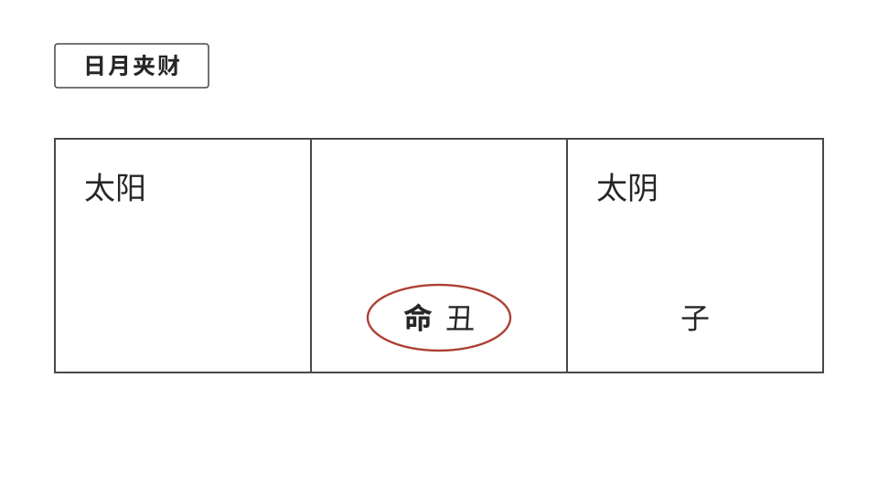
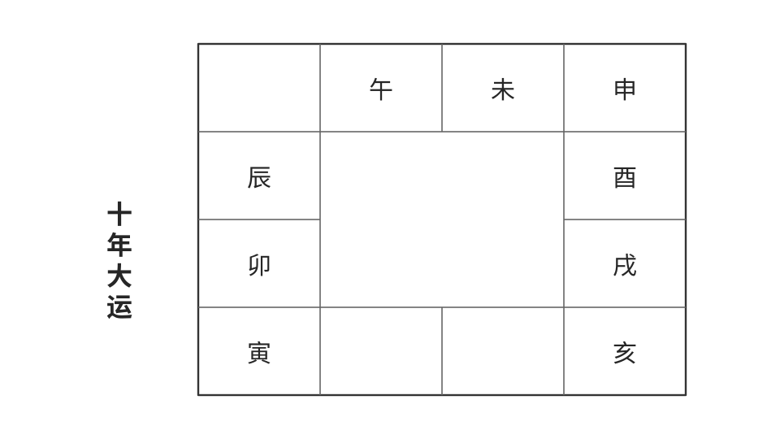
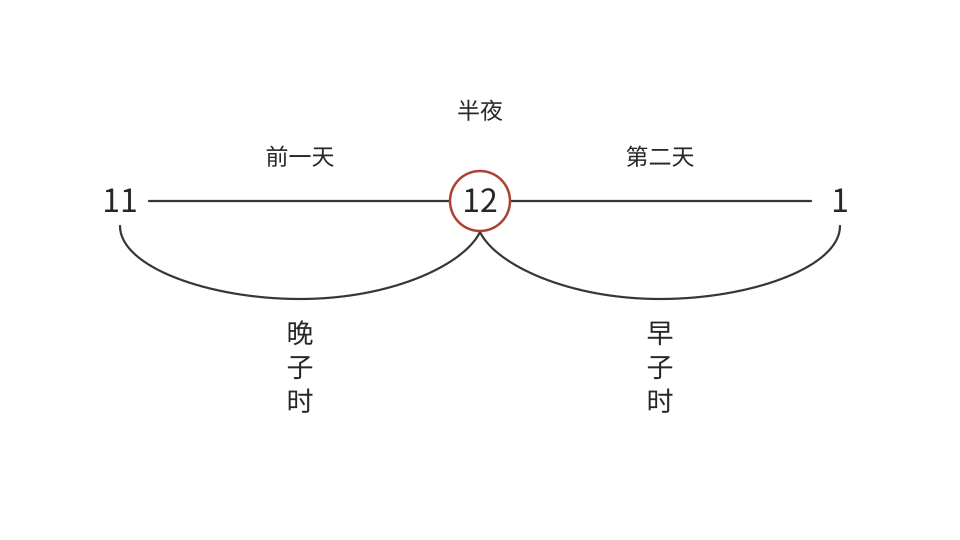
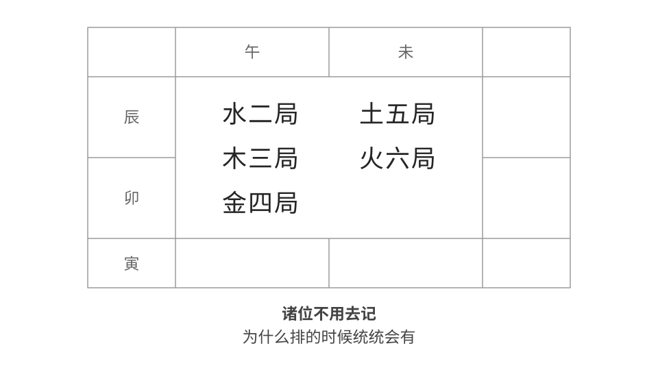
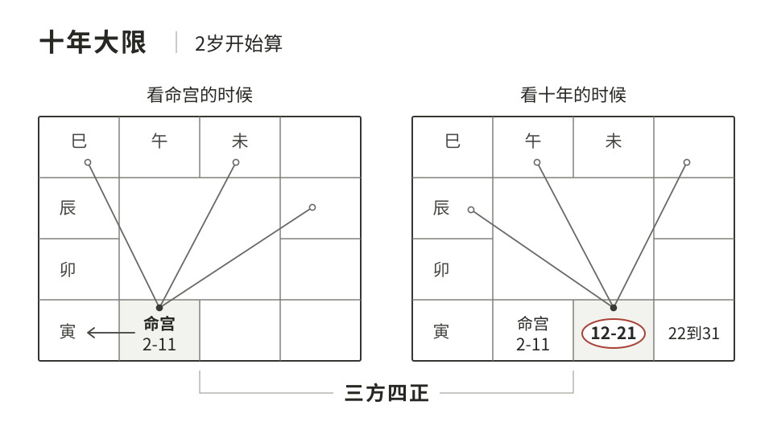
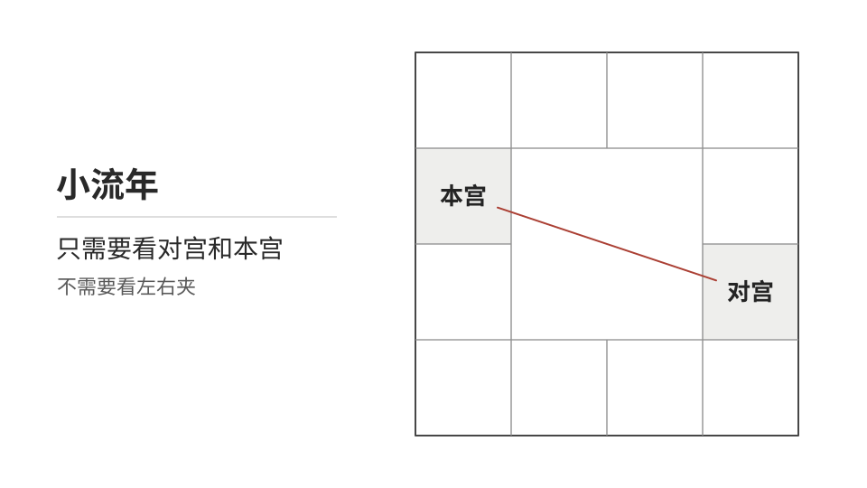
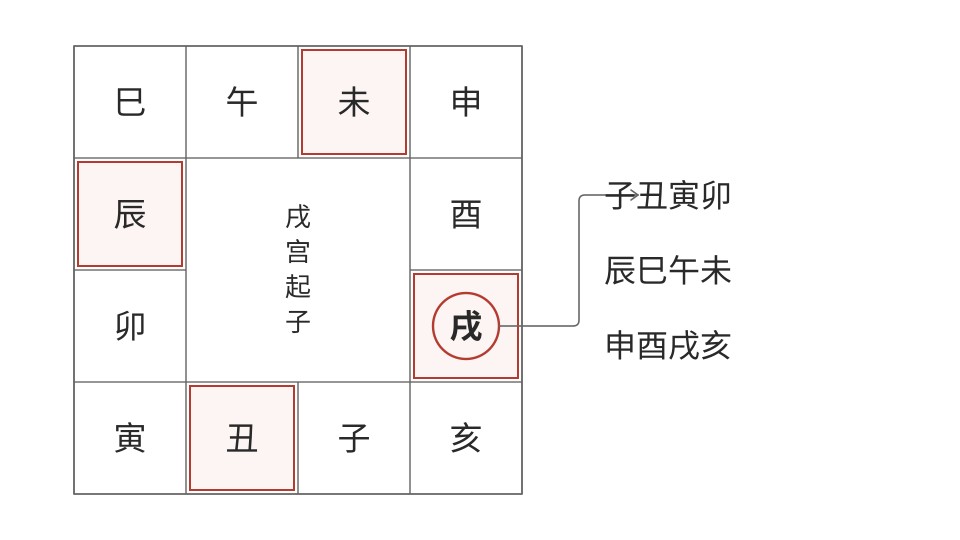
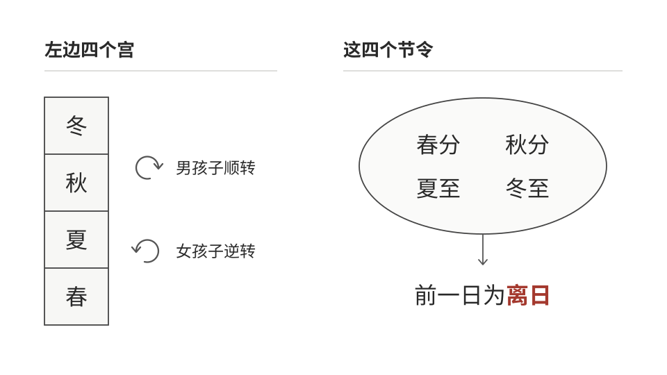

# P07 · 4 上：南斗星系 / 六杀星 / 副星 / 总格 / 离日绝日（00:00:00–00:51:20，共 92,412 帧）

> 2026-11-12 整理。依据 DeepSeek 逐帧记录与现成的五层材料（字幕、语音、叠图、板书、指代），由 Claude（Opus 5.5 子代理）分段起草，引文由程序逐段对过字幕。流程 2026-11-11 经站长认可。
> 依据标记：〔口述〕字幕与语音两路对得上的话，「」里是字幕原字 ·〔叠图〕后期贴的电子命盘，**不算倪师的话** ·〔板书〕粉笔字（看过那一帧原图才写）·〔指代〕「这里 / 这个」指哪（只收核过、确定的）·〔推断〕笔记作者自己的推断。每条后面的时间码可以点，跳到 B 站那一秒。

## 全集总结

**通用规则**

- 七杀、破军、贪狼都是南斗星系、是一组，常常会在一起，全部主武官（[00:00:04–00:00:31](https://www.bilibili.com/video/BV1KJsLekEfA/?p=7&t=4)，第 138–941 帧、[00:02:47–00:02:52](https://www.bilibili.com/video/BV1KJsLekEfA/?p=7&t=167)，第 5022–5177 帧）
- 庙旺利陷是星辰的亮度：所有星庙旺最好、利平平、陷最差，杀星落陷是差中更差、凶中之凶（[00:06:05–00:06:59](https://www.bilibili.com/video/BV1KJsLekEfA/?p=7&t=365)，第 10974–12581 帧）
- 越是好的时候越要警戒；流年通通是吉而后面藏着看不到的杀星，就会出事，这是杀星的意义（[00:10:12–00:10:44](https://www.bilibili.com/video/BV1KJsLekEfA/?p=7&t=612)，第 18366–19337 帧）
- 太阳、太阴左右两边夹命宫叫日月夹财，这个人一世财禄很大，包括先天祖业和后天财禄，命宫里没有主星也没关系（[00:16:48–00:17:42](https://www.bilibili.com/video/BV1KJsLekEfA/?p=7&t=1008)，第 30258–31871 帧）
- 文曲主才艺、博学多能，人较斯文；文昌主科甲、读书考试（[00:20:34–00:21:03](https://www.bilibili.com/video/BV1KJsLekEfA/?p=7&t=1234)，第 37020–37901 帧）
- 男命命宫有红鸾必招美妻，女命红鸾必有贵夫（[00:24:36–00:24:51](https://www.bilibili.com/video/BV1KJsLekEfA/?p=7&t=1476)，第 44286–44741 帧）
- 命好不如限好：十年大运叫做限，限好比命好还重要（[00:31:19–00:32:15](https://www.bilibili.com/video/BV1KJsLekEfA/?p=7&t=1879)，第 56394–58079 帧）
- 看十年大限要看它的三方四正和对面；批命先批十年，十年为主、小流年为辅（[00:37:27–00:38:11](https://www.bilibili.com/video/BV1KJsLekEfA/?p=7&t=2247)，第 67428–68759 帧）
- 春分、夏至、秋分、冬至前一日为离日，立春、立夏、立秋、立冬前一日为绝日，一年共八天，都是大凶、诸事不宜（[00:43:05–00:45:34](https://www.bilibili.com/video/BV1KJsLekEfA/?p=7&t=2585)，第 77574–82025 帧）
- 巨门本身是凶星，主口舌、是非、官司、牢狱之灾；庙旺则灾去大半、能言善道，落陷则问题来了、要坐牢（[00:48:07–00:49:12](https://www.bilibili.com/video/BV1KJsLekEfA/?p=7&t=2887)，第 86610–88571 帧）。

**只在本例**

- 假设娶个七杀的太太，就差不多毁了一半，因为多疑、草木皆兵（[00:00:48–00:00:57](https://www.bilibili.com/video/BV1KJsLekEfA/?p=7&t=48)，第 1440–1715 帧）
- 毕业旅行去横贯公路，旅行车一翻死掉一票人，用来说明吉处藏凶（[00:07:58–00:08:11](https://www.bilibili.com/video/BV1KJsLekEfA/?p=7&t=478)，第 14346–14741 帧）
- 有个女孩子走到财帛宫，辞职自己做生意，第一天签约的客户就是她未来的先生（[00:26:17–00:26:33](https://www.bilibili.com/video/BV1KJsLekEfA/?p=7&t=1577)，第 47310–47813 帧）
- 倪师说常算到明珠出海、石中隐玉、七杀朝斗紫府坐垣这类好格的人，批的时候却是夭折，因为命好限不好（[00:32:16–00:32:39](https://www.bilibili.com/video/BV1KJsLekEfA/?p=7&t=1936)，第 58080–58781 帧）
- 43年生、甲午年的人到83年为83-43+1=41岁；从戌起子数到午落在辰格为1岁，37岁也在辰格，41岁流年落申宫（[00:39:46–00:41:45](https://www.bilibili.com/video/BV1KJsLekEfA/?p=7&t=2386)，第 71586–75173 帧）
- 举例某人立冬设为12月25号，17号见他面目枯槁，流年六杀齐到、廉贞贪狼落陷进来，倪师说看相算命他百分之百死定了（[00:44:17–00:44:58](https://www.bilibili.com/video/BV1KJsLekEfA/?p=7&t=2657)，第 79734–80969 帧）

**不是排盘规则，是处世方法**

- 戒之初：刚开始就要谨慎，先查清楚，明了再动（[00:09:20–00:09:39](https://www.bilibili.com/video/BV1KJsLekEfA/?p=7&t=560)，第 16800–17399 帧）
- 看出小人就一开始不来往，不必想着去交很多朋友（[00:14:39–00:15:03](https://www.bilibili.com/video/BV1KJsLekEfA/?p=7&t=879)，第 26376–27101 帧）
- 对羊陀夹命的人不要只说他一辈子跟到小人、在劫难逃，要反过来讲他命中小人多、耳根子太软，教他分辨小人（[00:19:02–00:19:25](https://www.bilibili.com/video/BV1KJsLekEfA/?p=7&t=1142)，第 34260–34967 帧）
- 做妈妈的每天带孩子出去玩，让孩子保有童蒙天真，长大一身是胆（[00:34:49–00:34:59](https://www.bilibili.com/video/BV1KJsLekEfA/?p=7&t=2089)，第 62682–62975 帧）
- 客人好运没走到前就要提醒他戒盛，认为不可能的事最会发生，随时要警戒（[00:38:30–00:38:46](https://www.bilibili.com/video/BV1KJsLekEfA/?p=7&t=2310)，第 69312–69791 帧）

## 目录

**南斗三星：七杀、破军、贪狼（个性、形貌、事业）**

1. 南斗七杀破军贪狼的性情形貌与事业（00:00:00–00:04:48）

**六杀星：庙旺利陷、吉处藏凶、戒之初戒之盛、看相识小人**

2. 六杀、庙旺利陷与戒的时机（00:04:49–00:09:56）
3. 戒之盛、六杀流年断语与看相识小人（00:09:56–00:15:03）

**总格：日月夹财、紫府夹权、魁钺夹贵、羊陀夹杀**

4. 四种夹命总格与羊陀夹命怎么说（00:15:03–00:20:09）

**副星：曲昌、魁钺、红鸾天喜、辅弼、三台八座**

5. 副星：曲昌、魁钺与红鸾天喜（00:20:10–00:24:36）
6. 红鸾天喜、象数宗与辅弼台座（00:24:36–00:28:43）

**十年大运与小流年（闰月子时、命好不如限好、流年起法）**

7. 十年大运：闰月子时与命好不如限好（00:28:43–00:35:27）
8. 五行局、十年大限与小流年起法（00:35:28–00:42:09）

**节令离日绝日；补充两星：巨门、禄存（禄马交驰）**

9. 离日绝日：一年八天大凶与流年（00:42:09–00:46:44）
10. 流年快算与补讲巨门、禄存、禄马交驰（00:46:44–00:51:20）

## 南斗三星：七杀、破军、贪狼（个性、形貌、事业）

### 1　南斗七杀破军贪狼的性情形貌与事业（[00:00:00–00:04:48](https://www.bilibili.com/video/BV1KJsLekEfA/?p=7&t=0)，第 0–8669 帧）

| 提示区 | 笔记区 |
|---|---|
| **南斗三星是哪三颗？彼此什么关系、主什么官？** | 〔口述〕倪师说下面三个「都是南斗星系」：「七杀破军跟贪狼」，「这个这三个是一组的」；接着说「一定会会到」，这句话没说完就转开了。（[00:00:04–00:00:24](https://www.bilibili.com/video/BV1KJsLekEfA/?p=7&t=4)，第 138–731 帧） 〔板书〕可辨：上排横写「七杀、破军、贪狼」三星，下面画一道横线，横线右下方写一个「组」字。（[00:00:21](https://www.bilibili.com/video/BV1KJsLekEfA/?p=7&t=21)，第 655 帧） 〔口述〕「那这三颗呢」「全部主的是武官」，称为「武官星」；但三颗「个性上面会有区别」「有分别」。（[00:00:24–00:00:35](https://www.bilibili.com/video/BV1KJsLekEfA/?p=7&t=24)，第 732–1061 帧） 〔板书〕可辨：横线左下方竖写「武官」二字。（[00:00:29](https://www.bilibili.com/video/BV1KJsLekEfA/?p=7&t=29)，第 887 帧） |
| **七杀入命的人长相、个性怎样？** | 〔口述〕「七杀入命的人」「目大」，「做事情性子很急」；下一句字幕只认出一个「疑」字，语音作「多疑」。（[00:00:35–00:00:47](https://www.bilibili.com/video/BV1KJsLekEfA/?p=7&t=35)，第 1062–1439 帧） 〔板书〕可辨：「武官」左边竖写「目」「大」二字；其下一团潦草字迹认不出。（[00:00:47](https://www.bilibili.com/video/BV1KJsLekEfA/?p=7&t=47)，第 1428 帧） 〔口述〕倪师打比方：「如果你娶个太太」「七杀你就差不多毁了一半了」，因为「多疑很累啊」「草木皆兵」。（[00:00:48–00:00:57](https://www.bilibili.com/video/BV1KJsLekEfA/?p=7&t=48)，第 1440–1715 帧） 〔指代〕说「七杀你看这个个性就知道」时，手指的是板面左下「武」字左下方那团潦草字迹；字被手部分挡住，看不清是哪几个字。（[00:00:57](https://www.bilibili.com/video/BV1KJsLekEfA/?p=7&t=57)，第 1739 帧） |
| **三颗星共同的个性是什么？生活里怎么认出这种人？** | 〔口述〕「他性子很急而且很刚」，「这三个星都很刚」「都是很阳刚性的」。（[00:00:58–00:01:02](https://www.bilibili.com/video/BV1KJsLekEfA/?p=7&t=58)，第 1752–1889 帧） 〔口述〕倪师说：「所以你看有个人个性很刚强」「谁的话都不接受」「然后一天到晚在自以为是」「那都是七杀、破军、贪狼的人」。（[00:01:03–00:01:12](https://www.bilibili.com/video/BV1KJsLekEfA/?p=7&t=63)，第 1890–2189 帧） |
| **破军跟七杀唯一的差别在哪？破军的人长什么样？** | 〔口述〕「像破军呢」「跟七杀唯一的差别在这」：「破军星比较孤僻」。（[00:01:13–00:01:20](https://www.bilibili.com/video/BV1KJsLekEfA/?p=7&t=73)，第 2190–2429 帧） 〔口述〕倪师顺带说「你看我们天文地理」「我们讲这个比心理学还有用」。（[00:01:21–00:01:23](https://www.bilibili.com/video/BV1KJsLekEfA/?p=7&t=81)，第 2430–2519 帧） 〔口述〕再强调破军「他个性很孤僻」「非常的孤」，「也就是孤芳自赏」。（[00:01:24–00:01:29](https://www.bilibili.com/video/BV1KJsLekEfA/?p=7&t=84)，第 2520–2687 帧） 〔口述〕破军的形貌：「人呢瘦瘦的」「很瘦怎么养都不胖」「吃五谷杂粮吃肉啊怎么吃都不胖」。（[00:01:29–00:01:36](https://www.bilibili.com/video/BV1KJsLekEfA/?p=7&t=89)，第 2688–2909 帧） |
| **破军的人怎么看钱财？谈恋爱时要注意什么？** | 〔口述〕「那破军星的人不重利」「对钱财看不重」。（[00:01:37–00:01:44](https://www.bilibili.com/video/BV1KJsLekEfA/?p=7&t=97)，第 2910–3125 帧） 〔板书〕可辨：板面右上新写一行并在下面画线，第一字「不」认得出，后两字草写认不全（此时口述正讲「不重利」）。（[00:01:42](https://www.bilibili.com/video/BV1KJsLekEfA/?p=7&t=102)，第 3084 帧） 〔口述〕举例：你遇到一个女朋友，「结果她的妈妈是一个破军星」，「你每天在送你女朋友金银珠宝」「她妈妈一定反对的」，「所以招子放亮点人要看清楚」。（[00:01:44–00:01:57](https://www.bilibili.com/video/BV1KJsLekEfA/?p=7&t=104)，第 3126–3539 帧） 〔口述〕反过来「如果你女朋友是破军星」「这种人最好了」：「她不重利」「她完全重感觉」，「感觉不好」「钱多不重要」。（[00:01:58–00:02:08](https://www.bilibili.com/video/BV1KJsLekEfA/?p=7&t=118)，第 3540–3845 帧） |
| **贪狼在人事上主什么？跟廉贞的桃花有何不同？** | 〔口述〕「那贪狼星呢」「在人事上面呢」「这个是属于桃花星」；「像廉贞星呢是次桃花」「贪狼是主桃花」。（[00:02:08–00:02:20](https://www.bilibili.com/video/BV1KJsLekEfA/?p=7&t=128)，第 3846–4223 帧） 〔口述〕「那这个主桃花贪狼除了指桃花以外」「也指的是酒、财、气」，又说「酒、色、财、气、赌」「通通在贪狼的里面」。（[00:02:20–00:02:35](https://www.bilibili.com/video/BV1KJsLekEfA/?p=7&t=140)，第 4224–4655 帧） 〔板书〕可辨：「桃花」下方写「酒、色」二字，后面被人挡住。（[00:02:26](https://www.bilibili.com/video/BV1KJsLekEfA/?p=7&t=146)，第 4404 帧） 〔板书〕可辨：「贪狼」右边画一道竖线，引出箭头「→」，箭头后写「桃花星」并画下划线；再下一行可见「色、财、气」，最前一字被人挡住；更下方还有字，认不全。（[00:02:34](https://www.bilibili.com/video/BV1KJsLekEfA/?p=7&t=154)，第 4632 帧） |
| **贪狼的人长什么样？三颗星常以什么方式出现？** | 〔口述〕贪狼的形貌「比较魁梧比较大」「或者毛发比较多」「身上汗毛啊什么比较多」。（[00:02:35–00:02:47](https://www.bilibili.com/video/BV1KJsLekEfA/?p=7&t=155)，第 4656–5021 帧） 〔口述〕「那这三颗星常常会在一起」，又重复一遍「常常三颗星常常会在一起」。（[00:02:47–00:02:52](https://www.bilibili.com/video/BV1KJsLekEfA/?p=7&t=167)，第 5022–5177 帧） 〔板书〕可辨：三星下面那道横线之下，新画一道向下弯的弧线，左端约在「杀」字下方，右端约在「狼」字下方。（[00:02:50](https://www.bilibili.com/video/BV1KJsLekEfA/?p=7&t=170)，第 5104 帧） 〔口述〕「那武官拿到这种星最好了」；举例「你看那个张飞那个毛发多不多」「那胡子还很多对不对」。（[00:02:52–00:02:58](https://www.bilibili.com/video/BV1KJsLekEfA/?p=7&t=172)，第 5178–5363 帧） 〔指代〕说「这个贪狼」时，手指的是黑板上「贪狼」二字，粉笔停在「狼」字正下方。（[00:02:58](https://www.bilibili.com/video/BV1KJsLekEfA/?p=7&t=178)，第 5349 帧） |
| **遇到刚强固执的人，批命时要提醒他什么？** | 〔口述〕「那这几个就是个性会比较刚强」「比较固执」。（[00:03:00–00:03:03](https://www.bilibili.com/video/BV1KJsLekEfA/?p=7&t=180)，第 5400–5519 帧） 〔口述〕「那遇到这种人批八字的时候」「诸位就要记得」，「我们人物志里面告诉诸位」「前面我放在讲义里面」：「刚愎自用的人呢最容易被人家利用」，「你就要提醒」「提醒他」。（[00:03:04–00:03:16](https://www.bilibili.com/video/BV1KJsLekEfA/?p=7&t=184)，第 5520–5903 帧） |
| **学懂以后，为什么相会内敛、别人看不准？** | 〔口述〕「所有的这个斗数的星」「形容一个人的时候」「他有如果有中庸之德」，这句话没说完就接到下一句。（[00:03:16–00:03:25](https://www.bilibili.com/video/BV1KJsLekEfA/?p=7&t=196)，第 5904–6173 帧） 〔口述〕「你们如果很懂了以后」「你们的相会内敛进去」，「批八字是看不准的」「我们就看不准」「看到哎不对了」；「为什么因为你懂」「那相就内敛进去了」。（[00:03:25–00:03:37](https://www.bilibili.com/video/BV1KJsLekEfA/?p=7&t=205)，第 6174–6527 帧） 〔口述〕「内敛进去以后因为你懂了」，「同时你也会变得很正很好」，「所以学了这个出去人还会变」。（[00:03:37–00:03:45](https://www.bilibili.com/video/BV1KJsLekEfA/?p=7&t=217)，第 6528–6767 帧） 〔推断〕推断：倪师把「中庸之德」和「懂了以后相内敛」接连讲，似乎是说星性在外相上显不显，会因修养和学识而变，所以看相批命会看不准；但他没有把两句明确连起来。（[00:03:16–00:03:45](https://www.bilibili.com/video/BV1KJsLekEfA/?p=7&t=196)，第 5904–6767 帧） |
| **事业上，七杀破军与贪狼各主什么？** | 〔口述〕「那如果在事业上面来说的话」「这三颗星呢」：「这两颗星」「主的是耗主的是劳」，「这颗星呢」「主的是财」。字幕在「这两颗星」后加注「七杀破军」、在「这颗星呢」后加注「贪狼」，是字幕注，语音里没有。（[00:03:45–00:04:00](https://www.bilibili.com/video/BV1KJsLekEfA/?p=7&t=225)，第 6768–7229 帧） 〔板书〕可辨：「七杀」「破军」下方各引一条斜线汇成 V 形，「贪狼」下方引一道向下的箭头；再下面一行草字认不全，结合口述像是「耗」「劳」「财」。（[00:04:00](https://www.bilibili.com/video/BV1KJsLekEfA/?p=7&t=240)，第 7224 帧） 〔口述〕「所以它不但有刚刚讲的酒、色、财」「它主的是财」：「如果你的流年逢到贪狼很旺」，「换句话说如果财禄事业很赚钱喽」，「那很多赚钱的同时」「就逃不了这个桃花星」。（[00:04:01–00:04:14](https://www.bilibili.com/video/BV1KJsLekEfA/?p=7&t=241)，第 7230–7631 帧） 〔指代〕说「就逃不了这个桃花星」时，手指的是黑板上刚写的「桃花」二字，正拿粉笔在它外面画圈。（[00:04:11](https://www.bilibili.com/video/BV1KJsLekEfA/?p=7&t=251)，第 7553 帧） |
| **流年遇到七杀、破军会怎样？** | 〔口述〕「那这两颗星如果遇到流年」，「主劳辛苦的奔波劳碌」「孤单要一个人拼命去做事情」，「然后呢又耗」「有财钱财进来钱财出去又不容易聚财」。（[00:04:14–00:04:27](https://www.bilibili.com/video/BV1KJsLekEfA/?p=7&t=254)，第 7632–8033 帧） 〔推断〕推断：这里的「这两颗星」承接前面「主的是耗主的是劳」的两颗（字幕注为七杀破军），所讲的奔波劳碌、钱财进出不聚也正好对上「劳」与「耗」。（[00:03:50–00:04:27](https://www.bilibili.com/video/BV1KJsLekEfA/?p=7&t=230)，第 6924–8033 帧） |
| **这些星义该怎么学？什么时候再回头看书？** | 〔口述〕「这是它的星义」「诸位用性去领悟它」「不用去那个看书」。（[00:04:27–00:04:35](https://www.bilibili.com/video/BV1KJsLekEfA/?p=7&t=267)，第 8034–8273 帧） 〔口述〕「书上里面写的诸位先不要管」，「你三个月听完了后」「你已经变得很强了」，「有空再回头看看那些书」；「否则你不了解时一看书就会被书绑到」。倪师此时一边擦板一边说。（[00:04:35–00:04:48](https://www.bilibili.com/video/BV1KJsLekEfA/?p=7&t=275)，第 8274–8669 帧） |

**总结区**

- 通用规则：七杀、破军、贪狼都是南斗星系、是一组，常常会在一起，全部主武官（[00:00:04–00:00:31](https://www.bilibili.com/video/BV1KJsLekEfA/?p=7&t=4)，第 138–941 帧、[00:02:47–00:02:52](https://www.bilibili.com/video/BV1KJsLekEfA/?p=7&t=167)，第 5022–5177 帧）；三颗星都很刚、阳刚；个性刚强、谁的话都不接受、自以为是的，都是七杀破军贪狼的人（[00:00:58–00:01:12](https://www.bilibili.com/video/BV1KJsLekEfA/?p=7&t=58)，第 1752–2189 帧）；贪狼是主桃花、廉贞是次桃花，酒色财气赌通通在贪狼里面（[00:02:08–00:02:35](https://www.bilibili.com/video/BV1KJsLekEfA/?p=7&t=128)，第 3846–4655 帧）；事业上七杀破军主耗主劳、贪狼主财；流年逢贪狼旺赚钱的同时逃不了桃花，流年遇七杀破军则奔波劳碌、钱财不易聚（[00:03:45–00:04:27](https://www.bilibili.com/video/BV1KJsLekEfA/?p=7&t=225)，第 6768–8033 帧）
- 只在本例：假设娶个七杀的太太，就差不多毁了一半，因为多疑、草木皆兵（[00:00:48–00:00:57](https://www.bilibili.com/video/BV1KJsLekEfA/?p=7&t=48)，第 1440–1715 帧）；假设女朋友的妈妈是破军星，你天天送女朋友金银珠宝，她妈妈一定反对（[00:01:45–00:01:54](https://www.bilibili.com/video/BV1KJsLekEfA/?p=7&t=105)，第 3168–3431 帧）；举张飞毛发多、胡子多为例（[00:02:54–00:02:58](https://www.bilibili.com/video/BV1KJsLekEfA/?p=7&t=174)，第 5232–5363 帧）
- 不是排盘规则，是处世方法：招子放亮点，人要看清楚（[00:01:54–00:01:57](https://www.bilibili.com/video/BV1KJsLekEfA/?p=7&t=114)，第 3432–3539 帧）；遇到刚强固执、刚愎自用的人，批命时要提醒他最容易被人利用（[00:03:00–00:03:16](https://www.bilibili.com/video/BV1KJsLekEfA/?p=7&t=180)，第 5400–5903 帧）；学了这门学问，人的相会内敛、人也会变得很正很好（[00:03:25–00:03:45](https://www.bilibili.com/video/BV1KJsLekEfA/?p=7&t=205)，第 6174–6767 帧）；星义先用性去领悟，书上写的先不管，听完三个月变强后再回头看书，否则会被书绑住（[00:04:27–00:04:48](https://www.bilibili.com/video/BV1KJsLekEfA/?p=7&t=267)，第 8034–8669 帧）

**待核**

1. 「一定会会到」句子没说完，会到什么不清楚（[00:00:21](https://www.bilibili.com/video/BV1KJsLekEfA/?p=7&t=21)，第 642 帧）
2. 字幕只认出「疑」一字，语音作「多疑」（[00:00:45](https://www.bilibili.com/video/BV1KJsLekEfA/?p=7&t=45)，第 1356 帧）
3. 字幕开头多一个「（」（[00:00:58](https://www.bilibili.com/video/BV1KJsLekEfA/?p=7&t=58)，第 1752 帧）和「/」（[00:03:39](https://www.bilibili.com/video/BV1KJsLekEfA/?p=7&t=219)，第 6570 帧），引文中已去掉这两个符号，其余未改字
4. 板书：「武官」左边「目」「大」之下的一团潦草字认不出（[00:00:47](https://www.bilibili.com/video/BV1KJsLekEfA/?p=7&t=47)，第 1428 帧）；破军上方有一行草字，口述此时讲「孤僻」，但字形认不全（第2544、7224帧）
5. 板书：右上那行第一字「不」之后两字草写认不全（[00:01:42](https://www.bilibili.com/video/BV1KJsLekEfA/?p=7&t=102)，第 3084 帧）；「桃花星」上方似有一小字认不出（[00:02:34](https://www.bilibili.com/video/BV1KJsLekEfA/?p=7&t=154)，第 4632 帧）
6. 板书：[00:03:23–00:03:26](https://www.bilibili.com/video/BV1KJsLekEfA/?p=7&t=203)，第 6096–6191 帧写的字在[00:03:32](https://www.bilibili.com/video/BV1KJsLekEfA/?p=7&t=212)，第 6360 帧被人挡住，认不出；[00:03:43–00:03:45](https://www.bilibili.com/video/BV1KJsLekEfA/?p=7&t=223)，第 6708–6755 帧、[00:04:09–00:04:13](https://www.bilibili.com/video/BV1KJsLekEfA/?p=7&t=249)，第 7488–7619 帧两段写板书没有抽图（[00:03:32](https://www.bilibili.com/video/BV1KJsLekEfA/?p=7&t=212)，第 6360 帧）
7. 板书：事业那行草字只是像「耗」「劳」「财」，字形认不全（[00:04:00](https://www.bilibili.com/video/BV1KJsLekEfA/?p=7&t=240)，第 7224 帧）
8. 指代拿不准：[00:02:11](https://www.bilibili.com/video/BV1KJsLekEfA/?p=7&t=131)，第 3937 帧（贪狼箭头处，分不清指还是写）、[00:02:29](https://www.bilibili.com/video/BV1KJsLekEfA/?p=7&t=149)，第 4490 帧（「酒」字处，可能在补写）、[00:02:59](https://www.bilibili.com/video/BV1KJsLekEfA/?p=7&t=179)，第 5392 帧（「这几个」可能指整组星），均未当依据（[00:02:11](https://www.bilibili.com/video/BV1KJsLekEfA/?p=7&t=131)，第 3937 帧）
9. 「人物志」「前面我放在讲义里面」所指的讲义内容本材料里没有（[00:03:06](https://www.bilibili.com/video/BV1KJsLekEfA/?p=7&t=186)，第 5586 帧）
10. 倪师在讲斗数时说「批八字」（语音作「琵琶痴」），本块没解释是否泛指批命（[00:03:04](https://www.bilibili.com/video/BV1KJsLekEfA/?p=7&t=184)，第 5520 帧）
11. 「他有如果有中庸之德」句子没说完；「你们的相会内敛进去」「批八字是看不准的」主语是谁看谁不完全清楚（[00:03:23](https://www.bilibili.com/video/BV1KJsLekEfA/?p=7&t=203)，第 6090 帧）
12. 「诸位用性去领悟它」语音作「用信去」，原意待核，未改字（[00:04:30](https://www.bilibili.com/video/BV1KJsLekEfA/?p=7&t=270)，第 8118 帧）
13. 「像廉贞星呢是次桃花」语音作「赤桃花」，按字幕取「次」（[00:02:17](https://www.bilibili.com/video/BV1KJsLekEfA/?p=7&t=137)，第 4122 帧）
14. 「所以它不但有刚刚讲的酒、色、财」句子没说完（[00:04:01](https://www.bilibili.com/video/BV1KJsLekEfA/?p=7&t=241)，第 7230 帧）

## 六杀星：庙旺利陷、吉处藏凶、戒之初戒之盛、看相识小人

### 2　六杀、庙旺利陷与戒的时机（[00:04:49–00:09:56](https://www.bilibili.com/video/BV1KJsLekEfA/?p=7&t=289)，第 8670–17891 帧）

| 提示区 | 笔记区 |
|---|---|
| **六杀是哪六颗星？** | 〔口述〕讲完前面三颗星，接着讲一组星：「这三颗星完了后面有一组」「我们叫六杀」，「叫做羊、陀、火、铃、空、劫」。（[00:04:49–00:05:07](https://www.bilibili.com/video/BV1KJsLekEfA/?p=7&t=289)，第 8670–9221 帧） 〔口述〕逐个说全名：羊是擎羊，陀是陀罗，还有火星、铃星、天空、地劫；「这是我们在算命的时候这个叫做六杀」。这几句字幕可信度偏低，星名按板书核对。（[00:05:09–00:05:27](https://www.bilibili.com/video/BV1KJsLekEfA/?p=7&t=309)，第 9270–9821 帧） 〔板书〕可辨：「陀羅」「火」「天空、」「地劫」，中间一部分被老师身体挡住，其余认不出。（[00:05:21](https://www.bilibili.com/video/BV1KJsLekEfA/?p=7&t=321)，第 9647 帧） 〔板书〕可辨：「擎羊」「陀羅」；左边竖写的「殺」字认得出，它上面一字疑为「六」，不能确定。（[00:06:26](https://www.bilibili.com/video/BV1KJsLekEfA/?p=7&t=386)，第 11580 帧） |
| **六杀落在有人的宫和没人的宫，解释一样吗？** | 〔口述〕六杀出现时要分落在哪类宫：「这个六杀出现的时候……在有人的宫或者在事业宫无人的宫」。（[00:05:29–00:05:39](https://www.bilibili.com/video/BV1KJsLekEfA/?p=7&t=329)，第 9876–10181 帧） 〔口述〕有人的宫，举父母宫、命宫、兄弟宫、夫妻宫、子女宫、朋友宫，「都是属于有人的宫」，落在这些宫「它的解释都不一样」。（[00:05:39–00:05:47](https://www.bilibili.com/video/BV1KJsLekEfA/?p=7&t=339)，第 10182–10421 帧） 〔口述〕没人的宫，举财帛、官禄、迁移：「这些没有人的宫它解释也不一样」「但是基本上脱离不了通通是杀星」。（[00:05:47–00:05:57](https://www.bilibili.com/video/BV1KJsLekEfA/?p=7&t=347)，第 10422–10733 帧） 〔推断〕推断：本块只把宫分成有人、没人两类，说落在各宫解释不同，但没讲具体怎么不同；共同点是不管落哪里都还是杀星。（[00:05:29–00:05:57](https://www.bilibili.com/video/BV1KJsLekEfA/?p=7&t=329)，第 9876–10733 帧） |
| **庙旺利陷是什么意思？** | 〔口述〕「我们在看杀星的时候特别要注意」：排出来以后星「都会有庙、旺、利、陷」，「这个就是所谓的星辰的亮度」。（[00:05:59–00:06:26](https://www.bilibili.com/video/BV1KJsLekEfA/?p=7&t=359)，第 10782–11585 帧） 〔板书〕可辨：横排写「廟、旺、利、陷」，下面画了一道横线；左侧竖写「亮度」两字。（[00:06:26](https://www.bilibili.com/video/BV1KJsLekEfA/?p=7&t=386)，第 11580 帧） 〔口述〕用太阳打比方：白天太阳本该很亮，结果「天上乌云密布太阳光没办法透射」，「它代表的亮度不太一样」。（[00:06:26–00:06:38](https://www.bilibili.com/video/BV1KJsLekEfA/?p=7&t=386)，第 11586–11963 帧） |
| **星在庙旺、利、陷，各是好是坏？杀星落陷呢？** | 〔口述〕先说吉星入庙，再总括：「反正所有的星在庙旺的时候都是最好」「在利的时候是平平在陷的时候是最差」。（[00:06:38–00:06:49](https://www.bilibili.com/video/BV1KJsLekEfA/?p=7&t=398)，第 11964–12299 帧） 〔口述〕「那如果你遇到杀星在陷地的话」「哇那是差中更差」，又说「凶中之凶」，是凶里面的大凶（字幕作「大区」，按语音改）。（[00:06:50–00:06:59](https://www.bilibili.com/video/BV1KJsLekEfA/?p=7&t=410)，第 12300–12581 帧） 〔板书〕可辨：「廟、旺」两字圈在一个圈里，「利」单独一圈，「陷」单独一圈；「擎羊」下方加写一个「陷」字并画圈。（[00:06:53](https://www.bilibili.com/video/BV1KJsLekEfA/?p=7&t=413)，第 12413 帧） 〔推断〕推断：擎羊下加写「陷」，像是在示意杀星落陷的情形；倪师口头只说「杀星在陷地」，没点名擎羊。（[00:06:50–00:06:53](https://www.bilibili.com/video/BV1KJsLekEfA/?p=7&t=410)，第 12300–12413 帧） |
| **杀星入庙会怎样？** | 〔口述〕举陀罗星、火星入庙的情形：「而庙旺的话这个杀星呢」「反而会变成吉星」，接着又重复说杀星会变吉星，并问怎么解释。（[00:06:59–00:07:12](https://www.bilibili.com/video/BV1KJsLekEfA/?p=7&t=419)，第 12582–12965 帧） 〔板书〕可辨：「火」字下方加了一个画圈的「吉」字，旁边是「星」；右下另有一个圈，里面写「廟」。（[00:07:07](https://www.bilibili.com/video/BV1KJsLekEfA/?p=7&t=427)，第 12833 帧） |
| **什么叫吉处藏凶、凶处藏吉？** | 〔口述〕「我们有两句话」「叫做吉处藏凶」「还有呢」「凶处藏吉」，后面接「平安避凶」。（[00:07:12–00:07:36](https://www.bilibili.com/video/BV1KJsLekEfA/?p=7&t=432)，第 12966–13697 帧） 〔口述〕吉处藏凶：「看到都是吉星的时候」「里面有一个杀星暗在里面」「落陷在里面」「叫做吉处藏凶」。（[00:07:36–00:07:42](https://www.bilibili.com/video/BV1KJsLekEfA/?p=7&t=456)，第 13698–13877 帧） 〔口述〕凶处藏吉：「看到都是杀星可是里面杀星都入庙」「有一处有一个是吉星」「就是入庙在里面的时候」，叫凶处藏吉，「这是平安」。（[00:07:42–00:07:52](https://www.bilibili.com/video/BV1KJsLekEfA/?p=7&t=462)，第 13878–14165 帧） 〔板书〕板面上方两行，可辨：第一行开头「吉處藏凶」，第二行开头「凶處藏吉」；第二行末尾两字疑为「平安」，两行后半截其余字认不出。（[00:08:40](https://www.bilibili.com/video/BV1KJsLekEfA/?p=7&t=520)，第 15614 帧） |
| **吉处藏凶，用人间的事怎么理解？** | 〔口述〕倪师说这两句「我们人间道就可以解释了」。（[00:07:53–00:07:55](https://www.bilibili.com/video/BV1KJsLekEfA/?p=7&t=473)，第 14190–14279 帧） 〔口述〕「我们大家出国旅游玩是好事情」，是吉；到横贯公路毕业旅行很好，「结果旅行车一翻通通死掉」「死掉一票人」，这就是「吉处藏凶在劫难逃」。（[00:07:58–00:08:11](https://www.bilibili.com/video/BV1KJsLekEfA/?p=7&t=478)，第 14346–14741 帧） |
| **凶处藏吉，用人间的事怎么理解？** | 〔口述〕「那你家隔壁邻居失火了」，看到火很大，是凶处；可是「那我们就已经有知道了危险了」「我们就预防了」。（[00:08:11–00:08:18](https://www.bilibili.com/video/BV1KJsLekEfA/?p=7&t=491)，第 14742–14963 帧） 〔口述〕再举消防队员：「消防队员去很少消防队员被烧死的」「结果都没事为什么」，随后又念一遍吉处藏凶、凶处藏吉、平安。（[00:08:18–00:08:25](https://www.bilibili.com/video/BV1KJsLekEfA/?p=7&t=498)，第 14964–15167 帧） 〔推断〕推断：两个例子对照着讲，好事里可能藏着灾，看得见的危险反而因为知道而预防，所以平安。「知道危险就预防」是倪师原话的意思，归纳是笔记作者的。（[00:07:58–00:08:22](https://www.bilibili.com/video/BV1KJsLekEfA/?p=7&t=478)，第 14346–15089 帧） |
| **遇到这两种情况，要怎么跟客户说？** | 〔口述〕这两种情况出来的时候，「这时我们要告诉客户」「先生您要知道戒」。（[00:08:25–00:08:32](https://www.bilibili.com/video/BV1KJsLekEfA/?p=7&t=505)，第 15168–15371 帧） 〔口述〕「第一个戒有戒有戒的时机」，分「戒之初戒之盛」。本块只讲到戒之初，戒之盛在下一块。（[00:08:32–00:08:41](https://www.bilibili.com/video/BV1KJsLekEfA/?p=7&t=512)，第 15372–15641 帧） 〔板书〕可辨：板面右上写「戒之初」，下方另写「之盛」。（[00:08:40](https://www.bilibili.com/video/BV1KJsLekEfA/?p=7&t=520)，第 15614 帧） |
| **孔子讲戒慎恐惧，倪师怎么看？** | 〔口述〕说孔子「但是也有很多地方是错的」；孔子「是教我们戒慎恐惧」「他说是慎」。（[00:08:41–00:08:59](https://www.bilibili.com/video/BV1KJsLekEfA/?p=7&t=521)，第 15642–16175 帧） 〔口述〕反问：「一个最谨慎小心的人坐在飞机上面」「结果飞机掉下去他就没事了」「跟他没关系啊」，并念「予不得已也非予所愿也」。（[00:08:59–00:09:11](https://www.bilibili.com/video/BV1KJsLekEfA/?p=7&t=539)，第 16176–16547 帧） 〔板书〕可辨：右下竖写「戒」，下面一个画圈的「慎」，再下面两字潦草，疑为「恐」「懼」。（[00:08:57](https://www.bilibili.com/video/BV1KJsLekEfA/?p=7&t=537)，第 16127 帧） 〔推断〕推断：倪师用坐飞机的例子说明光是谨慎不够，接着就说「真正的戒」在于戒的时机。（[00:08:59–00:09:15](https://www.bilibili.com/video/BV1KJsLekEfA/?p=7&t=539)，第 16176–16661 帧） |
| **真正的戒，戒的是什么？谁决定时机？** | 〔口述〕「真正的戒」「要戒戒的时机」，戒之时；「我讲过决定什么时机的人是智」。（[00:09:11–00:09:19](https://www.bilibili.com/video/BV1KJsLekEfA/?p=7&t=551)，第 16548–16799 帧） |
| **戒之初怎么做？举了哪些例子？** | 〔口述〕「什么叫做戒之初」：「刚开始的时候要谨慎」。（[00:09:20–00:09:24](https://www.bilibili.com/video/BV1KJsLekEfA/?p=7&t=560)，第 16800–16943 帧） 〔口述〕去旅行先查游览公司：「我们先去查这游览公司开车的记录如何」「他派给我们的驾驶有没有酗酒的记录啊」，先弄清楚，「明了再动」。（[00:09:25–00:09:39](https://www.bilibili.com/video/BV1KJsLekEfA/?p=7&t=565)，第 16962–17399 帧） 〔口述〕签约：「在刚开始跟人家签合约的时候」「先把该避免的通通写在里面」「先小人了后君子」。（[00:09:40–00:09:49](https://www.bilibili.com/video/BV1KJsLekEfA/?p=7&t=580)，第 17400–17675 帧） 〔口述〕上任：「刚开始我们走马上任」「去做一件大事情的时候」「刚开始的时候要警戒」。（[00:09:49–00:09:56](https://www.bilibili.com/video/BV1KJsLekEfA/?p=7&t=589)，第 17676–17891 帧） |

**总结区**

- 通用规则：六杀是擎羊、陀罗、火星、铃星、天空、地劫（[00:04:49–00:05:27](https://www.bilibili.com/video/BV1KJsLekEfA/?p=7&t=289)，第 8670–9821 帧）；庙旺利陷是星辰的亮度：所有星庙旺最好、利平平、陷最差，杀星落陷是差中更差、凶中之凶（[00:06:05–00:06:59](https://www.bilibili.com/video/BV1KJsLekEfA/?p=7&t=365)，第 10974–12581 帧）；杀星庙旺反而会变成吉星（[00:06:59–00:07:12](https://www.bilibili.com/video/BV1KJsLekEfA/?p=7&t=419)，第 12582–12965 帧）；吉星当中暗藏落陷杀星叫吉处藏凶；杀星当中入庙且有一颗吉星叫凶处藏吉，是平安（[00:07:36–00:07:52](https://www.bilibili.com/video/BV1KJsLekEfA/?p=7&t=456)，第 13698–14165 帧）
- 只在本例：毕业旅行去横贯公路，旅行车一翻死掉一票人，用来说明吉处藏凶（[00:07:58–00:08:11](https://www.bilibili.com/video/BV1KJsLekEfA/?p=7&t=478)，第 14346–14741 帧）；邻居失火、消防队员很少被烧死，用来说明凶处藏吉（[00:08:11–00:08:22](https://www.bilibili.com/video/BV1KJsLekEfA/?p=7&t=491)，第 14742–15089 帧）；最谨慎的人坐飞机，飞机掉下去也躲不过，用来说明光谨慎不够（[00:08:59–00:09:07](https://www.bilibili.com/video/BV1KJsLekEfA/?p=7&t=539)，第 16176–16415 帧）
- 不是排盘规则，是处世方法：遇到吉处藏凶、凶处藏吉，要告诉客户要戒，而且戒有时机（[00:08:25–00:08:41](https://www.bilibili.com/video/BV1KJsLekEfA/?p=7&t=505)，第 15168–15641 帧）；戒之初：刚开始就要谨慎，先查清楚，明了再动（[00:09:20–00:09:39](https://www.bilibili.com/video/BV1KJsLekEfA/?p=7&t=560)，第 16800–17399 帧）；签合约时先把该避免的都写进去，先小人后君子（[00:09:40–00:09:49](https://www.bilibili.com/video/BV1KJsLekEfA/?p=7&t=580)，第 17400–17675 帧）

**待核**

1. [00:05:09–00:05:22](https://www.bilibili.com/video/BV1KJsLekEfA/?p=7&t=309)，第 9270–9683 帧 星名字幕可信度 0.41–0.51，语音作「秦羊」「陀螺」「灵星」「地球」，已按板书改为擎羊、陀罗、铃星、地劫。
2. [00:05:37](https://www.bilibili.com/video/BV1KJsLekEfA/?p=7&t=337)，第 10128 帧 字幕「或者在事业宫无人的宫」可信度 0.5，事业宫被归入没人的宫，原话待核。
3. [00:06:05](https://www.bilibili.com/video/BV1KJsLekEfA/?p=7&t=365)，第 10974 帧 字幕原字是「我们呢排出来的八字以后」，讲星辰亮度时说「八字」，是否口误待核。
4. [00:06:57](https://www.bilibili.com/video/BV1KJsLekEfA/?p=7&t=417)，第 12510 帧 字幕「凶里面的大区」，语音「大胸」，笔记里改作「大凶」。
5. [00:07:01](https://www.bilibili.com/video/BV1KJsLekEfA/?p=7&t=421)，第 12630 帧 「那你如果遇到陀罗星结果火星呢是入庙」，陀罗与火星之间是什么关系，本块没讲清。
6. [00:07:48](https://www.bilibili.com/video/BV1KJsLekEfA/?p=7&t=468)，第 14046 帧 字幕「叫做吉凶处藏吉」可信度 0.38，按上下文当作「凶处藏吉」。
7. [00:08:08](https://www.bilibili.com/video/BV1KJsLekEfA/?p=7&t=488)，第 14652 帧 「吉处藏凶在劫难逃」字幕可信度 0.5，语音只有「接难道」，后半句两路对不上。
8. [00:07:53](https://www.bilibili.com/video/BV1KJsLekEfA/?p=7&t=473)，第 14190 帧 「人间道」倪师用了，本块没解释。
9. [00:08:25](https://www.bilibili.com/video/BV1KJsLekEfA/?p=7&t=505)，第 15168 帧 「这两个原因规格出来的时候」，「规格」所指不明，疑为同音错字。
10. [00:08:36](https://www.bilibili.com/video/BV1KJsLekEfA/?p=7&t=516)，第 15492 帧 字幕「戒之盛」语音作「戒之胜」；[00:08:56](https://www.bilibili.com/video/BV1KJsLekEfA/?p=7&t=536)，第 16104 帧 字幕「慎」语音作「胜」，板书有画圈的「慎」，按字幕。
11. [00:08:43](https://www.bilibili.com/video/BV1KJsLekEfA/?p=7&t=523)，第 15696 帧 语音比字幕多出「很多地方是对的」，字幕只有「但是也有很多地方是错的」。
12. [00:09:07](https://www.bilibili.com/video/BV1KJsLekEfA/?p=7&t=547)，第 16416 帧 「予不得已也非予所愿也」字幕可信度 0.5，语音作「于不得已也非于所悦也」，倪师没说出处。
13. [00:09:17](https://www.bilibili.com/video/BV1KJsLekEfA/?p=7&t=557)，第 16710 帧 「我讲过决定什么时机的人是智」，「智」指什么、前面在哪讲过，本块没解释。
14. [00:09:35](https://www.bilibili.com/video/BV1KJsLekEfA/?p=7&t=575)，第 17250 帧 字幕「先以明通过明了以明而动」可信度 0.5，语音「以明从当明了以明而动」，原话待核。
15. 指代：第9746、9833、11448、11450、12727帧五处都是「是（不确定）」，[00:07:04](https://www.bilibili.com/video/BV1KJsLekEfA/?p=7&t=424)，第 12727 帧口说杀星、手圈「廟」，均未当依据。
16. 板书：[00:04:49](https://www.bilibili.com/video/BV1KJsLekEfA/?p=7&t=289)，第 8693 帧板面被老师挡住，看不出粉笔字；[00:05:06](https://www.bilibili.com/video/BV1KJsLekEfA/?p=7&t=306)，第 9205 帧只认得「陀」「火」「劫」，「鈴」字被挡一半；第13272、13608、14124帧上方两行后半截认不出；[00:06:26](https://www.bilibili.com/video/BV1KJsLekEfA/?p=7&t=386)，第 11580 帧「殺」上方一字疑为「六」；[00:08:57](https://www.bilibili.com/video/BV1KJsLekEfA/?p=7&t=537)，第 16127 帧「恐」「懼」两字潦草。

### 3　戒之盛、六杀流年断语与看相识小人（[00:09:56–00:15:03](https://www.bilibili.com/video/BV1KJsLekEfA/?p=7&t=596)，第 17892–27101 帧）

| 提示区 | 笔记区 |
|---|---|
| **什么叫戒之盛？什么时候才是戒的时机？** | 〔口述〕倪师接着讲戒之盛：「还有什么戒之盛呢……您在最好的时候越要警戒」，并点明「这戒的时机」。（[00:09:58–00:10:05](https://www.bilibili.com/video/BV1KJsLekEfA/?p=7&t=598)，第 17952–18167 帧） 〔口述〕用反例说明：已经落魄到欠债躺路边的人不必戒，「你都跑路了……你不必戒的小偷都不会来偷你」。（[00:10:05–00:10:12](https://www.bilibili.com/video/BV1KJsLekEfA/?p=7&t=605)，第 18168–18365 帧） 〔口述〕再强调一遍：「你最好的时候才要去戒，越好越要警戒，这是戒的时机」。（[00:10:12–00:10:17](https://www.bilibili.com/video/BV1KJsLekEfA/?p=7&t=612)，第 18366–18533 帧） 〔板书〕可辨：右上「戒之初」，右侧「火」「星」「戒」；另有一个圈住的字像「慎」、一个字像「铃」，不能确定；左半被老师身体挡住，其余认不出。（[00:10:06](https://www.bilibili.com/video/BV1KJsLekEfA/?p=7&t=606)，第 18180 帧） |
| **流年通通是吉，为什么还会出事？杀星的意义是什么？** | 〔口述〕倪师说「很多人出事呢，就是戒的时机不对」，好的时候心想「我的流年那么好了有什么好警戒的」。（[00:10:17–00:10:24](https://www.bilibili.com/video/BV1KJsLekEfA/?p=7&t=617)，第 18534–18737 帧） 〔口述〕「……结果你看他流年通通是吉，后面有个杀星在后面，暗暗的暗的看不到，就出事了」。（[00:10:24–00:10:32](https://www.bilibili.com/video/BV1KJsLekEfA/?p=7&t=624)，第 18738–18977 帧） 〔口述〕称之为「看不到的杀星」，「这种凶处藏吉，吉处藏凶你就完了」。（[00:10:32–00:10:37](https://www.bilibili.com/video/BV1KJsLekEfA/?p=7&t=632)，第 18978–19121 帧） 〔口述〕所以要告诉对方「越要这个时候越要警戒」，并总结「那这个就是杀星的意义」。（[00:10:37–00:10:44](https://www.bilibili.com/video/BV1KJsLekEfA/?p=7&t=637)，第 19122–19337 帧） |
| **天空、地劫怎么理解？做生意流年逢之会怎样？** | 〔口述〕倪师回到「刚刚讲的天空还有地劫」，说「诸位看这两个字，你不用去管它书上怎么写，望文生义嘛」。（[00:10:44–00:10:58](https://www.bilibili.com/video/BV1KJsLekEfA/?p=7&t=644)，第 19338–19745 帧） 〔板书〕可辨：右侧圈住的「天空」，其下一个「戒」；旁边大圈里有两字，下字像「劫」，上字认不全；左侧还有先前写的「陀」及圈住的「陷」「旺」「利」等；中间被老师身体挡住，其余认不出。（[00:10:51](https://www.bilibili.com/video/BV1KJsLekEfA/?p=7&t=651)，第 19548 帧） 〔口述〕举做生意的老板为例：「流年逢到天空地劫你说他会不会赚钱，肯定赔钱了」，并说「诸位这是算命」。（[00:10:58–00:11:09](https://www.bilibili.com/video/BV1KJsLekEfA/?p=7&t=658)，第 19746–20075 帧） |
| **流年逢火星、铃星，主什么？** | 〔口述〕「那如果流年流到火星铃星，像火铃进来的时候，除了外面有火厄，代表个性上有冲突」。（[00:11:09–00:11:16](https://www.bilibili.com/video/BV1KJsLekEfA/?p=7&t=669)，第 20076–20303 帧） 〔口述〕应在合伙上：「跟朋友合伙代表吵架分手，吵架拆伙，冲突很大」。（[00:11:16–00:11:21](https://www.bilibili.com/video/BV1KJsLekEfA/?p=7&t=676)，第 20304–20453 帧） |
| **火铃落夫妻宫，再逢巨门会怎样？** | 〔口述〕「那这个火星铃星就刚好会在你夫妻宫呢，那就夫妻两个人大打出手」。（[00:11:21–00:11:27](https://www.bilibili.com/video/BV1KJsLekEfA/?p=7&t=681)，第 20454–20627 帧） 〔口述〕「还可能如果再逢到刚好逢到巨门星，巨门星讲的官司是非对不对，是不是讲过」。（[00:11:27–00:11:33](https://www.bilibili.com/video/BV1KJsLekEfA/?p=7&t=687)，第 20628–20813 帧） 〔口述〕结果是「那逢了还不是大打出手，结果呢跑到法院去互告」。（[00:11:33–00:11:38](https://www.bilibili.com/video/BV1KJsLekEfA/?p=7&t=693)，第 20814–20957 帧） 〔推断〕推断：倪师在这里把火铃的「冲突」和巨门的「官司是非」叠起来讲，所以从夫妻打架升级到上法院互告；这是把本块两句连起来的归纳。（[00:11:09–00:11:38](https://www.bilibili.com/video/BV1KJsLekEfA/?p=7&t=669)，第 20076–20957 帧） |
| **擎羊陀罗主什么？第一种看不到的小人是谁？** | 〔口述〕「那如果是陀罗擎羊呢，就是看不到的小人」，又说「我们人间有两种看不到的小人」。（[00:11:39–00:11:45](https://www.bilibili.com/video/BV1KJsLekEfA/?p=7&t=699)，第 20994–21167 帧） 〔口述〕第一种：「实际上他对你很好，是你的父母亲可能是你的太太，可能是你的兄弟姐妹，可是实际上他因为太关心你了，反而会出事」。（[00:11:45–00:11:55](https://www.bilibili.com/video/BV1KJsLekEfA/?p=7&t=705)，第 21168–21473 帧） 〔口述〕举玉为例：拿一块玉给你说值十块钱台币，你放那边十年都不会摔破；说这玉一千万，你捧得小心反而很快就摔破了。倪师说「这是你的念不对，要目所无视看不到」。（[00:11:55–00:12:11](https://www.bilibili.com/video/BV1KJsLekEfA/?p=7&t=715)，第 21474–21935 帧） 〔口述〕「那遇到擎羊陀罗星进来的时候，往往你的小人就在你身边，如果我不认识你我根本害不到你，越了解你的人才能越才能害得到你」。（[00:12:11–00:12:21](https://www.bilibili.com/video/BV1KJsLekEfA/?p=7&t=731)，第 21936–22259 帧） |
| **第二种看不到的小人是什么？流年逢擎羊陀罗主何病灾？** | 〔口述〕「还有第二个呢，看不到的小人就是你看到外面很健康，里面有癌症，就开刀见血光，都是这两颗星」。（[00:12:23–00:12:31](https://www.bilibili.com/video/BV1KJsLekEfA/?p=7&t=743)，第 22290–22547 帧） 〔推断〕推断：「这两颗星」字幕没写星名，按上下文是接着擎羊、陀罗讲的。（[00:12:30–00:12:31](https://www.bilibili.com/video/BV1KJsLekEfA/?p=7&t=750)，第 22506–22547 帧） 〔口述〕「所以流年逢到这两颗星，身体病灾就来了，这是我们算命我们可以知道的」。（[00:12:31–00:12:40](https://www.bilibili.com/video/BV1KJsLekEfA/?p=7&t=751)，第 22548–22823 帧） |
| **擎羊庙旺与落陷，吉凶差在哪里？** | 〔口述〕举例：「如果擎羊代表是刃开血光，结果呢它是庙……庙或旺，代表说这个刀下去平安无事」。（[00:12:40–00:12:52](https://www.bilibili.com/video/BV1KJsLekEfA/?p=7&t=760)，第 22824–23189 帧） 〔板书〕可辨：左侧竖写「擎」「羊」，下方圈住「陷」；旁边一个「殺」字下写「庙」；下方大圈里写「庙」「旺」两字；其余认不出。（[00:12:51](https://www.bilibili.com/video/BV1KJsLekEfA/?p=7&t=771)，第 23136 帧） 〔口述〕庙旺时「可能是小刀可能没有事，但是没有事还是要警戒啊，有没有什么问题」。（[00:12:53–00:13:04](https://www.bilibili.com/video/BV1KJsLekEfA/?p=7&t=773)，第 23190–23525 帧） 〔板书〕可辨：「火」、圈住的「吉」、右侧「星」及一个像「铃」的字，下方两个圈里分别是「陷」「庙」，左侧「擎」「殺」；中间被老师身体挡住，这次新写的是哪几笔看不出。（[00:13:06](https://www.bilibili.com/video/BV1KJsLekEfA/?p=7&t=786)，第 23580 帧） 〔口述〕「所以如果你们遇到人事的问题时候，遇到这两个人……的问题，遇到它落陷的时候最可怕，来阴的」。字幕在「人」后加了「（星）」注，原话不含。（[00:13:04–00:13:15](https://www.bilibili.com/video/BV1KJsLekEfA/?p=7&t=784)，第 23526–23867 帧） |
| **怎么看出一个人在跟你来阴的？** | 〔口述〕「诸位呢你怎么知道他来阴的，看相就可以看出来了」。（[00:13:15–00:13:25](https://www.bilibili.com/video/BV1KJsLekEfA/?p=7&t=795)，第 23868–24161 帧） 〔口述〕「有个人站在您面前跟您讲话，眼睛这样子，鼻子嘴巴，哎左边，左边眉毛上面有一道纹子上去」。（[00:13:25–00:13:39](https://www.bilibili.com/video/BV1KJsLekEfA/?p=7&t=805)，第 24162–24575 帧） 〔板书〕可辨：画面中间有两道横向的粉笔线，没有字；右侧「天空」「戒」等是先前写的；其余被老师身体挡住。（[00:13:28](https://www.bilibili.com/video/BV1KJsLekEfA/?p=7&t=808)，第 24264 帧） 〔口述〕这种人「这是正面讲你好话，转身你不在他马上讲你都是坏话」。（[00:13:39–00:13:46](https://www.bilibili.com/video/BV1KJsLekEfA/?p=7&t=819)，第 24576–24809 帧） |
| **拿宗教担保「绝不骗你」的人，该不该信？** | 〔口述〕倪师说还看过很多人「甚而至于说我是信什么什么宗教的，我绝对不会骗你」。（[00:13:47–00:13:53](https://www.bilibili.com/video/BV1KJsLekEfA/?p=7&t=827)，第 24810–25001 帧） 〔口述〕他回应「你不用宗教来压，上帝有说你信我的宗教就不会骗，上帝只说真理是对的」。（[00:13:55–00:14:03](https://www.bilibili.com/video/BV1KJsLekEfA/?p=7&t=835)，第 25050–25295 帧） 〔口述〕「很多人就说我是信什么什么宗教的，你就要相信我，讲这个话的你就不用信了」。（[00:14:04–00:14:09](https://www.bilibili.com/video/BV1KJsLekEfA/?p=7&t=844)，第 25338–25493 帧） 〔口述〕又说「贵人言简刚中」，「越是这样子讲的人越要骗你」。（[00:14:09–00:14:16](https://www.bilibili.com/video/BV1KJsLekEfA/?p=7&t=849)，第 25494–25685 帧） |
| **眉上那道纹为什么代表表里不一？** | 〔口述〕「那个他纹往上走，表里不一致」。（[00:14:16–00:14:20](https://www.bilibili.com/video/BV1KJsLekEfA/?p=7&t=856)，第 25686–25805 帧） 〔口述〕原因：「他因为你在的时候他和颜悦色，可是呢纹已经出来了」。（[00:14:20–00:14:27](https://www.bilibili.com/video/BV1KJsLekEfA/?p=7&t=860)，第 25806–26027 帧） 〔口述〕你一走，「他开始他背后讲人家小人，讲人家看不起人家，或讲人家坏话的时候，他是越讲越激动，越讲眼睛变这样，然后纹以后一条纹就出来了」。（[00:14:27–00:14:39](https://www.bilibili.com/video/BV1KJsLekEfA/?p=7&t=867)，第 26028–26375 帧） |
| **看出这种小人以后，该怎么办？** | 〔口述〕「然后你一看这个家伙我不要接近，我宁可开始戒之盛嘛，然后就戒之初啊，一开始就把他去掉，不必来往」。（[00:14:39–00:14:46](https://www.bilibili.com/video/BV1KJsLekEfA/?p=7&t=879)，第 26376–26609 帧） 〔口述〕「你不跟他来往一样可以当到总统」，举「李登辉没有跟我们来往他也当总统啊」。（[00:14:47–00:14:53](https://www.bilibili.com/video/BV1KJsLekEfA/?p=7&t=887)，第 26610–26795 帧） 〔口述〕「你不一定要想说，哎我要去交很多朋友，不需要不需要」。（[00:14:54–00:15:03](https://www.bilibili.com/video/BV1KJsLekEfA/?p=7&t=894)，第 26820–27101 帧） 〔推断〕推断：倪师在这里把识小人接回本块开头的戒之盛、戒之初，意思是看出苗头就一开始断绝来往。（[00:14:39–00:14:46](https://www.bilibili.com/video/BV1KJsLekEfA/?p=7&t=879)，第 26376–26609 帧） |

**总结区**

- 通用规则：越是好的时候越要警戒；流年通通是吉而后面藏着看不到的杀星，就会出事，这是杀星的意义（[00:10:12–00:10:44](https://www.bilibili.com/video/BV1KJsLekEfA/?p=7&t=612)，第 18366–19337 帧）；做生意的人流年逢天空地劫，肯定赔钱（[00:10:58–00:11:07](https://www.bilibili.com/video/BV1KJsLekEfA/?p=7&t=658)，第 19746–20015 帧）；流年逢火星铃星主火厄与个性冲突、合伙吵架拆伙；落夫妻宫主夫妻大打出手，再逢巨门就闹到法院互告（[00:11:09–00:11:38](https://www.bilibili.com/video/BV1KJsLekEfA/?p=7&t=669)，第 20076–20957 帧）；擎羊陀罗主看不到的小人与开刀见血光的病灾；擎羊庙旺则刀下去平安无事，落陷最可怕、来阴的（[00:11:39–00:13:15](https://www.bilibili.com/video/BV1KJsLekEfA/?p=7&t=699)，第 20994–23867 帧）
- 只在本例：以一块玉说值十块钱还是一千万为例，说明太在意反而出事（[00:11:55–00:12:11](https://www.bilibili.com/video/BV1KJsLekEfA/?p=7&t=715)，第 21474–21935 帧）；以李登辉没跟他们来往也当了总统为例，说明不必跟小人来往（[00:14:50–00:14:53](https://www.bilibili.com/video/BV1KJsLekEfA/?p=7&t=890)，第 26724–26795 帧）
- 不是排盘规则，是处世方法：家人太关心你反而会出事，心念要放下、不要太在意（[00:11:45–00:12:11](https://www.bilibili.com/video/BV1KJsLekEfA/?p=7&t=705)，第 21168–21935 帧）；看到左眉上有纹往上走、正面好话背后坏话的人，或拿宗教担保不骗你的人，不必接近（[00:13:25–00:14:39](https://www.bilibili.com/video/BV1KJsLekEfA/?p=7&t=805)，第 24162–26375 帧）；看出小人就一开始不来往，不必想着去交很多朋友（[00:14:39–00:15:03](https://www.bilibili.com/video/BV1KJsLekEfA/?p=7&t=879)，第 26376–27101 帧）

**待核**

1. [00:09:58](https://www.bilibili.com/video/BV1KJsLekEfA/?p=7&t=598)，第 17952 帧：字幕「戒之盛」，语音作「戒之甚」；[00:14:41](https://www.bilibili.com/video/BV1KJsLekEfA/?p=7&t=881)，第 26454 帧语音作「戒之胜」，按字幕取「戒之盛」。
2. [00:10:24](https://www.bilibili.com/video/BV1KJsLekEfA/?p=7&t=624)，第 18738 帧：字幕「免惊」，语音「黏嘎只有」，疑为方言，原话待核，笔记未引。
3. [00:10:33–00:10:37](https://www.bilibili.com/video/BV1KJsLekEfA/?p=7&t=633)，第 19008–19121 帧：字幕「凶处藏吉」「吉处藏凶」，语音为「凶速长久急」「速长久」，两路对不上，原话待核。
4. [00:11:12](https://www.bilibili.com/video/BV1KJsLekEfA/?p=7&t=672)，第 20184 帧：「火厄」语音作「火恶」，倪师没解释火厄具体指什么。
5. [00:12:03](https://www.bilibili.com/video/BV1KJsLekEfA/?p=7&t=723)，第 21696 帧：字幕「我靠近眼睛那么小 20秒就摔破了（3）」可信度 0.42，语音只有「我靠去那小摔破」，原话待核；笔记只转述为很快摔破，「（3）」不明。
6. [00:12:08](https://www.bilibili.com/video/BV1KJsLekEfA/?p=7&t=728)，第 21864 帧：「要目所无视看不到」语音作「目所无事」，用字与词义都没解释，待核。
7. [00:12:42](https://www.bilibili.com/video/BV1KJsLekEfA/?p=7&t=762)，第 22860 帧：字幕「举例」，语音「取例」，按字幕取。
8. [00:12:46–00:12:50](https://www.bilibili.com/video/BV1KJsLekEfA/?p=7&t=766)，第 22986–23117 帧：字幕「庙旺庙或旺」可信度 0.5，语音「妙妙望」「妙后望」，原话待核。
9. [00:13:07](https://www.bilibili.com/video/BV1KJsLekEfA/?p=7&t=787)，第 23616 帧：字幕「这两个人（星）」中的「（星）」是字幕注，语音为「这两个人」。
10. [00:13:35](https://www.bilibili.com/video/BV1KJsLekEfA/?p=7&t=815)，第 24450 帧：字幕「一道纹子上去」，语音「一道文印之上」，原话待核。
11. [00:14:09](https://www.bilibili.com/video/BV1KJsLekEfA/?p=7&t=849)，第 25494 帧：字幕「贵人言简刚中」可信度 0.5，语音作「刚重」，倪师没解释，待核。
12. [00:14:39](https://www.bilibili.com/video/BV1KJsLekEfA/?p=7&t=879)，第 26393 帧：「这个家伙」指代标为是（不确定），手可能指黑板上粉笔画的人脸，未当依据。
13. [00:10:06](https://www.bilibili.com/video/BV1KJsLekEfA/?p=7&t=606)，第 18180 帧板书：圈住的像「慎」的字、像「铃」的字认不准。
14. [00:10:51](https://www.bilibili.com/video/BV1KJsLekEfA/?p=7&t=651)，第 19548 帧板书：大圈里上一个字认不全，下字像「劫」。
15. [00:13:06](https://www.bilibili.com/video/BV1KJsLekEfA/?p=7&t=786)，第 23580 帧板书：这次新写了哪几笔看不出。
16. [00:13:28](https://www.bilibili.com/video/BV1KJsLekEfA/?p=7&t=808)，第 24264 帧板书：只有两道横线，画的是什么看不出。

## 总格：日月夹财、紫府夹权、魁钺夹贵、羊陀夹杀

### 4　四种夹命总格与羊陀夹命怎么说（[00:15:03–00:20:09](https://www.bilibili.com/video/BV1KJsLekEfA/?p=7&t=903)，第 27102–36299 帧）

| 提示区 | 笔记区 |
|---|---|
| **主星之外还有哪些小星？什么时候讲？** | 〔口述〕倪师一边擦板一边说，介绍完主星，「其他我们还有很多小星……像长生十二宫长生沐浴冠带……临官帝旺衰病死墓绝胎养……这种小星呢流曜病符青龙岁驿什么……很多的小星」。（[00:15:11–00:15:22](https://www.bilibili.com/video/BV1KJsLekEfA/?p=7&t=911)，第 27336–27689 帧） 〔口述〕这些小星留到后面讲：「我们在介绍命格的时候……我再陆续跟诸位介绍」，并说介绍命格时「我们有很多很好的方法跟诸位介绍」。（[00:15:23–00:15:30](https://www.bilibili.com/video/BV1KJsLekEfA/?p=7&t=923)，第 27690–27911 帧） 〔板书〕本块开头板面是上一段留下的字，可辨：左侧「擎羊」「陷」「杀」「庙」，圆圈里「庙」「旺」，其余认不出；倪师正在擦板。（[00:15:03](https://www.bilibili.com/video/BV1KJsLekEfA/?p=7&t=903)，第 27102 帧） |
| **看一张命，第一个要面对的是什么问题？** | 〔口述〕倪师说现在首先看，「看一个八字的时候……第一个我们会面临到……第一个面临的总格的问题」，接着说「这个总格啊」。这里说的是「八字」，原话如此。（[00:15:30–00:15:47](https://www.bilibili.com/video/BV1KJsLekEfA/?p=7&t=930)，第 27912–28439 帧） 〔板书〕黑板左上方先写出一个「十」形笔画和类似「纟」的笔画，认不出是什么字。（[00:15:38](https://www.bilibili.com/video/BV1KJsLekEfA/?p=7&t=938)，第 28160 帧） 〔板书〕黑板左上方竖写「总格」两字（繁体，「总」字写得较草）。（[00:15:49](https://www.bilibili.com/video/BV1KJsLekEfA/?p=7&t=949)，第 28488 帧） 〔板书〕稍后「总格」的「总」字外加了一个圆圈。（[00:16:38](https://www.bilibili.com/video/BV1KJsLekEfA/?p=7&t=998)，第 29952 帧） |
| **「听明」和「聪明」，倪师说哪个好？** | 〔口述〕倪师说「写总我就突然想到」，插了一段题外话：很多老师夸小孩「你好聪明啊」，「聪明了之后给骗了」；他要说「先生你要听明啊」。字幕此处「（听明和聪明）」是字幕注，不是原话。（[00:15:48–00:16:06](https://www.bilibili.com/video/BV1KJsLekEfA/?p=7&t=948)，第 28440–29003 帧） 〔口述〕「这两个字看起来很像……你以为我讲错了……听就能明白这人多厉害啊」，随后「但这个总我写错无所谓了」，回到总格。（[00:16:08–00:16:17](https://www.bilibili.com/video/BV1KJsLekEfA/?p=7&t=968)，第 29040–29327 帧） 〔板书〕黑板右侧写了两组字，可辨：「聪明」「听明」（繁体）。（[00:15:59](https://www.bilibili.com/video/BV1KJsLekEfA/?p=7&t=959)，第 28775 帧） |
| **命里的格那么多，倪师怎么取舍？** | 〔口述〕「总格啊一个八字的总格……我们命里面有很多的格」，但「其他格我尽量给你删掉……什么石中隐玉啊……我们不用那么多格」。（[00:16:17–00:16:29](https://www.bilibili.com/video/BV1KJsLekEfA/?p=7&t=977)，第 29328–29693 帧） 〔口述〕「不要经常被不要被形绑到……但是有些特殊的我就要告诉你……属于例外」。（[00:16:29–00:16:37](https://www.bilibili.com/video/BV1KJsLekEfA/?p=7&t=989)，第 29694–29921 帧） 〔推断〕推断：倪师对格的态度是大多数格删掉不讲，只讲少数「特殊」「例外」的，本块接下来讲的几种夹命就属于这些例外。（[00:16:25–00:16:37](https://www.bilibili.com/video/BV1KJsLekEfA/?p=7&t=985)，第 29556–29921 帧） |
| **哪几种情况算「生有祖业」？** | 〔口述〕倪师回顾前面讲过的：「比如说命坐财星或者是父母宫在财星……或者是田宅宫有财星……这些都是生有祖业的」。（[00:16:39–00:16:48](https://www.bilibili.com/video/BV1KJsLekEfA/?p=7&t=999)，第 29982–30257 帧） |
| **什么叫日月夹财？黑板上怎么画？** | 〔口述〕「那还有一种状况呢……第一个叫日月夹财……什么叫日月夹财呢……比如说……这是丑宫……这是子宫」，接着说「如果有一个人的命在这里……结果呢……太阴在这里……这叫命宫在这里」。（[00:16:48–00:17:20](https://www.bilibili.com/video/BV1KJsLekEfA/?p=7&t=1008)，第 30258–31229 帧） 〔指代〕说「如果有一个人的命在这里」时，手指的是中间方框左下角刚写的「命」字处，同格写有「丑」。（[00:17:11](https://www.bilibili.com/video/BV1KJsLekEfA/?p=7&t=1031)，第 30941 帧） 〔指代〕说「太阴在这里」时，粉笔正在右侧方框左上角写「太阴」；说「太阳在这里」时，粉笔在左侧方框左上角写「太阳」（后一句在材料语音栏里，字幕栏未单列）。（[00:17:14–00:17:17](https://www.bilibili.com/video/BV1KJsLekEfA/?p=7&t=1034)，第 31045–31120 帧） 〔指代〕说「这叫命宫在这里」时，指的是中间方框「命 丑」那一格，前后正在给这一格画圆圈。（[00:17:19](https://www.bilibili.com/video/BV1KJsLekEfA/?p=7&t=1039)，第 31178 帧） 〔板书〕可辨：竖写「1. 日月夹财」；横排三个方框，左框「太阳」、底部一字认不出，中框「命 丑」加圆圈（「命」写得像「令」），右框「太阴」、底部「子」。（[00:17:47](https://www.bilibili.com/video/BV1KJsLekEfA/?p=7&t=1067)，第 32028 帧）  |
| **日月夹财的人，一生财禄如何？命宫没主星要紧吗？** | 〔口述〕「所以日月刚好是他的什么呀……左右两边夹……叫做日月夹财……夹在命上面」。（[00:17:21–00:17:28](https://www.bilibili.com/video/BV1KJsLekEfA/?p=7&t=1041)，第 31230–31469 帧） 〔口述〕断语：「这个人一世财禄很大……包括先天的祖业包括后天的财禄」。（[00:17:29–00:17:35](https://www.bilibili.com/video/BV1KJsLekEfA/?p=7&t=1049)，第 31470–31667 帧） 〔口述〕「那即使命宫里面没有什么主星……没有关系」。（[00:17:35–00:17:42](https://www.bilibili.com/video/BV1KJsLekEfA/?p=7&t=1055)，第 31668–31871 帧） |
| **紫府夹权是什么？** | 〔口述〕「这第一个」讲完，接着「紫府呢夹权……如果一个人命宫两边是……紫微天府来夹掌权」。（[00:17:42–00:18:05](https://www.bilibili.com/video/BV1KJsLekEfA/?p=7&t=1062)，第 31872–32561 帧） 〔口述〕顺带交代：「等下后面还有几颗副星要跟诸位介绍」。（[00:18:05–00:18:18](https://www.bilibili.com/video/BV1KJsLekEfA/?p=7&t=1085)，第 32562–32957 帧） 〔板书〕可辨：竖写「2. 紫府夹权」（繁体）。（[00:18:28](https://www.bilibili.com/video/BV1KJsLekEfA/?p=7&t=1108)，第 33252 帧） |
| **魁钺夹贵是什么？天魁天钺叫什么星？** | 〔口述〕倪师先说「这个钺啊重写一下」，然后说「有一个后面有两颗星……我等一下介绍……天魁还有天钺……这两个是科甲星」。（[00:18:18–00:18:38](https://www.bilibili.com/video/BV1KJsLekEfA/?p=7&t=1098)，第 32958–33557 帧） 〔口述〕「科甲星夹到命……命宫旁边的天魁天钺夹的时候夹贵」。（[00:18:38–00:18:44](https://www.bilibili.com/video/BV1KJsLekEfA/?p=7&t=1118)，第 33558–33749 帧） 〔板书〕可辨：竖写「3. 魁钺夹贵」（繁体）。（[00:18:28](https://www.bilibili.com/video/BV1KJsLekEfA/?p=7&t=1108)，第 33252 帧） 〔板书〕随后在「魁」「钺」旁各添一个「天」字，成「天魁」「天钺」。（[00:18:35](https://www.bilibili.com/video/BV1KJsLekEfA/?p=7&t=1115)，第 33479 帧） |
| **羊陀夹杀是什么？为什么说「比较惨」？** | 〔口述〕「那比较惨的呢……是羊陀夹……羊陀夹杀……这就比较累了」。（[00:18:45–00:18:56](https://www.bilibili.com/video/BV1KJsLekEfA/?p=7&t=1125)，第 33750–34091 帧） 〔口述〕「命宫旁边是擎羊陀罗……刚好两颗星把你夹到了」。（[00:18:58–00:19:01](https://www.bilibili.com/video/BV1KJsLekEfA/?p=7&t=1138)，第 34152–34259 帧） 〔板书〕可辨：命宫方框下方写「羊陀夹」，末字被画面边缘切掉一半，认不出。（[00:19:00](https://www.bilibili.com/video/BV1KJsLekEfA/?p=7&t=1140)，第 34217 帧） |
| **遇到羊陀夹命，为什么不能只说「一辈子跟到小人」？** | 〔口述〕「如果我们光是算命算形……算到形的话……就变成说……你这个人生下来……先天就是一辈子跟到小人……是外面朋友也是一票小人……你在劫难逃」。（[00:19:02–00:19:13](https://www.bilibili.com/video/BV1KJsLekEfA/?p=7&t=1142)，第 34260–34607 帧） 〔口述〕「讲完了这个没有用……应该要反过来讲……先生你命中注定小人很多……也换句话说……你容易被人家影响耳根子太软」。（[00:19:13–00:19:21](https://www.bilibili.com/video/BV1KJsLekEfA/?p=7&t=1153)，第 34608–34853 帧） 〔口述〕接着要教他「你要如何去辨别分辨小人……你要眼睛要看清楚」。（[00:19:21–00:19:25](https://www.bilibili.com/video/BV1KJsLekEfA/?p=7&t=1161)，第 34854–34967 帧） |
| **怎么分辨小人？告诉对方缺点有什么用？** | 〔口述〕「你要有个观念……真理说的才是对的……爸爸说的妈妈说的老师说的……不见得一定是对的哦……上帝有规定吗……圣经有这样子写吗」。（[00:19:25–00:19:34](https://www.bilibili.com/video/BV1KJsLekEfA/?p=7&t=1165)，第 34968–35225 帧） 〔口述〕举例反问「老师说的都是对的」吗，「那为什么中南部有的老师还体育老师……还去性骚扰……还跟学生这样子搞呢」，结论「合理的我们接受」。（[00:19:34–00:19:44](https://www.bilibili.com/video/BV1KJsLekEfA/?p=7&t=1174)，第 35226–35537 帧） 〔口述〕「羊陀夹命的人最容易被人家影响……你要告诉他个性上的缺点……然后他领悟了以后……当他了解了以后就这个……这个灾就没有了」。（[00:19:44–00:19:57](https://www.bilibili.com/video/BV1KJsLekEfA/?p=7&t=1184)，第 35538–35915 帧） |
| **本块讲了几个总格？其余格怎么处理？** | 〔口述〕「这是几个总格」，「后面有些例子……什么七杀朝斗紫府坐桓……我们尽量不去讲」。（[00:19:57–00:20:09](https://www.bilibili.com/video/BV1KJsLekEfA/?p=7&t=1197)，第 35916–36299 帧） 〔推断〕推断：本块讲的总格依次是日月夹财、紫府夹权、魁钺夹贵、羊陀夹杀，板书编号到「3.」可辨，羊陀夹一条未见编号；七杀朝斗等格只提名、不讲。（[00:16:48–00:20:09](https://www.bilibili.com/video/BV1KJsLekEfA/?p=7&t=1008)，第 30258–36299 帧） |

**总结区**

- 通用规则：命坐财星、父母宫在财星或田宅宫有财星，都是生有祖业的（[00:16:39–00:16:48](https://www.bilibili.com/video/BV1KJsLekEfA/?p=7&t=999)，第 29982–30257 帧）；太阳、太阴左右两边夹命宫叫日月夹财，这个人一世财禄很大，包括先天祖业和后天财禄，命宫里没有主星也没关系（[00:16:48–00:17:42](https://www.bilibili.com/video/BV1KJsLekEfA/?p=7&t=1008)，第 30258–31871 帧）；命宫两边是紫微天府来夹叫紫府夹权、掌权；天魁天钺是科甲星，夹命宫叫夹贵（[00:17:49–00:18:44](https://www.bilibili.com/video/BV1KJsLekEfA/?p=7&t=1069)，第 32070–33749 帧）；命宫旁边是擎羊陀罗叫羊陀夹杀，比较累，这种人最容易被人家影响（[00:18:45–00:19:48](https://www.bilibili.com/video/BV1KJsLekEfA/?p=7&t=1125)，第 33750–35645 帧）
- 只在本例：以中南部有体育老师性骚扰学生为例，说明老师说的不见得都对（[00:19:34–00:19:39](https://www.bilibili.com/video/BV1KJsLekEfA/?p=7&t=1174)，第 35226–35393 帧）
- 不是排盘规则，是处世方法：对羊陀夹命的人不要只说他一辈子跟到小人、在劫难逃，要反过来讲他命中小人多、耳根子太软，教他分辨小人（[00:19:02–00:19:25](https://www.bilibili.com/video/BV1KJsLekEfA/?p=7&t=1142)，第 34260–34967 帧）；要有真理说的才对的观念，爸爸妈妈老师说的不见得一定对，合理的才接受（[00:19:25–00:19:44](https://www.bilibili.com/video/BV1KJsLekEfA/?p=7&t=1165)，第 34968–35537 帧）；告诉对方个性上的缺点，他领悟了解以后，这个灾就没有了（[00:19:45–00:19:57](https://www.bilibili.com/video/BV1KJsLekEfA/?p=7&t=1185)，第 35574–35915 帧）；夸小孩不要说「聪明」，要说「听明」，听就能明白才厉害（[00:16:02–00:16:14](https://www.bilibili.com/video/BV1KJsLekEfA/?p=7&t=962)，第 28872–29249 帧）

**待核**

1. [00:15:13](https://www.bilibili.com/video/BV1KJsLekEfA/?p=7&t=913)，第 27414 帧：「像长生十二宫长生沐浴冠带」字幕识别可信度只有 0.32；[00:15:19](https://www.bilibili.com/video/BV1KJsLekEfA/?p=7&t=919)，第 27576 帧「流曜病符青龙岁驿」语音为「流流病服青龙睡衣小花」，「流曜」「岁驿」等字待核。
2. [00:15:33](https://www.bilibili.com/video/BV1KJsLekEfA/?p=7&t=933)，第 28008 帧：讲紫微斗数却说「看一个八字的时候」，原话如此，倪师没有解释。
3. [00:15:38](https://www.bilibili.com/video/BV1KJsLekEfA/?p=7&t=938)，第 28160 帧：板书只见一个「十」形笔画和类似「纟」的笔画，认不出。
4. [00:15:42](https://www.bilibili.com/video/BV1KJsLekEfA/?p=7&t=942)，第 28261 帧：「这个总格」的指代标为不确定，不作依据。
5. [00:15:59](https://www.bilibili.com/video/BV1KJsLekEfA/?p=7&t=959)，第 28776 帧：字幕里「（听明和聪明）」是字幕注，语音栏没有这几个字。
6. [00:16:15](https://www.bilibili.com/video/BV1KJsLekEfA/?p=7&t=975)，第 29250 帧：「但这个总我写错无所谓了」——写错的是什么没有说明；语音为「总格写写错误所谓了」。
7. [00:16:22](https://www.bilibili.com/video/BV1KJsLekEfA/?p=7&t=982)，第 29460 帧：板书图上未见可辨的粉笔字。
8. [00:16:27](https://www.bilibili.com/video/BV1KJsLekEfA/?p=7&t=987)，第 29622 帧：「石中隐玉」只提名，未解释；语音为「终引玉」。
9. [00:16:29](https://www.bilibili.com/video/BV1KJsLekEfA/?p=7&t=989)，第 29694 帧：「不要被形绑到」的「形」，语音为「刑」，字待核。
10. [00:17:06–00:17:10](https://www.bilibili.com/video/BV1KJsLekEfA/?p=7&t=1026)，第 30780–30905 帧：材料字幕栏只有「这是丑宫」「这是子宫」，但[00:17:09](https://www.bilibili.com/video/BV1KJsLekEfA/?p=7&t=1029)，第 30888 帧板书图画面字幕为「这是寅宫」，语音栏也有「这是尹宫」，材料可能漏了一句；左框底部那个字认不出，不能确定是「寅」。
11. [00:17:28](https://www.bilibili.com/video/BV1KJsLekEfA/?p=7&t=1048)，第 31442 帧：「这个人」时手按在方框上，指代标为不确定，不作依据。
12. [00:17:29](https://www.bilibili.com/video/BV1KJsLekEfA/?p=7&t=1049)，第 31470 帧：「一世财禄」的「一世」，语音为「疑似」，待核。
13. [00:18:09](https://www.bilibili.com/video/BV1KJsLekEfA/?p=7&t=1089)，第 32676 帧：此处「这个」的指代标为不确定，不作依据。
14. [00:18:18–00:18:36](https://www.bilibili.com/video/BV1KJsLekEfA/?p=7&t=1098)，第 32958–33497 帧：「这个钺啊重写一下」与语音栏对不上（语音为「啊有个后面有两个新火箭上介绍天葵还有天月这两个是柯」），后几句字幕与语音错位；「重写」指重写哪个字待核。
15. [00:18:36](https://www.bilibili.com/video/BV1KJsLekEfA/?p=7&t=1116)，第 33498 帧：「科甲星」一词倪师用了但没解释。
16. [00:19:00](https://www.bilibili.com/video/BV1KJsLekEfA/?p=7&t=1140)，第 34217 帧：板书「羊陀夹」后一字被画面边缘切掉，认不出。
17. [00:19:02](https://www.bilibili.com/video/BV1KJsLekEfA/?p=7&t=1142)，第 34260 帧：「算命算形」的「形」，语音为「行」，所指未解释。
18. [00:19:09](https://www.bilibili.com/video/BV1KJsLekEfA/?p=7&t=1149)，第 34494 帧：语音栏有「家里面也是一票小人」，字幕栏只有「是外面朋友也是一票小人」，原话待核。
19. [00:20:06](https://www.bilibili.com/video/BV1KJsLekEfA/?p=7&t=1206)，第 36192 帧：「七杀朝斗紫府坐桓」字幕可信度 0.5，语音为「七抄抄的支付多」，「坐桓」等字待核；两格只提名未讲。

## 副星：曲昌、魁钺、红鸾天喜、辅弼、三台八座

### 5　副星：曲昌、魁钺与红鸾天喜（[00:20:10–00:24:36](https://www.bilibili.com/video/BV1KJsLekEfA/?p=7&t=1210)，第 36300–44285 帧）

| 提示区 | 笔记区 |
|---|---|
| **讲十年大运之前，先要介绍什么？什么叫副星？** | 〔口述〕倪师说在介绍十年之前，还有些副星要先介绍；副星是成对出现的：「后面还有些副星」「在介绍十年之前呢」「什么叫副星呢」「一对一对的」。（[00:20:10–00:20:18](https://www.bilibili.com/video/BV1KJsLekEfA/?p=7&t=1210)，第 36300–36563 帧） 〔口述〕第一对是曲昌，即文曲、文昌星；这些以后例子很多都会看到：「第一个呢曲昌」「叫做文曲文昌星」「我给你们例子很多你们都会看到」。（[00:20:18–00:20:29](https://www.bilibili.com/video/BV1KJsLekEfA/?p=7&t=1218)，第 36564–36893 帧） 〔板书〕本块开头板面上只有上一段留下的圈起的「总」字和下面的「格」字。（[00:20:10](https://www.bilibili.com/video/BV1KJsLekEfA/?p=7&t=1210)，第 36324 帧） 〔板书〕「总格」右侧新写「1.」「副星」，下面竖写「文曲」「文昌」两组字，底下画一个 V 形连线。（[00:20:22](https://www.bilibili.com/video/BV1KJsLekEfA/?p=7&t=1222)，第 36688 帧） |
| **文曲星主什么？这种人看起来怎样？** | 〔口述〕文曲星主才艺、博学，是博学多能的人：「文曲星呢主的是才艺」「博学」「博学多能的人」。（[00:20:34–00:20:45](https://www.bilibili.com/video/BV1KJsLekEfA/?p=7&t=1234)，第 37020–37373 帧） 〔口述〕文曲星顾名思义，人看起来比较斯文、文绉绉的：「顾名思义看起来就是比较会比较斯文」「文绉绉的」。（[00:20:45–00:20:54](https://www.bilibili.com/video/BV1KJsLekEfA/?p=7&t=1245)，第 37374–37649 帧） 〔板书〕「文曲」已被圈起；下方可辨「才艺」「博学」，左侧可辨「斯」字；「博学」下面一行和「斯」下面的字潦草，认不出。（[00:20:52](https://www.bilibili.com/video/BV1KJsLekEfA/?p=7&t=1252)，第 37560 帧） |
| **文昌星主什么？流年逢什么就是金榜题名？** | 〔口述〕文昌星代表科甲，也就是读书考试：「文昌星呢」「代表的是科甲」「读书考试」。（[00:20:55–00:21:03](https://www.bilibili.com/video/BV1KJsLekEfA/?p=7&t=1255)，第 37650–37901 帧） 〔口述〕流年如果逢到化科，或者逢了文昌星，就是金榜题名：「你的流年刚好那一个」「今年逢到化科」「或者是逢了文昌星」「这就是金榜题名」。（[00:21:03–00:21:11](https://www.bilibili.com/video/BV1KJsLekEfA/?p=7&t=1263)，第 37902–38147 帧） 〔口述〕后面还有两个科甲星，这里先介绍文昌：「当然后面还有两个科甲星」「我先介绍这个」。（[00:21:11–00:21:15](https://www.bilibili.com/video/BV1KJsLekEfA/?p=7&t=1271)，第 38148–38267 帧） 〔板书〕「文曲」「文昌」各被圈起，从「昌」字圈右侧拉出一条箭头，指向竖写的「科甲」二字。（[00:21:11](https://www.bilibili.com/video/BV1KJsLekEfA/?p=7&t=1271)，第 38147 帧） |
| **文昌坐命、没有文曲来会，会成什么样的人？** | 〔口述〕文昌星坐命而没有文曲星来会，就变成书呆子：「那如果文昌星坐命」「没有文曲星来会的话」「这个变成书呆子」。（[00:21:15–00:21:22](https://www.bilibili.com/video/BV1KJsLekEfA/?p=7&t=1275)，第 38268–38483 帧） 〔口述〕倪师解释书呆子是什么都学了却不思考，引「学而没有思则罔」，说这种人迷惘了就被人骗走：「通通都学了」「学而不思」「孟子说这种人迷惘了一下给人骗走了」。（[00:21:22–00:21:35](https://www.bilibili.com/video/BV1KJsLekEfA/?p=7&t=1282)，第 38484–38867 帧） |
| **文曲文昌同时会到，男命女命各怎么断？** | 〔口述〕两颗星同时会到，就文采风流，像风流才子，诗写得很好：「那如果这两颗星同时会到」「很多或者风流才子」「写的诗写的很好」「就是文采风流」。（[00:21:35–00:21:45](https://www.bilibili.com/video/BV1KJsLekEfA/?p=7&t=1295)，第 38868–39155 帧） 〔口述〕这样给男孩子是好的，给女孩子就不好了，女孩子会到这两颗星是桃花：「给男孩子这样」「给女孩子不好了」「给女孩子会到这两颗星的话」「变成女孩子是桃花」。（[00:21:45–00:21:51](https://www.bilibili.com/video/BV1KJsLekEfA/?p=7&t=1305)，第 39156–39359 帧） |
| **替女孩子算命看到曲昌桃花，该怎么开口？** | 〔口述〕给女孩子算命时千万不要直说她有桃花、是桃花命：「在帮女孩子算命的时候」「千万不要跟她说哎」「小姐你有桃花」「千万不要这样子讲」。（[00:21:52–00:21:59](https://www.bilibili.com/video/BV1KJsLekEfA/?p=7&t=1312)，第 39360–39575 帧） 〔口述〕可以用很多方法换个说法，比如说男孩子看到你会很喜欢你之类：「就是说你可以用很多方法」「或者怎么样子」。（[00:21:59–00:22:03](https://www.bilibili.com/video/BV1KJsLekEfA/?p=7&t=1319)，第 39576–39713 帧） 〔口述〕倪师接着开玩笑：听众里若有找他算过命的，他当时没有很含蓄，讲的是实话：「你找我算过命」「我没有很含蓄啊我讲的是实话」。（[00:22:03–00:22:09](https://www.bilibili.com/video/BV1KJsLekEfA/?p=7&t=1323)，第 39714–39887 帧） |
| **流年逢文昌却遇化忌，考试会怎样？怎么类推？** | 〔口述〕文昌文曲是科，反过来要以此类推：「这个是科」「文昌文曲」「那反过来」「你们要以此类推」。（[00:22:09–00:22:16](https://www.bilibili.com/video/BV1KJsLekEfA/?p=7&t=1329)，第 39888–40103 帧） 〔口述〕举例：一个人流年 34 岁刚好逢文昌星，但文昌遇到化忌，代表他有考试，可是不中：「他34岁刚好逢了文昌星」「结果文昌星是遇到化忌」「是不是说代表他有考试」。末句字幕识别作「了苛是呢不中」（可信度 0.3），按语音与画面上的字幕转述为可是不中。（[00:22:16–00:22:27](https://www.bilibili.com/video/BV1KJsLekEfA/?p=7&t=1336)，第 40104–40427 帧） 〔板书〕可辨「34」；「昌」字圈右侧箭头此时指向一个大圈，圈内是「化忌」二字。第 38147 帧同一处原写「科甲」，中间有擦板动作。（[00:22:25](https://www.bilibili.com/video/BV1KJsLekEfA/?p=7&t=1345)，第 40361 帧） 〔口述〕以此类推加减就出来了；讲得好像零星，合在一起就很简单，不要以为很复杂：「这样以此类推加减就出来了」「其实合在一起的时候就变得很简单了」「所以千万不要以为很复杂其实很简单」。（[00:22:27–00:22:37](https://www.bilibili.com/video/BV1KJsLekEfA/?p=7&t=1347)，第 40428–40721 帧） |
| **第二对副星天魁天钺主什么？** | 〔口述〕第二对是天魁天钺，这两颗星也主科甲，是读书星：「第二个呢天魁天钺」「这两颗星呢也是主科甲」「读书星」。（[00:22:37–00:22:54](https://www.bilibili.com/video/BV1KJsLekEfA/?p=7&t=1357)，第 40722–41243 帧） 〔板书〕黑板擦过重写，「总格」右边写「2. 天魁」，后面的字此时还没写出（第 41225 帧只多出一个「天」字，其余被身体挡住）。（[00:22:41](https://www.bilibili.com/video/BV1KJsLekEfA/?p=7&t=1361)，第 40836 帧） |
| **曲昌魁钺都来会，长得粗鲁的人会读书吗？** | 〔口述〕命里文昌文曲来会、天魁天钺也来会，这人长得再粗鲁再壮，考试也很厉害：「如果有个人的命里面文昌文曲也来会」「天魁天钺也来会」「他长得再粗鲁再壮」「考试就很厉害了」。（[00:22:54–00:23:03](https://www.bilibili.com/video/BV1KJsLekEfA/?p=7&t=1374)，第 41244–41507 帧） 〔口述〕不要先设定斯斯文文的人就一定会读书：「你们不要先去设定」「看着这个人斯文文的就一定会读书」「小姐你错了」「真的错了」。（[00:23:11–00:23:17](https://www.bilibili.com/video/BV1KJsLekEfA/?p=7&t=1391)，第 41730–41921 帧） 〔口述〕有的人长得粗鲁、讲话洪亮，考试却最棒，千万不要被外形所惑：「有的人长得很粗鲁讲话很洪亮」「而考试都是最棒的」「千万不要被外形所惑」。（[00:23:17–00:23:27](https://www.bilibili.com/video/BV1KJsLekEfA/?p=7&t=1397)，第 41922–42221 帧） |
| **科甲星很旺的人，手上有什么记号？** | 〔口述〕这两个是科甲星；科甲星很旺的人，手上男左女右有天柱纹，这在手上最明显：「那你知不知道老师说科甲星很旺」「手上男左女右有天柱纹」「天柱纹都是科甲很旺的人」「这最明显在手上」。（[00:23:27–00:23:44](https://www.bilibili.com/video/BV1KJsLekEfA/?p=7&t=1407)，第 42222–42737 帧） |
| **红鸾天喜是什么星？「红鸾心动」从哪来？** | 〔口述〕第三对是红鸾天喜星，倪师说这是诸位最喜欢学的：「还有呢」「红鸾」「这个诸位最喜欢学的」「红鸾天喜星」。（[00:23:44–00:23:57](https://www.bilibili.com/video/BV1KJsLekEfA/?p=7&t=1424)，第 42738–43127 帧） 〔指代〕说「看到这个星呢」的「这个」时，粉笔正在第三行「红鸾」下面画横线，手指的是黑板上的「红鸾」。（[00:23:57](https://www.bilibili.com/video/BV1KJsLekEfA/?p=7&t=1437)，第 43111 帧） 〔板书〕「2. 天魁 天钺」下一行写「3. 红鸾 天喜」，「红鸾」「天喜」下面各画一道横线。（[00:23:58](https://www.bilibili.com/video/BV1KJsLekEfA/?p=7&t=1438)，第 43152 帧） 〔口述〕顾名思义就是红鸾心动，这个成语是从斗数来的；红鸾天喜一般代表喜庆，要看它坐在哪里：「你红鸾心动这个成语是从斗数里面来的」「一般的红鸾天喜星啊」「代表喜庆的星」「如果这个天喜红鸾星看坐在哪里」。（[00:23:59–00:24:17](https://www.bilibili.com/video/BV1KJsLekEfA/?p=7&t=1439)，第 43170–43727 帧） 〔口述〕倪师开始举例：男人命带红鸾，就是命宫里有红鸾星（断语在下一块）：「男人呐命带红鸾」「你的命宫里面就有红鸾星」。（[00:24:19–00:24:36](https://www.bilibili.com/video/BV1KJsLekEfA/?p=7&t=1459)，第 43770–44285 帧） 〔板书〕黑板右侧开始竖写，可辨「男」「命」「红」，下面被身体挡住，认不出。（[00:24:27](https://www.bilibili.com/video/BV1KJsLekEfA/?p=7&t=1467)，第 44028 帧） |

**总结区**

- 通用规则：文曲主才艺、博学多能，人较斯文；文昌主科甲、读书考试（[00:20:34–00:21:03](https://www.bilibili.com/video/BV1KJsLekEfA/?p=7&t=1234)，第 37020–37901 帧）；流年逢化科或文昌星为金榜题名；若流年逢文昌而文昌遇化忌，则有考试但不中，其余以此类推（[00:21:03–00:22:27](https://www.bilibili.com/video/BV1KJsLekEfA/?p=7&t=1263)，第 37902–40427 帧）；文昌坐命无文曲来会成书呆子；曲昌同会，男为文采风流，女则是桃花（[00:21:15–00:21:51](https://www.bilibili.com/video/BV1KJsLekEfA/?p=7&t=1275)，第 38268–39359 帧）；天魁天钺也主科甲；曲昌魁钺都来会，再粗鲁考试也很厉害；科甲很旺的人手上男左女右有天柱纹（[00:22:37–00:23:44](https://www.bilibili.com/video/BV1KJsLekEfA/?p=7&t=1357)，第 40722–42737 帧）
- 不是排盘规则，是处世方法：替女孩子算命看到曲昌桃花，千万不要直说她有桃花，要换种说法（[00:21:52–00:22:03](https://www.bilibili.com/video/BV1KJsLekEfA/?p=7&t=1312)，第 39360–39713 帧）；不要凭外形先认定谁会读书，不要被外形所惑（[00:23:11–00:23:27](https://www.bilibili.com/video/BV1KJsLekEfA/?p=7&t=1391)，第 41730–42221 帧）

**待核**

1. [00:20:40](https://www.bilibili.com/video/BV1KJsLekEfA/?p=7&t=1240)，第 37224 帧字幕「点斛」（可信度 0.3），语音为「学多」，两路对不上，已略过。
2. [00:21:38](https://www.bilibili.com/video/BV1KJsLekEfA/?p=7&t=1298)，第 38940 帧字幕「’那就变得文采风流」（可信度 0.3），语音为「成文采风流」，大意一致，笔记未直接引这句。
3. [00:22:25](https://www.bilibili.com/video/BV1KJsLekEfA/?p=7&t=1345)，第 40350 帧字幕「了苛是呢不中」（可信度 0.3），语音为「可是呢不中」，[00:22:25](https://www.bilibili.com/video/BV1KJsLekEfA/?p=7&t=1345)，第 40361 帧板书图画面上的字幕作「可是呢 不中」，笔记转述为可是不中。
4. [00:23:20](https://www.bilibili.com/video/BV1KJsLekEfA/?p=7&t=1400)，第 42006 帧字幕「三字经都还不能讲」，语音为「三十斤都在那边讲」，两路不一致，未引。
5. [00:21:06](https://www.bilibili.com/video/BV1KJsLekEfA/?p=7&t=1266)，第 37980 帧「化科」、[00:23:32](https://www.bilibili.com/video/BV1KJsLekEfA/?p=7&t=1412)，第 42366 帧「天柱纹」，倪师用了但本块没有解释。
6. [00:22:29](https://www.bilibili.com/video/BV1KJsLekEfA/?p=7&t=1349)，第 40482 帧字幕里的「（零散）」是字幕注，不是倪师原话，未引。
7. 指代 [00:21:20](https://www.bilibili.com/video/BV1KJsLekEfA/?p=7&t=1280)，第 38404 帧（D041）、[00:23:03](https://www.bilibili.com/video/BV1KJsLekEfA/?p=7&t=1383)，第 41518 帧（D045）、[00:23:12](https://www.bilibili.com/video/BV1KJsLekEfA/?p=7&t=1392)，第 41766 帧（D046）、[00:23:47](https://www.bilibili.com/video/BV1KJsLekEfA/?p=7&t=1427)，第 42818 帧（D047）、[00:24:15](https://www.bilibili.com/video/BV1KJsLekEfA/?p=7&t=1455)，第 43652 帧（D050）均为不确定，未作依据。
8. 板书 [00:20:52](https://www.bilibili.com/video/BV1KJsLekEfA/?p=7&t=1252)，第 37560 帧「博学」下方一行和「斯」下方的字认不出；[00:21:11](https://www.bilibili.com/video/BV1KJsLekEfA/?p=7&t=1271)，第 38147 帧板面上方一处数字状笔迹认不出；[00:24:27](https://www.bilibili.com/video/BV1KJsLekEfA/?p=7&t=1467)，第 44028 帧右侧竖写只辨「男」「命」「红」。

### 6　红鸾天喜、象数宗与辅弼台座（[00:24:36–00:28:43](https://www.bilibili.com/video/BV1KJsLekEfA/?p=7&t=1476)，第 44286–51707 帧）

| 提示区 | 笔记区 |
|---|---|
| **男命、女命命带红鸾，各主什么？** | 〔口述〕接上一块的举例：男人命带红鸾、命宫里面就有红鸾星，倪师的断语是「必招美妻」。（[00:24:36–00:24:39](https://www.bilibili.com/video/BV1KJsLekEfA/?p=7&t=1476)，第 44286–44393 帧） 〔口述〕女命则是「女命红鸾呢……必有贵夫」。语音一栏作蓝必有贵夫，与字幕对得上（红鸾语音多识成红蓝）。（[00:24:39–00:24:51](https://www.bilibili.com/video/BV1KJsLekEfA/?p=7&t=1479)，第 44394–44741 帧） 〔板书〕可辨：左边「2. 天魁 天钺」「3. 红鸾 天喜」，红鸾、天喜下面画了横线；右边竖写一列，可辨「男命」「红」，其余被老师身体挡住，认不出。（[00:24:36](https://www.bilibili.com/video/BV1KJsLekEfA/?p=7&t=1476)，第 44286 帧） 〔板书〕可辨：右侧「男命」那列旁边竖写一列，可辨「招」「美妻」，第一个字像「必」，不能完全确定；其余认不出。（[00:27:52](https://www.bilibili.com/video/BV1KJsLekEfA/?p=7&t=1672)，第 50168 帧） |
| **命带红鸾的男孩子有什么表现？** | 〔口述〕举例：替十几二十岁的小孩子算命，对他说「你这个命带红鸾星……漂亮的小姐你才追啊……不漂亮的人看都不看」，「他就在那边偷笑」。（[00:24:51–00:25:04](https://www.bilibili.com/video/BV1KJsLekEfA/?p=7&t=1491)，第 44742–45125 帧） 〔口述〕倪师接着说「那命带红鸾的男孩子很奇怪」，看到漂亮女孩子「他无法忍耐」「兽性大发」「他不追他不行的」。（[00:25:04–00:25:12](https://www.bilibili.com/video/BV1KJsLekEfA/?p=7&t=1504)，第 45126–45377 帧） |
| **命带红鸾天喜的女孩子有什么特征？** | 〔口述〕女孩子「命带红鸾天喜星的人」「一般来说长得很漂亮」。（[00:25:12–00:25:17](https://www.bilibili.com/video/BV1KJsLekEfA/?p=7&t=1512)，第 45378–45533 帧） 〔口述〕还有个特征：「红鸾天喜星坐命的女孩子她脑筋很清楚」，看得很清楚，「那自然而然知道嫁谁是贵夫啊」。（[00:25:17–00:25:24](https://www.bilibili.com/video/BV1KJsLekEfA/?p=7&t=1517)，第 45534–45743 帧） 〔口述〕她不但眼睛清楚还看得到将来：嫁的时候对方可能还没什么，嫁过去「可能几年以后渐渐才好起来」，「她都可以看得到」。（[00:25:24–00:25:34](https://www.bilibili.com/video/BV1KJsLekEfA/?p=7&t=1524)，第 45744–46031 帧） 〔推断〕推断：倪师用「那自然而然」把「女命红鸾必有贵夫」接到她脑筋清楚、看得到对方日后发展上，等于给贵夫一说举了缘由；这是材料内部的衔接，倪师没有再展开。（[00:24:39–00:25:34](https://www.bilibili.com/video/BV1KJsLekEfA/?p=7&t=1479)，第 44394–46031 帧） |
| **没有命带红鸾，能不能也看得清？** | 〔口述〕怎么去看？「我会教诸位我们在易经里面会讲」，「讲了以后你们不必命带红鸾，眼睛也会看」。（[00:25:34–00:25:41](https://www.bilibili.com/video/BV1KJsLekEfA/?p=7&t=1534)，第 46032–46253 帧） 〔口述〕「只是今天以前的错，我们没有办法帮你挽回，今天以后就不会错了」；自己如果错了，「别让你儿子孙子不要错了哈」，这样就可以了。（[00:25:41–00:25:50](https://www.bilibili.com/video/BV1KJsLekEfA/?p=7&t=1541)，第 46254–46511 帧） |
| **一定要会到红鸾天喜才会结婚吗？** | 〔口述〕一般坊间的算命「都是必须要会到红鸾天喜星才会结婚」，倪师说「其实不然」。（[00:25:50–00:26:00](https://www.bilibili.com/video/BV1KJsLekEfA/?p=7&t=1550)，第 46512–46811 帧） 〔口述〕临床上看：「有时候会到夫妻宫」，要看流年；「流年走到这个父母宫也会结婚」，是「媒妁之言呐从父母亲那边来的」。（[00:26:00–00:26:14](https://www.bilibili.com/video/BV1KJsLekEfA/?p=7&t=1560)，第 46812–47231 帧） 〔口述〕总括一句：「反正走到有人的宫他都会结婚」。（[00:26:14–00:26:16](https://www.bilibili.com/video/BV1KJsLekEfA/?p=7&t=1574)，第 47232–47309 帧） 〔板书〕可辨：左上圈住一个字（认不全），下面是「格」；「2. 天魁 天钺」「3. 红鸾 天喜」，两词下各有横线；左下新写一个像「令」或「今」的字，并有一条折线从天喜下方拉下来；右边竖列「男命红鸾」。新写的字与折线含义认不出。（[00:25:58](https://www.bilibili.com/video/BV1KJsLekEfA/?p=7&t=1558)，第 46751 帧） |
| **走到财帛宫的女孩子怎么遇到先生？** | 〔口述〕有的女孩子走到财帛宫，本来没结婚，在公司里做得「很郁卒」、心里不愉快，出来自己做生意当老板，「就跟一个客户第一天签约」。（[00:26:17–00:26:28](https://www.bilibili.com/video/BV1KJsLekEfA/?p=7&t=1577)，第 47310–47657 帧） 〔口述〕「那个客户就是她未来的先生」，所以「在财帛上面会到也不一定」。（[00:26:28–00:26:33](https://www.bilibili.com/video/BV1KJsLekEfA/?p=7&t=1588)，第 47658–47813 帧） 〔推断〕推断：这里的「走到财帛宫」接着上文「流年走到……宫也会结婚」的说法，应指流年走到财帛宫；这一句字幕本身没有出现「流年」二字。（[00:26:17–00:26:18](https://www.bilibili.com/video/BV1KJsLekEfA/?p=7&t=1577)，第 47310–47357 帧） |
| **流年何时结婚怎么算？倪师留到哪里讲？** | 〔口述〕流年上怎么走，「我们完全在运上面做加减」（这句字幕可信度 0.5，语音作完成在上面做加紧）。（[00:26:33–00:26:37](https://www.bilibili.com/video/BV1KJsLekEfA/?p=7&t=1593)，第 47814–47939 帧） 〔口述〕「所以这个部分呢我会留在天文」，「进入天文和地理的同时」批给大家看，「告诉你怎么计算你就会了」。（[00:26:38–00:26:45](https://www.bilibili.com/video/BV1KJsLekEfA/?p=7&t=1598)，第 47940–48167 帧） |
| **斗数讲象还讲数，「象数宗」是什么意思？** | 〔口述〕「最重要是那个数」；「斗数呢，和易经完全讲象，还有数」。（[00:26:45–00:26:52](https://www.bilibili.com/video/BV1KJsLekEfA/?p=7&t=1605)，第 48168–48389 帧） 〔口述〕「所以诸位看我们这一派叫象数宗」；「现在人研究易经象看不懂数不会弄」，「我们就专门挑人家看不懂的去弄」。（[00:26:53–00:27:01](https://www.bilibili.com/video/BV1KJsLekEfA/?p=7&t=1613)，第 48390–48653 帧） 〔口述〕「看懂的书谁都看得懂啊」「读书很简单啊」，接着说「读图读图象是读图」，意思是象要读图。（[00:27:01–00:27:12](https://www.bilibili.com/video/BV1KJsLekEfA/?p=7&t=1621)，第 48654–48983 帧） 〔板书〕可辨：上方新圈起一个字，字形像「数」，不能确定；左边「格」及「2. 天魁 天钺」「3. 红鸾 天喜」仍在；圈字右边和右侧竖列被老师身体挡住，认不出。（[00:26:51](https://www.bilibili.com/video/BV1KJsLekEfA/?p=7&t=1611)，第 48348 帧） |
| **第四组左辅右弼辅助哪颗星？** | 〔口述〕问完「刚刚以上介绍的星有什么不明了的」之后进入第四组；倪师先说左辅又改口，「没有没有没有左辅和右弼还没介绍」，确定第四组是左辅、右弼，第五个是三台八座。（[00:27:12–00:27:42](https://www.bilibili.com/video/BV1KJsLekEfA/?p=7&t=1632)，第 48984–49865 帧） 〔口述〕「这个左辅右弼是辅助紫微星的」，「只要看到紫微星出现的时候」「如果有辅弼来会」，「这紫微星就变成」「君王之相」。（[00:27:42–00:27:55](https://www.bilibili.com/video/BV1KJsLekEfA/?p=7&t=1662)，第 49866–50273 帧） 〔指代〕说「这个左辅右弼」前后，手拿粉笔在黑板「4. 左辅、右弼」下面画横线，从「左辅」一直画到「右弼」。（[00:27:41](https://www.bilibili.com/video/BV1KJsLekEfA/?p=7&t=1661)，第 49843 帧） 〔板书〕可辨：左边「4. 左辅」，后面被老师身体挡住，认不出。（[00:28:05](https://www.bilibili.com/video/BV1KJsLekEfA/?p=7&t=1685)，第 50566 帧） |
| **三台八座辅助哪颗星？是什么身份？** | 〔口述〕「三台八座呢是辅助天府星来会的」；「如果天府星有三台八座」，「这个是南斗星君的文武两官」。（[00:27:55–00:28:05](https://www.bilibili.com/video/BV1KJsLekEfA/?p=7&t=1675)，第 50274–50579 帧） 〔指代〕说「这个是南斗星君的文武两官」时，右手平掌按在黑板上圈起来的「5. 三台 八座」上，第二个「这个」出口时仍按着。（[00:28:02](https://www.bilibili.com/video/BV1KJsLekEfA/?p=7&t=1682)，第 50471–50482 帧） 〔板书〕可辨：左下「5.」和一个圈，圈里的字被老师身体挡住，认不出。（[00:28:05](https://www.bilibili.com/video/BV1KJsLekEfA/?p=7&t=1685)，第 50566 帧） |
| **南斗、北斗星君解厄制化有何不同？** | 〔口述〕如果南斗星君「有碰到三台八座来辅弼的时候」，「南斗星君解厄制化的力量就有了」。（[00:28:06–00:28:13](https://www.bilibili.com/video/BV1KJsLekEfA/?p=7&t=1686)，第 50580–50807 帧） 〔口述〕「北斗星君比南斗星君强」，「因为北斗星君即使不碰到左辅右弼」「它都可以解厄制化」。（[00:28:13–00:28:20](https://www.bilibili.com/video/BV1KJsLekEfA/?p=7&t=1693)，第 50808–51005 帧） 〔口述〕「这个天府星一定要逢到三台八座」「才有解厄制化的功能」，「否则光是一个天府星」「解厄制化的功能没有」。这是这个星象。（[00:28:20–00:28:35](https://www.bilibili.com/video/BV1KJsLekEfA/?p=7&t=1700)，第 51006–51455 帧） 〔推断〕推断：本块把「左辅右弼—紫微」「三台八座—天府」并列来讲，再说北斗不碰左辅右弼也能解厄制化、天府不逢三台八座就没有；材料里没有明说紫微属北斗，不能据此下定论。（[00:27:42–00:28:30](https://www.bilibili.com/video/BV1KJsLekEfA/?p=7&t=1662)，第 49866–51311 帧） |

**总结区**

- 通用规则：男命命宫有红鸾必招美妻，女命红鸾必有贵夫（[00:24:36–00:24:51](https://www.bilibili.com/video/BV1KJsLekEfA/?p=7&t=1476)，第 44286–44741 帧）；不必会到红鸾天喜才结婚，流年走到夫妻宫、父母宫等「有人的宫」都会结婚（[00:25:50–00:26:16](https://www.bilibili.com/video/BV1KJsLekEfA/?p=7&t=1550)，第 46512–47309 帧）；紫微星有左辅右弼来会，就变成君王之相（[00:27:42–00:27:55](https://www.bilibili.com/video/BV1KJsLekEfA/?p=7&t=1662)，第 49866–50273 帧）；天府星一定要逢三台八座才有解厄制化的功能，北斗星君不碰左辅右弼也能解厄制化（[00:28:06–00:28:30](https://www.bilibili.com/video/BV1KJsLekEfA/?p=7&t=1686)，第 50580–51311 帧）
- 只在本例：替十几二十岁命带红鸾的男孩子算命，说他只追漂亮小姐，他在那边偷笑（[00:24:51–00:25:04](https://www.bilibili.com/video/BV1KJsLekEfA/?p=7&t=1491)，第 44742–45125 帧）；有个女孩子走到财帛宫，辞职自己做生意，第一天签约的客户就是她未来的先生（[00:26:17–00:26:33](https://www.bilibili.com/video/BV1KJsLekEfA/?p=7&t=1577)，第 47310–47813 帧）
- 不是排盘规则，是处世方法：今天以前的错没法挽回，学会以后自己别再错，自己错了也别让儿孙再错（[00:25:41–00:25:50](https://www.bilibili.com/video/BV1KJsLekEfA/?p=7&t=1541)，第 46254–46511 帧）

**待核**

1. 「不可以的」是说男孩子只追漂亮的不可以，还是别的意思，上下文看不出（[00:25:02](https://www.bilibili.com/video/BV1KJsLekEfA/?p=7&t=1502)，第 45060 帧）
2. 字幕「她嫁他的时候可能现在还没什么」可信度 0.5，语音作「先生还没什么」；下一句字幕「渐渐才好起来」语音作「先生才好起来」，两路不一（第 45816、45906 帧）
3. 字幕「郁卒」可信度 0.71，语音作「温柱」，以字幕为准（[00:26:20](https://www.bilibili.com/video/BV1KJsLekEfA/?p=7&t=1580)，第 47406 帧）
4. 字幕只有「流年走到这个父母宫也会结婚」，语音还多出「榴莲走到夫妻宫他也会结婚」一句，字幕前句只说「有时候会到夫妻宫」，两路不全对得上（[00:26:03–00:26:12](https://www.bilibili.com/video/BV1KJsLekEfA/?p=7&t=1563)，第 46908–47165 帧）
5. 字幕「我们完全在运上面做加减」可信度 0.5，语音作「我们完成在上面做加紧」，原话待核（[00:26:35](https://www.bilibili.com/video/BV1KJsLekEfA/?p=7&t=1595)，第 47856 帧）
6. 「留在天文」「进入天文和地理的同时」指后面哪部分课程，本块没解释（[00:26:38–00:26:41](https://www.bilibili.com/video/BV1KJsLekEfA/?p=7&t=1598)，第 47940–48053 帧）
7. 「读图读图象是读图」字幕可信度 0.75，语音作「读图像是读图」，句意不完整（[00:27:04](https://www.bilibili.com/video/BV1KJsLekEfA/?p=7&t=1624)，第 48738 帧）
8. 「君王诸侯君王之相」字幕可信度 0.49，「诸侯」一词是否原话待核（[00:27:52](https://www.bilibili.com/video/BV1KJsLekEfA/?p=7&t=1672)，第 50166 帧）
9. 「南斗星君」「北斗星君」各指哪些星、「文武两官」「解厄制化」是什么意思，倪师用了但本块没解释（[00:28:02–00:28:30](https://www.bilibili.com/video/BV1KJsLekEfA/?p=7&t=1682)，第 50478–51311 帧）
10. 字幕「如果南斗星君」后接「紫微天府星」（可信度 0.88，语音只有「维天府心」），紫微与南斗星君的关系本块说不清（[00:28:07](https://www.bilibili.com/video/BV1KJsLekEfA/?p=7&t=1687)，第 50622 帧）
11. 字幕「这南府星君」按下文应为「南斗星君」，同音或口误，笔记未引此句（[00:28:10](https://www.bilibili.com/video/BV1KJsLekEfA/?p=7&t=1690)，第 50706 帧）
12. 板书认不全：[00:24:46](https://www.bilibili.com/video/BV1KJsLekEfA/?p=7&t=1486)，第 44580 帧右侧新写的两列被身体挡住；[00:25:58](https://www.bilibili.com/video/BV1KJsLekEfA/?p=7&t=1558)，第 46751 帧左上圈中字与左下像「令」「今」的字及折线；[00:26:51](https://www.bilibili.com/video/BV1KJsLekEfA/?p=7&t=1611)，第 48348 帧圈中字像「数」不确定；[00:27:52](https://www.bilibili.com/video/BV1KJsLekEfA/?p=7&t=1672)，第 50168 帧上方圈中字认不出；[00:28:05](https://www.bilibili.com/video/BV1KJsLekEfA/?p=7&t=1685)，第 50566 帧「5.」圈内字被挡住
13. 指代不确定未作依据：说「那这个一般来说」「所以这个部分呢」时手在黑板「红鸾」一带，标的是不确定（第 46501、47948 帧）

## 十年大运与小流年（闰月子时、命好不如限好、流年起法）

### 7　十年大运：闰月子时与命好不如限好（[00:28:43–00:35:27](https://www.bilibili.com/video/BV1KJsLekEfA/?p=7&t=1723)，第 51708–63839 帧）

| 提示区 | 笔记区 |
|---|---|
| **刚才讲的那些特殊格局，现在要怎么对待？** | 〔口述〕倪师收束总格部分：「我刚刚举的特殊的格诸位知道就好了」，其他还有很多，如「石中隐玉啊」「明珠出海啊」「七杀朝斗紫府坐垣啊」，「这些格诸位我们都在看例子的时候……慢慢跟诸位讲啊」。（[00:28:46–00:28:59](https://www.bilibili.com/video/BV1KJsLekEfA/?p=7&t=1726)，第 51798–52199 帧） |
| **第二个部分讲什么？黑板上画了什么？** | 〔口述〕倪师开讲「第二个部分呢」，题目是「十年大运」，并在黑板上画出盘来，说「这是一个很简单的一个命盘图」。（[00:28:43–00:29:28](https://www.bilibili.com/video/BV1KJsLekEfA/?p=7&t=1723)，第 51708–53063 帧） 〔板书〕黑板左侧竖写三字可辨「年大运」，最上一字被水印压住认不准；右边画出空的方格框。（[00:29:10](https://www.bilibili.com/video/BV1KJsLekEfA/?p=7&t=1750)，第 52522 帧）  〔板书〕方格盘四周格里写了地支，可辨：午、未、申、辰、酉、卯、戌、寅、亥；底行中间两格草写，似「丑」「子」；左上格一字形近「乙」，认不准。（[00:29:40](https://www.bilibili.com/video/BV1KJsLekEfA/?p=7&t=1780)，第 53424 帧） |
| **排盘第一个重点：闰月出生的人怎么排？** | 〔口述〕倪师说「排个命的时候这里有个重点」，「第一个」是「闰月生人」，要「作下月论」。（[00:29:35–00:29:48](https://www.bilibili.com/video/BV1KJsLekEfA/?p=7&t=1775)，第 53262–53651 帧） 〔口述〕举例：「比如说你是农历四月」，「结果你那个月刚好是闰四月」，排的时候要「排到5月去」；「这闰月生人要注意」。（[00:29:48–00:29:58](https://www.bilibili.com/video/BV1KJsLekEfA/?p=7&t=1788)，第 53652–53963 帧） 〔板书〕黑板右上可辨「月生人」及下一行「下月」和一个形近「命」的字，其余被老师的头和身体挡住。（[00:29:47](https://www.bilibili.com/video/BV1KJsLekEfA/?p=7&t=1787)，第 53617 帧） |
| **排盘第二个重点：子时是几点到几点？** | 〔口述〕「第二个子时生人」：子时是「我们从11点到1点」，分成「11点到12点 12点到1点」；「这个是半夜」，「要注明一下不然有人以为中午呢」。（[00:29:58–00:30:18](https://www.bilibili.com/video/BV1KJsLekEfA/?p=7&t=1798)，第 53964–54545 帧） 〔板书〕黑板右侧可辨：「①闰月生人」「作下月」后接一字形近「命」（口述是「论」）；「②子时生人」；其下写「11—12—1」，12 画了圈，12 下方竖写「半夜」。（[00:30:15](https://www.bilibili.com/video/BV1KJsLekEfA/?p=7&t=1815)，第 54462 帧） |
| **晚子时和早子时怎么分？日子什么时候换？** | 〔口述〕「如果你刚好是12点11点到12点」「这一段时间生的」，「这一段叫做晚子」；「晚子时这个是根据前一天来的」，「就是这前面这一天呢最晚的时间」，「最晚的子时叫晚子时」。（[00:30:19–00:30:36](https://www.bilibili.com/video/BV1KJsLekEfA/?p=7&t=1819)，第 54588–55085 帧） 〔口述〕「过了12点以后」这一段时间「叫做早子时」，「所以后面呢要日子要换」，「12点换第二天的」。（[00:30:36–00:30:47](https://www.bilibili.com/video/BV1KJsLekEfA/?p=7&t=1836)，第 55086–55415 帧） 〔板书〕在「11—12—1」下画两道弧：11 到 12 那段下竖写「晚子时」，12 到 1 那段下竖写「早子时」，中间仍是「半夜」。（[00:30:43](https://www.bilibili.com/video/BV1KJsLekEfA/?p=7&t=1843)，第 55308 帧）  |
| **今晚11点半和今天凌晨12点半出生，日子各算哪天？** | 〔口述〕「排斗数的时候我们有早子跟晚子」：「现在今天晚上11点半生的」，「你叫做今天这一天的晚子时生」。（[00:30:48–00:30:57](https://www.bilibili.com/video/BV1KJsLekEfA/?p=7&t=1848)，第 55446–55733 帧） 〔口述〕「那你是今天凌晨1点凌晨12点半生的」，「代表今天的早子时」，排的时候「那个日子还是今天懂不懂不要变动」。（[00:30:57–00:31:08](https://www.bilibili.com/video/BV1KJsLekEfA/?p=7&t=1857)，第 55734–56069 帧） 〔口述〕倪师又说「排还是排子时」，「早子跟晚子的排出来布列八字是一样」，「过了12点以后才算第二天」。哪里一样，本块没有展开。（[00:31:09–00:31:15](https://www.bilibili.com/video/BV1KJsLekEfA/?p=7&t=1869)，第 56070–56279 帧） 〔推断〕推断：两例都落在「今天」——今晚 11 点半是今天的晚子时，今天凌晨 12 点半是今天的早子时；合「过了12点以后才算第二天」看，今晚过了 12 点出生的，就要算到第二天。（[00:30:52–00:31:15](https://www.bilibili.com/video/BV1KJsLekEfA/?p=7&t=1852)，第 55584–56279 帧） |
| **什么叫「命好不如限好」？「限」指什么？** | 〔口述〕「我们在看子丑寅卯十年大运的时候」，「我们有一句话」，「叫做命好不如限好」。（[00:31:19–00:31:39](https://www.bilibili.com/video/BV1KJsLekEfA/?p=7&t=1879)，第 56394–56987 帧） 〔口述〕「比如说你的命宫里面都是吉星」，「就代表你先天很好」，「可是你的限」——「这个十年大运呢就叫做限」——「结果十年十年的时间是不好」，这就是命好不如限好。（[00:31:39–00:31:57](https://www.bilibili.com/video/BV1KJsLekEfA/?p=7&t=1899)，第 56988–57539 帧） 〔板书〕黑板左侧竖写两列：「十年大运」与「命好不如限好」；右边是写了地支的方格盘。（[00:31:36](https://www.bilibili.com/video/BV1KJsLekEfA/?p=7&t=1896)，第 56880 帧） 〔板书〕「命好不如限好」中的「限」字被圈起；「十年大运」一列下方另写一个「限」字，也圈起。（[00:31:52](https://www.bilibili.com/video/BV1KJsLekEfA/?p=7&t=1912)，第 57360 帧） |
| **命宫三方四正不太好、流年却都好，怎么论？** | 〔口述〕「有的人命宫出来三方四正会的时候」——三方四正指「我们命宫迁移宫财帛宫官禄宫」——「他本身会到命里面并不是很好」，「可是你一看他流年都很好」，「这叫做限好」。（[00:31:58–00:32:13](https://www.bilibili.com/video/BV1KJsLekEfA/?p=7&t=1918)，第 57540–58013 帧） 〔口述〕倪师下结论：「限好比命好还重要」。（[00:32:13–00:32:15](https://www.bilibili.com/video/BV1KJsLekEfA/?p=7&t=1933)，第 58014–58079 帧） |
| **格局很好的人，为什么批出来却是夭折？** | 〔口述〕「所以有的人我常常算到啊」，「八字拿出来哇明珠出海格」，「石中隐玉格」，「七杀朝斗紫府坐垣格」，结果批的时候却是夭折（字幕作「天折」，见待核）。（[00:32:16–00:32:29](https://www.bilibili.com/video/BV1KJsLekEfA/?p=7&t=1936)，第 58080–58487 帧） 〔口述〕原因是「他命很好」，「可是限不好」，所以夭折；倪师说「看过很多所以这个能让你误的地方」，是「失误的地方」。（[00:32:29–00:32:39](https://www.bilibili.com/video/BV1KJsLekEfA/?p=7&t=1949)，第 58488–58781 帧） 〔指代〕说「所以这个能让你误的地方」时，粉笔点在黑板左侧竖排「命好不如限好」末尾的「好」字上（圈起的「限」右下）。（[00:32:35](https://www.bilibili.com/video/BV1KJsLekEfA/?p=7&t=1955)，第 58652 帧） |
| **第一个大限遇到这种情形，第一个判断方法是什么？** | 〔口述〕「所以在刚开始讲第一个大限的时候」「诸位要注意了」，「遇到这种情形的时候」「你如何去判断」。（[00:32:39–00:32:47](https://www.bilibili.com/video/BV1KJsLekEfA/?p=7&t=1959)，第 58782–59039 帧） 〔口述〕「当然我们有后天有卜卦」；「我们判断的方法呢第一个」是：小儿善知人意，主夭折（字幕作「小儿善知人意主天天折」）。（[00:32:48–00:33:20](https://www.bilibili.com/video/BV1KJsLekEfA/?p=7&t=1968)，第 59040–60023 帧） 〔板书〕黑板右上可辨「①」，后一字被挡、似「小」，接「儿善知」「人意」，再有方框框住两字：首字「主」，次字形近「天」或「夭」认不准；右下可辨「大人」，其余被身体挡住。（[00:33:12](https://www.bilibili.com/video/BV1KJsLekEfA/?p=7&t=1992)，第 59772 帧） |
| **小孩子有大人的样子主什么？这个限在几岁？** | 〔口述〕「小孩子呢」「有大人的样子」，主夭折；「这个限差不多在七岁以前」，「发生在七岁以前」。（[00:33:20–00:33:38](https://www.bilibili.com/video/BV1KJsLekEfA/?p=7&t=2000)，第 60024–60563 帧） 〔口述〕举例：「比如说你拿他的八字一看」，「哇那么好哇科权禄会命啊什么都很好」，「再一看这个小孩子」，「比如说三岁四岁你一看到哎」，动作「龙行虎步」「不苟言笑」，「坐在那边的时候像将军一样」。（[00:33:38–00:33:53](https://www.bilibili.com/video/BV1KJsLekEfA/?p=7&t=2018)，第 60564–61013 帧） 〔口述〕「然后没有小孩子的天真活泼」，这主夭折；「你以为很好其实不好」。（[00:33:55–00:34:05](https://www.bilibili.com/video/BV1KJsLekEfA/?p=7&t=2035)，第 61068–61367 帧） 〔板书〕黑板右侧可辨「②小」，下方「像」，再下「7」和「前」，中间一字认不准；其余被画面右缘切掉。（[00:33:33](https://www.bilibili.com/video/BV1KJsLekEfA/?p=7&t=2013)，第 60392 帧） |
| **「善知人意」的小孩为什么反而不好？** | 〔口述〕「善知人意你讲什么他都很懂」，「马上就反应过来了」，「脑子反应很快」，「比大人还聪明」；「善知人意善解人意」都主夭折。（[00:34:05–00:34:16](https://www.bilibili.com/video/BV1KJsLekEfA/?p=7&t=2045)，第 61368–61685 帧） 〔口述〕所以「所以小孩子要童蒙」，「要有小孩子的天真」。（[00:34:16–00:34:20](https://www.bilibili.com/video/BV1KJsLekEfA/?p=7&t=2056)，第 61686–61817 帧） |
| **倪师劝妈妈们：学校教的要不要再教？该教什么？** | 〔口述〕「所以如果我劝诸位天下的妈妈们」：「你们小孩子到学校去学的东西」「你不用去教他」，「你教他的要学校没有的」。（[00:34:20–00:34:30](https://www.bilibili.com/video/BV1KJsLekEfA/?p=7&t=2060)，第 61818–62111 帧） 〔口述〕举例：「就好像很多妈妈在美国还要教女孩子」，「教她自己小孩子教她英文」；「她小学上课都是每天都是学的英文」，「还要劳烦你去教啊」；「你要教她中文」，「教她学校没有的才是妈妈的职责」。（[00:34:30–00:34:47](https://www.bilibili.com/video/BV1KJsLekEfA/?p=7&t=2070)，第 62112–62621 帧） |
| **为什么妈妈陪孩子玩就好？** | 〔口述〕「你每天带着小孩子带她出去玩」，「你就陪她玩」，「带她游泳啊打球啊带她溜冰啊什么的」；「童蒙嘛什么都不怕」，「这样子长大她一身是胆」。（[00:34:49–00:34:59](https://www.bilibili.com/video/BV1KJsLekEfA/?p=7&t=2089)，第 62682–62975 帧） 〔口述〕反例：「到现在很多大人脚踏车不敢骑」，「为什么小的时候妈妈没有教」；倪师说「我爸爸就是脚踏车不敢骑啊」。（[00:35:00–00:35:09](https://www.bilibili.com/video/BV1KJsLekEfA/?p=7&t=2100)，第 63024–63299 帧） 〔口述〕「你们做妈妈的陪他玩就好了」，「其他你不需要去教」，「不然要老师干嘛」；又问「你是他妈妈还是他老师」；要「带他去玩让他童稚的象要出现」。这段话延续到下一块。（[00:35:12–00:35:27](https://www.bilibili.com/video/BV1KJsLekEfA/?p=7&t=2112)，第 63372–63839 帧） |

**总结区**

- 通用规则：闰月生人作下月论，如闰四月生要排到五月（[00:29:35–00:29:58](https://www.bilibili.com/video/BV1KJsLekEfA/?p=7&t=1775)，第 53262–53963 帧）；子时是夜里 11 点到 1 点，要注明半夜；11 到 12 点为晚子时，依前一天，过了 12 点为早子时，日子要换（[00:29:58–00:30:47](https://www.bilibili.com/video/BV1KJsLekEfA/?p=7&t=1798)，第 53964–55415 帧）；命好不如限好：十年大运叫做限，限好比命好还重要（[00:31:19–00:32:15](https://www.bilibili.com/video/BV1KJsLekEfA/?p=7&t=1879)，第 56394–58079 帧）；小儿善知人意、有大人的样子、没有天真活泼，主夭折，这个限差不多在七岁以前（[00:32:50–00:34:16](https://www.bilibili.com/video/BV1KJsLekEfA/?p=7&t=1970)，第 59100–61685 帧）
- 只在本例：倪师说常算到明珠出海、石中隐玉、七杀朝斗紫府坐垣这类好格的人，批的时候却是夭折，因为命好限不好（[00:32:16–00:32:39](https://www.bilibili.com/video/BV1KJsLekEfA/?p=7&t=1936)，第 58080–58781 帧）；倪师说他爸爸就是脚踏车不敢骑（[00:35:05–00:35:09](https://www.bilibili.com/video/BV1KJsLekEfA/?p=7&t=2105)，第 63168–63299 帧）
- 不是排盘规则，是处世方法：学校教的妈妈不用再教，妈妈要教学校没有的，如在美国教中文而不是英文（[00:34:20–00:34:47](https://www.bilibili.com/video/BV1KJsLekEfA/?p=7&t=2060)，第 61818–62621 帧）；做妈妈的每天带孩子出去玩，让孩子保有童蒙天真，长大一身是胆（[00:34:49–00:34:59](https://www.bilibili.com/video/BV1KJsLekEfA/?p=7&t=2089)，第 62682–62975 帧）；妈妈要分清自己是妈妈不是老师，陪孩子玩就好（[00:35:12–00:35:27](https://www.bilibili.com/video/BV1KJsLekEfA/?p=7&t=2112)，第 63372–63839 帧）

**待核**

1. 改字：字幕多处「天折」（第 58338、58602、59226、60120–60227、61176、61620 帧），语音作「腰折」，按上下文改作「夭折」。
2. [00:29:28](https://www.bilibili.com/video/BV1KJsLekEfA/?p=7&t=1768)，第 53064 帧字幕「这个子丑寅卯辰已午未申酉戌亥」可信度 0.3，语音「值守一谋城市为生有趣」对不上，未当口述用；字幕里的「已」应为「巳」；地支以板书为准。
3. [00:28:52](https://www.bilibili.com/video/BV1KJsLekEfA/?p=7&t=1732)，第 51984 帧「七杀朝斗紫府坐垣啊」，语音作「头头之腹坐盘啊」，两路对不上；[00:32:22](https://www.bilibili.com/video/BV1KJsLekEfA/?p=7&t=1942)，第 58272 帧再提此格时两路大体对得上。
4. [00:31:50](https://www.bilibili.com/video/BV1KJsLekEfA/?p=7&t=1910)，第 57324 帧字幕「批流年的时候就叫做限」，语音作「年大运的时候就叫做现」，是「批流年」还是「十年大运」两路不一致。
5. [00:31:10](https://www.bilibili.com/video/BV1KJsLekEfA/?p=7&t=1870)，第 56118 帧「早子跟晚子的排出来布列八字是一样」：什么一样、「布列八字」指什么，本块没有解释。
6. [00:32:48](https://www.bilibili.com/video/BV1KJsLekEfA/?p=7&t=1968)，第 59040 帧「当然我们有后天有卜卦」：「后天」「卜卦」怎么用来判断，本块没有解释。
7. 第 58140、60564 帧倪师讲斗数时说「八字拿出来」「拿他的八字一看」，这里「八字」指什么没有说明。
8. [00:33:40](https://www.bilibili.com/video/BV1KJsLekEfA/?p=7&t=2020)，第 60612 帧字幕「科权禄会命」，语音作「科全鹿贵」，「会命」两路不一致；这个词本块没有解释。
9. [00:33:53](https://www.bilibili.com/video/BV1KJsLekEfA/?p=7&t=2033)，第 61014 帧字幕「爸爸快看那边趴了个的小孩子在干嘛」，语音作「看到他都在干嘛」，两路对不上，未收。
10. [00:33:31](https://www.bilibili.com/video/BV1KJsLekEfA/?p=7&t=2011)，第 60342 帧「七岁七岁啊」可信度 0.34，未用；[00:34:38](https://www.bilibili.com/video/BV1KJsLekEfA/?p=7&t=2078)，第 62352–62369 帧字幕是乱码，略过。
11. [00:35:16](https://www.bilibili.com/video/BV1KJsLekEfA/?p=7&t=2116)，第 63504 帧「你嘴巴里又看到那个是老师好」语意不清；[00:35:22](https://www.bilibili.com/video/BV1KJsLekEfA/?p=7&t=2122)，第 63660 帧字幕「你角色没有扮清楚」，语音作「的时候没有办心好」，两路对不上，未收。
12. [00:30:15](https://www.bilibili.com/video/BV1KJsLekEfA/?p=7&t=1815)，第 54462 帧板书「作下月」后一字形近「命」，口述是「作下月论」，该字待核；[00:29:47](https://www.bilibili.com/video/BV1KJsLekEfA/?p=7&t=1787)，第 53617 帧同一字也认不准。
13. [00:29:10](https://www.bilibili.com/video/BV1KJsLekEfA/?p=7&t=1750)，第 52522 帧板书竖排首字被水印压住；第 52836、53424 帧方格盘左上格一字形近「乙」，底行中间两格草写，认不准。
14. [00:33:12](https://www.bilibili.com/video/BV1KJsLekEfA/?p=7&t=1992)，第 59772 帧板书方框内次字是「天」还是「夭」认不准，「①」后一字被挡；[00:33:33](https://www.bilibili.com/video/BV1KJsLekEfA/?p=7&t=2013)，第 60392 帧「7」与「前」之间一字认不准，「②小」之后被画面右缘切掉。
15. [00:28:43](https://www.bilibili.com/video/BV1KJsLekEfA/?p=7&t=1723)，第 51708 帧板面空白；第 51864、59616 帧新写的字被身体挡住，认不出。

### 8　五行局、十年大限与小流年起法（[00:35:28–00:42:09](https://www.bilibili.com/video/BV1KJsLekEfA/?p=7&t=2128)，第 63840–75881 帧）

| 提示区 | 笔记区 |
|---|---|
| **孩子该怎么带？当老师的妈妈回家该做什么？** | 〔口述〕倪师接着劝做妈妈的：「小孩子尽量让他天真尽量让他活泼」「尽量让他去玩」，「摔伤了没有关系再玩」。（[00:35:28–00:35:34](https://www.bilibili.com/video/BV1KJsLekEfA/?p=7&t=2128)，第 63852–64025 帧） 〔口述〕拿大人和小孩对比：大人「脚一摔伤哇扭了受伤两个星期才恢复」，「小孩子摔摔抖抖又开始跑了」，所以「不要怕」，「你就陪他培养他玩」。（[00:35:34–00:35:43](https://www.bilibili.com/video/BV1KJsLekEfA/?p=7&t=2134)，第 64026–64307 帧） 〔口述〕「所以劝告天下所有的妈妈们」「你不要以为你教对了」；即使在学校当老师，在学校教他时是老师，「回到家里面你就是带他去玩」。（[00:35:43–00:35:55](https://www.bilibili.com/video/BV1KJsLekEfA/?p=7&t=2143)，第 64308–64655 帧） 〔口述〕倪师说自己「个人都不赞成暑假作业去做」，「没有用」，「到现在我暑假作业」「一个题目我都没有用到」，「不晓得当年要干什么」。（[00:35:55–00:36:04](https://www.bilibili.com/video/BV1KJsLekEfA/?p=7&t=2155)，第 64656–64931 帧） |
| **命里有哪几种局？要不要自己去记？** | 〔口述〕转入正题前先提醒「这个记住特别要特别要当心的地方」，接着说「如果我们的命我们命里有很多局」。（[00:36:08–00:36:17](https://www.bilibili.com/video/BV1KJsLekEfA/?p=7&t=2168)，第 65064–65321 帧） 〔口述〕边写边念五种局：水二局、木三局、金四局、土五局、火六局。（[00:36:17–00:36:30](https://www.bilibili.com/video/BV1KJsLekEfA/?p=7&t=2177)，第 65322–65717 帧） 〔板书〕盘中央可辨左列「水二局」「木三局」「金四局」，右列「土五局」「火六局」；四周宫格可辨「午」「未」「辰」「卯」「寅」等地支，其余被老师身体挡住。（[00:36:29](https://www.bilibili.com/video/BV1KJsLekEfA/?p=7&t=2189)，第 65670 帧）  〔口述〕这些局「诸位不用去记」，因为「排的时候统统会有」，「我会给诸位排那个东西统统有」。（[00:36:32–00:36:37](https://www.bilibili.com/video/BV1KJsLekEfA/?p=7&t=2192)，第 65760–65933 帧） |
| **五行局本身有意义吗？能凭水局断行业吗？** | 〔口述〕「这个是二三四五六」，「这个本身这个水火木金土」「这个没有什么意义」。（[00:36:37–00:36:42](https://www.bilibili.com/video/BV1KJsLekEfA/?p=7&t=2197)，第 65934–66089 帧） 〔指代〕说「这个水火木金土」前后，手指的是黑板盘中央「水二局」的「水」字，粉笔在上面画了圈。（[00:36:39](https://www.bilibili.com/video/BV1KJsLekEfA/?p=7&t=2199)，第 65989 帧） 〔口述〕「千万不要说哎呀他是水局的」「他就要从水的行业」。随后顺带列水的行业：「像东西经过漂洋过海来的」「国际贸易类水果类」「冷饮类农业渔业」「旅游业观光业畜牧业」「都属于水」。（[00:36:43–00:36:54](https://www.bilibili.com/video/BV1KJsLekEfA/?p=7&t=2203)，第 66090–66425 帧） 〔口述〕「你们不必像我那么熟」「你知道它的性就好」；但「千万不要说哎」「他是水局你跟他说你这个水最旺」「你错了」「不是这样子」，局数「没有什么没有什么代表的意义」。（[00:36:54–00:37:05](https://www.bilibili.com/video/BV1KJsLekEfA/?p=7&t=2214)，第 66426–66755 帧） 〔板书〕可辨盘中央被圈起的「水」字和后面的「二」，其余被老师身体挡住，认不出。（[00:36:46](https://www.bilibili.com/video/BV1KJsLekEfA/?p=7&t=2206)，第 66198 帧） |
| **局数里的「二」在排盘时管什么？** | 〔口述〕局数「只是我们在排局定星座的时候用的」；「二只是代表说比如他的命宫在这里」，「二的话只是2岁开始算」「到11岁」，往下「那12到21」「22到31」。（[00:37:05–00:37:19](https://www.bilibili.com/video/BV1KJsLekEfA/?p=7&t=2225)，第 66756–67199 帧） 〔指代〕说「命宫在这里」时，手在底排寅宫右边那一格（底排第二格）写「命」字；该格地支被字幕挡住。（[00:37:09](https://www.bilibili.com/video/BV1KJsLekEfA/?p=7&t=2229)，第 66893 帧） 〔口述〕「有的时候往这边走有的时候往这边走」，要「看他是阴男阳女」「阳男阴女那只是排列的方法」。（[00:37:20–00:37:24](https://www.bilibili.com/video/BV1KJsLekEfA/?p=7&t=2240)，第 67200–67343 帧） 〔指代〕第一个「往这边走」时，粉笔从「命」格往左移向寅宫，随后板上出现指向「寅」的箭头。（[00:37:20](https://www.bilibili.com/video/BV1KJsLekEfA/?p=7&t=2240)，第 67218 帧） 〔板书〕可辨：底排「2-11」「12-21」两格（后者被圈），寅宫旁有向左的箭头；盘上画了几条交叉斜线；另可辨「巳」「午」「未」「辰」「卯」「寅」，其余认不出。（[00:37:33](https://www.bilibili.com/video/BV1KJsLekEfA/?p=7&t=2253)，第 67603 帧）  |
| **看十年大限时要看哪些宫？** | 〔口述〕「那这里提出来十年大限」「要告诉诸位的重点在哪里」：「我们看命宫的时候我们要看三方四正」，「我们看十年的时候」「也要看看他的三方四正」。（[00:37:24–00:37:34](https://www.bilibili.com/video/BV1KJsLekEfA/?p=7&t=2244)，第 67344–67637 帧） 〔口述〕「看十年的时候你不要去看其他的宫」，「你就看他这个宫比如说这个是兄弟宫」，「这十年中间走到这边来」「看看对面是什么东西」。（[00:37:35–00:37:44](https://www.bilibili.com/video/BV1KJsLekEfA/?p=7&t=2255)，第 67674–67943 帧） 〔指代〕说「你就看他这个宫」「比如说这个是兄弟宫」时，手指的是底排中间那格，把「12-21」圈了起来。（[00:37:39–00:37:40](https://www.bilibili.com/video/BV1KJsLekEfA/?p=7&t=2259)，第 67776–67802 帧） 〔口述〕「这个时候我们再来定他的这个」「定他的这个」「这十年发生的那些事情」。（[00:37:44–00:37:51](https://www.bilibili.com/video/BV1KJsLekEfA/?p=7&t=2264)，第 67944–68135 帧） 〔推断〕推断：把「也要看看他的三方四正」和「不要去看其他的宫」「看看对面」连起来，意思是看某个十年只看该大限宫、它的三方四正和对面，不必去翻其余各宫；倪师没有逐字这样合起来说。（[00:37:27–00:37:44](https://www.bilibili.com/video/BV1KJsLekEfA/?p=7&t=2247)，第 67428–67943 帧） |
| **十年与小流年谁为主？财星十年逢天空地劫怎么断？** | 〔口述〕「那批八字的时候我们就先批十年」，「十年呢总运批好十年是最难批的」。（[00:37:51–00:37:56](https://www.bilibili.com/video/BV1KJsLekEfA/?p=7&t=2271)，第 68136–68297 帧） 〔口述〕「然后再以十年」「十年呢为主啊」，「小流年呢」「一年一年呢」「是小流年呢为辅」「为辅弼来辅佐它」。（[00:37:56–00:38:11](https://www.bilibili.com/video/BV1KJsLekEfA/?p=7&t=2276)，第 68298–68759 帧） 〔板书〕可辨：板上方一行字里有「流」「辅」，其余认不出。（[00:38:08](https://www.bilibili.com/video/BV1KJsLekEfA/?p=7&t=2288)，第 68652 帧） 〔口述〕举例：「比如说有可能十年都是财星」，「那走到这个小流年是天空地劫」。（[00:38:12–00:38:18](https://www.bilibili.com/video/BV1KJsLekEfA/?p=7&t=2292)，第 68760–68963 帧） 〔口述〕断法：「我们就知道这十年他是赚钱的」「但是这一年赔钱懂吗」；「你十年总和是赚钱」，「可能七年赚钱三年赔钱」「但是十年加起来还是赚钱」。（[00:38:20–00:38:29](https://www.bilibili.com/video/BV1KJsLekEfA/?p=7&t=2300)，第 69012–69293 帧） |
| **好运还没走到时，该怎么提醒客人？** | 〔口述〕「那你在还没有走到的时候你要告诉他」「你小心啊」「你今年实在是很好」。（[00:38:30–00:38:33](https://www.bilibili.com/video/BV1KJsLekEfA/?p=7&t=2310)，第 69312–69419 帧） 〔口述〕「但是你要记得戒盛啊你这个你太好了」「你没有戒心」。（[00:38:34–00:38:37](https://www.bilibili.com/video/BV1KJsLekEfA/?p=7&t=2314)，第 69420–69515 帧） 〔口述〕「你认为不可能的事情就会发生」，「都是你认为不可能才发生的」，「所以我们随时要警戒」。（[00:38:37–00:38:46](https://www.bilibili.com/video/BV1KJsLekEfA/?p=7&t=2317)，第 69516–69791 帧） 〔口述〕收住这一段：「这就是十年大运我们要看对面」。（[00:38:46–00:38:48](https://www.bilibili.com/video/BV1KJsLekEfA/?p=7&t=2326)，第 69792–69845 帧） |
| **批小流年时要看哪些宫？** | 〔口述〕「那如果我们批小流年的时候」「小流年呢就不需要看左右夹了」。（[00:38:48–00:38:56](https://www.bilibili.com/video/BV1KJsLekEfA/?p=7&t=2328)，第 69846–70085 帧） 〔口述〕「批一年的小流年的时候」「只需要看对宫」「及本宫」，再重复一遍「只需要看对宫和本宫」。（[00:38:56–00:39:03](https://www.bilibili.com/video/BV1KJsLekEfA/?p=7&t=2336)，第 70086–70313 帧） 〔口述〕「怎么讲呢」，接着边擦边写，然后说「怎么讲只要看本宫」。（[00:39:03–00:39:36](https://www.bilibili.com/video/BV1KJsLekEfA/?p=7&t=2343)，第 70314–71303 帧） 〔板书〕可辨：旧盘「酉」「戌」，底排被圈的「12-21」；酉格上部有两行新写的小字，形似「天空」「地劫」，认不准；板右侧几个字认不出。（[00:39:02](https://www.bilibili.com/video/BV1KJsLekEfA/?p=7&t=2342)，第 70271 帧）  〔板书〕擦出新的一块，重画十二宫格；可辨「午」「辰」「卯」「寅」「丑」，左上一格形似「巳」；板左侧竖写的大字认不出。（[00:39:32](https://www.bilibili.com/video/BV1KJsLekEfA/?p=7&t=2372)，第 71160 帧） |
| **小流年从哪宫起子？43年生人今年几岁？** | 〔口述〕「我们小流年呢」「从戌宫开始起子起子」。（[00:39:36–00:39:46](https://www.bilibili.com/video/BV1KJsLekEfA/?p=7&t=2376)，第 71304–71585 帧） 〔口述〕举例：「比如说你是43年生的」，「43年是排起来是年干是甲午年」，再拿「那83年跟43年」来算。（[00:39:46–00:40:03](https://www.bilibili.com/video/BV1KJsLekEfA/?p=7&t=2386)，第 71586–72107 帧） 〔板书〕可辨：盘左边竖写「43年次」和「甲午」；盘上地支可辨「午」「未」「辰」「卯」「寅」「丑」；右边缘竖写的字被画面切掉，认不全。（[00:39:58](https://www.bilibili.com/video/BV1KJsLekEfA/?p=7&t=2398)，第 71940 帧） 〔口述〕「那今年流年在哪一个宫」「我们怎么算」：「你83-43+1」「所以变成41岁」。（[00:40:03–00:40:13](https://www.bilibili.com/video/BV1KJsLekEfA/?p=7&t=2403)，第 72108–72395 帧） 〔板书〕可辨：左上「83」，左下算式「83-43+1」和「=41」。（[00:40:12](https://www.bilibili.com/video/BV1KJsLekEfA/?p=7&t=2412)，第 72377 帧） |
| **红框画了哪几宫？从哪里起子数十二支？** | 〔口述〕「那41岁到底怎么落呢」，「我教诸位一个方法一下就出来了」：「从戌宫起子」，「这几个宫我给你用红线画起来」。（[00:40:13–00:40:22](https://www.bilibili.com/video/BV1KJsLekEfA/?p=7&t=2413)，第 72396–72671 帧） 〔口述〕「红的框框画起来」，还开玩笑「有没有人把红的看成绿的」「那我给你介绍个眼科大夫去检查一下」。（[00:40:22–00:40:32](https://www.bilibili.com/video/BV1KJsLekEfA/?p=7&t=2422)，第 72672–72989 帧） 〔板书〕可辨：四格用红色涂过——「未」「辰」「丑」「戌」，「戌」格另外加圈；盘中间竖写「戌宫起子」；地支可辨「巳」「午」「未」「申」「辰」「酉」「卯」「戌」「寅」「丑」「子」「亥」。（[00:40:31](https://www.bilibili.com/video/BV1KJsLekEfA/?p=7&t=2431)，第 72936 帧）  〔口述〕「这4个」「其他不要看」，「我们从这里起子」，一路念「子丑寅卯」「辰巳午未」「申酉戌亥」，「从这边子丑寅卯辰巳午未申酉戌亥」「刚好12个」。（[00:40:33–00:40:58](https://www.bilibili.com/video/BV1KJsLekEfA/?p=7&t=2433)，第 72990–73763 帧） 〔指代〕说「从这边」起子时，手指的是右列圈出、涂红的戌宫格。（[00:40:54](https://www.bilibili.com/video/BV1KJsLekEfA/?p=7&t=2454)，第 73645 帧） |
| **甲午年生的人，1岁落在哪一格？怎么转？** | 〔口述〕「那我们算到子丑寅卯辰巳午午的时候」「我们晓得午宫在这里对不对」，因为「他是甲午年生的」，「从午宫开始起什么」。（[00:40:58–00:41:08](https://www.bilibili.com/video/BV1KJsLekEfA/?p=7&t=2458)，第 73764–74069 帧） 〔指代〕说「午宫在这里」时，手指的是左列第二格（涂红、格底标「辰」），粉笔在格内左上画了一个圈。（[00:41:03](https://www.bilibili.com/video/BV1KJsLekEfA/?p=7&t=2463)，第 73917 帧） 〔推断〕推断：从戌格起子，子丑寅卯辰巳午依次落在戌、亥、子、丑、寅、卯、辰各格，第七个「午」正好落在原盘辰格，与上面的指代一致；倪师没有把这层对应念出来。（[00:40:58–00:41:04](https://www.bilibili.com/video/BV1KJsLekEfA/?p=7&t=2458)，第 73764–73949 帧） 〔口述〕「1岁在这边」，「那1岁往上转的时候男顺女逆」，「女孩子是逆的」，「男顺女逆」。（[00:41:09–00:41:22](https://www.bilibili.com/video/BV1KJsLekEfA/?p=7&t=2469)，第 74070–74465 帧） 〔板书〕可辨：盘左上写「男顺女逆」并有线拉向盘内；辰格（红格）内画圈，格左边写「1」并圈起；左侧「甲午」的「午」被圈起；「83-43+1」「=41」仍在。（[00:41:21](https://www.bilibili.com/video/BV1KJsLekEfA/?p=7&t=2481)，第 74448 帧） |
| **不一格格转，怎样快速数到37岁？** | 〔口述〕「你千万不要从1岁开始算了」，「转转转转12个」「转转到41岁」「那你是不晓得哪里来的」，有「很简单的方法」。（[00:41:22–00:41:29](https://www.bilibili.com/video/BV1KJsLekEfA/?p=7&t=2482)，第 74466–74687 帧） 〔口述〕「1+12诸位再回头的时候一定是什么」，「再12的话 25对不对」「再回头是不是25」，「那你如果37在这边的时候37岁在这边」。（[00:41:29–00:41:42](https://www.bilibili.com/video/BV1KJsLekEfA/?p=7&t=2489)，第 74688–75065 帧） 〔指代〕说「37岁在这边」时，手指的是左列涂红的辰格，正在第一个圆圈右边写「37」并圈起。（[00:41:41](https://www.bilibili.com/video/BV1KJsLekEfA/?p=7&t=2501)，第 75041 帧） 〔板书〕可辨：辰格（红格）内圈起的「37」；格右边竖着一列数字，可辨「1」，下面几个形似「13」「25」「37」，认不准。（[00:41:41](https://www.bilibili.com/video/BV1KJsLekEfA/?p=7&t=2501)，第 75048 帧） |
| **41岁的流年最后落在哪一宫？** | 〔口述〕「那3839 4041岁就在这边的」，「今年的流年就在这边懂不懂」。（[00:41:42–00:41:45](https://www.bilibili.com/video/BV1KJsLekEfA/?p=7&t=2502)，第 75066–75173 帧） 〔指代〕说「就在这边」「今年的流年就在这边」时，手指的是板右上角写着「申」的那一格。（[00:41:44–00:41:45](https://www.bilibili.com/video/BV1KJsLekEfA/?p=7&t=2504)，第 75121–75156 帧） 〔推断〕推断：37岁在辰格，从辰格到申格中间依次是巳、午、未、申四格，正好放下38、39、40、41四个岁数，所以41岁流年落申宫；倪师只说「就在这边」并指申格，没有逐格念出。（[00:41:41–00:41:45](https://www.bilibili.com/video/BV1KJsLekEfA/?p=7&t=2501)，第 75041–75156 帧） |
| **为什么程式里不把小流年岁数印进宫里？** | 〔口述〕「很快的可以算一下」，「因为我们给诸位排的那个」「那个程式的时候」「没有这个东西在里面」，「你用这个方法一推就出来了」。（[00:41:45–00:41:55](https://www.bilibili.com/video/BV1KJsLekEfA/?p=7&t=2505)，第 75174–75467 帧） 〔口述〕「为什么我们不要设计在里面」：「很多外面排的那个电脑程式里面」「几岁几岁给他写的那边」「写的整个宫看的很乱你懂不懂」「你会……」（字幕此处是一个英文词，后面加了括号注「混淆」）。（[00:41:55–00:42:03](https://www.bilibili.com/video/BV1KJsLekEfA/?p=7&t=2515)，第 75468–75719 帧） 〔口述〕「不需要我们的流年一看就好了」「就可以算到了」。（[00:42:04–00:42:07](https://www.bilibili.com/video/BV1KJsLekEfA/?p=7&t=2524)，第 75720–75827 帧） |

**总结区**

- 通用规则：五行局（水二局到火六局）本身没有什么意义，只在排局定星时用，不能凭水局说他该做水的行业或说他水最旺（[00:36:37–00:37:07](https://www.bilibili.com/video/BV1KJsLekEfA/?p=7&t=2197)，第 65934–66839 帧）；局数只代表大限起算岁数，如二局从2岁算到11岁，再12到21、22到31，往哪边走看阴男阳女、阳男阴女（[00:37:08–00:37:24](https://www.bilibili.com/video/BV1KJsLekEfA/?p=7&t=2228)，第 66840–67343 帧）；看十年大限要看它的三方四正和对面；批命先批十年，十年为主、小流年为辅（[00:37:27–00:38:11](https://www.bilibili.com/video/BV1KJsLekEfA/?p=7&t=2247)，第 67428–68759 帧）；批小流年不看左右夹，只看本宫和对宫；小流年从戌宫起子，男顺女逆，每过12岁回到同一格（[00:38:48–00:41:42](https://www.bilibili.com/video/BV1KJsLekEfA/?p=7&t=2328)，第 69846–75065 帧）
- 只在本例：假设十年都是财星、某年小流年逢天空地劫：十年总和赚钱，那一年赔钱，如七年赚三年赔（[00:38:12–00:38:29](https://www.bilibili.com/video/BV1KJsLekEfA/?p=7&t=2292)，第 68760–69293 帧）；43年生、甲午年的人到83年为83-43+1=41岁；从戌起子数到午落在辰格为1岁，37岁也在辰格，41岁流年落申宫（[00:39:46–00:41:45](https://www.bilibili.com/video/BV1KJsLekEfA/?p=7&t=2386)，第 71586–75173 帧）
- 不是排盘规则，是处世方法：让孩子天真活泼多去玩，摔伤不要怕；妈妈即使是老师，回到家只陪孩子玩（[00:35:28–00:35:55](https://www.bilibili.com/video/BV1KJsLekEfA/?p=7&t=2128)，第 63852–64655 帧）；客人好运没走到前就要提醒他戒盛，认为不可能的事最会发生，随时要警戒（[00:38:30–00:38:46](https://www.bilibili.com/video/BV1KJsLekEfA/?p=7&t=2310)，第 69312–69791 帧）

**待核**

1. [00:35:36](https://www.bilibili.com/video/BV1KJsLekEfA/?p=7&t=2136)，第 64086 帧：字幕「脚一摔伤哇扭了受伤两个星期才恢复」，语音为「脚一摔伤哇女儿受伤两个地步里面」，两路只部分对上。
2. [00:36:48–00:36:52](https://www.bilibili.com/video/BV1KJsLekEfA/?p=7&t=2208)，第 66252–66371 帧：「国际贸易类水果类」「冷饮类农业渔业」「旅游业观光业畜牧业」可信度偏低，其中「旅游业」语音里没有，待核。
3. [00:37:05](https://www.bilibili.com/video/BV1KJsLekEfA/?p=7&t=2225)，第 66756 帧：「排局定星座」中的「星座」，本块没有解释所指。
4. 第66702、66840、67014、67428、67674帧：字幕开头混入「6」「•9」「P」「F」「•（」等杂字，引用时已去掉。
5. [00:37:22](https://www.bilibili.com/video/BV1KJsLekEfA/?p=7&t=2242)，第 67266 帧：「看他是阴男阳女」语音为「它是阴南阳里阳南」，只部分对上。
6. [00:37:51](https://www.bilibili.com/video/BV1KJsLekEfA/?p=7&t=2271)，第 68136 帧：讲十年大限时说「那批八字的时候」，字幕与语音一致，原话如此，「八字」在这里的所指待核。
7. [00:38:12](https://www.bilibili.com/video/BV1KJsLekEfA/?p=7&t=2292)，第 68760 帧：字幕「比如说有可能十年都是财星」，语音为「说有个人十年多是财星」，用词不一致。
8. [00:38:33](https://www.bilibili.com/video/BV1KJsLekEfA/?p=7&t=2313)，第 69396 帧：字幕「你今年实在是很好」，语音为「十年是很好」，说的是今年还是十年待核。
9. [00:38:34](https://www.bilibili.com/video/BV1KJsLekEfA/?p=7&t=2314)，第 69420 帧：「戒盛」语音为「戒胜」，按字幕作「戒盛」。
10. [00:38:51](https://www.bilibili.com/video/BV1KJsLekEfA/?p=7&t=2331)，第 69930 帧：「左右夹」本块没有解释。
11. 第70116–70313、71346、72480帧：语音「对公」「本公」「迅宫」「蓄公」按字幕改作「对宫」「本宫」「戌宫」。
12. [00:39:59](https://www.bilibili.com/video/BV1KJsLekEfA/?p=7&t=2399)，第 71994 帧：语音有「民国83年」，字幕没有「民国」二字；「43年」「83年」用的是哪种纪年，本块没有说明。
13. [00:40:48–00:40:54](https://www.bilibili.com/video/BV1KJsLekEfA/?p=7&t=2448)，第 73452–73649 帧：字幕「申酉戌亥」与识别错的「甲酉成亥」交替出现，当同一句看。
14. [00:41:29](https://www.bilibili.com/video/BV1KJsLekEfA/?p=7&t=2489)，第 74688 帧：字幕「1+12诸位再回头的时候一定是什么」后面没有答案，语音接着是「十三」，字幕未出。
15. [00:42:02](https://www.bilibili.com/video/BV1KJsLekEfA/?p=7&t=2522)，第 75666 帧：字幕「你会」后面是一个英文词，再加括号「（混淆）」；括号里的「混淆」是字幕注，不是倪师原话。
16. 板书认不全：[00:35:35](https://www.bilibili.com/video/BV1KJsLekEfA/?p=7&t=2135)，第 64068 帧本块开头板面只认得宫格「未」「申」「酉」「戌」「亥」，左侧竖写大字认不出；[00:38:08](https://www.bilibili.com/video/BV1KJsLekEfA/?p=7&t=2288)，第 68652 帧上方一行只认得「流」「辅」；[00:39:02](https://www.bilibili.com/video/BV1KJsLekEfA/?p=7&t=2342)，第 70271 帧酉格小字形似「天空」「地劫」认不准；[00:39:21](https://www.bilibili.com/video/BV1KJsLekEfA/?p=7&t=2361)，第 70848 帧只见新画的空宫格，没有可认的字；[00:40:57](https://www.bilibili.com/video/BV1KJsLekEfA/?p=7&t=2457)，第 73736 帧与[00:40:31](https://www.bilibili.com/video/BV1KJsLekEfA/?p=7&t=2431)，第 72936 帧相比看不出新增可认的字；[00:41:41](https://www.bilibili.com/video/BV1KJsLekEfA/?p=7&t=2501)，第 75048 帧那列数字认不准。
17. 指代看不准、未当依据：第65739、65908、65967、66028、66607、66698、67864、68002、68051、68870、73081、74101帧所指都是「不确定」；[00:37:21](https://www.bilibili.com/video/BV1KJsLekEfA/?p=7&t=2241)，第 67250 帧「看不出」。
18. 本块没有讲例子里这个人是男是女，[00:41:45](https://www.bilibili.com/video/BV1KJsLekEfA/?p=7&t=2505)，第 75156 帧41岁落申宫是否按「男顺」数出，倪师没有明说。

## 节令离日绝日；补充两星：巨门、禄存（禄马交驰）

### 9　离日绝日：一年八天大凶与流年（[00:42:09–00:46:44](https://www.bilibili.com/video/BV1KJsLekEfA/?p=7&t=2529)，第 75882–84137 帧）

| 提示区 | 笔记区 |
|---|---|
| **讲节令时，左边四个宫叫什么？顺逆怎么走？** | 〔口述〕倪师从「节令的时候」讲起，说「我们看4个」，擦出板右边空处「要写在这边好了」，又说「直接告诉你们」。（[00:42:09–00:42:22](https://www.bilibili.com/video/BV1KJsLekEfA/?p=7&t=2529)，第 75882–76277 帧） 〔口述〕倪师说「左边四个宫呢」，并提醒「刚刚是男孩子顺转女孩子逆转」「不要弄错了」，接着说「左边四个宫呢我们叫春夏秋冬」。（[00:42:22–00:42:38](https://www.bilibili.com/video/BV1KJsLekEfA/?p=7&t=2542)，第 76278–76769 帧） 〔板书〕板右上方空白处写了一个「春」字，其余这时还没写。（[00:42:17](https://www.bilibili.com/video/BV1KJsLekEfA/?p=7&t=2537)，第 76128 帧）  〔板书〕左侧宫格最左一列补上了橙色粉笔字，自上而下是「冬」「秋」「夏」「春」，即自下而上读为春夏秋冬；「夏」所在格另有白字「卯」，其余白字认不出。（[00:43:40](https://www.bilibili.com/video/BV1KJsLekEfA/?p=7&t=2620)，第 78612 帧） |
| **黄历上的凶日要不要跟着看？** | 〔口述〕倪师说看「黄历上面的时候」，「诸位不要被黄历看到哇」「里面凶日什么就要……」，说「不需要」，「我教诸位一个方法」。「就要」后面字幕是一个英文词，再括注「（迷惑）」，括注是字幕注，不是原话。（[00:42:46–00:43:00](https://www.bilibili.com/video/BV1KJsLekEfA/?p=7&t=2566)，第 76986–77405 帧） |
| **什么叫离日？** | 〔口述〕倪师依次念「春分」「夏至」「秋分」「冬至」，说「这四个节令的时候」「前一日呢为离日」。（[00:43:05–00:43:28](https://www.bilibili.com/video/BV1KJsLekEfA/?p=7&t=2585)，第 77574–78251 帧） 〔板书〕黑板中部画一个椭圆，圈里写「春分」「夏至」「秋分」「冬至」；圈右一列可辨「前」「一」「日」，下面被身体挡住。（[00:43:40](https://www.bilibili.com/video/BV1KJsLekEfA/?p=7&t=2620)，第 78612 帧） 〔板书〕椭圆右边一列完整可见：「前一日为离日」（「离」字写法较繁）。（[00:44:36](https://www.bilibili.com/video/BV1KJsLekEfA/?p=7&t=2676)，第 80280 帧） |
| **什么叫绝日？** | 〔口述〕倪师接着念「立春」「立夏」「立秋」「立冬」，说「这四个日子呢」「前一日呢为绝日」。（[00:43:28–00:43:47](https://www.bilibili.com/video/BV1KJsLekEfA/?p=7&t=2608)，第 78252–78815 帧） 〔板书〕离日一列右边又写两列「立春 立夏」「立秋 立冬」（「立」字写得潦草），最右一列「前一日为绝日」。（[00:44:36](https://www.bilibili.com/video/BV1KJsLekEfA/?p=7&t=2676)，第 80280 帧） |
| **离日、绝日为什么危险？** | 〔口述〕倪师回头说「这个春分夏至秋分冬至前一天呢」「你看那个黄历上面」「之前一天我们都叫做绝日」「黄历上面就有哈」「这叫离日」。字幕在「绝日」后括注「（离日）」，前后文与板书都是离日，此处「绝日」应是口误，记入待核。（[00:43:47–00:43:56](https://www.bilibili.com/video/BV1KJsLekEfA/?p=7&t=2627)，第 78816–79085 帧） 〔口述〕解释离日：「就是木火金水四个节令呢」「分离的时候」「在气最弱的时候」「也就是最危险的那一天的时候」。（[00:43:56–00:44:07](https://www.bilibili.com/video/BV1KJsLekEfA/?p=7&t=2636)，第 79086–79415 帧） 〔口述〕解释绝日：「立春立夏立秋立冬」「前一天是绝日代表春夏秋冬」「节气要交换的时候」「是节令最弱的时候」「所以那是大凶的日子」。（[00:44:07–00:44:17](https://www.bilibili.com/video/BV1KJsLekEfA/?p=7&t=2647)，第 79416–79733 帧） 〔推断〕推断：「离日」之名，倪师用四个节令「分离」来解释；绝日则对应春夏秋冬节气「交换」。两者共同点都是气或节令「最弱」的时候。（[00:43:56–00:44:17](https://www.bilibili.com/video/BV1KJsLekEfA/?p=7&t=2636)，第 79086–79733 帧） |
| **举例：立冬前见人面目枯槁，怎么看？** | 〔口述〕倪师举例：「如果你看到一个人」「他举例比如说他12月25号是立冬」，强调「这是举例啊」，「你刚好在17号的时候」「看到这个人已经面目枯槁」。（[00:44:17–00:44:36](https://www.bilibili.com/video/BV1KJsLekEfA/?p=7&t=2657)，第 79734–80297 帧） 〔板书〕板右下方用方框写「12.25」，旁边圈着「17」。（[00:44:36](https://www.bilibili.com/video/BV1KJsLekEfA/?p=7&t=2676)，第 80280 帧） |
| **再看他的流年：六杀齐到、杀星落陷意味着什么？** | 〔口述〕「然后看他今年的流年」「刚好四杀还不止还六杀」「羊陀火铃空劫通通来了」「所有的坏星通通在里面等到你了」。（[00:44:36–00:44:44](https://www.bilibili.com/video/BV1KJsLekEfA/?p=7&t=2676)，第 80298–80537 帧） 〔口述〕「然后再看到主星进来的时候」「廉贞贪狼这些杀星呢」「进来的时候还落陷」；又说「杀星入庙还好对不对」「庙还比较好」「那个落陷通通是杀」。（[00:44:44–00:44:53](https://www.bilibili.com/video/BV1KJsLekEfA/?p=7&t=2684)，第 80538–80813 帧） 〔口述〕倪师又说「那个在天罗地网」「天罗就是天上的星君」「然后地网的慧刀」，没有进一步解释。（[00:44:53–00:44:57](https://www.bilibili.com/video/BV1KJsLekEfA/?p=7&t=2693)，第 80814–80933 帧） |
| **看出死定了，为什么学这个叫阴德？** | 〔口述〕「再一看这个面容枯槁了」「看相看算命他是100%死定了」「可是这个人说不定还在你面前好好的」「他自己不知道」。（[00:44:57–00:45:05](https://www.bilibili.com/video/BV1KJsLekEfA/?p=7&t=2697)，第 80934–81155 帧） 〔口述〕「所以我们学这个真的叫阴德」。语音一栏作应得，两路不一致，记入待核。（[00:45:05–00:45:07](https://www.bilibili.com/video/BV1KJsLekEfA/?p=7&t=2705)，第 81156–81221 帧） 〔口述〕倪师说「他永远无法证明我们是错的」「因为他要证明的话他一条命要赔出来」；「但是要证明我们是错的很辛苦啊」「你花了很大很大的代价」「可能连你生命再也没有了」。（[00:45:07–00:45:21](https://www.bilibili.com/video/BV1KJsLekEfA/?p=7&t=2707)，第 81222–81659 帧） |
| **一年有几天大凶？哪些事要避开？** | 〔口述〕倪师接着说「遇到这种绝日的时候再一看又是绝日」（句意不完整），随后定数：「离日和绝日一年呢我们有八天」「都是大凶的日子」「就是这八天」「这八天诸事不宜」。（[00:45:22–00:45:34](https://www.bilibili.com/video/BV1KJsLekEfA/?p=7&t=2722)，第 81660–82025 帧） 〔口述〕「所以千万我们在后面介绍阳宅」「搬家或者是入殓或者是什么样」「一定要通通避开这八天」。（[00:45:34–00:45:40](https://www.bilibili.com/video/BV1KJsLekEfA/?p=7&t=2734)，第 82026–82217 帧） 〔推断〕推断：这八天就是板上四个离日（春分、夏至、秋分、冬至前一日）加四个绝日（立春、立夏、立秋、立冬前一日）。（[00:45:26–00:45:29](https://www.bilibili.com/video/BV1KJsLekEfA/?p=7&t=2726)，第 81792–81875 帧） |
| **这八天人为什么容易生病？** | 〔口述〕「这八天这八天是我们人气最弱的时候」「表面上看你是很壮」「可是你最容易得到感冒」「因为节气是空的真空的状态」「这是一个缺陷的地方」「这就是这个这个不吉的地带」「这日子要避掉」。（[00:45:40–00:45:56](https://www.bilibili.com/video/BV1KJsLekEfA/?p=7&t=2740)，第 82218–82709 帧） |
| **其他节气也要避吗？** | 〔口述〕「所以如果遇到这个节点」「你如果遇到其他的节气还不会」。（[00:45:57–00:46:00](https://www.bilibili.com/video/BV1KJsLekEfA/?p=7&t=2757)，第 82710–82829 帧） 〔口述〕「你看我们这写了八个」「一共有24个哦」「还有12个」，举「露水啊这个小雨啊」「清明啊谷雨啊」，说「这些都没有关系」「有没有这都没有关系」。（[00:46:01–00:46:13](https://www.bilibili.com/video/BV1KJsLekEfA/?p=7&t=2761)，第 82830–83207 帧） 〔口述〕最后叮嘱「遇到这个前一日通通要小心一点」。（[00:46:13–00:46:16](https://www.bilibili.com/video/BV1KJsLekEfA/?p=7&t=2773)，第 83208–83285 帧） 〔指代〕说「遇到这个前一日」的「这个」时，手指落在椭圆圈内「春分 夏至」一列的「夏」字下方，即指圈里那几个节令。（[00:46:13](https://www.bilibili.com/video/BV1KJsLekEfA/?p=7&t=2773)，第 83212 帧） |
| **节令跟宫上的春夏秋冬、化忌怎么连起来推流年？** | 〔口述〕「那跟诸位讲这个」「跟这个春夏秋冬就有关系了」「因为春夏秋冬进来的时候」。（[00:46:16–00:46:20](https://www.bilibili.com/video/BV1KJsLekEfA/?p=7&t=2776)，第 83286–83429 帧） 〔口述〕「如果是夏季有没有」「夏季的时候是很好就秋季的时候凶」「那化忌在这边化忌啊」「就是灾星在这边」「结果就发在夏在立秋交秋之前有没有」「就会出事」。（[00:46:21–00:46:33](https://www.bilibili.com/video/BV1KJsLekEfA/?p=7&t=2781)，第 83430–83819 帧） 〔指代〕说「那化忌在这边」的「这边」时，食指指着左侧宫格表里橙色的「秋」字（上为「冬」、下为「夏」）。（[00:46:25](https://www.bilibili.com/video/BV1KJsLekEfA/?p=7&t=2785)，第 83578 帧） 〔推断〕推断：倪师用左列标「秋」的宫示意化忌（灾星）所在，秋季凶，事就发在夏季、立秋交节之前，与前面讲的节气交换时最弱相呼应；但他没有明说就是立秋前一日的绝日。（[00:46:21–00:46:33](https://www.bilibili.com/video/BV1KJsLekEfA/?p=7&t=2781)，第 83430–83819 帧） 〔口述〕「了解我意思吧」「就会有这个事情」「这是推算时令的时候我们用」；随后转入收尾：「那其他诸位呢」「我们会跟诸位介绍很多很好的案例」，下一块接着讲。（[00:46:34–00:46:44](https://www.bilibili.com/video/BV1KJsLekEfA/?p=7&t=2794)，第 83820–84137 帧） |

**总结区**

- 通用规则：春分、夏至、秋分、冬至前一日为离日，立春、立夏、立秋、立冬前一日为绝日，一年共八天，都是大凶、诸事不宜（[00:43:05–00:45:34](https://www.bilibili.com/video/BV1KJsLekEfA/?p=7&t=2585)，第 77574–82025 帧）；搬家、入殓等事一定要通通避开这八天（[00:45:34–00:45:40](https://www.bilibili.com/video/BV1KJsLekEfA/?p=7&t=2734)，第 82026–82217 帧）；杀星（如廉贞、贪狼）入庙还好，落陷通通是杀（[00:44:44–00:44:53](https://www.bilibili.com/video/BV1KJsLekEfA/?p=7&t=2684)，第 80538–80813 帧）；其他节气如清明、谷雨都没有关系，只有这八个节令的前一日要小心（[00:45:58–00:46:16](https://www.bilibili.com/video/BV1KJsLekEfA/?p=7&t=2758)，第 82746–83285 帧）
- 只在本例：举例某人立冬设为12月25号，17号见他面目枯槁，流年六杀齐到、廉贞贪狼落陷进来，倪师说看相算命他百分之百死定了（[00:44:17–00:44:58](https://www.bilibili.com/video/BV1KJsLekEfA/?p=7&t=2657)，第 79734–80969 帧）；举例化忌（灾星）落在标「秋」的宫：夏季很好、秋季凶，事发在夏季立秋交秋之前（[00:46:21–00:46:33](https://www.bilibili.com/video/BV1KJsLekEfA/?p=7&t=2781)，第 83430–83819 帧）
- 不是排盘规则，是处世方法：学这个叫阴德：对方当下可能好好的、自己不知道，要证明我们错就得赔上一条命（[00:45:01–00:45:21](https://www.bilibili.com/video/BV1KJsLekEfA/?p=7&t=2701)，第 81042–81659 帧）

**待核**

1. [00:43:51](https://www.bilibili.com/video/BV1KJsLekEfA/?p=7&t=2631)，第 78930 帧：「之前一天我们都叫做绝日」，前句讲春分夏至秋分冬至，字幕括注「（离日）」，紧接说「这叫离日」，板书也写「为离日」，此处「绝日」疑为口误（[00:43:51](https://www.bilibili.com/video/BV1KJsLekEfA/?p=7&t=2631)，第 78930 帧）
2. [00:43:26–00:43:27](https://www.bilibili.com/video/BV1KJsLekEfA/?p=7&t=2606)，第 78204–78215 帧：两句字幕是乱码（「日留采当日一唄」「日日一温」），语音无内容，已略过（[00:43:26](https://www.bilibili.com/video/BV1KJsLekEfA/?p=7&t=2606)，第 78204 帧）
3. [00:42:48](https://www.bilibili.com/video/BV1KJsLekEfA/?p=7&t=2568)，第 77052 帧：「诸位不要被黄历看到哇」，语音作「不要被皇帝看了哇」，「看到」疑误识；本块「黄历」语音多处识成「皇帝」，一律按字幕取「黄历」（[00:42:48](https://www.bilibili.com/video/BV1KJsLekEfA/?p=7&t=2568)，第 77052 帧）
4. [00:44:40](https://www.bilibili.com/video/BV1KJsLekEfA/?p=7&t=2680)，第 80418 帧：「羊陀火铃空劫」字幕可信度仅 0.33，语音只听出「头火令」，六杀具体名目待核（[00:44:40](https://www.bilibili.com/video/BV1KJsLekEfA/?p=7&t=2680)，第 80418 帧）
5. [00:44:53–00:44:57](https://www.bilibili.com/video/BV1KJsLekEfA/?p=7&t=2693)，第 80814–80933 帧：「天罗地网」「天罗就是天上的星君」「地网的慧刀」，语音作「天上星帝」「王的会道」，两路不一致，所指本块未解释（[00:44:53](https://www.bilibili.com/video/BV1KJsLekEfA/?p=7&t=2693)，第 80814 帧）
6. [00:45:05](https://www.bilibili.com/video/BV1KJsLekEfA/?p=7&t=2705)，第 81156 帧：「阴德」语音作「应得」，两路不一致（[00:45:05](https://www.bilibili.com/video/BV1KJsLekEfA/?p=7&t=2705)，第 81156 帧）
7. [00:44:20–00:44:33](https://www.bilibili.com/video/BV1KJsLekEfA/?p=7&t=2660)，第 79824–80201 帧：举例立冬为12月25号、17号见到此人，17号与立冬前一日绝日是什么关系本块没讲明（[00:44:30](https://www.bilibili.com/video/BV1KJsLekEfA/?p=7&t=2670)，第 80112 帧）
8. [00:46:01–00:46:05](https://www.bilibili.com/video/BV1KJsLekEfA/?p=7&t=2761)，第 82830–82973 帧：「写了八个」「一共有24个」「还有12个」，数目对不上，原意待核（[00:46:03](https://www.bilibili.com/video/BV1KJsLekEfA/?p=7&t=2763)，第 82914 帧）
9. [00:46:05](https://www.bilibili.com/video/BV1KJsLekEfA/?p=7&t=2765)，第 82974 帧：「露水」，语音上一句尾为「雨水」，节气名待核（[00:46:05](https://www.bilibili.com/video/BV1KJsLekEfA/?p=7&t=2765)，第 82974 帧）
10. [00:45:22](https://www.bilibili.com/video/BV1KJsLekEfA/?p=7&t=2722)，第 81660 帧：「遇到这种绝日的时候再一看又是绝日」句意不完整（[00:45:22](https://www.bilibili.com/video/BV1KJsLekEfA/?p=7&t=2722)，第 81660 帧）
11. 板书[00:42:28](https://www.bilibili.com/video/BV1KJsLekEfA/?p=7&t=2548)，第 76463 帧：宫格中可辨「未」「申」「丑」，右侧圈中一字像「酉」，中间竖写一行认不出；[00:42:42](https://www.bilibili.com/video/BV1KJsLekEfA/?p=7&t=2562)，第 76872 帧画面模糊且被身体挡住，新写的字认不出（[00:42:28](https://www.bilibili.com/video/BV1KJsLekEfA/?p=7&t=2548)，第 76463 帧）
12. 指代：[00:42:18](https://www.bilibili.com/video/BV1KJsLekEfA/?p=7&t=2538)，第 76163 帧「这边」、[00:45:57](https://www.bilibili.com/video/BV1KJsLekEfA/?p=7&t=2757)，第 82730 帧「这个节点」、第 83317 与 83327 帧「这个」、[00:46:27](https://www.bilibili.com/video/BV1KJsLekEfA/?p=7&t=2787)，第 83636 帧「这边」均为不确定，未作依据（[00:42:18](https://www.bilibili.com/video/BV1KJsLekEfA/?p=7&t=2538)，第 76163 帧）

### 10　流年快算与补讲巨门、禄存、禄马交驰（[00:46:44–00:51:20](https://www.bilibili.com/video/BV1KJsLekEfA/?p=7&t=2804)，第 84138–92411 帧）

| 提示区 | 笔记区 |
|---|---|
| **岁驿、亡神这类小星，倪师打算什么时候讲？** | 〔口述〕倪师说以后用例子回头教怎么批：「我们用例子回头教你怎么批」「然后呢我用例子讲讲」。（[00:46:44–00:46:48](https://www.bilibili.com/video/BV1KJsLekEfA/?p=7&t=2804)，第 84138–84251 帧） 〔口述〕小星留到讲宫时再讲：「还有一些丙极星丁极星很小的了」「什么岁驿啊指背亡神啊这种」「丧神啊丧命的这种小星」「我们在介绍那个宫的时候给诸位再讲」。（[00:46:48–00:47:03](https://www.bilibili.com/video/BV1KJsLekEfA/?p=7&t=2808)，第 84252–84701 帧） 〔板书〕本块开头板面：右侧圆圈内可辨「春分」「秋分」「冬至」，最右竖写一行可辨「前」「一日」和末尾「日」，中间几字认不出；左侧数字和字被身体挡住，认不出。（[00:46:44](https://www.bilibili.com/video/BV1KJsLekEfA/?p=7&t=2804)，第 84138 帧） |
| **为什么倪师要反过来用例子教批命？** | 〔口述〕问大家有没有疑问，说没听懂没关系：「如果你没有听懂没有关系」「你把这个形式记下来」。（[00:47:04–00:47:09](https://www.bilibili.com/video/BV1KJsLekEfA/?p=7&t=2824)，第 84744–84881 帧） 〔口述〕以后每一堂课都有好几个很好的案例，看了就会用：「所以教你们批反过来教比较好」「不然一直在教理论你听的也是很乏味」。（[00:47:09–00:47:25](https://www.bilibili.com/video/BV1KJsLekEfA/?p=7&t=2829)，第 84882–85355 帧） |
| **流年从 1 岁起，怎样快速找到 25、61 岁在哪一宫？** | 〔口述〕倪师说「各位啊我这边是起1」，劝学生「千万不要25你给他算算算25」，算到 25 很辛苦，结果「算了还是在这边」。（[00:47:27–00:47:33](https://www.bilibili.com/video/BV1KJsLekEfA/?p=7&t=2847)，第 85422–85619 帧） 〔口述〕一格一格数容易出错：「因为你在算了一半的时候」「突然你儿子叫你一下」「你就停了一下过去了」「会跳会跳错」。（[00:47:34–00:47:41](https://www.bilibili.com/video/BV1KJsLekEfA/?p=7&t=2854)，第 85620–85835 帧） 〔口述〕直接加 12 回到同一宫：「所以你这边1 25 37 49」「61岁也在这边嘛」「你加12+12+12它就在这边」。（[00:47:41–00:47:45](https://www.bilibili.com/video/BV1KJsLekEfA/?p=7&t=2861)，第 85836–85979 帧） 〔指代〕说「算了还是在这边」的「这边」时，右手食指指着黑板方格里写着秋的那一格，那格右侧有白字 1、13、25、37。（[00:47:33](https://www.bilibili.com/video/BV1KJsLekEfA/?p=7&t=2853)，第 85609 帧） 〔指代〕说「61岁也在这边嘛」的「这边」时，食指仍停在秋所在的那一格。（[00:47:43](https://www.bilibili.com/video/BV1KJsLekEfA/?p=7&t=2863)，第 85896 帧） |
| **甲午年、戌年、丑年生的人，1 岁各在哪一格？** | 〔口述〕「那这是甲午年」；又问「如果是一个戌年生的怎么办」「是不是也在这边」；再问「那如果有个丑年生的属牛的呢」「1岁就在这里」。（[00:47:46–00:47:55](https://www.bilibili.com/video/BV1KJsLekEfA/?p=7&t=2866)，第 85980–86261 帧） 〔指代〕说戌年「这边」和「是不是也在这边」时，指尖都按在写着秋的那一格左下角，与甲午年例是同一格。（[00:47:49–00:47:50](https://www.bilibili.com/video/BV1KJsLekEfA/?p=7&t=2869)，第 86083–86102 帧） 〔指代〕说丑年「1岁就在这里」时，指尖停在方格右上那一格的气字右侧，这一格在冬那一格的右边，与秋那一格不同。（[00:47:55](https://www.bilibili.com/video/BV1KJsLekEfA/?p=7&t=2875)，第 86251 帧） 〔口述〕归纳成四宫三种：「这四个宫我们把它分三种」「4X3一十二我们有12个属生肖的人」。哪四个宫、怎样分三种，本块没有逐一说明。（[00:47:57–00:48:01](https://www.bilibili.com/video/BV1KJsLekEfA/?p=7&t=2877)，第 86310–86441 帧） 〔推断〕推断：从指代看，甲午年和戌年生的人 1 岁同在秋那一格，丑年生的人 1 岁在另一格；倪师借此说明不同生年的人起点格不同。（[00:47:46–00:47:55](https://www.bilibili.com/video/BV1KJsLekEfA/?p=7&t=2866)，第 85980–86261 帧） |
| **补讲的巨门星，本性是吉是凶、主什么事？** | 〔口述〕倪师说前面忘了，补充两颗星：「第一个叫巨门星」「这是主力星」「本身是一个凶星并不是吉星」。（[00:48:03–00:48:16](https://www.bilibili.com/video/BV1KJsLekEfA/?p=7&t=2883)，第 86490–86885 帧） 〔口述〕巨门代表的意义：「代表口舌」「是非」「官司」「牢狱之灾」，并重复一遍「牢狱之灾」。（[00:48:16–00:48:33](https://www.bilibili.com/video/BV1KJsLekEfA/?p=7&t=2896)，第 86886–87413 帧） 〔板书〕先写「巨門」（第 86616 帧），随后在右边加「凶星」（第 86849 帧）。（[00:48:14](https://www.bilibili.com/video/BV1KJsLekEfA/?p=7&t=2894)，第 86849 帧） 〔板书〕第二行写「口舌.」「是非.」两词，可辨。（[00:48:22](https://www.bilibili.com/video/BV1KJsLekEfA/?p=7&t=2902)，第 87088 帧） |
| **巨门庙旺与落陷，结果差在哪里？** | 〔口述〕「如果巨门星是庙旺」，也就是「星辰亮度是很亮的话」，「这个灾要去掉大半」「这个变成能言善道口才非常好」。（[00:48:33–00:48:44](https://www.bilibili.com/video/BV1KJsLekEfA/?p=7&t=2913)，第 87414–87743 帧） 〔指代〕说「这个灾要去掉大半」的「这个」时，粉笔点在黑板第三行「牢狱」右侧。（[00:48:38](https://www.bilibili.com/video/BV1KJsLekEfA/?p=7&t=2918)，第 87568 帧） 〔口述〕反之「那如果是巨门星落陷陷地不亮的话」「问题就来了」。（[00:48:44–00:48:49](https://www.bilibili.com/video/BV1KJsLekEfA/?p=7&t=2924)，第 87744–87893 帧） 〔板书〕「凶星」上方加写「庙旺」，第三行写牢狱等字，可辨「牢」，其后几字潦草认不全。（[00:48:41](https://www.bilibili.com/video/BV1KJsLekEfA/?p=7&t=2921)，第 87636 帧） 〔板书〕「巨門」下加横线，第二行最左加写「陷」并划线，后面是「口舌.」「是」，右边被身体部分挡住，可辨「官司」二字。（[00:48:52](https://www.bilibili.com/video/BV1KJsLekEfA/?p=7&t=2932)，第 87984 帧） |
| **倪师怎么用「门很大」比喻巨门的庙旺与落陷？** | 〔口述〕「这巨门就是门很大」「你看这个学校的门也很大」；庙旺的话「他就是当学校的校长了」。（[00:48:49–00:48:58](https://www.bilibili.com/video/BV1KJsLekEfA/?p=7&t=2929)，第 87894–88151 帧） 〔口述〕落陷的话「门是关到了」，「我们监狱的门也还是大但是是关到的」，「落陷要坐在牢里」。（[00:48:58–00:49:05](https://www.bilibili.com/video/BV1KJsLekEfA/?p=7&t=2938)，第 88152–88379 帧） 〔口述〕收束：「所以同样一颗星它代表意义不一样」；「那巨门星是主牢狱之灾」「也主官司纠纷口舌」。（[00:49:06–00:49:12](https://www.bilibili.com/video/BV1KJsLekEfA/?p=7&t=2946)，第 88380–88571 帧） |
| **巨门星的人有哪两种形象？** | 〔口述〕第一种：「有一种形小个子很小」，声音音量很大，概括为「形小声高量大」。（[00:49:12–00:49:20](https://www.bilibili.com/video/BV1KJsLekEfA/?p=7&t=2952)，第 88572–88829 帧） 〔口述〕第二种：「有的时候看到长绒肥胖」「也是巨门星」，「两种形象」；具体是「身体很长身体毛发很多」「然后比较肥胖」。（[00:49:24–00:49:39](https://www.bilibili.com/video/BV1KJsLekEfA/?p=7&t=2964)，第 88938–89381 帧） |
| **禄存是什么星？禄存坐命的人有什么特点？** | 〔口述〕第二颗补充的星「我们叫禄存」，「禄存呢同于化禄」，「那禄存最重要的是指的是财星」。（[00:49:39–00:49:50](https://www.bilibili.com/video/BV1KJsLekEfA/?p=7&t=2979)，第 89382–89729 帧） 〔口述〕「像禄存星在命」「这种人就是标准的小气」。（[00:49:51–00:49:55](https://www.bilibili.com/video/BV1KJsLekEfA/?p=7&t=2991)，第 89730–89879 帧） 〔口述〕举例：儿女命中有禄存，「你给他压岁钱给他零钱」「他通通藏起来」，出去时「他会这个用你的钱」，「他的钱还是放在袋子里面很小气」。（[00:49:56–00:50:10](https://www.bilibili.com/video/BV1KJsLekEfA/?p=7&t=2996)，第 89880–90305 帧） 〔板书〕牢狱一行下面划线，再下写「禄存」并划线，右侧另有一串草字，疑为「同化禄」，认不全。（[00:49:46](https://www.bilibili.com/video/BV1KJsLekEfA/?p=7&t=2986)，第 89580 帧） |
| **流年逢到禄存，财运如何？** | 〔口述〕「如果在财帛流年逢到禄存的时候」「财星都很旺事业上都会大赚钱」。（[00:50:10–00:50:17](https://www.bilibili.com/video/BV1KJsLekEfA/?p=7&t=3010)，第 90306–90515 帧） |
| **什么叫禄马交驰？** | 〔口述〕「但是这两颗星呢」「同化禄的时候通常要逢到天马」，「这有个特殊的格叫做禄马交驰」，又说「禄都要逢到天马」。（[00:50:17–00:50:31](https://www.bilibili.com/video/BV1KJsLekEfA/?p=7&t=3017)，第 90516–90953 帧） 〔口述〕引申一句：「所以天下没有白吃的午餐」。（[00:50:31–00:50:33](https://www.bilibili.com/video/BV1KJsLekEfA/?p=7&t=3031)，第 90954–91013 帧） 〔板书〕「禄存」和其右侧那串字（疑「同化禄」）各被圈起；右上角另有圈起的字和「交」字一类笔画，大半被身体挡住，认不出。（[00:50:27](https://www.bilibili.com/video/BV1KJsLekEfA/?p=7&t=3027)，第 90816 帧） 〔推断〕推断：「这两颗星」紧接禄存之后、又说「同化禄」，应指禄存与化禄；倪师在此没有点名。（[00:50:17–00:50:21](https://www.bilibili.com/video/BV1KJsLekEfA/?p=7&t=3017)，第 90516–90659 帧） |
| **禄马交驰的财，为什么说是辛苦来的？** | 〔口述〕「这个财禄来的时候一定要逢到天马」「一定是很辛苦赚来的」。（[00:50:33–00:50:41](https://www.bilibili.com/video/BV1KJsLekEfA/?p=7&t=3033)，第 91014–91235 帧） 〔指代〕说「一定是很辛苦赚来的啊这个」的「这个」时，右臂伸直指着黑板，指尖落在圈起的字下方空白处；据指代标注，最近的字是上方圈住的「天马」，指尖处本身没有字。（[00:50:40](https://www.bilibili.com/video/BV1KJsLekEfA/?p=7&t=3040)，第 91203 帧） 〔口述〕「所以逢到禄马交驰的时候」「都是很进会进很大的财」；「那一般人呢」「一个禄马交驰就不得了了」。（[00:50:41–00:50:49](https://www.bilibili.com/video/BV1KJsLekEfA/?p=7&t=3041)，第 91236–91475 帧） |
| **双禄、禄马交驰再逢巨门入庙，是什么命？会被批错成什么？** | 〔口述〕「化禄存化禄和禄马交驰在同宫」「那是巨富巨富」。（[00:50:49–00:50:57](https://www.bilibili.com/video/BV1KJsLekEfA/?p=7&t=3049)，第 91476–91715 帧） 〔口述〕「那巨富的人再逢到巨门星入庙的时候」「代表他豪门宅地」。（[00:50:57–00:51:02](https://www.bilibili.com/video/BV1KJsLekEfA/?p=7&t=3057)，第 91716–91871 帧） 〔口述〕「那如果生下来就是巨门星入庙」「那个双禄禄马交驰在命」「生下来就在豪门世家里面」，「你千万不要给他批出来」「生下来就在牢里」，「千万不要批错了」。（[00:51:02–00:51:15](https://www.bilibili.com/video/BV1KJsLekEfA/?p=7&t=3062)，第 91872–92267 帧） 〔口述〕全集收尾：「所以同一颗星它代表的意义不一样」。（[00:51:15–00:51:20](https://www.bilibili.com/video/BV1KJsLekEfA/?p=7&t=3075)，第 92268–92411 帧） 〔推断〕推断：这里呼应前面「门很大」的比喻——巨门入庙配双禄是豪门，不能套用落陷时「监狱的门」去断成坐牢。（[00:48:49–00:51:15](https://www.bilibili.com/video/BV1KJsLekEfA/?p=7&t=2929)，第 87894–92267 帧） |

**总结区**

- 通用规则：巨门本身是凶星，主口舌、是非、官司、牢狱之灾；庙旺则灾去大半、能言善道，落陷则问题来了、要坐牢（[00:48:07–00:49:12](https://www.bilibili.com/video/BV1KJsLekEfA/?p=7&t=2887)，第 86610–88571 帧）。；禄存同于化禄、主财星；禄存在命的人是标准的小气（[00:49:39–00:49:55](https://www.bilibili.com/video/BV1KJsLekEfA/?p=7&t=2979)，第 89382–89879 帧）。；化禄要逢天马，称禄马交驰，这种财一定是辛苦赚来的，且会进很大的财（[00:50:17–00:50:49](https://www.bilibili.com/video/BV1KJsLekEfA/?p=7&t=3017)，第 90516–91475 帧）。；化禄存化禄与禄马交驰同宫是巨富；再逢巨门入庙代表豪门宅地，不能批成生下来就在牢里（[00:50:49–00:51:15](https://www.bilibili.com/video/BV1KJsLekEfA/?p=7&t=3049)，第 91476–92267 帧）。
- 只在本例：黑板上的甲午年例：1、25、37、49、61 岁都在写秋的那一格，加 12 就回到同一宫（[00:47:27–00:47:45](https://www.bilibili.com/video/BV1KJsLekEfA/?p=7&t=2847)，第 85422–85979 帧）。；戌年生的人也在秋那一格，丑年生的人 1 岁在冬那一格右边写气的一格（[00:47:48–00:47:55](https://www.bilibili.com/video/BV1KJsLekEfA/?p=7&t=2868)，第 86040–86261 帧）。
- 不是排盘规则，是处世方法：教批命要反过来用例子教，一直讲理论学生会觉得乏味（[00:47:19–00:47:25](https://www.bilibili.com/video/BV1KJsLekEfA/?p=7&t=2839)，第 85170–85355 帧）。；算流年别一格一格数，中途被人叫一下就会跳错，直接加 12（[00:47:30–00:47:45](https://www.bilibili.com/video/BV1KJsLekEfA/?p=7&t=2850)，第 85506–85979 帧）。；天下没有白吃的午餐，财禄来时要逢天马、是辛苦赚来的（[00:50:31–00:50:41](https://www.bilibili.com/video/BV1KJsLekEfA/?p=7&t=3031)，第 90954–91235 帧）。

**待核**

1. 「丙极星丁极星」按上下文当作「丙级星丁级星」理解，语音为「秉级星定级星」，原字待核（[00:46:49](https://www.bilibili.com/video/BV1KJsLekEfA/?p=7&t=2809)，第 84288 帧）。
2. 小星名「岁驿」「指背」「亡神」「丧神」「丧命」照字幕；语音为「睡意」「子辈王神」「上命」，倪师未解释（[00:46:52–00:46:59](https://www.bilibili.com/video/BV1KJsLekEfA/?p=7&t=2812)，第 84372–84581 帧）。
3. 「所以你这边1 25 37 49」中没有 13，两路都如此；指代标注说秋那一格右侧白字是 1、13、25、37，是否口误待核（[00:47:41](https://www.bilibili.com/video/BV1KJsLekEfA/?p=7&t=2861)，第 85836 帧）。
4. 第 1206 句字幕「懂不懂我意思」，语音为「怎么能为生好这」，两路对不上（[00:47:55](https://www.bilibili.com/video/BV1KJsLekEfA/?p=7&t=2875)，第 86262 帧）。
5. 「这四个宫我们把它分三种」：哪四个宫、怎样分三种没说明，语音作「分三四三」（[00:47:57](https://www.bilibili.com/video/BV1KJsLekEfA/?p=7&t=2877)，第 86310 帧）。
6. 「主力星」一词倪师用了但没解释（[00:48:09](https://www.bilibili.com/video/BV1KJsLekEfA/?p=7&t=2889)，第 86676 帧）。
7. 「长绒肥胖」语音作「长龙肥胖」，原字待核（[00:49:25](https://www.bilibili.com/video/BV1KJsLekEfA/?p=7&t=2965)，第 88968 帧）。
8. 「财帛流年」具体指财帛宫逢流年还是流年走到财帛，本块没说明（[00:50:11](https://www.bilibili.com/video/BV1KJsLekEfA/?p=7&t=3011)，第 90354 帧）。
9. 「都是很进会进很大的财」字句不顺，「进」原字待核（[00:50:43](https://www.bilibili.com/video/BV1KJsLekEfA/?p=7&t=3043)，第 91302 帧）。
10. 「化禄存化禄」「双禄」倪师未解释是否即禄存加化禄（[00:50:49](https://www.bilibili.com/video/BV1KJsLekEfA/?p=7&t=3049)，第 91494 帧、[00:51:04](https://www.bilibili.com/video/BV1KJsLekEfA/?p=7&t=3064)，第 91932 帧）。
11. 板书认不全：[00:48:41](https://www.bilibili.com/video/BV1KJsLekEfA/?p=7&t=2921)，第 87636 帧第三行只认得「牢」；[00:49:46](https://www.bilibili.com/video/BV1KJsLekEfA/?p=7&t=2986)，第 89580 帧禄存右侧疑为「同化禄」；[00:50:27](https://www.bilibili.com/video/BV1KJsLekEfA/?p=7&t=3027)，第 90816 帧、[00:50:31](https://www.bilibili.com/video/BV1KJsLekEfA/?p=7&t=3031)，第 90955 帧右上角圈起的字被身体挡住；[00:46:44](https://www.bilibili.com/video/BV1KJsLekEfA/?p=7&t=2804)，第 84138 帧右侧竖行中间几字认不出。
12. 指代不确定未采用：[00:47:08](https://www.bilibili.com/video/BV1KJsLekEfA/?p=7&t=2828)，第 84842 帧「这个形式」、[00:47:27](https://www.bilibili.com/video/BV1KJsLekEfA/?p=7&t=2847)，第 85438 帧「我这边是起1」、[00:48:40](https://www.bilibili.com/video/BV1KJsLekEfA/?p=7&t=2920)，第 87605 帧「这个变成能言善道」、[00:49:22](https://www.bilibili.com/video/BV1KJsLekEfA/?p=7&t=2962)，第 88884 帧「这个这个是巨门星」。

