# P09 · 5 上：紫微在子 / 死夫 / 无子宅（00:00:00–00:57:04，共 102,742 帧）

> 2026-11-12 整理。依据 DeepSeek 逐帧记录与现成的五层材料（字幕、语音、叠图、板书、指代），由 Claude（Opus 5.5 子代理）分段起草，引文由程序逐段对过字幕。流程 2026-11-11 经站长认可。
> 依据标记：〔口述〕字幕与语音两路对得上的话，「」里是字幕原字 ·〔叠图〕后期贴的电子命盘，**不算倪师的话** ·〔板书〕粉笔字（看过那一帧原图才写）·〔指代〕「这里 / 这个」指哪（只收核过、确定的）·〔推断〕笔记作者自己的推断。每条后面的时间码可以点，跳到 B 站那一秒。

## 全集总结

**通用规则**

- 贪狼星要在亥、子两个水宫才是桃花星；在午宫不要乱批桃花，它是武官星（[00:02:44–00:03:22](https://www.bilibili.com/video/BV1KJsLekEfA/?p=9&t=164)，第 4932–6089 帧）
- 光算命只占三分之一，命相同参会增加算命的准确性，能帮你做加做减（[00:07:57–00:08:25](https://www.bilibili.com/video/BV1KJsLekEfA/?p=9&t=477)，第 14310–15173 帧）
- 身宫简单讲就是后天：在财帛去私人公司做事，在官禄去当官，在迁移去外地发展，在夫妻后天受婚姻影响大，身命同宫则先天后天一样（[00:12:36–00:13:15](https://www.bilibili.com/video/BV1KJsLekEfA/?p=9&t=756)，第 22692–23855 帧）
- 身宫最怕逢七杀，不管七杀落在哪一宫，只要七杀临身，一辈子多败少成、很累（[00:13:53–00:14:30](https://www.bilibili.com/video/BV1KJsLekEfA/?p=9&t=833)，第 25008–26129 帧）
- 只要命里太阳太阴反背，大部分都会离祖，离开家乡到外乡去发展（[00:19:32–00:19:42](https://www.bilibili.com/video/BV1KJsLekEfA/?p=9&t=1172)，第 35172–35489 帧）
- 看宫一定要看对宫，宫是空的时候要看对面（[00:29:21–00:29:27](https://www.bilibili.com/video/BV1KJsLekEfA/?p=9&t=1761)，第 52848–53015 帧）
- 批流年的时候，宫为当年值日发生之大事；外面算不好是因为没把宫解释出来（[00:39:50–00:40:22](https://www.bilibili.com/video/BV1KJsLekEfA/?p=9&t=2390)，第 71712–72671 帧）
- 西北角是乾卦，西北角做厨房（刀象）主夫妻死别；以此类推坤方死太太、东死长子、东南死长女、南死二女儿、西死三女儿、北死二儿子、东北死三儿子（[00:47:21–00:48:41](https://www.bilibili.com/video/BV1KJsLekEfA/?p=9&t=2841)，第 85242–87641 帧）。
- 阳宅只占三分之一，人间道也占三分之一，必须命上有灾、运上也有灾才会发生（[00:48:41–00:49:39](https://www.bilibili.com/video/BV1KJsLekEfA/?p=9&t=2921)，第 87642–89375 帧）。
- 站在房屋中心点看，正东边是客厅或餐厅、缺东宫，就没有儿子，睡哪一间都一样（[00:53:45–00:54:03](https://www.bilibili.com/video/BV1KJsLekEfA/?p=9&t=3225)，第 96774–97307 帧）

**只在本例**

- 本例命在午宫、贪狼入命，紫微星在对面；叠图为命宫甲午贪狼旺、迁移庚子紫微平（[00:02:22–00:02:37](https://www.bilibili.com/video/BV1KJsLekEfA/?p=9&t=142)，第 4284–4715 帧）
- 身在财帛，倪师断她在私人企业、私人行号或自己做事业发展（[00:14:43–00:14:50](https://www.bilibili.com/video/BV1KJsLekEfA/?p=9&t=883)，第 26490–26705 帧）
- 兄弟宫巳太阴陷，倪师说田宅酉太阳也陷，日月反背（[00:18:35–00:19:32](https://www.bilibili.com/video/BV1KJsLekEfA/?p=9&t=1115)，第 33462–35171 帧）
- 子女宫空、对宫化忌，倪师断她没有儿子（[00:29:13–00:29:41](https://www.bilibili.com/video/BV1KJsLekEfA/?p=9&t=1753)，第 52590–53447 帧）
- 34–43 大限在田宅宫，化忌与太阳同宫，这十年上不见父、下不见子、中不见夫（[00:35:24–00:36:26](https://www.bilibili.com/video/BV1KJsLekEfA/?p=9&t=2124)，第 63726–65597 帧）
- 41岁起太阳星在子女宫降落、看不到太阳，倪师断41岁以后先生就没有了，40岁值令夫妻宫、夫妻会有大限（[00:41:40–00:42:29](https://www.bilibili.com/video/BV1KJsLekEfA/?p=9&t=2500)，第 75024–76487 帧）
- 倪师说这是一个夫妻死别的宅，提醒这位小姐不管搬到哪里都要住西北角、这辈子无论如何要找得到他（[00:52:36–00:52:57](https://www.bilibili.com/video/BV1KJsLekEfA/?p=9&t=3156)，第 94686–95339 帧）。

**不是排盘规则，是处世方法**

- 算到七杀临身这种命不必慌，后面还有人间道和运解，人和地加起来大于天命，算命只是工具（[00:14:31–00:14:41](https://www.bilibili.com/video/BV1KJsLekEfA/?p=9&t=871)，第 26130–26459 帧）
- 跟人说「你剋父母」时，对方在还没听解释前会很心急，要讲清剋是感情太好、越对父母好父母越担心（[00:22:09–00:23:02](https://www.bilibili.com/video/BV1KJsLekEfA/?p=9&t=1329)，第 39888–41471 帧）
- 不要讲「忧喜参半」「命犯小人」这类空话，要直接告诉对方该怎么做、为什么（[00:28:27–00:29:12](https://www.bilibili.com/video/BV1KJsLekEfA/?p=9&t=1707)，第 51222–52589 帧）
- 算命就是要把问题找出来，再想如何化解，算命的功能就在这里（[00:34:27–00:34:39](https://www.bilibili.com/video/BV1KJsLekEfA/?p=9&t=2067)，第 62022–62381 帧）
- 批流年要观象，不要背书、不要被书绑住，越背越笨（[00:35:00–00:35:16](https://www.bilibili.com/video/BV1KJsLekEfA/?p=9&t=2100)，第 63006–63485 帧）

## 目录

**开场：紫微在子；命宫甲午贪狼，火贪格、五形相与南北相**

1. 紫微定十二章，贪狼桃花与火贪格（00:00:00–00:04:36）
2. 五形相、南北相与贪狼天魁文武双全（00:04:36–00:09:11）

**官禄（七杀擎羊、权星、财权）、财帛与身宫、迁移**

3. 官禄宫喜权星、财权，身宫即后天（00:09:12–00:13:53）
4. 七杀临身、财帛化科与迁移紫微（00:13:53–00:18:23）

**父母兄弟田宅（日月反背、剋与旺）、疾厄交友子女、夫妻与总格**

5. 日月反背：父母宫三解与剋、旺夫（00:18:23–00:23:48）
6. 剋与旺、兄弟疾厄交友断法与说话（00:23:48–00:29:12）
7. 子女宫无子、面相宫位与夫妻宫正财（00:29:13–00:34:43）

**大限流年：34–43 太阳化忌、宫为当年值日、40 岁夫妻限**

8. 大限看田宅化忌，流年宫为当年值日（00:34:43–00:40:24）
9. 流年值宫断事、40岁夫妻限与看相（00:40:25–00:46:28）

**化解（上）：死夫阳宅两种与人间道**

10. 化解：两种死夫阳宅、人间道与阴德（00:46:28–00:53:29）

**化解（下）：两种无子宅、人中与择方怀孕**

11. 两种无子宅、人中与择方怀孕（00:53:30–00:57:04）

## 开场：紫微在子；命宫甲午贪狼，火贪格、五形相与南北相

〔叠图〕这一例视频里只贴过 4 格：命宫 甲午：贪狼旺、左辅旺、咸池陷、大耗旺；父母 乙未：；疾厄 辛丑：；迁移 庚子：紫微平。

### 1　紫微定十二章，贪狼桃花与火贪格（[00:00:00–00:04:36](https://www.bilibili.com/video/BV1KJsLekEfA/?p=9&t=0)，第 0–8297 帧）

| 提示区 | 笔记区 |
|---|---|
| **这套案例为什么正好分成 12 章？** | 〔口述〕倪师说今天的案例有 12 章，要一章章仔细介绍；所有的星「通通是按照北斗星君」，「其他星都是按照北斗星君在转」，「所以我们以紫微星为主」。（[00:00:03–00:00:24](https://www.bilibili.com/video/BV1KJsLekEfA/?p=9&t=3)，第 114–731 帧） 〔口述〕第 1 章到第 12 章，紫微星依次在子宫、丑、寅、卯、辰、巳……「刚好绕一圈回来」，「所以12章刚好紫微星在12个位置」。（[00:00:24–00:00:34](https://www.bilibili.com/video/BV1KJsLekEfA/?p=9&t=24)，第 732–1049 帧） 〔推断〕推断：倪师在这里把命盘称作「八字」（「我们在排八字」），后面又说「批这个八字」时看紫微星在哪一宫，所以本课口中的「八字」就是指这张紫微命盘。（[00:00:15–00:01:45](https://www.bilibili.com/video/BV1KJsLekEfA/?p=9&t=15)，第 450–3179 帧） |
| **只看紫微星的位置，命盘一共有几种形式？** | 〔口述〕如果只以紫微星来看，「我们不要看它其它什么」，「八字就是这12种啊」。（[00:00:36–00:00:42](https://www.bilibili.com/video/BV1KJsLekEfA/?p=9&t=36)，第 1104–1271 帧） 〔口述〕其它的变化「只是宫的变化」：命宫会转，科权禄忌也会转动变化，「但是基本上就这样12种形式」。（[00:00:43–00:00:54](https://www.bilibili.com/video/BV1KJsLekEfA/?p=9&t=43)，第 1302–1631 帧） 〔口述〕星都会因为紫微星「而通通聚在一起」，「排起来都是一样的」。（[00:00:54–00:01:00](https://www.bilibili.com/video/BV1KJsLekEfA/?p=9&t=54)，第 1632–1805 帧） |
| **为什么不先教格局名称，而用批盘来教？** | 〔口述〕「这样子我们从这个角度来教比较简单」。如果光教哪些星在一起变成什么格，像明珠出海格、石中隐玉格、将星得地格、七杀朝斗紫府做垣格，「这样教的话你反而不好记」。（[00:01:00–00:01:14](https://www.bilibili.com/video/BV1KJsLekEfA/?p=9&t=60)，第 1806–2225 帧） 〔口述〕所以「我们光以紫微星来看这个格」。（[00:01:14–00:01:16](https://www.bilibili.com/video/BV1KJsLekEfA/?p=9&t=74)，第 2226–2303 帧） 〔口述〕介绍时会一张张批，「批的非常的详细」；利用批的同时，教诸位除了看这个以外如何批八字，都放在这些例子里，「接下来做例子」。（[00:01:16–00:01:34](https://www.bilibili.com/video/BV1KJsLekEfA/?p=9&t=76)，第 2304–2837 帧） |
| **第一张盘是谁？为什么拿它先讲？** | 〔口述〕「首先诸位看第一章」，是辛丑年（月份只语音有三月，见待核）五号生的人；时辰两路都识别不清。（[00:01:34–00:01:40](https://www.bilibili.com/video/BV1KJsLekEfA/?p=9&t=94)，第 2838–3005 帧） 〔口述〕倪师自问为什么要用这个八字，因为「这个八字刚好紫微星在什么」，语音接着答「在子」，即紫微星在子宫。（[00:01:41–00:01:48](https://www.bilibili.com/video/BV1KJsLekEfA/?p=9&t=101)，第 3042–3245 帧） 〔板书〕黑板上只画了一个空的大格子（格线），格内还没有字。（[00:02:19](https://www.bilibili.com/video/BV1KJsLekEfA/?p=9&t=139)，第 4176 帧） 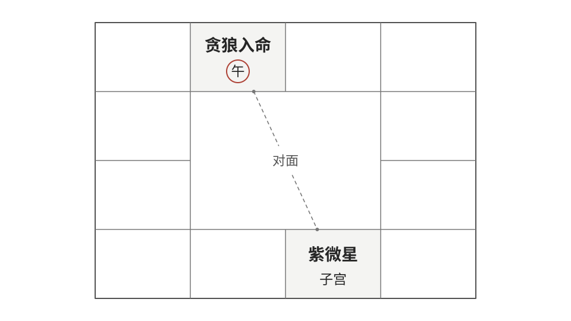 |
| **拿到盘，先看什么、先不看什么？** | 〔口述〕倪师叫大家先不要看下面的命宫、父母宫、福德宫，「通通不要看」，只看紫微星这样转一圈。（[00:01:48–00:01:54](https://www.bilibili.com/video/BV1KJsLekEfA/?p=9&t=108)，第 3246–3443 帧） 〔口述〕紫微星在子宫时，命宫不一定在午宫，可能在另一宫、可能在申宫，「命宫可能就有12个地方」；「但是紫微星在这里不会动的」。（[00:01:54–00:02:06](https://www.bilibili.com/video/BV1KJsLekEfA/?p=9&t=114)，第 3444–3803 帧） 〔推断〕推断：每一章只固定紫微星的位置，同一章里命宫仍可落在 12 个不同的地方，所以倪师先让学生只看紫微。（[00:00:31–00:02:06](https://www.bilibili.com/video/BV1KJsLekEfA/?p=9&t=31)，第 948–3803 帧） |
| **本例命宫在哪一宫？坐什么星？紫微在哪？** | 〔口述〕拿到这个八字，「个大原则要有」（这句没讲完）；这个人「他的命在午宫」，「是贪狼入命」，「紫微星在对面」。（[00:02:06–00:02:37](https://www.bilibili.com/video/BV1KJsLekEfA/?p=9&t=126)，第 3804–4715 帧） 〔板书〕黑板格子左上一格写了两行：第一行可辨「贪狼」；第二行末字可辨「午」，前一字像「命」但不确定。（[00:02:28](https://www.bilibili.com/video/BV1KJsLekEfA/?p=9&t=148)，第 4469 帧） 〔板书〕同一格里的「午」字已被圈起来；格子下方另有一处小字，认不出。（[00:02:41](https://www.bilibili.com/video/BV1KJsLekEfA/?p=9&t=161)，第 4844 帧） 〔叠图〕命宫甲午：贪狼旺、左辅旺、天钺、天厨、咸池（陷）、大耗（旺）、月德、沐浴，印有 4~13，小限 2,14,26,38,50，流年 6,18,30,42,54；迁移庚子：紫微平，印有 64~73，小耗、息神、病符、死；另见父母乙未、疾厄辛丑。（[00:02:22–00:02:27](https://www.bilibili.com/video/BV1KJsLekEfA/?p=9&t=142)，第 4284–4415 帧） 〔推断〕推断：口述命在午、紫微在子，又说紫微「在对面」；叠图上紫微平正落在迁移庚子，所以这里的「对面」就是迁移宫这一格。（[00:01:43–00:02:37](https://www.bilibili.com/video/BV1KJsLekEfA/?p=9&t=103)，第 3108–4715 帧） |
| **贪狼星在什么宫才算桃花星？** | 〔口述〕「贪狼星呢」「它是一个桃花星」，「但是贪狼星要有个大原则」，要在亥子宫。（[00:02:44–00:02:57](https://www.bilibili.com/video/BV1KJsLekEfA/?p=9&t=164)，第 4932–5339 帧） 〔口述〕亥宫是晚上 9 点到 11 点，子时是晚上 11 点到 1 点，「这两个宫我们又叫做水宫」。（[00:02:58–00:03:05](https://www.bilibili.com/video/BV1KJsLekEfA/?p=9&t=178)，第 5340–5573 帧） 〔口述〕在水宫里，如果贪狼星在亥宫或是在子宫，才叫做正科（待核）桃花星，「才是桃花星」。（[00:03:05–00:03:14](https://www.bilibili.com/video/BV1KJsLekEfA/?p=9&t=185)，第 5574–5831 帧） 〔板书〕黑板左侧竖写，可辨「贪狼」「桃花」，再下面一字被挡，认不出。（[00:02:53](https://www.bilibili.com/video/BV1KJsLekEfA/?p=9&t=173)，第 5208 帧） 〔叠图〕讲贪狼在子时，叠图贴出命宫庚子：贪狼旺、阴煞、龙德、大耗、息神、墓，印有 5~14，小限 6,18,30,42,54，流年 8,20,32,44,56。本例命宫是甲午，这一格是配合假设举的别的盘。（[00:02:44–00:02:49](https://www.bilibili.com/video/BV1KJsLekEfA/?p=9&t=164)，第 4932–5081 帧） |
| **贪狼在午宫，能不能批成桃花？** | 〔口述〕「如果贪狼星在午宫」，「你不要给他随便乱批桃花星哦」，「不是桃花星呐」。（[00:03:14–00:03:18](https://www.bilibili.com/video/BV1KJsLekEfA/?p=9&t=194)，第 5832–5951 帧） 〔口述〕它是「武官星」（语音作五官星，按字幕与板书取武官）。（[00:03:18–00:03:22](https://www.bilibili.com/video/BV1KJsLekEfA/?p=9&t=198)，第 5952–6089 帧） 〔板书〕黑板左侧竖写，可辨「武官星」三字；旁边原先写的「贪狼」「桃花」被老师身体挡住大半。（[00:03:57](https://www.bilibili.com/video/BV1KJsLekEfA/?p=9&t=237)，第 7135 帧） 〔推断〕推断：本例命在午宫、贪狼入命，按倪师这条说法，本例的贪狼不当桃花星批，而是武官星；倪师在本块没有明说这一层。（[00:02:24–00:03:22](https://www.bilibili.com/video/BV1KJsLekEfA/?p=9&t=144)，第 4326–6089 帧） |
| **武官星最希望碰到哪两颗星？** | 〔口述〕讲到贪狼这种武官，「贪狼破军七杀」「这些武官星呢」，「最希望碰到的是火和铃」，「叫做火星和铃星」。（[00:03:23–00:03:35](https://www.bilibili.com/video/BV1KJsLekEfA/?p=9&t=203)，第 6090–6473 帧） |
| **什么叫火贪格、火贵格？主什么？** | 〔口述〕「所以你们看书上有一句话」，叫做火贪格；「火贪相聚的话我们叫做火贵」，「火贵格」。（[00:03:35–00:03:47](https://www.bilibili.com/video/BV1KJsLekEfA/?p=9&t=215)，第 6474–6821 帧） 〔口述〕为什么叫火贵格？「这就是出武贵」，「武贵武官」。（[00:03:44–00:03:53](https://www.bilibili.com/video/BV1KJsLekEfA/?p=9&t=224)，第 6726–6995 帧） 〔板书〕黑板最右边竖写，可辨「火贪格」；格子中间一格可辨「火」「贪」两字，其余几个小字认不出。（[00:03:53](https://www.bilibili.com/video/BV1KJsLekEfA/?p=9&t=233)，第 6996 帧） 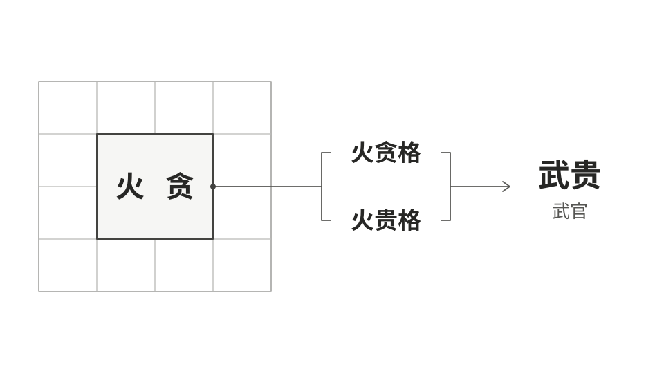 〔叠图〕讲火贪时贴出夫妻甲戌：贪狼庙权、火星庙，旁注「火贵格」，另有红鸾陷、大耗平、小耗、攀鞍、月德、病符、胎，印有 22~31。本例夫妻宫是壬辰，这一格是配合讲火贪举的别的盘。（[00:03:35–00:03:37](https://www.bilibili.com/video/BV1KJsLekEfA/?p=9&t=215)，第 6474–6521 帧） |
| **子时与午时的贪狼，长相要求有何不同？** | 〔口述〕「所有的午时出命的武官」……接着说子时（晚上）的贪狼星「要长得高大魁梧」，「女孩子男孩子都一样要长得肥厚才会」（后半句断了）。（[00:03:55–00:04:09](https://www.bilibili.com/video/BV1KJsLekEfA/?p=9&t=235)，第 7068–7481 帧） 〔口述〕「午时的贪狼」，凡是这些武曲（待核）七杀破军在中午出来，「贪狼反而人会变成瘦小」，「越小越瘦越小越好」。（[00:04:09–00:04:19](https://www.bilibili.com/video/BV1KJsLekEfA/?p=9&t=249)，第 7482–7799 帧） 〔叠图〕讲子时贪狼时叠图换成命宫庚子（贪狼旺），讲午时贪狼时换回命宫甲午。（[00:03:59–00:04:12](https://www.bilibili.com/video/BV1KJsLekEfA/?p=9&t=239)，第 7188–7565 帧） |
| **王升的例子印证了什么？** | 〔口述〕「举例我们王升就是这样子的命」，「你看那王升呢跑出来」，「干干的脸红红的头发还在往上翘」。（[00:04:20–00:04:27](https://www.bilibili.com/video/BV1KJsLekEfA/?p=9&t=260)，第 7800–8027 帧） 〔口述〕「那是标准的火形局的」，「火形的人」，「所以王升他是将军」。（[00:04:27–00:04:36](https://www.bilibili.com/video/BV1KJsLekEfA/?p=9&t=267)，第 8028–8297 帧） 〔推断〕推断：王升紧接在「越小越瘦越小越好」之后举出，又说他是将军，用来印证午时武官星瘦小反而好、能出武贵；倪师本块没有把这几点逐一连起来。（[00:04:16–00:04:36](https://www.bilibili.com/video/BV1KJsLekEfA/?p=9&t=256)，第 7698–8297 帧） |

**总结区**

- 通用规则：只看紫微星的位置，命盘就只有 12 种形式，其它只是宫与科权禄忌的变化（[00:00:36–00:01:00](https://www.bilibili.com/video/BV1KJsLekEfA/?p=9&t=36)，第 1104–1805 帧）；贪狼星要在亥、子两个水宫才是桃花星；在午宫不要乱批桃花，它是武官星（[00:02:44–00:03:22](https://www.bilibili.com/video/BV1KJsLekEfA/?p=9&t=164)，第 4932–6089 帧）；贪狼、破军、七杀这些武官星最希望碰到火星、铃星，火贪相聚叫火贵格，出武贵（[00:03:23–00:03:53](https://www.bilibili.com/video/BV1KJsLekEfA/?p=9&t=203)，第 6090–6995 帧）；子时（晚上）的贪狼要长得高大肥厚才好，午时出来的反而瘦小，越瘦越小越好（[00:03:59–00:04:19](https://www.bilibili.com/video/BV1KJsLekEfA/?p=9&t=239)，第 7188–7799 帧）
- 只在本例：第一张盘选它，是因为这张盘紫微星正好在子宫（[00:01:41–00:01:48](https://www.bilibili.com/video/BV1KJsLekEfA/?p=9&t=101)，第 3042–3245 帧）；本例命在午宫、贪狼入命，紫微星在对面；叠图为命宫甲午贪狼旺、迁移庚子紫微平（[00:02:22–00:02:37](https://www.bilibili.com/video/BV1KJsLekEfA/?p=9&t=142)，第 4284–4715 帧）

**待核**

1. [00:00:01–00:01:00](https://www.bilibili.com/video/BV1KJsLekEfA/?p=9&t=1)，第 48–1805 帧（第 0001–0030 句）语音一栏是与讲课无关的杂词（点赞、订阅、转发等），这段只有字幕一路可用，两路无法对照，相关口述条目只依据字幕，需人工听核。
2. [00:01:10](https://www.bilibili.com/video/BV1KJsLekEfA/?p=9&t=70)，第 2100 帧格名「七杀朝斗紫府做垣格」字幕可信度 0.5，语音作「七杀朝土之府作汉阁」，准确写法待核。
3. [00:01:34](https://www.bilibili.com/video/BV1KJsLekEfA/?p=9&t=94)，第 2838 帧字幕「第一章」、语音「第一张」，两路不同。
4. [00:01:37](https://www.bilibili.com/video/BV1KJsLekEfA/?p=9&t=97)，第 2910 帧生辰：字幕混入命盘印刷字，时辰字幕作「减时」、语音作「叙时」，月份只语音有「三月」，均待核。
5. [00:01:48–00:01:51](https://www.bilibili.com/video/BV1KJsLekEfA/?p=9&t=108)，第 3246–3341 帧改字：字幕「命官」、语音「命公」改为命宫；「福德官」「福德公」改为福德宫。
6. [00:01:58](https://www.bilibili.com/video/BV1KJsLekEfA/?p=9&t=118)，第 3564 帧命宫可能所在的第二个宫，字幕「朱嘗」、语音「卫功」，认不出是哪一宫；第一个宫语音「武功」按字幕取午宫。
7. [00:02:10](https://www.bilibili.com/video/BV1KJsLekEfA/?p=9&t=130)，第 3912 帧「个大原则要有」之后没讲出大原则的内容，就转到「这个人」，原话不全。
8. [00:02:28](https://www.bilibili.com/video/BV1KJsLekEfA/?p=9&t=148)，第 4469 帧板书第二行「午」前一字像「命」，不确定；[00:02:41](https://www.bilibili.com/video/BV1KJsLekEfA/?p=9&t=161)，第 4844 帧格子下方小字认不出。
9. [00:02:53](https://www.bilibili.com/video/BV1KJsLekEfA/?p=9&t=173)，第 5208 帧与[00:03:07](https://www.bilibili.com/video/BV1KJsLekEfA/?p=9&t=187)，第 5628 帧板书「桃花」下面一字被挡，认不出。
10. [00:03:10](https://www.bilibili.com/video/BV1KJsLekEfA/?p=9&t=190)，第 5700 帧字幕「正科桃花星」、语音「正合桃花星」，词待核，倪师也没有解释。
11. [00:03:18](https://www.bilibili.com/video/BV1KJsLekEfA/?p=9&t=198)，第 5952 帧字幕「武官星」、语音「五官星」，按字幕与[00:03:57](https://www.bilibili.com/video/BV1KJsLekEfA/?p=9&t=237)，第 7135 帧板书取「武官星」。
12. [00:03:37](https://www.bilibili.com/video/BV1KJsLekEfA/?p=9&t=217)，第 6522 帧字幕「四做火贪格」按上下文改为「叫做火贪格」。
13. [00:03:47](https://www.bilibili.com/video/BV1KJsLekEfA/?p=9&t=227)，第 6822 帧「出武贵」语音作「出五贵」；「武贵」倪师没有解释。
14. [00:03:53](https://www.bilibili.com/video/BV1KJsLekEfA/?p=9&t=233)，第 6996 帧板书中间格除「火」「贪」外的小字认不出。
15. [00:04:06](https://www.bilibili.com/video/BV1KJsLekEfA/?p=9&t=246)，第 7386 帧「要长得肥厚才会」后半句断了，语音接「五十的」，原意待核。
16. [00:04:12](https://www.bilibili.com/video/BV1KJsLekEfA/?p=9&t=252)，第 7566 帧字幕「武曲七杀破军」可信度 0.4，语音「五几七杀破军」，与前面「贪狼破军七杀」不一致，第一颗星待核。
17. [00:04:20](https://www.bilibili.com/video/BV1KJsLekEfA/?p=9&t=260)，第 7800 帧人名字幕「王升」、语音「王生」，是谁本块没说明，只说是将军。
18. [00:04:27](https://www.bilibili.com/video/BV1KJsLekEfA/?p=9&t=267)，第 8028 帧字幕「火形局」「火形」、语音「火星局」「火星」，倪师本块没有解释「火形」。
19. [00:02:22](https://www.bilibili.com/video/BV1KJsLekEfA/?p=9&t=142)，第 4284 帧叠图命宫甲午同时列「咸池」「咸池陷」、「大耗」「大耗旺」，疑为重复转写；疾厄辛丑有两字转写为「□□」，认不出。
20. [00:00:00](https://www.bilibili.com/video/BV1KJsLekEfA/?p=9&t=0)，第 0 帧板书图是片头标题画面，没有粉笔字；[00:02:19](https://www.bilibili.com/video/BV1KJsLekEfA/?p=9&t=139)，第 4176 帧板上只有格线没有字。

### 2　五形相、南北相与贪狼天魁文武双全（[00:04:36–00:09:11](https://www.bilibili.com/video/BV1KJsLekEfA/?p=9&t=276)，第 8298–16559 帧）

| 提示区 | 笔记区 |
|---|---|
| **火格的人瘦小，为什么反而大贵？** | 〔口述〕接着讲火格的人：「那火格一看他瘦又瘦干干的」。举林文礼为例：「空军最矮的就是他了」，可是「当的是总司令好好那个大贵」，「反而是大贵」。（[00:04:36–00:04:46](https://www.bilibili.com/video/BV1KJsLekEfA/?p=9&t=276)，第 8298–8591 帧） 〔口述〕由此提醒学生：「所以你们批八字不要乱批哦」，「你们看到好的……其实是反的」。（[00:04:46–00:04:54](https://www.bilibili.com/video/BV1KJsLekEfA/?p=9&t=286)，第 8592–8843 帧） 〔板书〕本块开头的板面。可辨：左侧「形」（前一字被台标挡住）、「武官星」「贪狼」「桃花星」；命盘格第二列上格「贪狼」，其下「介」，其余认不出。（[00:04:38](https://www.bilibili.com/video/BV1KJsLekEfA/?p=9&t=278)，第 8340 帧） |
| **看相把人分几种形？木形的人什么样？** | 〔口述〕倪师说在相上把人分成很多种：「分成5种形」，「一种是木形」。木形的人「瘦瘦高高的」，「像我们王永庆就是木形的」。（[00:04:54–00:05:05](https://www.bilibili.com/video/BV1KJsLekEfA/?p=9&t=294)，第 8844–9179 帧） 〔口述〕要成形「一定要纯」「很纯才行」。反例：「比如说你脸很瘦手很瘦就肚子很大」，「就不是木形的」。（[00:05:06–00:05:15](https://www.bilibili.com/video/BV1KJsLekEfA/?p=9&t=306)，第 9180–9455 帧） 〔口述〕「那纯木从头到脚都瘦」，脚伸出来干干的，「手伸出来都没有肉」，这才是纯木。（[00:05:15–00:05:21](https://www.bilibili.com/video/BV1KJsLekEfA/?p=9&t=315)，第 9456–9659 帧） 〔板书〕左上角台标旁新添一个「木」字，右边已有「火形」；下方仍是「武官星」「贪狼」「桃花星」。（[00:05:06](https://www.bilibili.com/video/BV1KJsLekEfA/?p=9&t=306)，第 9204 帧） 〔板书〕「木」字下方左侧又新添一个字，字形像「纯」，与此时口述「一定要纯」相合；其余板面同前。（[00:05:10](https://www.bilibili.com/video/BV1KJsLekEfA/?p=9&t=310)，第 9323 帧） |
| **纯火形的人长什么样？** | 〔口述〕「纯火呢」，「也是干干但是是红红的很热」，「看起来很热好像在发火」，头像火焰山：「头好像生的是火焰山一样」。（[00:05:22–00:05:30](https://www.bilibili.com/video/BV1KJsLekEfA/?p=9&t=322)，第 9660–9917 帧） 〔推断〕推断：本块开头说火格的林文礼「瘦又瘦干干的」，与这里纯火「也是干干」的描述一致；但倪师本块没有明说林文礼是火形。（[00:04:36–00:05:25](https://www.bilibili.com/video/BV1KJsLekEfA/?p=9&t=276)，第 8298–9779 帧） |
| **纯土形的人要符合哪些条件？** | 〔口述〕土形的人「是厚重」，举例「像我们的过去的总统」「经国先生就是土形局」。（[00:05:32–00:05:38](https://www.bilibili.com/video/BV1KJsLekEfA/?p=9&t=332)，第 9960–10157 帧） 〔口述〕「土是地厚嘛」，「所以头一定是要圆圆的」「脚一定要方方的」，因为「地是方天是圆」。（[00:05:40–00:05:49](https://www.bilibili.com/video/BV1KJsLekEfA/?p=9&t=340)，第 10218–10475 帧） 〔口述〕「那手伸出来的时候也要厚厚的」「摸到没有骨头」，全身圆圆的、「全身厚厚的重重的」，这才是纯土形局。（[00:05:50–00:05:58](https://www.bilibili.com/video/BV1KJsLekEfA/?p=9&t=350)，第 10500–10751 帧） 〔口述〕遇到一个看起来都像土形的人，「结果手伸出来干干的就不是纯土形局的」，「因为他有一个部分不合」。（[00:05:58–00:06:06](https://www.bilibili.com/video/BV1KJsLekEfA/?p=9&t=358)，第 10752–11003 帧） 〔板书〕左侧「武官星」右边新添两字，可辨上为「土」、下为「金」。（[00:06:08](https://www.bilibili.com/video/BV1KJsLekEfA/?p=9&t=368)，第 11046 帧） |
| **纯金形的人有什么特征？** | 〔口述〕「比如说金什么叫金」，金是白色的，「所以呢要方方的」。（[00:06:08–00:06:12](https://www.bilibili.com/video/BV1KJsLekEfA/?p=9&t=368)，第 11058–11189 帧） 〔口述〕「金金属都是方方方形的」，「像我们钻石切割都是方的白白的」，「那手伸出来都要方的」。（[00:06:13–00:06:20](https://www.bilibili.com/video/BV1KJsLekEfA/?p=9&t=373)，第 11190–11429 帧） 〔口述〕举例：「我们的林洋港林院长就是金形局的」。（[00:06:21–00:06:24](https://www.bilibili.com/video/BV1KJsLekEfA/?p=9&t=381)，第 11430–11543 帧） |
| **水形的人怎么认？** | 〔口述〕水形局「要圆形的圆圆的」，「到哪里看从哪个角度看都是圆的」。（[00:06:24–00:06:31](https://www.bilibili.com/video/BV1KJsLekEfA/?p=9&t=384)，第 11544–11741 帧） 〔口述〕举例「我们的考试院长邱创焕就是圆的」：颧圆、下巴圆、额头圆，「手伸的还是圆厚厚的肥肥的」，「这是水形局的」。（[00:06:32–00:06:43](https://www.bilibili.com/video/BV1KJsLekEfA/?p=9&t=392)，第 11760–12113 帧） 〔板书〕左侧「星」字右下新添「水」。至此左侧可见「木」「火形」「土」「金」「水」五个字。（[00:06:26](https://www.bilibili.com/video/BV1KJsLekEfA/?p=9&t=386)，第 11598 帧） |
| **看相第一个原则是什么？** | 〔口述〕「那我们所谓在相上面要成局的人」，「一定要纯」，「越纯的越贵」，「非富即贵」，「这是第一个看相的原则」。（[00:06:43–00:06:52](https://www.bilibili.com/video/BV1KJsLekEfA/?p=9&t=403)，第 12114–12383 帧） 〔推断〕推断：前面木形举「肚子很大」、土形举「手伸出来干干的」作为不合格的例子，都是在说明这条「一定要纯」的原则。（[00:05:11–00:06:52](https://www.bilibili.com/video/BV1KJsLekEfA/?p=9&t=311)，第 9342–12383 帧） |
| **什么叫北人南相？为什么大贵？** | 〔口述〕第二个原则：「第二个有两句话送给诸位」，「诸位在看相书的时候都会碰到」——「北人呢要南相」。（[00:06:52–00:07:08](https://www.bilibili.com/video/BV1KJsLekEfA/?p=9&t=412)，第 12384–12845 帧） 〔口述〕这在过去大陆上看得最明显：长江以北的北方人「吃吃大口的肉大口的酒这样子喝」，「面食一直吃」，「所以北方人看起来都很高很壮很大」。（[00:07:08–00:07:21](https://www.bilibili.com/video/BV1KJsLekEfA/?p=9&t=428)，第 12846–13241 帧） 〔口述〕山东人又高又大，「哪天突然跑个山东人出来」，「瘦瘦小小的皮肤白白的」「娇娇细细的斯斯文文的」，「这叫做北人南相大贵」。（[00:07:21–00:07:31](https://www.bilibili.com/video/BV1KJsLekEfA/?p=9&t=441)，第 13242–13547 帧） 〔板书〕可辨：黑板右侧竖写「北人南」，其左另一列首字像「南」，其余被倪师身体挡住，认不出。（[00:07:06](https://www.bilibili.com/video/BV1KJsLekEfA/?p=9&t=426)，第 12804 帧） |
| **什么叫南人北相？** | 〔口述〕「长江以南的南方人」，如「台湾人广东人」；「因为南方是鱼米之乡」，「所以他们比较斯斯文文秀秀气气」。（[00:07:31–00:07:45](https://www.bilibili.com/video/BV1KJsLekEfA/?p=9&t=451)，第 13548–13979 帧） 〔口述〕结果跑出个南方人，长得「比那个吃那个馒头的还高还宽」，「这叫做南人北相」，「这种也是非富即贵」。（[00:07:46–00:07:54](https://www.bilibili.com/video/BV1KJsLekEfA/?p=9&t=466)，第 13980–14231 帧） 〔口述〕总结两句：「这些特殊的贵相诸位要知道」。（[00:07:54–00:07:56](https://www.bilibili.com/video/BV1KJsLekEfA/?p=9&t=474)，第 14232–14309 帧） 〔板书〕黑板右缘竖写四字，可辨「南人北相」。（[00:09:09](https://www.bilibili.com/video/BV1KJsLekEfA/?p=9&t=549)，第 16476 帧） |
| **算命为什么还要看相？命相同参有何好处？** | 〔口述〕「那我们为什么要算命去看这些相」：「光算命的时候」「在我们这里它只占了1/3」，「我们有天文地理还有人事」。（[00:07:57–00:08:04](https://www.bilibili.com/video/BV1KJsLekEfA/?p=9&t=477)，第 14310–14549 帧） 〔口述〕倪师说以后会慢慢把三条路合起来，「终归为一条」。（[00:08:05–00:08:10](https://www.bilibili.com/video/BV1KJsLekEfA/?p=9&t=485)，第 14550–14717 帧） 〔口述〕介绍相时，「先不要管人事部分」「人间道部分跟地理的部分」，「光是管命的部分的话」，「如果我们把命相同参的话」「那会增加算命的很多的准确性」「会帮你做加会帮你做减」。（[00:08:10–00:08:25](https://www.bilibili.com/video/BV1KJsLekEfA/?p=9&t=490)，第 14718–15173 帧） 〔口述〕所以讲命盘时「同时要跟诸位介绍这些东西」，说明为何插讲看相。（[00:08:26–00:08:29](https://www.bilibili.com/video/BV1KJsLekEfA/?p=9&t=506)，第 15204–15299 帧） |
| **贪狼入命的人有什么权？** | 〔口述〕回到命盘：「那诸位看到这个贪狼入命的人」，「一般呢贪狼入命的人他有生杀之权」。（[00:08:30–00:08:34](https://www.bilibili.com/video/BV1KJsLekEfA/?p=9&t=510)，第 15300–15431 帧） 〔指代〕说「这个贪狼入命」时手指的是黑板命盘第二列上格的「贪狼」二字（粉笔按在其正下方），同格有圈起的「午」。（[00:08:30](https://www.bilibili.com/video/BV1KJsLekEfA/?p=9&t=510)，第 15314 帧） 〔板书〕可辨：命盘第二列上格「贪狼」，其下「介」与圈起的「午」；左侧「火形」「武」「官」「星」「土」「金」「水」等字仍在。这一段新写了什么看不出。（[00:08:31](https://www.bilibili.com/video/BV1KJsLekEfA/?p=9&t=511)，第 15348 帧） 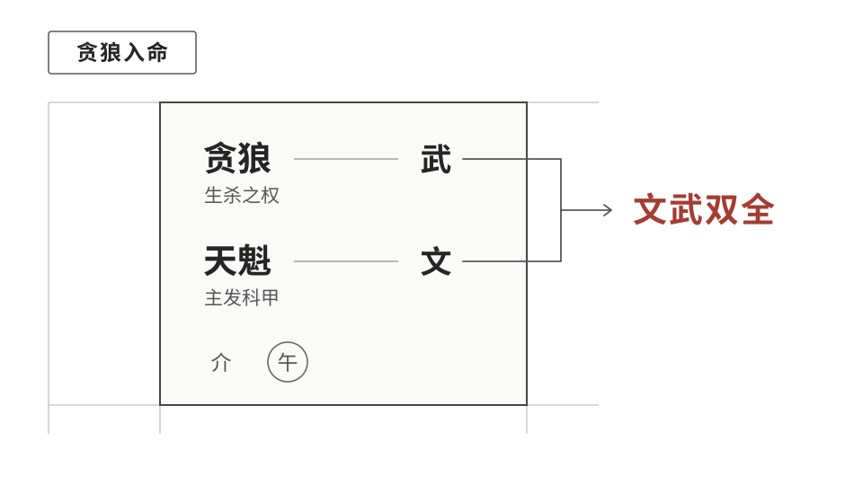 |
| **贪狼加天魁为什么叫文武双全？** | 〔口述〕「然后你下面看到还有个天魁星有没有」，「天魁星是什么」，「主发科甲」。（[00:08:34–00:08:42](https://www.bilibili.com/video/BV1KJsLekEfA/?p=9&t=514)，第 15432–15665 帧） 〔口述〕「贪狼是武」，「天魁星是什么文」，两颗星在一起「是不是文武双全」。（[00:08:45–00:08:51](https://www.bilibili.com/video/BV1KJsLekEfA/?p=9&t=525)，第 15774–15947 帧） 〔板书〕「贪狼」下方新添「天魁」两字，再下是「介」与圈起的「午」。（[00:08:36](https://www.bilibili.com/video/BV1KJsLekEfA/?p=9&t=516)，第 15508 帧） 〔板书〕「贪狼」右侧新添「武」字，其下一字被倪师身体挡住，认不出。（[00:08:48](https://www.bilibili.com/video/BV1KJsLekEfA/?p=9&t=528)，第 15863 帧） 〔板书〕身体移开后，同一格可辨：「贪狼」旁「武」，「天魁」旁「文」，下方「介」与圈起的「午」。（[00:09:09](https://www.bilibili.com/video/BV1KJsLekEfA/?p=9&t=549)，第 16476 帧） |
| **女命拿到文武双全，算命时怎么跟她说？** | 〔口述〕「如果这个文武双全给一个男的」，「那太好了」，「那就成格」。（[00:08:51–00:08:57](https://www.bilibili.com/video/BV1KJsLekEfA/?p=9&t=531)，第 15948–16121 帧） 〔口述〕反过来，「有的女孩子很不幸」，「拿到这种命很累呀」。（[00:08:57–00:09:01](https://www.bilibili.com/video/BV1KJsLekEfA/?p=9&t=537)，第 16122–16253 帧） 〔口述〕「这种我们算命就跟她说」，「你这是男命女身啊」，「男人命女人身」。（[00:09:01–00:09:11](https://www.bilibili.com/video/BV1KJsLekEfA/?p=9&t=541)，第 16254–16559 帧） 〔板书〕命盘中间格上方新写一行并画底线，可辨「命女身」，首字像「男」，其余认不出。（[00:09:09](https://www.bilibili.com/video/BV1KJsLekEfA/?p=9&t=549)，第 16476 帧） 〔推断〕推断：板书中贪狼、天魁同写在圈「午」的那一格，倪师接着就讲女命拿到这种命很累、要说「男命女身」，似是在讲本例这位命主；但本块口述没有明说「她」就是本例。（[00:08:30–00:09:11](https://www.bilibili.com/video/BV1KJsLekEfA/?p=9&t=510)，第 15300–16559 帧） |

**总结区**

- 通用规则：看相分木、火、土、金、水五形，在相上要成局一定要纯，越纯越贵、非富即贵，有一部分不合就不是纯形（[00:04:54–00:06:52](https://www.bilibili.com/video/BV1KJsLekEfA/?p=9&t=294)，第 8844–12383 帧）；北人南相大贵，南人北相也是非富即贵，这些是特殊的贵相（[00:06:52–00:07:56](https://www.bilibili.com/video/BV1KJsLekEfA/?p=9&t=412)，第 12384–14309 帧）；光算命只占三分之一，命相同参会增加算命的准确性，能帮你做加做减（[00:07:57–00:08:25](https://www.bilibili.com/video/BV1KJsLekEfA/?p=9&t=477)，第 14310–15173 帧）；贪狼入命的人有生杀之权；贪狼是武、天魁主发科甲是文，合为文武双全，给男的就成格，女孩子拿到很累（[00:08:30–00:09:01](https://www.bilibili.com/video/BV1KJsLekEfA/?p=9&t=510)，第 15300–16253 帧）
- 只在本例：本例板书命盘圈「午」的那一格写有贪狼、天魁，倪师据此讲文武双全（[00:08:30–00:09:09](https://www.bilibili.com/video/BV1KJsLekEfA/?p=9&t=510)，第 15300–16476 帧）
- 不是排盘规则，是处世方法：批八字不要乱批，看到好的其实可能是反的（[00:04:46–00:04:54](https://www.bilibili.com/video/BV1KJsLekEfA/?p=9&t=286)，第 8592–8843 帧）；女命遇到文武双全这种命，算命时就跟她说「你这是男命女身」（[00:09:01–00:09:11](https://www.bilibili.com/video/BV1KJsLekEfA/?p=9&t=541)，第 16254–16559 帧）

**待核**

1. [00:04:36](https://www.bilibili.com/video/BV1KJsLekEfA/?p=9&t=276)，第 8298 帧：字幕「那火格」识别可信度仅 0.5，语音作「哥」，「火格」是否为「火局」或别的词待核。
2. [00:04:38](https://www.bilibili.com/video/BV1KJsLekEfA/?p=9&t=278)，第 8364 帧：人名字幕作「林文礼」，语音作「林文理」，待核。另[00:05:04](https://www.bilibili.com/video/BV1KJsLekEfA/?p=9&t=304)，第 9120 帧「王永庆」（语音「永清」）、[00:05:37](https://www.bilibili.com/video/BV1KJsLekEfA/?p=9&t=337)，第 10110 帧「经国先生」（语音「金国」）、[00:06:21](https://www.bilibili.com/video/BV1KJsLekEfA/?p=9&t=381)，第 11430 帧「林洋港」（语音「林阳港」）、[00:06:32](https://www.bilibili.com/video/BV1KJsLekEfA/?p=9&t=392)，第 11760 帧「邱创焕」（语音「邱昌幻」），人名均按字幕写。
3. [00:04:54](https://www.bilibili.com/video/BV1KJsLekEfA/?p=9&t=294)，第 8844 帧：字幕「在象上面」、语音「在像上面」，按上下文改为「相上」，转述中已改，引文保留字幕原字。
4. [00:05:56](https://www.bilibili.com/video/BV1KJsLekEfA/?p=9&t=356)，第 10680 帧：字幕「纯士形局」，按语音与上下文改为「纯土形局」。
5. [00:06:10](https://www.bilibili.com/video/BV1KJsLekEfA/?p=9&t=370)，第 11106 帧：字幕「金是自色的」，语音作「白色」，已改为「白色」。
6. [00:08:07](https://www.bilibili.com/video/BV1KJsLekEfA/?p=9&t=487)，第 14634 帧：字幕「三条路并汐一条」识别可信度 0.3，语音作「并有一条」，原话待核。
7. [00:08:17](https://www.bilibili.com/video/BV1KJsLekEfA/?p=9&t=497)，第 14928 帧：字幕「如果我们把命相同参的话」，语音为「我们没有把命向同参的话」，两路在「有没有」上对不上，待核。
8. [00:08:42](https://www.bilibili.com/video/BV1KJsLekEfA/?p=9&t=522)，第 15666 帧：「科甲代表这个人是有武」与紧接的「贪狼是武」「天魁星是什么文」意思不顺，原话待核。
9. [00:08:47](https://www.bilibili.com/video/BV1KJsLekEfA/?p=9&t=527)，第 15833 帧：指代 D018「这个文武双全」为「是（不确定）」，未作依据；第13724、13742帧两处「这边」为空中挥手，未作依据。
10. [00:08:48](https://www.bilibili.com/video/BV1KJsLekEfA/?p=9&t=528)，第 15863 帧：「武」字下方一字被身体挡住；[00:07:06](https://www.bilibili.com/video/BV1KJsLekEfA/?p=9&t=426)，第 12804 帧板书大半被身体挡住；[00:09:09](https://www.bilibili.com/video/BV1KJsLekEfA/?p=9&t=549)，第 16476 帧中间格「男命女身」首字只是像「男」；[00:05:10](https://www.bilibili.com/video/BV1KJsLekEfA/?p=9&t=310)，第 9323 帧新添字只是像「纯」；[00:08:31](https://www.bilibili.com/video/BV1KJsLekEfA/?p=9&t=511)，第 15348 帧这一段新写的内容看不出。
11. [00:08:31](https://www.bilibili.com/video/BV1KJsLekEfA/?p=9&t=511)，第 15348 帧起：板书图右上角可见电子命盘叠图（命宫甲午，贪狼旺、左辅旺、天魁等，并有「文武双全」标签），但本块材料没有 ▣ 叠图行，按规则未作叠图依据。

## 官禄（七杀擎羊、权星、财权）、财帛与身宫、迁移

〔叠图〕这一例视频里只贴过 2 格：财帛 庚寅（身宫）：破军得、文曲平科、红鸾旺、天空陷、孤辰平；官禄 戊戌：七杀庙、擎羊庙、三台旺、天德庙、寡宿陷、解神庙。

### 3　官禄宫喜权星、财权，身宫即后天（[00:09:12–00:13:53](https://www.bilibili.com/video/BV1KJsLekEfA/?p=9&t=552)，第 16560–25007 帧）

| 提示区 | 笔记区 |
|---|---|
| **看完命宫接着看哪一宫？批命先定什么？** | 〔口述〕看完命宫，再看她的官禄宫；倪师说排盘里的事业宫就是官禄宫：「我们排的这个事业宫」「其实就是讲的是官禄宫」。（[00:09:12–00:09:24](https://www.bilibili.com/video/BV1KJsLekEfA/?p=9&t=552)，第 16560–16937 帧） 〔口述〕批命时先定三方四正，先看本：「我们在批一个八字的时候」「先定她的三方四正」「先看她的本」。（[00:09:24–00:09:32](https://www.bilibili.com/video/BV1KJsLekEfA/?p=9&t=564)，第 16938–17165 帧） 〔叠图〕画面贴出命宫、官禄、财帛、迁移四个宫名，此时没有印星曜。（[00:09:26–00:09:30](https://www.bilibili.com/video/BV1KJsLekEfA/?p=9&t=566)，第 16980–17105 帧） |
| **算命分哪两个部分？还有什么没讲？** | 〔口述〕算命分两部分：第一是「指点迷津」，讲「这一辈子要注意什么事情」；第二是「就批流年」；「这两个都是属于算命的部分」。（[00:09:32–00:09:45](https://www.bilibili.com/video/BV1KJsLekEfA/?p=9&t=572)，第 17166–17555 帧） 〔口述〕另外还有运的部分，倪师说「那是运的部分我们还没开始介绍」。（[00:09:45–00:09:49](https://www.bilibili.com/video/BV1KJsLekEfA/?p=9&t=585)，第 17556–17675 帧） 〔板书〕可辨：黑板左侧写「①迷津」「②流年」，「迷津」下方打了一个勾；右侧命盘上圈起的「午」字向下引出几条斜线。其余认不出。（[00:09:43](https://www.bilibili.com/video/BV1KJsLekEfA/?p=9&t=583)，第 17506 帧） 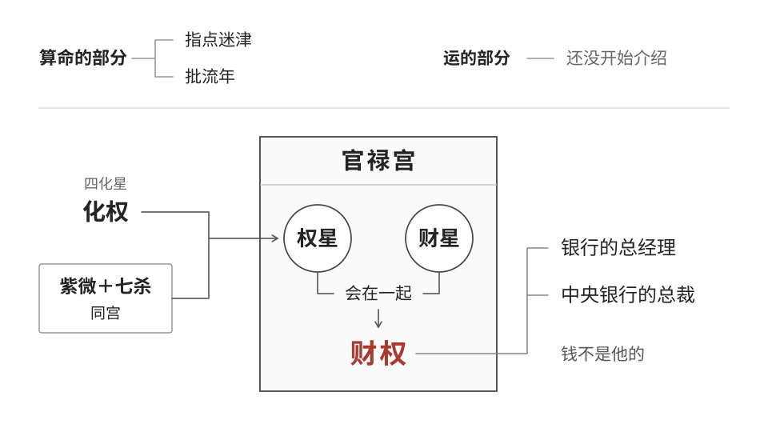 |
| **本例官禄宫坐什么星？** | 〔口述〕她的官禄宫是七杀带擎羊：「那官禄宫诸位看她是七杀带什么擎羊」。（[00:09:49–00:09:53](https://www.bilibili.com/video/BV1KJsLekEfA/?p=9&t=589)，第 17676–17795 帧） 〔口述〕倪师提起上堂课讲过，杀破狼三颗星一定在一起：「那个破杀狼杀破狼」「一定会在一起」。（[00:09:55–00:10:01](https://www.bilibili.com/video/BV1KJsLekEfA/?p=9&t=595)，第 17862–18047 帧） 〔叠图〕本例官禄戊戌格：七杀庙、擎羊庙，另有三台旺、解神庙、寡宿陷、天德、力士、阴煞、攀鞍、衰；小限 10,22,34,46,58,70，大限 44~53。（[00:09:49–00:09:53](https://www.bilibili.com/video/BV1KJsLekEfA/?p=9&t=589)，第 17676–17795 帧） |
| **官禄宫最喜欢什么星？命盘上哪几种算权？** | 〔口述〕「官禄宫呢最喜欢是权星入进来」，也就是「掌权的星进来」。（[00:10:01–00:10:11](https://www.bilibili.com/video/BV1KJsLekEfA/?p=9&t=601)，第 18048–18341 帧） 〔口述〕命上有几颗星代表权：第一「就是四化星里面的化权」；第二是紫微加七杀，「紫微跟七杀要同宫」，同在一个宫里，「这两个也代表权」。（[00:10:11–00:10:33](https://www.bilibili.com/video/BV1KJsLekEfA/?p=9&t=611)，第 18342–19001 帧） 〔板书〕可辨：圈起的「权」字，旁边写「星」「入」；中右一格被圈起，格内字认不出。（[00:10:09](https://www.bilibili.com/video/BV1KJsLekEfA/?p=9&t=609)，第 18276 帧） 〔板书〕可辨：黑板右侧写「化权」，另写「紫微+七杀」，两者下连到圈起的「同宫」，「同宫」与「化权」之间画有箭头连线。（[00:10:33](https://www.bilibili.com/video/BV1KJsLekEfA/?p=9&t=633)，第 18996 帧） 〔叠图〕临时贴出命宫乙亥格：紫微旺（带化权）、七杀平同在一格，另有天马平、铃星利、天姚陷等。这不是本例的命宫，是配合讲解举的格子。（[00:10:18](https://www.bilibili.com/video/BV1KJsLekEfA/?p=9&t=618)，第 18540–18563 帧） |
| **官禄宫化权、紫微七杀坐官禄会怎样？** | 〔口述〕如果一个人官禄宫化权，或者官禄宫有紫微七杀坐在里面，就是官权压重，非常好：「换句话说有一个人官禄宫化权」「有个官禄宫是紫微七杀坐在里面」「他是官权压重」「非常好」。（[00:10:33–00:10:45](https://www.bilibili.com/video/BV1KJsLekEfA/?p=9&t=633)，第 19002–19361 帧） 〔叠图〕同时贴出命宫乙亥（紫微旺、七杀平、化权）与官禄壬辰（太阳旺带权、文曲得、天喜陷、寡宿陷、副截陷；大限 45~54）。这是举例用的别的盘，不是本例；且叠图里紫微七杀在命宫格而非官禄格，以口述为准。（[00:10:36–00:10:40](https://www.bilibili.com/video/BV1KJsLekEfA/?p=9&t=636)，第 19092–19205 帧） |
| **本例官禄只有七杀擎羊，当官好不好？** | 〔叠图〕画面再次贴回本例的官禄戊戌格（七杀庙、擎羊庙）。（[00:10:45–00:10:46](https://www.bilibili.com/video/BV1KJsLekEfA/?p=9&t=645)，第 19362–19403 帧） 〔口述〕这个人官禄宫「只有七杀跟擎羊没有化权」，「所以他当官势必不好」。（[00:10:45–00:10:51](https://www.bilibili.com/video/BV1KJsLekEfA/?p=9&t=645)，第 19362–19541 帧） 〔口述〕「有的人当官好她当官就不好」；倪师的理由是「当官要有权才能不然当个小官干嘛」。（[00:10:52–00:10:58](https://www.bilibili.com/video/BV1KJsLekEfA/?p=9&t=652)，第 19578–19757 帧） |
| **财星与权星同在官禄，叫什么？什么样子？** | 〔口述〕「这个官禄宫很特殊的一种批法」：如果「财星跟权星会在一起」，就会「变成银行的总经理啦」「中央银行的总裁啦」。（[00:10:58–00:11:14](https://www.bilibili.com/video/BV1KJsLekEfA/?p=9&t=658)，第 19758–20231 帧） 〔口述〕这种人「财的权很大可是钱不是他的」：「他今天批个公文可能100亿」「可是他一个月领10万块薪水」，「这叫做财权」。（[00:11:14–00:11:28](https://www.bilibili.com/video/BV1KJsLekEfA/?p=9&t=674)，第 20232–20645 帧） 〔板书〕可辨：圈起的「权」，旁边新写一个圈，里面似「财星」二字（字迹潦草），两圈之间有连线；右侧「紫微+七杀」「同宫」仍在。（[00:11:08](https://www.bilibili.com/video/BV1KJsLekEfA/?p=9&t=668)，第 20060 帧） 〔叠图〕再次贴出官禄壬辰格（举例用，不是本例）：太阳旺、文曲得，标有权；小限 4,16,28,40,52,64，大限 45~54。（[00:11:06–00:11:10](https://www.bilibili.com/video/BV1KJsLekEfA/?p=9&t=666)，第 19998–20105 帧） |
| **从面相怎么分大富与掌财权？** | 〔口述〕看财权的人要「诸位注意看鼻子」，鼻子「一定要有两种是本身的财」：一种是「鼻子像狮的鼻子一样很肉」，狮子的鼻子很大很肉一条下来。（[00:11:28–00:11:42](https://www.bilibili.com/video/BV1KJsLekEfA/?p=9&t=688)，第 20646–21089 帧） 〔口述〕「还有一种悬胆鼻」，像菜市场里悬着的胆，「很瘦瘦长长的鼻子」；这两种「这种是大富」。（[00:11:43–00:11:50](https://www.bilibili.com/video/BV1KJsLekEfA/?p=9&t=703)，第 21090–21317 帧） 〔口述〕如果没有这种鼻子，鼻子很挺、长得很好，但肉不很厚，「然后他的颧柄很大」，「这种人就是掌财权的」，在相上看得到。（[00:11:50–00:12:00](https://www.bilibili.com/video/BV1KJsLekEfA/?p=9&t=710)，第 21318–21623 帧） 〔口述〕这种人「那你手握过去他也是软绵绵的」，因为是贵，「贵和富的手都是会很软」。（[00:12:00–00:12:07](https://www.bilibili.com/video/BV1KJsLekEfA/?p=9&t=720)，第 21624–21821 帧） |
| **官禄宫有杀星，当官如何？** | 〔口述〕「那如果说官禄宫有杀星在里面」，「那你当官当然不容易了」。（[00:12:09–00:12:13](https://www.bilibili.com/video/BV1KJsLekEfA/?p=9&t=729)，第 21894–22001 帧） 〔叠图〕临时贴出官禄戊寅格：贪狼平、陀罗陷、右弼旺、大耗陷等。这不是本例的官禄宫，是举例用的格子。（[00:12:09–00:12:11](https://www.bilibili.com/video/BV1KJsLekEfA/?p=9&t=729)，第 21894–21953 帧） |
| **本例财帛宫在哪？上面有什么？** | 〔口述〕「你看啊这是财帛宫在这里」；看财帛宫时要注意，「看到上面有一个叫做身宫看到没有」。（[00:12:15–00:12:24](https://www.bilibili.com/video/BV1KJsLekEfA/?p=9&t=735)，第 22050–22343 帧） 〔指代〕说「财帛宫在这里」时，手指的是黑板命盘左下格底部，粉笔停在刚写的「财帛」两字旁。（[00:12:18](https://www.bilibili.com/video/BV1KJsLekEfA/?p=9&t=738)，第 22159 帧） 〔口述〕倪师说「原来我就很想跟诸位介绍身宫」，但觉得「批的时候再跟诸位介绍比较好」，所以放到这里才讲。（[00:12:24–00:12:30](https://www.bilibili.com/video/BV1KJsLekEfA/?p=9&t=744)，第 22344–22529 帧） 〔叠图〕本例财帛庚寅格：破军得、文曲平（化科）、天魁、红鸾旺、天空陷、孤辰平、天巫、劫煞、奏书、晦气、绝，并标「身宫」。（[00:12:31–00:12:36](https://www.bilibili.com/video/BV1KJsLekEfA/?p=9&t=751)，第 22530–22691 帧） |
| **身宫是什么？落财帛、官禄、迁移各主什么？** | 〔口述〕「身宫的定义是什么」——「我们简单讲就是后天」。（[00:12:36–00:12:42](https://www.bilibili.com/video/BV1KJsLekEfA/?p=9&t=756)，第 22692–22883 帧） 〔板书〕可辨：黑板左侧竖写「身宫」「后天」，中间有一个符号认不出。（[00:12:40](https://www.bilibili.com/video/BV1KJsLekEfA/?p=9&t=760)，第 22817 帧） 〔口述〕身宫在财帛，「他就会在私人企业私人公司做事情」；身宫在官禄，「他自然而然会到官禄去当官去」；身宫在迁移，「他自然而然会到外地去发展」。（[00:12:42–00:12:54](https://www.bilibili.com/video/BV1KJsLekEfA/?p=9&t=762)，第 22884–23231 帧） 〔叠图〕讲身宫在官禄、在迁移时，临时贴出标「身宫」的官禄壬申格（廉贞庙、化禄、左辅平、文昌得等）和迁移乙卯格。都不是本例的宫格，是举例。（[00:12:47–00:12:54](https://www.bilibili.com/video/BV1KJsLekEfA/?p=9&t=767)，第 23010–23231 帧） |
| **身命同宫、身宫在夫妻，各怎么讲？** | 〔口述〕身命同宫，「就是先天和后天他是一样的」。（[00:12:54–00:12:59](https://www.bilibili.com/video/BV1KJsLekEfA/?p=9&t=774)，第 23232–23387 帧） 〔口述〕倪师举例：「比如说我的命里面化权化禄」，再身命同宫，「我生下来家里就很有钱」「然后长大继承祖业」「就一辈子讲完了」。（[00:12:59–00:13:08](https://www.bilibili.com/video/BV1KJsLekEfA/?p=9&t=779)，第 23388–23657 帧） 〔口述〕有的人身宫在夫妻宫，「那他就是后天被他的婚姻影响很大」。（[00:13:09–00:13:15](https://www.bilibili.com/video/BV1KJsLekEfA/?p=9&t=789)，第 23694–23855 帧） 〔推断〕推断：本块倪师用身宫落在哪一宫，来说明后天受哪方面影响最大（财帛、官禄、迁移、夫妻各举一例），与他说的「我们看他后天影响他最大的是谁」一致。（[00:12:42–00:13:20](https://www.bilibili.com/video/BV1KJsLekEfA/?p=9&t=762)，第 22884–24029 帧） |
| **本例身宫在财帛，要怎么跟她说？** | 〔口述〕「我们看他后天影响他最大的是谁」；「那这个女孩子居然身宫在财帛」，「后天影响不是在夫妻而是在财帛」。（[00:13:18–00:13:25](https://www.bilibili.com/video/BV1KJsLekEfA/?p=9&t=798)，第 23958–24179 帧） 〔叠图〕再次贴出本例财帛庚寅格，标「身宫」；小限 6,18,30,42,54,66，大限 84~93。（[00:13:26](https://www.bilibili.com/video/BV1KJsLekEfA/?p=9&t=806)，第 24180–24209 帧） 〔口述〕算到这种女孩子的命，就要跟她说「小姐你呀一定要做职业妇女」「千万不能中断哦」；理由是「为什么可能中年先生会有问题」，不然「你为什么老是要去赚钱」。（[00:13:28–00:13:39](https://www.bilibili.com/video/BV1KJsLekEfA/?p=9&t=808)，第 24252–24599 帧） 〔口述〕倪师转述她的回答：「你不要跟我讲我也会」「我本来就想做职业妇女」；倪师说她的命就是这样，「她就不会想做家庭主妇型的」。（[00:13:40–00:13:48](https://www.bilibili.com/video/BV1KJsLekEfA/?p=9&t=820)，第 24600–24869 帧） |

**总结区**

- 通用规则：官禄宫最喜欢权星（掌权的星）进来；四化里的化权、紫微七杀同宫都代表权，官禄宫化权或紫微七杀坐官禄是官权压重、非常好（[00:10:01–00:10:45](https://www.bilibili.com/video/BV1KJsLekEfA/?p=9&t=601)，第 18048–19361 帧）；财星跟权星在官禄宫会在一起叫财权：管的钱很多，但钱不是自己的（[00:10:58–00:11:28](https://www.bilibili.com/video/BV1KJsLekEfA/?p=9&t=658)，第 19758–20645 帧）；身宫简单讲就是后天：在财帛去私人公司做事，在官禄去当官，在迁移去外地发展，在夫妻后天受婚姻影响大，身命同宫则先天后天一样（[00:12:36–00:13:15](https://www.bilibili.com/video/BV1KJsLekEfA/?p=9&t=756)，第 22692–23855 帧）；面相上狮子鼻、悬胆鼻是大富；鼻挺而肉不厚、颧柄大的是掌财权；贵和富的手都很软（[00:11:28–00:12:07](https://www.bilibili.com/video/BV1KJsLekEfA/?p=9&t=688)，第 20646–21821 帧）
- 只在本例：这位女命官禄宫只有七杀擎羊、没有化权，当官势必不好（[00:10:45–00:10:51](https://www.bilibili.com/video/BV1KJsLekEfA/?p=9&t=645)，第 19362–19541 帧）；这位女命身宫在财帛，后天影响不在夫妻而在财帛，可能中年先生会有问题（[00:13:18–00:13:39](https://www.bilibili.com/video/BV1KJsLekEfA/?p=9&t=798)，第 23958–24599 帧）
- 不是排盘规则，是处世方法：算到这种命就直接跟她说一定要做职业妇女、千万不能中断（[00:13:28–00:13:34](https://www.bilibili.com/video/BV1KJsLekEfA/?p=9&t=808)，第 24252–24437 帧）；算命先指点迷津，告诉对方这一辈子要注意什么，再批流年（[00:09:32–00:09:45](https://www.bilibili.com/video/BV1KJsLekEfA/?p=9&t=572)，第 17166–17555 帧）

**待核**

1. [00:09:18](https://www.bilibili.com/video/BV1KJsLekEfA/?p=9&t=558)，第 16752 帧本块开头的板面：只认得上中格圈起的「午」，其余字认不出。
2. [00:09:24](https://www.bilibili.com/video/BV1KJsLekEfA/?p=9&t=564)，第 16938 帧、[00:10:45](https://www.bilibili.com/video/BV1KJsLekEfA/?p=9&t=645)，第 19362 帧：倪师说「批一个八字」「这个人的八字」，此处「八字」是指批这张紫微命盘还是别的，本块没有解释。
3. [00:09:30](https://www.bilibili.com/video/BV1KJsLekEfA/?p=9&t=570)，第 17106 帧：「先看她的本」里的「本」指什么，本块没有解释；「三方四正」也未解释。
4. [00:09:45](https://www.bilibili.com/video/BV1KJsLekEfA/?p=9&t=585)，第 17556 帧：字幕「当然我们还有三四啊」、语音「还有三次」，两路都不通，原话待核；下句接「那是运的部分」。
5. [00:09:57](https://www.bilibili.com/video/BV1KJsLekEfA/?p=9&t=597)，第 17922 帧：字幕「那个破杀狼杀破狼」，前三字似口误，照字幕原样引用。
6. [00:10:04](https://www.bilibili.com/video/BV1KJsLekEfA/?p=9&t=604)，第 18120 帧板书：这段写了约 8 秒，但写字处被身体挡住，新写的字认不出。
7. [00:10:09](https://www.bilibili.com/video/BV1KJsLekEfA/?p=9&t=609)，第 18276 帧板书：中右一格被圈起，格内字认不出；黑板右侧另有几行字，本块没有讲到，未写入。
8. [00:09:49](https://www.bilibili.com/video/BV1KJsLekEfA/?p=9&t=589)，第 17676 帧叠图官禄戊戌：「天德」出现两次（一次带庙），可能有一项是别的星转写重复，待核。
9. [00:10:36](https://www.bilibili.com/video/BV1KJsLekEfA/?p=9&t=636)，第 19092 帧叠图：口述说「有个官禄宫是紫微七杀坐在里面」，叠图里紫微七杀却在命宫乙亥格，官禄壬辰格是太阳文曲；以口述为准。
10. [00:10:36](https://www.bilibili.com/video/BV1KJsLekEfA/?p=9&t=636)，第 19092 帧与[00:11:06](https://www.bilibili.com/video/BV1KJsLekEfA/?p=9&t=666)，第 19998 帧叠图官禄壬辰：前者转写为「太阳旺权、文曲得科」，后者为「太阳旺、文曲得、权」；[00:11:08](https://www.bilibili.com/video/BV1KJsLekEfA/?p=9&t=668)，第 20060 帧画面上该格可见「权」「禄」两个红标，转写里没有「禄」。
11. [00:11:08](https://www.bilibili.com/video/BV1KJsLekEfA/?p=9&t=668)，第 20060 帧板书：新圈里的字似「财星」，字迹潦草，待核。
12. [00:11:56](https://www.bilibili.com/video/BV1KJsLekEfA/?p=9&t=716)，第 21498 帧：字幕「颧柄」、语音「权柄」，两路不一致，倪师也没有解释这个词。
13. [00:12:09](https://www.bilibili.com/video/BV1KJsLekEfA/?p=9&t=729)，第 21894 帧叠图官禄戊寅：转写里有「杀星」一项、「劫煞」出现两次，不像星曜名，待核。
14. [00:12:22](https://www.bilibili.com/video/BV1KJsLekEfA/?p=9&t=742)，第 22266 帧：字幕「看到上面有一个叫做身宫看到没有」可信度只有 0.32，语音「声工」，按上下文取「身宫」。
15. [00:12:31](https://www.bilibili.com/video/BV1KJsLekEfA/?p=9&t=751)，第 22530 帧叠图财帛庚寅：数字串「61830425466」连在一起无法还原；[00:13:26](https://www.bilibili.com/video/BV1KJsLekEfA/?p=9&t=806)，第 24180 帧再贴时可还原为小限 6,18,30,42,54,66、大限 84~93。
16. [00:12:45](https://www.bilibili.com/video/BV1KJsLekEfA/?p=9&t=765)，第 22968 帧板书：格子底部新写的字被叠图挡住，认不出。
17. [00:12:42](https://www.bilibili.com/video/BV1KJsLekEfA/?p=9&t=762)，第 22884 帧起：语音把「身宫」多处识别为「声工」「生工」，「财帛」识别为「财伯」，均按字幕取正字。
18. [00:13:23](https://www.bilibili.com/video/BV1KJsLekEfA/?p=9&t=803)，第 24108 帧：字幕开头多一个「w」，引文已略去。
19. [00:13:34](https://www.bilibili.com/video/BV1KJsLekEfA/?p=9&t=814)，第 24438 帧：「中年先生会有问题」为何由身宫在财帛推出，本块没有解释。
20. 指代 P09-D021（[00:09:17](https://www.bilibili.com/video/BV1KJsLekEfA/?p=9&t=557)，第 16719 帧）看不出；D022（[00:09:18](https://www.bilibili.com/video/BV1KJsLekEfA/?p=9&t=558)，第 16754 帧）、D023（[00:09:20](https://www.bilibili.com/video/BV1KJsLekEfA/?p=9&t=560)，第 16820 帧）、D025（[00:10:45](https://www.bilibili.com/video/BV1KJsLekEfA/?p=9&t=645)，第 19370 帧）、D031（[00:13:26](https://www.bilibili.com/video/BV1KJsLekEfA/?p=9&t=806)，第 24198 帧）均不确定，未当依据。

### 4　七杀临身、财帛化科与迁移紫微（[00:13:53–00:18:23](https://www.bilibili.com/video/BV1KJsLekEfA/?p=9&t=833)，第 25008–33107 帧）

| 提示区 | 笔记区 |
|---|---|
| **七杀临身为什么说「终不美」？** | 〔口述〕倪师接上一块的「还有一句话」，念出「七杀临身终不美」，解释为「这个啊身宫上面啊最怕逢七杀」。（[00:13:53–00:14:04](https://www.bilibili.com/video/BV1KJsLekEfA/?p=9&t=833)，第 25008–25343 帧） 〔板书〕黑板左侧竖写一列，可辨「七杀临身终不美」；旁边另一列可辨「身宫」和最下面一个「天」字，其余认不出。（[00:14:03](https://www.bilibili.com/video/BV1KJsLekEfA/?p=9&t=843)，第 25296 帧） 〔口述〕七杀临在身宫的人：「一辈子啊」「多败少成」「累这种命很累」。（[00:14:21–00:14:30](https://www.bilibili.com/video/BV1KJsLekEfA/?p=9&t=861)，第 25854–26129 帧） 〔口述〕算到这种命也不用慌：「我们后面有人间道和运解那很厉害」，天人地里的人和地「加起来就2/3 就大于天命」，「所以算命实际上只是个工具呀」。（[00:14:31–00:14:41](https://www.bilibili.com/video/BV1KJsLekEfA/?p=9&t=871)，第 26130–26459 帧） |
| **七杀临身，要不要管它落在哪一宫？** | 〔口述〕举例：有个人「他的福德宫在这边」，「结果七杀星在福德」；但「我们先不要管福德宫」，要看的是「而身宫它跟福德宫在一起」，所以七杀在身宫里面。（[00:14:04–00:14:15](https://www.bilibili.com/video/BV1KJsLekEfA/?p=9&t=844)，第 25344–25673 帧） 〔指代〕说「他的福德宫在这边」时手指的是黑板九宫格右侧一格（横线上方、竖线右侧），格内无字；说「身宫也在这里」时指的是同一格。（[00:14:07–00:14:13](https://www.bilibili.com/video/BV1KJsLekEfA/?p=9&t=847)，第 25419–25609 帧） 〔叠图〕叠图贴出一格「福德 丙寅」：七杀庙、天刑庙、天福旺、劫煞、天德平，将军，病，标「身宫」，102~111。本例福德宫是丙申，这一格是配合举例贴的别的盘，不是本例。（[00:13:53–00:14:01](https://www.bilibili.com/video/BV1KJsLekEfA/?p=9&t=833)，第 25008–25241 帧） 〔口述〕结论是「你不要管它是什么宫光是七杀临身啊」，只要「七杀临在身宫」就算。（[00:14:19–00:14:24](https://www.bilibili.com/video/BV1KJsLekEfA/?p=9&t=859)，第 25776–25943 帧） |
| **本例身在财帛，主她往哪种方向发展？** | 〔口述〕回到本例：「既然这样的话她在财帛身在财帛」，「讲她会在私人企业」「私人行号来发展」「或者是自己做事业来发展」。（[00:14:43–00:14:50](https://www.bilibili.com/video/BV1KJsLekEfA/?p=9&t=883)，第 26490–26705 帧） 〔叠图〕叠图贴出「财帛 庚寅」：破军得、文曲平化科、天魁、红鸾旺、天巫、天空陷、孤辰平、劫煞，奏书、晦气，绝，标「身宫」，84~93。（[00:14:45–00:14:47](https://www.bilibili.com/video/BV1KJsLekEfA/?p=9&t=885)，第 26550–26621 帧） |
| **本例财帛宫里有哪几颗星？** | 〔口述〕倪师逐颗数财帛宫：「那一看财帛第一个是破军星看到没有」，「破军星第二个是天钺星有没有」，「天钺第三个是文曲星化科有没有」。（[00:14:52–00:15:01](https://www.bilibili.com/video/BV1KJsLekEfA/?p=9&t=892)，第 26772–27059 帧） 〔推断〕推断：倪师口述第二颗是天钺，但当时叠图财帛庚寅格里印的是天魁，没有天钺；后面他又说天魁、天钺两颗都在，两处对不上，已记入待核。（[00:14:56–00:14:58](https://www.bilibili.com/video/BV1KJsLekEfA/?p=9&t=896)，第 26886–26963 帧） 〔板书〕这段写完后的板面：上方中间一格可辨「天魁」和一个圈起的「午」，其余字和右侧圈起的一团字认不出。（[00:15:12](https://www.bilibili.com/video/BV1KJsLekEfA/?p=9&t=912)，第 27360 帧） 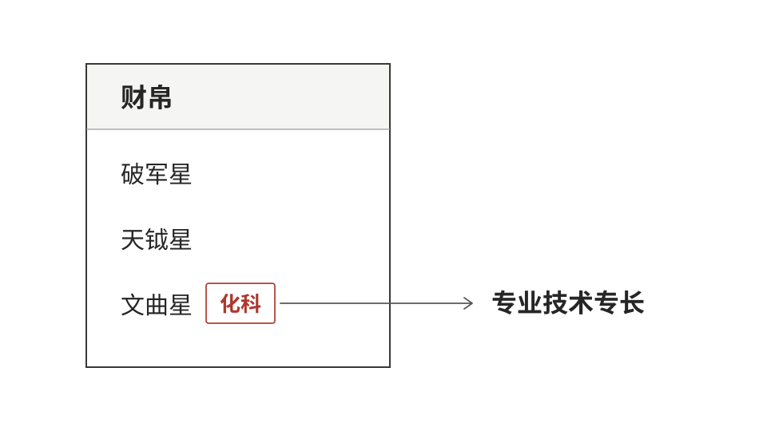 |
| **四化先看哪个？化科主哪两个意思？** | 〔口述〕「诸位有一个先首先看化科」，并说「我们首先看八字要科权禄是最大」，「我们先看科」。（[00:15:02–00:15:08](https://www.bilibili.com/video/BV1KJsLekEfA/?p=9&t=902)，第 27060–27245 帧） 〔口述〕「她科在财帛」，所以「她一定要有专业技术专长待在身上」。（[00:15:08–00:15:13](https://www.bilibili.com/video/BV1KJsLekEfA/?p=9&t=908)，第 27246–27407 帧） 〔口述〕「科主两个意思」：「一个是科是主的是考试金榜题名」，「一个是科主的是专业专长」。（[00:15:13–00:15:19](https://www.bilibili.com/video/BV1KJsLekEfA/?p=9&t=913)，第 27408–27587 帧） |
| **化科落在不同宫，各主什么？** | 〔口述〕「比如说我算过很多有的作家」，「他画画的或者是音乐家也有科」。（[00:15:19–00:15:26](https://www.bilibili.com/video/BV1KJsLekEfA/?p=9&t=919)，第 27588–27785 帧） 〔口述〕「那有的人科在官禄」，「他一定要考公家单位去」；「或科在命都会有考试」。（[00:15:26–00:15:31](https://www.bilibili.com/video/BV1KJsLekEfA/?p=9&t=926)，第 27786–27953 帧） 〔叠图〕讲科在官禄时叠图贴出「官禄 壬辰」：太阳旺化科、文曲得、天喜陷、寡宿陷、副截陷、天煞，喜神、病符，墓。这是配合假设贴的别的盘，不是本例。（[00:15:23–00:15:26](https://www.bilibili.com/video/BV1KJsLekEfA/?p=9&t=923)，第 27696–27785 帧） |
| **天魁天钺加化科，等于几个科甲星？主什么？** | 〔口述〕「而她这个科在财帛」，加上天魁、天钺两颗：「两个科甲星再化科」，「等于有三个科甲星在里面」。（[00:15:31–00:15:40](https://www.bilibili.com/video/BV1KJsLekEfA/?p=9&t=931)，第 27954–28217 帧） 〔指代〕说「天魁星在这边」时手指的是黑板上方中间格里的「天魁」二字，并给它画了框；说「天钺星又在这边」时手指的是黑板左下格（圈字左侧空白处），随后在那里写字。（[00:15:34–00:15:36](https://www.bilibili.com/video/BV1KJsLekEfA/?p=9&t=934)，第 28038–28081 帧） 〔板书〕后来的板面上，黑板左下格可辨「天钺」「财帛」，旁边一团圈起的字认不出。（[00:16:47](https://www.bilibili.com/video/BV1KJsLekEfA/?p=9&t=1007)，第 30229 帧） 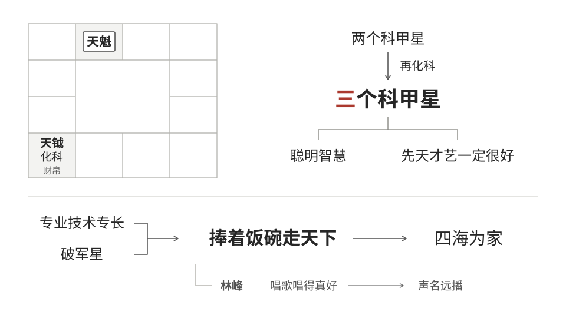 〔口述〕这样的人「先天才艺一定很好」，「聪明智慧她的才艺也很好」。（[00:15:40–00:15:47](https://www.bilibili.com/video/BV1KJsLekEfA/?p=9&t=940)，第 28218–28421 帧） |
| **才艺好的人手相什么样？该怎么跟她说？** | 〔口述〕才艺好的人一般手伸出来「都手指头比较长一点」，「天柱纹都比较高一点」。（[00:15:47–00:15:55](https://www.bilibili.com/video/BV1KJsLekEfA/?p=9&t=947)，第 28422–28673 帧） 〔口述〕倪师示范对客户说：小姐要多往才艺方面发展，「对你来说最有利」，「走专业技术专长」，「然后将来你走服务业」——「这就已经定出来了」。（[00:15:55–00:16:04](https://www.bilibili.com/video/BV1KJsLekEfA/?p=9&t=955)，第 28674–28943 帧） |
| **财帛宫没有破军、是财星化权的人呢？** | 〔口述〕对照另一种人：「他财帛宫没有破军」，「他财帛宫都是财星化权」，「这种时候他就会自己做生意当老板」。（[00:16:04–00:16:13](https://www.bilibili.com/video/BV1KJsLekEfA/?p=9&t=964)，第 28944–29207 帧） 〔叠图〕此时叠图贴出「财帛 庚午」：紫微庙化权、禄存庙、地空庙、三台旺、咸池陷、红鸾旺、天德旺，博士，墓，标「财星」。这是配合对照贴的别的盘，不是本例。（[00:16:06–00:16:08](https://www.bilibili.com/video/BV1KJsLekEfA/?p=9&t=966)，第 28998–29045 帧） |
| **破军加专业专长的人，为什么要走天下？** | 〔口述〕回到本例这种人：有专业技术专长，然后「破军星是要流浪在外要走天下」，专业技术专长「她要捧着饭碗走天下」。（[00:16:14–00:16:24](https://www.bilibili.com/video/BV1KJsLekEfA/?p=9&t=974)，第 29244–29531 帧） 〔口述〕举现场学生林峰为例：「像我们现在林峰就是这样的」；看相「对你看后脑瓜他秃头最好看」，「后面的脑壳是这样子的」，脖子「两个他的骨头是这样子的」。（[00:16:24–00:16:48](https://www.bilibili.com/video/BV1KJsLekEfA/?p=9&t=984)，第 29532–30263 帧） 〔板书〕边讲后脑、脖子边在黑板上方画了几道弧线，看不出画的是什么，也没有可辨的字。（[00:16:47](https://www.bilibili.com/video/BV1KJsLekEfA/?p=9&t=1007)，第 30229 帧） 〔口述〕这种人「一辈子到处四海为游」「四海为家」；林峰「虽然脸不怎么样但是唱歌唱得真好」，「然后他这个声名远播」。（[00:16:48–00:17:01](https://www.bilibili.com/video/BV1KJsLekEfA/?p=9&t=1008)，第 30264–30659 帧） |
| **迁移宫紫微单星在子宫，第一层、第二层各说明什么？** | 〔口述〕「诸位看迁移」，「迁移她是紫微星」，「现在紫微星在子宫」。前面讲过「紫微星一定要有什么呀」「左辅右弼来会它」，「结果她的紫微星」「一颗星在外地有没有」。（[00:17:07–00:17:21](https://www.bilibili.com/video/BV1KJsLekEfA/?p=9&t=1027)，第 30810–31253 帧） 〔口述〕批正格「这一面的时候是讲迷津」，「迷津是讲一辈子的懂不懂」，「我们不管你几岁」，「我们先把你终身先讲出来」。（[00:17:22–00:17:33](https://www.bilibili.com/video/BV1KJsLekEfA/?p=9&t=1042)，第 31284–31607 帧） 〔口述〕第一，紫微星在外「代表你在外地去会逢到贵人」，因为「紫微星是大贵皇帝星啊」。（[00:17:33–00:17:38](https://www.bilibili.com/video/BV1KJsLekEfA/?p=9&t=1053)，第 31608–31769 帧） 〔口述〕第二，紫微星对自己本身来说也是紫微星，「你一个人在外地」「到头来会孤军孤独的皇帝」。（[00:17:39–00:17:47](https://www.bilibili.com/video/BV1KJsLekEfA/?p=9&t=1059)，第 31770–32015 帧） |
| **这些信息对她的婚姻和出路有什么暗示？** | 〔口述〕一个女孩子的命「拿到男人的命然后又在外地孤单的话」，「恐怕先生就会有问题」；所以「我们随时等下我们批夫妻的」「我们就要注意看」，已经有暗示了。（[00:17:47–00:18:03](https://www.bilibili.com/video/BV1KJsLekEfA/?p=9&t=1067)，第 32016–32507 帧） 〔指代〕说「已经暗示我们了这里」时手指的是黑板中部偏右一处被圈起的潦草字，字看不清。（[00:18:01](https://www.bilibili.com/video/BV1KJsLekEfA/?p=9&t=1081)，第 32455 帧） 〔口述〕「所以你会不会劝这个女孩子去当官」——「不会嘛」，「她一定走财方面发展」，「走私人走这种方面发展」。（[00:18:04–00:18:13](https://www.bilibili.com/video/BV1KJsLekEfA/?p=9&t=1084)，第 32532–32819 帧） 〔口述〕收尾：她天魁天钺「化科星进来」，这是她的、「我们算命的一个」「第一个重点」。（[00:18:14–00:18:23](https://www.bilibili.com/video/BV1KJsLekEfA/?p=9&t=1094)，第 32820–33107 帧） |

**总结区**

- 通用规则：身宫最怕逢七杀，不管七杀落在哪一宫，只要七杀临身，一辈子多败少成、很累（[00:13:53–00:14:30](https://www.bilibili.com/video/BV1KJsLekEfA/?p=9&t=833)，第 25008–26129 帧）；化科主两个意思：考试金榜题名、专业专长；科在官禄要考公家单位，科在命会有考试（[00:15:13–00:15:31](https://www.bilibili.com/video/BV1KJsLekEfA/?p=9&t=913)，第 27408–27953 帧）；紫微星一定要有左辅右弼来会（[00:17:14–00:17:18](https://www.bilibili.com/video/BV1KJsLekEfA/?p=9&t=1034)，第 31026–31151 帧）；财帛宫没有破军、都是财星化权的人，会自己做生意当老板（[00:16:04–00:16:13](https://www.bilibili.com/video/BV1KJsLekEfA/?p=9&t=964)，第 28944–29207 帧）
- 只在本例：身在财帛，倪师断她在私人企业、私人行号或自己做事业发展（[00:14:43–00:14:50](https://www.bilibili.com/video/BV1KJsLekEfA/?p=9&t=883)，第 26490–26705 帧）；财帛天魁、天钺加文曲化科，等于三个科甲星，先天才艺好，宜走专业技术专长、将来走服务业（[00:15:31–00:16:04](https://www.bilibili.com/video/BV1KJsLekEfA/?p=9&t=931)，第 27954–28943 帧）；迁移紫微单星在子宫，主在外地逢贵人但终成孤独的皇帝；倪师据此提示先生恐怕有问题，不劝她当官、要往财与私人方面发展（[00:17:07–00:18:13](https://www.bilibili.com/video/BV1KJsLekEfA/?p=9&t=1027)，第 30810–32819 帧）
- 不是排盘规则，是处世方法：算到七杀临身这种命不必慌，后面还有人间道和运解，人和地加起来大于天命，算命只是工具（[00:14:31–00:14:41](https://www.bilibili.com/video/BV1KJsLekEfA/?p=9&t=871)，第 26130–26459 帧）；跟客户直说怎么发展对她最有利：往才艺方面发展、走专业技术专长（[00:15:55–00:16:02](https://www.bilibili.com/video/BV1KJsLekEfA/?p=9&t=955)，第 28674–28883 帧）

**待核**

1. [00:13:53](https://www.bilibili.com/video/BV1KJsLekEfA/?p=9&t=833)，第 25008 帧：字幕「七杀临身终不美」识别可信度只有0.43，语音作「凌生中不美」，按板书与下句定为「七杀临身终不美」。
2. [00:13:53](https://www.bilibili.com/video/BV1KJsLekEfA/?p=9&t=833)，第 25008 帧：叠图福德丙寅（七杀、标身宫）是举例用的别的盘，本例福德是丙申，不当本例依据。
3. [00:14:32](https://www.bilibili.com/video/BV1KJsLekEfA/?p=9&t=872)，第 26166 帧：「运解」「人间道」倪师在这里用了但没解释；[00:14:34](https://www.bilibili.com/video/BV1KJsLekEfA/?p=9&t=874)，第 26238 帧「人天人地的人和地」字幕可信度0.55，原话待核。
4. [00:14:56](https://www.bilibili.com/video/BV1KJsLekEfA/?p=9&t=896)，第 26886 帧：倪师说财帛第二颗是天钺星，叠图财帛庚寅格印的是天魁、没有天钺；[00:15:33](https://www.bilibili.com/video/BV1KJsLekEfA/?p=9&t=933)，第 27996 帧字幕作「天魁」、语音作「天悦」；随后又说天魁天钺两颗都在，到底几颗、哪颗待核。
5. [00:15:04](https://www.bilibili.com/video/BV1KJsLekEfA/?p=9&t=904)，第 27132 帧：「我们首先看八字要科权禄是最大」两路都作「八字」（语音「巴士尔」），这里「八字」指什么没解释，原话待核。
6. [00:15:23](https://www.bilibili.com/video/BV1KJsLekEfA/?p=9&t=923)，第 27696 帧、[00:16:06](https://www.bilibili.com/video/BV1KJsLekEfA/?p=9&t=966)，第 28998 帧：叠图官禄壬辰、财帛庚午是配合假设贴的别的盘，不是本例。
7. [00:15:56](https://www.bilibili.com/video/BV1KJsLekEfA/?p=9&t=956)，第 28692 帧：字幕作「要多发（往）才艺方面发展」，括号是字幕自带，原话可能是「多往」；[00:16:01](https://www.bilibili.com/video/BV1KJsLekEfA/?p=9&t=961)，第 28842 帧字幕开头多一个「J」、[00:16:08](https://www.bilibili.com/video/BV1KJsLekEfA/?p=9&t=968)，第 29046 帧开头多一个「4」、[00:14:42](https://www.bilibili.com/video/BV1KJsLekEfA/?p=9&t=882)，第 26460 帧开头多「J1」，都当识别杂字去掉。
8. [00:16:20](https://www.bilibili.com/video/BV1KJsLekEfA/?p=9&t=980)，第 29424 帧：字幕「袁业技术专长」按语音改为「专业技术专长」。
9. [00:16:24](https://www.bilibili.com/video/BV1KJsLekEfA/?p=9&t=984)，第 29532 帧：林峰应是现场学生，材料没交代是谁。
10. [00:17:02](https://www.bilibili.com/video/BV1KJsLekEfA/?p=9&t=1022)，第 30660 帧：「可以看到后脑勺都可以看到」字幕可信度0.41，意思不明，未写入笔记。
11. [00:17:24](https://www.bilibili.com/video/BV1KJsLekEfA/?p=9&t=1044)，第 31320 帧：字幕「批这个正格的时候」，语音作「批这个正面这一面」，「正格」还是「正面」待核。
12. [00:17:43](https://www.bilibili.com/video/BV1KJsLekEfA/?p=9&t=1063)，第 31902 帧：字幕「孤军孤独的皇帝」，语音作「孤君」，哪个字待核。
13. [00:17:51](https://www.bilibili.com/video/BV1KJsLekEfA/?p=9&t=1071)，第 32136 帧：「拿到男人的命」没在本块解释是指哪颗星或哪种格局。
14. [00:14:03](https://www.bilibili.com/video/BV1KJsLekEfA/?p=9&t=843)，第 25296 帧、[00:15:12](https://www.bilibili.com/video/BV1KJsLekEfA/?p=9&t=912)，第 27360 帧、[00:16:47](https://www.bilibili.com/video/BV1KJsLekEfA/?p=9&t=1007)，第 30229 帧：板书大部分认不出；[00:16:47](https://www.bilibili.com/video/BV1KJsLekEfA/?p=9&t=1007)，第 30229 帧上方弧线看不出画的是什么。
15. 第25181、28214、28712、30579、31332、31388、32549帧：这几处「这个」的指代标为否或不确定，未当依据。

## 父母兄弟田宅（日月反背、剋与旺）、疾厄交友子女、夫妻与总格

| 巳 | 午 | 未 | 申 |
|---|---|---|---|
| **兄弟 癸巳** 太阴陷 | **命宫 甲午** 贪狼旺 左辅旺 | **父母 乙未** 天同不 巨门不禄 | **福德 丙申** 武曲得 天相庙 右弼不 陀罗陷 铃星陷 |
| **夫妻 壬辰** 廉贞利 天府庙 | **父母兄弟田宅 · 命宫甲午** | 据视频叠图重排 | **田宅 丁酉** 太阳平权 天梁得 文昌旺忌 禄存庙 地劫平 |
| **子女 辛卯** （无主星、辅星） | 后期贴图，不算倪师的话 |  | **官禄 戊戌** 七杀庙 擎羊庙 |
| **财帛 庚寅**（身宫） 破军得 文曲平科 | **疾厄 辛丑** 火星得 地空陷 | **迁移 庚子** 紫微平 文昌得忌 | **交友 己亥** 天机平 天马平 |

按视频里这张盘逐格重画（我们自己画的图，不是视频截图）；同一个人的 3 段合成一张；星名后没写亮度的，视频里本来就没标亮度；数据见 [命盘-P09-命宫甲午.json](图/命盘-P09-命宫甲午.json)。

注：图中子、酉两宫都有文昌，是视频前后两版画面并存——原电子盘文昌化忌在子，剪辑后来把「文昌旺忌」贴在酉格讲解；按排盘规则（辛年、戌时）文昌应在子。

### 5　日月反背：父母宫三解与剋、旺夫（[00:18:23–00:23:48](https://www.bilibili.com/video/BV1KJsLekEfA/?p=9&t=1103)，第 33108–42857 帧）

| 提示区 | 笔记区 |
|---|---|
| **「第二个重点」看左右，本例父母宫有什么星？** | 〔口述〕讲完天魁天钺化科这「第一个重点」后，倪师转入第二个重点：「第二个重点诸位我们看左右」，先看父母宫：「天同巨门呢化禄」「待在她父母宫」。（[00:18:23–00:18:35](https://www.bilibili.com/video/BV1KJsLekEfA/?p=9&t=1103)，第 33108–33461 帧） 〔叠图〕父母乙未：天同不、巨门不并标「禄」，另有天才平、天虚陷、岁破、月煞、伏兵、冠带。这是后期贴的电子盘，不是倪师的话。（[00:18:28–00:18:32](https://www.bilibili.com/video/BV1KJsLekEfA/?p=9&t=1108)，第 33246–33383 帧） 〔板书〕本块开头的板面：可辨左上格圈起的「午」，其余字认不出。（[00:18:24](https://www.bilibili.com/video/BV1KJsLekEfA/?p=9&t=1104)，第 33144 帧） 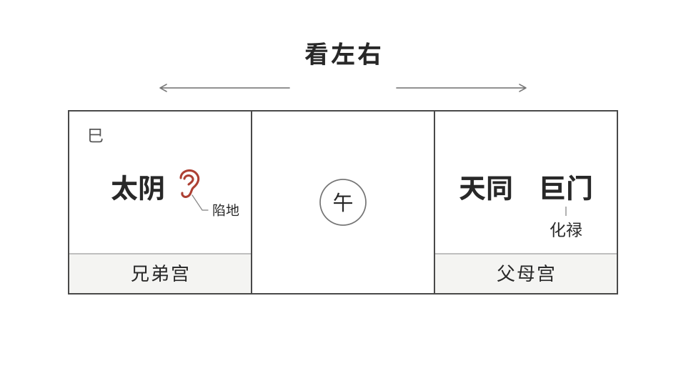 〔板书〕写完父母宫这一格后：可辨上排第二格里的「巨门」，同格下面几个字认不出。（[00:18:35](https://www.bilibili.com/video/BV1KJsLekEfA/?p=9&t=1115)，第 33456 帧） 〔推断〕推断：倪师说「看左右」之后接连讲父母宫和兄弟宫；按本例叠图，命宫甲午、父母乙未、兄弟癸巳，这两宫就在命宫两旁，「左右」可能指这两宫。倪师本块没有明说。（[00:18:23–00:18:43](https://www.bilibili.com/video/BV1KJsLekEfA/?p=9&t=1103)，第 33108–33701 帧） |
| **本例兄弟宫是什么星？「陷」在板上怎么记？** | 〔口述〕接着看兄弟宫：「还有呢」「兄弟宫」「太阴星陷」，并说「诸位看到那个陷」「我用那个耳朵来代表陷地」——在板上用一个「耳朵」记号表示陷地。（[00:18:35–00:18:51](https://www.bilibili.com/video/BV1KJsLekEfA/?p=9&t=1115)，第 33462–33941 帧） 〔板书〕左上格可辨「太阴」「巳」，下方「兄弟宫」；其余认不出。左侧竖写的几行字认不出。（[00:18:53](https://www.bilibili.com/video/BV1KJsLekEfA/?p=9&t=1133)，第 33996 帧） 〔指代〕说「为什么太阴星在这里陷」的「这里」时，粉笔落在黑板左上格「太阴」字右侧（随后在此写下「巳」），该格下方写有「兄弟宫」。（[00:18:52](https://www.bilibili.com/video/BV1KJsLekEfA/?p=9&t=1132)，第 33967 帧） 〔叠图〕兄弟癸巳：太阴陷，另有天哭不、天福旺、天贵平、截空庙、旬空庙、龙池陷、官符、指背、病符、长生。（[00:20:39–00:20:41](https://www.bilibili.com/video/BV1KJsLekEfA/?p=9&t=1239)，第 37170–37235 帧） |
| **太阴在巳为什么陷？太阳在酉又如何？** | 〔口述〕倪师用时辰来解释：「为什么太阴星在这里陷因为这是巳宫」，巳时「代表上午9点到11点」，那个时候「应该出太阳结果月亮跑出来」，所以太阴在这里陷。（[00:18:51–00:19:02](https://www.bilibili.com/video/BV1KJsLekEfA/?p=9&t=1131)，第 33942–34277 帧） 〔指代〕说「巳宫在这里」的「这里」时，食指点在黑板左上格「太阴—巳」的「巳」字上，格内下方写「兄弟宫」。（[00:18:53](https://www.bilibili.com/video/BV1KJsLekEfA/?p=9&t=1133)，第 34019 帧） 〔口述〕再用同样的问法看酉：「那你看这边酉时的时候有没有」「是不是太阳星在这边」「刚好也陷也是陷地」——太阳星在酉，倪师说也是陷地。（[00:19:02–00:19:11](https://www.bilibili.com/video/BV1KJsLekEfA/?p=9&t=1142)，第 34278–34541 帧） 〔叠图〕田宅丁酉：太阳平并标「权」，另有天梁得、禄存庙、地劫平、天官平、凤阁庙、年解旺、博士、将星、帝旺、白虎、蜚廉。叠图标太阳「平」，与口述「陷」不同，见待核。（[00:19:02–00:19:05](https://www.bilibili.com/video/BV1KJsLekEfA/?p=9&t=1142)，第 34278–34361 帧） 〔板书〕后来的板面上，右侧中排一格可辨「酉」，其上一行像「太阳」，旁边带一个圈记号；其余认不出。（[00:21:17](https://www.bilibili.com/video/BV1KJsLekEfA/?p=9&t=1277)，第 38312 帧） 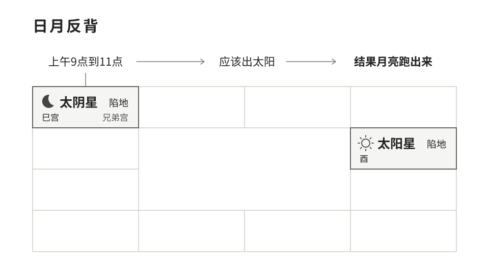 |
| **命里的太阳、太阴代表谁？** | 〔口述〕倪师提醒：「我们看女孩子的命的太阳和太阴」，「一个人的命月亮太阳就代表爸爸妈妈」。（[00:19:11–00:19:20](https://www.bilibili.com/video/BV1KJsLekEfA/?p=9&t=1151)，第 34542–34817 帧） 〔口述〕理由是天和地之象：「太阳和太阴在养众生」「就好像父母亲在养子女是一样的象」。（[00:19:20–00:19:29](https://www.bilibili.com/video/BV1KJsLekEfA/?p=9&t=1160)，第 34818–35081 帧） 〔口述〕落到本例：「那她的太阳星陷地太阴星陷日月反背的人」——太阳、太阴都陷，就叫日月反背。（[00:19:29–00:19:32](https://www.bilibili.com/video/BV1KJsLekEfA/?p=9&t=1169)，第 35082–35171 帧） |
| **日月反背的人一般会怎样？本例人在哪里？** | 〔口述〕倪师当作一般规律讲：「只要是命是太阳太阴是反着过来的话」「大部分都会离祖」「离开家乡到外乡去发展」。（[00:19:32–00:19:42](https://www.bilibili.com/video/BV1KJsLekEfA/?p=9&t=1172)，第 35172–35489 帧） 〔口述〕顺带提到当天另有一位来批命的人（字幕作「义士」），说「下次我把他八字拿出来给你看」。（[00:19:43–00:19:47](https://www.bilibili.com/video/BV1KJsLekEfA/?p=9&t=1183)，第 35490–35615 帧） 〔口述〕随后说「这也是离祖」，并说「所以这个八字目前人在国外」「在美国在国外」。中间两句字幕与语音对不上，所指是本例还是那位来批命的人看不准，见待核。（[00:19:52–00:20:01](https://www.bilibili.com/video/BV1KJsLekEfA/?p=9&t=1192)，第 35784–36035 帧） 〔指代〕说「这也是离祖」到「跟这个离祖……」之际，手一直指向板面右侧中排那格，食指对着「酉」，同格上方还有一行像「太阳」带圈记号的字。（[00:19:53](https://www.bilibili.com/video/BV1KJsLekEfA/?p=9&t=1193)，第 35807 帧） |
| **父母宫化禄，第一个解释是什么？** | 〔口述〕「这是第一个看到父母」，「第二个她的父母亲有化禄」，有化禄就「代表她父母亲有财禄会给她」。（[00:20:01–00:20:10](https://www.bilibili.com/video/BV1KJsLekEfA/?p=9&t=1201)，第 36036–36329 帧） 〔推断〕推断：叠图父母乙未格里巨门旁标「禄」，与倪师说父母宫「化禄」一致。（[00:18:28–00:18:32](https://www.bilibili.com/video/BV1KJsLekEfA/?p=9&t=1108)，第 33246–33383 帧） |
| **第二个解释：巨门在父母宫，父母关系怎样？** | 〔口述〕「那第二个解释呢」：「太阳太阴是不是反背的」，「那巨门星又在父母宫」，而「巨门星代表是非口舌的星」。（[00:20:11–00:20:20](https://www.bilibili.com/video/BV1KJsLekEfA/?p=9&t=1211)，第 36330–36617 帧） 〔口述〕断语：「代表父母亲呢会在一起」，「天同星又感情又好可是又要吵架」「两个人又不离婚」；「很多夫妻这样子啊」，「可是见面就吵架」。（[00:20:18–00:20:28](https://www.bilibili.com/video/BV1KJsLekEfA/?p=9&t=1218)，第 36558–36869 帧） 〔口述〕倪师打趣：「这是什么病」「目前还没有研究出来这种药」，说现在有这种情形，在这里就是这样。（[00:20:29–00:20:36](https://www.bilibili.com/video/BV1KJsLekEfA/?p=9&t=1229)，第 36870–37085 帧） 〔指代〕说「在这里是这样」的「这里」时，食指一直指着黑板上排中间那格「巨门」两字下方；黑板上没写宫名。（[00:20:34](https://www.bilibili.com/video/BV1KJsLekEfA/?p=9&t=1234)，第 37029 帧） |
| **第三个解释：日月反背会让父母怎样？** | 〔口述〕「第三个解释呢」：一般来说「日月反背的人」，「她都会有些事情」「让父母亲替她担心烦恼」。（[00:20:36–00:20:46](https://www.bilibili.com/video/BV1KJsLekEfA/?p=9&t=1236)，第 37086–37385 帧） 〔口述〕为什么不讲得含蓄：「因为每一个八字」「担心的烦恼的角度不一样」。（[00:20:46–00:20:50](https://www.bilibili.com/video/BV1KJsLekEfA/?p=9&t=1246)，第 37386–37523 帧） 〔口述〕以本例举可能的情形：「像她可能是因为她原来都很好啊」，「可是中年的话万一他先生有事情」，「她后来一个人带了孩子」，「那是不是爸爸妈妈会担心」。并说待会看她的夫妻宫就知道。（[00:20:50–00:21:05](https://www.bilibili.com/video/BV1KJsLekEfA/?p=9&t=1250)，第 37524–37961 帧） |
| **古人说日月反背「剋父母」，剋到底是什么？** | 〔口述〕过去人说「这种日月反背的说是剋父母」，但「他们没有把这个剋解释的很好」，于是倪师「我辅辅助解一下什么叫做剋」「什么叫做旺」。（[00:21:06–00:21:23](https://www.bilibili.com/video/BV1KJsLekEfA/?p=9&t=1266)，第 37998–38495 帧） 〔板书〕右上角可辨一个下面画横线的「旺」；其左边圈起的字被讲者头部挡住，认不出。（[00:21:17](https://www.bilibili.com/video/BV1KJsLekEfA/?p=9&t=1277)，第 38312 帧） 〔口述〕为什么古书只写一个「剋」字：「因为中国以前是竹简的」「这竹简刻下去已经很麻烦了」，「然后 100种人都是剋」「但是剋的事情不一样」，可是「精神是一样」；具体事情「陈述不完」。（[00:21:23–00:21:36](https://www.bilibili.com/video/BV1KJsLekEfA/?p=9&t=1283)，第 38496–38891 帧） 〔口述〕举例：路上陌生人说「先生你借我十万块我买车子」，「你把我当神经病了」，「我没有害到你哦」；若是弟弟或儿子说「我出车祸把人家撞了」，要十万去和解「不然我要坐牢」，「你给了这就叫做剋」。（[00:21:37–00:21:56](https://www.bilibili.com/video/BV1KJsLekEfA/?p=9&t=1297)，第 38928–39485 帧） 〔口述〕结论：「所以说能够影响得到你的」「才剋得到懂不懂」。（[00:21:56–00:21:59](https://www.bilibili.com/video/BV1KJsLekEfA/?p=9&t=1316)，第 39486–39599 帧） |
| **剋父母是感情不好吗？倪师举了什么例子？** | 〔口述〕「所以尅不是说跟父母亲感情不好」「你错了是感情太好了」。（[00:22:00–00:22:05](https://www.bilibili.com/video/BV1KJsLekEfA/?p=9&t=1320)，第 39600–39767 帧） 〔口述〕举例：「有个女孩子她没有结婚」「可是她的八字尅父母」，跟她这么说，她急着说「我跟我爸妈感情很好」「我很孝顺他们」；倪师答「没错就是因为你感情很好」。（[00:22:05–00:22:18](https://www.bilibili.com/video/BV1KJsLekEfA/?p=9&t=1325)，第 39768–40145 帧） 〔口述〕女孩子的做法：「你大学毕业出来一个月赚5万块」「你就拿4万块给你爸爸妈妈」，升职后「一个月赚7万块你拿6万块」，心态是「你们放心不要担心我」「我自己会照顾自己」。（[00:22:19–00:22:34](https://www.bilibili.com/video/BV1KJsLekEfA/?p=9&t=1339)，第 40188–40625 帧） 〔口述〕父母的想法却是：隔壁邻居女孩子「条件跟我女儿那么好」，「那为什么他那个女儿就嫁了好先生」「为什么我女儿到现在没结婚呢」，女儿给得越多「他越来越担心了」。（[00:22:36–00:22:56](https://www.bilibili.com/video/BV1KJsLekEfA/?p=9&t=1356)，第 40680–41297 帧） 〔口述〕「这就是剋了」，「所以你越对他好的时候就越剋」。（[00:22:58–00:23:02](https://www.bilibili.com/video/BV1KJsLekEfA/?p=9&t=1378)，第 41364–41471 帧） |
| **剋有没有解？倪师说用什么解？** | 〔口述〕「然后你们俩剋了半天」「你们无解我有解」，「我们用阳宅一下就把它解掉去了」「这就是人间道」。（[00:23:02–00:23:09](https://www.bilibili.com/video/BV1KJsLekEfA/?p=9&t=1382)，第 41472–41675 帧） 〔口述〕为什么当事人自己没办法：「因为人都是感情的动物」，「所以越剋是越累」「是感情越好的现象」。（[00:23:09–00:23:17](https://www.bilibili.com/video/BV1KJsLekEfA/?p=9&t=1389)，第 41676–41939 帧） |
| **什么叫旺夫？旺夫命就一定嫁好先生吗？** | 〔口述〕讲完剋，「还有一种是旺」。倪师说「我最怕看到女孩子是旺夫命」「可是很多女孩子是旺夫命」。（[00:23:18–00:23:25](https://www.bilibili.com/video/BV1KJsLekEfA/?p=9&t=1398)，第 41940–42173 帧） 〔口述〕先立一个观点：「上帝并没有规定」「旺夫命的人一定嫁了好先生」「这是两回事啊」。（[00:23:25–00:23:32](https://www.bilibili.com/video/BV1KJsLekEfA/?p=9&t=1405)，第 42174–42389 帧） 〔口述〕定义：「这个一个太太会让先生」「没有完全没有后顾之忧」「这叫旺夫啊」。（[00:23:33–00:23:39](https://www.bilibili.com/video/BV1KJsLekEfA/?p=9&t=1413)，第 42390–42587 帧） 〔口述〕这句话几秒钟讲完，但「一个太太要花十几二十年的时间」「去证明她是旺夫的」。本块到此，「旺」的话题延续到下一块。（[00:23:39–00:23:48](https://www.bilibili.com/video/BV1KJsLekEfA/?p=9&t=1419)，第 42588–42857 帧） |

**总结区**

- 通用规则：一个人的命里月亮、太阳代表爸爸妈妈，如同天地养众生、父母养子女（[00:19:13–00:19:29](https://www.bilibili.com/video/BV1KJsLekEfA/?p=9&t=1153)，第 34602–35081 帧）；只要命里太阳太阴反背，大部分都会离祖，离开家乡到外乡去发展（[00:19:32–00:19:42](https://www.bilibili.com/video/BV1KJsLekEfA/?p=9&t=1172)，第 35172–35489 帧）；剋是能影响得到你的才剋得到；剋父母不是感情不好，而是感情太好，越对他好越剋（[00:21:54–00:22:05](https://www.bilibili.com/video/BV1KJsLekEfA/?p=9&t=1314)，第 39426–39767 帧、[00:22:58–00:23:02](https://www.bilibili.com/video/BV1KJsLekEfA/?p=9&t=1378)，第 41364–41471 帧）；旺夫是太太让先生完全没有后顾之忧；旺夫命与一定嫁好先生是两回事（[00:23:25–00:23:39](https://www.bilibili.com/video/BV1KJsLekEfA/?p=9&t=1405)，第 42174–42587 帧）
- 只在本例：兄弟宫巳太阴陷，倪师说田宅酉太阳也陷，日月反背（[00:18:35–00:19:32](https://www.bilibili.com/video/BV1KJsLekEfA/?p=9&t=1115)，第 33462–35171 帧）；父母宫天同巨门化禄：父母有财禄会给她（[00:20:01–00:20:10](https://www.bilibili.com/video/BV1KJsLekEfA/?p=9&t=1201)，第 36036–36329 帧）；巨门在父母宫加日月反背：父母会在一起、感情好却见面就吵、又不离婚（[00:20:11–00:20:28](https://www.bilibili.com/video/BV1KJsLekEfA/?p=9&t=1211)，第 36330–36869 帧）；日月反背会有事让父母担心，倪师举的可能是中年先生出事、她一个人带孩子（[00:20:36–00:21:05](https://www.bilibili.com/video/BV1KJsLekEfA/?p=9&t=1236)，第 37086–37961 帧）
- 不是排盘规则，是处世方法：跟人说「你剋父母」时，对方在还没听解释前会很心急，要讲清剋是感情太好、越对父母好父母越担心（[00:22:09–00:23:02](https://www.bilibili.com/video/BV1KJsLekEfA/?p=9&t=1329)，第 39888–41471 帧）

**待核**

1. [00:18:28](https://www.bilibili.com/video/BV1KJsLekEfA/?p=9&t=1108)，第 33246 帧：「天同巨门呢化禄」字幕可信度 0.5，语音作「发露」，「化禄」按上下文与叠图「禄」暂收。
2. [00:18:48](https://www.bilibili.com/video/BV1KJsLekEfA/?p=9&t=1128)，第 33846 帧：「我用那个耳朵来代表陷地」——「耳朵」是什么记号倪师没解释，指代 D044 看不出手指何处。
3. [00:18:53–00:19:02](https://www.bilibili.com/video/BV1KJsLekEfA/?p=9&t=1133)，第 34014–34277 帧：字幕「已时」按上下文改作「巳时」；[00:18:53](https://www.bilibili.com/video/BV1KJsLekEfA/?p=9&t=1133)，第 34014 帧字幕「官在这里」可信度 0.32，语音作「在这里四十」，原话待核。
4. [00:19:02–00:19:11](https://www.bilibili.com/video/BV1KJsLekEfA/?p=9&t=1142)，第 34278–34541 帧：叠图田宅丁酉标太阳「平」，倪师口述太阳在酉「也陷也是陷地」，两者不一致。
5. [00:18:53](https://www.bilibili.com/video/BV1KJsLekEfA/?p=9&t=1133)，第 33996 帧：这一帧板书图右下已贴出兄弟癸巳叠图格，但材料把兄弟癸巳叠图记在约 00:20:39（[00:20:39](https://www.bilibili.com/video/BV1KJsLekEfA/?p=9&t=1239)，第 37170 帧），出现时间待核。
6. 第 34289、34384 帧：说「这边」时讲义尖端指向左下一带被圈的字，指代 D047、D048 均为不确定，没有当依据。
7. [00:19:43](https://www.bilibili.com/video/BV1KJsLekEfA/?p=9&t=1183)，第 35490 帧：字幕「这个义士」，语音「这个反共义士」，此人身份倪师没细讲。
8. 第 35724、35808 帧：字幕「即使她不是日月反背她也会离祖」「跟这个离祖跟反背是没有关系」，语音作「不是反共义士」「跟反共义士没关系」，两路对不上，这两句讲的是本例还是那位来批命的人看不准，未收为口述。
9. [00:19:55](https://www.bilibili.com/video/BV1KJsLekEfA/?p=9&t=1195)，第 35874 帧：「所以这个八字目前人在国外」所指是本例女命还是那位来批命的人，看不出；指代 D054 不确定。
10. [00:20:39](https://www.bilibili.com/video/BV1KJsLekEfA/?p=9&t=1239)，第 37170 帧：字幕开头「品C」为识别乱码，语音作「说」。
11. [00:20:46](https://www.bilibili.com/video/BV1KJsLekEfA/?p=9&t=1246)，第 37386 帧：字幕「我讲的不是很含蓄」，语音作「不是很安静」，原话待核。
12. [00:20:50](https://www.bilibili.com/video/BV1KJsLekEfA/?p=9&t=1250)，第 37524 帧：字幕「待会我们看她夫妻知道」，语音作「看到父亲知道」，两路对不上。
13. [00:21:14](https://www.bilibili.com/video/BV1KJsLekEfA/?p=9&t=1274)，第 38223 帧：说「这个剋」时讲者在右上角写字画圈，指代 D056 不确定；据其描述圈内是「克」、下写「父母」，但[00:21:17](https://www.bilibili.com/video/BV1KJsLekEfA/?p=9&t=1277)，第 38312 帧板书图里该处被头挡住，没有当依据。
14. [00:22:10](https://www.bilibili.com/video/BV1KJsLekEfA/?p=9&t=1330)，第 39924 帧：字幕「在你还没解释她很心急啊」，语音作「还没接受」。
15. 第 40380、41220 帧：语音多出「一个月赚十万块你拿九万块」，字幕没有；[00:22:54](https://www.bilibili.com/video/BV1KJsLekEfA/?p=9&t=1374)，第 41220 帧字幕「再给他九万」，语音作「再给他结婚」，十万给九万这一层待核。
16. [00:23:20](https://www.bilibili.com/video/BV1KJsLekEfA/?p=9&t=1400)，第 42006 帧：字幕「王Z书」为识别乱码，语音作「最」。
17. 字幕里「剋」「尅」两种写法混用（如第 39600、39852 帧作「尅」），引文照字幕原字未改。
18. 板书认不全：[00:18:24](https://www.bilibili.com/video/BV1KJsLekEfA/?p=9&t=1104)，第 33144 帧只认得圈起的「午」；[00:18:35](https://www.bilibili.com/video/BV1KJsLekEfA/?p=9&t=1115)，第 33456 帧只认得「巨门」；[00:18:53](https://www.bilibili.com/video/BV1KJsLekEfA/?p=9&t=1133)，第 33996 帧左侧竖写几行认不出；[00:21:17](https://www.bilibili.com/video/BV1KJsLekEfA/?p=9&t=1277)，第 38312 帧右上圈内字被挡。

### 6　剋与旺、兄弟疾厄交友断法与说话（[00:23:48–00:29:12](https://www.bilibili.com/video/BV1KJsLekEfA/?p=9&t=1428)，第 42858–52589 帧）

| 提示区 | 笔记区 |
|---|---|
| **太阳日月都旺的女命是什么样？丈夫该怎么待她？** | 〔口述〕接着讲旺：有一种女命太阳、太阴都旺，「这种女孩子很厉害天生好手」，即使没读过书也一样。（[00:23:48–00:23:55](https://www.bilibili.com/video/BV1KJsLekEfA/?p=9&t=1428)，第 42858–43055 帧） 〔口述〕如果你是男人，娶到太阳旺的太太，「你要多听她的」；即使她书读得少也要听，「她是旺夫命」「她给你的看法决定都是对的」「那你是当局者迷」「你不听她就完蛋」。（[00:23:55–00:24:12](https://www.bilibili.com/video/BV1KJsLekEfA/?p=9&t=1435)，第 43056–43565 帧） 〔口述〕但旺夫命的人自己不轻松：「那旺夫可是旺夫命的女孩子很辛苦」。（[00:24:12–00:24:15](https://www.bilibili.com/video/BV1KJsLekEfA/?p=9&t=1452)，第 43566–43673 帧） 〔板书〕本块开头的板面，可辨：右上方圈起来的「剋」，旁边写「旺」；左上格有「(4-11)」；中间格有「太阳」二字。其余认不出。（[00:23:48](https://www.bilibili.com/video/BV1KJsLekEfA/?p=9&t=1428)，第 42858 帧） 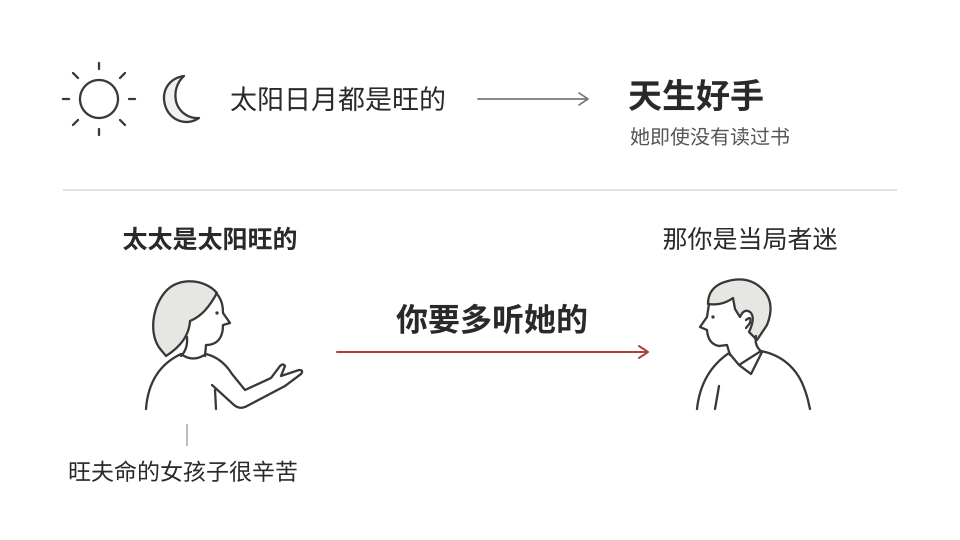 |
| **剋夫命的女孩子是什么样子？** | 〔口述〕倪师举百货公司的场景：「就是那个太太在前面走」「先生在后面冒满头大汗」，大包小包提在后面付钱；走到马路边，先生帮太太开门、太太先上车、先生放好东西，「先生再去开车」——「这是剋夫命」。（[00:24:15–00:24:35](https://www.bilibili.com/video/BV1KJsLekEfA/?p=9&t=1455)，第 43674–44255 帧） 〔推断〕推断：本块把旺夫和剋夫对着讲——旺夫命是太太自己辛苦，剋夫命是先生在后面跑腿伺候太太。两者的差别在谁辛苦，倪师没有说剋夫是把丈夫剋死。（[00:24:12–00:24:35](https://www.bilibili.com/video/BV1KJsLekEfA/?p=9&t=1452)，第 43566–44255 帧） |
| **「剋」能不能按外面的说法理解成剋死？** | 〔口述〕「那诸位看这个兄弟宫太阴星」，接着说「这就是剋和旺」。（[00:24:35–00:24:38](https://www.bilibili.com/video/BV1KJsLekEfA/?p=9&t=1475)，第 44256–44363 帧） 〔指代〕说「这个兄弟宫」时手指的是黑板左上那格的「兄弟宫」字样，同格还有「(4-11)」。（[00:24:35](https://www.bilibili.com/video/BV1KJsLekEfA/?p=9&t=1475)，第 44272 帧） 〔口述〕千万不要把外面的、过去的观念带进来，「什么叫剋就把他剋死」「胡说八道啊」「这是断章取义了」，「中间有多少个过程啊」。（[00:24:38–00:24:49](https://www.bilibili.com/video/BV1KJsLekEfA/?p=9&t=1478)，第 44364–44681 帧） 〔口述〕举例：爸爸担心你一直没结婚，你又担心他、在旁边孝顺他，说「我一直孝顺你我陪你到死」，「结果他就死掉然后你才能结婚」，「所以你们是互剋懂不懂」。（[00:24:49–00:25:08](https://www.bilibili.com/video/BV1KJsLekEfA/?p=9&t=1489)，第 44682–45245 帧） 〔口述〕解法：「我们解很简单」「一个动作就解掉了」（本块没说是什么动作）。（[00:25:08–00:25:11](https://www.bilibili.com/video/BV1KJsLekEfA/?p=9&t=1508)，第 45246–45353 帧） |
| **本例兄弟宫太阴落陷，有哪两种解释？** | 〔口述〕「兄弟宫你看她兄弟宫太阴星落陷」「这有两种解释」。「第一种没有兄弟」：「那兄弟是太阳你怎么月亮呢」「是阴星」。（[00:25:11–00:25:22](https://www.bilibili.com/video/BV1KJsLekEfA/?p=9&t=1511)，第 45354–45689 帧） 〔口述〕第二种解释：有兄弟，而且夭折，这种就会有夭折的现象。（[00:25:23–00:25:28](https://www.bilibili.com/video/BV1KJsLekEfA/?p=9&t=1523)，第 45690–45845 帧） 〔叠图〕兄弟 癸巳：太阴陷；另有天福旺、天贵平、截空庙、旬空庙、龙池陷、天哭、长生、病符、官符、指背。（[00:25:11–00:25:15](https://www.bilibili.com/video/BV1KJsLekEfA/?p=9&t=1511)，第 45354–45461 帧） |
| **一宫里有杀星时，吉星会不会来会差别有多大？** | 〔口述〕一颗星在里面不亮，又没有其他吉星来会——「你看只有一个太阴星有没有」「没它没有其他主星来会」——「这个杀星就很强了」。（[00:25:28–00:25:37](https://www.bilibili.com/video/BV1KJsLekEfA/?p=9&t=1528)，第 45846–46127 帧） 〔指代〕说「这个」时手指的是黑板左上那格（写着「兄弟宫」「(4-11)」）顶部的星名字样，字被手挡住看不清；叠图同时显示太阴、兄弟癸巳。（[00:25:34](https://www.bilibili.com/video/BV1KJsLekEfA/?p=9&t=1534)，第 46036 帧） 〔口述〕如果有其他主星，「比如说你有天同太阴啊」「这种吉星会在里面的话」「杀星力量就不强了」。（[00:25:37–00:25:43](https://www.bilibili.com/video/BV1KJsLekEfA/?p=9&t=1537)，第 46128–46295 帧） 〔口述〕「所以我们一个宫里面有个原则」：有杀星在里面，「有吉星来的话杀星就杀的力量很差」；「什么吉星都没有」，「一颗小杀星」「哪怕一个地劫或一个天空星」「可能都会要你的命」。（[00:25:43–00:25:54](https://www.bilibili.com/video/BV1KJsLekEfA/?p=9&t=1543)，第 46296–46637 帧） 〔口述〕后面会有很多临场的案例给大家看，「很多都发生了」。（[00:25:54–00:26:01](https://www.bilibili.com/video/BV1KJsLekEfA/?p=9&t=1554)，第 46638–46847 帧） |
| **本例身体第一个毛病为什么是肾？** | 〔口述〕「诸位看她的这个疾厄宫」，一看「第一个肾脏」，「为什么肾脏」「因为酉宫化忌」；「你不要管它什么东西化忌」「化忌就是就是最不好了」。（[00:26:01–00:26:16](https://www.bilibili.com/video/BV1KJsLekEfA/?p=9&t=1561)，第 46848–47285 帧） 〔口述〕批的时候「想把这个忌给你擦掉」「可是没有办法」，「擦掉的话没有警告」；化忌在酉宫，酉宫代表肾。（[00:26:16–00:26:25](https://www.bilibili.com/video/BV1KJsLekEfA/?p=9&t=1576)，第 47286–47555 帧） 〔指代〕说「想把这个忌给你擦掉」时手指的是黑板右侧格里圈起来的「化忌」，下方写着「酉」；黑板上这一格没写宫名。（[00:26:17](https://www.bilibili.com/video/BV1KJsLekEfA/?p=9&t=1577)，第 47326 帧） 〔叠图〕田宅 丁酉：文昌旺、化忌；太阳平、化权；天梁得、禄存庙、地劫平、年解旺、天官平、帝旺。（[00:26:05–00:26:10](https://www.bilibili.com/video/BV1KJsLekEfA/?p=9&t=1565)，第 46974–47105 帧） 〔推断〕推断：按叠图，酉宫化忌的是文昌；倪师特意说不管是什么星化忌，所以这里只看酉宫有化忌。（[00:26:05–00:26:16](https://www.bilibili.com/video/BV1KJsLekEfA/?p=9&t=1565)，第 46974–47285 帧） |
| **本例疾厄宫在丑，火星地空主哪些病？** | 〔口述〕「这第一个第二个」：她诸宫所有的星里面，「是不是火星」，火星还有地空，「在丑宫啊在疾厄宫里面」。（[00:26:25–00:26:36](https://www.bilibili.com/video/BV1KJsLekEfA/?p=9&t=1585)，第 47556–47903 帧） 〔叠图〕疾厄 辛丑：火星得、地空陷；另有华盖陷、天使陷、破碎陷、墓、将军、岁建。（[00:26:26–00:26:27](https://www.bilibili.com/video/BV1KJsLekEfA/?p=9&t=1586)，第 47592–47621 帧） 〔口述〕「那疾厄宫在丑宫」「丑宫代表什么内脏是肝」，并念口诀「亥焦子胆丑肝通」。（[00:26:36–00:26:43](https://www.bilibili.com/video/BV1KJsLekEfA/?p=9&t=1596)，第 47904–48101 帧） 〔口述〕「这又是个女孩子」：头、两个肩膀、左胸右胸、左腹右腹、两个脚，「妇科子宫那地方右边卵巢的地方」，「左边是紫微右边是火星地空有没有」，「妇科一定不好」。（[00:26:43–00:27:00](https://www.bilibili.com/video/BV1KJsLekEfA/?p=9&t=1603)，第 48102–48611 帧） |
| **看出身体问题后，该怎么跟她讲、何时应？** | 〔口述〕「这是身体」「先跟她讲好」。（[00:26:58–00:27:02](https://www.bilibili.com/video/BV1KJsLekEfA/?p=9&t=1618)，第 48552–48677 帧） 〔口述〕「那什么时候不好」「我们在后面批流年给你看啊」，「现在还没有批流年先批整格」——先讲这辈子要注意的事情。（[00:27:02–00:27:12](https://www.bilibili.com/video/BV1KJsLekEfA/?p=9&t=1622)，第 48684–48989 帧） |
| **本例交友宫天机天马，主什么？** | 〔口述〕「我们最后讲婚姻」「婚姻最精彩」；先看朋友宫，「这个交友宫在这边」。（[00:27:13–00:27:24](https://www.bilibili.com/video/BV1KJsLekEfA/?p=9&t=1633)，第 48990–49337 帧） 〔指代〕说「交友宫在这边」时手指的是黑板右下那格：先拿粉笔在那格起笔写字（没写完、看不出是什么字），随后粉笔指着同一格。（[00:27:20–00:27:23](https://www.bilibili.com/video/BV1KJsLekEfA/?p=9&t=1640)，第 49225–49316 帧） 〔叠图〕交友 己亥：天机平、天马平；另有天刑陷、天伤旺、病、岁驿、吊客、青龙。（[00:27:23–00:27:24](https://www.bilibili.com/video/BV1KJsLekEfA/?p=9&t=1643)，第 49296–49337 帧） 〔口述〕「交友宫是天机」「天马」，「我们有主动和被动」。「她这个人的天马星落在朋友宫」，「你注意听我讲话的顺序哈」，「所以她会为朋友奔波跑动」。（[00:27:24–00:27:52](https://www.bilibili.com/video/BV1KJsLekEfA/?p=9&t=1644)，第 49338–50177 帧） 〔口述〕顺带对比：「有的天马星在父母宫」。（[00:27:52–00:27:56](https://www.bilibili.com/video/BV1KJsLekEfA/?p=9&t=1672)，第 50178–50291 帧） |
| **朋友宫吉星多或杀星多，合伙结果各如何？** | 〔口述〕「天机星呢是个很平和的星」；如果有权星财星，「很多财星吉星会在朋友宫的时候」，「意味着他跟朋友合伙做事业一定大赚钱」。（[00:27:56–00:28:06](https://www.bilibili.com/video/BV1KJsLekEfA/?p=9&t=1676)，第 50292–50603 帧） 〔口述〕「如果有很多空耗的星」，「比如说擎羊羊陀火铃空劫」「或者化忌巨门星啊」，「这些杀星口舌星在朋友宫的话」，跟朋友合伙「会朋友变仇人」。上帝没有规定好朋友合伙都会赚钱，「这是这个原则」。（[00:28:06–00:28:27](https://www.bilibili.com/video/BV1KJsLekEfA/?p=9&t=1686)，第 50604–51221 帧） 〔叠图〕讲吉星时贴出交友 戊子：天机庙、化禄，天魁旺、天才旺；讲杀星口舌星时贴出交友 丙寅：太阳旺、化忌，巨门庙、火星陷。这两格都不是本例的交友宫（本例为交友己亥），是配合假设举的别的盘。（[00:27:56–00:28:10](https://www.bilibili.com/video/BV1KJsLekEfA/?p=9&t=1676)，第 50292–50717 帧） |
| **「忧喜参半」这种话为什么没用？该怎么跟她说？** | 〔口述〕「所以一般相书」「如果上面这么写」，「这个忧喜参半这句话没有用了」「这不是废话」。（[00:28:27–00:28:34](https://www.bilibili.com/video/BV1KJsLekEfA/?p=9&t=1707)，第 51222–51449 帧） 〔口述〕要直接跟她说：「你这个命的人啊就要一辈子要靠自己」，「你交朋友就好」「你交朋友交多是你的负担」「你也靠不了朋友」；「那这句话比较重要的」。（[00:28:35–00:28:51](https://www.bilibili.com/video/BV1KJsLekEfA/?p=9&t=1715)，第 51450–51953 帧） |
| **为什么不要跟客户说「你命犯小人」？** | 〔口述〕很多人算命还跟人说「你命犯小人」，「这个话都不要讲」。（[00:28:51–00:28:59](https://www.bilibili.com/video/BV1KJsLekEfA/?p=9&t=1731)，第 51954–52181 帧） 〔口述〕要把为什么解释出来：「她这命中注定就会犯小人」，是因为「她就会看到人她就会相信然后小人」「然后犯到小人」，「她就对小人特别有兴趣」。（[00:28:59–00:29:12](https://www.bilibili.com/video/BV1KJsLekEfA/?p=9&t=1739)，第 52182–52589 帧） 〔推断〕推断：倪师反对的是只丢下「命犯小人」四个字不解释；他自己的讲法是把原因落到她的为人上（看到人就相信、对小人有兴趣），和上一行「一辈子要靠自己、靠不了朋友」一脉相承。（[00:28:35–00:29:12](https://www.bilibili.com/video/BV1KJsLekEfA/?p=9&t=1715)，第 51450–52589 帧） |

**总结区**

- 通用规则：「剋」不能照外面的观念理解成把人剋死，那是断章取义，中间有很多过程（[00:24:38–00:24:49](https://www.bilibili.com/video/BV1KJsLekEfA/?p=9&t=1478)，第 44364–44681 帧）；一个宫里有杀星，有吉星来会，杀星力量就很差；什么吉星都没有，哪怕一颗地劫或天空小杀星也可能要命（[00:25:43–00:25:54](https://www.bilibili.com/video/BV1KJsLekEfA/?p=9&t=1543)，第 46296–46637 帧）；化忌不管是什么星化忌，都是最不好的（[00:26:13–00:26:16](https://www.bilibili.com/video/BV1KJsLekEfA/?p=9&t=1573)，第 47190–47285 帧）；朋友宫有很多财星吉星，跟朋友合伙一定大赚钱；有擎羊陀罗火铃空劫、化忌巨门这类杀星口舌星，合伙会朋友变仇人（[00:27:59–00:28:20](https://www.bilibili.com/video/BV1KJsLekEfA/?p=9&t=1679)，第 50376–51017 帧）
- 只在本例：兄弟宫太阴落陷，没有其他主星来会：要么没有兄弟，要么有兄弟而夭折（[00:25:11–00:25:34](https://www.bilibili.com/video/BV1KJsLekEfA/?p=9&t=1511)，第 45354–46049 帧）；身体第一个是肾（酉宫化忌），第二个是疾厄宫在丑、火星地空，主肝，妇科一定不好（[00:26:01–00:27:00](https://www.bilibili.com/video/BV1KJsLekEfA/?p=9&t=1561)，第 46848–48611 帧）；天马星落在朋友宫，她会为朋友奔波跑动；一辈子要靠自己，靠不了朋友（[00:27:38–00:28:48](https://www.bilibili.com/video/BV1KJsLekEfA/?p=9&t=1658)，第 49752–51845 帧）
- 不是排盘规则，是处世方法：娶到太阳旺、旺夫命的太太，就算她读书少也要多听她的，不听就完蛋（[00:23:57–00:24:12](https://www.bilibili.com/video/BV1KJsLekEfA/?p=9&t=1437)，第 43128–43565 帧）；看出身体问题先跟对方讲好，什么时候应留到批流年再说（[00:26:58–00:27:07](https://www.bilibili.com/video/BV1KJsLekEfA/?p=9&t=1618)，第 48552–48833 帧）；不要讲「忧喜参半」「命犯小人」这类空话，要直接告诉对方该怎么做、为什么（[00:28:27–00:29:12](https://www.bilibili.com/video/BV1KJsLekEfA/?p=9&t=1707)，第 51222–52589 帧）

**待核**

1. [00:23:48](https://www.bilibili.com/video/BV1KJsLekEfA/?p=9&t=1428)，第 42858 帧：字幕「太阳日月都是旺的」，语音是「太阳是越独自旺的」，两路不完全对得上，「太阳日月」的说法待核。
2. [00:23:55–00:23:57](https://www.bilibili.com/video/BV1KJsLekEfA/?p=9&t=1435)，第 43056–43127 帧：「如果你是你是男人」「你的八字是这样的」可信度 0.47、0.5，语音为「巴士是这样子」，没有收进引文。
3. [00:25:00](https://www.bilibili.com/video/BV1KJsLekEfA/?p=9&t=1500)，第 45018 帧：字幕「他赶快死就救不到你剋」与语音「赶快死就听不到」对不上，原话待核。
4. [00:25:09](https://www.bilibili.com/video/BV1KJsLekEfA/?p=9&t=1509)，第 45288 帧：「一个动作就解掉了」，本块没说是什么动作。
5. [00:25:23](https://www.bilibili.com/video/BV1KJsLekEfA/?p=9&t=1523)，第 45714 帧：字幕「天折」、语音「夭折」，笔记按上下文改作「夭折」。
6. [00:25:35](https://www.bilibili.com/video/BV1KJsLekEfA/?p=9&t=1535)，第 46050 帧：「这个杀星就很强了」指兄弟宫里的哪颗杀星，本块没说；叠图兄弟宫有截空、旬空等，倪师没点名。
7. 第46868、46916帧：说「这个疾厄宫」时讲义卷端停在上中格方框字、圈「午」附近，指代不确定，未当依据；那处字也认不清。
8. [00:26:04](https://www.bilibili.com/video/BV1KJsLekEfA/?p=9&t=1564)，第 46926 帧：「这个疾厄宫诸位一定很强的」意思不清。
9. [00:26:12–00:26:25](https://www.bilibili.com/video/BV1KJsLekEfA/?p=9&t=1572)，第 47160–47555 帧：倪师讲疾厄宫，第一个肾却说是「酉宫化忌」，叠图酉宫是田宅丁酉，为什么从酉宫看肾本块没解释；「化忌在酉宫」「酉宫代表肾」字幕可信度只有 0.35、0.33，语音只听到「代表肾」。
10. [00:26:16](https://www.bilibili.com/video/BV1KJsLekEfA/?p=9&t=1576)，第 47286 帧：「我擦掉的时候批八字想」语音为「琵琶子」，「批八字」待核。
11. [00:26:31](https://www.bilibili.com/video/BV1KJsLekEfA/?p=9&t=1591)，第 47732 帧：说「地空在这个地方」时人背对镜头、手低垂，看不出指哪一格。
12. [00:26:37–00:26:43](https://www.bilibili.com/video/BV1KJsLekEfA/?p=9&t=1597)，第 47934–48101 帧：「丑宫代表什么内脏是肝」可信度 0.32；口诀「亥焦子胆丑肝通」可信度 0.45，语音为「骄子胆丑肝通」，口诀全文与「焦」字待核。
13. [00:26:43–00:26:58](https://www.bilibili.com/video/BV1KJsLekEfA/?p=9&t=1603)，第 48102–48551 帧：念头、两肩、左右胸、左右腹、两脚、子宫、卵巢，是在对应命盘哪些位置，本块没讲清，也没有指代标注；「左边是紫微」在本块叠图里看不到紫微。
14. 第48678、48834、52350帧：字幕乱码（可信 0.3），按识别失败略过；第27:02、27:07、29:05 三处同。
15. [00:27:05](https://www.bilibili.com/video/BV1KJsLekEfA/?p=9&t=1625)，第 48768 帧：字幕「整格」、语音「整个」，待核。
16. [00:27:08](https://www.bilibili.com/video/BV1KJsLekEfA/?p=9&t=1628)，第 48840 帧：字幕「迷津」与语音「明依经」对不上，开头那个词待核。
17. 第49139、49160帧：说「这个朋友宫」时的指代为否 / 不确定，未当依据；下中格挨着「肝」圈的潦草字认不出。
18. [00:27:33](https://www.bilibili.com/video/BV1KJsLekEfA/?p=9&t=1653)，第 49602 帧：「我们有主动和被动」，本块没解释什么叫主动被动，要看后文。
19. [00:27:52](https://www.bilibili.com/video/BV1KJsLekEfA/?p=9&t=1672)，第 50178 帧：字幕只有「有的天马星在父母宫」，语音还有「在子女宫」，待核。
20. 第51286、51572帧：「这个忧喜参半」「你这个命的人」两处指代不确定，未当依据。
21. [00:28:41](https://www.bilibili.com/video/BV1KJsLekEfA/?p=9&t=1721)，第 51642 帧：字幕「不要靠第三者（3）」与语音「进去你交」对不上，未收。
22. [00:28:54](https://www.bilibili.com/video/BV1KJsLekEfA/?p=9&t=1734)，第 52020 帧：语音有「你命有贵人」，字幕只有「你命犯小人」，待核。
23. [00:23:48](https://www.bilibili.com/video/BV1KJsLekEfA/?p=9&t=1428)，第 42858 帧：板书左上格方框内字、中间格「太阳」后的圈字、下方格潦草字都认不出。

### 7　子女宫无子、面相宫位与夫妻宫正财（[00:29:13–00:34:43](https://www.bilibili.com/video/BV1KJsLekEfA/?p=9&t=1753)，第 52590–62495 帧）

| 提示区 | 笔记区 |
|---|---|
| **子女宫是空宫时，该怎么看？** | 〔口述〕倪师回头讲子女宫：「诸位回头来看这边子女宫」，问「子女宫是不是空的」，自答「空空的」。（[00:29:13–00:29:19](https://www.bilibili.com/video/BV1KJsLekEfA/?p=9&t=1753)，第 52590–52781 帧） 〔指代〕说「这边子女宫」时，手指的是黑板左栏「兄弟宫」下方的一个空格子，格内看不到字，板上没写宫名。（[00:29:13–00:29:15](https://www.bilibili.com/video/BV1KJsLekEfA/?p=9&t=1753)，第 52590–52661 帧） 〔叠图〕子女辛卯：天姚庙、天寿陷、恩光庙，另有丧门、灾煞、胎、飞廉，格内标「无吉星」；转写里未见主星。（[00:29:13–00:29:15](https://www.bilibili.com/video/BV1KJsLekEfA/?p=9&t=1753)，第 52590–52661 帧） 〔口述〕倪师讲规则：「我们看宫」「一定要看对宫」，「子女宫空的时候」「没有的时候我们要看对面」。（[00:29:21–00:29:27](https://www.bilibili.com/video/BV1KJsLekEfA/?p=9&t=1761)，第 52848–53015 帧） |
| **本例子女宫的对宫有什么？断出什么？** | 〔口述〕倪师指出「这个子女宫的对宫对宫是不是在这边」，接着问「对宫会来是什么」。（[00:29:28–00:29:32](https://www.bilibili.com/video/BV1KJsLekEfA/?p=9&t=1768)，第 53052–53183 帧） 〔指代〕说「对宫是不是在这边」时，手指持续指着黑板右栏「太阳」字下方、圈住的「化忌」旁边。（[00:29:28–00:29:31](https://www.bilibili.com/video/BV1KJsLekEfA/?p=9&t=1768)，第 53052–53153 帧） 〔叠图〕田宅丁酉：太阳平（标权）、天梁得、文昌旺（标忌）、禄存庙、地劫平、天官平、年解旺，另有博士、将星、帝旺、白虎、蜚廉。（[00:29:19–00:29:21](https://www.bilibili.com/video/BV1KJsLekEfA/?p=9&t=1759)，第 52782–52847 帧） 〔口述〕对宫「是不是化忌」，「杀所以说无子」「没有儿子」——倪师据此断本例没有儿子。（[00:29:32–00:29:41](https://www.bilibili.com/video/BV1KJsLekEfA/?p=9&t=1772)，第 53184–53447 帧） 〔板书〕本块开头板面可辨：左上格「兄弟宫」和圈着的「4-11」，右栏「太阳」；其余认不出，右侧部分被老师身体挡住。（[00:29:13](https://www.bilibili.com/video/BV1KJsLekEfA/?p=9&t=1753)，第 52590 帧） 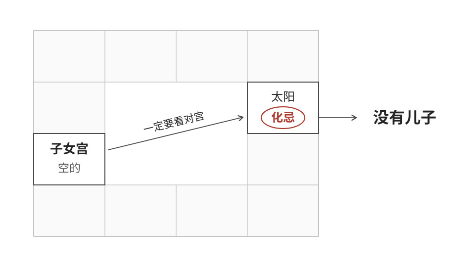 |
| **子女要不要合看先生的命？孩子像谁有何讲究？** | 〔口述〕倪师说「一般来说我们要看先生的命」，「两个夫妻两个八字合在一起的话」；举例「先生命中有两个太太命里面没有」。（[00:29:43–00:29:51](https://www.bilibili.com/video/BV1KJsLekEfA/?p=9&t=1783)，第 53514–53753 帧） 〔口述〕这种情况「还是照样会生两个哦」，「那生的两个都比较像先生」，至于女儿「那女儿不知道」。（[00:29:51–00:29:58](https://www.bilibili.com/video/BV1KJsLekEfA/?p=9&t=1791)，第 53754–53969 帧） 〔口述〕反过来，先生有两个、太太命里没有，「结果两个人一结婚」「生到个儿子」「脸孔很像太太」，倪师说「紧张咯」。（[00:29:59–00:30:10](https://www.bilibili.com/video/BV1KJsLekEfA/?p=9&t=1799)，第 53970–54329 帧） 〔口述〕要看这孩子小时候会不会像大人：「善知人意」「动作像大人」，倪师说这就有子会夭折的象（字幕作「天折」，按语音改）。（[00:30:11–00:30:20](https://www.bilibili.com/video/BV1KJsLekEfA/?p=9&t=1811)，第 54330–54629 帧） |
| **面相上子女、命、官禄、田宅、迁移宫在哪？** | 〔口述〕倪师说客户坐在面前，「你看她子女宫」，「相上面子女宫」「在泪堂的地方就是子女」。（[00:30:21–00:30:29](https://www.bilibili.com/video/BV1KJsLekEfA/?p=9&t=1821)，第 54630–54875 帧） 〔指代〕说「这个图像」时，倪师把讲义贴在黑板上展示，手掌按在讲义的人脸面相图上（眉眼一带）；讲义上的小字看不清。（[00:30:29–00:30:31](https://www.bilibili.com/video/BV1KJsLekEfA/?p=9&t=1829)，第 54876–54959 帧） 〔口述〕「印堂的地方就是你的命宫」；「正中中正这一块地方就是你的官禄宫」，又说「这个地方的印越大」。（[00:30:32–00:30:45](https://www.bilibili.com/video/BV1KJsLekEfA/?p=9&t=1832)，第 54960–55379 帧） 〔指代〕说「所以这个地方」「这个地方的印」时，倪师用手指按着自己额头正中、眉间一带，指的是自己脸上的部位。（[00:30:36–00:30:44](https://www.bilibili.com/video/BV1KJsLekEfA/?p=9&t=1836)，第 55092–55349 帧） 〔口述〕「田宅宫就在眉的下方」；「两个天仓的地方」「就是迁移宫」，并请助理「注明下迁移宫天仓啊」。（[00:30:46–00:31:01](https://www.bilibili.com/video/BV1KJsLekEfA/?p=9&t=1846)，第 55380–55835 帧） |
| **面相上财帛、夫妻、仆役宫在哪？** | 〔口述〕讲到年寿那一段：「鼻子中间那段就是财帛宫」。（[00:31:01–00:31:10](https://www.bilibili.com/video/BV1KJsLekEfA/?p=9&t=1861)，第 55836–56117 帧） 〔口述〕「奸门的地方两个眼角夫妻宫」（前一句字幕作「好门」，按上下文当是奸门）。（[00:31:10–00:31:19](https://www.bilibili.com/video/BV1KJsLekEfA/?p=9&t=1870)，第 56118–56399 帧） 〔口述〕「下边下巴的地方就是所谓的仆役宫」；举例「像我们总统」「他的下巴就很大」，「有点下牙包上牙」。（[00:31:20–00:31:28](https://www.bilibili.com/video/BV1KJsLekEfA/?p=9&t=1880)，第 56400–56669 帧） 〔口述〕下巴很大「那就是仆役宫」，是「手下很多众多的相」。（[00:31:29–00:31:33](https://www.bilibili.com/video/BV1KJsLekEfA/?p=9&t=1889)，第 56670–56819 帧） |
| **命门怎么望生死？反骨怎么看？** | 〔口述〕两边命门是「看相望生死的地方」；看病重或很危险的人，「命门这边这两块黑黑的」，「黑掉就会死掉」「死定了」。（[00:31:34–00:31:49](https://www.bilibili.com/video/BV1KJsLekEfA/?p=9&t=1894)，第 56820–57287 帧） 〔指代〕说「命门这边」时，倪师侧身用手掌贴住自己脸侧（耳前、鬓角一带），指的是自己脸上的命门位置。（[00:31:42](https://www.bilibili.com/video/BV1KJsLekEfA/?p=9&t=1902)，第 57066–57089 帧） 〔口述〕有一种人讲话时「这边怎么多个骨头在尖尖的这样子」，过去皇帝就说「这个人不能用这个人有反骨」「背叛你」。（[00:31:49–00:32:01](https://www.bilibili.com/video/BV1KJsLekEfA/?p=9&t=1909)，第 57288–57641 帧） 〔指代〕说「这边讲话的时候」「这边怎么多个骨头」时，右手手指按在自己脸侧（眼角外、太阳穴、耳前一带），指的是自己头侧部位。（[00:31:49–00:31:54](https://www.bilibili.com/video/BV1KJsLekEfA/?p=9&t=1909)，第 57288–57425 帧） 〔口述〕「就在这里命门这地方两个尖起来」，平常没有、「一讲话的时候」尖起来；「这个人用他一定反」，「你不信你再去用嘛」。（[00:32:01–00:32:15](https://www.bilibili.com/video/BV1KJsLekEfA/?p=9&t=1921)，第 57642–58055 帧） |
| **学了这个，为何能免去事后后悔？福堂驿马何时讲？** | 〔口述〕「现在社会上很多人啊就是」「事情之前他认为不可能」「事情之后他说他后悔」。（[00:32:15–00:32:20](https://www.bilibili.com/video/BV1KJsLekEfA/?p=9&t=1935)，第 58056–58205 帧） 〔口述〕「我们学了这个出来」「不能有这种经验的哈」，又说「有的事情不可得的经验」（语音多出有的事情可以得几个字，原意待核）。（[00:32:20–00:32:29](https://www.bilibili.com/video/BV1KJsLekEfA/?p=9&t=1940)，第 58206–58475 帧） 〔口述〕提到「那这个福堂这个」「驿马这边哈天马星了」，说「这个就是我们后面在介绍相的时候」「会再继续跟诸位介绍」，本块未展开。（[00:32:29–00:32:38](https://www.bilibili.com/video/BV1KJsLekEfA/?p=9&t=1949)，第 58476–58757 帧） |
| **本例夫妻宫廉贞天府，主怎样的人？** | 〔板书〕黑板左栏「兄弟宫」下一格可辨「廉天」「贞府」，其下两字似「夫妻」（字迹潦草）。（[00:32:56](https://www.bilibili.com/video/BV1KJsLekEfA/?p=9&t=1976)，第 59300 帧） 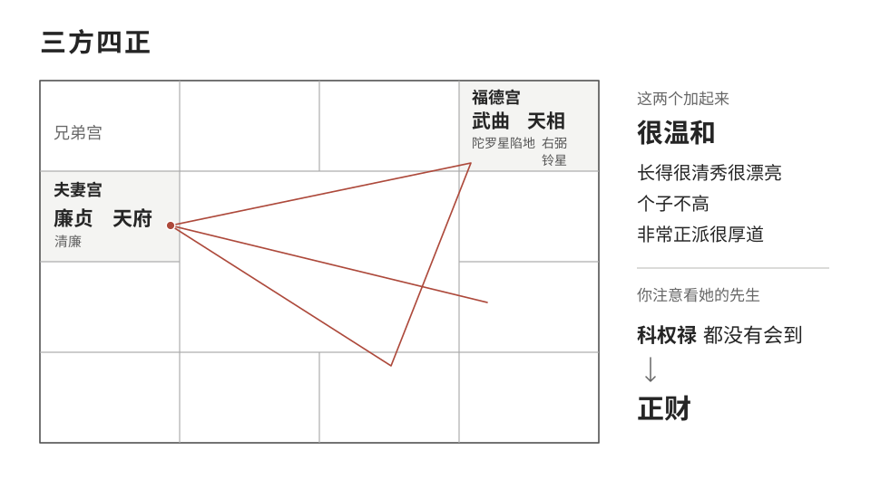 〔叠图〕夫妻壬辰：廉贞利、天府庙（加框），八座旺、台辅、天月、副截陷、副旬陷，另有喜神、天煞、贯索、养；大限 104~113。（[00:32:40–00:32:43](https://www.bilibili.com/video/BV1KJsLekEfA/?p=9&t=1960)，第 58818–58895 帧） 〔指代〕说「在夫妻宫」后接「这个」时，倪师手持粉笔贴在板上「廉天/贞府」格的字下方。（[00:32:52–00:32:56](https://www.bilibili.com/video/BV1KJsLekEfA/?p=9&t=1972)，第 59178–59285 帧） 〔口述〕「这个廉贞星啊」「本身是很清廉的」，「有当官的有廉贞星都很清廉的」；「逢到天府星」「南斗星君在里面」，「这两个加起来是一个很温和的星」。（[00:32:56–00:33:09](https://www.bilibili.com/video/BV1KJsLekEfA/?p=9&t=1976)，第 59286–59681 帧） 〔口述〕「这种人呢」「长得很清秀很漂亮」「个子不高」「也是很正派」，「非常正派很厚道的一种人」。（[00:33:09–00:33:18](https://www.bilibili.com/video/BV1KJsLekEfA/?p=9&t=1989)，第 59682–59957 帧） |
| **看夫妻宫要看什么？本例福德宫有哪些星？** | 〔口述〕「但是你注意看她的夫妻宫」，「我们看的时候要看三方四正」。（[00:33:18–00:33:21](https://www.bilibili.com/video/BV1KJsLekEfA/?p=9&t=1998)，第 59958–60059 帧） 〔口述〕「这个人的福德宫呢」「是武曲」「天相」，另有陀罗星陷地、右弼、铃星（字幕作「鉴陀罗星陷地有没有右弼啊铃星啊」）。（[00:33:22–00:33:40](https://www.bilibili.com/video/BV1KJsLekEfA/?p=9&t=2002)，第 60060–60629 帧） 〔叠图〕福德丙申：武曲得、天相庙、右弼不、陀罗陷、铃星陷（这五颗加框），另有天喜旺、龙德、官符、亡神、临官；大限 24~33。（[00:33:22–00:33:24](https://www.bilibili.com/video/BV1KJsLekEfA/?p=9&t=2002)，第 60060–60125 帧） 〔板书〕黑板右上格可辨「武天」「曲相」，其后几字认不全；右栏「太阳」下方圈着的「化忌」可辨；其余认不出。（[00:33:39](https://www.bilibili.com/video/BV1KJsLekEfA/?p=9&t=2019)，第 60576 帧） |
| **画红线看三方四正后，先生那边会到科权禄吗？** | 〔口述〕「我们看三方四正的时候」「这红线划出来」，「我们要看她夫妻宫要画红」，「一样要看三方四正」。（[00:33:41–00:33:47](https://www.bilibili.com/video/BV1KJsLekEfA/?p=9&t=2021)，第 60630–60839 帧） 〔板书〕板面新添几条橙红色斜线，跨过几格；右上格「武天」「曲相」仍可辨，线的端点和其余字认不出。（[00:33:45](https://www.bilibili.com/video/BV1KJsLekEfA/?p=9&t=2025)，第 60774 帧） 〔口述〕「你注意看她的先生」夫妻宫（字幕作「去妻宫」，按语音改），「请问你是不是科权禄」「都没有会到」。（[00:33:48–00:33:57](https://www.bilibili.com/video/BV1KJsLekEfA/?p=9&t=2028)，第 60846–61133 帧） 〔叠图〕十二宫一次贴全，各格另注「夫之」某宫：子女辛卯注夫之兄，兄弟癸巳注夫之父，命宫甲午注夫之福，福德丙申注夫之官，官禄戊戌注夫之迁，财帛庚寅注夫之夫；转写里夫妻壬辰未见此类标注。（[00:33:48–00:33:50](https://www.bilibili.com/video/BV1KJsLekEfA/?p=9&t=2028)，第 60846–60905 帧） 〔推断〕推断：叠图夫之兄在卯、夫之父在巳，夹在中间的夫妻壬辰相当于先生的命宫；这与倪师随后指着「廉天/贞府」格说「有一个人呢命宫在这里」相合。（[00:33:48–00:34:01](https://www.bilibili.com/video/BV1KJsLekEfA/?p=9&t=2028)，第 60846–61247 帧） |
| **科权禄都没会到叫什么？对人生有何影响？** | 〔口述〕科权禄都没有会到，「这种就叫做正财」。（[00:33:57–00:33:59](https://www.bilibili.com/video/BV1KJsLekEfA/?p=9&t=2037)，第 61134–61193 帧） 〔指代〕说「有一个人呢命宫在这里」时，食指明确指向板上「廉天/贞府」格，指尖在「贞府」下、「夫妻」字左侧。（[00:34:00–00:34:01](https://www.bilibili.com/video/BV1KJsLekEfA/?p=9&t=2040)，第 61206–61247 帧） 〔口述〕「有一个人呢命宫在这里」「出来科权禄都没有会到」「就是属于正财」。（[00:34:00–00:34:03](https://www.bilibili.com/video/BV1KJsLekEfA/?p=9&t=2040)，第 61206–61313 帧） 〔口述〕「正财正官就是只能去帮人家做」「一辈子要帮人家做领薪水」「因为你命里没有科权」。（[00:34:04–00:34:09](https://www.bilibili.com/video/BV1KJsLekEfA/?p=9&t=2044)，第 61320–61487 帧） 〔口述〕「结果她的先生没有科权禄」「反而他太太有个什么科在里面」。（[00:34:09–00:34:14](https://www.bilibili.com/video/BV1KJsLekEfA/?p=9&t=2049)，第 61488–61643 帧） |
| **本例总格：婚姻与子女如何？算命的功能何在？** | 〔口述〕「虽然她的命里面先生很好」，「但是适合去帮人家做领人家薪水」「到老领个退休金这样子」。（[00:34:14–00:34:22](https://www.bilibili.com/video/BV1KJsLekEfA/?p=9&t=2054)，第 61644–61865 帧） 〔口述〕「所以她的夫妻很好感情很好」，「但是呢儿子没有这是她的缺点」。（[00:34:22–00:34:27](https://www.bilibili.com/video/BV1KJsLekEfA/?p=9&t=2062)，第 61866–62021 帧） 〔叠图〕讲到儿子时叠图再贴出子女辛卯（同前：天姚庙、天寿陷、恩光庙，格内标「无吉星」）。（[00:34:25–00:34:27](https://www.bilibili.com/video/BV1KJsLekEfA/?p=9&t=2065)，第 61950–62021 帧） 〔口述〕「我们算命呢就是要把问题找出来」「如何让她生儿子」，「那是我们的算命我们的化解的方式」「所以算命功能就在这里」。（[00:34:27–00:34:39](https://www.bilibili.com/video/BV1KJsLekEfA/?p=9&t=2067)，第 62022–62381 帧） 〔口述〕收束本例：「这是我们看总格的时候」「总格是这样的」。（[00:34:39–00:34:43](https://www.bilibili.com/video/BV1KJsLekEfA/?p=9&t=2079)，第 62382–62495 帧） |

**总结区**

- 通用规则：看宫一定要看对宫，宫是空的时候要看对面（[00:29:21–00:29:27](https://www.bilibili.com/video/BV1KJsLekEfA/?p=9&t=1761)，第 52848–53015 帧）；子女要把夫妻两个八字合看：先生命中有两个、太太命里没有，照样会生两个，且都比较像先生（[00:29:43–00:29:58](https://www.bilibili.com/video/BV1KJsLekEfA/?p=9&t=1783)，第 53514–53969 帧）；看夫妻宫要看三方四正，画红线标出来（[00:33:18–00:33:47](https://www.bilibili.com/video/BV1KJsLekEfA/?p=9&t=1998)，第 59958–60839 帧）；科权禄都没有会到属正财正官，只能帮人家做、一辈子领薪水（[00:33:57–00:34:09](https://www.bilibili.com/video/BV1KJsLekEfA/?p=9&t=2037)，第 61134–61487 帧）
- 只在本例：子女宫空、对宫化忌，倪师断她没有儿子（[00:29:13–00:29:41](https://www.bilibili.com/video/BV1KJsLekEfA/?p=9&t=1753)，第 52590–53447 帧）；夫妻宫廉贞天府，倪师说这种人清秀、个子不高、正派厚道（[00:32:40–00:33:18](https://www.bilibili.com/video/BV1KJsLekEfA/?p=9&t=1960)，第 58818–59957 帧）；先生没有科权禄、太太反而有个科，适合领薪水到老领退休金（[00:34:09–00:34:22](https://www.bilibili.com/video/BV1KJsLekEfA/?p=9&t=2049)，第 61488–61865 帧）；夫妻感情很好，但没有儿子是她的缺点（[00:34:22–00:34:27](https://www.bilibili.com/video/BV1KJsLekEfA/?p=9&t=2062)，第 61866–62021 帧）
- 不是排盘规则，是处世方法：算命就是要把问题找出来，再想如何化解，算命的功能就在这里（[00:34:27–00:34:39](https://www.bilibili.com/video/BV1KJsLekEfA/?p=9&t=2067)，第 62022–62381 帧）；有反骨的人倪师说用了一定反，不信再去用就知道（[00:32:10–00:32:15](https://www.bilibili.com/video/BV1KJsLekEfA/?p=9&t=1930)，第 57900–58055 帧）；很多人事前认为不可能、事后后悔；学了这个就不必有这种经验（[00:32:15–00:32:29](https://www.bilibili.com/video/BV1KJsLekEfA/?p=9&t=1935)，第 58056–58475 帧）

**待核**

1. [00:29:32–00:29:37](https://www.bilibili.com/video/BV1KJsLekEfA/?p=9&t=1772)，第 53184–53339 帧：字幕「是不是化忌」「杀所以说无子」，语音作「话记杀」；化忌后面的「杀」指什么，本块没解释。
2. [00:29:19–00:29:31](https://www.bilibili.com/video/BV1KJsLekEfA/?p=9&t=1759)，第 52782–53153 帧：倪师说子女宫对宫「是不是化忌」，板上「太阳」下方圈着「化忌」；叠图田宅丁酉里标忌的是文昌（文昌旺忌），太阳标的是权，两者对应关系待核。
3. [00:30:16–00:30:20](https://www.bilibili.com/video/BV1KJsLekEfA/?p=9&t=1816)，第 54486–54629 帧：字幕「天折」按语音改作「夭折」。
4. [00:30:02–00:30:03](https://www.bilibili.com/video/BV1KJsLekEfA/?p=9&t=1802)，第 54084–54119 帧：「结果太太命是这样的命」中「这样的命」指什么，没说清。
5. [00:31:01–00:31:04](https://www.bilibili.com/video/BV1KJsLekEfA/?p=9&t=1861)，第 55836–55931 帧：「寿上年上」「年寿」是面相用词，倪师没解释；语音作「兽上连上」。
6. [00:31:10–00:31:13](https://www.bilibili.com/video/BV1KJsLekEfA/?p=9&t=1870)，第 56118–56201 帧：字幕「好门」按上下文改作「奸门」；语音作「尖门」。
7. [00:32:12–00:32:13](https://www.bilibili.com/video/BV1KJsLekEfA/?p=9&t=1932)，第 57972–58013 帧：字幕「我已经告诉你他要反」，语音作「告诉你他有办法」，两路不一致。
8. [00:32:22–00:32:29](https://www.bilibili.com/video/BV1KJsLekEfA/?p=9&t=1942)，第 58272–58475 帧：字幕「有的事情不可得的经验」，语音多出「有的事情可以得」，原意待核。
9. [00:32:29–00:32:32](https://www.bilibili.com/video/BV1KJsLekEfA/?p=9&t=1949)，第 58476–58577 帧：「福堂」「驿马」「天马星」未解释，倪师说后面讲相时再介绍；说「驿马这边」时手指向看不出。
10. [00:33:09–00:33:18](https://www.bilibili.com/video/BV1KJsLekEfA/?p=9&t=1989)，第 59682–59957 帧：「这种人呢」指夫妻宫所主之人（先生）还是别人，本块没明说。
11. [00:33:32–00:33:38](https://www.bilibili.com/video/BV1KJsLekEfA/?p=9&t=2012)，第 60366–60545 帧：字幕开头「鉴」字不明，语音作「心陷地」。
12. [00:33:48–00:33:50](https://www.bilibili.com/video/BV1KJsLekEfA/?p=9&t=2028)，第 60846–60905 帧：字幕「去妻宫」按语音改作「夫妻宫」；「她的先生夫妻宫」是指先生的夫妻宫，还是她夫妻宫所代表的先生，不明。
13. 第 60840、60906、61194、61314 帧：四句字幕只有一个「科」字，语音对不上，当作画面命盘印刷字混入，不当原话。
14. [00:34:11–00:34:14](https://www.bilibili.com/video/BV1KJsLekEfA/?p=9&t=2051)，第 61548–61643 帧：倪师说太太「有个什么科在里面」，叠图转写里看不到标「科」的星，科在哪一宫待核。
15. [00:33:48](https://www.bilibili.com/video/BV1KJsLekEfA/?p=9&t=2028)，第 60846 帧起：全盘叠图里田宅丁酉列「文昌旺忌」、迁移庚子又列「文昌得忌」，同一盘出现两处文昌，叠图或转写可能有误。
16. [00:33:57–00:34:03](https://www.bilibili.com/video/BV1KJsLekEfA/?p=9&t=2037)，第 61134–61313 帧：「正财」「正官」语音作「政裁」「政官」，倪师只说只能帮人家做领薪水，没进一步解释这两个词。
17. [00:29:13](https://www.bilibili.com/video/BV1KJsLekEfA/?p=9&t=1753)，第 52590 帧、[00:33:45](https://www.bilibili.com/video/BV1KJsLekEfA/?p=9&t=2025)，第 60774 帧板书：大部分字认不出（[00:29:13](https://www.bilibili.com/video/BV1KJsLekEfA/?p=9&t=1753)，第 52590 帧右侧被老师身体挡住，[00:33:45](https://www.bilibili.com/video/BV1KJsLekEfA/?p=9&t=2025)，第 60774 帧只认得几条橙红斜线和「武天」「曲相」）。

## 大限流年：34–43 太阳化忌、宫为当年值日、40 岁夫妻限

| 巳 | 午 | 未 | 申 |
|---|---|---|---|
| **兄弟 癸巳** 太阴陷 | **命宫 甲午** 贪狼旺 左辅旺 | **父母 乙未** 天同不 巨门不禄 | **福德 丙申** 武曲得 天相庙 右弼不 陀罗陷 铃星陷 |
| **夫妻 壬辰** 廉贞利 天府庙 | **大限流年：34–43 太阳化忌、宫为当年值日、40 岁夫妻限 · 命宫甲午** | 据视频叠图重排 | **田宅 丁酉** 太阳平权 天梁得 文昌旺忌 禄存庙 地劫平 |
| **子女 辛卯** （无主星、辅星） | 后期贴图，不算倪师的话 |  | **官禄 戊戌** 七杀庙 擎羊庙 |
| **财帛 庚寅**（身宫） 破军得 文曲平科 | **疾厄 辛丑** 火星得 地空陷 | **迁移 庚子** 紫微平 文昌得 | **交友 己亥** 天机平 天马平 |

同「父母兄弟田宅」那张的命盘，见上图。

注：图中子、酉两宫都有文昌，是视频前后两版画面并存——原电子盘文昌化忌在子，剪辑后来把「文昌旺忌」贴在酉格讲解；按排盘规则（辛年、戌时）文昌应在子。

### 8　大限看田宅化忌，流年宫为当年值日（[00:34:43–00:40:24](https://www.bilibili.com/video/BV1KJsLekEfA/?p=9&t=2083)，第 62496–72749 帧）

| 提示区 | 笔记区 |
|---|---|
| **为什么现在先算命，阳宅地理先不加进来？** | 〔口述〕倪师说大家还没进到天文地理同批的阶段，阳宅那部分易经也还没学完，所以地理先不加：「诸位还没有进入天文地理同批的时候」「所以我们地理还是先不要加进来」「不要太快速的进来」「如果我们现在先算命」。（[00:34:48–00:34:58](https://www.bilibili.com/video/BV1KJsLekEfA/?p=9&t=2088)，第 62646–62957 帧） 〔板书〕黑板左侧空白处新写「流年」两字（后面带一点），其余板面是前面已有的命盘。（[00:34:55](https://www.bilibili.com/video/BV1KJsLekEfA/?p=9&t=2095)，第 62856 帧） |
| **批流年为什么不要背书，要怎样？** | 〔口述〕「批流年的时候诸位要观象」，不要把书背起来：「你书背起来都不会批的哦」。（[00:35:00–00:35:08](https://www.bilibili.com/video/BV1KJsLekEfA/?p=9&t=2100)，第 63006–63251 帧） 〔口述〕倪师强调背了也没用、反而更笨：「你不相信你有本领背」「背完你还是不会批」「不背还好越背越笨」，又说「不要被书绑到」「要观象」。（[00:35:08–00:35:16](https://www.bilibili.com/video/BV1KJsLekEfA/?p=9&t=2108)，第 63252–63485 帧） 〔板书〕左侧「流年」下方又写了两个字，可辨像「观象」，与口述「要观象」相合。（[00:35:20](https://www.bilibili.com/video/BV1KJsLekEfA/?p=9&t=2120)，第 63600 帧） |
| **本例第一个看的大限 34–43 在哪宫、有哪些星？** | 〔口述〕倪师说「诸位看第一个流年」「我把它放大」，指出这是「田宅宫」，岁数「34岁-43岁」，问「她里面有几颗星」：「太阳化权」「有没有天梁」，再讲「禄存还有文昌怎么样化忌」「文昌星啊」「化忌」。（[00:35:16–00:35:57](https://www.bilibili.com/video/BV1KJsLekEfA/?p=9&t=2116)，第 63486–64733 帧） 〔叠图〕田宅 丁酉：太阳平、化权，天梁得，禄存庙，文昌旺、化忌，地劫平，天官平，年解旺，蜚廉；博士、将星、白虎、帝旺；大限 34~43；小限 11,23,35,47,59,71。（[00:35:26–00:35:30](https://www.bilibili.com/video/BV1KJsLekEfA/?p=9&t=2126)，第 63780–63929 帧） 〔板书〕黑板右侧新画一个方框，可辨「太阳」「天梁」「禄存」「化忌」「田宅宫」等字，「太阳」后一字和「化忌」前几字认不全。（[00:35:56](https://www.bilibili.com/video/BV1KJsLekEfA/?p=9&t=2156)，第 64704 帧） |
| **为什么要特别看 34–43 这一段？** | 〔口述〕「为什么要你看这一段34-43」，因为「这十年中间化忌」，「而刚刚好跟太阳是同宫」。（[00:35:57–00:36:09](https://www.bilibili.com/video/BV1KJsLekEfA/?p=9&t=2157)，第 64734–65081 帧） 〔板书〕方框里的「太阳」和「化忌」被粉红色粉笔圈起来，其余字同前一张。（[00:36:07](https://www.bilibili.com/video/BV1KJsLekEfA/?p=9&t=2167)，第 65016 帧） |
| **女命里太阳代表谁？** | 〔口述〕「女孩子的命呢」「太阳就代表先生（父亲）代表丈夫代表儿子」。字幕里的「（父亲）」是括注，语音只听到先生、丈夫、儿子。（[00:36:09–00:36:14](https://www.bilibili.com/video/BV1KJsLekEfA/?p=9&t=2169)，第 65082–65243 帧） |
| **本例 34–43 这十年断成什么？** | 〔口述〕「所以第一个她34-43」，看这十年中：「上不见父」「下不见子」「中不见夫」。（[00:36:14–00:36:26](https://www.bilibili.com/video/BV1KJsLekEfA/?p=9&t=2174)，第 65244–65597 帧） 〔推断〕推断：这三句紧接在「女命太阳代表先生、丈夫、儿子」和「化忌跟太阳同宫」之后，倪师是把太阳与化忌同宫落到父、子、夫三方面来断；本块没有逐一解释哪一句对应哪颗星。（[00:36:09–00:36:26](https://www.bilibili.com/video/BV1KJsLekEfA/?p=9&t=2169)，第 65082–65597 帧） |
| **这个人的命为什么叫太强、要孤军奋战？** | 〔口述〕倪师看全盘后说「糟糕这个人的命太强了」，又说「她这种人孤军奋战」「女孩子拿到这种武官命」，都是「一个人去拼」。（[00:36:31–00:36:42](https://www.bilibili.com/video/BV1KJsLekEfA/?p=9&t=2191)，第 65748–66071 帧） 〔口述〕她先生原本很好，倪师自问自答：「那你说刚刚为什么她先生那么好」「他会有那个到头来会一个人」，有「要孤军奋战的现象」，「原来在这个时候会有灾」。（[00:36:42–00:36:50](https://www.bilibili.com/video/BV1KJsLekEfA/?p=9&t=2202)，第 66072–66323 帧） 〔叠图〕全盘十二宫一次贴出：命宫甲午（贪狼旺、左辅旺、天钺）、官禄戊戌（七杀庙、擎羊庙）、夫妻壬辰（天府庙、廉贞利）、财帛庚寅标「身宫」（文曲平、化科）等。（[00:36:31–00:36:33](https://www.bilibili.com/video/BV1KJsLekEfA/?p=9&t=2191)，第 65748–65807 帧） |
| **34–43 这十年会发生什么事？** | 〔口述〕「第一个十年我们就看到了」，「34-43中间太阳星会化忌」，「这十年中的会发生这个事情」。（[00:36:50–00:36:58](https://www.bilibili.com/video/BV1KJsLekEfA/?p=9&t=2210)，第 66324–66557 帧） 〔叠图〕田宅 丁酉再次贴出，太阳旁标的是化权，化忌标在文昌旁；与口述「太阳星会化忌」字面不同，见待核。（[00:36:50–00:36:52](https://www.bilibili.com/video/BV1KJsLekEfA/?p=9&t=2210)，第 66324–66377 帧） |
| **大限遇太阴或太阳落陷，主谁有问题？** | 〔口述〕「举个例」：「如果在你十几岁比如说」那十年中，「这边有个太阴星落陷」「或太阳星落陷看不到」，「就是在这段时间当中」「你的父亲或者你的母亲会有问题」，「以此类推」。（[00:36:58–00:37:19](https://www.bilibili.com/video/BV1KJsLekEfA/?p=9&t=2218)，第 66558–67181 帧） 〔指代〕说「这边」时，手指的是黑板顶排中间偏右那一格上方的星名草字（像「天巨／同门」），该格刚用粉笔框了「14」。（[00:37:08–00:37:10](https://www.bilibili.com/video/BV1KJsLekEfA/?p=9&t=2228)，第 66864–66917 帧） 〔口述〕推回本例：「这太阳代表什么」「先生」，「所以她才会造成她往后的运道」。（[00:37:20–00:37:25](https://www.bilibili.com/video/BV1KJsLekEfA/?p=9&t=2240)，第 67224–67361 帧） |
| **本例 44–53 大限是什么星、主什么？** | 〔口述〕「诸位看十年大运44-53岁是不是七杀星」，「七杀星在本宫执令」「执令星是七杀星」。（[00:37:25–00:37:33](https://www.bilibili.com/video/BV1KJsLekEfA/?p=9&t=2245)，第 67362–67607 帧） 〔口述〕「也就是说44岁以后她一个人孤军奋战」，「一个人在那边做事很辛苦」，「这是一个十年大运」。（[00:37:33–00:37:43](https://www.bilibili.com/video/BV1KJsLekEfA/?p=9&t=2253)，第 67608–67913 帧） 〔叠图〕官禄 戊戌：七杀庙、擎羊庙、三台旺、天德庙、寡宿陷、解神庙、阴煞、力士、攀鞍、衰；大限 44~53；小限 10,22,34,46,58,70。（[00:37:30–00:37:32](https://www.bilibili.com/video/BV1KJsLekEfA/?p=9&t=2250)，第 67518–67571 帧） |
| **50 年生、今年虚岁 34，流年从哪里起算？** | 〔口述〕倪师看讲义：「那这个50年生的」「这个呢今年虚岁我们算34岁」「会不会算啊」「那我们先看流年」。（[00:37:43–00:37:57](https://www.bilibili.com/video/BV1KJsLekEfA/?p=9&t=2263)，第 67914–68321 帧） 〔口述〕他擦板重画：「这我重新来过」「因为这个灾要赶快先讲」「要让我们事先发现到」。（[00:37:59–00:38:25](https://www.bilibili.com/video/BV1KJsLekEfA/?p=9&t=2279)，第 68382–69155 帧） 〔口述〕「这个我们从这个戌宫啊」起算，又问「那这个人是什么」「辛丑年」「对不对丑年是什么」「是肖牛的嘛」。（[00:38:25–00:38:39](https://www.bilibili.com/video/BV1KJsLekEfA/?p=9&t=2305)，第 69156–69599 帧） 〔板书〕右半板已擦净，原命盘只剩左边一列。（[00:38:06](https://www.bilibili.com/video/BV1KJsLekEfA/?p=9&t=2286)，第 68580 帧） 〔板书〕新画十二宫外框；左侧写「34」，其下一字认不全；稍后左侧可辨圈起的「丑」，旁写「牛」，其余认不出。（[00:38:40](https://www.bilibili.com/video/BV1KJsLekEfA/?p=9&t=2320)，第 69612 帧） |
| **流年怎么数：男顺女逆，34 岁落在哪里？** | 〔口述〕「子丑是不是在这里」，「未宫是不是落25岁」，「37岁49岁都在这边」。（[00:38:40–00:38:47](https://www.bilibili.com/video/BV1KJsLekEfA/?p=9&t=2320)，第 69600–69827 帧） 〔口述〕「男孩子是什么顺转」「女孩子呢逆转」。「那今年算她几岁」「34岁」，「37 36 35 34 是不是落在这边」，「马上就找出来了」「现在这个会算了哈」。（[00:38:47–00:39:13](https://www.bilibili.com/video/BV1KJsLekEfA/?p=9&t=2327)，第 69828–70601 帧） 〔板书〕顶排第三格可辨圈起的「25」，旁有向左箭头，另一圈起的字认不出；右列第三格可辨「戌」，旁有两个圈，一个像「34」、一个像「3」，认不全。（[00:39:25](https://www.bilibili.com/video/BV1KJsLekEfA/?p=9&t=2365)，第 70956 帧） 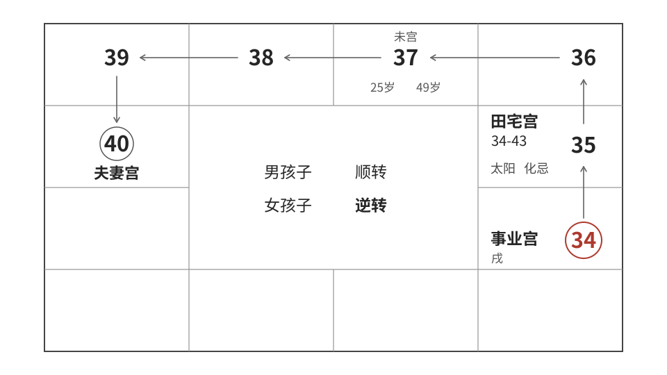 |
| **34–43 田宅宫之后，34 岁、40 岁各落哪宫？** | 〔口述〕「她这个是 34-43」「太阳在这边」，「那我们其他星不要写了」，「化忌也在这个宫里面」，「这是田宅宫」。（[00:39:14–00:39:27](https://www.bilibili.com/video/BV1KJsLekEfA/?p=9&t=2354)，第 70638–71039 帧） 〔指代〕说「这个宫里面」时，正用橙色粉笔在右列从上数第二格的34与43之间写字并圈起；此前说「太阳在这边」也是在这一格上部写字，格内可见橙色43。（[00:39:18–00:39:23](https://www.bilibili.com/video/BV1KJsLekEfA/?p=9&t=2358)，第 70746–70919 帧） 〔口述〕「那34岁是什么」「事业宫」，「夫妻宫是不是在这边」，「诸位从这边开始算」「35岁在这边」，一路数到「40岁」。（[00:39:28–00:39:50](https://www.bilibili.com/video/BV1KJsLekEfA/?p=9&t=2368)，第 71040–71711 帧） 〔指代〕说「夫妻宫是不是在这边」时，用橙色粉笔在左列从上数第二格写「夫妻」。（[00:39:32–00:39:35](https://www.bilibili.com/video/BV1KJsLekEfA/?p=9&t=2372)，第 71172–71279 帧） 〔板书〕右列第二格橙字可辨「太阳」「34」「43」「田宅」，中间圈起一字认不全；左列第二格写「夫妻宫」并有圈起的「40」；顶排可辨「39」「38」、圈起的「37」「36」，右列第二格右上一个圈起数字像「35」。（[00:39:52](https://www.bilibili.com/video/BV1KJsLekEfA/?p=9&t=2392)，第 71783 帧） |
| **外面为什么算不好？批流年时宫代表什么？** | 〔口述〕「我一再很多人现在外面不会算」「算命算的不好」「问题在哪里」「就是没有把宫解释出来」。（[00:39:50–00:39:58](https://www.bilibili.com/video/BV1KJsLekEfA/?p=9&t=2390)，第 71712–71963 帧） 〔指代〕说「这个宫啊」时，手指的是用粉笔把左列第二格橙色「夫妻宫」三字圈起来，上方有圈起的40。（[00:39:56–00:39:58](https://www.bilibili.com/video/BV1KJsLekEfA/?p=9&t=2396)，第 71886–71963 帧） 〔口述〕「批流年的时候」，「宫呢为当年值日」「发生之大事」。（[00:39:59–00:40:22](https://www.bilibili.com/video/BV1KJsLekEfA/?p=9&t=2399)，第 71988–72671 帧） 〔板书〕黑板左侧竖写一段字，可辨「批」「流」「宫」「值」「生」「之」「大事」等，与口述「批流年的时候」「宫呢为当年值日」「发生之大事」相合，个别草字认不全。（[00:40:21](https://www.bilibili.com/video/BV1KJsLekEfA/?p=9&t=2421)，第 72642 帧） |

**总结区**

- 通用规则：女命太阳代表先生、丈夫、儿子（[00:36:09–00:36:14](https://www.bilibili.com/video/BV1KJsLekEfA/?p=9&t=2169)，第 65082–65243 帧）；某个十年大限里有太阴星或太阳星落陷，这段时间父亲或母亲会有问题，以此类推（[00:36:58–00:37:19](https://www.bilibili.com/video/BV1KJsLekEfA/?p=9&t=2218)，第 66558–67181 帧）；数流年时男孩子顺转、女孩子逆转（[00:38:47–00:38:53](https://www.bilibili.com/video/BV1KJsLekEfA/?p=9&t=2327)，第 69828–70001 帧）；批流年的时候，宫为当年值日发生之大事；外面算不好是因为没把宫解释出来（[00:39:50–00:40:22](https://www.bilibili.com/video/BV1KJsLekEfA/?p=9&t=2390)，第 71712–72671 帧）
- 只在本例：34–43 大限在田宅宫，化忌与太阳同宫，这十年上不见父、下不见子、中不见夫（[00:35:24–00:36:26](https://www.bilibili.com/video/BV1KJsLekEfA/?p=9&t=2124)，第 63726–65597 帧）；这个人命太强、是武官命，要孤军奋战，原来在这个时候会有灾（[00:36:31–00:36:50](https://www.bilibili.com/video/BV1KJsLekEfA/?p=9&t=2191)，第 65748–66323 帧）；44–53 大限七杀星执令，44 岁以后一个人孤军奋战、做事很辛苦（[00:37:25–00:37:43](https://www.bilibili.com/video/BV1KJsLekEfA/?p=9&t=2245)，第 67362–67913 帧）；今年虚岁 34，34 岁落事业宫，往后数到 40 岁落夫妻宫（[00:37:48–00:39:50](https://www.bilibili.com/video/BV1KJsLekEfA/?p=9&t=2268)，第 68052–71711 帧）
- 不是排盘规则，是处世方法：阳宅地理还没学完，先不要加进来，不要太快（[00:34:48–00:34:55](https://www.bilibili.com/video/BV1KJsLekEfA/?p=9&t=2088)，第 62646–62867 帧）；批流年要观象，不要背书、不要被书绑住，越背越笨（[00:35:00–00:35:16](https://www.bilibili.com/video/BV1KJsLekEfA/?p=9&t=2100)，第 63006–63485 帧）；有灾要赶快先讲，让人事先发现（[00:38:04–00:38:25](https://www.bilibili.com/video/BV1KJsLekEfA/?p=9&t=2284)，第 68544–69155 帧）

**待核**

1. [00:34:43](https://www.bilibili.com/video/BV1KJsLekEfA/?p=9&t=2083)，第 62496 帧：字幕「我们来看十年」，语音作「我们来看死女」，两路对不上，未引用。
2. [00:35:16](https://www.bilibili.com/video/BV1KJsLekEfA/?p=9&t=2116)，第 63486 帧：倪师说「第一个流年」，所指却是 34–43 这一个十年大限，此处用词待核。
3. [00:36:11](https://www.bilibili.com/video/BV1KJsLekEfA/?p=9&t=2171)，第 65130 帧：字幕「太阳就代表先生（父亲）代表丈夫代表儿子」里的「（父亲）」语音没有，像是字幕括注。
4. [00:36:26](https://www.bilibili.com/video/BV1KJsLekEfA/?p=9&t=2186)，第 65598 帧：字幕「这个一出来就很杀」，语音作「很伤」，两路对不上，未引用。
5. [00:36:33–00:36:50](https://www.bilibili.com/video/BV1KJsLekEfA/?p=9&t=2193)，第 65808–66323 帧：字幕混入「平陷旺」「平陷刑伤旺」「平马刑伤路旺」等印刷字，引文已避开；[00:36:40](https://www.bilibili.com/video/BV1KJsLekEfA/?p=9&t=2200)，第 66012 帧字幕「平马刑陷了解我意思吧划不来嘛」与语音「种花木兰嘛」对不上，未引用。
6. [00:36:36](https://www.bilibili.com/video/BV1KJsLekEfA/?p=9&t=2196)，第 65886 帧：「武官命」语音作「五冠命」，本块没有解释这个词。
7. [00:36:42–00:36:45](https://www.bilibili.com/video/BV1KJsLekEfA/?p=9&t=2202)，第 66072–66173 帧：字幕「她先生」，语音两处作「得很好」「心得那么好」，大体可对但待核。
8. [00:36:52](https://www.bilibili.com/video/BV1KJsLekEfA/?p=9&t=2212)，第 66378 帧：口述「34-43中间太阳星会化忌」，但叠图田宅宫太阳标的是化权，化忌标在文昌；[00:36:06](https://www.bilibili.com/video/BV1KJsLekEfA/?p=9&t=2166)，第 64986 帧口述又说化忌「跟太阳是同宫」，两种说法待核。
9. [00:37:00](https://www.bilibili.com/video/BV1KJsLekEfA/?p=9&t=2220)，第 66606 帧：字幕「如果在你十几岁比如说」，语音作「十四到十三这十年中」，数字待核。
10. [00:37:30](https://www.bilibili.com/video/BV1KJsLekEfA/?p=9&t=2250)，第 67518 帧：「执令」语音作「直令」，本块没有解释这个词。
11. [00:37:43](https://www.bilibili.com/video/BV1KJsLekEfA/?p=9&t=2263)，第 67914 帧与[00:38:31](https://www.bilibili.com/video/BV1KJsLekEfA/?p=9&t=2311)，第 69348 帧：「50年生」与「辛丑年」「肖牛」的关系本块没讲清，辛丑是生年还是今年待核。
12. [00:38:28](https://www.bilibili.com/video/BV1KJsLekEfA/?p=9&t=2308)，第 69246 帧：字幕「起子」，语音作「那这个人是」，两路对不上。
13. [00:38:42](https://www.bilibili.com/video/BV1KJsLekEfA/?p=9&t=2322)，第 69684 帧：「未宫」只见于字幕，语音作「公」。
14. [00:39:40](https://www.bilibili.com/video/BV1KJsLekEfA/?p=9&t=2380)，第 71422 帧：指代标注说「35岁在这边」时写在右列最上格，但板书图[00:39:52](https://www.bilibili.com/video/BV1KJsLekEfA/?p=9&t=2392)，第 71783 帧右列最上格是圈起的「36」，「35」在右列第二格右上，两者待核。
15. [00:37:18](https://www.bilibili.com/video/BV1KJsLekEfA/?p=9&t=2238)，第 67150 帧：板书图里新写的字被讲者身体挡住，认不出。
16. [00:38:20](https://www.bilibili.com/video/BV1KJsLekEfA/?p=9&t=2300)，第 69023 帧、[00:38:40](https://www.bilibili.com/video/BV1KJsLekEfA/?p=9&t=2320)，第 69612 帧：左侧「34」下一字认不全；[00:39:25](https://www.bilibili.com/video/BV1KJsLekEfA/?p=9&t=2365)，第 70956 帧「25」旁圈起的字、戌格里两个圈中的字认不全；[00:39:34](https://www.bilibili.com/video/BV1KJsLekEfA/?p=9&t=2374)，第 71240 帧、[00:39:52](https://www.bilibili.com/video/BV1KJsLekEfA/?p=9&t=2392)，第 71783 帧戌格下方橙色小字认不出。
17. [00:36:31](https://www.bilibili.com/video/BV1KJsLekEfA/?p=9&t=2191)，第 65748 帧：叠图子女宫宫名缺一字（「子□辛卯」），另有「□门」「□书」「□煞」缺字。

### 9　流年值宫断事、40岁夫妻限与看相（[00:40:25–00:46:28](https://www.bilibili.com/video/BV1KJsLekEfA/?p=9&t=2425)，第 72750–83657 帧）

| 提示区 | 笔记区 |
|---|---|
| **34岁来算命，流年坐哪一宫、她来问什么？** | 〔口述〕接上文举例：这位小姐「今年34岁」「她来找你算命」，「今年的流年正好坐在事业宫」，所以「她就是今天来问你想问事业的」。（[00:40:25–00:40:34](https://www.bilibili.com/video/BV1KJsLekEfA/?p=9&t=2425)，第 72750–73037 帧） 〔叠图〕画面贴出官禄戊戌：七杀庙、擎羊庙、三台旺、解神庙、寡宿陷、天德庙、阴煞，另有力士、攀鞍、天德、衰；小限 10,22,34,46,58,70；大限 44~53。（[00:40:25–00:40:26](https://www.bilibili.com/video/BV1KJsLekEfA/?p=9&t=2425)，第 72750–72791 帧） 〔推断〕推断：倪师口中的「事业宫」就是叠图上的官禄宫，叠图官禄宫的小限正好含 34，与「今年34岁」流年坐事业宫对得上。（[00:40:25–00:40:30](https://www.bilibili.com/video/BV1KJsLekEfA/?p=9&t=2425)，第 72750–72911 帧） 〔板书〕黑板左侧竖写的字大部分被老师身体挡住，可辨：「34」「流」「才」，其余认不出。（[00:40:25](https://www.bilibili.com/video/BV1KJsLekEfA/?p=9&t=2425)，第 72750 帧） |
| **明年、后年、40岁来算命，各是来问什么？** | 〔口述〕「如果是明年来」，「就是问田宅问财产」；「后年来福德就是问婚姻的」；「如果她是40岁来找你算命的话」，「她这是要看夫妻」。（[00:40:34–00:40:46](https://www.bilibili.com/video/BV1KJsLekEfA/?p=9&t=2434)，第 73038–73409 帧） 〔叠图〕随讲依次贴出：田宅丁酉（太阳平、化权，天梁得，禄存庙，文昌旺、化忌，地劫平，天官平，年解旺；小限 11,23,35,47,59,71；大限 34~43）；福德丙申（天相庙、武曲得、天喜旺、铃星陷、陀罗陷、右弼不；小限按图例还原为 12,24,36,48,60,72；大限 24~33）。（[00:40:34–00:40:41](https://www.bilibili.com/video/BV1KJsLekEfA/?p=9&t=2434)，第 73038–73259 帧） 〔叠图〕接着贴出夫妻壬辰：天府庙、廉贞利、八座旺、台辅、天月、副截陷、副旬陷；小限 4,16,28,40,52,64；大限 104~113（数字以板书图第76343帧上同一叠图为准）。（[00:40:42–00:40:43](https://www.bilibili.com/video/BV1KJsLekEfA/?p=9&t=2442)，第 73260–73313 帧） 〔推断〕推断：明年即35岁、后年即36岁、40岁，分别落在叠图田宅、福德、夫妻三宫的小限数字里，倪师就是按流年小限落哪一宫来定对方当年来问的事。（[00:40:34–00:40:46](https://www.bilibili.com/video/BV1KJsLekEfA/?p=9&t=2434)，第 73038–73409 帧） |
| **流年值的那一个宫代表什么？** | 〔口述〕「所以这个宫一个宫代表她」「她本身要发生的」「当年发生最影响最严重的事情」——流年所值的那一宫，就是本人当年最大、最严重的事。（[00:40:47–00:40:56](https://www.bilibili.com/video/BV1KJsLekEfA/?p=9&t=2447)，第 73410–73685 帧） 〔指代〕说「这个宫」时，手指按在黑板左中格橙色椭圆圈住的「夫妻宫」上（旁标橙色40）。（[00:40:47](https://www.bilibili.com/video/BV1KJsLekEfA/?p=9&t=2447)，第 73410 帧） |
| **大限有哪两种算法？** | 〔口述〕「有两种大限的算法」：一种「十年叫做未来十年」，「未来十年无大运大限在今年」；另一种「未来呢一年无大运大限在前一年」，「大限刚好落在前一年」。（[00:40:59–00:41:35](https://www.bilibili.com/video/BV1KJsLekEfA/?p=9&t=2459)，第 73794–74855 帧） 〔板书〕黑板右上新写一竖行，可辨「未来」「十」「年」；左侧竖写可辨「流」「年」「宫」「值」「日」等字，其余认不出；盘中可见橙色 39、38、圈住的 37，左中格橙色圈 40 与橙色椭圆「夫妻宫」。（[00:41:05](https://www.bilibili.com/video/BV1KJsLekEfA/?p=9&t=2465)，第 73976 帧） 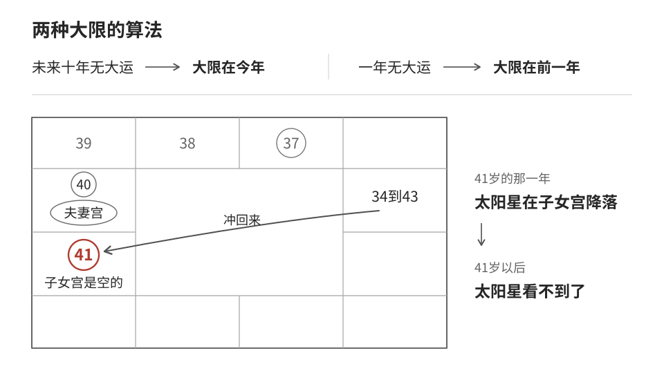 〔板书〕右侧陆续加写竖行：可辨「大限在」（第74136帧）、「未来一」（第74448帧），最后一行可辨「大限在」「一年」，中间一字像「前」。（[00:41:32](https://www.bilibili.com/video/BV1KJsLekEfA/?p=9&t=2492)，第 74772 帧） |
| **34到43是什么情形？41岁起为何「看不到太阳」？** | 〔口述〕「34到43冲回来这里是空的」「子女宫是空的对不对」「是不是没有的」。（[00:41:35–00:41:40](https://www.bilibili.com/video/BV1KJsLekEfA/?p=9&t=2495)，第 74856–75023 帧） 〔口述〕「她41岁的那一年呢」「开始正好太阳星在子女宫降落」，「她从41岁以后开始」「太阳星看不到了」；「看不到儿子太阳」，一个是儿子本来就没有，「一个是看不到太阳的」，「所以她是41岁以后看不到太阳」。（[00:41:40–00:41:57](https://www.bilibili.com/video/BV1KJsLekEfA/?p=9&t=2500)，第 75024–75527 帧） 〔叠图〕贴出子女辛卯：无吉星，天姚庙、恩光庙、天寿陷，另有飞廉、灾煞、丧门、胎；小限 5,17,29,41,53,65；大限 94~103。随后又贴田宅丁酉（大限 34~43，太阳平、化权）。（[00:41:42–00:41:48](https://www.bilibili.com/video/BV1KJsLekEfA/?p=9&t=2502)，第 75072–75245 帧） 〔板书〕夫妻宫下方新写一个圈住的「41」，下面一字认不出；一条长箭头从盘的右侧指向这个「41」。（[00:41:43](https://www.bilibili.com/video/BV1KJsLekEfA/?p=9&t=2503)，第 75106 帧） 〔推断〕推断：「34到43」与叠图田宅宫的大限 34~43 一致，子女宫小限含 41、叠图标「无吉星」，与「子女宫是空的」「41岁」对得上；但叠图上太阳在田宅宫，倪师说太阳「在子女宫降落」的意思本块没讲清。（[00:41:35–00:41:48](https://www.bilibili.com/video/BV1KJsLekEfA/?p=9&t=2495)，第 74856–75245 帧） |
| **为什么说「算命是谈果的哲学」？** | 〔口述〕「但是已经讲结果了」，「算命呢是一个谈果的哲学」：「我们知道41岁以后先生就没有了」，再往前推「那是不是在40岁的时候会发生」。（[00:41:57–00:42:06](https://www.bilibili.com/video/BV1KJsLekEfA/?p=9&t=2517)，第 75528–75809 帧） 〔板书〕盘中间格写了一个圈住的「果」字。（[00:42:02](https://www.bilibili.com/video/BV1KJsLekEfA/?p=9&t=2522)，第 75674 帧） 〔推断〕推断：倪师先把「看不到太阳」说成看不到儿子，紧接着又落到「41岁以后先生就没有了」，即先由41岁以后的结果断事，再回推40岁是发生的那一年；本块里太阳具体指儿子还是先生没有明确交代。（[00:41:49–00:42:06](https://www.bilibili.com/video/BV1KJsLekEfA/?p=9&t=2509)，第 75294–75809 帧） |
| **40岁值令哪一宫？若值兄弟宫又怎么看？** | 〔口述〕「刚好值令40岁是什么」「是她的夫妻宫」。又举对照：「如果40岁值令那年呢」「刚好是她的兄弟宫」，那这太阳星可能指的是兄弟夭折，「可是刚好落在她夫妻宫」。（[00:42:07–00:42:19](https://www.bilibili.com/video/BV1KJsLekEfA/?p=9&t=2527)，第 75810–76199 帧） 〔口述〕所以从这个命上看，「40岁呢」「夫妻会有大限」。（[00:42:20–00:42:29](https://www.bilibili.com/video/BV1KJsLekEfA/?p=9&t=2540)，第 76200–76487 帧） 〔叠图〕再贴夫妻壬辰：天府庙、廉贞利，小限含 40。（[00:42:07–00:42:08](https://www.bilibili.com/video/BV1KJsLekEfA/?p=9&t=2527)，第 75810–75857 帧） 〔板书〕盘中间偏右格写圈住的「40」，下面写「大限」；左中格橙色「40」旁加了一个勾。（[00:42:24](https://www.bilibili.com/video/BV1KJsLekEfA/?p=9&t=2544)，第 76343 帧） 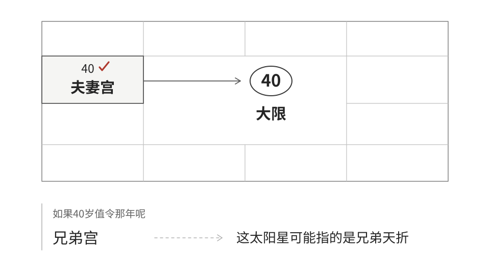 |
| **女命面大、声沙、骨粗，这个限会不会发生？** | 〔口述〕「然后这个女孩子如果坐到你面前来」，「面大声沙骨粗」，就「100%会发生」。（[00:42:29–00:42:52](https://www.bilibili.com/video/BV1KJsLekEfA/?p=9&t=2549)，第 76488–77189 帧） 〔口述〕解释三样：「脸孔大大的」；「讲话声音是破嗓子」「破锣嗓子」；「骨头很粗」。并重复「一定会发生」。（[00:42:53–00:43:03](https://www.bilibili.com/video/BV1KJsLekEfA/?p=9&t=2573)，第 77190–77507 帧） 〔板书〕黑板左侧竖写可辨「面大、声沙」，旁边一行可辨「骨」，下一字像「粗」。（[00:42:47](https://www.bilibili.com/video/BV1KJsLekEfA/?p=9&t=2567)，第 77039 帧） |
| **奸门在哪里？奸门的纹怎么看夫妻？** | 〔口述〕夫妻宫有死运的时候，看相书相图上的奸门：「奸门就是眼角后面这边」「眼角的尾巴」。（[00:43:03–00:43:12](https://www.bilibili.com/video/BV1KJsLekEfA/?p=9&t=2583)，第 77508–77783 帧） 〔指代〕说「眼角后面这边」时，粉笔点在黑板上画的眼睛形状的右端尾角，那里没有字。（[00:43:09](https://www.bilibili.com/video/BV1KJsLekEfA/?p=9&t=2589)，第 77681 帧） 〔口述〕「如果是一条是往下走」，「上次介绍过婚姻不好」；「如果是打了个十字纹」，有纹路在眼尾交叉，「代表夫妻死别」。（[00:43:12–00:43:28](https://www.bilibili.com/video/BV1KJsLekEfA/?p=9&t=2592)，第 77784–78251 帧） 〔指代〕说「有纹路在这边」「打了十字纹在这边」时，粉笔、食指先后落在眼形尾端外侧，正在画、指刚画好的交叉线（十字），不是文字。（[00:43:22–00:43:23](https://www.bilibili.com/video/BV1KJsLekEfA/?p=9&t=2602)，第 78073–78106 帧） 〔板书〕黑板左上画了一个眼睛形状，尾端一条线往右下延伸（第77940帧）；随后尾端加画交叉线成「×」形，没有文字。（[00:43:26](https://www.bilibili.com/video/BV1KJsLekEfA/?p=9&t=2606)，第 78192 帧） |
| **鱼尾纹多少条，分别代表什么？** | 〔口述〕「眼角的鱼尾纹呢一票」「密密麻一票」，「代表桃花」。（[00:43:28–00:43:38](https://www.bilibili.com/video/BV1KJsLekEfA/?p=9&t=2608)，第 78252–78551 帧） 〔口述〕眼角鱼尾纹最好是一两条，最多三条（字幕与语音这里对不上，见待核），「这都是夫妻很好」「对他的另外一半非常的满意」。（[00:43:38–00:43:46](https://www.bilibili.com/video/BV1KJsLekEfA/?p=9&t=2618)，第 78552–78797 帧） 〔口述〕举眼前的人：「好这样看他笑一笑哎两条」「对他现在的太太都非常满意」，「这马上可以看到」。（[00:43:46–00:44:00](https://www.bilibili.com/video/BV1KJsLekEfA/?p=9&t=2626)，第 78798–79217 帧） 〔板书〕左侧中部画第二个眼形，尾端画出一大把散开的线（第78468帧）；下方再画第三个眼形，尾端只有几条线（第78804帧），没有文字。（[00:43:46](https://www.bilibili.com/video/BV1KJsLekEfA/?p=9&t=2626)，第 78804 帧） |
| **先生应酬回来，不用问怎么看出他干了坏事？** | 〔口述〕「那如果我教你们女孩子一个技巧」：「你先生每天晚上回家吃饭的时候」或「晚上出去应酬回来」，「你就不用问什么」，「眼睛看过去」。（[00:44:00–00:44:15](https://www.bilibili.com/video/BV1KJsLekEfA/?p=9&t=2640)，第 79218–79667 帧） 〔口述〕「如果他眉毛立起来对着你」，「就是刚刚干完坏事了回来」。（[00:44:15–00:44:24](https://www.bilibili.com/video/BV1KJsLekEfA/?p=9&t=2655)，第 79668–79925 帧） |
| **男方怎么从鼻子看女方婚前是否乱来？** | 〔口述〕顺便教男的：「这女孩子比较不好看」「比较不容易看」。有的女孩子婚前乱来，婚后去医院请「妇产科医生给你作假做的让你看不出」，倪师说那个没有用。（[00:44:24–00:44:58](https://www.bilibili.com/video/BV1KJsLekEfA/?p=9&t=2664)，第 79926–80963 帧） 〔口述〕「你眼睛一看上去那个鼻子啊」，鼻子中间、鼻头处，「那个骨头两片分开来的」「一定不是处女」；「你这样一摸」「两个分开来就不是处女」。（[00:44:58–00:45:10](https://www.bilibili.com/video/BV1KJsLekEfA/?p=9&t=2698)，第 80964–81317 帧） 〔指代〕说「这个中间」时，倪师面向镜头，用食指按着自己的鼻头。（[00:45:00](https://www.bilibili.com/video/BV1KJsLekEfA/?p=9&t=2700)，第 81001 帧） 〔口述〕她就算否认，「她只能把阴部的地方缝起来」「可是她没有办法缝到鼻子」。（[00:45:10–00:45:20](https://www.bilibili.com/video/BV1KJsLekEfA/?p=9&t=2710)，第 81318–81617 帧） |
| **看相为什么尽量少教、要自己看相书？** | 〔口述〕「我们尽量这部分少教」，诸位「自己看相书」。（[00:44:33–00:44:42](https://www.bilibili.com/video/BV1KJsLekEfA/?p=9&t=2673)，第 80208–80489 帧） 〔口述〕还有很多，「如果你们男孩子有兴趣私下问我」「我私下再讲」；「讲到相破掉的话」，男孩子晓得了回家先做遮掩，「对啊我就看不到所以真人不露相嘛」，「那我讲了就破掉了」。（[00:45:20–00:45:38](https://www.bilibili.com/video/BV1KJsLekEfA/?p=9&t=2720)，第 81618–82157 帧） |
| **40岁的夫妻限，还能从谁的命上印证？** | 〔口述〕「这是她所以她40有这个限」，「那刚刚是不是提供我们的资料」，后面还会有一个：「结果她女儿的八字刚好是在」——「她今年生到女儿」，「结果她女儿7岁的时候」「她爸爸有灾在命格上看到了」，「1234567 刚好7岁你看看」。（[00:45:43–00:46:07](https://www.bilibili.com/video/BV1KJsLekEfA/?p=9&t=2743)，第 82296–83027 帧） 〔叠图〕此时画面同时贴出夫妻壬辰、田宅丁酉两格。（[00:45:43–00:45:45](https://www.bilibili.com/video/BV1KJsLekEfA/?p=9&t=2743)，第 82296–82361 帧） 〔推断〕推断：「今年」指她34岁那年；若女儿出生那年算1岁，数到7正是她40岁，与前面「40岁」「夫妻会有大限」对得上；倪师只数了「1234567」，没有明说这层换算。（[00:40:25–00:46:07](https://www.bilibili.com/video/BV1KJsLekEfA/?p=9&t=2425)，第 72750–83027 帧） 〔口述〕「从她女儿的命也看到」。「那她的命看到还不见得一定是对的」，因为跟这位小姐「同时间出生的人很多」，「不一定嫁同时间同样的先生嘛」；她女儿又是这样，「这个时候我们要去注意」，「这是一个流年上的一个限」。（[00:46:07–00:46:28](https://www.bilibili.com/video/BV1KJsLekEfA/?p=9&t=2767)，第 83028–83657 帧） |

**总结区**

- 通用规则：流年值到的那一宫，代表本人当年要发生的、最影响最严重的事情（[00:40:47–00:40:56](https://www.bilibili.com/video/BV1KJsLekEfA/?p=9&t=2447)，第 73410–73685 帧）；大限有两种算法：未来十年，大限在今年；未来一年，大限在前一年（[00:40:59–00:41:35](https://www.bilibili.com/video/BV1KJsLekEfA/?p=9&t=2459)，第 73794–74855 帧）；奸门（眼角尾巴）纹一条往下走主婚姻不好、打十字纹代表夫妻死别；鱼尾纹密密麻麻代表桃花，一两条、最多三条主夫妻很好（[00:43:03–00:43:46](https://www.bilibili.com/video/BV1KJsLekEfA/?p=9&t=2583)，第 77508–78797 帧）；只看本人的命不见得一定对，同时间出生的人很多、不一定嫁同样的先生，要从家人（女儿）的命一起印证（[00:46:07–00:46:22](https://www.bilibili.com/video/BV1KJsLekEfA/?p=9&t=2767)，第 83028–83489 帧）
- 只在本例：她34岁流年坐事业宫来问事业；明年问田宅财产，后年福德问婚姻，40岁看夫妻（[00:40:25–00:40:46](https://www.bilibili.com/video/BV1KJsLekEfA/?p=9&t=2425)，第 72750–73409 帧）；41岁起太阳星在子女宫降落、看不到太阳，倪师断41岁以后先生就没有了，40岁值令夫妻宫、夫妻会有大限（[00:41:40–00:42:29](https://www.bilibili.com/video/BV1KJsLekEfA/?p=9&t=2500)，第 75024–76487 帧）；这个女孩子若面大、声沙、骨粗，40岁这个限100%会发生（[00:42:29–00:43:03](https://www.bilibili.com/video/BV1KJsLekEfA/?p=9&t=2549)，第 76488–77507 帧）；她今年生女儿，女儿7岁时爸爸有灾，从女儿的命也看到（[00:45:51–00:46:09](https://www.bilibili.com/video/BV1KJsLekEfA/?p=9&t=2751)，第 82530–83099 帧）
- 不是排盘规则，是处世方法：看相这部分尽量少教，学生自己看相书；真人不露相，讲出来就破掉了（[00:44:33–00:45:38](https://www.bilibili.com/video/BV1KJsLekEfA/?p=9&t=2673)，第 80208–82157 帧）；教女孩子：先生晚上回来不用问，眼睛看过去，眉毛立起来对着你就是刚干完坏事回来（[00:44:00–00:44:24](https://www.bilibili.com/video/BV1KJsLekEfA/?p=9&t=2640)，第 79218–79925 帧）

**待核**

1. [00:40:39](https://www.bilibili.com/video/BV1KJsLekEfA/?p=9&t=2439)，第 73182 帧「后年来福德就是问婚姻的」：语音作「来服务的」；福德为何问婚姻，本块没有解释。
2. [00:40:59–00:41:18](https://www.bilibili.com/video/BV1KJsLekEfA/?p=9&t=2459)，第 73794–74369 帧「无大运」：字幕作「无」、语音作「吴」，意思本块没有解释；「十年叫做未来十年」字幕可信度只有0.5。
3. [00:41:35](https://www.bilibili.com/video/BV1KJsLekEfA/?p=9&t=2495)，第 74856 帧「34到43冲回来这里是空的」：「冲回来」从哪一宫冲到哪一宫没讲；该处指代（D124）为「是（不确定）」，未作依据。
4. [00:41:42](https://www.bilibili.com/video/BV1KJsLekEfA/?p=9&t=2502)，第 75072 帧「太阳星在子女宫降落」：叠图上太阳在田宅丁酉（平、化权），子女辛卯无太阳，「降落」的意思待核。
5. [00:41:52](https://www.bilibili.com/video/BV1KJsLekEfA/?p=9&t=2512)，第 75378 帧字幕「一个是几子本来就没有」：按语音「儿子」理解为「儿子」。
6. [00:42:07](https://www.bilibili.com/video/BV1KJsLekEfA/?p=9&t=2527)，第 75810 帧「值令」：语音作「直立」，倪师用了这个词但没解释。
7. [00:42:15](https://www.bilibili.com/video/BV1KJsLekEfA/?p=9&t=2535)，第 76056 帧字幕「兄弟天折」：按上下文改为「夭折」（语音作「妖子」）。
8. [00:42:56](https://www.bilibili.com/video/BV1KJsLekEfA/?p=9&t=2576)，第 77292 帧字幕「一个个皮骨相连」：语音作「屁股相连」，原话待核，未写进笔记。
9. [00:43:05](https://www.bilibili.com/video/BV1KJsLekEfA/?p=9&t=2585)，第 77550 帧字幕「好门」、语音「尖门」：按下一句字幕改为「奸门」。
10. [00:43:38–00:43:42](https://www.bilibili.com/video/BV1KJsLekEfA/?p=9&t=2618)，第 78552–78677 帧：字幕「最好是一条两条奴仆」「超过三条最多」，语音「最好是一条两条三条最多」，两路对不上，笔记按「一两条、最多三条」转述。
11. [00:43:29](https://www.bilibili.com/video/BV1KJsLekEfA/?p=9&t=2609)，第 78288 帧字幕「鱼尾纹」，语音作「尾巴」。
12. [00:44:27](https://www.bilibili.com/video/BV1KJsLekEfA/?p=9&t=2667)，第 80010 帧字幕「交个男的」：语音「教一个男的」，按上下文理解为「教」。
13. [00:45:00](https://www.bilibili.com/video/BV1KJsLekEfA/?p=9&t=2700)，第 81012 帧字幕「素膠」、语音「塑料」：鼻子中间部位的名称听不清，未写进笔记。
14. [00:45:38](https://www.bilibili.com/video/BV1KJsLekEfA/?p=9&t=2738)，第 82158 帧字幕「没关系不要当真以示公平」与语音「系当然一定是公平」对不上，未写进笔记。
15. [00:46:00](https://www.bilibili.com/video/BV1KJsLekEfA/?p=9&t=2760)，第 82806 帧字幕「有灾」，语音作「有宅」。
16. [00:45:44](https://www.bilibili.com/video/BV1KJsLekEfA/?p=9&t=2744)，第 82347 帧「她40有这个限」时手指（D132）为「是（不确定）」，分不清指黑板还是叠图，未作依据。
17. 夫妻壬辰叠图数字串「104113、405264、41628」顺序错乱，以[00:42:24](https://www.bilibili.com/video/BV1KJsLekEfA/?p=9&t=2544)，第 76343 帧图上印的小限 4,16,28,40,52,64、大限 104~113 为准；福德丙申没有对应板书图，小限按图例还原。
18. [00:40:25](https://www.bilibili.com/video/BV1KJsLekEfA/?p=9&t=2425)，第 72750 帧板书大部分被身体挡住；[00:41:43](https://www.bilibili.com/video/BV1KJsLekEfA/?p=9&t=2503)，第 75106 帧圈住的「41」下方一字认不出；[00:42:47](https://www.bilibili.com/video/BV1KJsLekEfA/?p=9&t=2567)，第 77039 帧盘右侧中格的圈注数字认不出。
19. [00:43:18](https://www.bilibili.com/video/BV1KJsLekEfA/?p=9&t=2598)，第 77940 帧起画面右下角有后期贴的「面部十二宫图」，材料未列为▣叠图，未作依据。
20. [00:43:54–00:43:58](https://www.bilibili.com/video/BV1KJsLekEfA/?p=9&t=2634)，第 79020–79163 帧有一段短板书没有抽图，内容不知。

## 化解（上）：死夫阳宅两种与人间道

### 10　化解：两种死夫阳宅、人间道与阴德（[00:46:28–00:53:29](https://www.bilibili.com/video/BV1KJsLekEfA/?p=9&t=2788)，第 83658–96299 帧）

| 提示区 | 笔记区 |
|---|---|
| **大限有灾，倪师先从哪里讲怎么解？** | 〔口述〕倪师问大限到了要怎么解，先从阳宅讲：「那这个大限的时候我们要如何去解它」「阳宅上面来说」「房子来说东南西北」，说有两种阳宅会「死先生」「死老公的」。（[00:46:28–00:46:41](https://www.bilibili.com/video/BV1KJsLekEfA/?p=9&t=2788)，第 83658–84047 帧） 〔板书〕黑板左边画一个房屋方框，上方写 S、下方写 N、左侧写 E，方框正中画一个小方框，里面一个圈。（[00:46:43](https://www.bilibili.com/video/BV1KJsLekEfA/?p=9&t=2803)，第 84108 帧） 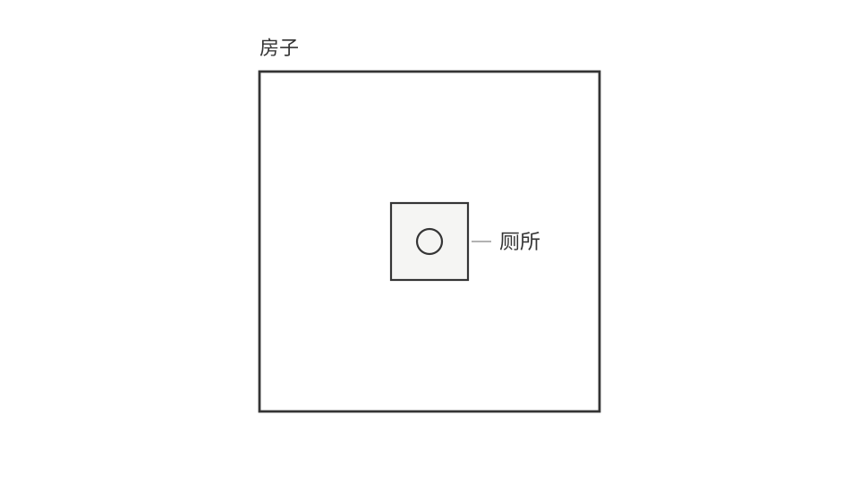 〔推断〕推断：板上房屋图是上南、下北、左东，右边后来写了 W（见第 84684 帧板书），后面讲的「西北角」就在方框右下角。（[00:47:02](https://www.bilibili.com/video/BV1KJsLekEfA/?p=9&t=2822)，第 84684 帧） |
| **第一种死夫凶宅长什么样？要不要管门？** | 〔口述〕以房子的「中心点」看，「第一个」是「厕所在房子的中间」，「它没有临靠边」，并说「你不用管门呐」。（[00:46:41–00:47:00](https://www.bilibili.com/video/BV1KJsLekEfA/?p=9&t=2801)，第 84048–84623 帧） 〔口述〕倪师说「把阳宅简化了四个字就讲完了」：「你不要去管门怎么开」「门随便怎么开」，「厕所搁在房子的中间」「这是凶宅」。（[00:47:01–00:47:10](https://www.bilibili.com/video/BV1KJsLekEfA/?p=9&t=2821)，第 84654–84923 帧） 〔板书〕可辨：「①厕所在 房中」，房屋方框右侧写 W，W 旁画圈，圈里一个字认不全。（[00:47:02](https://www.bilibili.com/video/BV1KJsLekEfA/?p=9&t=2822)，第 84684 帧） |
| **厕所在房子中间，主死于什么病？** | 〔口述〕「凶这种死的一定是心脏病啊」，接着说「气喘」「到这痰梗到死掉」；语音这句里还多出动风二字（字幕没有，见待核），与后面板书的中風对得上。（[00:47:10–00:47:21](https://www.bilibili.com/video/BV1KJsLekEfA/?p=9&t=2830)，第 84924–85241 帧） 〔板书〕可辨：「①厕所在 房中．凶」，后面一字认不出，再后是「中風．気喘」。房屋方框正中的小方框里画了一个交叉的图形。（[00:48:29](https://www.bilibili.com/video/BV1KJsLekEfA/?p=9&t=2909)，第 87282 帧） |
| **第二种死夫凶宅是什么？为什么死夫？** | 〔口述〕「第二种凶宅呢」「西北角是厨房」；「西北角呢是乾卦」，太太住到先生的位置。倪师说这是夫妻的地天泰，对先生来说是乾为天（字幕作「地天泰雪」「乾为天冒」，按语音改）。（[00:47:21–00:47:40](https://www.bilibili.com/video/BV1KJsLekEfA/?p=9&t=2841)，第 85242–85823 帧） 〔指代〕说「那这里如果是厨房」的「这里」时，手指的是房屋图右下角写着 K 的小方框。（[00:47:38–00:47:40](https://www.bilibili.com/video/BV1KJsLekEfA/?p=9&t=2858)，第 85764–85823 帧） 〔口述〕「那这里如果是厨房」「厨房是刀象」「刀的象所以这个也主的夫妻死别」。（[00:47:40–00:47:48](https://www.bilibili.com/video/BV1KJsLekEfA/?p=9&t=2860)，第 85824–86057 帧） 〔板书〕可辨：「②西北」，房屋方框右下角画小方框写 K；之后在 K 框外下方写「乾」。（[00:47:35](https://www.bilibili.com/video/BV1KJsLekEfA/?p=9&t=2855)，第 85653 帧） 〔板书〕可辨：「②西北为厨」（「为厨」两字是按字形认的，不十分确定）。（[00:48:29](https://www.bilibili.com/video/BV1KJsLekEfA/?p=9&t=2909)，第 87282 帧） |
| **厕所在中间为何主心脏、中风、气喘？** | 〔口述〕倪师问「为什么会主的心脏中风气喘呢」，让大家「看一个门」：「如果你门有你这个厕所啊」「有靠边都有开窗」。（[00:47:49–00:47:57](https://www.bilibili.com/video/BV1KJsLekEfA/?p=9&t=2869)，第 86076–86327 帧） 〔指代〕说「你这个厕所」时，手指的是正在房屋图上边（S 侧）靠墙处新画的小方框，框里还没写字。（[00:47:54–00:47:55](https://www.bilibili.com/video/BV1KJsLekEfA/?p=9&t=2874)，第 86220–86279 帧） 〔口述〕「中国以前窗户是不是这样格子这样弄的」，说这就是开，「开就是窗格子」。（[00:47:57–00:48:02](https://www.bilibili.com/video/BV1KJsLekEfA/?p=9&t=2877)，第 86328–86483 帧） 〔口述〕「那如果你一个门在那边没有窗户」「有一个心脏在那边闷到的象」。（[00:48:02–00:48:07](https://www.bilibili.com/video/BV1KJsLekEfA/?p=9&t=2882)，第 86484–86615 帧） 〔板书〕可辨：黑板左上角一个大字「開」；S 旁边加画几道格线；房屋方框左上角圈里一个门字框的字，认不全。（[00:48:29](https://www.bilibili.com/video/BV1KJsLekEfA/?p=9&t=2909)，第 87282 帧） 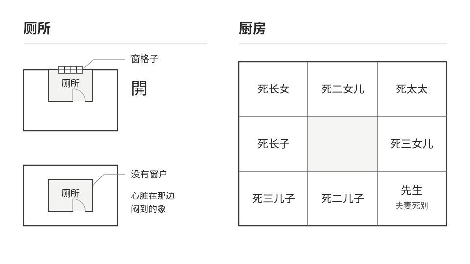 |
| **看阳宅到底看什么？** | 〔口述〕「诸位我们看什么东西」，看精神：「精神呢就是讲它的象就是它的精神」。（[00:48:09–00:48:13](https://www.bilibili.com/video/BV1KJsLekEfA/?p=9&t=2889)，第 86670–86801 帧） 〔口述〕「所以以后室内设计再怎么设计」「那个神还在哪里」（语音作神还在那里）；「我们用象取象最好」「取它的象最准」。（[00:48:13–00:48:22](https://www.bilibili.com/video/BV1KJsLekEfA/?p=9&t=2893)，第 86802–87071 帧） |
| **厨房落在其他方位，各主死谁？** | 〔口述〕「以此类推很简单啊」：「厨房如果在坤方」「是不是死太太」。（[00:48:26–00:48:31](https://www.bilibili.com/video/BV1KJsLekEfA/?p=9&t=2906)，第 87180–87341 帧） 〔口述〕「那如果厨房在东宫是不是死长子」「那东南宫死长女」「南边死二女儿西边死三女儿」「北方死二儿子」「东北角死三儿子以此类推」。（[00:48:32–00:48:41](https://www.bilibili.com/video/BV1KJsLekEfA/?p=9&t=2912)，第 87360–87641 帧） 〔板书〕房屋方框被画成三行三列的格子，多格里画了圆圈，格里没有认得出的字。（[00:48:39](https://www.bilibili.com/video/BV1KJsLekEfA/?p=9&t=2919)，第 87571 帧） 〔推断〕推断：连同前面西北角（乾）厨房死先生，本段给出了厨房在八个方位各主死家中哪一位的对照；西北为先生、坤方为太太。（[00:47:21–00:48:41](https://www.bilibili.com/video/BV1KJsLekEfA/?p=9&t=2841)，第 85242–87641 帧） |
| **阳宅占几分？光有凶宅就会出事吗？** | 〔口述〕「但是阳宅部分它只占了什么1/3」「必须你命上有灾」。（[00:48:41–00:48:47](https://www.bilibili.com/video/BV1KJsLekEfA/?p=9&t=2921)，第 87642–87821 帧） 〔板书〕可辨：房屋图左下方写「1/3」。（[00:48:45](https://www.bilibili.com/video/BV1KJsLekEfA/?p=9&t=2925)，第 87773 帧） 〔口述〕「东边是厨房一定要是命上有那个灾」「再加上运上有那个灾」「就会发生了」。（[00:49:28–00:49:35](https://www.bilibili.com/video/BV1KJsLekEfA/?p=9&t=2968)，第 89046–89279 帧） |
| **命上没儿子的那位小姐，挑房子出了什么错？** | 〔口述〕「比如说这个这位小姐」「她的命上没儿子」，有儿子的话会夭折（字幕作「天折」）；「结果她不幸她生了个儿子」「脸孔很像她那很紧张啊」。（[00:48:47–00:48:55](https://www.bilibili.com/video/BV1KJsLekEfA/?p=9&t=2927)，第 87822–88061 帧） 〔口述〕「然后她好紧张她去挑房子」，「一挑的时候南北看反了」：「他一想东边不要厨房」，结果东宫那边是厨房，「因为她罗盘不会看啊」「看南北看反了」。（[00:48:55–00:49:09](https://www.bilibili.com/video/BV1KJsLekEfA/?p=9&t=2935)，第 88062–88487 帧） 〔指代〕说「东在这边」时，手指的是九宫图左侧外的「E」标记。（[00:49:09–00:49:10](https://www.bilibili.com/video/BV1KJsLekEfA/?p=9&t=2949)，第 88488–88529 帧） 〔口述〕「她的命中有这个灾」「她很紧张她也去做了」「结果罗盘还是看错了太紧张」。（[00:49:13–00:49:18](https://www.bilibili.com/video/BV1KJsLekEfA/?p=9&t=2953)，第 88590–88757 帧） |
| **为什么越紧张越容易出事？** | 〔口述〕倪师打比方：「诸位我常常说给你一百万」「说这块玉一百万」「你就一下就摔坏了」；「给你10块钱保证你不会摔坏」「骑摩托车摔倒了玉都不会摔坏」。（[00:49:18–00:49:28](https://www.bilibili.com/video/BV1KJsLekEfA/?p=9&t=2958)，第 88758–89045 帧） 〔推断〕推断：这个比方接在那位小姐太紧张、罗盘看错之后，用来说明命中有灾的人越紧张越会做错。（[00:49:13–00:49:28](https://www.bilibili.com/video/BV1KJsLekEfA/?p=9&t=2953)，第 88590–89045 帧） |
| **人间道占几分？命中注定无子的妈妈怀孕时会怎样？** | 〔口述〕「那我们要进入人间」「人间道的时候还占了1/3」。（[00:49:36–00:49:39](https://www.bilibili.com/video/BV1KJsLekEfA/?p=9&t=2976)，第 89280–89375 帧） 〔板书〕可辨：房屋图下方另写一个「1/3」并画圈。（[00:49:44](https://www.bilibili.com/video/BV1KJsLekEfA/?p=9&t=2984)，第 89520 帧） 〔口述〕「一个妈妈命中她注定没有儿子」，「她每天在紧张」「从怀孕开始」，「每个礼拜跑去电子扫描」「扫描非把那个孩子扫描死掉」，「三个月心跳没了」。（[00:49:41–00:50:02](https://www.bilibili.com/video/BV1KJsLekEfA/?p=9&t=2981)，第 89436–90089 帧） 〔推断〕推断：本块明说阳宅占三分之一、人间道占三分之一，又说算命「三个都要讨论」（见第 92052 帧），剩下的一份应是命本身；倪师本块没有直说。（[00:48:41–00:51:09](https://www.bilibili.com/video/BV1KJsLekEfA/?p=9&t=2921)，第 87642–92099 帧） |
| **生了儿子以后，这种妈妈怎样伤到孩子？** | 〔口述〕「还有一种呢」「生了儿子以后」，「那她会做很多动作伤害儿子」，「她动机都是爱儿子哦」，是「她的无知造成的」。（[00:50:05–00:50:19](https://www.bilibili.com/video/BV1KJsLekEfA/?p=9&t=3005)，第 90174–90593 帧） 〔口述〕小孩东西掉到地上并不怕，「他是很好奇啊什么东西啊」；倪师讲鼻子：「鼻子长成这种形状是天生好奇嘛」「小孩子鼻子都是这样子的」。（[00:50:19–00:50:37](https://www.bilibili.com/video/BV1KJsLekEfA/?p=9&t=3019)，第 90594–91127 帧） 〔指代〕说「这个眼睛在这边」时，手指的是黑板右上部新画的弧线（眼形），画的是图形不是字。（[00:50:30–00:50:33](https://www.bilibili.com/video/BV1KJsLekEfA/?p=9&t=3030)，第 90900–91013 帧） 〔口述〕「结果你知道妈妈在后面啊一叫」，本意「可能是担心玻璃刺到他」，「结果呢你一叫小孩子被你那一叫吓到」「你是河东狮吼啊」。（[00:50:39–00:50:48](https://www.bilibili.com/video/BV1KJsLekEfA/?p=9&t=3039)，第 91182–91451 帧） 〔口述〕「一惊的话」「小肠和心表里」「结果小肠的蠕动就不好」「大便不出来」，「很多后遗症都是妈妈造成的」。（[00:50:51–00:51:03](https://www.bilibili.com/video/BV1KJsLekEfA/?p=9&t=3051)，第 91530–91919 帧） |
| **过去算命怎么处理命中无子？为何说消极？** | 〔口述〕「过去我们算命」「我们没有人间道和地理」「其实算命三个都要讨论的」。（[00:51:05–00:51:09](https://www.bilibili.com/video/BV1KJsLekEfA/?p=9&t=3065)，第 91962–92099 帧） 〔口述〕外面算命会说儿子要给别人养：「给人家养」「给保姆养或者是给奶妈养」「或者是过继给别人不要放在身边养」，倪师说「这是很消极的动作」。（[00:51:11–00:51:21](https://www.bilibili.com/video/BV1KJsLekEfA/?p=9&t=3071)，第 92142–92453 帧） 〔口述〕「因为不见得每个人都愿意啊」，有人说「哪有我不自己养」；倪师说不能讲你养会养死，而是「因为你太关心了」「你眼睛看到他反而会出事啊」。（[00:51:21–00:51:31](https://www.bilibili.com/video/BV1KJsLekEfA/?p=9&t=3081)，第 92454–92753 帧） 〔口述〕过去还有喝人家奶水的习俗，「就就是那个就可以避」，「可是这是消极的」「消极的不是最积极的」。（[00:51:36–00:51:46](https://www.bilibili.com/video/BV1KJsLekEfA/?p=9&t=3096)，第 92904–93203 帧） |
| **最积极的化解是什么？儿子排行老二怎么办？** | 〔口述〕「最积极的呢我们让他有东宫」「让儿子去住到东宫里面」。（[00:51:46–00:51:52](https://www.bilibili.com/video/BV1KJsLekEfA/?p=9&t=3106)，第 93204–93365 帧） 〔口述〕如果妈妈命中没儿子而儿子排行老二，老大已住东宫，「你不会变通啊」「你给他住到南方去」，说是水火既济卦；「你二儿子北方是坎水卦」「后面会介绍到为什么」。（[00:51:52–00:52:10](https://www.bilibili.com/video/BV1KJsLekEfA/?p=9&t=3112)，第 93366–93917 帧） 〔口述〕「我们有64个位置可以让你动」「所以随便你是什么位」「通通有位置可以动」「我们用卦来变化它」。（[00:52:12–00:52:18](https://www.bilibili.com/video/BV1KJsLekEfA/?p=9&t=3132)，第 93966–94157 帧） 〔口述〕老二要变成长子，「势必要等到大儿子结了婚以后」「二儿子变成大儿子才能补位」，「我们名和位一直在动」。（[00:52:18–00:52:33](https://www.bilibili.com/video/BV1KJsLekEfA/?p=9&t=3138)，第 94158–94613 帧） |
| **倪师怎么交代这位小姐？什么叫阴德？** | 〔口述〕「这是一个夫妻死别的宅」「那我们要告诉她」，「不管你搬到哪里去」，要住西北角（字幕作「主卧房要住在西北还是要住西北角」）；「可是你要好的时候才警戒啊」。（[00:52:36–00:52:50](https://www.bilibili.com/video/BV1KJsLekEfA/?p=9&t=3156)，第 94686–95123 帧） 〔口述〕「我就特别提醒她你这辈子要换了」「无论如何你都要找得到我」，还问她「你要不要录音机录下来」。（[00:52:50–00:52:57](https://www.bilibili.com/video/BV1KJsLekEfA/?p=9&t=3170)，第 95124–95339 帧） 〔口述〕「为什么最后我什么都没赚到」「可是我帮了她忙」「她可能不知道」「我们所谓做阴德」；很多人去帮人家洗碗洗衣服，说替自己种福田，「你这都是交易」；「我们这阴德我帮了她她还不知道」。（[00:52:59–00:53:16](https://www.bilibili.com/video/BV1KJsLekEfA/?p=9&t=3179)，第 95394–95909 帧） 〔板书〕可辨：黑板中左部用彩色粉笔写一个「陰」字。（[00:53:08](https://www.bilibili.com/video/BV1KJsLekEfA/?p=9&t=3188)，第 95648 帧） 〔口述〕「你不信我的话」「你去住个西北角厨房」「你要等事情发生再来也无所谓啊」；「我们没有那个经验」「怎么敢跟你讲这种话」「这是我们的算命的一些功能」。（[00:53:17–00:53:29](https://www.bilibili.com/video/BV1KJsLekEfA/?p=9&t=3197)，第 95910–96299 帧） |

**总结区**

- 通用规则：厕所在房子正中、不靠边，不管门怎么开都是凶宅，主死于心脏病、中风、气喘（[00:46:41–00:47:21](https://www.bilibili.com/video/BV1KJsLekEfA/?p=9&t=2801)，第 84048–85241 帧）。；西北角是乾卦，西北角做厨房（刀象）主夫妻死别；以此类推坤方死太太、东死长子、东南死长女、南死二女儿、西死三女儿、北死二儿子、东北死三儿子（[00:47:21–00:48:41](https://www.bilibili.com/video/BV1KJsLekEfA/?p=9&t=2841)，第 85242–87641 帧）。；阳宅只占三分之一，人间道也占三分之一，必须命上有灾、运上也有灾才会发生（[00:48:41–00:49:39](https://www.bilibili.com/video/BV1KJsLekEfA/?p=9&t=2921)，第 87642–89375 帧）。；看阳宅用象取象最准；命中无子，最积极的是让儿子住东宫，排行不合可用卦变通，有 64 个位置可动（[00:48:09–00:52:18](https://www.bilibili.com/video/BV1KJsLekEfA/?p=9&t=2889)，第 86670–94157 帧）。
- 只在本例：倪师说这是一个夫妻死别的宅，提醒这位小姐不管搬到哪里都要住西北角、这辈子无论如何要找得到他（[00:52:36–00:52:57](https://www.bilibili.com/video/BV1KJsLekEfA/?p=9&t=3156)，第 94686–95339 帧）。
- 不是排盘规则，是处世方法：命中有灾的人越紧张越出错，像给一百万的玉一下就摔坏（[00:49:13–00:49:28](https://www.bilibili.com/video/BV1KJsLekEfA/?p=9&t=2953)，第 88590–89045 帧）。；母亲出于爱却因无知伤孩子，如在后面一叫把孩子吓到；太关心反而会出事（[00:50:05–00:51:31](https://www.bilibili.com/video/BV1KJsLekEfA/?p=9&t=3005)，第 90174–92753 帧）。；帮了人家、人家还不知道才叫阴德；帮忙为了替自己种福田是交易（[00:52:59–00:53:16](https://www.bilibili.com/video/BV1KJsLekEfA/?p=9&t=3179)，第 95394–95909 帧）。；要在好的时候就警戒，先把话讲给客户、让她录下来（[00:52:47–00:52:57](https://www.bilibili.com/video/BV1KJsLekEfA/?p=9&t=3167)，第 95022–95339 帧）。

**待核**

1. [00:47:00](https://www.bilibili.com/video/BV1KJsLekEfA/?p=9&t=2820)，第 84624 帧：字幕「我们讲易啊」，语音作「讲义啊」，所指是「易」还是讲义未定；W 旁圈里的字也认不全（[00:47:02](https://www.bilibili.com/video/BV1KJsLekEfA/?p=9&t=2822)，第 84684 帧）。
2. [00:47:29](https://www.bilibili.com/video/BV1KJsLekEfA/?p=9&t=2849)，第 85488 帧：语音另有「西南脚是坑挂」（疑为西南角是坤卦），字幕没有这半句，未收。
3. [00:47:36–00:47:40](https://www.bilibili.com/video/BV1KJsLekEfA/?p=9&t=2856)，第 85692–85823 帧：字幕「地天泰雪」「乾为天冒」，按语音改为地天泰、乾为天；「太太从先生住到先生的位置」语句不通，原意待核。
4. 第 85721、85977、88320、88332、88514、95816 帧：指代为「是（不确定）」，未当依据。
5. [00:48:15](https://www.bilibili.com/video/BV1KJsLekEfA/?p=9&t=2895)，第 86856 帧：字幕「那个神还在哪里」，语音作「神还在那里」，未定。
6. [00:48:29](https://www.bilibili.com/video/BV1KJsLekEfA/?p=9&t=2909)，第 87282 帧：板书「凶」后一字认不出；「西北」后两字按字形认为「为厨」，不十分确定；房屋图左上角圈中门字框的字认不全。
7. [00:48:38](https://www.bilibili.com/video/BV1KJsLekEfA/?p=9&t=2918)，第 87540 帧：「北方死二儿子」字幕可信度仅 0.3，语音同为「死二儿子」，收录但待核。
8. [00:48:47](https://www.bilibili.com/video/BV1KJsLekEfA/?p=9&t=2927)，第 87822 帧：「比如说这个这位小姐」是否就是本例女命，材料没有明说；[00:52:36](https://www.bilibili.com/video/BV1KJsLekEfA/?p=9&t=3156)，第 94686 帧起「这位小姐」是否同一人亦待核。
9. [00:48:50](https://www.bilibili.com/video/BV1KJsLekEfA/?p=9&t=2930)，第 87918 帧：字幕「天折」改为夭折。
10. [00:49:59](https://www.bilibili.com/video/BV1KJsLekEfA/?p=9&t=2999)，第 89976 帧：字幕「最后心脏病死」，语音作「这个心脏里面死这孩子」，两路对不上，未收。
11. [00:51:12](https://www.bilibili.com/video/BV1KJsLekEfA/?p=9&t=3072)，第 92178 帧：字幕「儿子给二姓宜生」，语音作「给恶性医生」，原话待核。
12. [00:51:36](https://www.bilibili.com/video/BV1KJsLekEfA/?p=9&t=3096)，第 92904 帧：字幕「过去文人还有个习俗喝人家奶水」，语音很乱，「文人」待核。
13. [00:52:05](https://www.bilibili.com/video/BV1KJsLekEfA/?p=9&t=3125)，第 93768 帧：字幕「水火既济卦器」，「器」疑为口头语，按水火既济卦记。
14. [00:52:10](https://www.bilibili.com/video/BV1KJsLekEfA/?p=9&t=3130)，第 93918 帧：字幕「我们这移置位置一再类推」，语音作「这位置一定在内堆」，原话待核。
15. [00:52:39](https://www.bilibili.com/video/BV1KJsLekEfA/?p=9&t=3159)，第 94776 帧：字幕「一定要坚心哦」，语音作「坚信」，未收；[00:52:43](https://www.bilibili.com/video/BV1KJsLekEfA/?p=9&t=3163)，第 94896 帧「主卧房要住在西北还是要住西北角」语音作「他住在西北还想住西北角」，是否说的是主卧房待核。
16. 倪师用了但没解释的词：人间道、地天泰、乾为天、水火既济、坎水卦、64 个位置、名和位（[00:47:36–00:52:33](https://www.bilibili.com/video/BV1KJsLekEfA/?p=9&t=2856)，第 85692–94613 帧）。
17. 另有 2 段写板书没有抽图（[00:47:40–00:47:43](https://www.bilibili.com/video/BV1KJsLekEfA/?p=9&t=2860)，第 85800–85895 帧、[00:48:11–00:48:14](https://www.bilibili.com/video/BV1KJsLekEfA/?p=9&t=2891)，第 86736–86843 帧），内容未见。
18. [00:47:10–00:47:14](https://www.bilibili.com/video/BV1KJsLekEfA/?p=9&t=2830)，第 84924–85031 帧：字幕「凶这种死的一定是心脏病啊」，语音在这句后多出「动风」，字幕没录到；按[00:48:29](https://www.bilibili.com/video/BV1KJsLekEfA/?p=9&t=2909)，第 87282 帧板书「中風」与[00:47:49](https://www.bilibili.com/video/BV1KJsLekEfA/?p=9&t=2869)，第 86076 帧倪师「心脏中风气喘」的说法，疑即「中风」，待核。

## 化解（下）：两种无子宅、人中与择方怀孕

### 11　两种无子宅、人中与择方怀孕（[00:53:30–00:57:04](https://www.bilibili.com/video/BV1KJsLekEfA/?p=9&t=3210)，第 96300–102741 帧）

| 提示区 | 笔记区 |
|---|---|
| **第一种无子宅是什么样的房子？** | 〔口述〕倪师说「我们有两种无子宅」，先拿家庭计划口号开玩笑：「口号喊出来一男一女恰恰好……人家很难做到」。（[00:53:31–00:53:45](https://www.bilibili.com/video/BV1KJsLekEfA/?p=9&t=3211)，第 96354–96773 帧） 〔口述〕第一种：站在房子中心点看，正东边是客厅或餐厅、空着，就是缺东宫。原话「一个房子偏东……中心点来说不要管它南西北……站在房屋的中心点一看……正东边是客厅或餐厅……空的有没有……就是缺东宫嘛」。（[00:53:45–00:53:56](https://www.bilibili.com/video/BV1KJsLekEfA/?p=9&t=3225)，第 96774–97085 帧） 〔口述〕缺东宫就没有儿子，睡哪一间都一样：「你缺东宫当然没有儿子……就算你随便你睡哪一间……东边是不是还是客厅……这个东边客厅跟你睡哪一间没关系」。随后说「我们图把它简化就好了」。（[00:53:56–00:54:07](https://www.bilibili.com/video/BV1KJsLekEfA/?p=9&t=3236)，第 97086–97433 帧） 〔板书〕可辨：标题「子宅」（前一字草书，像「无」）；下面圆圈编号①，①下画一个分成左右两格的房屋图，图左侧外写「东」，左格内可辨「客」，后一字潦草认不出；右格无字。（[00:53:54](https://www.bilibili.com/video/BV1KJsLekEfA/?p=9&t=3234)，第 97032 帧） 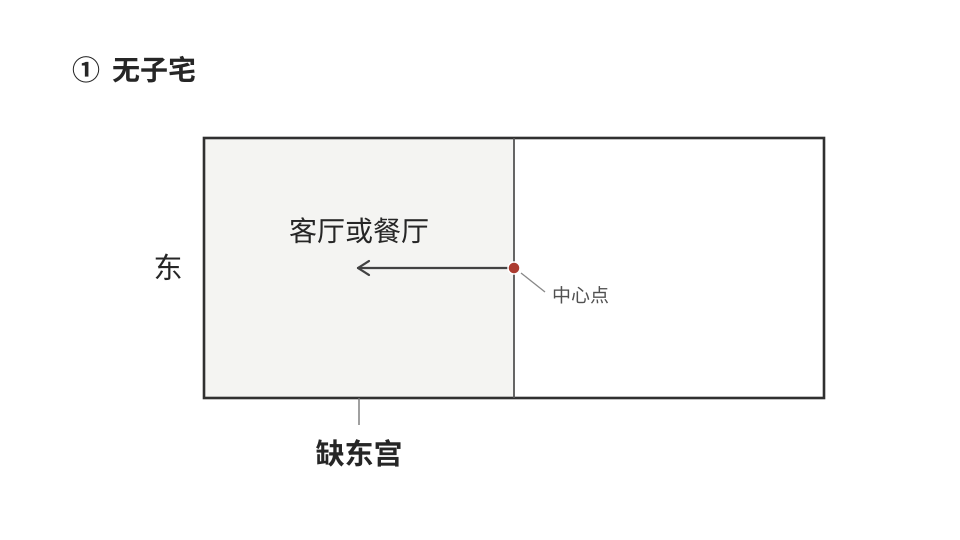 〔指代〕说「这个东边客厅」时手指的是第一张房屋图左格内的「客」字（图左侧标「东」）；说「这个第一个图」时手指的是整张第一张房屋图。（[00:54:01–00:54:03](https://www.bilibili.com/video/BV1KJsLekEfA/?p=9&t=3241)，第 97230–97300 帧） |
| **第二种无子宅：东边有房间为什么还生女儿？** | 〔口述〕第二种造成没有儿子的阳宅：东边有房间，但夫妻的床压到东边墙壁。原话「有的人呢东边有……东边有房间……结果夫妻的床好死不死……压到东边的墙壁」。（[00:54:07–00:54:16](https://www.bilibili.com/video/BV1KJsLekEfA/?p=9&t=3247)，第 97434–97709 帧） 〔口述〕拿教室举例：「我们这个房子那边是南……这里是北这里是东……如果我们这间教室里面……做夫妻的主卧房……把床靠着那个墙面的话……生下来就是女儿」。（[00:54:21–00:54:30](https://www.bilibili.com/video/BV1KJsLekEfA/?p=9&t=3261)，第 97836–98123 帧） 〔指代〕说「这里是北」时手指的是画面左上方、越过黑板左缘的教室实际方位，不是板面上的字。（[00:54:22](https://www.bilibili.com/video/BV1KJsLekEfA/?p=9&t=3262)，第 97871 帧） |
| **床压东墙的房子怎么改才能生儿子？** | 〔口述〕同样东宫有房间，把床从东墙移开，靠北或靠西就生儿子：「有的人东宫有房间……把床移开来……不要靠东边墙壁……靠北边怎么样生下来……或者靠西边生下来就是儿子」。（[00:54:33–00:54:40](https://www.bilibili.com/video/BV1KJsLekEfA/?p=9&t=3273)，第 98208–98429 帧） 〔推断〕推断：两种无子宅的差别在于，第一种是东边根本没有可睡的房间（缺东宫），第二种是东边有房间但床的位置压东墙；第二种只要挪床即可。（[00:53:45–00:54:40](https://www.bilibili.com/video/BV1KJsLekEfA/?p=9&t=3225)，第 96774–98429 帧） |
| **四合院大媳妇生子、二媳妇生不到，冤在哪？** | 〔口述〕举四合院的例子：「那个四合院同样的房子……那婆婆就说你看看……大媳妇一住进去就生儿子……娶了你二媳妇以后……你老公我二儿子跟你结婚……娶了以后你同样住那个房间……你就生不到儿子」。（[00:54:45–00:54:55](https://www.bilibili.com/video/BV1KJsLekEfA/?p=9&t=3285)，第 98562–98861 帧） 〔口述〕倪师说「其实冤枉啊」：二儿子娶媳妇时把房子重新装潢、把床搬动了，「生不到儿子就床压到东边墙壁」，结果「就二媳妇活活给婆婆整惨」。（[00:54:55–00:55:07](https://www.bilibili.com/video/BV1KJsLekEfA/?p=9&t=3295)，第 98862–99221 帧） 〔口述〕反问同一个房间为何结果不同：「同一个房间……同种人你为什么会男女混生……她生到你生不到」。（[00:55:10–00:55:14](https://www.bilibili.com/video/BV1KJsLekEfA/?p=9&t=3310)，第 99306–99431 帧） 〔推断〕推断：倪师用这个故事说明，同一房间生男生女的差别出在床的位置，不在媳妇本人。（[00:54:55–00:55:14](https://www.bilibili.com/video/BV1KJsLekEfA/?p=9&t=3295)，第 98862–99431 帧） |
| **过去婆婆怎么看人中判断媳妇能不能生？** | 〔口述〕人中宽生得好、生产平安：「那我们过去的婆婆看媳妇的时候……看这个会不会生小孩一看……女孩子的人中宽……人中要宽……生的非常好……生小孩平安」。（[00:55:16–00:55:27](https://www.bilibili.com/video/BV1KJsLekEfA/?p=9&t=3316)，第 99504–99815 帧） 〔口述〕人中窄代表难产，人中和产道有关：「人中很窄……细细一条代表……人中跟我们产道很有关系……那细细一条代表很困难难产」。（[00:55:27–00:55:33](https://www.bilibili.com/video/BV1KJsLekEfA/?p=9&t=3327)，第 99816–100007 帧） 〔口述〕没有人中就生不到儿子：「那整个平平的没有人中……根本就生不到儿子了」。（[00:55:33–00:55:36](https://www.bilibili.com/video/BV1KJsLekEfA/?p=9&t=3333)，第 100008–100103 帧） |
| **改了阳宅还生不到儿子怎么办？** | 〔口述〕有时阳宅改了也不够，还要加别的方法：「比如说我们改阳宅改了半天……搞不还要改……还有一些别的方法加进来」，并说「这个就是我们要注意的」。本块没有说是哪些方法。（[00:55:36–00:55:48](https://www.bilibili.com/video/BV1KJsLekEfA/?p=9&t=3336)，第 100104–100445 帧） |
| **算命时发现无子宅，该怎么跟客人说？** | 〔口述〕算命看到问题就马上处理：「你看我们算个命……哎她有这个问题我们马上把它解掉」。（[00:55:48–00:55:50](https://www.bilibili.com/video/BV1KJsLekEfA/?p=9&t=3348)，第 100446–100529 帧） 〔口述〕刚结婚的就先告诉她：「那如果她刚结婚我们就告诉她……你住这种房子的话……你就你的命中没有儿子……你专挑这种没有儿子的房子去住哦」。（[00:55:51–00:55:57](https://www.bilibili.com/video/BV1KJsLekEfA/?p=9&t=3351)，第 100530–100727 帧） 〔口述〕命中没有儿子的人找房子都会找到这种：「那个人很好玩一个萝卜一个坑……她的命中没有儿子……她找来的房子都是这样子……换了七八个都是这样子」。（[00:55:57–00:56:03](https://www.bilibili.com/video/BV1KJsLekEfA/?p=9&t=3357)，第 100728–100913 帧） 〔口述〕好不容易换到有东宫的，床又靠到那一边，「这个时候我们要运把她推一下就好了」。（[00:56:03–00:56:09](https://www.bilibili.com/video/BV1KJsLekEfA/?p=9&t=3363)，第 100914–101099 帧） |
| **东边是客厅没法住，怎么办？西北角是什么位置？** | 〔口述〕东边是客厅也没关系，怀孕时到客厅去：「那你说老师这边是客厅没办法住……没有关系嘛……你跑到客厅来行房就好了」。（[00:56:10–00:56:15](https://www.bilibili.com/video/BV1KJsLekEfA/?p=9&t=3370)，第 101100–101279 帧） 〔指代〕说「老师这边是客厅」的「这边」时手指的是①号房屋图左间，首字可辨为「客」。（[00:56:10](https://www.bilibili.com/video/BV1KJsLekEfA/?p=9&t=3370)，第 101114 帧） 〔口述〕住客厅只是暂时：「对不对那客厅住是暂时的嘛……你只是那一个月那三天……你哪能每天都会怀孕那么厉害……那是怪胎」。（[00:56:16–00:56:22](https://www.bilibili.com/video/BV1KJsLekEfA/?p=9&t=3376)，第 101280–101477 帧） 〔口述〕平时住西北角：「我们要住西北角的时候……这个才是夫妻一世的位置……懂不懂我意思那怀孕只是暂时」。（[00:56:22–00:56:28](https://www.bilibili.com/video/BV1KJsLekEfA/?p=9&t=3382)，第 101478–101669 帧） 〔指代〕说「这个才是夫妻一世的位置」时手指的是①号房屋图右下角新画的小方框，框内无字。（[00:56:23](https://www.bilibili.com/video/BV1KJsLekEfA/?p=9&t=3383)，第 101518 帧） |
| **在东南、东北怀孕，生男生女为什么不同？** | 〔口述〕东南边怀孕是女孩，东往北是男孩：「那你如果到东南边来怀孕的话……就是女孩子嘛……东往北怀孕就是男的嘛」。（[00:56:29–00:56:34](https://www.bilibili.com/video/BV1KJsLekEfA/?p=9&t=3389)，第 101670–101825 帧） 〔口述〕解释原因：「因为我们的阳宅上面这边东南西北……这不是这一块来看的话长女在这边……长子在这边三子在这边……所以东往北都是男的……东往南女的有没有」。（[00:56:36–00:56:47](https://www.bilibili.com/video/BV1KJsLekEfA/?p=9&t=3396)，第 101892–102227 帧） 〔指代〕说「长女在这边」「长子在这边」「三子在这边」时，粉笔分别落在板左上三格竖框的最上格、中格、最下格书写。（[00:56:41–00:56:43](https://www.bilibili.com/video/BV1KJsLekEfA/?p=9&t=3401)，第 102043–102112 帧） 〔板书〕可辨：第二张房屋图上方圆圈编号②，图左格内画了几个小方框；左边可见「东」字，部分被身体挡住；其余认不出。（[00:56:36](https://www.bilibili.com/video/BV1KJsLekEfA/?p=9&t=3396)，第 101880 帧） 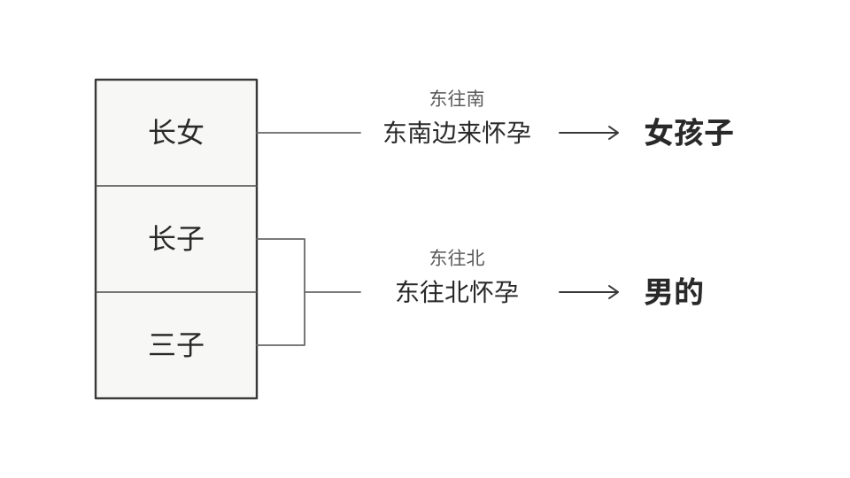 〔板书〕可辨：板左上新画一个竖长框，分成三格，格内草书认不出；下方第一张房屋图左侧「东」、左格「客」仍可见；其余重叠笔画认不出。（[00:56:46](https://www.bilibili.com/video/BV1KJsLekEfA/?p=9&t=3406)，第 102197 帧） |
| **先男后女还是先女后男？为什么说嘴巴讲没用？** | 〔口述〕顺序由人自己挑：「那你要先女后男还是先男后女……你自己挑啊」。（[00:56:47–00:56:51](https://www.bilibili.com/video/BV1KJsLekEfA/?p=9&t=3407)，第 102228–102347 帧） 〔口述〕又拿口号作对比：「这个我这个比较积极啊……至少比那个人家说的哎一男一女恰恰好……那个人家喊的口号……喊的口号都很难做到的」。（[00:56:51–00:56:59](https://www.bilibili.com/video/BV1KJsLekEfA/?p=9&t=3411)，第 102348–102587 帧） 〔口述〕全集收尾：「千万不要我们这个……嘴巴讲没有用……要实际上去体会」。（[00:56:59–00:57:04](https://www.bilibili.com/video/BV1KJsLekEfA/?p=9&t=3419)，第 102588–102741 帧） |

**总结区**

- 通用规则：站在房屋中心点看，正东边是客厅或餐厅、缺东宫，就没有儿子，睡哪一间都一样（[00:53:45–00:54:03](https://www.bilibili.com/video/BV1KJsLekEfA/?p=9&t=3225)，第 96774–97307 帧）；东边有房间但夫妻的床压到东边墙壁会生女儿；床移开、靠北或靠西就生儿子（[00:54:07–00:54:40](https://www.bilibili.com/video/BV1KJsLekEfA/?p=9&t=3247)，第 97434–98429 帧）；人中宽生产平安，人中细窄代表难产，没有人中根本生不到儿子（[00:55:16–00:55:36](https://www.bilibili.com/video/BV1KJsLekEfA/?p=9&t=3316)，第 99504–100103 帧）；东南边怀孕是女孩、东往北是男孩；东边是客厅就怀孕时暂到客厅，平时住西北角（[00:56:10–00:56:47](https://www.bilibili.com/video/BV1KJsLekEfA/?p=9&t=3370)，第 101100–102227 帧）
- 不是排盘规则，是处世方法：客人刚结婚就先告诉她住这种房子没有儿子，看到问题马上解掉（[00:55:48–00:55:57](https://www.bilibili.com/video/BV1KJsLekEfA/?p=9&t=3348)，第 100446–100727 帧）；先女后男还是先男后女让人自己挑（[00:56:47–00:56:51](https://www.bilibili.com/video/BV1KJsLekEfA/?p=9&t=3407)，第 102228–102347 帧）；嘴巴讲没有用，要实际上去体会（[00:56:59–00:57:04](https://www.bilibili.com/video/BV1KJsLekEfA/?p=9&t=3419)，第 102588–102741 帧）

**待核**

1. [00:53:35](https://www.bilibili.com/video/BV1KJsLekEfA/?p=9&t=3215)，第 96468 帧字幕「我们这个发掘台北市家庭计划」，语音「发觉台北市家庭去玩」，「发掘」用字待核。
2. [00:54:17](https://www.bilibili.com/video/BV1KJsLekEfA/?p=9&t=3257)，第 97710 帧「压到东边的墙壁要负负得正」，语音作「夫妇得正」，「负负得正」指什么本块没有解释。
3. [00:53:53](https://www.bilibili.com/video/BV1KJsLekEfA/?p=9&t=3233)，第 97014 帧起用了「东宫」一词，本块没有解释东宫的范围。
4. [00:54:42](https://www.bilibili.com/video/BV1KJsLekEfA/?p=9&t=3282)，第 98460 帧「如果我早生几千年我们中国妇女解放」，语音作「几些年」，句意不完整，与上下文接不上。
5. [00:55:01](https://www.bilibili.com/video/BV1KJsLekEfA/?p=9&t=3301)，第 99036 帧字幕原文为「就生（不）到儿子」，括号原样保留，按上下文应是「生不到」。
6. [00:55:37](https://www.bilibili.com/video/BV1KJsLekEfA/?p=9&t=3337)，第 100134 帧字幕「搞不还要改」，语音作「搞不好还要改」。
7. [00:55:42](https://www.bilibili.com/video/BV1KJsLekEfA/?p=9&t=3342)，第 100260 帧字幕「才有办法帮她生儿子」与语音「不让他生得这个就是」对不上，未收为原话；倪师说的「别的方法」具体是什么，本块没有讲。
8. [00:56:07](https://www.bilibili.com/video/BV1KJsLekEfA/?p=9&t=3367)，第 101034 帧「要运把她推一下」，「运」字所指（运用？运势？）本块没有解释。
9. [00:56:24](https://www.bilibili.com/video/BV1KJsLekEfA/?p=9&t=3384)，第 101538 帧字幕「夫妻一世的位置」，语音作「一室」，待核。
10. [00:56:36–00:56:44](https://www.bilibili.com/video/BV1KJsLekEfA/?p=9&t=3396)，第 101892–102131 帧板左上三格竖框内草书认不出，长女、长子、三子为何这样排位本块没有进一步解释。
11. [00:53:54](https://www.bilibili.com/video/BV1KJsLekEfA/?p=9&t=3234)，第 97032 帧板书标题首字草书，像「无」，未能确认；「客」后一字潦草认不出。
12. [00:53:30](https://www.bilibili.com/video/BV1KJsLekEfA/?p=9&t=3210)，第 96300 帧本块开头板面是前文留下的字（右侧可辨「大限在今年」等），与本块内容无关，不写入。
13. 指代D153（[00:53:33](https://www.bilibili.com/video/BV1KJsLekEfA/?p=9&t=3213)，第 96412 帧）、D156（[00:54:20](https://www.bilibili.com/video/BV1KJsLekEfA/?p=9&t=3260)，第 97828 帧）、D158（[00:54:23](https://www.bilibili.com/video/BV1KJsLekEfA/?p=9&t=3263)，第 97891 帧）、D161（[00:55:49](https://www.bilibili.com/video/BV1KJsLekEfA/?p=9&t=3349)，第 100477 帧）、D162（[00:56:07](https://www.bilibili.com/video/BV1KJsLekEfA/?p=9&t=3367)，第 101031 帧）、D165（[00:56:37](https://www.bilibili.com/video/BV1KJsLekEfA/?p=9&t=3397)，第 101929 帧）为否或不确定，未作依据。

