# P11 · 6 上：发旋定时辰 / 紫微在丑 / 日月反背 / 合八字 / 紫微在寅（00:00:00–00:59:39，共 107,383 帧）

> 2026-11-12 整理。依据 DeepSeek 逐帧记录与现成的五层材料（字幕、语音、叠图、板书、指代），由 Claude（Opus 5.5 子代理）分段起草，引文由程序逐段对过字幕。流程 2026-11-11 经站长认可。
> 依据标记：〔口述〕字幕与语音两路对得上的话，「」里是字幕原字 ·〔叠图〕后期贴的电子命盘，**不算倪师的话** ·〔板书〕粉笔字（看过那一帧原图才写）·〔指代〕「这里 / 这个」指哪（只收核过、确定的）·〔推断〕笔记作者自己的推断。每条后面的时间码可以点，跳到 B 站那一秒。

## 全集总结

**通用规则**

- 子午卯酉时生发旋居中或偏左，寅申巳亥时生发旋一定偏右，辰戌丑未时生一定双旋以上，左右从后面看（[00:00:16–00:01:42](https://www.bilibili.com/video/BV1KJsLekEfA/?p=11&t=16)，第 504–3089 帧）
- 命宫空而对面廉贪落陷、或廉贪落陷进命宫，叫半空折翅，属天罗地网，限在中年约 30 岁左右，有中年夭折的现象（[00:04:04–00:05:18](https://www.bilibili.com/video/BV1KJsLekEfA/?p=11&t=244)，第 7326–9563 帧）
- 杀星庙旺是看得到的杀、凶处藏吉，都会度过去；落陷是看不到、无法预测的杀、吉处藏凶，最可怕（[00:10:53–00:11:58](https://www.bilibili.com/video/BV1KJsLekEfA/?p=11&t=653)，第 19602–21563 帧）
- 太阴在辰是白天出月亮、太阳在夜间出，叫日月反背，主披星戴月、六亲不靠、性情刚躁（[00:12:20–00:13:30](https://www.bilibili.com/video/BV1KJsLekEfA/?p=11&t=740)，第 22212–24305 帧）。
- 生离还是死别看阳宅：西北是夫、西南是妇（坤），厨房主死别、客厅主生离（[00:19:12–00:19:20](https://www.bilibili.com/video/BV1KJsLekEfA/?p=11&t=1152)，第 34584–34805 帧、[00:20:11–00:20:30](https://www.bilibili.com/video/BV1KJsLekEfA/?p=11&t=1211)，第 36330–36917 帧、[00:22:03–00:22:15](https://www.bilibili.com/video/BV1KJsLekEfA/?p=11&t=1323)，第 39708–40055 帧）
- 武杀会：女子主孤单；离祖到异乡发迹，看它落在第几个大限就知几岁离家；男人武职大利；商人主劳多功少（[00:26:27–00:28:12](https://www.bilibili.com/video/BV1KJsLekEfA/?p=11&t=1587)，第 47622–50783 帧）
- 看八字一定要先看先天：先天一世夫妻的，找八字合的就可以结婚；先天二婚命的，找八字合的刚好就二婚，要找八字不合的才可以结婚（[00:37:12–00:37:53](https://www.bilibili.com/video/BV1KJsLekEfA/?p=11&t=2232)，第 66984–68219 帧）
- 紫微在寅宫时，天府一定与紫微同宫，七杀一定在对面；紫府这一端叫紫府作垣，七杀那一端叫七杀朝斗（[00:42:47–00:43:46](https://www.bilibili.com/video/BV1KJsLekEfA/?p=11&t=2567)，第 77028–78809 帧）。
- 按易经的象推：太阳陷亥是晚上出太阳，坐田宅主火灾、坐父母指爸爸、坐疾厄主眼睛不好（[00:47:33–00:49:52](https://www.bilibili.com/video/BV1KJsLekEfA/?p=11&t=2853)，第 85602–89765 帧）
- 看任何一宫都不能光看本宫，一定要看三方四正和对面；本宫没星而三方四正会出科权禄，也是大富大贵（[00:57:16–00:57:52](https://www.bilibili.com/video/BV1KJsLekEfA/?p=11&t=3436)，第 103086–104177 帧）

**只在本例**

- 本例紫微在丑（迁移己丑紫微破军），命宫在癸未、坐天相，兄弟宫在午；倪师此处称「像女孩这个命宫」（[00:05:39–00:05:52](https://www.bilibili.com/video/BV1KJsLekEfA/?p=11&t=339)，第 10194–10577 帧）
- 这个人夫妻宫廉贞贪狼（叠图夫妻辛巳，两星皆陷），婚姻会有问题、先生一定不是很好（[00:08:31–00:09:20](https://www.bilibili.com/video/BV1KJsLekEfA/?p=11&t=511)，第 15354–16817 帧）
- 本例太阴陷化忌在子女宫辰，倪师说子女宫化忌又反背，没有儿子（[00:11:58–00:13:51](https://www.bilibili.com/video/BV1KJsLekEfA/?p=11&t=718)，第 21564–24953 帧）。
- 23–32 廉贞贪狼落陷、33–42 日月反背又化忌，杀都在夫妻与子女，倪师断她这二十年婚姻不好、子女没有，32 岁那年可能想轻生（[00:14:57–00:15:58](https://www.bilibili.com/video/BV1KJsLekEfA/?p=11&t=897)，第 26934–28769 帧）。
- 本例命盘一直被说成女命，倪师在此更正「第二个八字是男的」，之后改按男命说西南角厨房死妻（[00:19:23–00:19:41](https://www.bilibili.com/video/BV1KJsLekEfA/?p=11&t=1163)，第 34908–35453 帧）
- 本例命宫天相，倪师说若给他找廉贪落陷坐命的女人，八字合就结婚会很惨烈（[00:37:38–00:37:47](https://www.bilibili.com/video/BV1KJsLekEfA/?p=11&t=2258)，第 67752–68027 帧）
- 本盘命宫若在七杀（戊申）一端，迁移宫是紫微天府，所以到边疆、威震边疆；若命宫在紫府（壬寅）一格，就在本地、待在天子旁边（[00:45:37–00:45:52](https://www.bilibili.com/video/BV1KJsLekEfA/?p=11&t=2737)，第 82122–82565 帧）。

**不是排盘规则，是处世方法**

- 客户说不清出生时辰（鸡进去睡、喂猪时生）时，不必纠缠，用看发旋来协助判断（[00:00:53–00:01:48](https://www.bilibili.com/video/BV1KJsLekEfA/?p=11&t=53)，第 1602–3251 帧）
- 同一张盘，只算命的话 23 岁前和 42 岁后来算结果一样；懂天地人三才的人在事前来算，可以让凶限二十年凭空不见，不要等事情发生了再去解（[00:15:59–00:16:44](https://www.bilibili.com/video/BV1KJsLekEfA/?p=11&t=959)，第 28770–30149 帧）。
- 不懂医就别直接告诉客户死期死因，否则对方死前多年活在阴影里；要帮他解决（[00:23:42–00:24:12](https://www.bilibili.com/video/BV1KJsLekEfA/?p=11&t=1422)，第 42660–43565 帧）
- 算命要看对方适合扮演哪个角色，把他安在那个位置上；逼不是当官料的人去当官，是害他一辈子痛苦（[00:25:37–00:26:06](https://www.bilibili.com/video/BV1KJsLekEfA/?p=11&t=1537)，第 46116–46991 帧）
- 算命只是个工具，知道哪里有问题，把缺点补上去，这才是算命的重点（[00:40:56–00:41:03](https://www.bilibili.com/video/BV1KJsLekEfA/?p=11&t=2456)，第 73686–73919 帧）

## 目录

**发旋定时辰、方位；紫微在丑例（命宫癸未天相）、廉贞四格**

1. 发旋定时、方位与紫微在丑：半空折翅（00:00:00–00:06:09）
2. 天相、紫破辅弼、廉贞杀星与庙陷（00:06:09–00:11:58）

**日月反背（本例子女宫太阴化忌）：凶限、疾厄、阳宅、父母宫**

3. 日月反背、两个凶限与疾厄脏腑（00:11:58–00:18:39）
4. 阳宅厨房客厅断生离死别，看子女父母（00:18:39–00:25:08）

**武曲七杀会（福德宫）：主孤、离祖、武职大利、商劳多功少**

5. 武曲七杀会：孤、离祖、武职、商劳（00:25:08–00:29:42）

**本例33–42大限：婚姻凶的化解、合八字与八字合**

6. 33至42婚姻凶、外面命解与合八字（00:29:42–00:36:03）
7. 合八字精义：合与不合、宫位相合（00:36:04–00:42:14）

**紫微在寅：紫府作垣、七杀朝斗、三方四正**

8. 紫微在寅：紫府作垣与七杀朝斗（00:42:14–00:47:02）

**紫微在寅（续）：太阳在亥用象批、武曲贪狼入庙、巨门化忌**

9. 太阳陷亥逐宫象批与武贪入庙（00:47:02–00:53:23）
10. 教子、武曲落宫、看流年与巨门化忌（00:53:23–00:59:39）

## 发旋定时辰、方位；紫微在丑例（命宫癸未天相）、廉贞四格

| 巳 | 午 | 未 | 申 |
|---|---|---|---|
| **夫妻 辛巳** 廉贞陷 贪狼陷 | **兄弟 壬午** 巨门旺 文昌陷 | **命宫 癸未** 天相得 火星利 地空平 | **父母 甲申** 天同旺 天梁陷权 文曲得 天钺庙 |
| **子女 庚辰** 太阴陷忌 擎羊庙 | **发旋定时辰、方位；紫微在丑例 · 命宫癸未** | 据视频叠图重排 | （酉：没贴过） |
| **财帛 己卯**（身宫） 天府得 禄存庙 地劫平 | 后期贴图，不算倪师的话 |  | （戌：没贴过） |
| **疾厄 戊寅** 陀罗陷 铃星庙 | **迁移 己丑** 紫微庙科 破军旺 左辅庙 右弼庙 | （子：没贴过） | **官禄（宫序推） 丁亥** 天马平 |

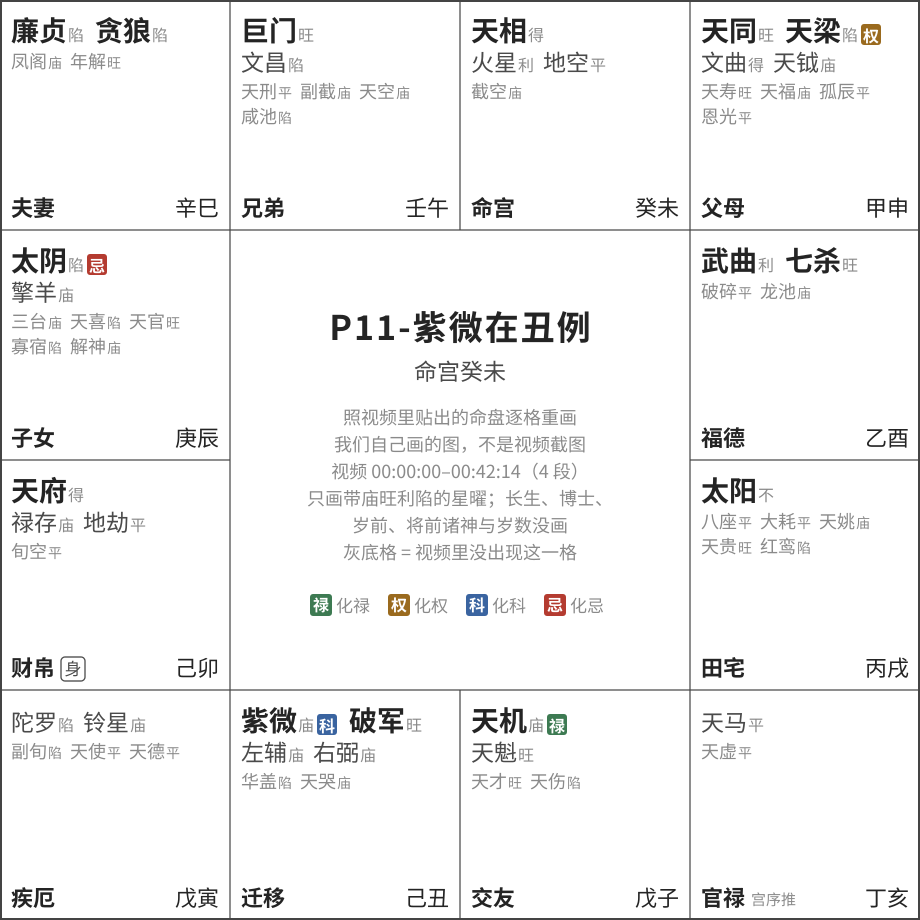

按视频里这张盘逐格重画（我们自己画的图，不是视频截图）；同一个人的 4 段合成一张；标「宫序推」的格（亥），视频里只以别的宫名演示贴过，宫名按宫序推出；数据见 [命盘-P11-紫微在丑例.json](图/命盘-P11-紫微在丑例.json)。

### 1　发旋定时、方位与紫微在丑：半空折翅（[00:00:00–00:06:09](https://www.bilibili.com/video/BV1KJsLekEfA/?p=11&t=0)，第 0–11093 帧）

| 提示区 | 笔记区 |
|---|---|
| **不同时辰出生，发旋各是什么样？** | 〔口述〕讲下一张盘之前，倪师先给出三组时辰与发旋的对应：「我们叫做子午卯酉」「偏左或者是居中」；「寅申巳亥呢」「叫做偏右」；「那辰戌丑未」「双旋以上」。（[00:00:16–00:00:53](https://www.bilibili.com/video/BV1KJsLekEfA/?p=11&t=16)，第 504–1601 帧） 〔口述〕后面又重讲一遍：「如果发旋你是子午卯酉时生的话」「发旋是中央或者是中央偏左」；寅申巳亥时生的，「发旋一定偏右」。（[00:01:22–00:01:33](https://www.bilibili.com/video/BV1KJsLekEfA/?p=11&t=82)，第 2460–2795 帧） 〔口述〕所说的偏左偏右，是「从后边看」的左右。（[00:01:33–00:01:37](https://www.bilibili.com/video/BV1KJsLekEfA/?p=11&t=93)，第 2796–2939 帧） 〔口述〕辰戌丑未时生的，「一定是发双旋两个旋以上」，「有的人三个旋以上」。（[00:01:38–00:01:42](https://www.bilibili.com/video/BV1KJsLekEfA/?p=11&t=98)，第 2940–3089 帧） 〔板书〕可辨：板右竖写「辰戌丑」，下面一字像「未」、再下一字像「双」；其左一列可辨「寅申巳」；命盘里可辨「午」。其余认不出。（[00:00:48](https://www.bilibili.com/video/BV1KJsLekEfA/?p=11&t=48)，第 1440 帧） |
| **客户说不清出生时辰，怎么办？** | 〔口述〕有时客户「八字搞不清楚」：「他说五点钟左右生的」「或者是我家鸡进去睡觉时我生的」，「这什么什么答案都有」。（[00:00:56–00:01:05](https://www.bilibili.com/video/BV1KJsLekEfA/?p=11&t=56)，第 1680–1967 帧） 〔口述〕还有人说「他说我爸早上去喂猪的时候我生的」，倪师开玩笑说「那我怎么知道你家鸡进去睡了」。（[00:01:08–00:01:15](https://www.bilibili.com/video/BV1KJsLekEfA/?p=11&t=68)，第 2046–2261 帧） 〔口述〕办法是「我们有一种方法」「就看后面的发旋」，用发旋「来协助我们判断出生的时间的关系」。（[00:01:19–00:01:48](https://www.bilibili.com/video/BV1KJsLekEfA/?p=11&t=79)，第 2376–3251 帧） |
| **十二时辰的正向方位怎么对？** | 〔口述〕「还有这是第一个」「第二个呢」「我们方位上的问题」——讲完发旋，接着讲方位。（[00:01:48–00:01:55](https://www.bilibili.com/video/BV1KJsLekEfA/?p=11&t=108)，第 3252–3479 帧） 〔口述〕「方位呢我们正向」，「子时呢正北」；同一句的语音里还依次听到正东、正南、正西，字幕栏只收了子时一句。（[00:01:56–00:02:10](https://www.bilibili.com/video/BV1KJsLekEfA/?p=11&t=116)，第 3480–3905 帧） 〔口述〕「诸位只要知道正向就好了」，「八字上面正向」。（[00:02:10–00:02:15](https://www.bilibili.com/video/BV1KJsLekEfA/?p=11&t=130)，第 3906–4079 帧） 〔板书〕可辨：命盘内「午」「卯」，「卯」那格左边写「東」；板左竖写两字像「方位」，后带冒号；板右竖写可辨「午卯酉偏左」，最上一字认不出。其余认不出。（[00:02:02](https://www.bilibili.com/video/BV1KJsLekEfA/?p=11&t=122)，第 3670 帧） 〔板书〕可辨：同前的「東」「卯」「午」，新多出一条从「東」旁斜穿命盘的直线。其余认不出。（[00:02:11](https://www.bilibili.com/video/BV1KJsLekEfA/?p=11&t=131)，第 3953 帧） |
| **八字合到阳宅上，看几个宫？** | 〔口述〕「可是我们实际上在运用阳宅的时候」「我们需要知道12个宫」。（[00:02:16–00:02:21](https://www.bilibili.com/video/BV1KJsLekEfA/?p=11&t=136)，第 4080–4235 帧） 〔口述〕这十二个宫就是地支宫：「子丑寅卯辰巳午未申酉戌亥」。（[00:02:21–00:02:25](https://www.bilibili.com/video/BV1KJsLekEfA/?p=11&t=141)，第 4236–4379 帧） 〔口述〕「我们把八字合到阳宅上面去看的时候」「只看这12个宫而已」。（[00:02:26–00:02:31](https://www.bilibili.com/video/BV1KJsLekEfA/?p=11&t=146)，第 4380–4535 帧） |
| **罗经上的二十四个只用十二个，其余做什么？** | 〔口述〕「我会让诸位去买罗盘」，「这罗经买回来的时候」「我们有上面有24个分金煞」。（[00:02:34–00:02:40](https://www.bilibili.com/video/BV1KJsLekEfA/?p=11&t=154)，第 4632–4817 帧） 〔口述〕「那实际上我们真的在阳宅上面用了」「用了12个」，「方位上面就用了12」。（[00:02:40–00:02:45](https://www.bilibili.com/video/BV1KJsLekEfA/?p=11&t=160)，第 4818–4973 帧） 〔口述〕「那其他多余的都是我们看风水用的」：「看阴宅山川河流啊」，看房子在整个大自然界的位置，「这要看风水」。（[00:02:45–00:02:56](https://www.bilibili.com/video/BV1KJsLekEfA/?p=11&t=165)，第 4974–5303 帧） 〔口述〕「房子室内的布局就要看地理」，「看阳宅看室内」。（[00:02:56–00:03:03](https://www.bilibili.com/video/BV1KJsLekEfA/?p=11&t=176)，第 5304–5513 帧） |
| **四正之外的四个角，各是什么方向？** | 〔口述〕「往下以此类推」，子午卯酉之外，「你刚好这边是东南西南西北东北」，「这是方向」。（[00:03:03–00:03:16](https://www.bilibili.com/video/BV1KJsLekEfA/?p=11&t=183)，第 5514–5891 帧） 〔指代〕说「这边是东南」的「这边」时，手掌按在黑板命盘左上角那一格（「午」那格左边一格），那一格没有字。（[00:03:06](https://www.bilibili.com/video/BV1KJsLekEfA/?p=11&t=186)，第 5580 帧） 〔推断〕推断：西南、西北、东北三个方向在本块没有确定的指代，对应命盘哪一格，材料里看不出。（[00:03:05–00:03:08](https://www.bilibili.com/video/BV1KJsLekEfA/?p=11&t=185)，第 5568–5651 帧） |
| **紫微在丑宫，旁边一定跟着哪颗星？** | 〔口述〕「诸位来看第二个」，讲「紫微星在什么丑宫」；「那紫微星在丑宫出现的时候」「其他诸星都一样」。（[00:03:16–00:03:31](https://www.bilibili.com/video/BV1KJsLekEfA/?p=11&t=196)，第 5892–6359 帧） 〔口述〕「但是如果紫微星在这边的话」「一定是跟到破军」；「紫微星在这个宫的话」「旁边一定是跟到破军」。（[00:03:38–00:03:43](https://www.bilibili.com/video/BV1KJsLekEfA/?p=11&t=218)，第 6540–6719 帧） 〔指代〕说「紫微星在这边」「在这个宫」时，手指的是黑板命盘下排左起第二格、写有「紫微」的那一格。（[00:03:38–00:03:40](https://www.bilibili.com/video/BV1KJsLekEfA/?p=11&t=218)，第 6567–6625 帧） 〔叠图〕迁移 己丑：紫微庙、化科，破军旺，同宫有左辅庙、右弼庙、天哭庙、华盖陷；大限 63~72，小限 7,19,31,43,55,67。（[00:03:22–00:03:25](https://www.bilibili.com/video/BV1KJsLekEfA/?p=11&t=202)，第 6066–6179 帧） 〔口述〕其余星也照样排：「旁边这边陀罗啊」「天府啊太阴啊」「其他都一样的」。叠图同时显示疾厄戊寅陀罗陷、财帛己卯天府得（标身宫，有禄存庙）、子女庚辰太阴陷。（[00:03:44–00:03:51](https://www.bilibili.com/video/BV1KJsLekEfA/?p=11&t=224)，第 6720–6959 帧） |
| **四化也跟着星盘固定吗？** | 〔口述〕不固定：「科权禄忌呢」「完全是要看八字」，「不一定都在都在」「永远都在一起」——意思是四化不一定永远跟着同样的星。（[00:03:32–00:03:37](https://www.bilibili.com/video/BV1KJsLekEfA/?p=11&t=212)，第 6360–6539 帧） 〔叠图〕本盘叠图里，迁移己丑的紫微带「科」，子女庚辰的太阴带「忌」。（[00:03:22–00:03:45](https://www.bilibili.com/video/BV1KJsLekEfA/?p=11&t=202)，第 6066–6755 帧） 〔推断〕推断：按倪师的话，这里紫微化科、太阴化忌是这张八字定的，另一个紫微在丑的人不一定相同。（[00:03:32–00:03:45](https://www.bilibili.com/video/BV1KJsLekEfA/?p=11&t=212)，第 6360–6755 帧） |
| **假设命宫是空的、对面廉贪落陷，是什么样？** | 〔口述〕倪师先放下例盘：「首先我们先不要看我们现在的例」，改作假设，「假设命宫在这里」。（[00:03:52–00:04:04](https://www.bilibili.com/video/BV1KJsLekEfA/?p=11&t=232)，第 6978–7325 帧） 〔指代〕说「先不要看命宫在这里」的「这里」时，手按在板顶一排右侧写「命」的格子；随后说「命宫在这里」时，手伸到板右下格，碰着那里写的「命」并圈起来。（[00:04:01–00:04:06](https://www.bilibili.com/video/BV1KJsLekEfA/?p=11&t=241)，第 7249–7397 帧） 〔口述〕「我们常常算到一种人的命」，命宫「本身是一个空的」，「对面是廉贪」。（[00:04:04–00:04:12](https://www.bilibili.com/video/BV1KJsLekEfA/?p=11&t=244)，第 7326–7583 帧） 〔叠图〕命宫 丁亥：格内标「无吉星」「空的」，有天马平、天虚平、岁破、岁驿、病符、长生；大限 43~52。（[00:04:04–00:04:07](https://www.bilibili.com/video/BV1KJsLekEfA/?p=11&t=244)，第 7326–7415 帧） 〔叠图〕夫妻 辛巳：廉贞陷、贪狼陷，凤阁庙、年解旺；大限 103~112。说「这个是」时，持粉笔的手按在黑板左上角那一格。（[00:04:09–00:04:12](https://www.bilibili.com/video/BV1KJsLekEfA/?p=11&t=249)，第 7494–7583 帧） |
| **廉贪落陷跑进命宫也算吗？这格局叫什么？** | 〔口述〕「这个是廉贞贪狼」「都落陷都在这两个位置上」；「廉贞贪狼落陷不单单在这边」，「如果有一天廉贞贪狼跑到这边来」「也是属于廉贪落陷」。（[00:04:12–00:04:30](https://www.bilibili.com/video/BV1KJsLekEfA/?p=11&t=252)，第 7584–8123 帧） 〔指代〕说「不单单在这边」时，手按在黑板左上角方框格的下沿；说「跑到这边来」时，手伸到板右下格、画了圈的「命」那里。（[00:04:23–00:04:26](https://www.bilibili.com/video/BV1KJsLekEfA/?p=11&t=263)，第 7907–7989 帧） 〔叠图〕右下叠图宫名标「命宫 丁亥」，格内却是廉贞陷、贪狼陷、凤阁庙、年解旺、大限 103~112，与前面夫妻辛巳那格的内容相同。（[00:04:24–00:04:30](https://www.bilibili.com/video/BV1KJsLekEfA/?p=11&t=264)，第 7944–8123 帧） 〔口述〕「这个有个特别一个格局」「我给它叫半空折翅」，「以后我们会举很多案例批给你看」。（[00:04:30–00:04:43](https://www.bilibili.com/video/BV1KJsLekEfA/?p=11&t=270)，第 8124–8495 帧） 〔板书〕可辨：板左竖写「半空折翅」四字；命盘左上方框里可辨「廉」「命」，其余认不出；上排可辨「午」和圈起来的「命」。（[00:04:40](https://www.bilibili.com/video/BV1KJsLekEfA/?p=11&t=280)，第 8428 帧） |
| **半空折翅在算命上属什么？应在几岁？** | 〔口述〕「这种八字在算命的立场上」「就是属于一种天罗地网」。（[00:04:44–00:04:51](https://www.bilibili.com/video/BV1KJsLekEfA/?p=11&t=284)，第 8544–8759 帧） 〔口述〕「那限在中年」；「什么叫中年限呢」，「30岁左右看他流年的时候」。（[00:04:52–00:05:02](https://www.bilibili.com/video/BV1KJsLekEfA/?p=11&t=292)，第 8760–9071 帧） 〔口述〕「我这边只是个大概的原则」：「有的人在29岁就发生」，有的在30、31、32岁，「不一定」。（[00:05:02–00:05:09](https://www.bilibili.com/video/BV1KJsLekEfA/?p=11&t=302)，第 9072–9275 帧） 〔板书〕可辨：「半空折翅」右边竖写「天罗地网」，下方有圈起来的「30」；「天罗地网」下面还有两三个字，像「中年」，不能确认。（[00:05:00](https://www.bilibili.com/video/BV1KJsLekEfA/?p=11&t=300)，第 9020 帧） |
| **碰到这个格局，中年会出什么事？** | 〔口述〕「但是基本上诸位只要看到廉贪」，「如果他的命宫在这里」「或者是命宫在这里」「廉贪在对面」，「这就是一个格局」。（[00:05:09–00:05:15](https://www.bilibili.com/video/BV1KJsLekEfA/?p=11&t=309)，第 9276–9461 帧） 〔口述〕这种属于中年会有夭折的现象（字幕作「天折」，语音转写作夭折）。（[00:05:15–00:05:18](https://www.bilibili.com/video/BV1KJsLekEfA/?p=11&t=315)，第 9462–9563 帧） 〔口述〕倪师说看过很多，一种是「有一种呢是身体上先天带的一些病症」，「然后到那个时候发病死掉」。（[00:05:19–00:05:26](https://www.bilibili.com/video/BV1KJsLekEfA/?p=11&t=319)，第 9588–9785 帧） 〔口述〕另一种「是他完全没有病」「而是环境造成他」，「周围也没有人要伤害他」，结果「他自杀了」。（[00:05:26–00:05:32](https://www.bilibili.com/video/BV1KJsLekEfA/?p=11&t=326)，第 9786–9971 帧） 〔口述〕「案例我们会陆续举」，「碰到这个非常的不好」。（[00:05:34–00:05:39](https://www.bilibili.com/video/BV1KJsLekEfA/?p=11&t=334)，第 10020–10193 帧） |
| **回到本例：命宫在哪、兄弟宫在哪？** | 〔口述〕「那如果按照他的命来看的话」「你看他的命宫」「他的兄弟宫在这边」。（[00:05:39–00:05:44](https://www.bilibili.com/video/BV1KJsLekEfA/?p=11&t=339)，第 10194–10331 帧） 〔指代〕说「他的兄弟宫在这边」时，食指点在黑板上排写「午」的那一格。（[00:05:43](https://www.bilibili.com/video/BV1KJsLekEfA/?p=11&t=343)，第 10316 帧） 〔口述〕「像女孩这个命宫呢」「她是天相」；「首先诸位看这个人的命宫」「如果命宫在这里」「她是天相」。（[00:05:44–00:05:52](https://www.bilibili.com/video/BV1KJsLekEfA/?p=11&t=344)，第 10332–10577 帧） 〔指代〕说「如果命宫在这里」时，粉笔点在黑板上排圈着「命」字的那一格。（[00:05:49](https://www.bilibili.com/video/BV1KJsLekEfA/?p=11&t=349)，第 10494 帧） 〔叠图〕命宫 癸未：天相得，火星利、地空平、截空庙、蜚廉；墓；将军、月煞、丧门；大限 3~12，小限 1,13,25,37,49,61。（[00:05:46–00:05:47](https://www.bilibili.com/video/BV1KJsLekEfA/?p=11&t=346)，第 10380–10433 帧） |
| **为什么说女孩子天相最好？天相是什么星？** | 〔口述〕「那一般来说的话」「我们算命的时候女孩子是天相星最好」。（[00:05:52–00:05:57](https://www.bilibili.com/video/BV1KJsLekEfA/?p=11&t=352)，第 10578–10721 帧） 〔口述〕「天相是什么」「天上的宰相」，「是非常好的良佐」「辅佐的人才」。（[00:05:57–00:06:02](https://www.bilibili.com/video/BV1KJsLekEfA/?p=11&t=357)，第 10722–10877 帧） 〔口述〕「所以天相呢」「一定是位高无权」。本块到此为止，天相的话下一块接着讲。（[00:06:02–00:06:09](https://www.bilibili.com/video/BV1KJsLekEfA/?p=11&t=362)，第 10878–11093 帧） 〔板书〕可辨：上排圈「命」那一格的上方写着「天相」两字。其余认不出。（[00:05:50](https://www.bilibili.com/video/BV1KJsLekEfA/?p=11&t=350)，第 10500 帧） 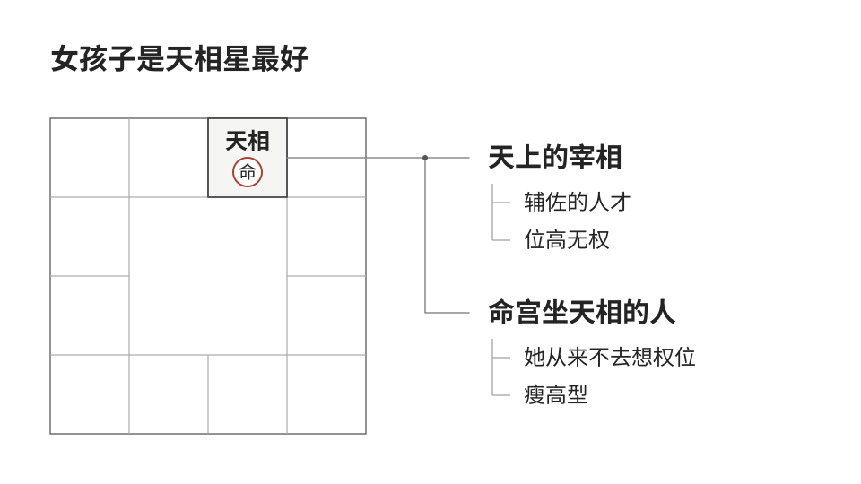 〔板书〕板右上角新写一列竖字，下面一字像「高」，其余认不出。（[00:06:07](https://www.bilibili.com/video/BV1KJsLekEfA/?p=11&t=367)，第 11016 帧） |

**总结区**

- 通用规则：子午卯酉时生发旋居中或偏左，寅申巳亥时生发旋一定偏右，辰戌丑未时生一定双旋以上，左右从后面看（[00:00:16–00:01:42](https://www.bilibili.com/video/BV1KJsLekEfA/?p=11&t=16)，第 504–3089 帧）；紫微在丑宫，旁边一定跟着破军，其他诸星都一样，但科权禄忌要看八字（[00:03:29–00:03:43](https://www.bilibili.com/video/BV1KJsLekEfA/?p=11&t=209)，第 6270–6719 帧）；命宫空而对面廉贪落陷、或廉贪落陷进命宫，叫半空折翅，属天罗地网，限在中年约 30 岁左右，有中年夭折的现象（[00:04:04–00:05:18](https://www.bilibili.com/video/BV1KJsLekEfA/?p=11&t=244)，第 7326–9563 帧）；算命时女孩子天相星最好，天相是天上的宰相、辅佐的人才，一定位高无权（[00:05:52–00:06:09](https://www.bilibili.com/video/BV1KJsLekEfA/?p=11&t=352)，第 10578–11093 帧）
- 只在本例：本例紫微在丑（迁移己丑紫微破军），命宫在癸未、坐天相，兄弟宫在午；倪师此处称「像女孩这个命宫」（[00:05:39–00:05:52](https://www.bilibili.com/video/BV1KJsLekEfA/?p=11&t=339)，第 10194–10577 帧）；讲半空折翅时的命宫丁亥是「假设命宫在这里」的示范，不是本例命宫（[00:03:52–00:04:30](https://www.bilibili.com/video/BV1KJsLekEfA/?p=11&t=232)，第 6978–8123 帧）
- 不是排盘规则，是处世方法：客户说不清出生时辰（鸡进去睡、喂猪时生）时，不必纠缠，用看发旋来协助判断（[00:00:53–00:01:48](https://www.bilibili.com/video/BV1KJsLekEfA/?p=11&t=53)，第 1602–3251 帧）

**待核**

1. 性别：[00:05:44](https://www.bilibili.com/video/BV1KJsLekEfA/?p=11&t=344)，第 10332 帧「像女孩这个命宫呢」及其后「她是天相」，倪师约 19:26（第 4 块）自己改正「第二个八字是男的」；本块照原话写，以更正为准。
2. 改过的错字：[00:01:29](https://www.bilibili.com/video/BV1KJsLekEfA/?p=11&t=89)，第 2688 帧「寅申已亥」→巳；[00:01:33](https://www.bilibili.com/video/BV1KJsLekEfA/?p=11&t=93)，第 2796 帧「偏左偏有」→偏右；[00:01:38](https://www.bilibili.com/video/BV1KJsLekEfA/?p=11&t=98)，第 2940 帧「辰成丑未」→戌；[00:01:43](https://www.bilibili.com/video/BV1KJsLekEfA/?p=11&t=103)，第 3090 帧「法旋」→发旋；[00:02:21](https://www.bilibili.com/video/BV1KJsLekEfA/?p=11&t=141)，第 4236 帧「地之宫」→地支宫；[00:03:04](https://www.bilibili.com/video/BV1KJsLekEfA/?p=11&t=184)，第 5544 帧「子午卯西」→酉；[00:04:00](https://www.bilibili.com/video/BV1KJsLekEfA/?p=11&t=240)，第 7224 帧、[00:04:07](https://www.bilibili.com/video/BV1KJsLekEfA/?p=11&t=247)，第 7416 帧「命官」→命宫；[00:05:15](https://www.bilibili.com/video/BV1KJsLekEfA/?p=11&t=315)，第 9462 帧「天折」→夭折（语音作「夭折」）。这些错字都没有放进引号。
3. [00:01:58](https://www.bilibili.com/video/BV1KJsLekEfA/?p=11&t=118)，第 3552 帧：字幕栏只认出「子时呢正北」，语音里依次有正东、正南、正西；板书图[00:02:02](https://www.bilibili.com/video/BV1KJsLekEfA/?p=11&t=122)，第 3670 帧画面上的字幕是「午时呢 正南」。卯时、午时、酉时那几句的字幕原文待核。
4. [00:02:37](https://www.bilibili.com/video/BV1KJsLekEfA/?p=11&t=157)，第 4716 帧「24个分金煞」：语音作「分金上」，「煞」字待核；这二十四个具体指什么，本块没解释。
5. [00:02:31](https://www.bilibili.com/video/BV1KJsLekEfA/?p=11&t=151)，第 4536 帧「罗盘以后会高到一定程度」：「高」字意思不明，疑为同音错字，待核。
6. [00:02:55–00:03:03](https://www.bilibili.com/video/BV1KJsLekEfA/?p=11&t=175)，第 5250–5513 帧：「这要看风水」与「房子室内的布局就要看地理」的分工，倪师没进一步解释；[00:02:48](https://www.bilibili.com/video/BV1KJsLekEfA/?p=11&t=168)，第 5058 帧「阴宅」语音作「阴仔」。
7. [00:05:06](https://www.bilibili.com/video/BV1KJsLekEfA/?p=11&t=306)，第 9186 帧字幕「30岁3132岁」丢了分隔，按语音「三十岁三十一三十二岁」理解。
8. [00:03:32–00:03:37](https://www.bilibili.com/video/BV1KJsLekEfA/?p=11&t=212)，第 6360–6539 帧「不一定都在都在永远都在一起」句子不完整，句意按上下文理解为四化不一定永远在一起，待核。
9. 叠图：[00:04:24–00:04:30](https://www.bilibili.com/video/BV1KJsLekEfA/?p=11&t=264)，第 7944–8123 帧右下叠图宫名标「命宫 丁亥」，格内却是夫妻辛巳的内容（廉贞陷、贪狼陷、凤阁、年解、103~112）；[00:04:04](https://www.bilibili.com/video/BV1KJsLekEfA/?p=11&t=244)，第 7326 帧起那张命宫丁亥是「空的」。推断是后期跟着「跑到这边来」把廉贪挪进命宫示意，不是换命例。
10. 叠图：[00:04:04](https://www.bilibili.com/video/BV1KJsLekEfA/?p=11&t=244)，第 7326 帧命宫丁亥的岁数串「4352、455769、92133」，按图例还原为大限 43~52、小限 9,21,33,45,57,69，小限未写入笔记，待看原图。[00:03:52](https://www.bilibili.com/video/BV1KJsLekEfA/?p=11&t=232)，第 6978 帧命宫癸未首次出现时岁数串有缺字（「3□4961、□1325」），以[00:05:46](https://www.bilibili.com/video/BV1KJsLekEfA/?p=11&t=346)，第 10380 帧完整版为准。
11. 指代看不出或不确定：[00:01:35](https://www.bilibili.com/video/BV1KJsLekEfA/?p=11&t=95)，第 2850 帧、[00:01:35](https://www.bilibili.com/video/BV1KJsLekEfA/?p=11&t=95)，第 2878 帧「这边是左」手比在自己头上；[00:03:56](https://www.bilibili.com/video/BV1KJsLekEfA/?p=11&t=236)，第 7102 帧、[00:03:58](https://www.bilibili.com/video/BV1KJsLekEfA/?p=11&t=238)，第 7149 帧「命宫是在这里」「这个」；[00:04:03](https://www.bilibili.com/video/BV1KJsLekEfA/?p=11&t=243)，第 7308 帧「假设命宫在这里」；[00:05:11](https://www.bilibili.com/video/BV1KJsLekEfA/?p=11&t=311)，第 9352 帧、[00:05:12](https://www.bilibili.com/video/BV1KJsLekEfA/?p=11&t=312)，第 9388 帧「如果他的命宫在这里」「或者是命宫在这里」两处所指格位不确定；[00:05:36](https://www.bilibili.com/video/BV1KJsLekEfA/?p=11&t=336)，第 10081 帧、[00:05:37](https://www.bilibili.com/video/BV1KJsLekEfA/?p=11&t=337)，第 10114 帧「这个格」；[00:03:26](https://www.bilibili.com/video/BV1KJsLekEfA/?p=11&t=206)，第 6209 帧、[00:03:44](https://www.bilibili.com/video/BV1KJsLekEfA/?p=11&t=224)，第 6725 帧「紫微星在这里」「这边陀罗」。
12. 板书认不出：[00:00:32](https://www.bilibili.com/video/BV1KJsLekEfA/?p=11&t=32)，第 960 帧只认出「午」「酉」「卯」和右侧被挡住的「寅申巳」；[00:00:52](https://www.bilibili.com/video/BV1KJsLekEfA/?p=11&t=52)，第 1565 帧右列下方新写的字认不出；[00:03:44](https://www.bilibili.com/video/BV1KJsLekEfA/?p=11&t=224)，第 6732 帧大半被叠图和讲者挡住，只认得「午」；[00:04:31](https://www.bilibili.com/video/BV1KJsLekEfA/?p=11&t=271)，第 8156 帧、[00:04:40](https://www.bilibili.com/video/BV1KJsLekEfA/?p=11&t=280)，第 8428 帧左上方框里除「廉」「命」外认不出（指代标注作「廉贞 命宫」）；下排左起第二格的草书只认得像「紫」的字，指代标注作「紫微」；[00:05:00](https://www.bilibili.com/video/BV1KJsLekEfA/?p=11&t=300)，第 9020 帧「天罗地网」下方字像「中年」，不能确认；[00:06:07](https://www.bilibili.com/video/BV1KJsLekEfA/?p=11&t=367)，第 11016 帧右上新写的竖字只认得像「高」的一字。
13. [00:05:59](https://www.bilibili.com/video/BV1KJsLekEfA/?p=11&t=359)，第 10770 帧「良佐」：语音作「两者」，按字幕。

### 2　天相、紫破辅弼、廉贞杀星与庙陷（[00:06:09–00:11:58](https://www.bilibili.com/video/BV1KJsLekEfA/?p=11&t=369)，第 11094–21563 帧）

| 提示区 | 笔记区 |
|---|---|
| **命宫坐天相的人是什么性情、什么体型？** | 〔口述〕承接前文天相的话题，倪师说命宫坐天相的人不求权位，只是好的辅佐人才：「命宫坐天相的人」「她从来不去想权位」「她只是很好」「她是很好的辅佐的人才」。（[00:06:11–00:06:19](https://www.bilibili.com/video/BV1KJsLekEfA/?p=11&t=371)，第 11148–11393 帧） 〔口述〕讲天相的体型：「然后天相的人呢」「一定比较瘦高型」「瘦瘦高高型高挑型」。（[00:06:21–00:06:25](https://www.bilibili.com/video/BV1KJsLekEfA/?p=11&t=381)，第 11436–11579 帧） 〔叠图〕此时叠图为命宫癸未：天相得、火星利、地空平、截空庙、蜚廉；将军、月煞、丧门；墓；大限 3~12，小限 1,13,25,37,49,61。（[00:06:09–00:06:11](https://www.bilibili.com/video/BV1KJsLekEfA/?p=11&t=369)，第 11094–11147 帧） 〔板书〕黑板右侧竖长椭圆内，可辨「位」「高」二字，下面两字潦草，其余认不出。（[00:06:15](https://www.bilibili.com/video/BV1KJsLekEfA/?p=11&t=375)，第 11277 帧） |
| **天相落在 45-54 那一格，这十年怎么批？** | 〔口述〕倪师假设：「如果你算命的时候」「有一个人的呢」「天相星在这边」「结果是45-54岁」「她的本宫就是天相」「意思就是说45-54她十年中间」「她就是这种位高无权的形象」。（[00:06:29–00:06:43](https://www.bilibili.com/video/BV1KJsLekEfA/?p=11&t=389)，第 11682–12095 帧） 〔指代〕说「天相星在这边」时，右手粉笔落在黑板上排「午」右侧那一格的圈字下方，随后在该格写出 45-54。（[00:06:33](https://www.bilibili.com/video/BV1KJsLekEfA/?p=11&t=393)，第 11790–11807 帧） 〔叠图〕同一格的宫名改标为财帛宫癸未，星曜同上（天相得等），大限 45~54。黑板上未写宫名。（[00:06:33–00:06:35](https://www.bilibili.com/video/BV1KJsLekEfA/?p=11&t=393)，第 11808–11879 帧） 〔口述〕举例说明位高无权：「比如说她干了人事部副总监」「都干不到正总监」「她干副经理」「老是干老是干副的」。（[00:06:43–00:06:49](https://www.bilibili.com/video/BV1KJsLekEfA/?p=11&t=403)，第 12096–12293 帧） |
| **星的性质只管命宫吗？大限、流年遇到怎么办？** | 〔口述〕倪师说不只命宫这样：「所以这不单单是这样」「你要以此类推」「你不能说这个宫」……「就是命宫是这样子」「实际上如果进入流年遇到这个」「也是以此类推这样子批的」。（[00:06:49–00:06:59](https://www.bilibili.com/video/BV1KJsLekEfA/?p=11&t=409)，第 12294–12575 帧） 〔指代〕说「你不能说这个宫」时整只手掌按在上排写有 45-54 的那一格；说「遇到这个」时右手食指又点向同一格。（[00:06:52–00:06:57](https://www.bilibili.com/video/BV1KJsLekEfA/?p=11&t=412)，第 12378–12521 帧） 〔口述〕强调要活用：「所以批八字要活用」「你如果光看书看不了的没有用的」。（[00:07:01–00:07:06](https://www.bilibili.com/video/BV1KJsLekEfA/?p=11&t=421)，第 12642–12797 帧） |
| **紫微破军逢左辅右弼在命宫，主什么？** | 〔口述〕换一个格：「那如果是紫微破军在这边呢」「如果是命宫在这边」，又说「紫微星要逢到左辅右弼」「这个人就有左辅右弼在命的看到没有」。（[00:07:08–00:07:21](https://www.bilibili.com/video/BV1KJsLekEfA/?p=11&t=428)，第 12858–13241 帧） 〔指代〕说「紫微破军在这边」「命宫在这边」时，粉笔点在黑板下排画圈写「紫微 破军」的那一格及其圈下的小圈；说「光管这个宫」时沿该格边框描画圈定整格；说「左辅还是右弼都在这边」时在同格圈右侧竖写「左辅」「右」。（[00:07:10–00:07:31](https://www.bilibili.com/video/BV1KJsLekEfA/?p=11&t=430)，第 12906–13553 帧） 〔叠图〕叠图为命宫己丑：紫微庙化科、破军旺、左辅庙、右弼庙、天哭庙、华盖陷；伏兵、华盖、白虎；冠带；大限 3~12，小限 7,19,31,43,55,67。（[00:07:08–00:07:11](https://www.bilibili.com/video/BV1KJsLekEfA/?p=11&t=428)，第 12858–12947 帧） 〔口述〕只看宫内星曜组合：「我们不要管什么命宫」「光管这个宫是紫微破军还是左辅右弼」；结论「我们知道紫微星碰到辅弼星」「非常好非常的贵」。（[00:07:24–00:07:37](https://www.bilibili.com/video/BV1KJsLekEfA/?p=11&t=444)，第 13320–13727 帧） 〔板书〕可辨：下排一格内圈起的「紫微」「破军」，圈外右侧加写的竖字形近「左辅」「右弼」但认不全；黑板左侧竖写可辨「天罗地网」「半空折翅」。其余认不出。（[00:07:32](https://www.bilibili.com/video/BV1KJsLekEfA/?p=11&t=452)，第 13566 帧） 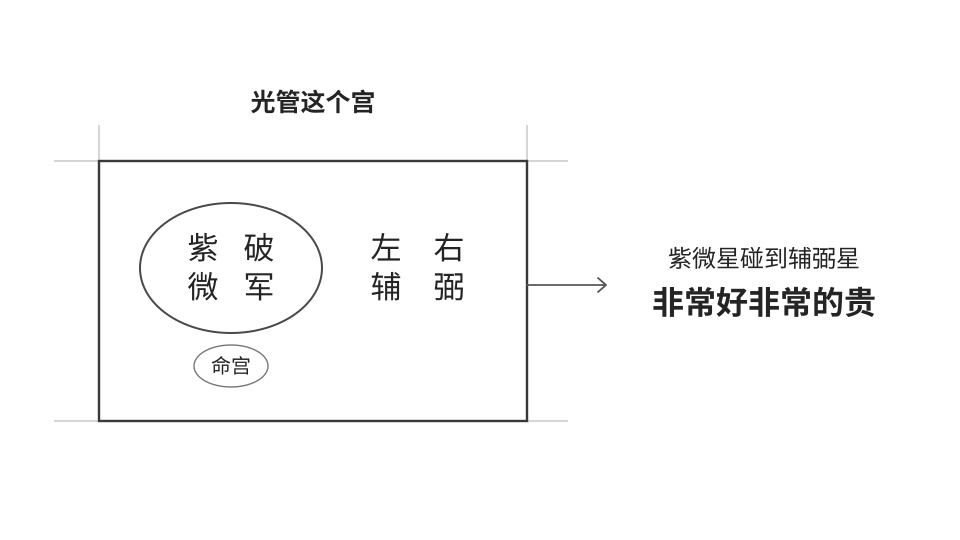 |
| **同一组星落迁移宫和落命宫，批法为何相反？** | 〔口述〕「那对这个八字来说」「它是刚好落在迁移宫是不是」「换句话说这个八字如果到外地去」「是不是会比本地好很多」。（[00:07:37–00:07:44](https://www.bilibili.com/video/BV1KJsLekEfA/?p=11&t=457)，第 13728–13949 帧） 〔叠图〕同一格宫名改标为迁移己丑，星曜同上，大限 63~72。（[00:07:34–00:07:36](https://www.bilibili.com/video/BV1KJsLekEfA/?p=11&t=454)，第 13644–13691 帧） 〔口述〕反过来：「反过来如果命宫在这里迁移宫在这里」「他在他在本地是不是比外地好很多」「所以格是一样」「那个那个星座位置上那个宫不一样」「你批法刚好反的懂不懂我意思」「这就是批的原则」。（[00:07:45–00:07:57](https://www.bilibili.com/video/BV1KJsLekEfA/?p=11&t=465)，第 13950–14327 帧） 〔指代〕说「迁移宫在这里」时食指点在黑板上排「午」右边那一格下部的一个草书字（亻旁，字难辨）。（[00:07:45–00:07:47](https://www.bilibili.com/video/BV1KJsLekEfA/?p=11&t=465)，第 13950–14015 帧） 〔口述〕「所以斗数易学难精就在这里」「其实很简单了解我意思吧」「就是这样子看」。（[00:07:57–00:08:02](https://www.bilibili.com/video/BV1KJsLekEfA/?p=11&t=477)，第 14328–14477 帧） |
| **紫微破军逢辅弼落夫妻宫，配偶如何？** | 〔口述〕「这个是北斗星君遇到辅弼星非常好」「如果这个落夫妻宫呢」「哇代表她的对象她的另一半」「如果是女的话男的先生很好」「如果是男孩子的话」「太太非常的优秀」。（[00:08:04–00:08:14](https://www.bilibili.com/video/BV1KJsLekEfA/?p=11&t=484)，第 14526–14843 帧） 〔指代〕说「这个是北斗星君」「如果这个落夫妻宫」时，食指点在黑板下排中格画圈的草书星名（首字像「紫」）及圈底小圈字附近。（[00:08:02–00:08:08](https://www.bilibili.com/video/BV1KJsLekEfA/?p=11&t=482)，第 14478–14645 帧） 〔叠图〕同一格宫名再改标为夫妻宫己丑，星曜同上（紫微庙化科、破军旺、左辅庙、右弼庙）。（[00:08:02–00:08:04](https://www.bilibili.com/video/BV1KJsLekEfA/?p=11&t=482)，第 14478–14525 帧） 〔口述〕说明现在只是介绍批法：「以后我们举例的时候」「我们再批整格」「我现在是讲介绍我们如何批」，等「以后这个12个12章介绍完紫微星的时候」「我们开始正式有很多例子」。（[00:08:17–00:08:26](https://www.bilibili.com/video/BV1KJsLekEfA/?p=11&t=497)，第 14934–15197 帧） |
| **本例夫妻宫廉贞贪狼，婚姻怎么断？** | 〔口述〕「那这个是这个人的夫妻宫呢」「刚好这个八字呢」「夫妻宫是在什么廉贞贪狼」；又说「廉贞贪狼是天罗地网的」「也是半空折翅对不对」。（[00:08:31–00:08:43](https://www.bilibili.com/video/BV1KJsLekEfA/?p=11&t=511)，第 15354–15695 帧） 〔叠图〕叠图为夫妻辛巳：廉贞陷、贪狼陷、凤阁庙、年解旺；青龙、指背、岁建；病；大限 103~112，小限 3,15,27,39,51,63。（[00:08:31–00:08:34](https://www.bilibili.com/video/BV1KJsLekEfA/?p=11&t=511)，第 15354–15449 帧） 〔口述〕「两个大桃花星落陷坐在命宫」「我讲过这一定是沾酒色财气」「一定是酒色财气十足会有这种现象」。（[00:08:48–00:08:57](https://www.bilibili.com/video/BV1KJsLekEfA/?p=11&t=528)，第 15858–16115 帧） 〔口述〕「那刚好又聚在夫妻宫」「是不是她的婚姻就会很差」，不用多了解就有预感「这个人婚姻不太好」「婚姻会有问题」「先生一定不是很好对不对」「一定一定这个问题很大」。（[00:09:00–00:09:20](https://www.bilibili.com/video/BV1KJsLekEfA/?p=11&t=540)，第 16218–16817 帧） 〔板书〕黑板左侧竖写可辨「天罗地网」「半空折翅」两行（第 13566 帧已在板上），此时外加框线；其余认不出。（[00:08:41](https://www.bilibili.com/video/BV1KJsLekEfA/?p=11&t=521)，第 15648 帧） |
| **廉贞配七杀、破军、贪狼，各是什么断语？** | 〔口述〕列出三组：「廉贞廉贞七杀廉贞破军廉贞贪狼」。「这个廉贞七杀呢半路死亡」「就是半路啊埋尸啊」。（[00:09:29–00:09:56](https://www.bilibili.com/video/BV1KJsLekEfA/?p=11&t=569)，第 17088–17897 帧） 〔口述〕「廉贞破军呢水中作冢」「水里面做坟墓」；「廉贞贪狼呢天折横天啊」「叫做横天啊横天」。（[00:09:56–00:10:12](https://www.bilibili.com/video/BV1KJsLekEfA/?p=11&t=596)，第 17898–18365 帧） 〔口述〕「这廉贞贪狼比较着重于先天的疾病」「比如说」「生下来就得到一种治不好的病」「还有一种自杀自杀的倾向」。（[00:10:12–00:10:24](https://www.bilibili.com/video/BV1KJsLekEfA/?p=11&t=612)，第 18366–18737 帧） 〔板书〕黑板右侧可辨：「廉殺→半路死亡」，下接两字认不出；「破→水中…」后半认不全；「廉贪→」后有被划掉的字，上方加写一字形近「横」，其余认不出；下方字迹认不出。（[00:10:22](https://www.bilibili.com/video/BV1KJsLekEfA/?p=11&t=622)，第 18660 帧） 〔叠图〕讲廉贞七杀时叠图为兄弟辛未：廉贞利、七杀庙、文昌利、文曲旺（原图「忌」在文曲列下方）、擎羊庙、龙池庙、凤阁陷、年解得、华盖陷；大限 114~123。讲廉贞破军时另贴福德乙酉：廉贞平、破军陷、右弼陷。（[00:09:46–00:10:01](https://www.bilibili.com/video/BV1KJsLekEfA/?p=11&t=586)，第 17580–18047 帧） |
| **杀破狼遇廉贞为何「杀会加杀」？举了哪些死法？** | 〔口述〕「所以我们这个杀星啊」「杀破狼七杀破军贪狼本身是杀星」「再遇到廉贞星的话」「杀会加杀知不知道加杀」。（[00:10:24–00:10:33](https://www.bilibili.com/video/BV1KJsLekEfA/?p=11&t=624)，第 18738–18995 帧） 〔口述〕举水中死的例子：「那有的人就死在水里面了」「他不是想不开他谁愿意啊」「他被杀了丢到水里啊」「或者在水里面淹死的」「或者在岸边钓鱼被风和浪卷下去了」。（[00:10:33–00:10:44](https://www.bilibili.com/video/BV1KJsLekEfA/?p=11&t=633)，第 18996–19343 帧） 〔口述〕「那有些半路死亡」……「这这几颗星代表」「但是都是死」「了解我意思吧都是死」。（[00:10:44–00:10:53](https://www.bilibili.com/video/BV1KJsLekEfA/?p=11&t=644)，第 19344–19601 帧） 〔指代〕说「这几颗星」前后，右手指尖停在黑板右侧「廉贪」一行下方，再沿「廉破」往上移到「廉杀」。（[00:10:48–00:10:50](https://www.bilibili.com/video/BV1KJsLekEfA/?p=11&t=648)，第 19446–19517 帧） |
| **杀星庙旺与落陷，吉凶有何不同？** | 〔口述〕「那如果是入庙」「这个庙旺就是说杀星很亮」「杀星很亮就代表你眼睛看得到的杀」，比喻「你家隔壁失火了」「你看到了」「你去救火你会先预防」。（[00:10:53–00:11:05](https://www.bilibili.com/video/BV1KJsLekEfA/?p=11&t=653)，第 19602–19955 帧） 〔口述〕「所以杀星很亮」「代表说凶处藏吉」「杀星不亮就是你根本没有预警」「叫做吉处藏凶」「在劫难逃」。（[00:11:05–00:11:15](https://www.bilibili.com/video/BV1KJsLekEfA/?p=11&t=665)，第 19956–20273 帧） 〔口述〕「这就是我们相书里面」「那八字里面写的」「凶处藏吉跟吉处藏凶的精义」「就在这里面」。（[00:11:15–00:11:23](https://www.bilibili.com/video/BV1KJsLekEfA/?p=11&t=675)，第 20274–20495 帧） 〔叠图〕此时叠图贴出兄弟辛未（同上）与夫妻辛丑：七杀庙、廉贞庙、破碎陷；华盖陷、岁建、病符；胎。（[00:10:52–00:10:53](https://www.bilibili.com/video/BV1KJsLekEfA/?p=11&t=652)，第 19560–19601 帧） |
| **落陷的杀星为何最可怕？小偷与强盗怎么比？** | 〔口述〕「所以你看到杀星落陷」「这是你看不到的杀」「你无法预测的杀」……「看起来外面是好事」「实际上是杀凶事在里面」。（[00:11:23–00:11:31](https://www.bilibili.com/video/BV1KJsLekEfA/?p=11&t=683)，第 20514–20747 帧） 〔口述〕「所以杀星进来的时候」「如果亮的没有关系」「大家都安心都会度过去」「那落陷的看不到的那最可怕」。（[00:11:31–00:11:38](https://www.bilibili.com/video/BV1KJsLekEfA/?p=11&t=691)，第 20748–20963 帧） 〔口述〕比喻：「小偷给你看到了」「那就不叫小偷」「那叫强盗了」……「给你看到他就跑掉了」「给你看到他要拿的话叫抢了」……「所以他就不敢了」。（[00:11:38–00:11:50](https://www.bilibili.com/video/BV1KJsLekEfA/?p=11&t=698)，第 20964–21329 帧） 〔口述〕收束：「这是入庙旺就是庙旺」「它的星辰亮度跟落陷的关系」。（[00:11:51–00:11:58](https://www.bilibili.com/video/BV1KJsLekEfA/?p=11&t=711)，第 21330–21563 帧） 〔推断〕推断：小偷强盗的比喻对应前面的庙陷之说，看得见的（庙旺）对方就不敢下手，看不见的（落陷）才真正得手；倪师没有逐句对应，这是笔记作者的归纳。（[00:11:38–00:11:58](https://www.bilibili.com/video/BV1KJsLekEfA/?p=11&t=698)，第 20964–21563 帧） |

**总结区**

- 通用规则：命宫坐天相的人不想权位、是很好的辅佐人才、一定比较瘦高；天相落在某个大限，那十年也是位高无权，进入流年遇到也以此类推批（[00:06:11–00:06:59](https://www.bilibili.com/video/BV1KJsLekEfA/?p=11&t=371)，第 11148–12575 帧）；格一样而宫不一样，批法刚好相反：紫微破军逢辅弼落迁移宫则外地比本地好，落命宫则本地比外地好（[00:07:37–00:07:57](https://www.bilibili.com/video/BV1KJsLekEfA/?p=11&t=457)，第 13728–14327 帧）；杀破狼本是杀星，遇廉贞杀会加杀：廉贞七杀半路死亡，廉贞破军水中作冢，廉贞贪狼重先天疾病与自杀倾向（[00:09:29–00:10:33](https://www.bilibili.com/video/BV1KJsLekEfA/?p=11&t=569)，第 17088–18995 帧）；杀星庙旺是看得到的杀、凶处藏吉，都会度过去；落陷是看不到、无法预测的杀、吉处藏凶，最可怕（[00:10:53–00:11:58](https://www.bilibili.com/video/BV1KJsLekEfA/?p=11&t=653)，第 19602–21563 帧）
- 只在本例：假设天相在 45-54 那一格（叠图财帛宫癸未），这十年位高无权，老是干副职（[00:06:29–00:06:49](https://www.bilibili.com/video/BV1KJsLekEfA/?p=11&t=389)，第 11682–12293 帧）；这个八字紫微破军逢辅弼刚好落迁移宫，到外地会比本地好很多（[00:07:37–00:07:44](https://www.bilibili.com/video/BV1KJsLekEfA/?p=11&t=457)，第 13728–13949 帧）；这个人夫妻宫廉贞贪狼（叠图夫妻辛巳，两星皆陷），婚姻会有问题、先生一定不是很好（[00:08:31–00:09:20](https://www.bilibili.com/video/BV1KJsLekEfA/?p=11&t=511)，第 15354–16817 帧）

**待核**

1. 性别：本块[00:09:11](https://www.bilibili.com/video/BV1KJsLekEfA/?p=11&t=551)，第 16536 帧倪师说本例「先生一定不是很好」，沿用约 05:44 说的「女孩」；约 19:26（第 4 块）倪师自己改正「第二个八字是男的」，本块涉及性别的条目照原话写，待与第 4 块对照。
2. [00:06:26](https://www.bilibili.com/video/BV1KJsLekEfA/?p=11&t=386)，第 11580 帧「诸位呢唯一一个四个字给你天相以后」：「四个字」是哪四个字本块没有明说，可能指板书右侧椭圆内的字，但该处只认得「位」「高」。
3. [00:06:54](https://www.bilibili.com/video/BV1KJsLekEfA/?p=11&t=414)，第 12426 帧「的热议眼他但曾摸」、[00:07:06](https://www.bilibili.com/video/BV1KJsLekEfA/?p=11&t=426)，第 12798 帧「即的順維 L#栽热」为字幕乱码，已略过。
4. [00:06:43–00:06:49](https://www.bilibili.com/video/BV1KJsLekEfA/?p=11&t=403)，第 12096–12293 帧（副总监、副经理一段）语音一路残缺（「说老」「是」「干负」），只有字幕完整，原话待核。
5. [00:07:34](https://www.bilibili.com/video/BV1KJsLekEfA/?p=11&t=454)，第 13644 帧字幕「我们知道紫微星碰到辅弼星」，语音为「知道紫围新破均弃性」，两路只部分对得上。
6. [00:08:48](https://www.bilibili.com/video/BV1KJsLekEfA/?p=11&t=528)，第 15858 帧倪师说廉贞贪狼「两个大桃花星落陷坐在命宫」，但前后讲的是夫妻宫，是口误还是另指待核。
7. [00:10:03–00:10:12](https://www.bilibili.com/video/BV1KJsLekEfA/?p=11&t=603)，第 18114–18365 帧字幕「天折横天」「横天」，语音为「幼者横腰」「横腰」，原字待核；板书该行有划掉的字和上方加写的字，认不全。
8. 未解释的词：「北斗星君」（[00:08:04](https://www.bilibili.com/video/BV1KJsLekEfA/?p=11&t=484)，第 14526 帧）、「天罗地网」「半空折翅」（[00:08:39](https://www.bilibili.com/video/BV1KJsLekEfA/?p=11&t=519)，第 15582 帧，倪师说「我刚刚有没有讲过」，本块未解释）、「批整格」（[00:08:18](https://www.bilibili.com/video/BV1KJsLekEfA/?p=11&t=498)，第 14964 帧，语音作「整个」）、「12个12章」（[00:08:22](https://www.bilibili.com/video/BV1KJsLekEfA/?p=11&t=502)，第 15084 帧）、「相书」（[00:11:15](https://www.bilibili.com/video/BV1KJsLekEfA/?p=11&t=675)，第 20274 帧）。
9. 叠图宫名多次换格：同一紫微破军格先后标命宫己丑（[00:07:08](https://www.bilibili.com/video/BV1KJsLekEfA/?p=11&t=428)，第 12858 帧）、迁移己丑（[00:07:34](https://www.bilibili.com/video/BV1KJsLekEfA/?p=11&t=454)，第 13644 帧）、夫妻宫己丑（[00:08:02](https://www.bilibili.com/video/BV1KJsLekEfA/?p=11&t=482)，第 14478 帧），对应倪师「如果命宫在这边」「落在迁移宫」「如果这个落夫妻宫」的演示；[00:08:31](https://www.bilibili.com/video/BV1KJsLekEfA/?p=11&t=511)，第 15354 帧又出现夫妻辛巳（廉贞贪狼），[00:10:52](https://www.bilibili.com/video/BV1KJsLekEfA/?p=11&t=652)，第 19560 帧再出现夫妻辛丑（廉贞七杀），同一块里有三个不同的夫妻宫，哪张是本例真盘以口述为准，待核。
10. 叠图兄弟辛未的化忌：[00:09:46](https://www.bilibili.com/video/BV1KJsLekEfA/?p=11&t=586)，第 17580 帧转写记在文曲旺之后，[00:10:52](https://www.bilibili.com/video/BV1KJsLekEfA/?p=11&t=652)，第 19560 帧转写记在廉贞利之后；看原图 f017736（[00:09:51](https://www.bilibili.com/video/BV1KJsLekEfA/?p=11&t=591)，第 17736 帧）「忌」在文曲那一列下方，[00:10:52](https://www.bilibili.com/video/BV1KJsLekEfA/?p=11&t=652)，第 19560 帧原图未看，待核。
11. 叠图福德乙酉（[00:09:56](https://www.bilibili.com/video/BV1KJsLekEfA/?p=11&t=596)，第 17898 帧）与夫妻辛丑（[00:10:52](https://www.bilibili.com/video/BV1KJsLekEfA/?p=11&t=652)，第 19560 帧）的大限数字串都是「2332」，两宫不可能同一大限，叠图或转写有误。
12. 板书认不全：f011277（[00:06:15](https://www.bilibili.com/video/BV1KJsLekEfA/?p=11&t=375)，第 11277 帧）左上方框两行草书认不出；f013566（[00:07:32](https://www.bilibili.com/video/BV1KJsLekEfA/?p=11&t=452)，第 13566 帧）紫微破军格旁加写字只辨近「左辅」「右弼」；f015414（[00:08:33](https://www.bilibili.com/video/BV1KJsLekEfA/?p=11&t=513)，第 15414 帧）未见可辨的新增字；f017280（[00:09:36](https://www.bilibili.com/video/BV1KJsLekEfA/?p=11&t=576)，第 17280 帧）右上只辨「殺」「破」；f018660（[00:10:22](https://www.bilibili.com/video/BV1KJsLekEfA/?p=11&t=622)，第 18660 帧）「半路死亡」下一行、「水中」之后、「廉贪」之后与下方字迹认不全。
13. 指代看不出：[00:07:37](https://www.bilibili.com/video/BV1KJsLekEfA/?p=11&t=457)，第 13732 帧、[00:07:41](https://www.bilibili.com/video/BV1KJsLekEfA/?p=11&t=461)，第 13842 帧、[00:07:59](https://www.bilibili.com/video/BV1KJsLekEfA/?p=11&t=479)，第 14378 帧、[00:08:34](https://www.bilibili.com/video/BV1KJsLekEfA/?p=11&t=514)，第 15436 帧、[00:09:44](https://www.bilibili.com/video/BV1KJsLekEfA/?p=11&t=584)，第 17532 帧为「否（不确定）」；[00:07:46](https://www.bilibili.com/video/BV1KJsLekEfA/?p=11&t=466)，第 13981 帧、[00:08:30](https://www.bilibili.com/video/BV1KJsLekEfA/?p=11&t=510)，第 15304 帧、[00:09:13](https://www.bilibili.com/video/BV1KJsLekEfA/?p=11&t=553)，第 16614 帧、[00:10:54](https://www.bilibili.com/video/BV1KJsLekEfA/?p=11&t=654)，第 19635 帧为「是（不确定）」；[00:10:24](https://www.bilibili.com/video/BV1KJsLekEfA/?p=11&t=624)，第 18728 帧讲者不在画面，均未作依据。
14. [00:11:47](https://www.bilibili.com/video/BV1KJsLekEfA/?p=11&t=707)，第 21216 帧字幕「抢了就强盜了」（可信度 0.33）与语音「抢了就抢到了」对不上，未引用。

## 日月反背（本例子女宫太阴化忌）：凶限、疾厄、阳宅、父母宫

〔叠图〕这一例视频里只贴过 6 格：夫妻 辛巳：廉贞陷、贪狼陷、凤阁庙、年解旺；田宅 丙戌：太阳不、八座平、大耗平、天姚庙、天贵旺、红鸾陷；子女 庚辰：太阴陷忌、擎羊庙、三台庙、天喜陷、天官旺、寡宿陷、解神庙；迁移 己丑：紫微庙科、破军旺、左辅庙、右弼庙、华盖陷、天哭庙；财帛 己卯：天府得、禄存庙、地劫平、旬空平；疾厄 戊寅：陀罗陷、铃星庙、副旬陷、天使平、天德平。

### 3　日月反背、两个凶限与疾厄脏腑（[00:11:58–00:18:39](https://www.bilibili.com/video/BV1KJsLekEfA/?p=11&t=718)，第 21564–33575 帧）

| 提示区 | 笔记区 |
|---|---|
| **本例太阴在哪一宫？辰宫是什么时辰？** | 〔口述〕倪师让大家再看太阴星：「太阴星在这个这个是辰宫」，「辰宫是上午7点到7点到9点」，「我们叫辰时」，「它刚好在子女宫」。（[00:11:58–00:12:12](https://www.bilibili.com/video/BV1KJsLekEfA/?p=11&t=718)，第 21564–21989 帧） 〔指代〕说「太阴星在这里」「在这个这个是辰宫」时，手指的是黑板左列第二格（命宫格正下方）正在写的「太尚.」字处；当时这一格还没写宫名。（[00:12:01–00:12:04](https://www.bilibili.com/video/BV1KJsLekEfA/?p=11&t=721)，第 21636–21728 帧） 〔叠图〕子女庚辰：太阴陷、化忌，擎羊庙，天喜陷，三台庙，天官旺，解神庙，寡宿陷；官符、天煞、病符；死；大限 33~42；小限 10,22,34,46,58；流年 12,24,36,48,60。（[00:11:58–00:12:03](https://www.bilibili.com/video/BV1KJsLekEfA/?p=11&t=718)，第 21564–21701 帧） 〔叠图〕田宅丙戌：太阳不，红鸾陷，天姚庙，八座平，天贵旺，台辅，大耗平，月德；奏书、攀鞍、小耗；沐浴；大限 93~102；小限 4,16,28,40,52；流年 6,18,30,42,54。倪师此时说「这太阳星在这里」，但手指哪里看不出，太阳在戌只是叠图所示。（[00:12:13–00:12:15](https://www.bilibili.com/video/BV1KJsLekEfA/?p=11&t=733)，第 21990–22061 帧） 〔板书〕可辨：盘面左列第二格「太尚.」，其下一行以「辰」开头（后面的字认不出），再下一格「卯」，上方中格「午」；左上方框里的字认不全，其余认不出。（[00:12:13](https://www.bilibili.com/video/BV1KJsLekEfA/?p=11&t=733)，第 21996 帧） 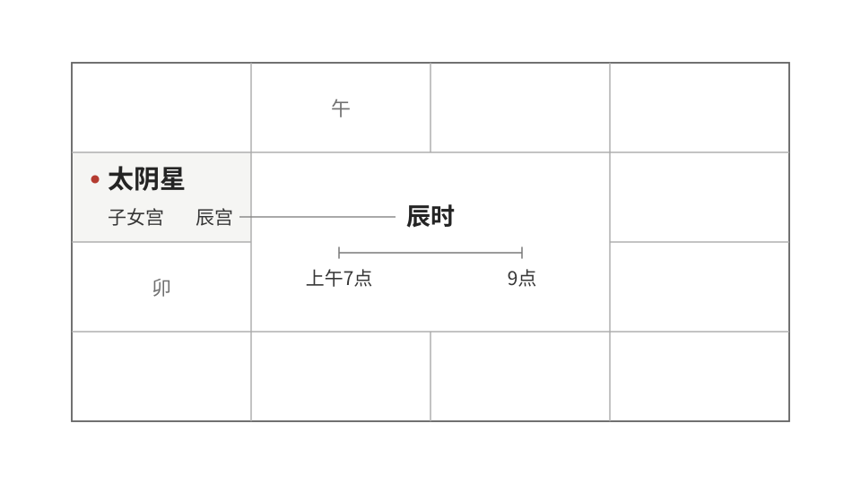 |
| **什么叫日月反背？** | 〔口述〕倪师指着化忌说「这个化忌在这里」，「太阴在这里是白天」，「它等于白天出月亮」；而「太阳在夜间呢」，「出太阳刚好是反」，「这叫做日月反背」。（[00:12:20–00:12:40](https://www.bilibili.com/video/BV1KJsLekEfA/?p=11&t=740)，第 22212–22823 帧） 〔指代〕说「这个化忌在这里」「太阴在这里」时，手指的是黑板左列第二格「太尚」字处（同格写有「辰」），并用粉笔把「太尚」圈起来。（[00:12:21–00:12:25](https://www.bilibili.com/video/BV1KJsLekEfA/?p=11&t=741)，第 22231–22368 帧） 〔板书〕可辨：盘面右列一格写「太阳」，旁边有一个向左的箭头，其余认不出。（[00:17:37](https://www.bilibili.com/video/BV1KJsLekEfA/?p=11&t=1057)，第 31716 帧） |
| **日月反背第一、第二个重点是什么？** | 〔口述〕「日月反背主第一件事有几个重点」，第一个，「代表这个人呢披星戴月」。（[00:12:40–00:12:51](https://www.bilibili.com/video/BV1KJsLekEfA/?p=11&t=760)，第 22824–23153 帧） 〔口述〕转述：这种人工作常常白天忙完，「晚上比白天还忙」，「有很多行业晚上才开始忙的哦」。（[00:12:51–00:13:03](https://www.bilibili.com/video/BV1KJsLekEfA/?p=11&t=771)，第 23154–23507 帧） 〔口述〕第二个：「这叫做六亲不靠」，「靠不到父母亲」。（[00:13:03–00:13:15](https://www.bilibili.com/video/BV1KJsLekEfA/?p=11&t=783)，第 23508–23867 帧） 〔板书〕可辨：黑板左侧竖写「日月反背」，旁边写圈号「①」和「披星」「月」，「星」「月」之间一字认不准，其余认不出。（[00:12:55](https://www.bilibili.com/video/BV1KJsLekEfA/?p=11&t=775)，第 23252 帧） 〔板书〕可辨：圈号「②」，其下一列末两字「不靠」，上面两字潦草认不出。（[00:13:13](https://www.bilibili.com/video/BV1KJsLekEfA/?p=11&t=793)，第 23800 帧） |
| **第三个重点刚躁，命宫若在此为何很固执？** | 〔口述〕「第三个呢」，性情「非常的刚躁」。（[00:13:19–00:13:30](https://www.bilibili.com/video/BV1KJsLekEfA/?p=11&t=799)，第 23976–24305 帧） 〔口述〕倪师举例：「如果是命宫在这里」，「白天出月亮」，「那个白天明明是太阳」，「他要指着太阳说这是月亮」，「你看固不固执」，「就形容这个很固执的意思」。（[00:13:30–00:13:45](https://www.bilibili.com/video/BV1KJsLekEfA/?p=11&t=810)，第 24306–24755 帧） 〔板书〕可辨：圈号「③」和「性」字，其下的字认不准，其余认不出。（[00:13:27](https://www.bilibili.com/video/BV1KJsLekEfA/?p=11&t=807)，第 24216 帧） 〔推断〕推断：倪师用的是「如果是命宫在这里」「命宫如果在这里的话」，是假设说法；这两处手指的落点都标为不确定，所以假设的是黑板哪一格看不出。（[00:13:32–00:13:36](https://www.bilibili.com/video/BV1KJsLekEfA/?p=11&t=812)，第 24360–24485 帧） |
| **子女宫化忌又反背主什么？紫微在丑会怎样？** | 〔口述〕转述：如果在子女宫化忌，「又是反背」，「那你想想看这有没有儿子」，「没有」。（[00:13:45–00:13:51](https://www.bilibili.com/video/BV1KJsLekEfA/?p=11&t=825)，第 24756–24953 帧） 〔口述〕「所以紫微星在丑宫的话」，「会有日月反背的现象」。（[00:13:53–00:13:56](https://www.bilibili.com/video/BV1KJsLekEfA/?p=11&t=833)，第 25002–25109 帧） 〔叠图〕迁移己丑：紫微庙、化科，破军旺，左辅庙，右弼庙，天哭庙，华盖陷；伏兵、冠带、白虎；大限 63~72；另有两串岁数 7,19,31 与 43,55,67，叠图转写里没标哪串是小限、哪串是流年。（[00:13:53–00:13:54](https://www.bilibili.com/video/BV1KJsLekEfA/?p=11&t=833)，第 25002–25049 帧） 〔推断〕推断：叠图迁移己丑有紫微庙科，和倪师此处说的「紫微星在丑宫」对得上；但本块倪师没有口头说出本例紫微落哪一宫。（[00:13:53–00:13:56](https://www.bilibili.com/video/BV1KJsLekEfA/?p=11&t=833)，第 25002–25109 帧） |
| **本例要看哪两个十年？「大限在前」怎么说？** | 〔口述〕「这里还牵涉到一个重点了」，「诸位看十年 23-32 33-42」，「看十年哈」。（[00:13:57–00:14:30](https://www.bilibili.com/video/BV1KJsLekEfA/?p=11&t=837)，第 25110–26105 帧） 〔口述〕「我那天给你诸位讲过」，「未来十年无大运」，「大限前十年」，先看一个十年一个段落；「33-42化忌日月反背」，「没有大限了」，「那大限就在前」，「连续两个20年杀」。（[00:14:31–00:14:54](https://www.bilibili.com/video/BV1KJsLekEfA/?p=11&t=871)，第 26136–26843 帧） 〔板书〕可辨：盘面左上格里有红框「23-32」；下一格写「太」开头的两字（第二字潦草）和一个红圈圈住的字，其下有红框「33-42」；红圈里的字认不准。（[00:14:30](https://www.bilibili.com/video/BV1KJsLekEfA/?p=11&t=870)，第 26124 帧） 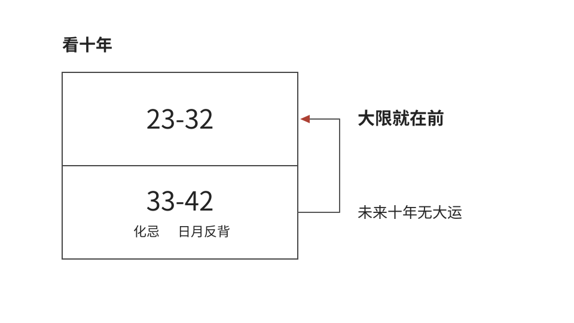 〔板书〕可辨：黑板左侧两列竖写，一列可辨「未」「来」「十」，另一列可辨「大」「限」「十」，其余被讲者身体挡住或认不出。（[00:14:44](https://www.bilibili.com/video/BV1KJsLekEfA/?p=11&t=884)，第 26532 帧） |
| **23–32 廉贪、33–42 化忌反背，合起来怎样？** | 〔口述〕「23-32 廉贞贪狼」，「我们晓得半空折翅很危险」；33–42 又日月反背又化忌，「是不是完了差不多这个人」，「人生乏味我可以走了」。（[00:14:57–00:15:07](https://www.bilibili.com/video/BV1KJsLekEfA/?p=11&t=897)，第 26934–27215 帧） 〔叠图〕夫妻辛巳：廉贞陷，贪狼陷，凤阁庙，年解旺；伏兵、指背、岁建；病；大限 23~32；小限 11,23,35,47,59；流年 1,13,25,37,49。（[00:14:13–00:14:23](https://www.bilibili.com/video/BV1KJsLekEfA/?p=11&t=853)，第 25590–25919 帧） 〔推断〕推断：叠图夫妻辛巳大限 23~32、子女庚辰大限 33~42，正是倪师说的这两个十年，前一个是廉贞贪狼落陷，后一个是太阴化忌、日月反背。（[00:14:13–00:15:03](https://www.bilibili.com/video/BV1KJsLekEfA/?p=11&t=853)，第 25590–27113 帧） |
| **杀都落在夫妻、子女，对她意味着什么？** | 〔口述〕「她的杀都在夫妻宫」，「还有什么子女宫」，「就是杀在婚姻和子女好了」；「一个女孩子的观念」，「我的世界就是我的先生我的孩子」，都没有了，「这种人生乏味啊」，「对不对就又想去自杀」。（[00:15:07–00:15:25](https://www.bilibili.com/video/BV1KJsLekEfA/?p=11&t=907)，第 27216–27755 帧） 〔口述〕「所以她在23岁开始到42岁20年中间」，「她婚姻也不好儿子子女也没有」，「让她没有办法」，「没有这个精神的依靠」。（[00:15:25–00:15:35](https://www.bilibili.com/video/BV1KJsLekEfA/?p=11&t=925)，第 27756–28079 帧） 〔口述〕「所以她廉贪落陷的时候」，「因为大限在前十年」，「她在32岁那年可能就会想通了」，「我不想活了」……「死掉说不定是个解脱」……「就会有这种倾向」。（[00:15:36–00:15:58](https://www.bilibili.com/video/BV1KJsLekEfA/?p=11&t=936)，第 28080–28769 帧） 〔推断〕推断：32 岁是叠图夫妻辛巳大限 23~32 的最后一年；倪师在本块没有说明为什么是 32 岁。（[00:15:38–00:15:40](https://www.bilibili.com/video/BV1KJsLekEfA/?p=11&t=938)，第 28152–28223 帧） |
| **23 岁前和 42 岁后来算，结果为什么不同？** | 〔口述〕「所以我们如果今天只是算命」，「我们在23岁以前她来算」「和42岁以后来算」，「我们算命的结果是一样的」。（[00:15:59–00:16:08](https://www.bilibili.com/video/BV1KJsLekEfA/?p=11&t=959)，第 28770–29063 帧） 〔口述〕「我们看易经说上看天文俯察地理中知人事」，「天人地三才来讲的话」，「她是23岁以前来找我们算」，和 42 岁来算「完全不一样哦」。（[00:16:12–00:16:22](https://www.bilibili.com/video/BV1KJsLekEfA/?p=11&t=972)，第 29178–29465 帧） 〔口述〕「我们可以让她这20年凭空不见」；不能等到事情发生了再去解决，事前「这都可以解的」，「这是一个凶限诸位要注意」。（[00:16:22–00:16:44](https://www.bilibili.com/video/BV1KJsLekEfA/?p=11&t=982)，第 29466–30149 帧） |
| **本例疾厄在寅、太阴辰宫化忌，各伤哪些脏腑？** | 〔口述〕「诸位看她的疾厄」，「疾厄宫是陀罗星落陷带铃星」，「疾厄宫是不是在寅宫啊」，「第一个本来寅宫就很杀了对不对」；「寅是什么」，「肺内脏是肺」，「外科呢右脚」，「你不要把它写到左脚去了哈」。（[00:16:45–00:17:05](https://www.bilibili.com/video/BV1KJsLekEfA/?p=11&t=1005)，第 30150–30755 帧） 〔口述〕「第二个」，「你看她的太阴星在辰宫化忌有没有」，「所以她的胃一定也不好是不是」；「那这段时间又廉贪落陷」，「是不是脾一定也不好」。（[00:17:05–00:17:16](https://www.bilibili.com/video/BV1KJsLekEfA/?p=11&t=1025)，第 30756–31091 帧） 〔叠图〕疾厄戊寅：陀罗陷，铃星庙，天使平，副旬陷，劫煞，天德平；力士；绝；大限 53~62；小限 8,20,32,44,56；流年 10,22,34,46,58。（[00:16:45–00:16:46](https://www.bilibili.com/video/BV1KJsLekEfA/?p=11&t=1005)，第 30150–30209 帧） 〔板书〕可辨：盘面「卯」格下面一格写「肺.」，其余认不出。（[00:16:56](https://www.bilibili.com/video/BV1KJsLekEfA/?p=11&t=1016)，第 30504 帧） 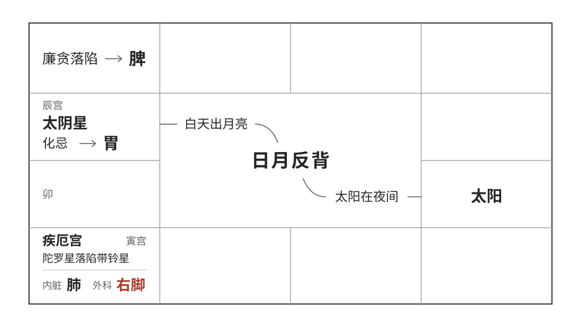 〔板书〕可辨：「肺、」，其后一字认不出；红圈那一格和上格红框「23-32」右侧各新添了一个字，潦草认不出。（[00:17:17](https://www.bilibili.com/video/BV1KJsLekEfA/?p=11&t=1037)，第 31128 帧） |
| **中医说忧能伤肺、思能伤脾，怎么体现？** | 〔口述〕「再按照中医的观念里面来说呢」，「很惨啊」，「中医的观点呢」，「忧能伤肺」，「思能伤脾」。（[00:17:16–00:17:40](https://www.bilibili.com/video/BV1KJsLekEfA/?p=11&t=1036)，第 31092–31817 帧） 〔口述〕感冒咳嗽，「奇怪怎么咳了两三个月还没好」，那只是表症；「实际上你有没有想到」，「你一定在担忧事情」，「很紧张很忧郁」，「这咳嗽一直没好」。（[00:17:40–00:17:53](https://www.bilibili.com/video/BV1KJsLekEfA/?p=11&t=1060)，第 31818–32207 帧） 〔口述〕思虑太重伤了脾脏：「胃的蠕动跟脾脏蠕动同时的」，「脾脏一胀大胃就缩小」，「脾脏一缩小胃就跟着胀」；「像梁山伯思虑太重了」，「脾脏都死掉了没有蠕动了」，东西当然吃不下去。（[00:17:53–00:18:10](https://www.bilibili.com/video/BV1KJsLekEfA/?p=11&t=1073)，第 32208–32711 帧） 〔口述〕「所以恋爱谈的很深的时候」「思念对方的时候」，「真的是胃如同嚼蜡啊」，「酸甜苦辣吃下去没有味道的」，「因为伤到脾脏」。（[00:18:10–00:18:19](https://www.bilibili.com/video/BV1KJsLekEfA/?p=11&t=1090)，第 32712–32987 帧） 〔板书〕可辨：黑板右侧上行末两字「伤肺」，下行末字「脾」，前面的字被讲者身体挡住，认不出。（[00:17:37](https://www.bilibili.com/video/BV1KJsLekEfA/?p=11&t=1057)，第 31716 帧） |
| **婚姻、子女都不好又逢廉贪，先生会怎样？** | 〔口述〕「那一个女孩子的婚姻是非常的不好」，「再加上子女非常的不好的话」，「那她真的是食同嚼蜡」。（[00:18:19–00:18:29](https://www.bilibili.com/video/BV1KJsLekEfA/?p=11&t=1099)，第 32988–33299 帧） 〔口述〕「尤其是遇到这种廉贞贪狼」，「这种的话先生一定是」，「他就算先生没有死亡」，「也是等于如同死亡一样」。（[00:18:30–00:18:39](https://www.bilibili.com/video/BV1KJsLekEfA/?p=11&t=1110)，第 33300–33575 帧） |

**总结区**

- 通用规则：太阴在辰是白天出月亮、太阳在夜间出，叫日月反背，主披星戴月、六亲不靠、性情刚躁（[00:12:20–00:13:30](https://www.bilibili.com/video/BV1KJsLekEfA/?p=11&t=740)，第 22212–24305 帧）。；紫微星在丑宫的话，会有日月反背的现象（[00:13:53–00:13:56](https://www.bilibili.com/video/BV1KJsLekEfA/?p=11&t=833)，第 25002–25109 帧）。；寅宫内脏是肺、外科是右脚，别写成左脚（[00:16:53–00:17:05](https://www.bilibili.com/video/BV1KJsLekEfA/?p=11&t=1013)，第 30408–30755 帧）。；中医观点：忧能伤肺、思能伤脾；久咳不好往往是在担忧，思虑太重伤脾则吃东西没味道（[00:17:26–00:18:19](https://www.bilibili.com/video/BV1KJsLekEfA/?p=11&t=1046)，第 31386–32987 帧）。
- 只在本例：本例太阴陷化忌在子女宫辰，倪师说子女宫化忌又反背，没有儿子（[00:11:58–00:13:51](https://www.bilibili.com/video/BV1KJsLekEfA/?p=11&t=718)，第 21564–24953 帧）。；23–32 廉贞贪狼落陷、33–42 日月反背又化忌，杀都在夫妻与子女，倪师断她这二十年婚姻不好、子女没有，32 岁那年可能想轻生（[00:14:57–00:15:58](https://www.bilibili.com/video/BV1KJsLekEfA/?p=11&t=897)，第 26934–28769 帧）。；疾厄宫在寅、陀罗落陷带铃星，加上太阴辰宫化忌、廉贪落陷，倪师断她肺、胃、脾都不好（[00:16:45–00:17:16](https://www.bilibili.com/video/BV1KJsLekEfA/?p=11&t=1005)，第 30150–31091 帧）。；婚姻、子女都非常不好又遇廉贞贪狼，先生就算没死也如同死亡（[00:18:19–00:18:39](https://www.bilibili.com/video/BV1KJsLekEfA/?p=11&t=1099)，第 32988–33575 帧）。
- 不是排盘规则，是处世方法：同一张盘，只算命的话 23 岁前和 42 岁后来算结果一样；懂天地人三才的人在事前来算，可以让凶限二十年凭空不见，不要等事情发生了再去解（[00:15:59–00:16:44](https://www.bilibili.com/video/BV1KJsLekEfA/?p=11&t=959)，第 28770–30149 帧）。

**待核**

1. [00:12:57](https://www.bilibili.com/video/BV1KJsLekEfA/?p=11&t=777)，第 23328 帧：字幕行尾「小限：4.16,28.40.52」是叠图小限岁数串进了字幕识别，不是倪师的话，笔记已去掉。
2. [00:12:51](https://www.bilibili.com/video/BV1KJsLekEfA/?p=11&t=771)，第 23154 帧：字幕「他工作常常自天忙完」，语音为「工作常常白天晚晚上」，两路对不上，笔记只转述；[00:13:01](https://www.bilibili.com/video/BV1KJsLekEfA/?p=11&t=781)，第 23454 帧字幕「自天」按上下文应为「白天」。
3. [00:13:45](https://www.bilibili.com/video/BV1KJsLekEfA/?p=11&t=825)，第 24756 帧：字幕「子女官化忌」，按上下文改为「子女宫」。
4. [00:15:01](https://www.bilibili.com/video/BV1KJsLekEfA/?p=11&t=901)，第 27054 帧：字幕「叉日月反背叉化忌」，语音为「又」，按上下文改为「又日月反背又化忌」。
5. [00:13:51](https://www.bilibili.com/video/BV1KJsLekEfA/?p=11&t=831)，第 24954 帧：字幕「这这个八字我要给你提出来」，语音「把手要给你提出来」，两路对不上，原话待核，没写进笔记。
6. [00:13:53](https://www.bilibili.com/video/BV1KJsLekEfA/?p=11&t=833)，第 25002 帧：字幕「所以紫微星在丑宫的话」可信度 0.5，语音「只为现在丑空的话」，两路只部分对得上。
7. [00:16:08](https://www.bilibili.com/video/BV1KJsLekEfA/?p=11&t=968)，第 29064 帧：字幕「所以我跟着中真正的中国有天天文地理的人」语句残缺，语音为「他说真正的中国有天文地理的人」，原话待核。
8. [00:16:25–00:16:30](https://www.bilibili.com/video/BV1KJsLekEfA/?p=11&t=985)，第 29568–29717 帧：「排的时候要排」「不要说她是你的兄弟姐妹」「你就把她擦掉装作没看到」意思不清，没写进笔记，待核。
9. [00:16:37](https://www.bilibili.com/video/BV1KJsLekEfA/?p=11&t=997)，第 29934 帧：字幕「这是一个凶限诸位要注意」，语音为「陷主要主要主要看到」，两路对不上。
10. [00:14:33](https://www.bilibili.com/video/BV1KJsLekEfA/?p=11&t=873)，第 26202 帧、[00:14:51](https://www.bilibili.com/video/BV1KJsLekEfA/?p=11&t=891)，第 26754 帧、[00:14:53](https://www.bilibili.com/video/BV1KJsLekEfA/?p=11&t=893)，第 26796 帧：「未来十年无大运」「那大限就在前」「连续两个20年杀」，倪师用了但本块没解释；「两个20年」是否指两个十年共二十年，待核。
11. [00:14:59](https://www.bilibili.com/video/BV1KJsLekEfA/?p=11&t=899)，第 26982 帧：「半空折翅」本块没有解释。
12. [00:18:13](https://www.bilibili.com/video/BV1KJsLekEfA/?p=11&t=1093)，第 32790 帧、[00:18:27](https://www.bilibili.com/video/BV1KJsLekEfA/?p=11&t=1107)，第 33210 帧：字幕「胃如同嚼蜡」「食同嚼蜡」照原字引用，未改。
13. [00:15:13](https://www.bilibili.com/video/BV1KJsLekEfA/?p=11&t=913)，第 27414 帧、[00:18:22](https://www.bilibili.com/video/BV1KJsLekEfA/?p=11&t=1102)，第 33078 帧：「一个女孩子的观念」「那一个女孩子」照原话写；倪师约 05:44 说本例是「女孩」，约 19:26（第 4 块）自己改正「第二个八字是男的」，本块涉及性别的条目以此为准待核。
14. [00:13:21](https://www.bilibili.com/video/BV1KJsLekEfA/?p=11&t=801)，第 24042 帧：字幕「刚躁」，语音「刚照」；[00:13:27](https://www.bilibili.com/video/BV1KJsLekEfA/?p=11&t=807)，第 24216 帧板书「③」下的字认不准。
15. [00:14:04](https://www.bilibili.com/video/BV1KJsLekEfA/?p=11&t=844)，第 25324 帧：板书图被讲者身体挡住，认不出。
16. [00:14:44](https://www.bilibili.com/video/BV1KJsLekEfA/?p=11&t=884)，第 26532 帧、[00:17:17](https://www.bilibili.com/video/BV1KJsLekEfA/?p=11&t=1037)，第 31128 帧、[00:17:37](https://www.bilibili.com/video/BV1KJsLekEfA/?p=11&t=1057)，第 31716 帧：板书部分被身体挡住或字迹潦草，只写了可辨的字。
17. [00:12:13](https://www.bilibili.com/video/BV1KJsLekEfA/?p=11&t=733)，第 21996 帧：说「这太阳星在这里」时手指哪里看不出（D067）；[00:14:01](https://www.bilibili.com/video/BV1KJsLekEfA/?p=11&t=841)，第 25242 帧「这个看十年」指向看不出（D079）。
18. [00:13:32](https://www.bilibili.com/video/BV1KJsLekEfA/?p=11&t=812)，第 24388 帧、[00:13:34](https://www.bilibili.com/video/BV1KJsLekEfA/?p=11&t=814)，第 24446 帧：「命宫在这里」两处指向不确定（D074、D075），假设命宫在哪一格看不出。
19. [00:13:53](https://www.bilibili.com/video/BV1KJsLekEfA/?p=11&t=833)，第 25002 帧：叠图迁移己丑第一次转写为「71□31」有缺字，[00:13:57](https://www.bilibili.com/video/BV1KJsLekEfA/?p=11&t=837)，第 25110 帧再次出现为「71931」；同宫「华盖」与「华盖陷」重复列出。

### 4　阳宅厨房客厅断生离死别，看子女父母（[00:18:39–00:25:08](https://www.bilibili.com/video/BV1KJsLekEfA/?p=11&t=1119)，第 33576–45263 帧）

| 提示区 | 笔记区 |
|---|---|
| **命盘配上阳宅，厨房在西北、西南角各主什么？** | 〔口述〕倪师说命上看完之后，再去看她的阳宅：「如果我们去看她的阳宅配上去的时候」「命运同参的时候非常厉害」；阳宅以「东南西北房屋的中心点来说」。（[00:18:40–00:18:52](https://www.bilibili.com/video/BV1KJsLekEfA/?p=11&t=1120)，第 33624–33977 帧） 〔口述〕此时仍按女命讲：「如果厨房在西北角」「这是死别」「西北角的话死夫」；「如果西南角的话本人死」「她自己死掉了」。（[00:18:52–00:19:08](https://www.bilibili.com/video/BV1KJsLekEfA/?p=11&t=1132)，第 33978–34445 帧） 〔口述〕解释为什么：「西南角不是坤卦吗」「坤地嘛这是个女孩子的命嘛对不对」「西南角是不是妇西北角是夫」。（[00:19:12–00:19:20](https://www.bilibili.com/video/BV1KJsLekEfA/?p=11&t=1152)，第 34584–34805 帧） 〔板书〕黑板右侧新画一个方框，可辨：上方「S」、右边「W」，左边一字形似「E」、下方一字形似「N」；方框右侧上下各有一个小框，框里各一字，形似「厨」，其余认不出。（[00:19:08](https://www.bilibili.com/video/BV1KJsLekEfA/?p=11&t=1148)，第 34440 帧） 〔板书〕可辨：方框右下外侧圈出一个「夫」字，其余新写的字认不出。（[00:19:19](https://www.bilibili.com/video/BV1KJsLekEfA/?p=11&t=1159)，第 34782 帧） |
| **本例命盘到底是男命还是女命？男命西南角厨房主什么？** | 〔口述〕倪师当场更正：「啊这位男孩子抱歉抱歉」「对不起改正」「第二个八字是男的」。此前本例一直被说成女孩子的命。（[00:19:23–00:19:27](https://www.bilibili.com/video/BV1KJsLekEfA/?p=11&t=1163)，第 34908–35027 帧） 〔口述〕改按男命讲：「如果是西南角的话死妻死太太」；「那这个是男人的命的话」「娶这种太太也也很惨了」。（[00:19:27–00:19:41](https://www.bilibili.com/video/BV1KJsLekEfA/?p=11&t=1167)，第 35028–35453 帧） 〔推断〕推断：更正前按女命说西南角厨房「本人死」，更正后按男命说西南角「死妻」，两种说法都落在「西南角是妇」这一方；倪师没有把这层关系明说出来。（[00:19:01–00:19:36](https://www.bilibili.com/video/BV1KJsLekEfA/?p=11&t=1141)，第 34242–35297 帧） 〔板书〕可辨：命盘中央一格写了一个「男」字；黑板右上角圈出「死妻」二字，其余认不出。（[00:19:36](https://www.bilibili.com/video/BV1KJsLekEfA/?p=11&t=1176)，第 35282 帧） 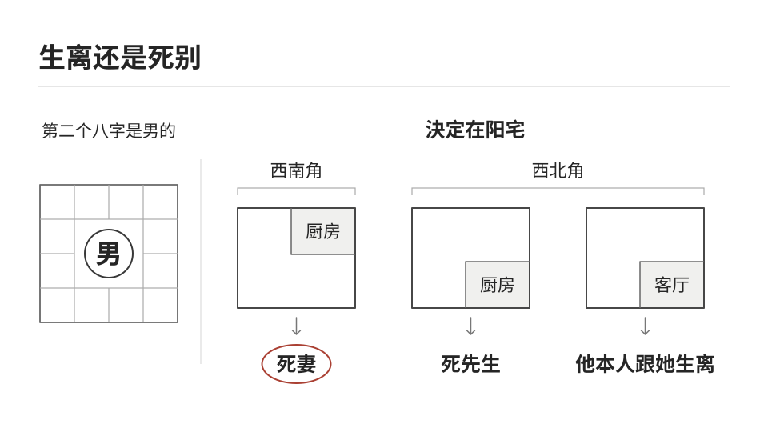 |
| **人间道、地理都没改时，算命的人该怎么劝？** | 〔口述〕倪师说遇到这种情况：「干脆遇到这种情况我们跟他说算了」「如果今天没有改人间道」「还有地理没有改这个」「就叫他算了你把太太放掉算了」。（[00:19:41–00:19:50](https://www.bilibili.com/video/BV1KJsLekEfA/?p=11&t=1181)，第 35454–35729 帧） 〔口述〕举例说这种太太「反正喜欢到地下舞厅啊」「或者是到赌场里面去啊这样子」，「这个积重难返了很累」。（[00:19:51–00:20:04](https://www.bilibili.com/video/BV1KJsLekEfA/?p=11&t=1191)，第 35730–36143 帧） |
| **到底生离还是死别，由什么决定？** | 〔口述〕若这是女孩子的命，「这种先生就完了」；「那到底是生离还是死别」「決定在阳宅」。（[00:20:04–00:20:12](https://www.bilibili.com/video/BV1KJsLekEfA/?p=11&t=1204)，第 36144–36371 帧） 〔口述〕厨房的分法：「西北角是厨房死先生」「西南角厨房死太太」。（[00:20:12–00:20:14](https://www.bilibili.com/video/BV1KJsLekEfA/?p=11&t=1212)，第 36372–36449 帧） 〔口述〕客厅的分法：「如果是西北角是客厅」「他住的房子西北角客厅」「是如果这是男的」「就是他本人跟她生离」；并重复「客厅主的是生离」。（[00:20:15–00:20:30](https://www.bilibili.com/video/BV1KJsLekEfA/?p=11&t=1215)，第 36450–36917 帧） 〔板书〕可辨：方框右侧上小框仍是形似「厨」的字，下小框改写成一个形似「客」的字；右上「死妻」圈仍在，盘中央「男」字已圈起，其余认不出。（[00:20:24](https://www.bilibili.com/video/BV1KJsLekEfA/?p=11&t=1224)，第 36722 帧） 〔板书〕方框左上方新圈一处，可辨「生」，第二字形似「离」，其余认不出。（[00:20:29](https://www.bilibili.com/video/BV1KJsLekEfA/?p=11&t=1229)，第 36881 帧） |
| **客厅在易经上是什么象？东边是客厅，儿子会怎样？** | 〔口述〕「客厅的象」「这易经上的象客厅呢」「像客人嘛」「把家当旅馆了」。（[00:20:36–00:20:48](https://www.bilibili.com/video/BV1KJsLekEfA/?p=11&t=1236)，第 37104–37451 帧） 〔口述〕「如果你家东边是客厅」「有两种情形」「第一种夫妻住进去以后生不到儿子」「第二种有了儿子以后」，再住进去「的儿子变成客人」。（[00:20:51–00:21:07](https://www.bilibili.com/video/BV1KJsLekEfA/?p=11&t=1251)，第 37548–38021 帧） 〔口述〕举例：原来住的地方「我儿子很孝顺」，换了房子以后儿子「如坐针毡坐不住」「他就喜欢到外面去打电动玩具啊」，跟不良少年「跑到公园里坐那边吸安非他命了」，「客儿子变成客人」。（[00:21:08–00:21:24](https://www.bilibili.com/video/BV1KJsLekEfA/?p=11&t=1268)，第 38058–38543 帧） 〔板书〕可辨：上方写「客」「象」「客人」；下面新画方框，上「S」、左「E」、右「W」、下「N」，方框左侧（东边）小框里写「客」，其余认不出。（[00:20:54](https://www.bilibili.com/video/BV1KJsLekEfA/?p=11&t=1254)，第 37644 帧） |
| **西北角是客厅，丈夫会怎样？举了哪些职业？** | 〔口述〕「那如果西北角是客厅的话」，顾名思义就是丈夫的位置，「就丈夫等于客人呐」「把家当旅馆啊」。（[00:21:24–00:21:31](https://www.bilibili.com/video/BV1KJsLekEfA/?p=11&t=1284)，第 38544–38753 帧） 〔口述〕举例：「先生当船员先生当飞行员」「这都是客人是不是」；又说「干军人的干这个警察」「或者是干这个船员的飞行员的」「都是这边这个客厅」。（[00:21:31–00:22:03](https://www.bilibili.com/video/BV1KJsLekEfA/?p=11&t=1291)，第 38754–39707 帧） 〔口述〕算命时看到太太住这种房子，倪师就说「你家门口开个牌子」「叫做某某市大旅馆」，姓陈「叫陈氏大旅馆」，姓张「叫张氏大旅馆」，「先生就像客人一样」。（[00:21:39–00:21:53](https://www.bilibili.com/video/BV1KJsLekEfA/?p=11&t=1299)，第 38988–39401 帧） 〔板书〕可辨：上方「客人」二字已圈起；方框右下（W 与 N 之间）新画小框，里面写「客」，后接一横，旁边圈出「夫」字，其余认不出。（[00:21:35](https://www.bilibili.com/video/BV1KJsLekEfA/?p=11&t=1295)，第 38868 帧） |
| **西北方为什么分客厅、厨房？厨房为何主死别？** | 〔口述〕「因为西北方是夫妻的位置」「所以如果西北方是客厅的话」「主的是夫妻生离」「如果西北方是厨房的话」「主的是死别」。（[00:22:03–00:22:15](https://www.bilibili.com/video/BV1KJsLekEfA/?p=11&t=1323)，第 39708–40055 帧） 〔口述〕「厨房我介绍过」：「厨房是肉放到菜刀板上刀子下去」「跟人躺在手术台上刀子下去是一样的」。（[00:22:15–00:22:23](https://www.bilibili.com/video/BV1KJsLekEfA/?p=11&t=1335)，第 40056–40319 帧） 〔板书〕与上一张大致相同，可辨「客人」圈、小框里的「客」与圈出的「夫」，方框外新写的字认不出。（[00:22:15](https://www.bilibili.com/video/BV1KJsLekEfA/?p=11&t=1335)，第 40068 帧） 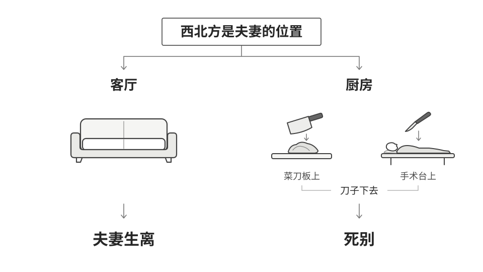 |
| **子女宫东边是厨房、子女宫太阴化忌，各主什么？** | 〔口述〕「那同样以此类推」「如果你的子女宫东边是厨房」，主的是长子夭折：「是阳宅地理位置上长子天折」（此句连说两三次，当一句看）。（[00:22:24–00:22:39](https://www.bilibili.com/video/BV1KJsLekEfA/?p=11&t=1344)，第 40320–40799 帧） 〔口述〕「那如果子女宫」「子女宫在化忌」「太阴化忌在这边」；「就这种八字是没有儿子的」「无子的命」。（[00:22:40–00:22:52](https://www.bilibili.com/video/BV1KJsLekEfA/?p=11&t=1360)，第 40800–41171 帧） 〔指代〕说「太阴化忌在这边」的「这边」时，手拿粉笔在黑板命盘左边中格（「午」下面那一格）写字、画圈，格里可辨「忌」字。（[00:22:43–00:22:48](https://www.bilibili.com/video/BV1KJsLekEfA/?p=11&t=1363)，第 40914–41045 帧） 〔叠图〕叠图「子女 庚辰」：太阴陷、化忌，擎羊庙，天喜陷，三台庙，天官旺，解神庙，寡宿陷，天煞，官符，病符，死；大限 33~42。（[00:22:40–00:22:41](https://www.bilibili.com/video/BV1KJsLekEfA/?p=11&t=1360)，第 40800–40859 帧） |
| **命中无子却生了儿子，怎么看？** | 〔口述〕设问「那你说倪海厦不对啊」「我现在有儿子」。倪师答：算男孩子的命「如果这男孩子命中没有儿子」，算出「他是无子」，「但是如果他太太太太命中有儿子」「她会生的儿子脸孔比较像太太」。（[00:22:52–00:23:06](https://www.bilibili.com/video/BV1KJsLekEfA/?p=11&t=1372)，第 41172–41603 帧） 〔口述〕「那如果有一天他生了儿子脸孔像他」「这个儿子呢就是主的就会天折」「这个命他占了一半」。（[00:23:06–00:23:13](https://www.bilibili.com/video/BV1KJsLekEfA/?p=11&t=1386)，第 41604–41819 帧） 〔指代〕说「脸孔像他这个」的「这个」时，手持粉笔点在黑板中右部画圈的字上，圈内字认不清。（[00:23:06–00:23:09](https://www.bilibili.com/video/BV1KJsLekEfA/?p=11&t=1386)，第 41604–41675 帧） 〔口述〕「然后如果呢」「再去住个房子」「东边是客厅的话」「那是100% 会天折」。（[00:23:14–00:23:21](https://www.bilibili.com/video/BV1KJsLekEfA/?p=11&t=1394)，第 41820–42053 帧） 〔板书〕黑板重画了命盘，可辨上方格「午」、左上残留「客」，右下角被叠图挡住，其余格内草书认不出。（[00:23:17](https://www.bilibili.com/video/BV1KJsLekEfA/?p=11&t=1397)，第 41928 帧） |
| **长子夭折怎么化解？三才里人间道占多少？** | 〔口述〕「那如何化解这天折」：「就是要靠第一个靠阳宅的位置」，东边把它改成卧房，「改成东宫嘛」。（[00:23:21–00:23:29](https://www.bilibili.com/video/BV1KJsLekEfA/?p=11&t=1401)，第 42054–42299 帧） 〔口述〕「第二个就医学上的技术」「他如果生了什么病」「医学上就能帮他解決」。（[00:23:30–00:23:35](https://www.bilibili.com/video/BV1KJsLekEfA/?p=11&t=1410)，第 42300–42461 帧） 〔口述〕「所以天人地三才」「实际上人间道的部分呢」……「医学的理论占了很大很重要的角色」。（[00:23:35–00:23:41](https://www.bilibili.com/video/BV1KJsLekEfA/?p=11&t=1415)，第 42462–42659 帧） 〔板书〕与上一张大致相同，可辨左上「客」字一带被圈，其余认不出。（[00:23:32](https://www.bilibili.com/video/BV1KJsLekEfA/?p=11&t=1412)，第 42389 帧） |
| **算出客户的死期死因，该不该直接说？** | 〔口述〕「在医的立场」「不然的话如果不懂医的话」，帮人算命说「你儿子天折」「然后死在心脏病」，「就算你算的很准好不好」……「你不要跟他讲他也是这样死啊」「你跟他讲的」「他就死之前不愉快好几天」。（[00:23:42–00:23:53](https://www.bilibili.com/video/BV1KJsLekEfA/?p=11&t=1422)，第 42660–43013 帧） 〔口述〕「对啊你要解決啊对不对」；举例 39 岁来算命，你说他 59 岁死在心脏病，「他20年就活在心脏病的阴影之下」「结果真的死在心脏病」，所以要解决。（[00:23:55–00:24:12](https://www.bilibili.com/video/BV1KJsLekEfA/?p=11&t=1435)，第 43074–43565 帧） 〔口述〕收尾一句：「这是日月反背的意思」。（[00:24:12–00:24:15](https://www.bilibili.com/video/BV1KJsLekEfA/?p=11&t=1452)，第 43566–43673 帧） |
| **日月反背在父母宫又化忌，怎么判先亡父还是母？** | 〔口述〕「那同理以此类推」「如果这个日月反背」「它在子女宫」，「如果日月反背如果在父母宫了又化忌」「太阴化忌代表妈妈」「太阳也在这边」「那父母亲代表会不在身边」「或者父母双亡」。（[00:24:15–00:24:30](https://www.bilibili.com/video/BV1KJsLekEfA/?p=11&t=1455)，第 43674–44105 帧） 〔叠图〕同一格宫名换成「父母 庚辰」，格内星曜与前面「子女 庚辰」逐项相同（太阴陷、化忌等）；随后另贴「田宅 丙戌」：太阳（不）、天姚庙、天贵旺、红鸾陷、八座平、大耗平、台辅、小耗、月德、沐浴。（[00:24:20–00:24:26](https://www.bilibili.com/video/BV1KJsLekEfA/?p=11&t=1460)，第 43800–44003 帧） 〔口述〕「那到底先亡父还是先亡母」「看印堂」；但对面老师刘海遮着，「我又不好意思叫他拉开来」，怕「告我这个这个这个性骚扰」，所以「看眉毛」。（[00:24:30–00:24:41](https://www.bilibili.com/video/BV1KJsLekEfA/?p=11&t=1470)，第 44106–44453 帧） 〔口述〕「刚好左边是父右边是母」；「如果父亲已经走了」「这眉毛也不需要伤感情了」「就停在那边不动」；「如果已经这个眉毛不动了」「这个走了妈妈已经走了」，「看脸上也可以知道」。（[00:24:41–00:24:59](https://www.bilibili.com/video/BV1KJsLekEfA/?p=11&t=1481)，第 44454–44981 帧） 〔指代〕说「这个眉毛很高」「这个眉毛不动了」「这个走了」时，手按在自己额头眉毛上方，指的是自己的眉毛，不是黑板。（[00:24:50–00:24:56](https://www.bilibili.com/video/BV1KJsLekEfA/?p=11&t=1490)，第 44718–44897 帧） |

**总结区**

- 通用规则：生离还是死别看阳宅：西北是夫、西南是妇（坤），厨房主死别、客厅主生离（[00:19:12–00:19:20](https://www.bilibili.com/video/BV1KJsLekEfA/?p=11&t=1152)，第 34584–34805 帧、[00:20:11–00:20:30](https://www.bilibili.com/video/BV1KJsLekEfA/?p=11&t=1211)，第 36330–36917 帧、[00:22:03–00:22:15](https://www.bilibili.com/video/BV1KJsLekEfA/?p=11&t=1323)，第 39708–40055 帧）；客厅的象是客人：东边是客厅主生不到儿子或儿子变成客人，西北是客厅主丈夫变成客人、把家当旅馆（[00:20:36–00:22:03](https://www.bilibili.com/video/BV1KJsLekEfA/?p=11&t=1236)，第 37104–39707 帧）；子女宫东边是厨房主长子夭折；化解一靠阳宅把东边改成卧房（东宫），二靠医学（[00:22:24–00:22:39](https://www.bilibili.com/video/BV1KJsLekEfA/?p=11&t=1344)，第 40320–40799 帧、[00:23:21–00:23:35](https://www.bilibili.com/video/BV1KJsLekEfA/?p=11&t=1401)，第 42054–42461 帧）；日月反背在父母宫又化忌，主父母不在身边或双亡；先亡父还是先亡母看眉毛，左边是父右边是母（[00:24:15–00:24:46](https://www.bilibili.com/video/BV1KJsLekEfA/?p=11&t=1455)，第 43674–44603 帧）
- 只在本例：本例命盘一直被说成女命，倪师在此更正「第二个八字是男的」，之后改按男命说西南角厨房死妻（[00:19:23–00:19:41](https://www.bilibili.com/video/BV1KJsLekEfA/?p=11&t=1163)，第 34908–35453 帧）；本例子女宫太阴化忌，倪师断「这种八字是没有儿子的」；若生的儿子像他、再住东边客厅的房子，「那是100% 会天折」（[00:22:40–00:23:21](https://www.bilibili.com/video/BV1KJsLekEfA/?p=11&t=1360)，第 40800–42053 帧）；父母宫日月反背化忌是借本例同一格改名作的假设演示，不是换了命例（[00:24:15–00:24:26](https://www.bilibili.com/video/BV1KJsLekEfA/?p=11&t=1455)，第 43674–44003 帧）
- 不是排盘规则，是处世方法：人间道、地理都没改，积重难返时，干脆劝对方放手（[00:19:41–00:20:04](https://www.bilibili.com/video/BV1KJsLekEfA/?p=11&t=1181)，第 35454–36143 帧）；不懂医就别直接告诉客户死期死因，否则对方死前多年活在阴影里；要帮他解决（[00:23:42–00:24:12](https://www.bilibili.com/video/BV1KJsLekEfA/?p=11&t=1422)，第 42660–43565 帧）；看印堂不便时改看眉毛，免得冒犯对方（[00:24:30–00:24:41](https://www.bilibili.com/video/BV1KJsLekEfA/?p=11&t=1470)，第 44106–44453 帧）

**待核**

1. [00:18:58](https://www.bilibili.com/video/BV1KJsLekEfA/?p=11&t=1138)，第 34146 帧：字幕「死夫」，语音「死敷」，按上下文取「死夫」。
2. [00:19:27](https://www.bilibili.com/video/BV1KJsLekEfA/?p=11&t=1167)，第 35028 帧：语音多出「是西北角的话他死本人」，字幕没有；男命西北角厨房的说法待核。
3. [00:19:35](https://www.bilibili.com/video/BV1KJsLekEfA/?p=11&t=1175)，第 35279 帧、[00:21:56](https://www.bilibili.com/video/BV1KJsLekEfA/?p=11&t=1316)，第 39480 帧、[00:21:58](https://www.bilibili.com/video/BV1KJsLekEfA/?p=11&t=1318)，第 39563 帧、[00:22:01](https://www.bilibili.com/video/BV1KJsLekEfA/?p=11&t=1321)，第 39630 帧、[00:22:01](https://www.bilibili.com/video/BV1KJsLekEfA/?p=11&t=1321)，第 39637 帧、[00:22:46](https://www.bilibili.com/video/BV1KJsLekEfA/?p=11&t=1366)，第 41004 帧、[00:23:11](https://www.bilibili.com/video/BV1KJsLekEfA/?p=11&t=1391)，第 41734 帧、[00:24:17](https://www.bilibili.com/video/BV1KJsLekEfA/?p=11&t=1457)，第 43728 帧、[00:24:25](https://www.bilibili.com/video/BV1KJsLekEfA/?p=11&t=1465)，第 43958 帧：指代「是（不确定）」或「否（不确定）」，未当依据。
4. [00:20:11](https://www.bilibili.com/video/BV1KJsLekEfA/?p=11&t=1211)，第 36330 帧：字幕作「決定」（繁体字形），原样引用；[00:23:33](https://www.bilibili.com/video/BV1KJsLekEfA/?p=11&t=1413)，第 42402 帧、[00:23:55](https://www.bilibili.com/video/BV1KJsLekEfA/?p=11&t=1435)，第 43074 帧「解決」同。
5. [00:21:04](https://www.bilibili.com/video/BV1KJsLekEfA/?p=11&t=1264)，第 37938 帧：字幕「再佳进去」，语音「在住进去」，按上下文应为「再住进去」，笔记已转述。
6. [00:21:26](https://www.bilibili.com/video/BV1KJsLekEfA/?p=11&t=1286)，第 38592 帧：字幕「顾名思必」，语音「顾名思义」，改为「顾名思义」。
7. [00:22:28](https://www.bilibili.com/video/BV1KJsLekEfA/?p=11&t=1348)，第 40452 帧起：字幕「天折」按上下文应为「夭折」（语音「夭者」）；引文保留字幕原字。
8. [00:22:26](https://www.bilibili.com/video/BV1KJsLekEfA/?p=11&t=1346)，第 40380 帧：「子女宫东边是厨房」中子女宫与东边如何对应，本块没有解释。
9. [00:23:01](https://www.bilibili.com/video/BV1KJsLekEfA/?p=11&t=1381)，第 41454 帧、[00:23:06](https://www.bilibili.com/video/BV1KJsLekEfA/?p=11&t=1386)，第 41604 帧：字幕行尾「小限：1022,34,46,58」等是叠图小限岁数串入字幕，已去掉。
10. [00:23:26](https://www.bilibili.com/video/BV1KJsLekEfA/?p=11&t=1406)，第 42204 帧：字幕「把官改成卧房」，语音「把它改成卧房」，按语音取「它」；[00:23:28](https://www.bilibili.com/video/BV1KJsLekEfA/?p=11&t=1408)，第 42240 帧「东宫」倪师未解释。
11. [00:19:44](https://www.bilibili.com/video/BV1KJsLekEfA/?p=11&t=1184)，第 35538 帧、[00:23:35](https://www.bilibili.com/video/BV1KJsLekEfA/?p=11&t=1415)，第 42462 帧：「人间道」「天人地三才」倪师用了但本块未解释。
12. [00:23:59](https://www.bilibili.com/video/BV1KJsLekEfA/?p=11&t=1439)，第 43188 帧：字幕「659岁」，语音「59岁」，取 59 岁。
13. [00:24:20](https://www.bilibili.com/video/BV1KJsLekEfA/?p=11&t=1460)，第 43800 帧：叠图「父母 庚辰」与此前「子女 庚辰」内容逐项相同，应是跟着「如果……在父母宫」改名示意；田宅丙戌太阳庙旺标为「不」，照图记录。
14. [00:24:50](https://www.bilibili.com/video/BV1KJsLekEfA/?p=11&t=1490)，第 44718 帧、[00:24:53](https://www.bilibili.com/video/BV1KJsLekEfA/?p=11&t=1493)，第 44808 帧：字幕括号「（左眉）」「（右眉）」语音没有，像字幕制作者加的注，未当原话引；手按的是哪边眉与「左边是父右边是母」的对应待核。
15. [00:18:42](https://www.bilibili.com/video/BV1KJsLekEfA/?p=11&t=1122)，第 33672 帧、[00:18:52](https://www.bilibili.com/video/BV1KJsLekEfA/?p=11&t=1132)，第 33984 帧板书：除「S」「W」「午」「大限」等外认不出，未写入；[00:19:08](https://www.bilibili.com/video/BV1KJsLekEfA/?p=11&t=1148)，第 34440 帧小框字形似「厨」、[00:20:24](https://www.bilibili.com/video/BV1KJsLekEfA/?p=11&t=1224)，第 36722 帧下小框形似「客」、[00:20:29](https://www.bilibili.com/video/BV1KJsLekEfA/?p=11&t=1229)，第 36881 帧圈内第二字形似「离」，均待核；[00:23:17](https://www.bilibili.com/video/BV1KJsLekEfA/?p=11&t=1397)，第 41928 帧、[00:23:32](https://www.bilibili.com/video/BV1KJsLekEfA/?p=11&t=1412)，第 42389 帧盘内草书大部分认不出。

## 武曲七杀会（福德宫）：主孤、离祖、武职大利、商劳多功少

〔叠图〕这一例视频里只贴过 3 格：福德 乙酉：武曲利、七杀旺、破碎平、龙池庙；迁移 己丑：紫微庙科、破军旺、左辅庙、右弼庙、华盖陷、天哭庙；子女（宫序推） 庚辰：太阴陷忌、擎羊庙、三台庙、天喜陷、天官旺、寡宿陷、解神庙。

### 5　武曲七杀会：孤、离祖、武职、商劳（[00:25:08–00:29:42](https://www.bilibili.com/video/BV1KJsLekEfA/?p=11&t=1508)，第 45264–53465 帧）

| 提示区 | 笔记区 |
|---|---|
| **倪师为什么要把几颗星合在一起讲？** | 〔口述〕本块以「还有一个」转场，倪师说他把一些星联合在一起讲：「我一讲12章讲完你就会批了嘛」「以后讲例子你都会了」。（[00:25:08–00:25:17](https://www.bilibili.com/video/BV1KJsLekEfA/?p=11&t=1508)，第 45264–45533 帧） 〔板书〕本块开头的板面是之前画好的盘图，可辨左上一格的「午」，其余各格圈内的字潦草，认不出。（[00:25:09](https://www.bilibili.com/video/BV1KJsLekEfA/?p=11&t=1509)，第 45276 帧） 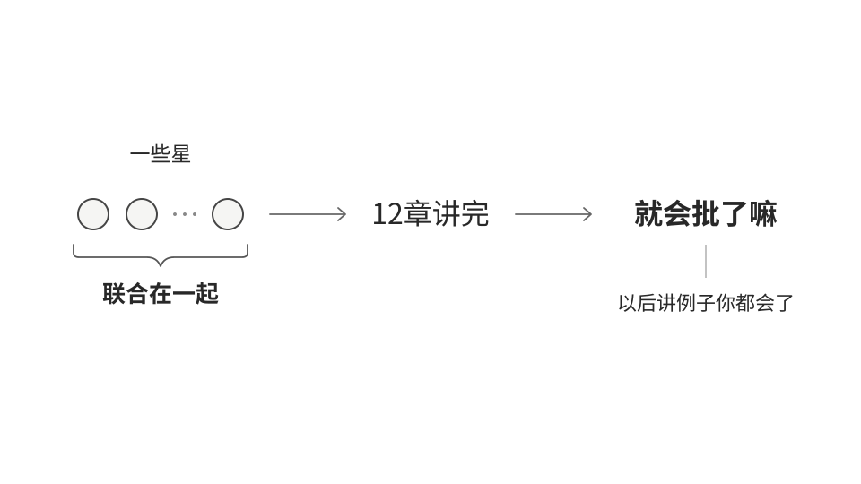 |
| **紫微在丑宫时，武曲七杀落在哪？日月怎样？** | 〔口述〕倪师说「诸位看到这一个地方」「武曲和七杀在这边是不是」，接着讲规律：「所以你看紫微星在丑宫的时候」「一定武曲七杀一定会会到这边来」「日月一定会反背懂不懂」「只是你看它哪里反背啊」，并说「比如这样子你这样子推一下」。（[00:25:17–00:25:32](https://www.bilibili.com/video/BV1KJsLekEfA/?p=11&t=1517)，第 45534–45983 帧） 〔指代〕说「一定会会到这边来」时（☞ 记作「这里」），倪师右手按在黑板盘图左侧中间一格画圈的字上，那几个字潦草看不清。（[00:25:27](https://www.bilibili.com/video/BV1KJsLekEfA/?p=11&t=1527)，第 45817 帧） 〔叠图〕福德宫乙酉：武曲利、七杀旺、龙池庙、破碎平，另有冠带、飞廉、将星、官符；大限 103~112。（[00:25:20–00:25:23](https://www.bilibili.com/video/BV1KJsLekEfA/?p=11&t=1520)，第 45606–45701 帧） 〔叠图〕迁移宫己丑：紫微庙（旁标「科」）、破军旺、左辅庙、右弼庙、天哭庙、华盖陷，另有伏兵、冠带、白虎。（[00:25:23–00:25:24](https://www.bilibili.com/video/BV1KJsLekEfA/?p=11&t=1523)，第 45702–45725 帧） |
| **官禄宫太阴化忌，这个人当官会怎样？** | 〔口述〕倪师举例：「比如说这是官禄宫」「太阴星化忌」「这个人官当官就毁掉了」。（[00:25:32–00:25:37](https://www.bilibili.com/video/BV1KJsLekEfA/?p=11&t=1532)，第 45984–46115 帧） 〔叠图〕叠图切到官禄宫庚辰：太阴陷、化忌；擎羊庙、天官旺、三台庙、解神庙、天喜陷、寡宿陷，另有力士、天煞、病符、衰。（[00:25:32–00:25:33](https://www.bilibili.com/video/BV1KJsLekEfA/?p=11&t=1532)，第 45984–46019 帧） 〔推断〕推断：倪师用「比如说」引出这一宫，口述没说清这是本命例自己的官禄宫，还是借来举例；叠图同时显示官禄庚辰太阴陷忌，两者对得上，但不能据此断定。（[00:25:32–00:25:37](https://www.bilibili.com/video/BV1KJsLekEfA/?p=11&t=1532)，第 45984–46115 帧） |
| **明知不是当官的料还劝他当官，错在哪？** | 〔口述〕明明当官已经毁掉了，算命的还跟他说去当官很好，就是「你你害他做一件事情」「他一辈子做不到的事情」。（[00:25:37–00:25:45](https://www.bilibili.com/video/BV1KJsLekEfA/?p=11&t=1537)，第 46116–46361 帧） 〔口述〕倪师举例：「比如说你不是当官的料」「我逼着你去当官」「你考到50岁还在考特考」，考到49岁，「你都活得很痛苦」「这是谁害的我害的」。（[00:25:47–00:25:59](https://www.bilibili.com/video/BV1KJsLekEfA/?p=11&t=1547)，第 46428–46793 帧） 〔口述〕所以「我们算命要看他哪个角色适合扮演」「告诉他安在那个位置上」「以此类推知不知道意思」。（[00:25:59–00:26:06](https://www.bilibili.com/video/BV1KJsLekEfA/?p=11&t=1559)，第 46794–46991 帧） |
| **武曲七杀在福德宫，该怎么去理解它？** | 〔口述〕倪师说「这里有个重点福德宫」，讲武曲七杀「这两颗星在一起的时候」，要「诸位用顾名思义用想的」「你过去看到书上都不要想」「要顾名思义」。（[00:26:06–00:26:27](https://www.bilibili.com/video/BV1KJsLekEfA/?p=11&t=1566)，第 46992–47621 帧） 〔指代〕说「这里有个重点」的「这里」时，倪师食指点在黑板盘图右侧中间一格画圈的字下方，圈内字迹潦草，无法照抄。（[00:26:05](https://www.bilibili.com/video/BV1KJsLekEfA/?p=11&t=1565)，第 46971 帧） 〔板书〕盘图右侧一格里新圈了几个字，潦草，认不出。（[00:26:14](https://www.bilibili.com/video/BV1KJsLekEfA/?p=11&t=1574)，第 47220 帧） 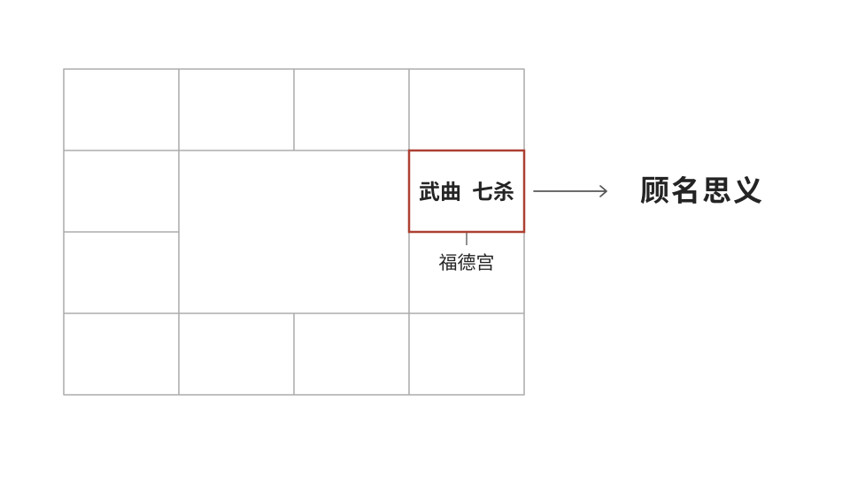 |
| **武杀会第一条：女子逢武曲七杀主什么？** | 〔口述〕倪师写「武杀会」，「第一个是女子」「女子呢逢到这个武曲七杀主孤单」，劝她「你还是好好在家做家庭主妇就好了！」。（[00:26:27–00:26:41](https://www.bilibili.com/video/BV1KJsLekEfA/?p=11&t=1587)，第 47622–48041 帧） 〔口述〕接着说「你去杀谁啊」，「就是变成当武官」「个人去孤军奋战拼命去做」「那不是主孤单吗」。（[00:26:41–00:26:49](https://www.bilibili.com/video/BV1KJsLekEfA/?p=11&t=1601)，第 48042–48287 帧） 〔板书〕可辨：首行「武□会」（第二字被圈住，认不出），第二行「①女子、主孤单」。（[00:26:43](https://www.bilibili.com/video/BV1KJsLekEfA/?p=11&t=1603)，第 48090 帧） |
| **第二条离祖：怎么从盘上看他几岁离家？** | 〔口述〕「第二个呢」「代表离祖」「到异乡」「异乡发迹」。（[00:26:51–00:27:06](https://www.bilibili.com/video/BV1KJsLekEfA/?p=11&t=1611)，第 48342–48803 帧） 〔口述〕倪师举例：「比如说有一个人命出来」「一出来命就是这个」「他早年就会离家」；「如果他是第二个 12-21岁是武曲七杀」「就是到那个时候才离家」，所以要「看他是什么时候」。（[00:27:06–00:27:20](https://www.bilibili.com/video/BV1KJsLekEfA/?p=11&t=1626)，第 48804–49229 帧） 〔板书〕可辨：「②离祖」开头、第二行「迹」字，中间几个字潦草，认不出；「主孤单」下加了一道底线。（[00:27:06](https://www.bilibili.com/video/BV1KJsLekEfA/?p=11&t=1626)，第 48804 帧） |
| **第三条：男人逢武曲七杀适合干什么？** | 〔口述〕「第三个如果是男人」「武职大利」「武官非常好」，「你干今天是干军人警察法官外交官」，这些都算武职。（[00:27:21–00:27:40](https://www.bilibili.com/video/BV1KJsLekEfA/?p=11&t=1641)，第 49230–49817 帧） 〔板书〕可辨：「③男人 武□大利」，「男人」下有底线，「武」后一字潦草，认不出。（[00:27:30](https://www.bilibili.com/video/BV1KJsLekEfA/?p=11&t=1650)，第 49524 帧） 〔板书〕「武□大利」这一行下面又加了一道底线，其余同前。（[00:27:36](https://www.bilibili.com/video/BV1KJsLekEfA/?p=11&t=1656)，第 49704 帧） |
| **武官会到文昌星，结果会怎样？** | 〔口述〕「武官的人要逢到杀星才用嘛」；「有的人武官呢都没有会到」，「会到个文昌星」，「结果他他当他当教官」，「教在学校当教官教书的」，「那不一样」。（[00:27:40–00:27:56](https://www.bilibili.com/video/BV1KJsLekEfA/?p=11&t=1660)，第 49818–50309 帧） 〔口述〕倪师称之为「当会到文昌的武官文相懂不懂」，随后回到「这是武职大利」。（[00:27:57–00:28:03](https://www.bilibili.com/video/BV1KJsLekEfA/?p=11&t=1677)，第 50310–50507 帧） 〔叠图〕叠图切到福德宫丙戌：文昌庙、天刑庙，另有天煞、奏书、胎、贯索，标「身宫」。（[00:27:44–00:27:46](https://www.bilibili.com/video/BV1KJsLekEfA/?p=11&t=1664)，第 49944–49997 帧） 〔推断〕推断：讲到「会到个文昌星」时叠图切到福德丙戌，约十几秒后又切回福德乙酉；口述是泛讲「有的人」，看来只是示意文昌，不是换了命例。（[00:27:44–00:28:03](https://www.bilibili.com/video/BV1KJsLekEfA/?p=11&t=1664)，第 49944–50507 帧） |
| **商人碰到武曲七杀，为什么劳多功少？** | 〔口述〕「如果是商人」「商人会到这个主劳多功少」，因为「这两颗星进来的话」「完全掌的是权」「不掌禄不管财」。（[00:28:03–00:28:18](https://www.bilibili.com/video/BV1KJsLekEfA/?p=11&t=1683)，第 50508–50951 帧） 〔口述〕「那你是商人」「碰到这颗星不是很累吗」：「我商人说我不要权」「你都不要跟我讲掌权」「只要我赚钱就好了」。（[00:28:19–00:28:26](https://www.bilibili.com/video/BV1KJsLekEfA/?p=11&t=1699)，第 50982–51203 帧） 〔口述〕比喻：当董事长手下有100个人，「你们大家都不要叫我董事长就好了」「每个月你给我赚100万」「我就很爽」，「其实我是求利我又不是求权」，所以「看你是什么职位」「需要什么东西」。（[00:28:26–00:28:41](https://www.bilibili.com/video/BV1KJsLekEfA/?p=11&t=1706)，第 51204–51659 帧） 〔板书〕可辨：「商人、主劳多功」，末一字认不出；「武□大利」下有底线。（[00:28:14](https://www.bilibili.com/video/BV1KJsLekEfA/?p=11&t=1694)，第 50820 帧） |
| **武曲七杀和廉贞贪狼比，哪个凶？** | 〔口述〕「那遇到这种所以他他会不好」，「但是武曲七杀比廉贞贪狼好多了」，「因为它至少不像廉贪落陷那么凶」「了解我意思吧不像它那么凶」。（[00:28:42–00:28:57](https://www.bilibili.com/video/BV1KJsLekEfA/?p=11&t=1722)，第 51660–52139 帧） |
| **福德宫武曲七杀，男命、女命各主什么？** | 〔口述〕「那如果男孩子的命里面」「他的福德福德主的是一辈子」「他是武曲七杀」，「代表这个男孩子个性很刚强」「他不喜欢靠祖业」「一个人拼命去做事情」。（[00:28:58–00:29:09](https://www.bilibili.com/video/BV1KJsLekEfA/?p=11&t=1738)，第 52140–52487 帧） 〔口述〕女孩子的福德宫倪师说最难批；遇到武曲七杀，「她一辈子靠她自己」「这个人面大骨粗」「孤鸾孤单的凤凰」「就不会结婚哦」。（[00:29:09–00:29:22](https://www.bilibili.com/video/BV1KJsLekEfA/?p=11&t=1749)，第 52488–52883 帧） 〔口述〕倪师接着带到阳宅：「那你拿阳宅一看哎」「怎么你住住西北角」「小姐你为什么要没有结婚」「你要去住爸爸的位置」，说「慢慢会陆续跟诸位介绍」，最后收在「这是武曲七杀」。（[00:29:22–00:29:42](https://www.bilibili.com/video/BV1KJsLekEfA/?p=11&t=1762)，第 52884–53465 帧） |

**总结区**

- 通用规则：紫微星在丑宫时，武曲七杀一定会到（倪师手按黑板那一格），日月一定反背（[00:25:24–00:25:28](https://www.bilibili.com/video/BV1KJsLekEfA/?p=11&t=1524)，第 45726–45869 帧）；武杀会：女子主孤单；离祖到异乡发迹，看它落在第几个大限就知几岁离家；男人武职大利；商人主劳多功少（[00:26:27–00:28:12](https://www.bilibili.com/video/BV1KJsLekEfA/?p=11&t=1587)，第 47622–50783 帧）；武曲七杀掌的是权、不掌禄不管财，所以商人碰到很累；但它比廉贞贪狼好，不像廉贪落陷那么凶（[00:28:14–00:28:57](https://www.bilibili.com/video/BV1KJsLekEfA/?p=11&t=1694)，第 50820–52139 帧）；福德宫武曲七杀：男命个性刚强、不喜欢靠祖业；女命一辈子靠自己、面大骨粗、孤鸾不会结婚（[00:28:58–00:29:22](https://www.bilibili.com/video/BV1KJsLekEfA/?p=11&t=1738)，第 52140–52883 帧）
- 只在本例：本例叠图武曲七杀在福德宫乙酉（武曲利、七杀旺），大限 103~112（[00:25:20–00:25:23](https://www.bilibili.com/video/BV1KJsLekEfA/?p=11&t=1520)，第 45606–45701 帧）；叠图官禄宫庚辰太阴陷化忌，倪师说这个人当官就毁掉了（是否本命例口述未明说）（[00:25:32–00:25:37](https://www.bilibili.com/video/BV1KJsLekEfA/?p=11&t=1532)，第 45984–46115 帧）
- 不是排盘规则，是处世方法：算命要看对方适合扮演哪个角色，把他安在那个位置上；逼不是当官料的人去当官，是害他一辈子痛苦（[00:25:37–00:26:06](https://www.bilibili.com/video/BV1KJsLekEfA/?p=11&t=1537)，第 46116–46991 帧）；学星曜组合要顾名思义自己去想，不要套过去书上看到的说法（[00:26:20–00:26:27](https://www.bilibili.com/video/BV1KJsLekEfA/?p=11&t=1580)，第 47418–47621 帧）

**待核**

1. [00:25:21](https://www.bilibili.com/video/BV1KJsLekEfA/?p=11&t=1521)，第 45634 帧：说「武曲和七杀在这边」时讲者背对镜头、手被身体挡住，看不出「这边」指哪
2. [00:25:27](https://www.bilibili.com/video/BV1KJsLekEfA/?p=11&t=1527)，第 45834 帧：「反背」一词本块没有解释，也没说日月具体在哪两宫
3. [00:25:34](https://www.bilibili.com/video/BV1KJsLekEfA/?p=11&t=1534)，第 46020 帧：「太阴星化忌」语音识别为「已经新化剧」，两路只大体对得上
4. [00:25:34](https://www.bilibili.com/video/BV1KJsLekEfA/?p=11&t=1534)，第 46037 帧：「这个」手势可能是指盘图左侧中格，也可能只是强调，不确定
5. [00:25:50](https://www.bilibili.com/video/BV1KJsLekEfA/?p=11&t=1550)，第 46524 帧：「特考」一词本块没有解释
6. [00:26:07](https://www.bilibili.com/video/BV1KJsLekEfA/?p=11&t=1567)，第 47038 帧：手停在盘图右侧中格、拿着粉笔，分不清是指还是在写
7. [00:26:14](https://www.bilibili.com/video/BV1KJsLekEfA/?p=11&t=1574)，第 47220 帧：盘图右侧一格新圈的字认不出
8. [00:26:38](https://www.bilibili.com/video/BV1KJsLekEfA/?p=11&t=1598)，第 47958 帧：字幕「你还是好好在家做家庭主妇就好了_！」中的「_」是识别噪声，引文已去掉
9. [00:26:41](https://www.bilibili.com/video/BV1KJsLekEfA/?p=11&t=1601)，第 48042 帧：「你去杀谁啊」与前后句的衔接意思本块没有展开
10. [00:26:43](https://www.bilibili.com/video/BV1KJsLekEfA/?p=11&t=1603)，第 48090 帧：板书首行「武□会」第二字被圈住，认不出；口述为「武杀会」
11. [00:27:06](https://www.bilibili.com/video/BV1KJsLekEfA/?p=11&t=1626)，第 48804 帧：板书「②离祖」与「迹」之间几个字潦草认不出，口述是「到异乡」「异乡发迹」，图上未能确认
12. [00:27:08](https://www.bilibili.com/video/BV1KJsLekEfA/?p=11&t=1628)，第 48869 帧：「一出来命就是这个」手掌扫向右上盘图，看不出落在哪一格
13. [00:27:30](https://www.bilibili.com/video/BV1KJsLekEfA/?p=11&t=1650)，第 49524 帧：板书「武」后一字潦草认不出，口述为「武职」
14. [00:27:44](https://www.bilibili.com/video/BV1KJsLekEfA/?p=11&t=1664)，第 49944 帧：叠图在同一讲解中先后出现福德丙戌、福德乙酉两个福德宫，应是示意文昌而非同一张盘，待核
15. [00:27:49](https://www.bilibili.com/video/BV1KJsLekEfA/?p=11&t=1669)，第 50084 帧：字幕「就是变成当武官」语音识别为「就变成当母官」，按字幕收
16. [00:28:06](https://www.bilibili.com/video/BV1KJsLekEfA/?p=11&t=1686)，第 50593 帧：「商人会到这个」手指向「②离祖」一行右端附近，具体字看不清，不确定
17. [00:28:14](https://www.bilibili.com/video/BV1KJsLekEfA/?p=11&t=1694)，第 50820 帧：材料字幕栏记为「完全掌的是权」，但该帧画面字幕是「掌的是生杀之权」，语音为「的是身杀之权完全长的是权」，字幕栏可能漏了一句
18. [00:28:14](https://www.bilibili.com/video/BV1KJsLekEfA/?p=11&t=1694)，第 50820 帧：板书「商人、主劳多功」末一字认不出
19. [00:28:20](https://www.bilibili.com/video/BV1KJsLekEfA/?p=11&t=1700)，第 51010 帧：「这颗星」时手掌扫过「③男人 武…大利」一行，手是糊的，不确定在指
20. [00:28:51](https://www.bilibili.com/video/BV1KJsLekEfA/?p=11&t=1731)，第 51942 帧：「廉贪落陷」本块没有解释
21. [00:29:11](https://www.bilibili.com/video/BV1KJsLekEfA/?p=11&t=1751)，第 52554 帧：字幕「福德官是最难批的」中「福德官」按上下文应为「福德宫」，笔记里已改作福德宫
22. [00:29:17](https://www.bilibili.com/video/BV1KJsLekEfA/?p=11&t=1757)，第 52728 帧：「孤鸾」一词倪师只解释为「孤单的凤凰」
23. [00:29:24](https://www.bilibili.com/video/BV1KJsLekEfA/?p=11&t=1764)，第 52926 帧：「住西北角」与「爸爸的位置」之间的关系本块没有解释，倪师说以后陆续介绍

## 本例33–42大限：婚姻凶的化解、合八字与八字合

〔叠图〕这一例视频里只贴过 7 格：子女 庚辰：太阴陷忌、擎羊庙、三台庙、天喜陷、天官旺、寡宿陷、解神庙；田宅 丙戌：太阳不、八座平、大耗平、天姚庙、天贵旺、红鸾陷；交友 戊子：天机庙禄、天魁旺、天才旺、天伤陷；命宫 癸未：天相得、火星利、地空平、截空庙；父母 甲申：天同旺、天梁陷权、文曲得、天钺庙、天寿旺、天福庙、孤辰平、恩光平；兄弟 壬午：巨门旺、文昌陷、天刑平、副截庙、天空庙、咸池陷；夫妻 辛巳：廉贞陷、贪狼陷、凤阁庙、年解旺。

### 6　33至42婚姻凶、外面命解与合八字（[00:29:42–00:36:03](https://www.bilibili.com/video/BV1KJsLekEfA/?p=11&t=1782)，第 53466–64919 帧）

| 提示区 | 笔记区 |
|---|---|
| **本例33到42这个十年，流年里有哪些星？** | 〔口述〕倪师回到本例命盘，拿手上的讲义讲33到42这个十年：「那如果我们以这张八字来说」「这个33-42他不是有」「你看他的流年哦」「是不是太阴星」「有没有太阴星在里面」「然后这个官府带死」。（[00:29:42–00:30:00](https://www.bilibili.com/video/BV1KJsLekEfA/?p=11&t=1782)，第 53466–54029 帧） 〔指代〕说「诸位看」这个33到42时，左手举讲义、右手食指点在讲义上；讲义上的字看不清，所指具体内容无法辨认。（[00:29:48](https://www.bilibili.com/video/BV1KJsLekEfA/?p=11&t=1788)，第 53662 帧） 〔叠图〕左下角叠图【子女 庚辰】，大限33~42：太阴陷、化忌（忌字红底），擎羊庙，天喜陷，三台庙，天官旺，解神庙，寡宿陷；另有官符、天煞、病符、死；流年12,24,36,48,60，小限10,22,34,46,58。（[00:29:51–00:29:53](https://www.bilibili.com/video/BV1KJsLekEfA/?p=11&t=1791)，第 53730–53819 帧） |
| **为什么说这十年「实在是太凶了」？** | 〔口述〕倪师指出红鸾、天喜跟这一宫对会：「诸位看这红鸾星天喜星」「是不是在他的这个宫」「在辰宫对会回来有没有」。（[00:30:01–00:30:10](https://www.bilibili.com/video/BV1KJsLekEfA/?p=11&t=1801)，第 54030–54305 帧） 〔口述〕这十年他要放大太阴化忌来讲：「所以他在33-42中间十年中间呢」「我放大」「太阴星化忌」「实在是太凶了」，并说要把这个人当例子举给大家听。（[00:30:10–00:30:24](https://www.bilibili.com/video/BV1KJsLekEfA/?p=11&t=1810)，第 54306–54731 帧） 〔口述〕其余小星不必看：「旁边小小星啊」「还有官府还有死这小星」「这擎羊都不必去看它了」「已经没有什么用了」。（[00:30:24–00:30:32](https://www.bilibili.com/video/BV1KJsLekEfA/?p=11&t=1824)，第 54732–54971 帧） 〔板书〕写完后的板面可辨：「太陰」「官府」「死」「33—42」，其余认不出。（[00:30:27](https://www.bilibili.com/video/BV1KJsLekEfA/?p=11&t=1827)，第 54839 帧） |
| **看这个宫还要看哪里？对宫是什么星？** | 〔口述〕倪师说「这个宫我们要看对宫」「对面是不是太阳」「这是不是太阳陷地有没有」。（[00:30:32–00:30:38](https://www.bilibili.com/video/BV1KJsLekEfA/?p=11&t=1832)，第 54972–55163 帧） 〔叠图〕叠图在子女庚辰上方加出【田宅 丙戌】，大限93~102：太阳不，红鸾陷，天姚庙，八座平，天贵旺，台辅，大耗平，月德；另有奏书、攀鞍、小耗、沐浴；流年6,18,30,42,54，小限4,16,28,40,52。（[00:30:32–00:30:33](https://www.bilibili.com/video/BV1KJsLekEfA/?p=11&t=1832)，第 54972–55013 帧） 〔推断〕推断：叠图里子女庚辰有天喜、对面田宅丙戌有红鸾，和倪师说的「红鸾星天喜星」「在辰宫对会回来」相合；但倪师说太阳「陷地」，叠图印的是「太阳不」，两者字面不同。（[00:30:01–00:30:38](https://www.bilibili.com/video/BV1KJsLekEfA/?p=11&t=1801)，第 54030–55163 帧） |
| **33到42走子女宫，倪师断了哪三件事？** | 〔口述〕「所以他在33-42」「这个是走子女宫」，第一个是「第一个他我们可以看到他无子福」「没有儿子的福」；又说人死了「人死了也就没有儿子的福了嘛」，也是一样。（[00:30:38–00:30:52](https://www.bilibili.com/video/BV1KJsLekEfA/?p=11&t=1838)，第 55164–55565 帧） 〔指代〕说「所以他在33到42，这个是走子女宫」时，粉笔尖点在黑板上手写的「33-42」的「33」处，指的是板书，不是叠图。（[00:30:39](https://www.bilibili.com/video/BV1KJsLekEfA/?p=11&t=1839)，第 55191 帧） 〔口述〕第二个：「第二个呢」「父母凶主丧亡」，解释为「丧亡父母亲要离开你」。第三个：「第三个」「婚姻凶这个男人的命呢」。（[00:30:53–00:31:06](https://www.bilibili.com/video/BV1KJsLekEfA/?p=11&t=1853)，第 55596–56009 帧） 〔板书〕写完后的板面可辨：「太陰、忌」「官府」「死 33—42」，下方大圆圈里写了几个字，像有「福」字，其余认不出。（[00:30:46](https://www.bilibili.com/video/BV1KJsLekEfA/?p=11&t=1846)，第 55404 帧） 〔板书〕大圆圈右侧新写了几个带圈的小编号，具体编号和字认不出。（[00:30:56](https://www.bilibili.com/video/BV1KJsLekEfA/?p=11&t=1856)，第 55680 帧） |
| **男命太阴化忌，为什么婚姻一定完蛋？** | 〔口述〕倪师说太阴代表太太：「到太阴代表什么太太」「太太在这个时候化忌」「婚姻一定完蛋」「根本就不用看了」「这个婚姻完蛋」。（[00:31:07–00:31:16](https://www.bilibili.com/video/BV1KJsLekEfA/?p=11&t=1867)，第 56010–56285 帧） 〔指代〕说「太太在这个时候化忌」时，右手食指点着黑板上「太阴、忌」里的「忌」字。（[00:31:09](https://www.bilibili.com/video/BV1KJsLekEfA/?p=11&t=1869)，第 56093 帧） |
| **天喜、红鸾逢化忌，夫妻会怎样？** | 〔口述〕「因为他天喜星是不是在旁边」「诸位看右边右上角」「那边是不是有天官解神天喜」，并说「天喜在这边红鸾星一定在对面」。（[00:31:16–00:31:26](https://www.bilibili.com/video/BV1KJsLekEfA/?p=11&t=1876)，第 56286–56585 帧） 〔指代〕说「红鸾星在这边」时，左手举命盘讲义，右手食指点在讲义上某处；讲义上的字太小看不清。（[00:31:26](https://www.bilibili.com/video/BV1KJsLekEfA/?p=11&t=1886)，第 56600 帧） 〔口述〕「那红鸾天喜星牛郎织女星」「这个喜神逢到化忌」「他又是男命他又不是太阴有没有」「所以夫妻一定冲不是生离就是死别」「一定完蛋」。（[00:31:28–00:31:37](https://www.bilibili.com/video/BV1KJsLekEfA/?p=11&t=1888)，第 56664–56933 帧） 〔指代〕说「这个喜神」时，右手手掌按在黑板上紧挨圈「忌」右侧的那个圆圈，圈内只露出「天」字，其余被手掌挡住。（[00:31:30](https://www.bilibili.com/video/BV1KJsLekEfA/?p=11&t=1890)，第 56705 帧） |
| **只剩生离和死别两条路，倪师怎么选？** | 〔口述〕「那遇到如果结果只有两个」「生离跟死别的话」「如果我们这个做选择」「生离比死别可能还好一点」。（[00:31:37–00:31:46](https://www.bilibili.com/video/BV1KJsLekEfA/?p=11&t=1897)，第 56934–57203 帧） |
| **光会算命的人给的建议，为什么是「废话」？** | 〔口述〕倪师假设以前「我们没有阳宅」「没有人间道」「光是算命」，算命的人会说「您这个命很惨很惨烈」「那您这个婚姻子女都不好」，然后建议「你43岁以后再结婚」。（[00:31:46–00:32:01](https://www.bilibili.com/video/BV1KJsLekEfA/?p=11&t=1906)，第 57204–57635 帧） 〔口述〕倪师说这是「这不是废话有没有」，打比方「就像台北市政府」「一男一女恰恰好」，说完就算了；实际上「他会有周围的环境逼他做」「很难啊」。（[00:32:05–00:32:20](https://www.bilibili.com/video/BV1KJsLekEfA/?p=11&t=1925)，第 57768–58211 帧） 〔口述〕总结：「所以我们往往算命给客户的建议」「讲出来的话很简单讲」「可是是消极的」「人家做不到」「这就是过去算命的缺失就在这里」；叫人不要结婚是「很好的想法啊」，但「那想法跟事实不一样啊」。（[00:32:20–00:32:41](https://www.bilibili.com/video/BV1KJsLekEfA/?p=11&t=1940)，第 58212–58835 帧） 〔推断〕推断：「43岁以后」正好接在本例33~42这个子女宫大限之后；倪师没有明说这层关系。（[00:31:58–00:32:05](https://www.bilibili.com/video/BV1KJsLekEfA/?p=11&t=1918)，第 57564–57767 帧） |
| **外面算命遇到婚姻凶，给的两个「命解」是什么？** | 〔口述〕「算命有化解的方式」「算命外面的算命化解方式」「遇到婚姻不好的时候」「男女都一样」；接着讲六和九：「九呢是阳数的极」（前一句讲六是阴数之极，字幕识别不清）。（[00:32:45–00:33:09](https://www.bilibili.com/video/BV1KJsLekEfA/?p=11&t=1965)，第 58968–59687 帧） 〔口述〕「婚姻凶的时候」有两个命解：「命的解法第一个」「二婚的对象」，「第二个呢」「长7岁以上」。（[00:33:14–00:33:34](https://www.bilibili.com/video/BV1KJsLekEfA/?p=11&t=1994)，第 59832–60449 帧） 〔口述〕举例：婚姻非常不好、还没结婚的人来算，就跟他说「你找个对象离过婚的」「再跟他结婚」「还要年龄相差要相差7岁以上才行」，这样「那那那就不克了」。（[00:33:35–00:33:55](https://www.bilibili.com/video/BV1KJsLekEfA/?p=11&t=2015)，第 60450–61061 帧） 〔板书〕可辨两行：「六→陰…之極」「九→陽…之極」，中间字认不全；下面开始写「人命」，其余认不出。（[00:33:13](https://www.bilibili.com/video/BV1KJsLekEfA/?p=11&t=1993)，第 59796 帧） 〔板书〕写完后可辨：「人命婚凶」「命解」，下面编号「①二婚之對…」「②長七…」，其余认不出。（[00:35:10](https://www.bilibili.com/video/BV1KJsLekEfA/?p=11&t=2110)，第 63324 帧） |
| **这两个命解是废话吗？倪师说道理在哪？** | 〔口述〕倪师先说「这也是废话哦」「这是一般外面算命的」，又说「但是我为什么要告诉你」「因为有的人命就是这样子」，娶或嫁个离过婚、相差7岁的，就「没事了」。（[00:33:55–00:34:14](https://www.bilibili.com/video/BV1KJsLekEfA/?p=11&t=2035)，第 61062–61643 帧） 〔口述〕第一种道理：「她离过婚她本来就理亏的嘛」「她就是忍耐」；以前跟老公吵架「她敢她敢出去喝酒跳舞的」，「现在不好意思去了」「对不对就待在家里面」。（[00:34:23–00:34:34](https://www.bilibili.com/video/BV1KJsLekEfA/?p=11&t=2063)，第 61896–62249 帧） 〔口述〕第二种：先生「脾气很坏」，太太年龄差不多就「冲突很大」；「如果遇到个太太小你7岁以下」，就会想「哎小美眉算了她不懂是应该的」。（[00:34:35–00:34:47](https://www.bilibili.com/video/BV1KJsLekEfA/?p=11&t=2075)，第 62250–62639 帧） 〔口述〕结论：「这同样一件事情」「对面面对她的态度不一样造成的」「所以算命有它的逻辑在这里」；如果年龄差不多，「吵架冲突就来了」。（[00:34:48–00:34:59](https://www.bilibili.com/video/BV1KJsLekEfA/?p=11&t=2088)，第 62640–62987 帧） |
| **合八字时，要看两人是哪一种「合」？** | 〔口述〕「帮人家合八字的时候」「我们看这两个八字放在一起一看」「居然这个八字是父女合」；「他的外面的形是夫妻男女」，八字却是父女合。（[00:35:00–00:35:15](https://www.bilibili.com/video/BV1KJsLekEfA/?p=11&t=2100)，第 63018–63467 帧） 〔口述〕父女合的样子：「把他太太当女儿一样的宠爱」；打比方马路上爸爸「对待女儿的态度」「和对儿子不一样」，「儿子一脚踢过去啊」「女儿就抱到怀里面去」。（[00:35:15–00:35:29](https://www.bilibili.com/video/BV1KJsLekEfA/?p=11&t=2115)，第 63468–63881 帧） 〔口述〕其他的合：「有的夫妻呢是母子合」「有的是朋友合」，「看你是看你是什么状况嘛」。（[00:35:33–00:35:46](https://www.bilibili.com/video/BV1KJsLekEfA/?p=11&t=2133)，第 64014–64391 帧） 〔板书〕写「父女合」「母子合」「朋友合」之后的两张板面，新写的字（含上方粉红色粉笔字）都认不出，右边一部分被身体挡住。（[00:35:20](https://www.bilibili.com/video/BV1KJsLekEfA/?p=11&t=2120)，第 63612 帧） |
| **本例命宫天相，挑到廉贞贪狼的对象会怎样？** | 〔口述〕倪师拿本例举例：「一个八字的时候」「我们有命宫」「诸位看八字格」「命宫是天相」；「如果他还没有结婚」「我们帮他挑对象的时候」「一挑他对象的命宫就是廉贞贪狼」「是不是刚好死路一条」。原因留到下一块讲。（[00:35:52–00:36:03](https://www.bilibili.com/video/BV1KJsLekEfA/?p=11&t=2152)，第 64566–64919 帧） 〔叠图〕【命宫 癸未】：天相得，地空平，火星利，截空庙；另有丧门、将军、月煞、蜚廉、墓；数字串中「312」按图例为大限3~12。（[00:35:52–00:35:53](https://www.bilibili.com/video/BV1KJsLekEfA/?p=11&t=2152)，第 64566–64595 帧） 〔叠图〕叠图另加【命宫 丁亥】：廉贞陷、贪狼陷，凤阁庙，年解旺；另有岁建、指背、青龙、病；数字串没有还原。（[00:36:01–00:36:03](https://www.bilibili.com/video/BV1KJsLekEfA/?p=11&t=2161)，第 64830–64919 帧） 〔推断〕推断：按口述，丁亥这一格标「命宫」是在演示「对象的命宫是廉贞贪狼」这个假设，不是换了命例；本例本人的命宫仍是癸未天相。（[00:35:53–00:36:03](https://www.bilibili.com/video/BV1KJsLekEfA/?p=11&t=2153)，第 64596–64919 帧） |

**总结区**

- 通用规则：太阴代表太太；男命太阴化忌，婚姻「一定完蛋」（[00:31:07–00:31:16](https://www.bilibili.com/video/BV1KJsLekEfA/?p=11&t=1867)，第 56010–56285 帧）；天喜在这边，红鸾星一定在对面；红鸾天喜这喜神逢化忌，夫妻不是生离就是死别（[00:31:22–00:31:37](https://www.bilibili.com/video/BV1KJsLekEfA/?p=11&t=1882)，第 56484–56933 帧）；外面算命遇婚姻凶的两个命解：找离过婚的对象，年龄相差7岁以上（[00:33:14–00:33:55](https://www.bilibili.com/video/BV1KJsLekEfA/?p=11&t=1994)，第 59832–61061 帧）；合八字要看两人是父女合、母子合还是朋友合，外面的形是夫妻不代表八字也是夫妻（[00:35:00–00:35:46](https://www.bilibili.com/video/BV1KJsLekEfA/?p=11&t=2100)，第 63018–64391 帧）
- 只在本例：本例33~42走子女宫，太阴化忌加官府、死，断无子福、父母凶主丧亡、婚姻凶（[00:29:51–00:31:06](https://www.bilibili.com/video/BV1KJsLekEfA/?p=11&t=1791)，第 53730–56009 帧）；本例子女宫对宫是太阳，倪师说是陷地（[00:30:32–00:30:38](https://www.bilibili.com/video/BV1KJsLekEfA/?p=11&t=1832)，第 54972–55163 帧）；本例命宫天相，若挑到命宫廉贞贪狼的对象，「刚好死路一条」（[00:35:53–00:36:03](https://www.bilibili.com/video/BV1KJsLekEfA/?p=11&t=2153)，第 64596–64919 帧）
- 不是排盘规则，是处世方法：只剩生离死别两条路时，生离比死别可能还好一点（[00:31:37–00:31:46](https://www.bilibili.com/video/BV1KJsLekEfA/?p=11&t=1897)，第 56934–57203 帧）；给客户的建议若只是消极地叫人不结婚、人家做不到，就是废话（[00:32:20–00:32:41](https://www.bilibili.com/video/BV1KJsLekEfA/?p=11&t=1940)，第 58212–58835 帧）；同一件事，对方因离过婚或年纪小7岁以上而态度不同，冲突就少（[00:34:18–00:34:59](https://www.bilibili.com/video/BV1KJsLekEfA/?p=11&t=2058)，第 61752–62987 帧）

**待核**

1. 「官府」：字幕和板书都写「官府」，叠图印的是「官符」，是不是同一颗星待核（[00:29:58](https://www.bilibili.com/video/BV1KJsLekEfA/?p=11&t=1798)，第 53946 帧）
2. 「在辰宫对会回来」字幕可信度0.5，语音为「成功兑会回来」，原话待核（[00:30:05](https://www.bilibili.com/video/BV1KJsLekEfA/?p=11&t=1805)，第 54168 帧）
3. 倪师说对宫「太阳陷地」，叠图田宅丙戌印的是「太阳不」，两者不同（[00:30:36](https://www.bilibili.com/video/BV1KJsLekEfA/?p=11&t=1836)，第 55080 帧）
4. 板书大圆圈里的字只像有「福」字，是否写的是「无子福」认不出（[00:30:46](https://www.bilibili.com/video/BV1KJsLekEfA/?p=11&t=1846)，第 55404 帧）
5. 大圆圈右侧的带圈小编号认不出（[00:30:56](https://www.bilibili.com/video/BV1KJsLekEfA/?p=11&t=1856)，第 55680 帧）
6. 「牛郎织女星」「喜神」这两个叫法本块没有解释（[00:31:28](https://www.bilibili.com/video/BV1KJsLekEfA/?p=11&t=1888)，第 56664 帧）
7. 「他又是男命他又不是太阴」字幕可信度0.5，意思本块没有解释（[00:31:33](https://www.bilibili.com/video/BV1KJsLekEfA/?p=11&t=1893)，第 56790 帧）
8. 「人间道」是什么本块没有解释（[00:31:49](https://www.bilibili.com/video/BV1KJsLekEfA/?p=11&t=1909)，第 57288 帧）
9. 「六了是个阴数的极之极」字幕可信度0.48，语音为「六啊是个因素的极是极」，原话待核；六九阴阳之极和两个命解有什么关系本块没讲（[00:32:57](https://www.bilibili.com/video/BV1KJsLekEfA/?p=11&t=1977)，第 59310 帧）
10. 「我们提示两个啊命解」字幕可信度0.62，语音为「极是两个命解」，原话待核（[00:33:15](https://www.bilibili.com/video/BV1KJsLekEfA/?p=11&t=1995)，第 59862 帧）
11. 命解第二条字幕作「长7岁以上」，后面又说「年龄相差要相差7岁以上」和「太太小你7岁以下」，是指男方年长还是只要相差，口径待核（[00:33:29](https://www.bilibili.com/video/BV1KJsLekEfA/?p=11&t=2009)，第 60276 帧）
12. 「就离过婚大跟他相差7岁」中的「大」字语音里没有，疑为识别多出（[00:34:09](https://www.bilibili.com/video/BV1KJsLekEfA/?p=11&t=2049)，第 61482 帧）
13. 语音在「母子合」与「朋友合」之间有「有的是兄」「妹合」，疑还讲了「兄妹合」，字幕没有（[00:35:38](https://www.bilibili.com/video/BV1KJsLekEfA/?p=11&t=2138)，第 64146 帧）
14. 「朋友合对啊」与语音「你是什么」对不上（[00:35:42](https://www.bilibili.com/video/BV1KJsLekEfA/?p=11&t=2142)，第 64278 帧）
15. 「八字格」本块没有解释（[00:35:54](https://www.bilibili.com/video/BV1KJsLekEfA/?p=11&t=2154)，第 64626 帧）
16. 天相配廉贞贪狼为何「死路一条」本块没讲，下一块接着讲（[00:36:01](https://www.bilibili.com/video/BV1KJsLekEfA/?p=11&t=2161)，第 64830 帧）
17. 写父女合、母子合、朋友合时的板书（含粉红色粉笔字）认不出（[00:35:20](https://www.bilibili.com/video/BV1KJsLekEfA/?p=11&t=2120)，第 63612 帧、[00:35:40](https://www.bilibili.com/video/BV1KJsLekEfA/?p=11&t=2140)，第 64209 帧）
18. 叠图命宫癸未的「11325」「374961」、命宫丁亥的「103112」「31527」「395163」数字串没有还原（[00:35:52](https://www.bilibili.com/video/BV1KJsLekEfA/?p=11&t=2152)，第 64566 帧、[00:36:01](https://www.bilibili.com/video/BV1KJsLekEfA/?p=11&t=2161)，第 64830 帧）
19. 本块开头板面（[00:29:42](https://www.bilibili.com/video/BV1KJsLekEfA/?p=11&t=1782)，第 53466 帧）都是前文的板书，本块未写入

### 7　合八字精义：合与不合、宫位相合（[00:36:04–00:42:14](https://www.bilibili.com/video/BV1KJsLekEfA/?p=11&t=2164)，第 64920–76043 帧）

| 提示区 | 笔记区 |
|---|---|
| **合八字的精义，外面算命的人懂吗？** | 〔口述〕倪师转入合八字：「合八字的精神精义在哪里」「诸位要会啊」；又说「外面非常多算命的人呐」连同不会算命的人都误解了，「包括本身算命的人都不懂」。（[00:36:04–00:36:25](https://www.bilibili.com/video/BV1KJsLekEfA/?p=11&t=2164)，第 64920–65579 帧） 〔板书〕黑板中间竖写「合八字」三字（后两字是草书，较潦草），字的右边画了一条竖线。（[00:36:32](https://www.bilibili.com/video/BV1KJsLekEfA/?p=11&t=2192)，第 65768 帧） 〔指代〕说「这个合八字」的「这个」时，手里拿着粉笔，停在刚写好的竖排「合八字」末端旁边。（[00:36:27](https://www.bilibili.com/video/BV1KJsLekEfA/?p=11&t=2187)，第 65620 帧） 〔口述〕倪师强调：「这个合八字跟八字合是两回事啊」。外面算命说「现在外面算命八字合才能结婚」，他批评：「这是你看他这句话就完了」「已经错了」。（[00:36:29–00:36:38](https://www.bilibili.com/video/BV1KJsLekEfA/?p=11&t=2189)，第 65676–65963 帧） |
| **一念错了要付出多少时间？** | 〔口述〕倪师说一个念头错了要耽误十年：「一个念错了十年乃字啊」「你要十年才好厌倦啊」（这两句字幕的意思不完全清楚，见待核）。（[00:36:38–00:36:42](https://www.bilibili.com/video/BV1KJsLekEfA/?p=11&t=2198)，第 65964–66071 帧） 〔口述〕接着说把这个念头纠正过来就能省时间：「我现在把你一念改回来」「你就省少了十年的时间」。（[00:36:44–00:36:47](https://www.bilibili.com/video/BV1KJsLekEfA/?p=11&t=2204)，第 66120–66215 帧） 〔板书〕「合八字」左边新写了一竖行：可辨「十」「乃」，第二个字像「年」，最后一个字是草书、像「字」，认不全。（[00:36:43](https://www.bilibili.com/video/BV1KJsLekEfA/?p=11&t=2203)，第 66105 帧） |
| **两个八字合在一起，结果有哪几种？** | 〔口述〕两个人的八字放在一起合，结果第一个是合，「第二个是不合」；问「有没有有没有第三个」，答「没有了我们就讨论这两个吧」，总结为「一个合一个是不合嘛」。（[00:36:47–00:37:00](https://www.bilibili.com/video/BV1KJsLekEfA/?p=11&t=2207)，第 66216–66629 帧） 〔板书〕「合八字」右边画「<」形分成两支：上支写「①合」，下支写「②」，后面一个字像「不」（还没写完）。（[00:36:52](https://www.bilibili.com/video/BV1KJsLekEfA/?p=11&t=2212)，第 66377 帧） 〔口述〕倪师反问：「有的时候不合也可以结婚」，甚至「才可以不合才可以结婚」，并说要讲清楚这句话是什么意思。（[00:37:01–00:37:08](https://www.bilibili.com/video/BV1KJsLekEfA/?p=11&t=2221)，第 66654–66845 帧） |
| **先天一世夫妻和先天二婚命，各自该找什么样的八字？** | 〔口述〕倪师说看一个八字「一定要看先天的立命」，先看这个人命中先天的婚姻是什么样。（[00:37:12–00:37:16](https://www.bilibili.com/video/BV1KJsLekEfA/?p=11&t=2232)，第 66984–67109 帧） 〔口述〕如果「他的命生下来就是一世夫妻」，「那你找个八字真正合他的」，那就太好了，「就可以结婚了」。（[00:37:20–00:37:27](https://www.bilibili.com/video/BV1KJsLekEfA/?p=11&t=2240)，第 67224–67421 帧） 〔口述〕如果生下来「先天就是二婚命怎么办」：「你找个八字跟他很合的」，「那刚刚好就二婚了」。（[00:37:27–00:37:38](https://www.bilibili.com/video/BV1KJsLekEfA/?p=11&t=2247)，第 67422–67751 帧） 〔口述〕所以对先天命上就是二婚命的人，「我们要找个八字跟他不合的」「才可以结婚」。（[00:37:47–00:37:53](https://www.bilibili.com/video/BV1KJsLekEfA/?p=11&t=2267)，第 68028–68219 帧） 〔板书〕两支各加了内容：上支「①合」被圈起来，后面接箭头，箭头后的字认不出，下一行可辨「先天」，后面是草书、认不出；下支写成「②不合→」，后面一个字像「可」，下一行可辨「先天二」，最后一个字像「婚」，其余被身体挡住。（[00:37:32](https://www.bilibili.com/video/BV1KJsLekEfA/?p=11&t=2252)，第 67572 帧） |
| **本例命宫天相，配廉贪落陷坐命的女人会怎样？** | 〔口述〕倪师举本例：「他的命中是天相」，「你给他找个廉贪落陷坐命的一个女人」，两人看起来很好，但「八字合就结婚就惨了对不对」「很这很惨烈啊」。（[00:37:38–00:37:47](https://www.bilibili.com/video/BV1KJsLekEfA/?p=11&t=2258)，第 67752–68027 帧） 〔叠图〕画面上贴着两格：命宫癸未——天相得、地空平、火星利、截空庙、将军、丧门、月煞、蜚廉、墓；命宫丁亥——廉贞陷、贪狼陷、凤阁庙、年解旺、岁建、指背、青龙、病。（[00:37:39–00:37:43](https://www.bilibili.com/video/BV1KJsLekEfA/?p=11&t=2259)，第 67794–67901 帧） 〔推断〕推断：这个例子夹在「先天二婚命找八字很合的就二婚」和「要找八字不合的才可以结婚」两句中间，倪师像是在拿本例的天相命宫示范先天二婚命；本块里他没有明说本例就是二婚命。（[00:37:27–00:37:53](https://www.bilibili.com/video/BV1KJsLekEfA/?p=11&t=2247)，第 67422–68219 帧） 〔推断〕推断：这两格叠图从本块一开头就贴在画面上，跟上一块末尾「命宫天相、对象命宫廉贞贪狼」的说法是同一个例子。（[00:36:04–00:36:05](https://www.bilibili.com/video/BV1KJsLekEfA/?p=11&t=2164)，第 64920–64961 帧） |
| **八字不合时要看怎么合，什么叫母子合？** | 〔口述〕遇到八字不合的情形，「我们要看他怎么合」。（[00:37:54–00:37:57](https://www.bilibili.com/video/BV1KJsLekEfA/?p=11&t=2274)，第 68220–68327 帧） 〔口述〕比如给这个男的找个女孩子，「这个女孩子的命宫刚好是天同天梁坐命」，「刚好在父母宫有没有」——女方的命宫正好是男方的父母宫，「就代表是母子合」。（[00:37:57–00:38:09](https://www.bilibili.com/video/BV1KJsLekEfA/?p=11&t=2277)，第 68328–68675 帧） 〔叠图〕同一格先后标成「命宫甲申」（女命）和「父母甲申」（男命）：天同旺、天梁陷权、天钺庙、天福庙、文曲得、天寿旺、恩光平、孤辰平、天巫、临官。（[00:38:06–00:38:10](https://www.bilibili.com/video/BV1KJsLekEfA/?p=11&t=2286)，第 68592–68717 帧） 〔口述〕倪师劝：「先生你赶快娶这个女孩子」，她将来会待你「像跟他对他儿子一样的宠爱」，看妈妈宠儿子的样子就知道了。（[00:38:09–00:38:18](https://www.bilibili.com/video/BV1KJsLekEfA/?p=11&t=2289)，第 68676–68963 帧） 〔口述〕他说妈妈很奇怪：「这个爸爸犯桃花妈妈一定要管」，「儿子犯桃花妈妈笑一笑的」；她们会说儿子没关系，「我要看我老公」，所以「先生都比较倒霉哦」。（[00:38:20–00:38:35](https://www.bilibili.com/video/BV1KJsLekEfA/?p=11&t=2300)，第 69006–69467 帧） |
| **什么叫兄弟合、朋友合？** | 〔口述〕如果找的太太是「他的太太是巨门文昌入在右边的」，就是跟他兄弟合（字幕作「是不是跟他是弟合」，语音转写作兄弟合）。（[00:38:35–00:38:44](https://www.bilibili.com/video/BV1KJsLekEfA/?p=11&t=2315)，第 69468–69725 帧） 〔叠图〕同一格先后标成「兄弟壬午」（男命）和「命宫壬午」（女命）：巨门旺、文昌陷、天刑平、咸池陷、天空庙、天厨、天月、封诰、大耗、晦气、衰。（[00:38:37–00:38:40](https://www.bilibili.com/video/BV1KJsLekEfA/?p=11&t=2317)，第 69528–69629 帧） 〔口述〕「如果你找个他的对象是在朋友宫在这边」，「命宫刚好这边天机天魁这个」，就是「是不是跟他朋友合」。（[00:38:44–00:38:52](https://www.bilibili.com/video/BV1KJsLekEfA/?p=11&t=2324)，第 69726–69965 帧） 〔指代〕说「在朋友宫在这边」的「这边」时，倪师把讲义举起来朝向学生，手指按在讲义右下部；讲义上的字太小，看不清。（[00:38:46](https://www.bilibili.com/video/BV1KJsLekEfA/?p=11&t=2326)，第 69800 帧） 〔叠图〕同一格先后标成「交友戊子」（男命）和「命宫戊子」（女命）：天机庙禄、天魁旺、天才旺、天伤陷、养、小耗、息神、龙德。（[00:38:50–00:38:52](https://www.bilibili.com/video/BV1KJsLekEfA/?p=11&t=2330)，第 69906–69965 帧） |
| **朋友合、兄弟合，光按命走不动阳宅会怎样？** | 〔口述〕朋友合的情况，「如果我们没有后天的阳宅去动动的话哦」，「光是按照命走」，两人介绍认识后会处得很好，「但是永远像好朋友一样」「就不会结婚」。（[00:38:52–00:39:01](https://www.bilibili.com/video/BV1KJsLekEfA/?p=11&t=2332)，第 69966–70259 帧） 〔口述〕完全按照命走、找个八字「这个跟他兄弟合」的，「他来他跟你好像兄妹一样」「他就不想娶你」，那你怎么办。（[00:39:04–00:39:12](https://www.bilibili.com/video/BV1KJsLekEfA/?p=11&t=2344)，第 70326–70583 帧） 〔指代〕说「你找个八字哎这个很好」的「这个」时，右手食指点在左手拿着的讲义上；讲义内容看不清。（[00:39:06](https://www.bilibili.com/video/BV1KJsLekEfA/?p=11&t=2346)，第 70398 帧） 〔口述〕「所以我们后天要有」推动的力量，「阳宅才会」推进（字幕这两处夹一个英文词，自注「推」「推进」）；「但这个是在命上面」「我们来做讨论的」。（[00:39:14–00:39:19](https://www.bilibili.com/video/BV1KJsLekEfA/?p=11&t=2354)，第 70620–70787 帧） 〔指代〕说这个「这个」时，倪师转身用右手食指指向黑板右上那一行：圈起来的字后面接着箭头，指尖落在箭头末端；箭头后面的字潦草，认不出。（[00:39:16](https://www.bilibili.com/video/BV1KJsLekEfA/?p=11&t=2356)，第 70700 帧） |
| **八字合的两个人，恋爱婚姻常见什么现象？** | 〔口述〕「但是我们临床上看了很多经验」，「往往都是八字合得在一起的时候」「一看就看得很顺眼」，不管婚后离不离婚，「婚前都谈恋爱谈得很惨烈」，死去活来，「然后一定要去结婚」。（[00:39:19–00:39:32](https://www.bilibili.com/video/BV1KJsLekEfA/?p=11&t=2359)，第 70788–71165 帧） 〔口述〕还有一个更好玩的现象：过去媒妁之言由相命师合八字去结婚，或者现在自由恋爱去结婚，「我告诉你拿着八字还是一样」。（[00:39:33–00:39:47](https://www.bilibili.com/video/BV1KJsLekEfA/?p=11&t=2373)，第 71196–71639 帧） 〔口述〕媒妁之言只看八字合就可以，「所以刚开始的时候两个人一定很对眼」，互称白马王子、白雪公主，「结了婚一个月以后」「都变黑了都不白了」。（[00:39:48–00:40:04](https://www.bilibili.com/video/BV1KJsLekEfA/?p=11&t=2388)，第 71640–72137 帧） 〔口述〕把自由恋爱的男女朋友「或者夫妻八字一排哇」，常常是一样的，心会跳起来，「这真是命啊」——那么多人不挑，偏偏挑中对方。（[00:40:04–00:40:20](https://www.bilibili.com/video/BV1KJsLekEfA/?p=11&t=2404)，第 72138–72629 帧） 〔口述〕「来自不同家庭的两个人」，家里完全不一样，在一起后「哇夫妻脸好像啊」，「只是头发换一下都可以」，像到这种程度都有。（[00:40:22–00:40:34](https://www.bilibili.com/video/BV1KJsLekEfA/?p=11&t=2422)，第 72660–73049 帧） |
| **阳宅配合时，什么情况才去改运？算命的重点是什么？** | 〔口述〕在阳宅上配天文地理时，「诸位要记得一个原则」：「命上八字婚姻没有问题的时候」，「我们就不要去神经病去改他的运」，「让他自然而然结婚」。（[00:40:39–00:40:51](https://www.bilibili.com/video/BV1KJsLekEfA/?p=11&t=2439)，第 73170–73559 帧） 〔口述〕反过来，「命上八字婚姻有问题」，「我们才需要去改他有问题的」。（[00:40:52–00:40:56](https://www.bilibili.com/video/BV1KJsLekEfA/?p=11&t=2452)，第 73560–73685 帧） 〔口述〕「所以算命实际上只是个工具」，用它知道哪里有问题，「我们把缺点补上去就好起来了」，「这才是算命的重点懂吗」。（[00:40:56–00:41:03](https://www.bilibili.com/video/BV1KJsLekEfA/?p=11&t=2456)，第 73686–73919 帧） |
| **补缺点能不能靠符咒、鱼缸、风铃、玉、箫？** | 〔口述〕补上去的方法「绝对不是画个符念个咒」，「你买个鱼缸买个风铃买块玉好了」，「你买回去他的八字还是还是不和啊」，还是很凶，还是这个八字。（[00:41:04–00:41:13](https://www.bilibili.com/video/BV1KJsLekEfA/?p=11&t=2464)，第 73920–74207 帧） 〔口述〕他反问：「你有没有说买个箫回去」，「这个八字这个夫妻宫就变了」「化忌也没了」？「哪那么厉害啊」。（[00:41:13–00:41:19](https://www.bilibili.com/video/BV1KJsLekEfA/?p=11&t=2473)，第 74208–74387 帧） 〔口述〕他拿「箫」和「消」开玩笑，说那不如买消防栓，反正都是「消」；「不对的」，「那个都是迷信的」「没有根据的哈」。（[00:41:19–00:41:31](https://www.bilibili.com/video/BV1KJsLekEfA/?p=11&t=2479)，第 74388–74753 帧） 〔叠图〕画面上贴着两格：夫妻辛巳——廉贞陷、贪狼陷、凤阁庙、年解旺、岁建、指背、青龙、病；子女庚辰——太阴陷忌、擎羊庙、天喜陷、天官旺、三台庙、寡宿陷、解神庙、天煞、官符、病符、死。（[00:41:17–00:41:19](https://www.bilibili.com/video/BV1KJsLekEfA/?p=11&t=2477)，第 74334–74387 帧） |
| **倪师最喜欢看到哪种夫妻组合？** | 〔口述〕合八字知道这个方法后，「所以我常常最喜欢就是这样」：「是太太是妈妈」「先生是儿子」。（[00:41:31–00:41:43](https://www.bilibili.com/video/BV1KJsLekEfA/?p=11&t=2491)，第 74754–75107 帧） 〔口述〕两个人合在一起，女孩子的命「正好是他的先生的父母宫」，「哇那个那个就很好了」。（[00:41:44–00:41:52](https://www.bilibili.com/video/BV1KJsLekEfA/?p=11&t=2504)，第 75120–75389 帧） 〔指代〕说「他的这个女孩子」的「这个」时，右手食指伸直指向画面左上角的黑板；那里的粉笔字是草书，又有一部分出了画面，看不清。（[00:41:45](https://www.bilibili.com/video/BV1KJsLekEfA/?p=11&t=2505)，第 75161 帧） 〔叠图〕同一格先后标成「命宫癸丑」（女命）和「父母癸丑」（男命）：天相庙、天刑陷、凤阁平、华盖陷、龙池平、年解得、冠带、喜神、官符。（[00:41:39–00:41:41](https://www.bilibili.com/video/BV1KJsLekEfA/?p=11&t=2499)，第 74982–75047 帧） 〔口述〕先生偶尔在外面犯点错，「妈妈儿子嘛儿子没关系」；「所以有的太太会容忍先生」，「有的太太绝对不容忍先生」；最后说「我们阳宅上还有」「还可以化解」。（[00:41:53–00:42:12](https://www.bilibili.com/video/BV1KJsLekEfA/?p=11&t=2513)，第 75390–75983 帧） |

**总结区**

- 通用规则：合八字跟八字合是两回事，外面说八字合才能结婚是错的（[00:36:29–00:36:38](https://www.bilibili.com/video/BV1KJsLekEfA/?p=11&t=2189)，第 65676–65963 帧）；看八字一定要先看先天：先天一世夫妻的，找八字合的就可以结婚；先天二婚命的，找八字合的刚好就二婚，要找八字不合的才可以结婚（[00:37:12–00:37:53](https://www.bilibili.com/video/BV1KJsLekEfA/?p=11&t=2232)，第 66984–68219 帧）；八字不合时看怎么合：女方命宫落在男方父母宫是母子合，落在兄弟宫是兄弟合，落在朋友宫是朋友合；兄弟合、朋友合光按命走、不动后天阳宅，两人处得好却不会结婚（[00:37:54–00:39:12](https://www.bilibili.com/video/BV1KJsLekEfA/?p=11&t=2274)，第 68220–70583 帧）；命上八字婚姻没问题就不要去改运，有问题才去改；补的方法不是画符念咒、买鱼缸风铃玉箫，那些是迷信（[00:40:39–00:41:31](https://www.bilibili.com/video/BV1KJsLekEfA/?p=11&t=2439)，第 73170–74753 帧）
- 只在本例：本例命宫天相，倪师说若给他找廉贪落陷坐命的女人，八字合就结婚会很惨烈（[00:37:38–00:37:47](https://www.bilibili.com/video/BV1KJsLekEfA/?p=11&t=2258)，第 67752–68027 帧）；示范的女命天同天梁坐命甲申，正好落在男命父母宫，倪师称为母子合，劝男方赶快娶（[00:37:57–00:38:14](https://www.bilibili.com/video/BV1KJsLekEfA/?p=11&t=2277)，第 68328–68831 帧）
- 不是排盘规则，是处世方法：算命只是个工具，知道哪里有问题，把缺点补上去，这才是算命的重点（[00:40:56–00:41:03](https://www.bilibili.com/video/BV1KJsLekEfA/?p=11&t=2456)，第 73686–73919 帧）；婚姻在命上没问题时，不要去改，让他自然而然结婚（[00:40:43–00:40:51](https://www.bilibili.com/video/BV1KJsLekEfA/?p=11&t=2443)，第 73314–73559 帧）

**待核**

1. [00:36:38–00:36:42](https://www.bilibili.com/video/BV1KJsLekEfA/?p=11&t=2198)，第 65964–66071 帧：字幕「一个念错了十年乃字啊」「你要十年才好厌倦啊」，语音作「十年乃至」；「乃字」「厌倦」的确切说法与意思待核。
2. [00:36:43](https://www.bilibili.com/video/BV1KJsLekEfA/?p=11&t=2203)，第 66105 帧：板书左侧新写的一竖行，只认得「十」「乃」，第二、末字像「年」「字」，不确定。
3. [00:36:42](https://www.bilibili.com/video/BV1KJsLekEfA/?p=11&t=2202)，第 66072 帧：字幕「something wrong（有毛病）」括号是字幕注，语音作「伤心一乱」，两路对不上，这句没写进笔记。
4. [00:37:14](https://www.bilibili.com/video/BV1KJsLekEfA/?p=11&t=2234)，第 67020 帧：「一定要看先天的立命」，语音作「利命」；「立命」具体指什么，本块没有解释。
5. [00:37:27](https://www.bilibili.com/video/BV1KJsLekEfA/?p=11&t=2247)，第 67422 帧：「那如果有一个咖生下来」，语音作「一个他生下来」，「咖」待核。
6. [00:37:47](https://www.bilibili.com/video/BV1KJsLekEfA/?p=11&t=2267)，第 68028 帧：「你要找会先天命上面是二婚命的人」句子不通，「会」字可能是识别错，待核。
7. [00:37:18](https://www.bilibili.com/video/BV1KJsLekEfA/?p=11&t=2238)，第 67148 帧、[00:37:32](https://www.bilibili.com/video/BV1KJsLekEfA/?p=11&t=2252)，第 67572 帧：板书上支「①合→」后的字，以及「先天」后的草书都认不出；下支「→」后的字只能看出像「可」。
8. [00:36:07](https://www.bilibili.com/video/BV1KJsLekEfA/?p=11&t=2167)，第 65016 帧：本块开头板面左侧是前文留下的旧板书（可辨圈号②③、「男人」等），与本块内容无关，未写。
9. [00:38:37–00:38:44](https://www.bilibili.com/video/BV1KJsLekEfA/?p=11&t=2317)，第 69528–69725 帧：字幕「是不是跟他是弟合」，语音作「兄弟合」；笔记按兄弟合写。「入在右边」的「右边」指什么看不出。
10. [00:38:52](https://www.bilibili.com/video/BV1KJsLekEfA/?p=11&t=2332)，第 69966 帧：字幕「找一个合谈的时候」，语音作「合来的」，意思不明。
11. [00:39:02](https://www.bilibili.com/video/BV1KJsLekEfA/?p=11&t=2342)，第 70260 帧：字幕「从来没有那个结婚那个电（念）」，括号是字幕注，「电」听不清，这句没写进笔记。
12. [00:39:14–00:39:16](https://www.bilibili.com/video/BV1KJsLekEfA/?p=11&t=2354)，第 70620–70703 帧：字幕里的「push」后括注「（推）」「（推进）」是字幕注，没当倪师原话引。
13. [00:39:16](https://www.bilibili.com/video/BV1KJsLekEfA/?p=11&t=2356)，第 70700 帧：指代 D148 手指黑板右上「圈起的字后接箭头」，可能就是[00:37:32](https://www.bilibili.com/video/BV1KJsLekEfA/?p=11&t=2252)，第 67572 帧板书上方被圈起的「①合→」那一行，但箭头后的字认不出，未核。
14. [00:39:56–00:39:59](https://www.bilibili.com/video/BV1KJsLekEfA/?p=11&t=2396)，第 71904–71999 帧：字幕「只自马王子」「自雪公主」，按语音和上下文改作白马王子、白雪公主。
15. [00:41:54](https://www.bilibili.com/video/BV1KJsLekEfA/?p=11&t=2514)，第 75420 帧：字幕「有时候较劲犯点错啊」，语音作「交进」，「较劲」待核。
16. [00:41:17](https://www.bilibili.com/video/BV1KJsLekEfA/?p=11&t=2477)，第 74310 帧：「化忌也没了」说的是哪颗化忌，本块没讲；同时段叠图子女庚辰格有太阴陷忌，两者是否相关不确定。
17. [00:41:17](https://www.bilibili.com/video/BV1KJsLekEfA/?p=11&t=2477)，第 74334 帧：叠图「夫妻辛巳」格里的星曜和数字串与本块开头「命宫丁亥」格完全相同，但干支不同，叠图可能有误，待核。
18. [00:38:50](https://www.bilibili.com/video/BV1KJsLekEfA/?p=11&t=2330)，第 69906 帧：叠图交友、命宫两格各有一处天干印成「□子」，另一处是「戊子」，笔记取戊子。
19. [00:38:02](https://www.bilibili.com/video/BV1KJsLekEfA/?p=11&t=2282)，第 68476 帧、[00:39:07](https://www.bilibili.com/video/BV1KJsLekEfA/?p=11&t=2347)，第 70415 帧、[00:41:14](https://www.bilibili.com/video/BV1KJsLekEfA/?p=11&t=2474)，第 74233 帧：指代 D139、D147、D151 都是「是（不确定）」，没有当依据。
20. [00:42:07](https://www.bilibili.com/video/BV1KJsLekEfA/?p=11&t=2527)，第 75816 帧：「给你学去了」上下文不明，没写进笔记。

## 紫微在寅：紫府作垣、七杀朝斗、三方四正

〔叠图〕这一例视频里只贴过 2 格：命宫 戊申：七杀庙、天德平；迁移 壬寅：紫微旺、天府庙、火星庙、副截陷、天刑庙、天官平、天贵平、孤辰平。

### 8　紫微在寅：紫府作垣与七杀朝斗（[00:42:14–00:47:02](https://www.bilibili.com/video/BV1KJsLekEfA/?p=11&t=2534)，第 76044–84671 帧）

| 提示区 | 笔记区 |
|---|---|
| **第三种星盘从哪里讲起？为什么先不批流年？** | 〔口述〕倪师开讲第三种星盘：「第三个紫微星在寅宫」，接着又重复「紫微星在寅宫」。（[00:42:14–00:42:21](https://www.bilibili.com/video/BV1KJsLekEfA/?p=11&t=2534)，第 76044–76259 帧） 〔口述〕他说现在还不批流年，先学看格：「我们现在还没有批流年呢」「不要急先看格先会批」；等真正批流年时会另找好的案例，「我们按照一年年批给诸位看」。（[00:42:22–00:42:33](https://www.bilibili.com/video/BV1KJsLekEfA/?p=11&t=2542)，第 76260–76607 帧） 〔板书〕黑板上新画了一个方格盘（外框加格线），格内还没有认得出的字；左下角被叠图盖住。（[00:42:51](https://www.bilibili.com/video/BV1KJsLekEfA/?p=11&t=2571)，第 77154 帧） 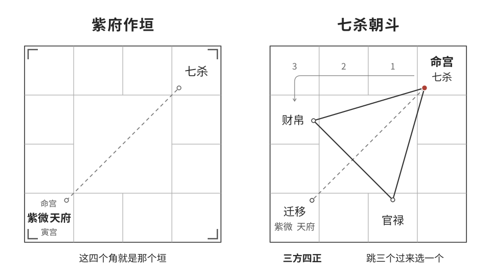 |
| **紫微在寅时，天府和七杀各在哪里？** | 〔口述〕倪师在盘上标出紫微的位置：「诸位看到这里没有」「紫微星在这里」，并交代「我们先不要管它是什么宫」。（[00:42:47–00:42:53](https://www.bilibili.com/video/BV1KJsLekEfA/?p=11&t=2567)，第 77028–77207 帧） 〔口述〕紫微在这里时，「这个天府星一定跟它在一起」；「那七杀就一定在对面」。（[00:42:53–00:43:03](https://www.bilibili.com/video/BV1KJsLekEfA/?p=11&t=2573)，第 77208–77501 帧） 〔指代〕说「紫微星在这里」时，粉笔停在方格盘左下角格内新写字的地方（字未写完、看不清）。（[00:42:48](https://www.bilibili.com/video/BV1KJsLekEfA/?p=11&t=2568)，第 77066 帧） 〔叠图〕左下角叠图：迁移 壬寅——紫微旺、天府庙同格，另有火星庙、天刑庙、天贵平、天官平、副截陷、孤辰平；临官、将军、亡神、贯索；小限 2,14,26,38,50,62；大限 4~13。（[00:42:48–00:42:51](https://www.bilibili.com/video/BV1KJsLekEfA/?p=11&t=2568)，第 77064–77135 帧） 〔叠图〕叠图：命宫 戊申——七杀庙，另有天巫、劫煞、天德平；伏兵、劫煞、天德、绝；小限 8,20,32,44,56,68；大限 64~73。（[00:43:02–00:43:06](https://www.bilibili.com/video/BV1KJsLekEfA/?p=11&t=2582)，第 77460–77580 帧） |
| **什么叫紫府作垣？「垣」指什么？** | 〔口述〕紫微、天府同在这一格对着七杀，「这就成了一个格」，「我们叫做紫府作垣」。（[00:43:03–00:43:17](https://www.bilibili.com/video/BV1KJsLekEfA/?p=11&t=2583)，第 77502–77915 帧） 〔口述〕解释「垣」：把盘当成一个方阵，「这四个角就是那个垣有没有」「就叫做垣啊」。（[00:43:17–00:43:24](https://www.bilibili.com/video/BV1KJsLekEfA/?p=11&t=2597)，第 77916–78143 帧） 〔指代〕说「在这个地方的时候」时，手滑进方格盘左下角格，格内粉笔字右列可见「天」「府」。（[00:43:04](https://www.bilibili.com/video/BV1KJsLekEfA/?p=11&t=2584)，第 77536 帧） 〔板书〕方格盘左下角格可辨「紫」「天」「府」，其余几笔认不出；黑板左侧竖排字被讲者身体挡住，认不出。（[00:43:21](https://www.bilibili.com/video/BV1KJsLekEfA/?p=11&t=2601)，第 78059 帧） |
| **倪师用什么比喻说明「紫府坐在垣上面」？** | 〔口述〕以从前部队的警卫作比：「这个警卫都站在这四个角看」，站中间是傻瓜，站角上「你站这边看两边都可以看到」。（[00:43:24–00:43:34](https://www.bilibili.com/video/BV1KJsLekEfA/?p=11&t=2604)，第 78144–78449 帧） 〔口述〕所以「这叫做垣」，「那这叫紫府坐在垣上面」。（[00:43:35–00:43:39](https://www.bilibili.com/video/BV1KJsLekEfA/?p=11&t=2615)，第 78450–78575 帧） 〔指代〕说「站在这边看」时，右臂伸直、食指点在方格盘右上一格，格内没有看得见的字。（[00:43:29](https://www.bilibili.com/video/BV1KJsLekEfA/?p=11&t=2609)，第 78292 帧） |
| **什么叫七杀朝斗？「斗」是什么意思？** | 〔口述〕命在七杀那一边（「那如果在这边的话」），「就叫做七杀朝斗」。（[00:43:39–00:43:46](https://www.bilibili.com/video/BV1KJsLekEfA/?p=11&t=2619)，第 78576–78809 帧） 〔口述〕解释「斗」：「因为这个像个斗」，像星斗一样，「以前中国就拿这个斗去淘米嘛」。（[00:43:47–00:43:56](https://www.bilibili.com/video/BV1KJsLekEfA/?p=11&t=2627)，第 78810–79097 帧） 〔叠图〕左上角叠图：七杀所在格标为命宫 戊申（七杀庙）。（[00:43:40–00:43:46](https://www.bilibili.com/video/BV1KJsLekEfA/?p=11&t=2620)，第 78612–78809 帧） 〔板书〕黑板右缘竖排字可辨「七」「朝」，其余被身体挡住；方格盘上排右侧格有一行潦草字，认不出。左下格仍可辨「紫」「天」「府」。（[00:43:46](https://www.bilibili.com/video/BV1KJsLekEfA/?p=11&t=2626)，第 78780 帧） |
| **三方四正怎么在盘上数出来？** | 〔口述〕「那如果是命宫在这边」，对面会过来，「我们是不是要看三方四正」，接着问「这个宫怎么找」。（[00:43:56–00:44:04](https://www.bilibili.com/video/BV1KJsLekEfA/?p=11&t=2636)，第 79098–79337 帧） 〔口述〕找法：「很简单 123」「跳三个过来选一个」，剩下三个宫取中间那一个，「就是三方四正」。（[00:44:04–00:44:12](https://www.bilibili.com/video/BV1KJsLekEfA/?p=11&t=2644)，第 79338–79583 帧） 〔口述〕他担心学生还不熟练，说「慢慢慢慢弄就会熟练了」。（[00:44:12–00:44:16](https://www.bilibili.com/video/BV1KJsLekEfA/?p=11&t=2652)，第 79584–79691 帧） 〔板书〕方格盘上用粉色粉笔画了几条连线把几格连起来；上排有白色潦草字与粉色字各一处，都认不出。（[00:44:20](https://www.bilibili.com/video/BV1KJsLekEfA/?p=11&t=2660)，第 79817 帧） |
| **命宫的三方四正一定是哪几宫？怎样算画错？** | 〔口述〕「所以命宫出来的话」「它一定要会到什么」——会到官禄宫和财帛宫。（[00:44:16–00:44:25](https://www.bilibili.com/video/BV1KJsLekEfA/?p=11&t=2656)，第 79692–79967 帧） 〔口述〕如果「你一画出来一看命宫出来会到夫妻宫」「你就画错了」；「画了会到疾厄宫」也是「什么都画错了懂吧」。（[00:44:25–00:44:31](https://www.bilibili.com/video/BV1KJsLekEfA/?p=11&t=2665)，第 79968–80135 帧） 〔口述〕三方四正画出来以后是命宫、财帛、迁移、官禄四宫，「一定是这样子的」。（[00:44:31–00:44:37](https://www.bilibili.com/video/BV1KJsLekEfA/?p=11&t=2671)，第 80136–80321 帧） 〔板书〕方格盘上的粉色连线围成一个三角，底排一格里有粉色字，认不出。（[00:44:33](https://www.bilibili.com/video/BV1KJsLekEfA/?p=11&t=2673)，第 80196 帧） |
| **紫府作垣、七杀朝斗是什么等级？紫府作垣主什么？** | 〔口述〕紫府作垣和七杀朝斗，「这两个都是大贵的星」。（[00:44:37–00:44:45](https://www.bilibili.com/video/BV1KJsLekEfA/?p=11&t=2677)，第 80322–80579 帧） 〔口述〕紫府作垣的人「他将来的位列三台」，是「他会在天子身侧的人」，「当到将相之德就是宰相」，是「近天子身边的人」。（[00:44:46–00:45:02](https://www.bilibili.com/video/BV1KJsLekEfA/?p=11&t=2686)，第 80580–81065 帧） 〔叠图〕讲两格时叠图同时出现命宫 戊申与迁移 壬寅两格。（[00:44:37–00:44:41](https://www.bilibili.com/video/BV1KJsLekEfA/?p=11&t=2677)，第 80322–80435 帧） 〔板书〕黑板左侧竖排两行，可辨「紫府坐垣」，下一字像「格」；旁行可辨「位列三」，其余认不出。（[00:45:23](https://www.bilibili.com/video/BV1KJsLekEfA/?p=11&t=2723)，第 81696 帧） |
| **紫微天府代表什么？紫府坐命就是君王吗？「位列三台」指什么？** | 〔口述〕「因为紫微天府代表君王」，但「真正的君王不一定是在这里」，「不一定是紫微天府坐命」。（[00:45:02–00:45:12](https://www.bilibili.com/video/BV1KJsLekEfA/?p=11&t=2702)，第 81066–81371 帧） 〔口述〕他说之后可以拿八字给大家看：「以后我也可以给诸位一些八字看一下」。（[00:45:12–00:45:16](https://www.bilibili.com/video/BV1KJsLekEfA/?p=11&t=2712)，第 81372–81485 帧） 〔口述〕「那位列三台就是说」「以前叫司空有没有司马司空啊这种」。（[00:45:16–00:45:23](https://www.bilibili.com/video/BV1KJsLekEfA/?p=11&t=2716)，第 81486–81695 帧） 〔板书〕黑板左侧竖排可辨「紫府坐垣」「位列三台」两行。（[00:46:36](https://www.bilibili.com/video/BV1KJsLekEfA/?p=11&t=2796)，第 83898 帧） |
| **七杀朝斗的人主什么？为什么说威震边疆？** | 〔口述〕七杀朝斗的人「一定是这个是将星入命」，将星入命的人「他有威震边疆」。（[00:45:23–00:45:37](https://www.bilibili.com/video/BV1KJsLekEfA/?p=11&t=2723)，第 81696–82121 帧） 〔口述〕设问「你说老师你怎么让他威震边疆」：「他的命如果在那边七杀这边的对面」「就变成迁移宫是紫微天府」，所以「他是不是到边疆的威镇边疆了对不对」。（[00:45:37–00:45:46](https://www.bilibili.com/video/BV1KJsLekEfA/?p=11&t=2737)，第 82122–82403 帧） 〔指代〕说「命如果在这边」时，食指点在方格盘上排右侧格，粉笔字似「七杀」。（[00:45:40](https://www.bilibili.com/video/BV1KJsLekEfA/?p=11&t=2740)，第 82222 帧） 〔板书〕黑板右上竖排可辨「将星」「威」，「威」下一字像「镇」，其余被身体挡住；上排一格有圆圈，圈内粉色字认不出。（[00:45:35](https://www.bilibili.com/video/BV1KJsLekEfA/?p=11&t=2735)，第 82068 帧） 〔叠图〕叠图：命宫 戊申（七杀庙），小限 8,20,32,44,56,68，大限 64~73。（[00:45:24–00:45:29](https://www.bilibili.com/video/BV1KJsLekEfA/?p=11&t=2724)，第 81738–81881 帧） |
| **命宫若在紫府那一格，结果有什么不同？** | 〔口述〕「如果你命宫在这里就在本地吉嘛」，「当然会待在天子旁边了」。（[00:45:46–00:45:52](https://www.bilibili.com/video/BV1KJsLekEfA/?p=11&t=2746)，第 82404–82565 帧） 〔口述〕「这是一个特殊的格」：「南北斗星君同时会在一起」。（[00:45:52–00:46:06](https://www.bilibili.com/video/BV1KJsLekEfA/?p=11&t=2752)，第 82566–82991 帧） 〔指代〕说「命宫在这里」时，手按在方格盘左下格，格内粉笔字可辨「天」「府」。（[00:45:47](https://www.bilibili.com/video/BV1KJsLekEfA/?p=11&t=2747)，第 82425 帧） 〔叠图〕叠图把紫微天府那一格改标为命宫 壬寅，星曜与前面的迁移 壬寅相同。（[00:45:46–00:45:49](https://www.bilibili.com/video/BV1KJsLekEfA/?p=11&t=2746)，第 82404–82481 帧） 〔推断〕推断：同一组紫府对七杀，倪师按命宫落在哪一端分开讲——命在七杀端、迁移是紫府，主到边疆；命在紫府端，主在本地、近天子。（[00:45:37–00:45:52](https://www.bilibili.com/video/BV1KJsLekEfA/?p=11&t=2737)，第 82122–82565 帧） |
| **紫府落在官禄宫怎么断？** | 〔口述〕换个假设：「那如果这个不是命宫」，「如果这个人的官禄宫在这里怎么办」。（[00:46:06–00:46:16](https://www.bilibili.com/video/BV1KJsLekEfA/?p=11&t=2766)，第 82992–83297 帧） 〔口述〕答：「哇那大好这两个是官星嘛是不是」。（[00:46:16–00:46:20](https://www.bilibili.com/video/BV1KJsLekEfA/?p=11&t=2776)，第 83298–83423 帧） 〔指代〕说「官禄宫在这里」时，粉笔指着方格盘左下格（白字「紫……天府」的右侧）。（[00:46:13](https://www.bilibili.com/video/BV1KJsLekEfA/?p=11&t=2773)，第 83217 帧） |
| **紫府落在财帛宫，是不是大财？** | 〔口述〕「那如果这个是财帛宫在这里怎么办」——「哎老师财帛宫呢这两颗是库星」。（[00:46:20–00:46:27](https://www.bilibili.com/video/BV1KJsLekEfA/?p=11&t=2780)，第 83424–83633 帧） 〔口述〕「而且并不是并不是财星」「只是有很大的权利而已」「并不是很大的财星」。（[00:46:27–00:46:34](https://www.bilibili.com/video/BV1KJsLekEfA/?p=11&t=2787)，第 83634–83837 帧） 〔指代〕说「财帛宫在这里」时，讲者拿粉笔在左下格「紫……天府」右侧写粉色字并指着这里，新写的粉字看不清。（[00:46:22](https://www.bilibili.com/video/BV1KJsLekEfA/?p=11&t=2782)，第 83486 帧） 〔板书〕左下格可辨「紫」「天」「府」，右侧加了粉色字，认不出；左列第二格也有粉色字，认不出。（[00:46:36](https://www.bilibili.com/video/BV1KJsLekEfA/?p=11&t=2796)，第 83898 帧） 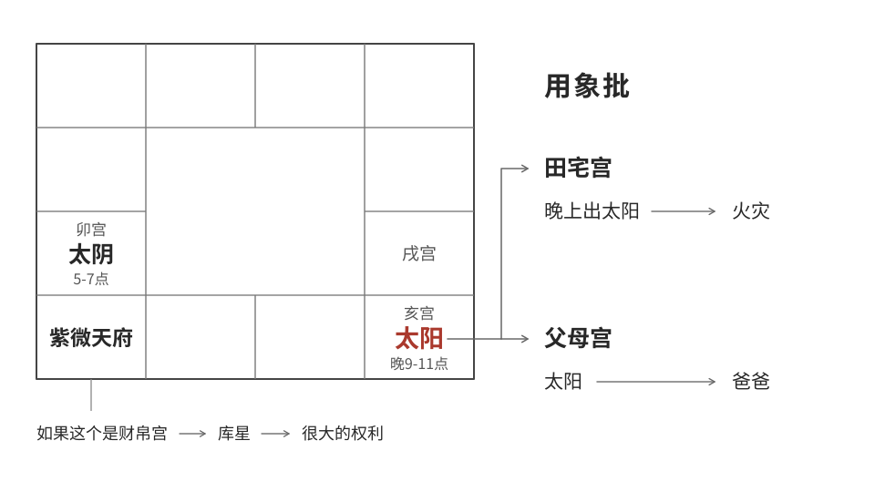 |
| **紫府在财帛宫的人，在私人企业还是公家单位好？** | 〔口述〕「换句话说如果财帛宫在这里的话」，「他到私人公司行号去做事情」，「股票上市公司比他公家单位还来得好」。（[00:46:34–00:46:41](https://www.bilibili.com/video/BV1KJsLekEfA/?p=11&t=2794)，第 83838–84059 帧） 〔口述〕举例：「然后在私人公司里面当总经理」「比如他到台硕去当了总经理」，公司不是他的，「因为他表现太好了」「一路上平步青云上去」。（[00:46:42–00:46:49](https://www.bilibili.com/video/BV1KJsLekEfA/?p=11&t=2802)，第 84060–84299 帧） 〔口述〕这样「也会近于天子之侧」；「所以他到底是在私人企业还是公家单位」，「我们一念之间而已」。（[00:46:50–00:47:02](https://www.bilibili.com/video/BV1KJsLekEfA/?p=11&t=2810)，第 84300–84671 帧） 〔指代〕说「如果财帛宫在这里的话」时，手指着左下格「紫……天府」右侧的粉色笔迹。（[00:46:35](https://www.bilibili.com/video/BV1KJsLekEfA/?p=11&t=2795)，第 83864 帧） 〔叠图〕叠图把同一格改标为财帛 壬寅，星曜仍是紫微旺、天府庙等。（[00:46:44–00:46:45](https://www.bilibili.com/video/BV1KJsLekEfA/?p=11&t=2804)，第 84126–84179 帧） |

**总结区**

- 通用规则：紫微在寅宫时，天府一定与紫微同宫，七杀一定在对面；紫府这一端叫紫府作垣，七杀那一端叫七杀朝斗（[00:42:47–00:43:46](https://www.bilibili.com/video/BV1KJsLekEfA/?p=11&t=2567)，第 77028–78809 帧）。；找三方四正：从命宫数一二三、跳三个取一个，剩下三个宫取中间；命宫的三方四正一定是命宫、财帛、迁移、官禄，会到夫妻宫或疾厄宫就是画错了（[00:43:56–00:44:37](https://www.bilibili.com/video/BV1KJsLekEfA/?p=11&t=2636)，第 79098–80321 帧）。；紫府作垣和七杀朝斗都是大贵的格：紫府作垣位列三台、近天子身边；七杀朝斗是将星入命、威震边疆（[00:44:37–00:45:37](https://www.bilibili.com/video/BV1KJsLekEfA/?p=11&t=2677)，第 80322–82121 帧）。；紫府落官禄宫是官星、大好；落财帛宫是库星不是财星，只是有很大的权力（[00:46:06–00:46:34](https://www.bilibili.com/video/BV1KJsLekEfA/?p=11&t=2766)，第 82992–83837 帧）。
- 只在本例：本盘命宫若在七杀（戊申）一端，迁移宫是紫微天府，所以到边疆、威震边疆；若命宫在紫府（壬寅）一格，就在本地、待在天子旁边（[00:45:37–00:45:52](https://www.bilibili.com/video/BV1KJsLekEfA/?p=11&t=2737)，第 82122–82565 帧）。；假设紫府那一格是财帛宫：到私人公司当总经理反比公家单位好，倪师举「台硕」总经理为例，说表现好、平步青云，也会近于天子之侧（[00:46:34–00:47:02](https://www.bilibili.com/video/BV1KJsLekEfA/?p=11&t=2794)，第 83838–84671 帧）。

**待核**

1. 叠图宫名：七杀格标命宫戊申、大限 64~73，紫府格标迁移壬寅、大限 4~13；之后紫府格又先后改标命宫、财帛（[00:45:46](https://www.bilibili.com/video/BV1KJsLekEfA/?p=11&t=2746)，第 82404 帧、[00:46:44](https://www.bilibili.com/video/BV1KJsLekEfA/?p=11&t=2804)，第 84126 帧），多半是跟着倪师的假设换标，不是换命例。这张盘真正的命宫在哪一格，本块没有交代（[00:42:48](https://www.bilibili.com/video/BV1KJsLekEfA/?p=11&t=2568)，第 77064 帧）。
2. [00:46:13](https://www.bilibili.com/video/BV1KJsLekEfA/?p=11&t=2773)，第 83217 帧的指代标注说叠图当时显示「寅 / 官禄」，但材料的 ▣ 叠图行里没有收「官禄壬寅」这一格，待核原帧（[00:46:13](https://www.bilibili.com/video/BV1KJsLekEfA/?p=11&t=2773)，第 83217 帧）。
3. 字幕写法不一致：同一格名字幕有「紫府作垣」（[00:43:07](https://www.bilibili.com/video/BV1KJsLekEfA/?p=11&t=2587)，第 77616 帧）和「紫府做垣」（[00:44:37](https://www.bilibili.com/video/BV1KJsLekEfA/?p=11&t=2677)，第 80322 帧、[00:44:46](https://www.bilibili.com/video/BV1KJsLekEfA/?p=11&t=2686)，第 80580 帧），板书写「紫府坐垣」，口述又说「紫府坐在垣上面」（[00:43:36](https://www.bilibili.com/video/BV1KJsLekEfA/?p=11&t=2616)，第 78504 帧）；笔记转述统一写作「紫府作垣」。
4. 改字：字幕「那剩下三个官取中间这个」的「官」按上下文应为「宫」（[00:44:09](https://www.bilibili.com/video/BV1KJsLekEfA/?p=11&t=2649)，第 79476 帧）；「这个官禄官」的后一个「官」应为「宫」（[00:44:20](https://www.bilibili.com/video/BV1KJsLekEfA/?p=11&t=2660)，第 79800 帧）；「命宫财宗迁移官禄」的「财宗」按板书帧里的字幕画面与上下文改为「财帛」（[00:44:31](https://www.bilibili.com/video/BV1KJsLekEfA/?p=11&t=2671)，第 80136 帧）。改过的地方都没有放进引号。
5. 「当到将相之德就是宰相」：语音作「将相之给」，「之德」是否原话待核（[00:44:56](https://www.bilibili.com/video/BV1KJsLekEfA/?p=11&t=2696)，第 80886 帧）。
6. 「威震边疆」与「威镇边疆」两种写法字幕都有（[00:45:30](https://www.bilibili.com/video/BV1KJsLekEfA/?p=11&t=2730)，第 81924 帧、[00:45:44](https://www.bilibili.com/video/BV1KJsLekEfA/?p=11&t=2744)，第 82320 帧），板书「威」下一字像「镇」，原字待核。
7. 「如果你命宫在这里就在本地吉嘛」：语音作「本地级」，「吉」是否原话待核（[00:45:46](https://www.bilibili.com/video/BV1KJsLekEfA/?p=11&t=2746)，第 82404 帧）。
8. 「我们一念之间而已」：语音作「一年之间」，两路对不上（[00:46:55](https://www.bilibili.com/video/BV1KJsLekEfA/?p=11&t=2815)，第 84450 帧）。
9. 「比如他到台硕去当了总经理」：「台硕」是什么，本块没有解释；语音作「台所」（[00:46:44](https://www.bilibili.com/video/BV1KJsLekEfA/?p=11&t=2804)，第 84126 帧）。
10. 倪师用了但没解释的词：「位列三台」只说相当于以前的司马、司空（[00:45:16](https://www.bilibili.com/video/BV1KJsLekEfA/?p=11&t=2716)，第 81486 帧）；「南北斗星君」没说哪颗是南斗、哪颗是北斗（[00:45:56](https://www.bilibili.com/video/BV1KJsLekEfA/?p=11&t=2756)，第 82698 帧）；「库星」「官星」「将星入命」都没展开（[00:45:24](https://www.bilibili.com/video/BV1KJsLekEfA/?p=11&t=2724)，第 81738 帧、[00:46:16](https://www.bilibili.com/video/BV1KJsLekEfA/?p=11&t=2776)，第 83298 帧、[00:46:24](https://www.bilibili.com/video/BV1KJsLekEfA/?p=11&t=2784)，第 83544 帧）。
11. [00:45:02–00:45:12](https://www.bilibili.com/video/BV1KJsLekEfA/?p=11&t=2702)，第 81066–81371 帧说「真正的君王不一定是紫微天府坐命」，并说以后给八字看，本块没有展开。
12. 板书认不全：上排右侧格的潦草字像「七杀」但不能确定（[00:43:46](https://www.bilibili.com/video/BV1KJsLekEfA/?p=11&t=2626)，第 78780 帧）；粉色字与圆圈内字都认不出（[00:44:20](https://www.bilibili.com/video/BV1KJsLekEfA/?p=11&t=2660)，第 79817 帧、[00:44:33](https://www.bilibili.com/video/BV1KJsLekEfA/?p=11&t=2673)，第 80196 帧、[00:45:35](https://www.bilibili.com/video/BV1KJsLekEfA/?p=11&t=2735)，第 82068 帧、[00:46:36](https://www.bilibili.com/video/BV1KJsLekEfA/?p=11&t=2796)，第 83898 帧）；[00:45:00](https://www.bilibili.com/video/BV1KJsLekEfA/?p=11&t=2700)，第 81000 帧左列第二格粉色字认不出；本块开头的板面（[00:42:16](https://www.bilibili.com/video/BV1KJsLekEfA/?p=11&t=2536)，第 76092 帧）是上一段留下的字，可辨「男人」等，与本块无关；[00:42:21](https://www.bilibili.com/video/BV1KJsLekEfA/?p=11&t=2541)，第 76248 帧讲者正在擦板，无可辨新字。
13. 指代看不出或不确定的几处没有当依据：[00:42:33](https://www.bilibili.com/video/BV1KJsLekEfA/?p=11&t=2553)，第 76613 帧、[00:43:08](https://www.bilibili.com/video/BV1KJsLekEfA/?p=11&t=2588)，第 77658 帧、[00:43:18](https://www.bilibili.com/video/BV1KJsLekEfA/?p=11&t=2598)，第 77945 帧、[00:43:31](https://www.bilibili.com/video/BV1KJsLekEfA/?p=11&t=2611)，第 78333 帧、[00:43:39](https://www.bilibili.com/video/BV1KJsLekEfA/?p=11&t=2619)，第 78573 帧、[00:43:52](https://www.bilibili.com/video/BV1KJsLekEfA/?p=11&t=2632)，第 78981 帧、[00:43:57](https://www.bilibili.com/video/BV1KJsLekEfA/?p=11&t=2637)，第 79112 帧、[00:44:01](https://www.bilibili.com/video/BV1KJsLekEfA/?p=11&t=2641)，第 79240 帧、[00:44:03](https://www.bilibili.com/video/BV1KJsLekEfA/?p=11&t=2643)，第 79304 帧、[00:44:10](https://www.bilibili.com/video/BV1KJsLekEfA/?p=11&t=2650)，第 79509 帧、[00:44:18](https://www.bilibili.com/video/BV1KJsLekEfA/?p=11&t=2658)，第 79756 帧、[00:45:06](https://www.bilibili.com/video/BV1KJsLekEfA/?p=11&t=2706)，第 81194 帧、[00:45:24](https://www.bilibili.com/video/BV1KJsLekEfA/?p=11&t=2724)，第 81745 帧、[00:45:41](https://www.bilibili.com/video/BV1KJsLekEfA/?p=11&t=2741)，第 82236 帧、[00:46:11](https://www.bilibili.com/video/BV1KJsLekEfA/?p=11&t=2771)，第 83142 帧、[00:46:21](https://www.bilibili.com/video/BV1KJsLekEfA/?p=11&t=2781)，第 83431 帧。

## 紫微在寅（续）：太阳在亥用象批、武曲贪狼入庙、巨门化忌

〔叠图〕这一例视频里只贴过 7 格：田宅 辛亥：太阳陷、天魁旺、八座庙、凤阁旺、天寿旺、天福庙、年解得；疾厄 癸卯：太阴陷禄、铃星利、三台陷、龙池庙、截空平；财帛 甲辰：贪狼庙、地劫陷、大耗平、红鸾庙；福德 庚戌：武曲庙、天喜陷、寡宿陷、恩光庙；命宫 戊申：七杀庙、天德平；迁移 壬寅：紫微旺、天府庙、火星庙、副截陷、天刑庙、天官平、天贵平、孤辰平；子女 乙巳：巨门旺忌、右弼平、文昌庙、天马平、陀罗陷、天虚旺。

### 9　太阳陷亥逐宫象批与武贪入庙（[00:47:02–00:53:23](https://www.bilibili.com/video/BV1KJsLekEfA/?p=11&t=2822)，第 84672–96095 帧）

| 提示区 | 笔记区 |
|---|---|
| **紫微天府在寅时，太阳、太阴落在哪里？** | 〔口述〕倪师接着紫微在寅讲：「如果紫微天府在这里」，「太阳星一定便在这里」，随后在板上另一格说到「太阴了」。字幕在「这里」后括注的「（亥宫）」语音里没有，不当原话。（[00:47:02–00:47:13](https://www.bilibili.com/video/BV1KJsLekEfA/?p=11&t=2822)，第 84672–85001 帧） 〔指代〕说「如果紫微天府在这里」的「这里」时，手指着黑板左下格写有「紫…天府」字样处。（[00:47:05](https://www.bilibili.com/video/BV1KJsLekEfA/?p=11&t=2825)，第 84758 帧） 〔指代〕说「太阳星一定便在这里」中第二个「这里」时，粉笔指着板上左列第三格（粉字格下面那一格），该格是空的，黑板没写宫名。（[00:47:08](https://www.bilibili.com/video/BV1KJsLekEfA/?p=11&t=2828)，第 84866 帧） 〔叠图〕贴出两格：田宅 辛亥，太阳陷、天魁旺、八座庙、凤阁旺、天寿旺、天福庙、台辅、年解得，小限 11,23,35,47,59,71；疾厄 癸卯，太阴陷并带红底「禄」字、铃星利、三台陷、龙池庙、天月、截空平，小限 3,15,27,39,51,63。（[00:47:06–00:47:11](https://www.bilibili.com/video/BV1KJsLekEfA/?p=11&t=2826)，第 84780–84941 帧） 〔板书〕本块开头板面（第 84684 帧）可辨：左下格「天府」，其上一字似「紫」；其余认不出。第 84994 帧左列第三格新出现一个红色字，认不出。（[00:47:13](https://www.bilibili.com/video/BV1KJsLekEfA/?p=11&t=2833)，第 84994 帧） |
| **太阳在亥为什么比在戌更凶？** | 〔口述〕倪师比较太阳在戌与在亥：「这个在戌宫的时候……太阳已经很惨了」；「这亥宫呢晚9-11点」，「卯宫呢5-7点」，亥宫更暗，「就是比刚刚的还要加凶」。（[00:47:16–00:47:33](https://www.bilibili.com/video/BV1KJsLekEfA/?p=11&t=2836)，第 85086–85601 帧） 〔指代〕说「这个在戌宫的时候」之前那个「这个」时，粉笔点在板上右列中下那一格，格里只有一个小点、没有字。（[00:47:15](https://www.bilibili.com/video/BV1KJsLekEfA/?p=11&t=2835)，第 85069 帧） 〔板书〕可辨：右列中间一格写了「戌」，其余新写的字认不出。（[00:47:19](https://www.bilibili.com/video/BV1KJsLekEfA/?p=11&t=2839)，第 85176 帧） 〔推断〕推断：倪师用时辰来讲太阳亮度——亥是晚上 9–11 点，太阳在亥比在戌更暗、更凶；太阴在卯（5–7 点）也是同一思路，但本块对卯宫只报了时辰，没有展开。（[00:47:16–00:47:33](https://www.bilibili.com/video/BV1KJsLekEfA/?p=11&t=2836)，第 85086–85601 帧） |
| **太阳陷亥坐田宅、父母宫，用象怎么批？** | 〔口述〕「那如果你要以此类推」，按「易经的象来推」：这个人田宅宫刚好在亥，「晚上出太阳」，「你家房子晚上怎么会太阳」，「好大的火啊」，「对火灾」。字幕「留宅宫」按语音改作田宅宫。（[00:47:33–00:47:53](https://www.bilibili.com/video/BV1KJsLekEfA/?p=11&t=2853)，第 85602–86213 帧） 〔指代〕说「刚好留宅宫在这里」时，粉笔一直点在板面「戌」下方那一格里，格内字迹看不清。（[00:47:42](https://www.bilibili.com/video/BV1KJsLekEfA/?p=11&t=2862)，第 85860 帧） 〔口述〕同一格换个宫来批：「这是亥时这不是田宅宫」，「是父母宫怎么办」，「太阳指的是什么爸爸」，并说「了解我意思吧以此类推」。（[00:47:53–00:48:06](https://www.bilibili.com/video/BV1KJsLekEfA/?p=11&t=2873)，第 86214–86597 帧） 〔叠图〕同一辛亥格（太阳陷等星曜不变）的宫名由田宅改成「父母 辛亥」。（[00:47:59–00:48:00](https://www.bilibili.com/video/BV1KJsLekEfA/?p=11&t=2879)，第 86376–86423 帧） 〔板书〕可辨：「戌」下方一格有红色「太阳」二字；其余白字认不出。（[00:47:45](https://www.bilibili.com/video/BV1KJsLekEfA/?p=11&t=2865)，第 85968 帧） |
| **女命太阳陷亥坐夫妻宫，该怎么跟她说？** | 〔口述〕「如果这是个女孩子的命」，「这是夫妻宫呢」，太阳指「先生看到没有」，「如果太阳陷地」。（[00:48:06–00:48:18](https://www.bilibili.com/video/BV1KJsLekEfA/?p=11&t=2886)，第 86598–86945 帧） 〔口述〕要看她的相：「你一看她眼角两根没有第三根第四根」，「知道她先生很好」，「你不要给她批她先生死别啊」，改说「太太您夫妻聚少散多」，先生可能是海员之类，「都很少住在一家」。（[00:48:18–00:48:32](https://www.bilibili.com/video/BV1KJsLekEfA/?p=11&t=2898)，第 86946–87365 帧） 〔叠图〕同一辛亥格的宫名改成「夫妻 辛亥」，太阳陷等内容不变。（[00:48:11–00:48:13](https://www.bilibili.com/video/BV1KJsLekEfA/?p=11&t=2891)，第 86736–86819 帧） 〔指代〕说「如果这是一个这个亥宫」的「这个」时，粉笔指着「戌」下方那一格的模糊红字下面，那一格没写宫名。（[00:48:07](https://www.bilibili.com/video/BV1KJsLekEfA/?p=11&t=2887)，第 86635 帧） 〔板书〕可辨：板面右侧竖写的几行里有一个「入」字，其余认不出。（[00:48:25](https://www.bilibili.com/video/BV1KJsLekEfA/?p=11&t=2905)，第 87168 帧） |
| **命盘相同，为什么还要看相、看阳宅？** | 〔口述〕反过来，那个女孩子坐到面前「已经面大骨粗声沙」，「你还在说您夫妻聚少散多」，其实「她先生已经走人了」，所以「要看要招子放亮点」。（[00:48:32–00:48:46](https://www.bilibili.com/video/BV1KJsLekEfA/?p=11&t=2912)，第 87366–87809 帧） 〔口述〕「不然的话给你搞的像同时间生人」「都一样了懂不懂我意思」；「那就算你看不到她相没有关系」，「阳宅拿来看看也可以嘛」，阳宅也能帮着加减。（[00:48:47–00:48:59](https://www.bilibili.com/video/BV1KJsLekEfA/?p=11&t=2927)，第 87810–88193 帧） 〔推断〕推断：同一时间出生的人命盘一样，倪师用看相、看阳宅来分辨同盘之人的实际情况，这是本段讲看相和阳宅的用意。（[00:48:47–00:48:56](https://www.bilibili.com/video/BV1KJsLekEfA/?p=11&t=2927)，第 87810–88109 帧） |
| **太阳陷亥坐子女宫，再见化忌、煞星主什么？** | 〔口述〕「那如果这个是在子女宫」，「那不管是男的女的」，子女宫是这个的话「会有儿子」，「儿子远离不在身边」。（[00:48:59–00:49:07](https://www.bilibili.com/video/BV1KJsLekEfA/?p=11&t=2939)，第 88194–88433 帧） 〔口述〕「化忌的话代表儿子要死」；「有杀星羊陀火铃空劫进入子女宫」，「带化忌的话一定是死」；化忌或羊陀、火铃、空劫进来，「再落陷的话就杀了」，「这个要特别注意一下」。（[00:49:07–00:49:26](https://www.bilibili.com/video/BV1KJsLekEfA/?p=11&t=2947)，第 88434–88985 帧） 〔叠图〕同一辛亥格的宫名改成「子女 辛亥」，太阳陷等内容不变。（[00:48:59–00:49:01](https://www.bilibili.com/video/BV1KJsLekEfA/?p=11&t=2939)，第 88194–88259 帧） 〔指代〕说「子女宫是这个的话」的「这个」时，粉笔停在「戌」下方那一格模糊红字的右下方，持续指着；格内字迹看不清。（[00:49:03](https://www.bilibili.com/video/BV1KJsLekEfA/?p=11&t=2943)，第 88292 帧） |
| **太阳陷亥坐疾厄宫，用象批主什么病？** | 〔口述〕「用象来批疾厄宫」，「用象批对眼睛不好」：「你怎么把晚上的月亮看成太阳啊」，「你什么眼青光眼啊」，并点出「日月反背」。中间一句字幕「当然是左脚子我们都知道」意思不明，见待核。（[00:49:26–00:49:52](https://www.bilibili.com/video/BV1KJsLekEfA/?p=11&t=2966)，第 88986–89765 帧） 〔叠图〕同一辛亥格的宫名改成「疾厄 辛亥」，太阳陷等内容不变。（[00:49:26–00:49:28](https://www.bilibili.com/video/BV1KJsLekEfA/?p=11&t=2966)，第 88986–89063 帧） |
| **太阳陷亥坐财帛宫，能不能做生意？** | 〔口述〕「如果它是坐财帛呢」，「哎呀这个人是晚上出太阳在财帛宫」，「这个人可不可以做生意当老板」——「不行」。（[00:49:56–00:50:06](https://www.bilibili.com/video/BV1KJsLekEfA/?p=11&t=2996)，第 89880–90203 帧） 〔口述〕规则：「做生意当老板的人」「一定要有权有禄才行」；星曜里有化权、化禄财星，「如果那个人的命就是财禄星都会到」，命宫如此，「或者是十年大运上面有权禄星会到」，「就代表他可以做事业」。（[00:50:06–00:50:25](https://www.bilibili.com/video/BV1KJsLekEfA/?p=11&t=3006)，第 90204–90779 帧） 〔口述〕如果没有，财帛宫又是太阳落陷，去做生意就白天忙晚上忙，「忙了半天还是空忙啊」；「你还在说先生你做事业大利」，「你不是害死人了」，「他一辈子被你一句话改了好累啊」。（[00:50:26–00:50:45](https://www.bilibili.com/video/BV1KJsLekEfA/?p=11&t=3026)，第 90780–91367 帧） 〔叠图〕同一辛亥格的宫名改成「财帛 辛亥」，太阳陷等内容不变。（[00:49:56–00:49:58](https://www.bilibili.com/video/BV1KJsLekEfA/?p=11&t=2996)，第 89880–89951 帧） 〔指代〕说「这个人是晚上出太阳在财帛宫」「这个晚上出太阳」「他这个财宗宫」时，右手一直指着板上右下那格的两个粉笔圈，圈内字潦草看不清，黑板未标宫名。（[00:49:59–00:50:27](https://www.bilibili.com/video/BV1KJsLekEfA/?p=11&t=2999)，第 89986–90828 帧） |
| **本盘武曲、贪狼在哪里，是庙是陷？** | 〔口述〕「还有一个」，「武曲星在这边」，「诸位看武曲在这边入庙」；「贪狼啊也是入庙」，贪狼隔壁一个宫也是庙旺，「完全不一样」。（[00:50:50–00:51:09](https://www.bilibili.com/video/BV1KJsLekEfA/?p=11&t=3050)，第 91500–92087 帧） 〔指代〕说「武曲星在这边」「武曲在这边入庙」时，粉笔点在板上右侧中间那格并在那里写字，首字可认作「武」。（[00:50:52–00:50:56](https://www.bilibili.com/video/BV1KJsLekEfA/?p=11&t=3052)，第 91574–91682 帧） 〔叠图〕贴出两格：福德 庚戌，武曲庙、天喜陷、恩光庙、寡宿陷，大限 44~53；财帛 甲辰，贪狼庙、地劫陷、红鸾庙、阴煞、大耗平、月德，大限 104~113。（[00:51:01–00:51:04](https://www.bilibili.com/video/BV1KJsLekEfA/?p=11&t=3061)，第 91848–91943 帧） 〔板书〕第 91776 帧可辨：右列中格「武」「戌」两字，板中央一个「女」字；其余认不出。（[00:50:59](https://www.bilibili.com/video/BV1KJsLekEfA/?p=11&t=3059)，第 91776 帧） 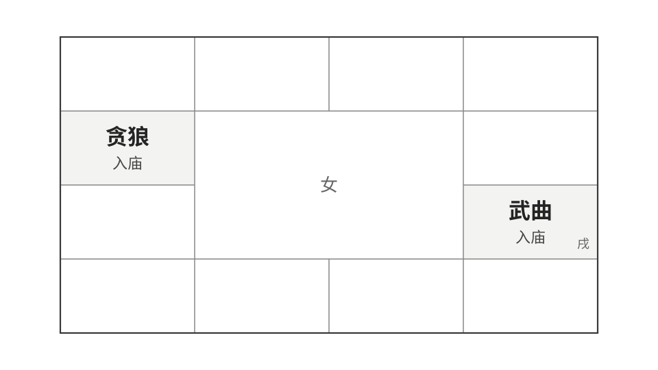 〔板书〕第 91939 帧可辨：左列第二格似「贪」字，左列第三格似「卯 5~7」；其余认不出。（[00:51:04](https://www.bilibili.com/video/BV1KJsLekEfA/?p=11&t=3064)，第 91939 帧） |
| **杀星武官星入庙的人，性格怎样？** | 〔口述〕「意思就是告诉诸位」，「杀星武官星入庙是最好大吉」，武官星要入庙，「这种人非常的刚强」。（[00:51:09–00:51:19](https://www.bilibili.com/video/BV1KJsLekEfA/?p=11&t=3069)，第 92088–92375 帧） 〔口述〕中国人讲刚强，「在我们八字里面讲这个人很固执」，孔子不这样讲，「孔子说这个人择善固执」，「对的事情坚持到底」；易经说「阳刚之人有没有讲的就是这个」，「一定要有点个性的哦」。（[00:51:20–00:51:35](https://www.bilibili.com/video/BV1KJsLekEfA/?p=11&t=3080)，第 92406–92861 帧） |
| **没主见的人是什么样子？** | 〔口述〕题外话：娶个太太叫她「去买一包味精回来」，结果半路人家叫她看电影，「叫我去看电影我就跟他看电影去了」。「为什么她没有主见」，「别人两句话她就走了」，「她忘掉她自己要什么事情」。（[00:51:35–00:51:58](https://www.bilibili.com/video/BV1KJsLekEfA/?p=11&t=3095)，第 92862–93569 帧） 〔口述〕「现在这种人很多」；「龙卷风来把人都吹不走啊」，「两句话就把她吹走了」；「你如果娶到这种你要小心了」，遇到这种小孩子，「来我有办法修理她」。（[00:51:59–00:52:22](https://www.bilibili.com/video/BV1KJsLekEfA/?p=11&t=3119)，第 93570–94289 帧） |
| **孩子没主见，常是怎么被训练出来的？** | 〔口述〕更可怜的是「先天上她不是这样子」，「她被后天被爸爸妈妈训练成这样子的」。（[00:52:29–00:52:36](https://www.bilibili.com/video/BV1KJsLekEfA/?p=11&t=3149)，第 94470–94709 帧） 〔口述〕麦当劳里妈妈带女儿来，「她绝对不会问女儿你要吃什么」，「汉堡就已经讲完了」；看电影也替女儿选好，「女儿都没什么意见」；「好了出去遇到坏人」，「坏人说走是走了就是这样子」，「这都是妈妈训练不好」。（[00:52:37–00:53:08](https://www.bilibili.com/video/BV1KJsLekEfA/?p=11&t=3157)，第 94734–95645 帧） 〔口述〕妈妈说「我当然担心我当然要帮她」，倪师反问「好那你有没有办法24小时看到她」，24 小时看着女儿，「你就看不到你先生了」，并说这样很可怕。这段到本块末尾还没讲完。（[00:53:08–00:53:23](https://www.bilibili.com/video/BV1KJsLekEfA/?p=11&t=3188)，第 95646–96095 帧） |

**总结区**

- 通用规则：做生意当老板一定要有权有禄；命宫或十年大运有权禄星会到，才代表可以做事业（[00:50:06–00:50:25](https://www.bilibili.com/video/BV1KJsLekEfA/?p=11&t=3006)，第 90204–90779 帧）；子女宫见化忌主儿子要死；羊陀火铃空劫进入子女宫带化忌一定是死，或再落陷就杀（[00:49:07–00:49:20](https://www.bilibili.com/video/BV1KJsLekEfA/?p=11&t=2947)，第 88434–88823 帧）；按易经的象推：太阳陷亥是晚上出太阳，坐田宅主火灾、坐父母指爸爸、坐疾厄主眼睛不好（[00:47:33–00:49:52](https://www.bilibili.com/video/BV1KJsLekEfA/?p=11&t=2853)，第 85602–89765 帧）；杀星武官星入庙最好大吉，这种人非常刚强，即择善固执（[00:51:12–00:51:35](https://www.bilibili.com/video/BV1KJsLekEfA/?p=11&t=3072)，第 92166–92861 帧）
- 只在本例：紫微天府在寅这张盘，太阳落亥且陷，比太阳在戌更凶（[00:47:04–00:47:33](https://www.bilibili.com/video/BV1KJsLekEfA/?p=11&t=2824)，第 84738–85601 帧）；同一辛亥格依次假设为田宅、父母、夫妻、子女、疾厄、财帛宫来批，是跟口述演示换宫名，不是换命例（[00:47:41–00:50:06](https://www.bilibili.com/video/BV1KJsLekEfA/?p=11&t=2861)，第 85842–90203 帧）；本盘武曲入庙、贪狼也入庙，叠图分别是福德庚戌、财帛甲辰（[00:50:50–00:51:09](https://www.bilibili.com/video/BV1KJsLekEfA/?p=11&t=3050)，第 91500–92087 帧）
- 不是排盘规则，是处世方法：女命夫妻宫太阳陷，看相先生很好就别批死别，说夫妻聚少散多（[00:48:18–00:48:32](https://www.bilibili.com/video/BV1KJsLekEfA/?p=11&t=2898)，第 86946–87365 帧）；要看清来人的相，看不到相可拿阳宅来参考，否则同时间生人都一样了（[00:48:32–00:48:59](https://www.bilibili.com/video/BV1KJsLekEfA/?p=11&t=2912)，第 87366–88193 帧）；财帛宫太阳陷又无权禄，别劝人做事业，一句话会累他一辈子（[00:50:26–00:50:45](https://www.bilibili.com/video/BV1KJsLekEfA/?p=11&t=3026)，第 90780–91367 帧）；没主见的人别人两句话就走，常是被父母后天训练成这样（[00:51:35–00:53:08](https://www.bilibili.com/video/BV1KJsLekEfA/?p=11&t=3095)，第 92862–95645 帧）

**待核**

1. [00:47:06](https://www.bilibili.com/video/BV1KJsLekEfA/?p=11&t=2826)，第 84780 帧：字幕「太阳星一定便在这里（亥宫）」里的「（亥宫）」语音里没有，像字幕制作者加注，不当倪师原话引。
2. [00:47:25](https://www.bilibili.com/video/BV1KJsLekEfA/?p=11&t=2845)，第 85362 帧：字幕「不一定是更暗」，语音为「一定是更暗」，两路对不上，按上下文更像「一定是更暗」。
3. [00:47:41](https://www.bilibili.com/video/BV1KJsLekEfA/?p=11&t=2861)，第 85842 帧：字幕「留宅宫」按语音与叠图改为「田宅宫」。
4. [00:48:19](https://www.bilibili.com/video/BV1KJsLekEfA/?p=11&t=2899)，第 86976 帧：「眼角两根没有第三根第四根」指的是什么（纹路？），倪师没解释。
5. [00:48:29–00:48:32](https://www.bilibili.com/video/BV1KJsLekEfA/?p=11&t=2909)，第 87270–87365 帧：字幕「她先生可能是海员船员都费心点」「都很少住在一家」，语音为「海员海员都费信」「少最难以降」，后半句原话待核。
6. [00:49:33](https://www.bilibili.com/video/BV1KJsLekEfA/?p=11&t=2973)，第 89214 帧：字幕「当然是左脚子我们都知道」，语音为「角这个我们都知道」，意思不明。
7. [00:49:58](https://www.bilibili.com/video/BV1KJsLekEfA/?p=11&t=2998)，第 89952 帧、[00:50:01](https://www.bilibili.com/video/BV1KJsLekEfA/?p=11&t=3001)，第 90042 帧、[00:50:26](https://www.bilibili.com/video/BV1KJsLekEfA/?p=11&t=3026)，第 90804 帧：字幕「财宗宫」按语音改为「财帛宫」。
8. [00:50:30](https://www.bilibili.com/video/BV1KJsLekEfA/?p=11&t=3030)，第 90900 帧：字幕「变成晚上忙自天忙晚上忙」，语音为「白天忙」，「自天」改为「白天」。
9. [00:51:01–00:51:04](https://www.bilibili.com/video/BV1KJsLekEfA/?p=11&t=3061)，第 91848–91943 帧：「那个贪狼隔壁一个宫就一个庙旺一个庙」所说的隔壁宫是哪一宫、庙旺的是哪颗星，没讲清。
10. [00:51:12](https://www.bilibili.com/video/BV1KJsLekEfA/?p=11&t=3072)，第 92166 帧：「杀星武官星」一词倪师用了但没解释，指哪些星待核。
11. [00:51:28](https://www.bilibili.com/video/BV1KJsLekEfA/?p=11&t=3088)，第 92658 帧：字幕「阳宅诸位我们在易经上面说」，语音为「在对我们在意经上面说」，「阳宅」疑为字幕错。
12. [00:52:23](https://www.bilibili.com/video/BV1KJsLekEfA/?p=11&t=3143)，第 94290 帧：字幕「很快给她绕回来」，语音为「跟他回来」，原话待核。
13. [00:47:06](https://www.bilibili.com/video/BV1KJsLekEfA/?p=11&t=2826)，第 84798 帧、[00:47:13](https://www.bilibili.com/video/BV1KJsLekEfA/?p=11&t=2833)，第 85016 帧、[00:52:26](https://www.bilibili.com/video/BV1KJsLekEfA/?p=11&t=3146)，第 94387 帧：指代看不出指向；[00:48:59](https://www.bilibili.com/video/BV1KJsLekEfA/?p=11&t=2939)，第 88185 帧、[00:49:34](https://www.bilibili.com/video/BV1KJsLekEfA/?p=11&t=2974)，第 89228 帧、[00:51:06](https://www.bilibili.com/video/BV1KJsLekEfA/?p=11&t=3066)，第 92007 帧：指代不确定，均未当依据。
14. [00:47:06](https://www.bilibili.com/video/BV1KJsLekEfA/?p=11&t=2826)，第 84780 帧：叠图疾厄癸卯「太阴陷」后带红底「禄」字，是否表示化禄，口述没提。
15. [00:47:59–00:49:58](https://www.bilibili.com/video/BV1KJsLekEfA/?p=11&t=2879)，第 86376–89951 帧：叠图同一辛亥格内容不变，只换宫名，属演示，不代表盘上真有这些宫位。
16. 板书：[00:47:13](https://www.bilibili.com/video/BV1KJsLekEfA/?p=11&t=2833)，第 84994 帧左列第三格红字、[00:47:45](https://www.bilibili.com/video/BV1KJsLekEfA/?p=11&t=2865)，第 85968 帧「戌」下方格白字、[00:48:25](https://www.bilibili.com/video/BV1KJsLekEfA/?p=11&t=2905)，第 87168 帧右侧竖写多字、[00:51:04](https://www.bilibili.com/video/BV1KJsLekEfA/?p=11&t=3064)，第 91939 帧左列第二格「贪」与「卯 5~7」均认不全，待核。

### 10　教子、武曲落宫、看流年与巨门化忌（[00:53:23–00:59:39](https://www.bilibili.com/video/BV1KJsLekEfA/?p=11&t=3203)，第 96096–107382 帧）

| 提示区 | 笔记区 |
|---|---|
| **女儿没主见，倪师给她妈妈出了什么主意？** | 〔推断〕推断：前文讲这位妈妈 24 小时盯着女儿、女儿不晓得自己要什么，本块开头接着讲倪师对这位妈妈的建议。（[00:53:23–00:53:25](https://www.bilibili.com/video/BV1KJsLekEfA/?p=11&t=3203)，第 96096–96179 帧） 〔口述〕倪师跟她妈妈讲：「太太您去您去到宗教里去闭禁去」「交给和尚每天在里面打坐修身养性去」「我来训练她」。（[00:53:24–00:53:33](https://www.bilibili.com/video/BV1KJsLekEfA/?p=11&t=3204)，第 96144–96401 帧） 〔口述〕结果「你再一个月看她完全人不一样」，「非常有主见」「非常知道自己要什么啊」。（[00:53:33–00:53:37](https://www.bilibili.com/video/BV1KJsLekEfA/?p=11&t=3213)，第 96402–96533 帧） |
| **父母该教孩子什么，为什么一直讲道理没用？** | 〔口述〕父母平常忙于工作，孩子送到学校受教育，「所以就不需要你去教她什么东西了」；历史、地理老师都教过，「她念的地理明天就变成历史」「所以说那个都不准的」「你不要教她那些东西」。（[00:53:37–00:54:01](https://www.bilibili.com/video/BV1KJsLekEfA/?p=11&t=3217)，第 96534–97235 帧） 〔口述〕要看孩子在生活环境很好时想要什么、「知道他的动态是什么」；在他「一毛都没有的时候」看他不屑做什么事，「就可以知道儿子的心性」，然后「如何去谆谆善诱他就好了」，平常带他去玩就好。（[00:54:01–00:54:26](https://www.bilibili.com/video/BV1KJsLekEfA/?p=11&t=3241)，第 97236–98009 帧） 〔口述〕老师教过的再重复教，儿子会说「你反渎啊」「渎蒙」「我每天听到的这些我都不想听了」。（[00:54:27–00:54:38](https://www.bilibili.com/video/BV1KJsLekEfA/?p=11&t=3267)，第 98010–98357 帧） 〔口述〕很多爸妈到儿子面前「一直在讲道理啊」「讲的都是千篇一律」「他根本懒得听」；「你应该要问一些问题」「知道儿子想要什么才是重点」。（[00:54:38–00:54:52](https://www.bilibili.com/video/BV1KJsLekEfA/?p=11&t=3278)，第 98358–98783 帧） |
| **武曲贪狼来会是什么？在疾厄宫为什么不算杀？** | 〔口述〕「我们回言归正传」，回到武曲：「武曲贪狼来会」「这种是武官带」。（[00:54:54–00:54:57](https://www.bilibili.com/video/BV1KJsLekEfA/?p=11&t=3294)，第 98820–98939 帧） 〔叠图〕右下【福德 庚戌】武曲庙（另有天喜陷、恩光庙、寡宿陷）；左下【财帛 甲辰】贪狼庙（另有地劫陷、红鸾庙、大耗平）。（[00:54:52–00:54:53](https://www.bilibili.com/video/BV1KJsLekEfA/?p=11&t=3292)，第 98784–98819 帧） 〔口述〕「那如果是逢到疾厄宫」，这种星就「不是杀因为都入庙」。（[00:54:58–00:55:04](https://www.bilibili.com/video/BV1KJsLekEfA/?p=11&t=3298)，第 98940–99131 帧） 〔板书〕可辨：板中央「女」字；右列中间格有圆圈字，认不出；其余认不出。（[00:54:59](https://www.bilibili.com/video/BV1KJsLekEfA/?p=11&t=3299)，第 98976 帧） 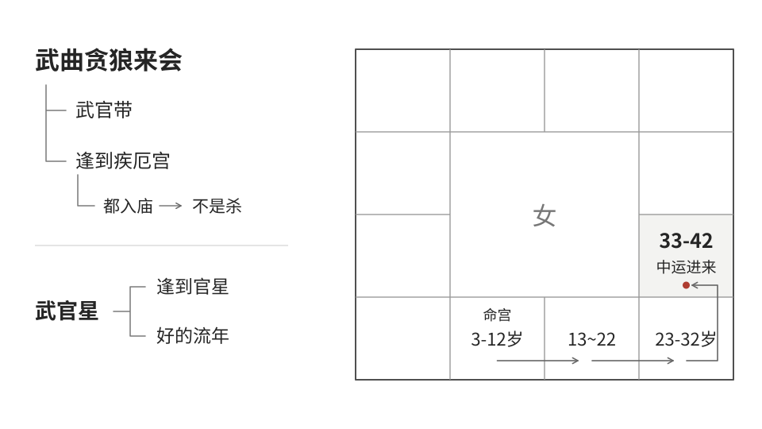 |
| **武官星要什么条件才有用？什么叫好的流年？** | 〔口述〕「如果一定要这武官星」「一定要逢到官星他会有」「还有要逢到好的流年」。（[00:55:04–00:55:11](https://www.bilibili.com/video/BV1KJsLekEfA/?p=11&t=3304)，第 99132–99335 帧） 〔口述〕什么叫好的流年：假设「你的命宫刚好在这里」，3-12 岁在这里，13 岁开始到 22 岁，「23-32岁在这里」，「33-42 刚好中运进来才有用嘛」。（[00:55:11–00:55:29](https://www.bilibili.com/video/BV1KJsLekEfA/?p=11&t=3311)，第 99336–99893 帧） 〔指代〕说「你的命宫刚好在这里」时，手持粉笔在黑板下排左起第二格写字（之后写成「3岁」）。（[00:55:17](https://www.bilibili.com/video/BV1KJsLekEfA/?p=11&t=3317)，第 99539 帧） 〔板书〕可辨：下排左起第二格「3」「岁」，其余还没写。（[00:55:19](https://www.bilibili.com/video/BV1KJsLekEfA/?p=11&t=3319)，第 99581 帧） 〔板书〕可辨：下排「3-12岁」「13~22」，右列第二格「命2-1」（后面被身体挡住）；右下格的字认不出。（[00:55:32](https://www.bilibili.com/video/BV1KJsLekEfA/?p=11&t=3332)，第 99972 帧） |
| **命宫好但流年不对，会怎样？** | 〔口述〕「结果你呢有一个人的命宫在这里」「结果2-11岁这边」「12-21岁会到这个有个鸟用啊」「12岁都干将军呐哪那么好啊」「你以为你是甘罗啊12岁做宰相」「哪那么多机会啊」。（[00:55:29–00:55:41](https://www.bilibili.com/video/BV1KJsLekEfA/?p=11&t=3329)，第 99894–100259 帧） 〔指代〕说「有一个人的命宫在这里」时，在右列第二格用粉笔写「命」，随后补成「命2-11」。（[00:55:31](https://www.bilibili.com/video/BV1KJsLekEfA/?p=11&t=3331)，第 99933 帧） 〔口述〕「所以我们要逢到好的流年」「才有用嘛」；不要傻乎乎地说「老师呀这个命很好你看」，「结果一看到流年在这里」就不对了。（[00:55:42–00:55:56](https://www.bilibili.com/video/BV1KJsLekEfA/?p=11&t=3342)，第 100260–100691 帧） |
| **两千多年前的东西怎么用到今天？** | 〔口述〕看八字的时候「要一要推理」，把两千多年前的东西「适用到2000多年以后」，「环境再怎么改变」「它的神没有变」。（[00:55:56–00:56:06](https://www.bilibili.com/video/BV1KJsLekEfA/?p=11&t=3356)，第 100692–101003 帧） 〔口述〕不可能 200 年以后小孩子 12 岁就当将军，「还是有一定的军中的伦理」，「所以说一定要经过这个过程」；「那结果那么好的星在那个出来的时候不对」。（[00:56:06–00:56:17](https://www.bilibili.com/video/BV1KJsLekEfA/?p=11&t=3366)，第 101004–101321 帧） 〔指代〕说「在那个出来的时候不对」时，食指指向右列中间格（带圆圈的字及其右侧被划线的字），字迹看不清。（[00:56:16](https://www.bilibili.com/video/BV1KJsLekEfA/?p=11&t=3376)，第 101280 帧） |
| **命宫七杀、夫妻宫武曲，这对夫妻怎么样？** | 〔口述〕「如果有一个人的武曲星在这里」「如果他的夫妻宫是在这边」「就是个男性的」：先生「是七杀朝斗紫府做垣」，「太太是武曲」，「这是夫妻两个人是同行的」「看得清很楚」。（[00:56:22–00:56:39](https://www.bilibili.com/video/BV1KJsLekEfA/?p=11&t=3382)，第 101472–101975 帧） 〔指代〕说「夫妻宫是在这边」时，手持粉笔在右列中间格圆圈字右侧书写，新写出「未」等字（黑板上没写「夫妻」字样）。（[00:56:25](https://www.bilibili.com/video/BV1KJsLekEfA/?p=11&t=3385)，第 101552 帧） 〔指代〕说「命宫在这里」时，粉笔点在右上格的圆圈处（圈内字看不清）。（[00:56:27](https://www.bilibili.com/video/BV1KJsLekEfA/?p=11&t=3387)，第 101621 帧） 〔叠图〕左上【命宫 戊申】七杀庙（另有天巫、劫煞、天德平）；右下同一庚戌格改标【夫妻 庚戌】武曲庙。第 101790 帧起加左下【迁移 壬寅】紫微旺、天府庙（另有火星庙、天刑庙）。（[00:56:24–00:56:34](https://www.bilibili.com/video/BV1KJsLekEfA/?p=11&t=3384)，第 101526–101825 帧） 〔板书〕黑板大部分被叠图挡住。可辨：中央「女」字，下排「13~22」；右列圆圈字认不出，旁边一字疑「未」，其余认不出。（[00:56:35](https://www.bilibili.com/video/BV1KJsLekEfA/?p=11&t=3395)，第 101855 帧） 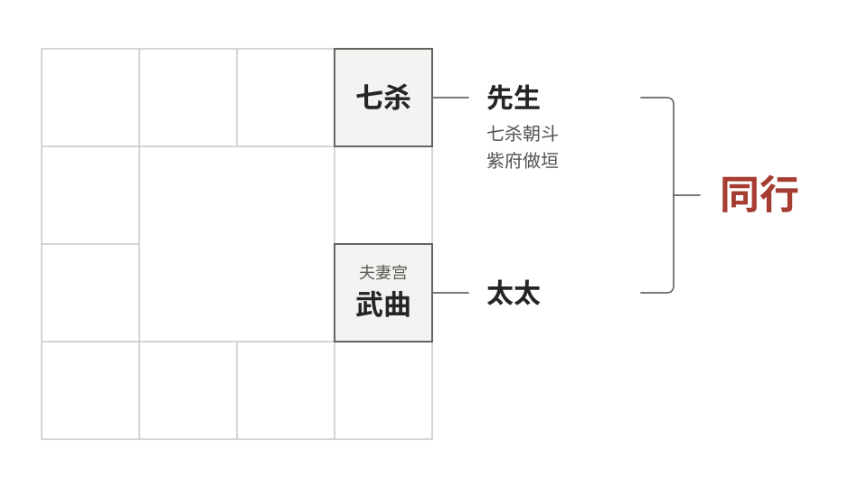 |
| **同一颗武曲落兄弟宫、父母宫，各怎么解？** | 〔口述〕有的人不是这样：「如果这个这个命宫在这边」「结果武曲变成兄弟」「代表兄弟得利」。（[00:56:39–00:56:51](https://www.bilibili.com/video/BV1KJsLekEfA/?p=11&t=3399)，第 101976–102353 帧） 〔口述〕「所以看它同样是武曲星」「要它的性是一样的」，「它要看它什么宫」「我们做什么解释」。（[00:56:51–00:56:58](https://www.bilibili.com/video/BV1KJsLekEfA/?p=11&t=3411)，第 102354–102545 帧） 〔口述〕「如果说在父母宫」「像这种人一定是父母出武贵啊」。（[00:56:58–00:57:01](https://www.bilibili.com/video/BV1KJsLekEfA/?p=11&t=3418)，第 102546–102653 帧） 〔叠图〕同一庚戌格（武曲庙）的宫名第 102270 帧起改标「兄弟」，第 102690 帧起改标「父母」；父母版里武曲庙带「科」、多出破军陷带「权」、不见天喜。（[00:56:48–00:57:03](https://www.bilibili.com/video/BV1KJsLekEfA/?p=11&t=3408)，第 102246–102695 帧） |
| **父母宫武曲破军化科化权，和化禄，断法有何不同？** | 〔口述〕比如看一个人，「哎呀他的父母宫是武曲破军呐化科化权呐」，「你要说这种是武将」，「而且文笔又好」，「有文有武的人」。（[00:57:01–00:57:11](https://www.bilibili.com/video/BV1KJsLekEfA/?p=11&t=3421)，第 102654–102941 帧） 〔口述〕「那如果他父母宫是化禄」「明明是个做生意的」，「你还是给他说做武官呢」——意思是不能一样断。（[00:57:11–00:57:16](https://www.bilibili.com/video/BV1KJsLekEfA/?p=11&t=3431)，第 102942–103085 帧） |
| **看父母、兄弟宫为什么也要看三方四正？** | 〔口述〕不只命宫会三方四正，「你要看他的父母看他的兄弟宫」「也是要看看三方四正」「才知道他兄弟怎么样」。（[00:57:16–00:57:26](https://www.bilibili.com/video/BV1KJsLekEfA/?p=11&t=3436)，第 103086–103403 帧） 〔口述〕「有的时候他的父母宫在这边」「结果父母宫本宫没什么星」「可是三方四正会出来的时候」「这里是科权禄」「他的父母是科权禄啊」「那个大富大贵啊」「你不要搞错了」。（[00:57:28–00:57:41](https://www.bilibili.com/video/BV1KJsLekEfA/?p=11&t=3448)，第 103440–103835 帧） 〔指代〕说「父母宫在这边」时，粉笔在板上方第二列格内书写；之后说「这里是科权禄」也在同一格书写，字迹看不清。（[00:57:28–00:57:32](https://www.bilibili.com/video/BV1KJsLekEfA/?p=11&t=3448)，第 103466–103571 帧） 〔板书〕可辨：中央「女」，下排「3-12岁」「13~22」；板上新画了一个大三角形连线。其余认不出。（[00:57:25](https://www.bilibili.com/video/BV1KJsLekEfA/?p=11&t=3445)，第 103367 帧） 〔板书〕可辨：右列「命2-11」，下排「3-12岁」；上方第二列新写的几个字认不出（口述此处是科权禄）。（[00:57:37](https://www.bilibili.com/video/BV1KJsLekEfA/?p=11&t=3457)，第 103714 帧） |
| **黑板上那个三角形为什么只是标杆？** | 〔口述〕「我们为什么要只画这个箭头」「一个三角形给你看命宫」；「所有的宫你要看它一定都要看对面」，「你看子女宫不能光看一个宫」「也要看三方四正对面」。（[00:57:41–00:57:52](https://www.bilibili.com/video/BV1KJsLekEfA/?p=11&t=3461)，第 103836–104177 帧） 〔口述〕「所以实际上这个只是个标杆」「一直在转一直在转」，「那我们不能把它通通画起来」，否则「你都看昏了」。（[00:57:52–00:58:05](https://www.bilibili.com/video/BV1KJsLekEfA/?p=11&t=3472)，第 104178–104561 帧） |
| **巨门化忌主什么？** | 〔口述〕「诸位看左上角是不是巨门星在这边」「这个巨门星已经是是非口舌星了」，「碰到巨门的话」「已经在吵架已经在打官司了」。（[00:58:17–00:58:26](https://www.bilibili.com/video/BV1KJsLekEfA/?p=11&t=3497)，第 104910–105209 帧） 〔口述〕「再一个化忌」「就会加重这个巨门星的杀」，「再个化忌这是100%要打官司的」「那根本在劫难逃」。（[00:58:27–00:58:38](https://www.bilibili.com/video/BV1KJsLekEfA/?p=11&t=3507)，第 105210–105545 帧） 〔叠图〕右上【子女 乙巳】巨门旺、化忌，另有天马平、文昌庙、右弼平、陀罗陷。（[00:58:17–00:58:20](https://www.bilibili.com/video/BV1KJsLekEfA/?p=11&t=3497)，第 104910–105023 帧） 〔指代〕说「光个巨门星就已经会打官司了」前后，右手掌按在黑板上左格，露出「巨」字。（[00:58:34](https://www.bilibili.com/video/BV1KJsLekEfA/?p=11&t=3514)，第 105426 帧） |
| **巨门化忌再逢天马主什么？春夏秋冬怎么用？** | 〔口述〕「那如果这巨门星逢到天马星呢」，「他骑着马打官司」「一定车祸嘛」。（[00:58:38–00:58:46](https://www.bilibili.com/video/BV1KJsLekEfA/?p=11&t=3518)，第 105546–105791 帧） 〔指代〕说「逢到这个天马在这边」时，指尖落在黑板上左格「巨」字下方「天」字一行。（[00:58:40–00:58:42](https://www.bilibili.com/video/BV1KJsLekEfA/?p=11&t=3520)，第 105622–105667 帧） 〔口述〕「那这边春夏秋冬」「不小心冬天发生车祸」「是不是要会以此类推下去」。（[00:58:48–00:58:56](https://www.bilibili.com/video/BV1KJsLekEfA/?p=11&t=3528)，第 105864–106091 帧） 〔叠图〕四格换标：【命宫 壬寅】春、【父母 癸卯】夏、【福德 甲辰】秋、【田宅 乙巳】冬；乙巳格仍是巨门旺忌、天马平。（[00:58:48–00:58:50](https://www.bilibili.com/video/BV1KJsLekEfA/?p=11&t=3528)，第 105864–105905 帧） 〔板书〕可辨：左上格「巨」、一个圆圈字疑「子」、下一行「天」；下排「3-12岁」，右列有「未」；其余认不出。（[00:59:19](https://www.bilibili.com/video/BV1KJsLekEfA/?p=11&t=3559)，第 106788 帧） 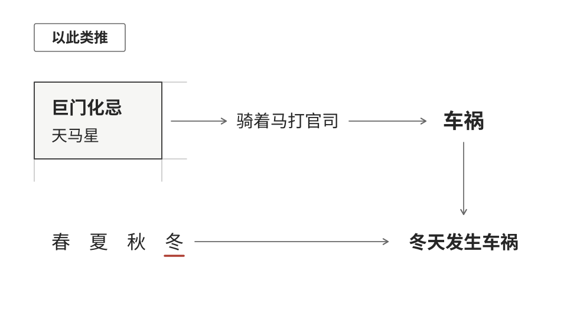 |
| **太阳陷在田宅、对面巨门化忌，女命怎么断？** | 〔口述〕看十年：「他这个八字十年刚好在这里」「太阳在这里」「这个是34-43这是它是田宅宫」，「结果34-43 太阳星陷地不亮」「对面是什么巨门化忌」「代表他34-43 看不到太阳」。（[00:58:56–00:59:19](https://www.bilibili.com/video/BV1KJsLekEfA/?p=11&t=3536)，第 106092–106799 帧） 〔叠图〕右下【田宅 辛亥】太阳陷（另有天魁旺、天福庙、八座庙），大限 34~43；第 106650 帧起右上再贴出【子女 乙巳】巨门旺忌（第 106320 帧画面右上角还没有这一格）。（[00:59:03–00:59:18](https://www.bilibili.com/video/BV1KJsLekEfA/?p=11&t=3543)，第 106290–106740 帧） 〔口述〕「如果这是个女孩子的命」「34岁以后就已经没有太阳了」「发生事情在33岁之前」；「太阳是代表说夫妻不在」「先生就聚少散多」「可能会做海员做什么」「可是对面是化忌就完了」「一定是散」。（[00:59:20–00:59:36](https://www.bilibili.com/video/BV1KJsLekEfA/?p=11&t=3560)，第 106800–107303 帧） 〔口述〕最后一句：「所以要因时因地制宜」。（[00:59:36–00:59:39](https://www.bilibili.com/video/BV1KJsLekEfA/?p=11&t=3576)，第 107304–107382 帧） 〔推断〕推断：叠图里太阳所在辛亥格与巨门化忌所在乙巳格同时出现，与口述「对面是什么巨门化忌」相合；倪师在本块没说为什么太阳代表夫妻。（[00:59:03–00:59:20](https://www.bilibili.com/video/BV1KJsLekEfA/?p=11&t=3543)，第 106290–106827 帧） |

**总结区**

- 通用规则：同样是武曲星，性一样，要看落在什么宫做什么解释：落兄弟代表兄弟得利，落父母一定是父母出武贵（[00:56:48–00:57:01](https://www.bilibili.com/video/BV1KJsLekEfA/?p=11&t=3408)，第 102246–102653 帧）；看任何一宫都不能光看本宫，一定要看三方四正和对面；本宫没星而三方四正会出科权禄，也是大富大贵（[00:57:16–00:57:52](https://www.bilibili.com/video/BV1KJsLekEfA/?p=11&t=3436)，第 103086–104177 帧）；星再好也要逢到好的流年才有用，命好而流年不对就没用（[00:55:04–00:55:56](https://www.bilibili.com/video/BV1KJsLekEfA/?p=11&t=3304)，第 99132–100691 帧）；巨门是是非口舌星，再化忌加重其杀、百分之百打官司；巨门再逢天马主车祸（[00:58:20–00:58:46](https://www.bilibili.com/video/BV1KJsLekEfA/?p=11&t=3500)，第 105024–105791 帧）
- 只在本例：假设命宫七杀、夫妻宫武曲的男命：先生七杀朝斗紫府做垣、太太武曲，夫妻两人同行（[00:56:22–00:56:38](https://www.bilibili.com/video/BV1KJsLekEfA/?p=11&t=3382)，第 101472–101945 帧）；本盘太阳陷在田宅宫 34–43 岁、对面巨门化忌：若是女命，34 岁后没有太阳、事情发生在 33 岁之前，先生聚少散多、一定是散（[00:58:56–00:59:36](https://www.bilibili.com/video/BV1KJsLekEfA/?p=11&t=3536)，第 106092–107303 帧）
- 不是排盘规则，是处世方法：妈妈不要 24 小时盯女儿，放手交给别人训练一个月，女儿就有主见（[00:53:24–00:53:37](https://www.bilibili.com/video/BV1KJsLekEfA/?p=11&t=3204)，第 96144–96533 帧）；学校教过的不必回家重复教，不要一直讲千篇一律的道理，要多问问题、看孩子贫困时不屑做什么，知道孩子想要什么才是重点（[00:53:37–00:54:52](https://www.bilibili.com/video/BV1KJsLekEfA/?p=11&t=3217)，第 96534–98783 帧）；古法要推理着用到今天，环境再变它的神没有变，要因时因地制宜（[00:55:56–00:56:15](https://www.bilibili.com/video/BV1KJsLekEfA/?p=11&t=3356)，第 100692–101255 帧、[00:59:36–00:59:39](https://www.bilibili.com/video/BV1KJsLekEfA/?p=11&t=3576)，第 107304–107382 帧）

**待核**

1. [00:53:26](https://www.bilibili.com/video/BV1KJsLekEfA/?p=11&t=3206)，第 96180 帧：字幕「闭禁」，语音作「逼近」，原词待核。
2. [00:54:17](https://www.bilibili.com/video/BV1KJsLekEfA/?p=11&t=3257)，第 97716 帧：字幕「你看他不所不屑为什么事情」，「不所不屑」疑识别错，语音作「她所不屑」，转述按「不屑做什么事」理解，待核。
3. [00:54:30–00:54:35](https://www.bilibili.com/video/BV1KJsLekEfA/?p=11&t=3270)，第 98124–98267 帧：「你反渎啊」「渎蒙」语音作「烦赌」「赌萌」，倪师用了没解释。
4. [00:54:52](https://www.bilibili.com/video/BV1KJsLekEfA/?p=11&t=3292)，第 98784 帧：字幕「但是武曲天钺」语音只有「天我们」，两句后又说「武曲贪狼来会」，「天钺」是否识别错，待核；本笔记未采用这句。
5. [00:54:56](https://www.bilibili.com/video/BV1KJsLekEfA/?p=11&t=3296)，第 98898 帧：「这种是武官带」语音作「五官代」，「武官带」所指本块没解释。
6. [00:55:01](https://www.bilibili.com/video/BV1KJsLekEfA/?p=11&t=3301)，第 99048 帧：字幕「这种在这种星就没有」（可信度 0.62）语音只有「就不是杀」，原话待核。
7. [00:55:04–00:55:08](https://www.bilibili.com/video/BV1KJsLekEfA/?p=11&t=3304)，第 99132–99263 帧：「一定要逢到官星」的「官星」指星还是宫，本块没解释。
8. [00:55:26](https://www.bilibili.com/video/BV1KJsLekEfA/?p=11&t=3326)，第 99786 帧：字幕「中运」语音作「终于」，待核。
9. [00:55:37](https://www.bilibili.com/video/BV1KJsLekEfA/?p=11&t=3337)，第 100122 帧：字幕「甘罗」语音作「干干罗」，人名待核，倪师没展开。
10. [00:55:56](https://www.bilibili.com/video/BV1KJsLekEfA/?p=11&t=3356)，第 100692 帧、[00:58:59](https://www.bilibili.com/video/BV1KJsLekEfA/?p=11&t=3539)，第 106182 帧：紫微课里倪师说「看八字」「八字十年」，是否指命盘的大限，本块没说清。
11. [00:56:33](https://www.bilibili.com/video/BV1KJsLekEfA/?p=11&t=3393)，第 101790 帧：字幕「是七杀朝斗紫府做垣」（可信度 0.5）语音作「操作之后」，上一句语音「先生西刹」；格名待核，倪师没解释。
12. [00:57:13](https://www.bilibili.com/video/BV1KJsLekEfA/?p=11&t=3433)，第 103014 帧：字幕「你还是给他说做武官呢」语音作「给他说这个很无关的」，两路不一致。
13. [00:59:05](https://www.bilibili.com/video/BV1KJsLekEfA/?p=11&t=3545)，第 106374 帧：字幕「这是它是田宅宫」语音作「钱财工」；叠图标田宅辛亥，取字幕。
14. 叠图：武曲庙所在庚戌格约 54:53 标福德、56:25 标夫妻、56:49 标兄弟、57:02 标父母，57:02 版多了武曲化科、破军陷化权、不见天喜；多半是跟着「假设」演示，不是换命例（[00:54:52](https://www.bilibili.com/video/BV1KJsLekEfA/?p=11&t=3292)，第 98784 帧、[00:56:24](https://www.bilibili.com/video/BV1KJsLekEfA/?p=11&t=3384)，第 101526 帧、[00:56:48](https://www.bilibili.com/video/BV1KJsLekEfA/?p=11&t=3408)，第 102246 帧、[00:57:01](https://www.bilibili.com/video/BV1KJsLekEfA/?p=11&t=3421)，第 102654 帧）。
15. 叠图：[00:55:24](https://www.bilibili.com/video/BV1KJsLekEfA/?p=11&t=3324)，第 99738 帧福德庚戌的第二个数字串由「4453」变成「3342」，疑把大限改成 33~42 配合口述；指代题 D224 却说叠图显示「12~21 福德」，与材料不一致。
16. 叠图：命宫先标戊申（[00:56:24](https://www.bilibili.com/video/BV1KJsLekEfA/?p=11&t=3384)，第 101526 帧）、后标壬寅（[00:58:48](https://www.bilibili.com/video/BV1KJsLekEfA/?p=11&t=3528)，第 105864 帧）；乙巳格先标子女（[00:58:17](https://www.bilibili.com/video/BV1KJsLekEfA/?p=11&t=3497)，第 104910 帧）、后标田宅（[00:58:48](https://www.bilibili.com/video/BV1KJsLekEfA/?p=11&t=3528)，第 105864 帧），而[00:59:03](https://www.bilibili.com/video/BV1KJsLekEfA/?p=11&t=3543)，第 106290 帧辛亥也标田宅，同一时段出现两个田宅，待核。
17. [00:58:11](https://www.bilibili.com/video/BV1KJsLekEfA/?p=11&t=3491)，第 104742 帧：字幕「这个是还有右左上角」可信度 0.56，「右左」原话待核。
18. 板书：[00:53:30](https://www.bilibili.com/video/BV1KJsLekEfA/?p=11&t=3210)，第 96300 帧、[00:54:59](https://www.bilibili.com/video/BV1KJsLekEfA/?p=11&t=3299)，第 98976 帧、[00:56:35](https://www.bilibili.com/video/BV1KJsLekEfA/?p=11&t=3395)，第 101855 帧、[00:57:37](https://www.bilibili.com/video/BV1KJsLekEfA/?p=11&t=3457)，第 103714 帧、[00:59:19](https://www.bilibili.com/video/BV1KJsLekEfA/?p=11&t=3559)，第 106788 帧大部分粉笔字认不出；[00:57:37](https://www.bilibili.com/video/BV1KJsLekEfA/?p=11&t=3457)，第 103714 帧上方第二列口述是科权禄但板上字认不出；[00:59:19](https://www.bilibili.com/video/BV1KJsLekEfA/?p=11&t=3559)，第 106788 帧圆圈字疑「子」、右列疑「未」，「未」在[00:56:25](https://www.bilibili.com/video/BV1KJsLekEfA/?p=11&t=3385)，第 101552 帧写出但倪师没解释。
19. 指代看不准、未当依据：D221（[00:55:25](https://www.bilibili.com/video/BV1KJsLekEfA/?p=11&t=3325)，第 99764 帧）、D223（[00:55:32](https://www.bilibili.com/video/BV1KJsLekEfA/?p=11&t=3332)，第 99982 帧）、D224（[00:55:34](https://www.bilibili.com/video/BV1KJsLekEfA/?p=11&t=3334)，第 100020 帧）、D225（[00:55:49](https://www.bilibili.com/video/BV1KJsLekEfA/?p=11&t=3349)，第 100478 帧）、D228（[00:56:23](https://www.bilibili.com/video/BV1KJsLekEfA/?p=11&t=3383)，第 101504 帧）、D231–D233（[00:56:41–00:56:44](https://www.bilibili.com/video/BV1KJsLekEfA/?p=11&t=3401)，第 102052–102120 帧）、D238（[00:57:43](https://www.bilibili.com/video/BV1KJsLekEfA/?p=11&t=3463)，第 103891 帧）、D239（[00:57:52](https://www.bilibili.com/video/BV1KJsLekEfA/?p=11&t=3472)，第 104185 帧）、D241–D243（[00:58:18–00:58:30](https://www.bilibili.com/video/BV1KJsLekEfA/?p=11&t=3498)，第 104947–105312 帧）、D248（[00:58:48](https://www.bilibili.com/video/BV1KJsLekEfA/?p=11&t=3528)，第 105858 帧）、D249–D252（[00:58:59–00:59:05](https://www.bilibili.com/video/BV1KJsLekEfA/?p=11&t=3539)，第 106175–106352 帧）。

