# P13 · 7 上：紫微在卯 / 辰 / 巳 / 午 / 未 / 申（00:00:00–00:57:36，共 103,696 帧）

> 2026-11-12 整理。依据 DeepSeek 逐帧记录与现成的五层材料（字幕、语音、叠图、板书、指代），由 Claude（Opus 5.5 子代理）分段起草，引文由程序逐段对过字幕。流程 2026-11-11 经站长认可。
> 依据标记：〔口述〕字幕与语音两路对得上的话，「」里是字幕原字 ·〔叠图〕后期贴的电子命盘，**不算倪师的话** ·〔板书〕粉笔字（看过那一帧原图才写）·〔指代〕「这里 / 这个」指哪（只收核过、确定的）·〔推断〕笔记作者自己的推断。每条后面的时间码可以点，跳到 B 站那一秒。

## 全集总结

**通用规则**

- 命宫被太阳（子）、太阴（寅）两边夹住叫反背夹命，夹命不好，一世辛苦（[00:02:02–00:02:35](https://www.bilibili.com/video/BV1KJsLekEfA/?p=13&t=122)，第 3684–4667 帧）
- 左辅、右弼、八座、三台单独一颗在宫里、没有紫微来会，叫孤星独守，主孤单（[00:05:33–00:06:15](https://www.bilibili.com/video/BV1KJsLekEfA/?p=13&t=333)，第 10002–11273 帧）
- 武曲破军两颗武官星同会叫将星，入男命最好；不管哪一宫，走到那个十年大限就化将，要以此类推、不被宫名绑住（[00:14:30–00:15:10](https://www.bilibili.com/video/BV1KJsLekEfA/?p=13&t=870)，第 26100–27329 帧）
- 廉贞星独守命宫，且一定要在申宫或寅宫，才成雄宿朝元格，出军人武官和生意商人；做商人还要财帛宫有禄（[00:22:43–00:23:28](https://www.bilibili.com/video/BV1KJsLekEfA/?p=13&t=1363)，第 40890–42245 帧）
- 巨门太阳两个都亮（庙旺）、同宫，叫巨日格，腰缠黄金衣服穿紫色的，主大富（[00:31:11–00:31:33](https://www.bilibili.com/video/BV1KJsLekEfA/?p=13&t=1871)，第 56154–56819 帧）
- 命宫刚好落在太阳与太阴中间叫日月夹命，夹财，主一世财禄无缺、一世荣华（[00:36:21–00:36:41](https://www.bilibili.com/video/BV1KJsLekEfA/?p=13&t=2181)，第 65454–66041 帧）
- 命在太阴所在的亥叫月朗天门，命在太阳所在的卯叫日照雷门；「雷门」取东方震卦、震为雷（[00:39:53–00:41:05](https://www.bilibili.com/video/BV1KJsLekEfA/?p=13&t=2393)，第 71796–73961 帧）
- 贪狼星在亥宫或子宫叫贪居亥子，即泛水桃花、桃花命；批斗数之前先看格，格是特例，成格就要加重这方面（[00:43:28–00:44:02](https://www.bilibili.com/video/BV1KJsLekEfA/?p=13&t=2608)，第 78246–79283 帧）
- 命宫在太阳或太阴其中一格、对宫是另一颗，或三方四正会到太阳太阴，都叫日月并明（[00:49:53–00:50:39](https://www.bilibili.com/video/BV1KJsLekEfA/?p=13&t=2993)，第 89808–91193 帧）
- 破军在午宫或子宫叫英星入庙，子午相对两者一样；男命英挺、威震边疆，女命反过来瘦小孤僻，男女都不重利、都晚婚（[00:54:08–00:55:59](https://www.bilibili.com/video/BV1KJsLekEfA/?p=13&t=3248)，第 97464–100775 帧）

**只在本例**

- 示范盘假设命在午宫、天梁坐命：外交官可干到大使，司法官干到地方法院院长，警察干局长，都是一方之主（[00:01:16–00:01:39](https://www.bilibili.com/video/BV1KJsLekEfA/?p=13&t=76)，第 2304–2981 帧）
- 廉贞七杀庙旺走在34–43岁那十年最好、财禄来得是时候；走在14–23岁则读书时当班长、毕业后反而干不到（[00:08:21–00:09:03](https://www.bilibili.com/video/BV1KJsLekEfA/?p=13&t=501)，第 15048–16313 帧）
- 这张示范八字命宫在甲申，对面迁移戊寅太阴化忌来冲，两边巨门太阳落陷（[00:12:29–00:13:01](https://www.bilibili.com/video/BV1KJsLekEfA/?p=13&t=749)，第 22476–23435 帧）
- 裁缝太太的先生赌博欠债、得了性病，倪师帮她改了位置后，先生犯桃花、认识舞女，想尽办法跟太太离婚（[00:16:55–00:17:44](https://www.bilibili.com/video/BV1KJsLekEfA/?p=13&t=1015)，第 30462–31931 帧）
- 倪师的一位女性好朋友是武曲贪狼命，师大毕业后自愿到金门当老师（[00:38:39–00:39:04](https://www.bilibili.com/video/BV1KJsLekEfA/?p=13&t=2319)，第 69576–70337 帧）
- 假设命宫不在明珠出海那格，32-41 走日照雷门：朝九晚五的白天行业大发大旺，酒廊做事的女孩子则刚好反背（[00:45:44–00:46:18](https://www.bilibili.com/video/BV1KJsLekEfA/?p=13&t=2744)，第 82320–83351 帧）
- 本盘化禄落父母宫，主爸爸妈妈有钱、祖业大、会承继祖业；若落命宫则生下来就有钱（[00:57:11–00:57:28](https://www.bilibili.com/video/BV1KJsLekEfA/?p=13&t=3431)，第 102942–103463 帧）

**不是排盘规则，是处世方法**

- 好运最好不要太早来；天才儿童后来多没消息，拿诺贝尔奖的没有一个是天才儿童（[00:09:03–00:09:21](https://www.bilibili.com/video/BV1KJsLekEfA/?p=13&t=543)，第 16314–16853 帧）
- 教孩子讲实话又禁止她讲实话叫教而后禁，是教育最大的错误；心性修到平常心，命格就束不了你（[00:11:57–00:12:27](https://www.bilibili.com/video/BV1KJsLekEfA/?p=13&t=717)，第 21510–22433 帧）
- 太太想找征信社跟踪先生：先问目的，要离婚就直接说，不离婚就别做，做了反而毁婚姻（[00:18:39–00:19:16](https://www.bilibili.com/video/BV1KJsLekEfA/?p=13&t=1119)，第 33570–34685 帧）
- 原则上不给女命批桃花，批出来只有纠纷，人家私事尽量不讲（[00:27:16–00:27:39](https://www.bilibili.com/video/BV1KJsLekEfA/?p=13&t=1636)，第 49098–49793 帧）
- 不要做聪明人；一念之间能把最凶的格变成最好的格（[00:50:56–00:51:30](https://www.bilibili.com/video/BV1KJsLekEfA/?p=13&t=3056)，第 91686–92717 帧）

## 目录

**紫微在卯（第四章）：天梁居午、反背夹命、孤星独守、将星**

1. 紫微在卯：天梁居午、反背夹命、天仓地库（00:00:00–00:05:27）
2. 右弼孤星独守、廉贞七杀与巨日格（00:05:27–00:10:46）
3. 巨日格偏正、半空折翅与将星（00:10:46–00:16:25）
4. 阳失正道、女命暗权与鼻如灶门（00:16:25–00:21:45）

**紫微在辰：雄宿朝元、曲昌同宫日月科禄、天钺、七杀在午**

5. 紫微在辰：雄宿朝元、曲昌、天钺、七杀（00:21:46–00:30:21）

**紫微在巳：巨日格与巨富之相、水澄桂萼、日月夹命**

6. 紫微在巳：巨日格与巨富之相（00:30:21–00:34:31）
7. 水澄桂萼、日月夹命与右弼主孤（00:34:32–00:39:04）

**紫微在午：月朗天门、日照雷门、明珠出海、贪居亥子**

8. 紫微在午：月朗天门日照雷门明珠出海（00:39:04–00:43:28）
9. 贪居亥子泛水桃花与格不必在命宫（00:43:28–00:47:47）

**紫微在未：廉贪自杀格、日月并明、武曲七杀兵阵**

10. 紫微在未：廉贪自杀、日月并明、兵阵（00:47:47–00:53:22）

**紫微在申：英星入庙、七杀朝斗、日月并明、巨日格**

11. 紫微在申：英星入庙与紫府日月巨日（00:53:22–00:57:36）

## 紫微在卯（第四章）：天梁居午、反背夹命、孤星独守、将星

| 巳 | 午 | 未 | 申 |
|---|---|---|---|
| （巳：没贴过） | **夫妻 壬午** 天梁庙权 地劫庙 | **兄弟 癸未** 廉贞利 七杀庙 | **命宫 甲申** 天钺庙 |
| **财帛 庚辰** 巨门平 擎羊庙 火星陷 地空陷 | **紫微在卯 · 命宫甲申** | 据视频叠图重排 | **父母 乙酉** 右弼陷 |
| **疾厄 己卯** 紫微旺科 贪狼利 文昌利 禄存庙 | 后期贴图，不算倪师的话 |  | （戌：没贴过） |
| **迁移 戊寅** 天机得禄 太阴旺忌 陀罗陷 | **交友（宫序推） 己丑** 天府庙 | **官禄 戊子** 太阳陷 天魁旺 | **田宅 丁亥** 武曲平 破军平 文曲旺 |

按视频里这张盘逐格重画（我们自己画的图，不是视频截图）；标「宫序推」的格（丑），视频里只以别的宫名演示贴过，宫名按宫序推出；数据见 [命盘-P13-紫微在卯.json](图/命盘-P13-紫微在卯.json)。

### 1　紫微在卯：天梁居午、反背夹命、天仓地库（[00:00:00–00:05:27](https://www.bilibili.com/video/BV1KJsLekEfA/?p=13&t=0)，第 0–9821 帧）

| 提示区 | 笔记区 |
|---|---|
| **第四章紫微在卯宫，先看什么、暂不看什么？** | 〔口述〕倪师翻到第四章讲紫微在卯宫：「诸位看我们看第四章」「紫微星在卯宫」，说这里「有几个特殊的格」「要注意一下」。（[00:00:02–00:00:24](https://www.bilibili.com/video/BV1KJsLekEfA/?p=13&t=2)，第 72–725 帧） 〔口述〕「当你紫微星在卯宫的时候」「我们先不要看科权禄」，科权禄那些东西等正式教批命、「我们举案例批的时候」再讲。（[00:00:24–00:00:33](https://www.bilibili.com/video/BV1KJsLekEfA/?p=13&t=24)，第 726–1001 帧） 〔板书〕这时黑板上只画了命盘的格子线，还没有写字。（[00:00:18](https://www.bilibili.com/video/BV1KJsLekEfA/?p=13&t=18)，第 569 帧） 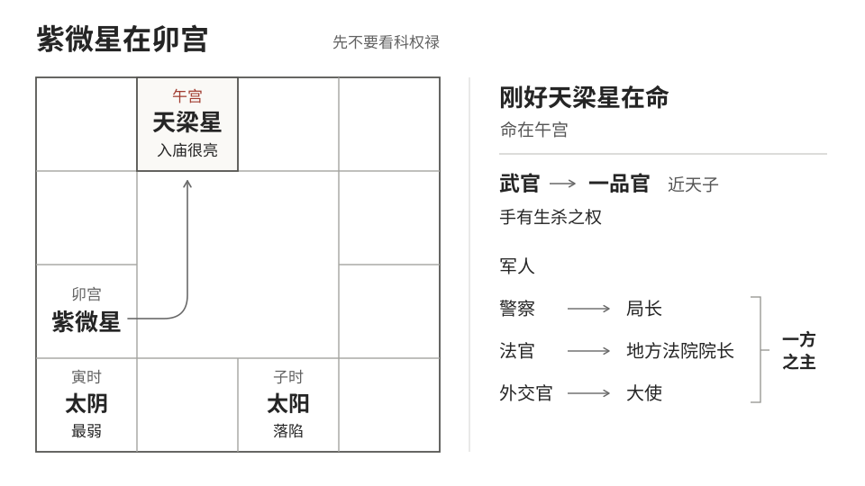 〔板书〕左侧一格横线下写了两个草书字，可辨：第二字像「限」，第一字认不出。（[00:00:28](https://www.bilibili.com/video/BV1KJsLekEfA/?p=13&t=28)，第 860 帧） 〔叠图〕卯宫格为「疾厄 己卯」：紫微旺、化科，贪狼利，文昌利，禄存庙，凤阁旺，天才旺，天使平，年解庙，蜚廉；博士、将星、白虎；衰。（[00:00:28–00:00:30](https://www.bilibili.com/video/BV1KJsLekEfA/?p=13&t=28)，第 852–905 帧） |
| **紫微在卯时，天梁星在哪宫、亮不亮？** | 〔口述〕第一个特点：紫微星在卯宫的时候，「天梁星在午宫」，并且「一定是它一定是入庙很亮」。（[00:00:33–00:00:48](https://www.bilibili.com/video/BV1KJsLekEfA/?p=13&t=33)，第 1002–1451 帧） 〔板书〕上排一格竖写「天梁」，右边写「午」；后来在「天梁」与「午」之间画了一个箭头。（[00:00:38](https://www.bilibili.com/video/BV1KJsLekEfA/?p=13&t=38)，第 1164 帧） 〔板书〕同一格里「天梁」右侧的弯箭头指向「午」字，已清楚可见。（[00:00:49](https://www.bilibili.com/video/BV1KJsLekEfA/?p=13&t=49)，第 1488 帧） 〔叠图〕午宫格为「夫妻 壬午」：天梁庙、化权，地劫庙，恩光庙，天厨，副截庙；大耗、息神、病符；冠带。（[00:00:28–00:00:30](https://www.bilibili.com/video/BV1KJsLekEfA/?p=13&t=28)，第 852–905 帧） 〔推断〕推断：叠图里天梁标「庙」，与倪师说的「入庙很亮」一致。（[00:00:28–00:00:48](https://www.bilibili.com/video/BV1KJsLekEfA/?p=13&t=28)，第 852–1451 帧） |
| **天梁在午宫成什么格？武官指哪四种人？** | 〔口述〕「天梁星在午宫我们有特别一个格」，「这个干武官的话」是「一品一品官」，「一品官呢近天子」。（[00:00:48–00:01:02](https://www.bilibili.com/video/BV1KJsLekEfA/?p=13&t=48)，第 1452–1871 帧） 〔口述〕「武官有四种人」：「军人警察法官外交官这4种人」。（[00:01:02–00:01:16](https://www.bilibili.com/video/BV1KJsLekEfA/?p=13&t=62)，第 1872–2303 帧） 〔板书〕中间一格写着两组字，可辨：「武官」「一品」。（[00:00:58](https://www.bilibili.com/video/BV1KJsLekEfA/?p=13&t=58)，第 1752 帧） 〔板书〕黑板左边一列竖写，可辨：「军人、警、法、外……」，后面被倪师身体挡住，认不出。（[00:01:29](https://www.bilibili.com/video/BV1KJsLekEfA/?p=13&t=89)，第 2682 帧） |
| **外交官、司法官、警察天梁坐命午宫，能做到什么位置？** | 〔口述〕「所以如果一个外交官拿到这种八字」「刚好天梁星在命」「这是在命哦命在午宫」。（[00:01:16–00:01:22](https://www.bilibili.com/video/BV1KJsLekEfA/?p=13&t=76)，第 2304–2477 帧） 〔口述〕天梁在午宫「手有生杀之权」；「所以我算过很多人当司法官的话」「他会干到地方法院院长」「或者一直在往上去干」。（[00:01:22–00:01:32](https://www.bilibili.com/video/BV1KJsLekEfA/?p=13&t=82)，第 2478–2789 帧） 〔口述〕「然后警察的话干局长」「外交官的话要干大使」，「都是一方之主」。（[00:01:33–00:01:39](https://www.bilibili.com/video/BV1KJsLekEfA/?p=13&t=93)，第 2790–2981 帧） 〔指代〕说「都是一方之主这个」时，倪师食指指着上排写有「午」「命」的那一格（午宫）。（[00:01:37](https://www.bilibili.com/video/BV1KJsLekEfA/?p=13&t=97)，第 2927 帧） 〔板书〕上排那格在「午」下方加写了「命」；中间一格竖写，可辨：「生」「杀」，最下一字像「权」，其余认不出。（[00:01:29](https://www.bilibili.com/video/BV1KJsLekEfA/?p=13&t=89)，第 2682 帧） |
| **紫微在卯，太阳、太阴各落在哪里？** | 〔口述〕「还有一个特一个诸位要注意这里」：「他这个太阳在这里」「太阴在这里对不对」。（[00:01:39–00:01:49](https://www.bilibili.com/video/BV1KJsLekEfA/?p=13&t=99)，第 2982–3275 帧） 〔指代〕说「要注意这里」时，倪师粉笔抵在下排中间那格的左上角，接着在这格里写「太」（太阳）。（[00:01:41](https://www.bilibili.com/video/BV1KJsLekEfA/?p=13&t=101)，第 3031 帧） 〔指代〕第3116帧说「这里」时，粉笔移到左边那格正下方的左下格，接着在这格里写「太」字；第3156帧粉笔仍在黑板左下那格书写，先写出「太」。（[00:01:43–00:01:45](https://www.bilibili.com/video/BV1KJsLekEfA/?p=13&t=103)，第 3116–3156 帧） 〔叠图〕叠图给出三宫：「兄弟 戊子」太阳陷；「命宫 己丑」天府庙；「父母 戊寅」天机得（带「禄」）、太阴陷。（[00:02:08–00:02:09](https://www.bilibili.com/video/BV1KJsLekEfA/?p=13&t=128)，第 3858–3899 帧） |
| **为什么太阳在子、太阴在寅都弱？** | 〔口述〕「太阳在子时出来」「子时是晚上11-1点」「太阳所以落陷」，「晚上怎么看得到太阳呢」。（[00:01:49–00:01:57](https://www.bilibili.com/video/BV1KJsLekEfA/?p=13&t=109)，第 3276–3527 帧） 〔口述〕「那寅时的时候」「月亮在旁边」，「寅时是月亮最弱的时候」。（[00:01:57–00:02:01](https://www.bilibili.com/video/BV1KJsLekEfA/?p=13&t=117)，第 3528–3647 帧） 〔板书〕下排写了日月：一格可辨「太阳」，另一格可辨「太」，其后的字认不出。（[00:02:00](https://www.bilibili.com/video/BV1KJsLekEfA/?p=13&t=120)，第 3612 帧） |
| **什么叫反背夹命？命宫要在哪里才算？** | 〔口述〕「如果有一个人的命宫在这里」「叫做日月夹命」，「这种夹命不好」「这种叫做反背的夹」「反背的夹命」。（[00:02:02–00:02:17](https://www.bilibili.com/video/BV1KJsLekEfA/?p=13&t=122)，第 3684–4139 帧） 〔口述〕「如果是命宫在才会反背夹命」——只有命宫在这一格才构成反背夹命。（[00:02:20–00:02:23](https://www.bilibili.com/video/BV1KJsLekEfA/?p=13&t=140)，第 4200–4307 帧） 〔指代〕说「命宫在这里」前后，倪师在黑板底行中间格（左邻写「太…」那格，右邻写「太阳」那格）写「命」字。（[00:02:04](https://www.bilibili.com/video/BV1KJsLekEfA/?p=13&t=124)，第 3733 帧） 〔叠图〕「命宫 己丑」：天府庙，天伤平，台辅，天虚庙，破碎陷；岁破、月煞、青龙；死。左右分别是寅宫（太阴陷）与子宫（太阳陷）。（[00:02:08–00:02:09](https://www.bilibili.com/video/BV1KJsLekEfA/?p=13&t=128)，第 3858–3899 帧） 〔推断〕推断：板上「命」夹在两个「太」字格之间，叠图命宫己丑也夹在寅宫太阴、子宫太阳之间，两者对得上，就是倪师说的日月夹命。（[00:02:02–00:02:09](https://www.bilibili.com/video/BV1KJsLekEfA/?p=13&t=122)，第 3684–3899 帧） |
| **反背夹命的人一生怎样？** | 〔口述〕「反背夹命的话一世辛苦」，一世辛劳，「一辈子都很辛苦」。（[00:02:23–00:02:35](https://www.bilibili.com/video/BV1KJsLekEfA/?p=13&t=143)，第 4308–4667 帧） 〔板书〕黑板右侧竖写，可辨：「反背」「一世辛……」，末字与下方被身体挡住，认不出。（[00:02:28](https://www.bilibili.com/video/BV1KJsLekEfA/?p=13&t=148)，第 4464 帧） |
| **脸上哪里是天仓、哪里是地库？** | 〔口述〕倪师画一个人头，「我故意稍微画夸张点」：正常人的脸「很丰满很饱」，「上面这个位置呢」「我们叫天仓」，「下面这个位置呢我们叫地库」「就是嘴角两边」。（[00:02:35–00:02:58](https://www.bilibili.com/video/BV1KJsLekEfA/?p=13&t=155)，第 4668–5357 帧） 〔指代〕说「上面这个位置」时，手按在黑板所画人脸的左上方（额角处）。（[00:02:48](https://www.bilibili.com/video/BV1KJsLekEfA/?p=13&t=168)，第 5056 帧） 〔指代〕说「下面这个位置」时，手移到所画人脸的左下方（下巴、嘴角一侧）并停住。（[00:02:52](https://www.bilibili.com/video/BV1KJsLekEfA/?p=13&t=172)，第 5165 帧） 〔板书〕黑板左边画了人头：额头两角各画一个小圈，下巴两侧各画一个圈，圈内与下巴处有小字，认不出。（[00:03:01](https://www.bilibili.com/video/BV1KJsLekEfA/?p=13&t=181)，第 5430 帧） |
| **天仓、地库陷下去是什么样子？** | 〔口述〕「天仓这两边有的凹下去」，「有时候正面你还看不到」「你摸它根本就皮包骨的」，「太阳穴的地方这样凹下去」「这叫做天仓没有」。（[00:03:09–00:03:21](https://www.bilibili.com/video/BV1KJsLekEfA/?p=13&t=189)，第 5676–6041 帧） 〔指代〕讲凸出、凹下时，倪师用手按自己的额头、眉骨到眉间、太阳穴一带示范，没有指黑板。（[00:03:15–00:03:17](https://www.bilibili.com/video/BV1KJsLekEfA/?p=13&t=195)，第 5876–5917 帧） 〔口述〕「地库呢两个下巴」，「你看我两个地阁」「两块我是刚好两个大肉」，「如果没有两个大肉」「今天不会站这里」。（[00:03:24–00:03:31](https://www.bilibili.com/video/BV1KJsLekEfA/?p=13&t=204)，第 6120–6347 帧） 〔口述〕「如果整个陷下去」「我在监牢里面」，「那坐牢的人呢」「啊对都是这样」。（[00:03:31–00:03:40](https://www.bilibili.com/video/BV1KJsLekEfA/?p=13&t=211)，第 6348–6617 帧） |
| **相书说没天仓地库一世辛劳，倪师说真正原因是什么？** | 〔口述〕「相是断章取义的」：「没有天仓没有地库的」「一世辛劳它就讲完了」，「可是你有没有想到他为什么一世辛劳」。（[00:03:44–00:03:52](https://www.bilibili.com/video/BV1KJsLekEfA/?p=13&t=224)，第 6738–6971 帧） 〔口述〕「因为他不安分」「他心里面贪念很大」「他每天是欲望很强」。（[00:03:52–00:03:57](https://www.bilibili.com/video/BV1KJsLekEfA/?p=13&t=232)，第 6972–7127 帧） 〔口述〕「他眼睛我们艮为艮为山为止」：「他眼睛看到他就想去要」，「我们看到当作没看到」。（[00:03:57–00:04:02](https://www.bilibili.com/video/BV1KJsLekEfA/?p=13&t=237)，第 7128–7289 帧） 〔口述〕去取不当得的东西，「当然这辈子牢狱之灾很多啊」：坐了牢出来没办法做，「然后再去犯然后又继续坐牢」「就一辈子这样子了」。（[00:04:03–00:04:15](https://www.bilibili.com/video/BV1KJsLekEfA/?p=13&t=243)，第 7290–7667 帧） |
| **天仓陷下、发黑代表什么身体状况？** | 〔口述〕「还有一个重点」：天仓「整个要是如果陷下去的时候」，过去看相看到「这个人糟糕这个天仓没有了」，「代表这个人身体啊气血两虚」「极虚弱的状态之下」。（[00:04:15–00:04:32](https://www.bilibili.com/video/BV1KJsLekEfA/?p=13&t=255)，第 7668–8171 帧） 〔指代〕说「这个天仓」时，倪师右手整掌按在自己额头上。（[00:04:27](https://www.bilibili.com/video/BV1KJsLekEfA/?p=13&t=267)，第 8027 帧） 〔口述〕「为什么叫天仓啊」：「就是说你吃的食物到胃里面去以后」「胃里面能够消化掉」「能够生养化生食物这是天仓嘛」。（[00:04:37–00:04:45](https://www.bilibili.com/video/BV1KJsLekEfA/?p=13&t=277)，第 8334–8561 帧） 〔口述〕病重的时候「天仓也看不到」，「而且天仓这两边黑黑的」「凹下去黑黑的」「这就是代表重病」。（[00:04:45–00:04:53](https://www.bilibili.com/video/BV1KJsLekEfA/?p=13&t=285)，第 8562–8819 帧） |
| **没重病却没天仓的人，从吃相能看出什么？** | 〔口述〕「那你看他重病了」「你再跟他说一世辛苦不要啊」——已经重病的人，不要再跟他讲一世辛苦。（[00:04:54–00:04:56](https://www.bilibili.com/video/BV1KJsLekEfA/?p=13&t=294)，第 8820–8909 帧） 〔口述〕「那个人没有重病精神很好」「你看他两个天仓没有」，就知道他食不知味；「他吃东西都很紧张啊」「看看有没有人看他」「然后眼睛在那边闪动」。（[00:04:57–00:05:08](https://www.bilibili.com/video/BV1KJsLekEfA/?p=13&t=297)，第 8910–9245 帧） 〔口述〕在饭店、餐厅里「你看你对面的人怎么吃东西」，「眼睛在闪来闪去」「跑路的嘛」「这个他已经告诉你了」。（[00:05:09–00:05:16](https://www.bilibili.com/video/BV1KJsLekEfA/?p=13&t=309)，第 9276–9485 帧） 〔口述〕「因为他心里有鬼啊」「那他吃东西不消化啊」「随时会跑对啊」。（[00:05:17–00:05:27](https://www.bilibili.com/video/BV1KJsLekEfA/?p=13&t=317)，第 9522–9821 帧） |

**总结区**

- 通用规则：紫微在卯宫时，天梁星在午宫，一定入庙很亮（[00:00:33–00:00:48](https://www.bilibili.com/video/BV1KJsLekEfA/?p=13&t=33)，第 1002–1451 帧）；天梁在午宫是特别的一个格，主武官一品官、近天子；武官指军人、警察、法官、外交官四种人（[00:00:48–00:01:16](https://www.bilibili.com/video/BV1KJsLekEfA/?p=13&t=48)，第 1452–2303 帧）；命宫被太阳（子）、太阴（寅）两边夹住叫反背夹命，夹命不好，一世辛苦（[00:02:02–00:02:35](https://www.bilibili.com/video/BV1KJsLekEfA/?p=13&t=122)，第 3684–4667 帧）；天仓陷下、两边凹下去黑黑的，代表气血两虚、重病（[00:04:15–00:04:53](https://www.bilibili.com/video/BV1KJsLekEfA/?p=13&t=255)，第 7668–8819 帧）
- 只在本例：示范盘假设命在午宫、天梁坐命：外交官可干到大使，司法官干到地方法院院长，警察干局长，都是一方之主（[00:01:16–00:01:39](https://www.bilibili.com/video/BV1KJsLekEfA/?p=13&t=76)，第 2304–2981 帧）；示范盘叠图以丑宫为命宫（己丑），两旁子宫太阳陷、寅宫太阴陷，用来示范反背夹命（[00:02:02–00:02:23](https://www.bilibili.com/video/BV1KJsLekEfA/?p=13&t=122)，第 3684–4307 帧）
- 不是排盘规则，是处世方法：看到别人有的东西，我们看到当作没看到，不像贪念大的人看到就想去要（[00:04:00–00:04:02](https://www.bilibili.com/video/BV1KJsLekEfA/?p=13&t=240)，第 7200–7289 帧）；对已经重病的人，不要再跟他说一世辛苦（[00:04:54–00:04:56](https://www.bilibili.com/video/BV1KJsLekEfA/?p=13&t=294)，第 8820–8909 帧）；吃饭时看对面的人吃东西紧张、眼睛闪来闪去，是心里有鬼、随时会跑（[00:05:03–00:05:27](https://www.bilibili.com/video/BV1KJsLekEfA/?p=13&t=303)，第 9108–9821 帧）

**待核**

1. [00:00:31](https://www.bilibili.com/video/BV1KJsLekEfA/?p=13&t=31)，第 936 帧字幕「会特再跟诸位讲」多出「特」字，语音作「会跟诸位讲」，原话待核。
2. [00:00:53](https://www.bilibili.com/video/BV1KJsLekEfA/?p=13&t=53)，第 1590 帧「这个干武官的话」：天梁居午这个格的格名倪师没有明说，「干武官」是否就是格名不清；语音作「干五官」。
3. [00:00:58](https://www.bilibili.com/video/BV1KJsLekEfA/?p=13&t=58)，第 1752 帧字幕「近天子」，语音作「进天子」，以字幕为准，待核。
4. [00:00:28](https://www.bilibili.com/video/BV1KJsLekEfA/?p=13&t=28)，第 860 帧板书左侧格两个草书字认不全（第二字像「限」）；指代标注[00:01:41](https://www.bilibili.com/video/BV1KJsLekEfA/?p=13&t=101)，第 3031 帧称这一格为「紫微」格、[00:01:45](https://www.bilibili.com/video/BV1KJsLekEfA/?p=13&t=105)，第 3156 帧称为「岁限」字样，两处说法不一，待核。
5. [00:01:20](https://www.bilibili.com/video/BV1KJsLekEfA/?p=13&t=80)，第 2412 帧板书图上的叠图，午宫格宫名显示为「命宫」、大限2~11，与▣行记的「夫妻壬午」（22~31）不同，应是随「命在午宫」整体换宫名，▣行未单列。
6. [00:01:21](https://www.bilibili.com/video/BV1KJsLekEfA/?p=13&t=81)，第 2450 帧「这个天梁」的指代为「是（不确定）」，没有采用。
7. [00:02:20](https://www.bilibili.com/video/BV1KJsLekEfA/?p=13&t=140)，第 4214 帧、[00:02:21](https://www.bilibili.com/video/BV1KJsLekEfA/?p=13&t=141)，第 4257 帧「如果命宫是在这里」的指代看不出，没有采用；是否指丑宫只能靠叠图推断。
8. [00:02:08](https://www.bilibili.com/video/BV1KJsLekEfA/?p=13&t=128)，第 3858 帧叠图：兄弟戊子「天□旺」、父母戊寅「□罗陷」「太阴陷□」有没认出的字；兄弟格「咸池」「小耗」、父母格「龙德」各出现两次，疑转写重复；对原帧[00:02:09](https://www.bilibili.com/video/BV1KJsLekEfA/?p=13&t=129)，第 3880 帧看，天机、太阴下方的红签被绿框压住，天机下是「禄」，太阴下那一字疑为「忌」，未敢定。
9. [00:01:29](https://www.bilibili.com/video/BV1KJsLekEfA/?p=13&t=89)，第 2682 帧板书中间格「生」「杀」下面的字只像「权」，中间的字认不出；[00:02:00](https://www.bilibili.com/video/BV1KJsLekEfA/?p=13&t=120)，第 3612 帧下排日月两格只认得「太阳」「太」，其余认不出；[00:03:01](https://www.bilibili.com/video/BV1KJsLekEfA/?p=13&t=181)，第 5430 帧人头图里的小字认不出。
10. [00:03:01](https://www.bilibili.com/video/BV1KJsLekEfA/?p=13&t=181)，第 5448 帧字幕「两颊在我我在人上面在这两边」语句不通，原话待核，未写入。
11. [00:03:25](https://www.bilibili.com/video/BV1KJsLekEfA/?p=13&t=205)，第 6162 帧「你看我两个地阁」：「地阁」与「地库」的关系倪师没有解释。
12. [00:03:32](https://www.bilibili.com/video/BV1KJsLekEfA/?p=13&t=212)，第 6372 帧字幕「我在监牢里面」，意思像是「（若陷下去）我就在监牢里面」，原话待核。
13. [00:03:57](https://www.bilibili.com/video/BV1KJsLekEfA/?p=13&t=237)，第 7128 帧「他眼睛我们艮为艮为山为止」字幕可信度0.38；「艮为山为止」与眼睛的关系倪师没有解释。
14. [00:04:05](https://www.bilibili.com/video/BV1KJsLekEfA/?p=13&t=245)，第 7350 帧字幕「取他不当得想想得的东西」语句不通，笔记里只转述为「取不当得的东西」。
15. [00:05:00](https://www.bilibili.com/video/BV1KJsLekEfA/?p=13&t=300)，第 9012 帧字幕作「就就知道他食食不知味」，有叠字，笔记转述为「食不知味」。

### 2　右弼孤星独守、廉贞七杀与巨日格（[00:05:27–00:10:46](https://www.bilibili.com/video/BV1KJsLekEfA/?p=13&t=327)，第 9822–19403 帧）

| 提示区 | 笔记区 |
|---|---|
| **右弼等四颗星「孤星独守」指什么？** | 〔口述〕倪师让大家看「这张八字」，说「一个一个右弼星在酉宫」，接着说「我们叫左辅右弼」「或者是八座三台这四颗星啊独守」。（[00:05:33–00:05:52](https://www.bilibili.com/video/BV1KJsLekEfA/?p=13&t=333)，第 10002–10565 帧） 〔叠图〕叠图标「父母 乙酉」：右弼陷、三台庙、封诰，另有丧门、灾煞、飞廉、养；第10560帧图上这一格大限印作 112~121。（[00:05:31–00:05:33](https://www.bilibili.com/video/BV1KJsLekEfA/?p=13&t=331)，第 9954–9995 帧） 〔板书〕黑板右侧一格里用圆圈圈起「右弼」两字，认得出；其余格里的字与本行无关。（[00:05:52](https://www.bilibili.com/video/BV1KJsLekEfA/?p=13&t=352)，第 10560 帧） 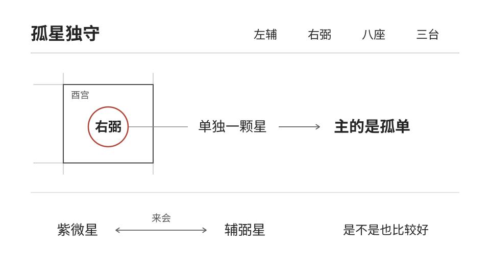 〔口述〕倪师对比：紫微星应该有辅弼星来会，辅弼星也有紫微星来会，「是不是也比较好」；原话「反过来紫微星呢」「应该有辅弼星来会」「同样辅弼星也有紫微星来会」。（[00:05:52–00:06:01](https://www.bilibili.com/video/BV1KJsLekEfA/?p=13&t=352)，第 10566–10847 帧） 〔口述〕这里「他现在什么星都没有」「一颗星在里面」，「这就叫做这四颗星孤星独守」，「一辈子孤单」「主的是孤单」。（[00:06:01–00:06:15](https://www.bilibili.com/video/BV1KJsLekEfA/?p=13&t=361)，第 10848–11273 帧） |
| **右弼独守落命宫、父母宫，各主什么？** | 〔口述〕倪师假设「那如果是命宫在这里」，「那主他一辈子孤单」；再问「那他如果他在父母宫呢」，答「主的单一父母单一单一」。（[00:06:15–00:06:24](https://www.bilibili.com/video/BV1KJsLekEfA/?p=13&t=375)，第 11274–11543 帧） 〔指代〕说「命宫在这里」时手指的是黑板右侧格里用圆圈圈起的「右弼」；板上没写宫名。（[00:06:17](https://www.bilibili.com/video/BV1KJsLekEfA/?p=13&t=377)，第 11324 帧） 〔叠图〕叠图把同一格（乙酉，右弼陷、三台庙、封诰）的宫名先标「命宫」，随即又改回「父母」，跟着倪师的假设换宫名，内容不变。（[00:06:17–00:06:20](https://www.bilibili.com/video/BV1KJsLekEfA/?p=13&t=377)，第 11328–11417 帧） |
| **太阳陷、太阴化忌，为什么说「父母都有凶」？** | 〔口述〕倪师接着说「那如果太阳星陷呢」「太阴星化忌已经很可怜了」，又说「太阳星陷已经很不好了」「太阴星好不容易有点露头」「又化忌」。（[00:06:24–00:06:32](https://www.bilibili.com/video/BV1KJsLekEfA/?p=13&t=384)，第 11544–11789 帧） 〔口述〕结论是「如果化忌呢」「父母都有凶」。（[00:06:33–00:06:37](https://www.bilibili.com/video/BV1KJsLekEfA/?p=13&t=393)，第 11790–11915 帧） 〔叠图〕叠图同时贴出：官禄 戊子——太阳陷、天魁旺、咸池陷、大耗旺、阴煞、月德、墓，大限 82~91；迁移 戊寅——天机得 化禄、太阴旺 化忌、陀罗陷、天喜庙、天姚旺、天贵平、病，大限 62~71（大限数字据第11628帧图）。（[00:06:20–00:06:27](https://www.bilibili.com/video/BV1KJsLekEfA/?p=13&t=380)，第 11418–11628 帧） 〔推断〕推断：倪师在这里把太阳陷、太阴化忌接到「父母都有凶」，但本块没有说明太阳、太阴为什么对应父母；叠图上这两颗星分别在官禄、迁移，不在父母宫。（[00:06:24–00:06:37](https://www.bilibili.com/video/BV1KJsLekEfA/?p=13&t=384)，第 11544–11915 帧） |
| **右弼（或单一左辅）独守夫妻宫主什么？** | 〔口述〕倪师说「这一颗右弼星如果入夫妻宫」，因为夫妻宫「本身主的是双两个人才对」，如果夫妻宫有右弼「或者是单一的左辅」，「这个一颗星在这里主的是二婚」「婚姻势必会离婚」「一定离婚」。（[00:06:37–00:06:50](https://www.bilibili.com/video/BV1KJsLekEfA/?p=13&t=397)，第 11916–12311 帧） 〔口述〕并强调不必看别的亮度：「你不要看什么太阳亮不亮」「孤星在那边就代表会离婚了」「一颗就够了」。（[00:06:50–00:06:57](https://www.bilibili.com/video/BV1KJsLekEfA/?p=13&t=410)，第 12312–12515 帧） 〔指代〕说「这个一颗星在这里」时，粉笔在黑板顶部中间格，正圈起草书单字「左」，所指就是这一格。（[00:06:46–00:06:47](https://www.bilibili.com/video/BV1KJsLekEfA/?p=13&t=406)，第 12186–12219 帧） 〔板书〕可辨：顶部中间格圈起的「左」、其旁的「天」，右侧格圈起的「右弼」；「左」旁新写的「二」后面的字及其余字认不出。（[00:06:49](https://www.bilibili.com/video/BV1KJsLekEfA/?p=13&t=409)，第 12288 帧） 〔叠图〕叠图把同一格改标「夫妻宫 乙酉」：右弼陷、三台庙、封诰，大限 112~121（据第12288帧图）。（[00:06:40–00:06:41](https://www.bilibili.com/video/BV1KJsLekEfA/?p=13&t=400)，第 12012–12041 帧） |
| **右弼在福德宫怎样？福德宫最好有什么？** | 〔口述〕倪师问「那一颗右弼星在福德宫怎么办」，答「那不是更惨」；「最好要有紫微星在福德」「然后辅弼有那最好」，「你只有辅弼星也不行」。（[00:06:57–00:07:10](https://www.bilibili.com/video/BV1KJsLekEfA/?p=13&t=417)，第 12516–12923 帧） 〔叠图〕叠图先把乙酉那格标「福德宫 乙酉」（右弼陷、三台庙、封诰），同时贴出「福德 己丑」：紫微庙 化科、破军旺、左辅庙、右弼庙、天哭庙、华盖陷、胎。两格干支不同，是否另一张盘对照，材料没说。（[00:07:00–00:07:07](https://www.bilibili.com/video/BV1KJsLekEfA/?p=13&t=420)，第 12612–12827 帧） |
| **命宫就是右弼的人，是什么材料？** | 〔口述〕倪师说「那如果命就是右弼」，八字「就已经在告诉你了」：「我生下来就是辅弼之才」「我生下来我当你的助手」「我当你的秘书」「我当老板的助理也很好」。（[00:07:10–00:07:28](https://www.bilibili.com/video/BV1KJsLekEfA/?p=13&t=430)，第 12924–13469 帧） 〔叠图〕叠图又把乙酉那格标回「命宫 乙酉」，内容同前（右弼陷等）。（[00:07:12–00:07:13](https://www.bilibili.com/video/BV1KJsLekEfA/?p=13&t=432)，第 12966–13001 帧） 〔口述〕转到用人：「你是老板要用用手下」，「旁边你一看右弼左辅」「这个人用最好」「他孤单对你有利啊」「随时叫随叫随到啊」。（[00:07:30–00:07:44](https://www.bilibili.com/video/BV1KJsLekEfA/?p=13&t=450)，第 13518–13949 帧） |
| **未宫廉贞七杀庙旺与落陷，结果差在哪？** | 〔口述〕倪师转讲「这个上面呢未宫」：「诸位看到未宫」「他廉贞七杀」，「廉贞七杀在未宫的时候」「你看是不是庙旺」「有没有看到庙和旺」。（[00:07:48–00:08:07](https://www.bilibili.com/video/BV1KJsLekEfA/?p=13&t=468)，第 14040–14621 帧） 〔口述〕对照：「这个廉贞七杀落陷」「两个要落陷地」「在同宫的时候就是凶星」「那个人会横死」；「如果两个是庙旺的时候」，加起来「累积的财富很多」。（[00:08:07–00:08:21](https://www.bilibili.com/video/BV1KJsLekEfA/?p=13&t=487)，第 14622–15041 帧） 〔叠图〕叠图「兄弟 癸未」：廉贞庙、七杀旺、截空庙、华盖陷、岁建、病符、沐浴；第14507帧图上大限印 14~23。（[00:07:51–00:07:56](https://www.bilibili.com/video/BV1KJsLekEfA/?p=13&t=471)，第 14154–14285 帧） 〔叠图〕叠图另贴「夫妻 辛丑」：廉贞陷、七杀陷、破碎陷、华盖陷、胎；第14791帧图上大限印 23~32。与兄弟癸未庙陷正相反，是否另一张盘对照，材料没说。（[00:08:07–00:08:08](https://www.bilibili.com/video/BV1KJsLekEfA/?p=13&t=487)，第 14622–14669 帧） 〔板书〕可辨：上排中间格草书里有「七」字，其后在第14880帧此处已被圈起；其余字认不出。（[00:08:03](https://www.bilibili.com/video/BV1KJsLekEfA/?p=13&t=483)，第 14507 帧） |
| **廉贞七杀庙旺落在34–43岁与14–23岁有何不同？** | 〔口述〕倪师说举这个例的用意：一个人「他是34-43十年中间」「他的流年是廉贞七杀都庙旺」，「是不是他这段时间最好」「财禄来的是时候」。（[00:08:21–00:08:34](https://www.bilibili.com/video/BV1KJsLekEfA/?p=13&t=501)，第 15048–15443 帧） 〔口述〕另一个人「他是14岁开始到23岁廉贞七杀」，「那这个屁用都没有」。（[00:08:34–00:08:42](https://www.bilibili.com/video/BV1KJsLekEfA/?p=13&t=514)，第 15444–15683 帧） 〔口述〕解释：「他从小从13岁开始」，从初中「开始干班长」，「然后干到大学毕业都班代」，「然后念书毕业以后他都干不到」，因为「好星走完了」。（[00:08:43–00:09:03](https://www.bilibili.com/video/BV1KJsLekEfA/?p=13&t=523)，第 15708–16313 帧） 〔叠图〕叠图「兄弟 癸未」这一格的大限数字跟着假设换：第14880帧图印 34~43，第15740帧图印 14~23。（[00:08:16–00:08:44](https://www.bilibili.com/video/BV1KJsLekEfA/?p=13&t=496)，第 14880–15740 帧） |
| **为什么说好运最好不要太早来？** | 〔口述〕倪师由上例得出「所以好运最好不要太早来」。（[00:09:03–00:09:05](https://www.bilibili.com/video/BV1KJsLekEfA/?p=13&t=543)，第 16314–16379 帧） 〔口述〕举例：新闻常报「金门发现一个天才儿童」，「然后到后来都没有消息了」；「然后你看拿到诺贝尔奖的」「没有一个是天才儿童」。（[00:09:07–00:09:21](https://www.bilibili.com/video/BV1KJsLekEfA/?p=13&t=547)，第 16410–16853 帧） 〔口述〕又说「爱迪生还是个聋子呢」「所以当聋子很好啊」：很多人眼睛耳朵都好，父母生下来「就准备让你去给人家骗」，「那聋子骗不到他的」「他根本听不到你的话」。（[00:09:21–00:09:43](https://www.bilibili.com/video/BV1KJsLekEfA/?p=13&t=561)，第 16854–17513 帧） |
| **巨门、太阳都不亮时会到，是什么情形？** | 〔口述〕倪师说这张八字还有一个要讨论：「太阳星陷地中巨门在这边」，「这个巨门星在这里的时候也不亮」，「巨门和太阳如果同这两个会到的时候」「如果是两个这个看不到了对不对」。（[00:09:49–00:10:03](https://www.bilibili.com/video/BV1KJsLekEfA/?p=13&t=589)，第 17682–18101 帧） 〔指代〕说「巨门在这边」时，粉笔正在黑板中间偏左那一格写「巨」字；说「在这里的时候也不亮」时，手压在刚写好的「巨门」下方，同一格。（[00:09:52–00:09:55](https://www.bilibili.com/video/BV1KJsLekEfA/?p=13&t=592)，第 17783–17865 帧） 〔板书〕可辨：中间偏左一格新写的「巨门」，其余新写的字认不出。（[00:09:59](https://www.bilibili.com/video/BV1KJsLekEfA/?p=13&t=599)，第 17991 帧） 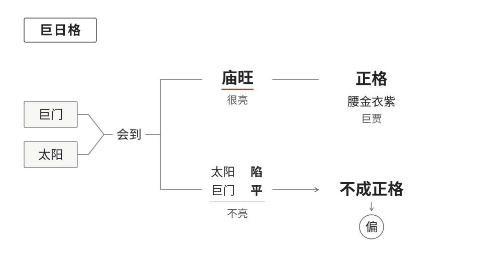 〔叠图〕叠图贴出：官禄 戊子——太阳陷；财帛 庚辰——巨门平、擎羊庙、火星陷、地空陷、天官旺、副旬陷、寡宿陷、天德庙、帝旺，大限 42~51（据第17991帧图）。（[00:09:51–00:09:54](https://www.bilibili.com/video/BV1KJsLekEfA/?p=13&t=591)，第 17742–17837 帧） |
| **巨日格怎样才算成格？** | 〔口述〕倪师说「我们有巨日有两种」，「巨日格要成格」，所谓成格「就是要合那个格局才是成格」。（[00:10:03–00:10:18](https://www.bilibili.com/video/BV1KJsLekEfA/?p=13&t=603)，第 18102–18551 帧） 〔口述〕顺带提到后面介绍易经时，也有卦卜到「要哪些人才合成格」，此处没展开。（[00:10:18–00:10:25](https://www.bilibili.com/video/BV1KJsLekEfA/?p=13&t=618)，第 18552–18773 帧） 〔板书〕可辨：「巨日格」三字，旁边框起的「成格」；右边一格「巨门」。（[00:10:16](https://www.bilibili.com/video/BV1KJsLekEfA/?p=13&t=616)，第 18499 帧） 〔口述〕规则：「巨日格必须要庙旺才会成格」「庙旺啊就是要很亮」，「后面我们会介绍」。（[00:10:28–00:10:33](https://www.bilibili.com/video/BV1KJsLekEfA/?p=13&t=628)，第 18858–19013 帧） 〔叠图〕讲成格时叠图换贴：父母 癸巳——太阳旺、天马平、天福旺、火星得等；疾厄 己亥——巨门旺、天姚陷、天寿旺、天使旺等。（[00:10:28–00:10:30](https://www.bilibili.com/video/BV1KJsLekEfA/?p=13&t=628)，第 18858–18929 帧） |
| **本盘巨门太阳会到，为何「不成正格」？** | 〔口述〕倪师说「巨门太阳在这里会庙旺」，而「现在这个巨门太阳两个会到」「它一定会会到」，但「会到这两个是陷和平不亮对不对」。（[00:10:33–00:10:40](https://www.bilibili.com/video/BV1KJsLekEfA/?p=13&t=633)，第 19014–19217 帧） 〔指代〕说话时右手指尖点在黑板右中格的「巨门」二字处。（[00:10:35](https://www.bilibili.com/video/BV1KJsLekEfA/?p=13&t=635)，第 19060 帧） 〔叠图〕叠图又换回官禄 戊子（太阳陷）与财帛 庚辰（巨门平），与「陷和平」的说法一致。（[00:10:37–00:10:40](https://www.bilibili.com/video/BV1KJsLekEfA/?p=13&t=637)，第 19134–19217 帧） 〔口述〕结论：「这是叫做也是叫做巨日格」，「但是不成正格懂不懂」「不能成为正格」。正格怎样，本块未讲完。（[00:10:40–00:10:46](https://www.bilibili.com/video/BV1KJsLekEfA/?p=13&t=640)，第 19218–19403 帧） |

**总结区**

- 通用规则：左辅、右弼、八座、三台单独一颗在宫里、没有紫微来会，叫孤星独守，主孤单（[00:05:33–00:06:15](https://www.bilibili.com/video/BV1KJsLekEfA/?p=13&t=333)，第 10002–11273 帧）；夫妻宫本主成双，右弼或单一左辅独守夫妻宫主二婚、一定离婚，不必看太阳亮不亮，一颗就够（[00:06:37–00:06:57](https://www.bilibili.com/video/BV1KJsLekEfA/?p=13&t=397)，第 11916–12515 帧）；廉贞七杀同宫落陷是凶星、会横死；两颗都庙旺则累积财富很多（[00:08:07–00:08:21](https://www.bilibili.com/video/BV1KJsLekEfA/?p=13&t=487)，第 14622–15041 帧）；巨日格必须庙旺才会成格；巨门太阳陷、平不亮而会到，也叫巨日格，但不成正格（[00:10:28–00:10:46](https://www.bilibili.com/video/BV1KJsLekEfA/?p=13&t=628)，第 18858–19403 帧）
- 只在本例：这张八字右弼在酉宫，叠图把同一乙酉格先后标为父母、命宫、夫妻宫、福德宫，倪师逐个假设来讲（[00:05:31–00:07:13](https://www.bilibili.com/video/BV1KJsLekEfA/?p=13&t=331)，第 9954–13001 帧）；廉贞七杀庙旺走在34–43岁那十年最好、财禄来得是时候；走在14–23岁则读书时当班长、毕业后反而干不到（[00:08:21–00:09:03](https://www.bilibili.com/video/BV1KJsLekEfA/?p=13&t=501)，第 15048–16313 帧）；本盘太阳陷、巨门平，两颗会到但不亮，属不成正格的巨日格（[00:09:49–00:10:46](https://www.bilibili.com/video/BV1KJsLekEfA/?p=13&t=589)，第 17682–19403 帧）
- 不是排盘规则，是处世方法：老板挑手下，看命宫右弼左辅的人最好用：他孤单、随叫随到，对老板有利（[00:07:30–00:07:44](https://www.bilibili.com/video/BV1KJsLekEfA/?p=13&t=450)，第 13518–13949 帧）；好运最好不要太早来；天才儿童后来多没消息，拿诺贝尔奖的没有一个是天才儿童（[00:09:03–00:09:21](https://www.bilibili.com/video/BV1KJsLekEfA/?p=13&t=543)，第 16314–16853 帧）；聋子骗不到，被人骗的都是眼睛耳朵很好的人（[00:09:21–00:09:43](https://www.bilibili.com/video/BV1KJsLekEfA/?p=13&t=561)，第 16854–17513 帧）

**待核**

1. [00:06:10–00:06:12](https://www.bilibili.com/video/BV1KJsLekEfA/?p=13&t=370)，第 11124–11171 帧「哎变成孤星类了」：语音为「孤心累了」，是「类」还是「累」待核
2. [00:06:20–00:06:24](https://www.bilibili.com/video/BV1KJsLekEfA/?p=13&t=380)，第 11418–11543 帧「主的单一父母单一单一」：「单一」具体指什么，本块没有解释
3. [00:06:24–00:06:37](https://www.bilibili.com/video/BV1KJsLekEfA/?p=13&t=384)，第 11544–11915 帧 太阳陷、太阴化忌为什么推到「父母都有凶」没有解释；叠图上太阳在官禄戊子、太阴在迁移戊寅，不在父母宫
4. [00:06:46–00:06:48](https://www.bilibili.com/video/BV1KJsLekEfA/?p=13&t=406)，第 12198–12263 帧 板书顶部中间格「左」旁新写的「二…」没写完、认不出，是否就是「二婚」待核
5. [00:07:00–00:07:07](https://www.bilibili.com/video/BV1KJsLekEfA/?p=13&t=420)，第 12612–12827 帧 叠图同时出现福德乙酉（右弼陷）与福德己丑（紫微庙科、左右庙），是否另一张盘对照，材料没说
6. [00:08:07–00:08:08](https://www.bilibili.com/video/BV1KJsLekEfA/?p=13&t=487)，第 14622–14669 帧 叠图兄弟癸未（廉贞庙、七杀旺）与夫妻辛丑（廉贞陷、七杀陷）同时出现，是否另一张盘对照，材料没说
7. [00:08:44](https://www.bilibili.com/video/BV1KJsLekEfA/?p=13&t=524)，第 15740 帧 板书图里叠图兄弟癸未印作「廉贞利、七杀庙」，与[00:08:03](https://www.bilibili.com/video/BV1KJsLekEfA/?p=13&t=483)，第 14507 帧图及材料转写的「廉贞庙、七杀旺」不一致，叠图可能有误
8. [00:08:17–00:08:21](https://www.bilibili.com/video/BV1KJsLekEfA/?p=13&t=497)，第 14928–15041 帧「富人积富累积的财富很多」：语音为「人积父累积了财富很多」，前几个字待核
9. [00:08:28–00:08:30](https://www.bilibili.com/video/BV1KJsLekEfA/?p=13&t=508)，第 15252–15317 帧「他的流年是廉贞七杀都庙旺」：语音为「留年是年轻七杀落陷地妙望」，两路不全对；且34–43是十年却称「流年」，未解释
10. [00:08:36–00:08:46](https://www.bilibili.com/video/BV1KJsLekEfA/?p=13&t=516)，第 15486–15803 帧 先说「14岁开始到23岁」，后说「从13岁开始」，岁数前后不一
11. [00:09:03–00:09:05](https://www.bilibili.com/video/BV1KJsLekEfA/?p=13&t=543)，第 16314–16379 帧「所以好运最好不要太早来」：语音为「意最好不要再找来」，两路只大体对上
12. [00:09:51–00:09:54](https://www.bilibili.com/video/BV1KJsLekEfA/?p=13&t=591)，第 17742–17837 帧「太阳星陷地中巨门在这边」：语音为「线的一种巨门在这边」，「陷地中」几字待核
13. [00:10:18–00:10:25](https://www.bilibili.com/video/BV1KJsLekEfA/?p=13&t=618)，第 18552–18773 帧 易经卦卜到「要哪些人才合成格」：字幕可信度约0.5，倪师说后面再讲，内容未展开
14. 指代标为不确定、未作依据：第13013、14062、14593、15602、17794、18058、18838、19028帧
15. 板书认不出：[00:05:31](https://www.bilibili.com/video/BV1KJsLekEfA/?p=13&t=331)，第 9936 帧只认得「午」「太阳」等零星字；第11417、11628、14791、15480、15740帧黑板多被身体或叠图挡住，认不出；[00:10:39](https://www.bilibili.com/video/BV1KJsLekEfA/?p=13&t=639)，第 19172 帧只认得「巨门」

### 3　巨日格偏正、半空折翅与将星（[00:10:46–00:16:25](https://www.bilibili.com/video/BV1KJsLekEfA/?p=13&t=646)，第 19404–29555 帧）

| 提示区 | 笔记区 |
|---|---|
| **巨日格成正格与落陷不成正格，各是什么命？** | 〔口述〕接着上一块讲的巨日格：成正格的话很旺，「巨门太阳是腰金衣紫」，「那个大的大生意人啊」，「巨贾就是这种命」。（[00:10:46–00:10:53](https://www.bilibili.com/video/BV1KJsLekEfA/?p=13&t=646)，第 19404–19619 帧） 〔口述〕「那如果落陷了」，就不成正格，「不成正那就不正了嘛」，「那就变成偏了嘛」。（[00:10:54–00:11:01](https://www.bilibili.com/video/BV1KJsLekEfA/?p=13&t=654)，第 19620–19835 帧） 〔叠图〕先贴出父母癸巳（太阳旺、天马平、火星得、截空庙、孤辰陷等，大限112~121）与疾厄己亥（巨门旺、天姚陷、天寿旺、天使旺，大限52~61）；随后换贴官禄戊子（太阳陷、天魁旺、咸池陷、大耗旺，大限82~91）与财帛庚辰（巨门平、擎羊庙、火星陷、地空陷、天官旺，大限42~51）。（[00:10:46–00:10:56](https://www.bilibili.com/video/BV1KJsLekEfA/?p=13&t=646)，第 19404–19685 帧） 〔板书〕可辨：左侧「巨门」，中间一竖行可辨「金」「衣」两字，其余认不出。（[00:10:49](https://www.bilibili.com/video/BV1KJsLekEfA/?p=13&t=649)，第 19491 帧） 〔板书〕可辨：左上角「巨」「不」，旁边圆圈里一个字像「偏」（字迹潦草，配合口述「变成偏了」判读），其余认不出。（[00:11:04](https://www.bilibili.com/video/BV1KJsLekEfA/?p=13&t=664)，第 19920 帧） |
| **落陷巨日格男女拿到各主什么？倪师为何怕算到？** | 〔口述〕「男孩子拿到还好」，「女孩子拿到会做偏房」。（[00:11:01–00:11:05](https://www.bilibili.com/video/BV1KJsLekEfA/?p=13&t=661)，第 19836–19955 帧） 〔口述〕男孩子拿到的话，「就变成这个个性啊喜怒无常」，「表里不一致」。（[00:11:05–00:11:13](https://www.bilibili.com/video/BV1KJsLekEfA/?p=13&t=665)，第 19956–20201 帧） 〔口述〕倪师说「我算命很怕算到这种」，「我又不敢告诉小姐你表里不一致」「你很坏」；「这个我们不能讲」，又是反背，「所以遇到这个很累」。（[00:11:13–00:11:26](https://www.bilibili.com/video/BV1KJsLekEfA/?p=13&t=673)，第 20202–20585 帧） |
| **自己是这种八字、过去犯过错，该怎么办？** | 〔口述〕倪师常跟学生说：看到自己是这种八字的，「过去你有犯这种错误」，「不要担心没有关系」，「你要知道如何修正它」。（[00:11:26–00:11:35](https://www.bilibili.com/video/BV1KJsLekEfA/?p=13&t=686)，第 20586–20867 帧） 〔口述〕「所以我们到了平常心的阶段」，「像乾为天你刚进刚进」，「你对的往前走」，「然后平常心实话实说嘛」，没有关系。（[00:11:35–00:11:43](https://www.bilibili.com/video/BV1KJsLekEfA/?p=13&t=695)，第 20868–21119 帧） |
| **四岁女儿说「房子好老」，倪师为何说妈妈错了？** | 〔口述〕前几天有个妈妈带女儿来，「那个女儿四岁了」，一进倪师家就大声说「妈妈这个房子好老啊」，妈妈赶紧制止：「她妈就嘿别讲别讲别讲」。（[00:11:44–00:11:56](https://www.bilibili.com/video/BV1KJsLekEfA/?p=13&t=704)，第 21120–21509 帧） 〔口述〕倪师说「我说太太你错了」「她说的是实话」：「你每天在家里面」「教你女儿要讲实话」，「然后她讲实话」「你又禁止她」，「这叫做教而后禁」。（[00:11:57–00:12:07](https://www.bilibili.com/video/BV1KJsLekEfA/?p=13&t=717)，第 21510–21821 帧） 〔口述〕「现在我们教育最大的错误就在这里」，「教了她又不准她这样子」。（[00:12:07–00:12:11](https://www.bilibili.com/video/BV1KJsLekEfA/?p=13&t=727)，第 21822–21941 帧） 〔口述〕要平常心：「我跟她说你女儿讲的对啊」，房子是很丑、「很老很破啊没错啊」，「那为什么要去禁止她」。（[00:12:11–00:12:20](https://www.bilibili.com/video/BV1KJsLekEfA/?p=13&t=731)，第 21942–22217 帧） 〔口述〕「如果心性修到这个阶段的时候」，「命格都束绑束不了你了」。（[00:12:20–00:12:27](https://www.bilibili.com/video/BV1KJsLekEfA/?p=13&t=740)，第 22218–22433 帧） |
| **这张示范盘的特殊状况：命宫在哪，化忌在哪？** | 〔口述〕「还有一个还有一个特殊的状况」，「注意看到这边」，「太阴星化忌看到没有化忌」。（[00:12:29–00:12:36](https://www.bilibili.com/video/BV1KJsLekEfA/?p=13&t=749)，第 22476–22697 帧） 〔指代〕说「注意看到这边」时手指的是黑板左下格：右手拿粉笔点在那格的字上，字迹潦草认不出。（[00:12:32](https://www.bilibili.com/video/BV1KJsLekEfA/?p=13&t=752)，第 22565 帧） 〔叠图〕迁移戊寅：天机得、化禄，太阴旺、化忌，陀罗陷、天喜庙、天姚旺、天贵平、龙德；大限62~71。（[00:12:33–00:12:36](https://www.bilibili.com/video/BV1KJsLekEfA/?p=13&t=753)，第 22590–22697 帧） 〔叠图〕命宫甲申：天钺庙、红鸾庙、天福庙、解神不、天巫、天空旺、孤辰平、劫煞；大限2~11。（[00:12:36–00:12:41](https://www.bilibili.com/video/BV1KJsLekEfA/?p=13&t=756)，第 22698–22847 帧） 〔口述〕「这个八字的刚好命宫在这里」，他刚好拿出来的时候，「命宫是不是在这里」。手指何处见待核。（[00:12:36–00:12:45](https://www.bilibili.com/video/BV1KJsLekEfA/?p=13&t=756)，第 22698–22967 帧） |
| **用三方四正一看，这个命宫受到什么夹冲？** | 〔口述〕「我们三方四正来看」，「我们用红线搭起来」，「诸位打个线一看」。（[00:12:45–00:12:54](https://www.bilibili.com/video/BV1KJsLekEfA/?p=13&t=765)，第 22968–23249 帧） 〔板书〕黑板上用红（橙）色粉笔画出几条连线；右上格可辨一个「命」字，其余被身体挡住或认不出。（[00:12:53](https://www.bilibili.com/video/BV1KJsLekEfA/?p=13&t=773)，第 23208 帧） 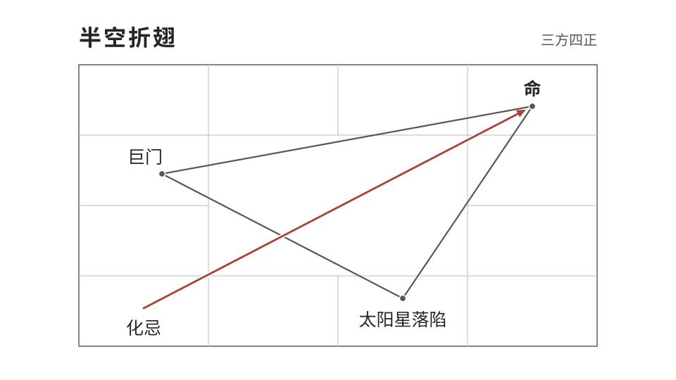 〔口述〕本来两边左右是巨门太阳，「太阳星落陷已经是杀了」，「对面又是化忌来冲」。（[00:12:55–00:13:01](https://www.bilibili.com/video/BV1KJsLekEfA/?p=13&t=775)，第 23250–23435 帧） 〔推断〕推断：倪师说命宫「对面又是化忌来冲」，本块叠图里带化忌的只有迁移戊寅的太阴，所以这里的「对面」应指迁移戊寅那格；同屏叠图（第24624帧板书图可见）另有财帛庚辰巨门平、官禄戊子太阳陷，与「两边左右」巨门太阳落陷相合。倪师口头没说这几格的宫名。（[00:12:55–00:13:01](https://www.bilibili.com/video/BV1KJsLekEfA/?p=13&t=775)，第 23250–23435 帧） |
| **杀星在本宫与从对面来，哪个力量大？** | 〔口述〕「化忌我们命我们算十年」，「跟算命宫跟算流年都是一样的」。（[00:13:01–00:13:06](https://www.bilibili.com/video/BV1KJsLekEfA/?p=13&t=781)，第 23436–23591 帧） 〔口述〕杀星来的时候，「如果在本宫」，「杀星的力量就不强了」；「如果是对面会来的是最大」。（[00:13:06–00:13:13](https://www.bilibili.com/video/BV1KJsLekEfA/?p=13&t=786)，第 23592–23819 帧） 〔口述〕再看他的命宫，对面是化忌来冲。「如果你命中化忌」「有杀星还没什么」；「对面有化忌来冲」，「再加上三方四正」「没有吉星来会的时候」，才是要讲的状况。（[00:13:14–00:13:23](https://www.bilibili.com/video/BV1KJsLekEfA/?p=13&t=794)，第 23820–24101 帧） |
| **什么叫半空折翅？一定要巨门太阳吗？** | 〔口述〕不要管它是不是巨门太阳，「比如说你这里是擎羊陀罗」「或者是其他星」，「不一定是巨门太阳」，「反正那个星不好」。（[00:13:23–00:13:30](https://www.bilibili.com/video/BV1KJsLekEfA/?p=13&t=803)，第 24102–24329 帧） 〔口述〕「然后对面是化忌来冲的时候」，「这我们有个格」，「就叫做半空折翅」。（[00:13:31–00:13:43](https://www.bilibili.com/video/BV1KJsLekEfA/?p=13&t=811)，第 24330–24719 帧） 〔板书〕可辨：右上一格写「命」，其余写字处被身体挡住，认不出。（[00:13:40](https://www.bilibili.com/video/BV1KJsLekEfA/?p=13&t=820)，第 24624 帧） 〔板书〕黑板最右侧竖写「半空折翅」四字，清楚可辨；旁边一竖行认不出。（[00:14:41](https://www.bilibili.com/video/BV1KJsLekEfA/?p=13&t=881)，第 26448 帧） |
| **半空折翅应在几岁？原因有哪两种？** | 〔口述〕「这就是说限会在限运会在中年」，「30岁左右」，「这是一个定定律一样」。（[00:13:44–00:13:51](https://www.bilibili.com/video/BV1KJsLekEfA/?p=13&t=824)，第 24720–24935 帧） 〔口述〕限在30岁左右的原因之一，「是得了先天性的绝症」，「比如艾滋病啊 SLE啊这样」，不是自己要的，「我生下来就这样没办法」。（[00:13:51–00:13:59](https://www.bilibili.com/video/BV1KJsLekEfA/?p=13&t=831)，第 24936–25193 帧） 〔口述〕「还有种是后天的灾星进来的」，「这都有这两种可能」，「都会有这种现象」。（[00:13:59–00:14:16](https://www.bilibili.com/video/BV1KJsLekEfA/?p=13&t=839)，第 25194–25697 帧） |
| **武曲破军同时会到，为什么称将星？** | 〔口述〕「武曲还有破军在这里」，「这两个武官星同时会到的话」，「我们也可以称它为什么」，「将星得地将星来会到」。（[00:14:20–00:14:39](https://www.bilibili.com/video/BV1KJsLekEfA/?p=13&t=860)，第 25812–26393 帧） 〔叠图〕田宅丁亥：武曲平、破军平、文曲旺、龙池旺、天哭平、将军、指背、官符、绝。大限数字有疑问，见待核。（[00:14:20–00:14:24](https://www.bilibili.com/video/BV1KJsLekEfA/?p=13&t=860)，第 25812–25925 帧） 〔指代〕说「这个武曲破军在这两同时会到」时手指的是黑板下排圈起来的板书「武破/曲军」，粉笔点在它的下缘和右侧；板上没写这格的宫名。（[00:14:28](https://www.bilibili.com/video/BV1KJsLekEfA/?p=13&t=868)，第 26061 帧） 〔口述〕「这是我讲的都是命」，「命在这里」。（[00:14:39–00:14:42](https://www.bilibili.com/video/BV1KJsLekEfA/?p=13&t=879)，第 26394–26471 帧） 〔指代〕说「命在这里」时手指的是下排圈起来的「武破/曲军」格（点在圈的左缘），这格右下刚写上「命」字。（[00:14:41](https://www.bilibili.com/video/BV1KJsLekEfA/?p=13&t=881)，第 26437 帧） |
| **武破不在命宫时，怎么以此类推到十年大限？** | 〔口述〕「其他要依此类推嘛」，「这两颗星是将星」，「不单单是命」；「男人拿武官星最好出来就化将」。（[00:14:42–00:14:53](https://www.bilibili.com/video/BV1KJsLekEfA/?p=13&t=882)，第 26472–26813 帧） 〔口述〕把这两颗星，「如果刚好这里不是命宫」，「刚好这里你不要管什么宫」，「刚好这个时候是34-43」「或者是44-53」，「是不是就化将军呢」。（[00:14:57–00:15:05](https://www.bilibili.com/video/BV1KJsLekEfA/?p=13&t=897)，第 26928–27179 帧） 〔指代〕说「这里不是命宫」「刚好这里」「这个时候是34-43」时，手指的都是黑板右下格圈着「武…破」的圆圈；板上看不到34~43，只在叠图里印着。（[00:14:58–00:15:02](https://www.bilibili.com/video/BV1KJsLekEfA/?p=13&t=898)，第 26942–27082 帧） 〔口述〕「你要会以此类推」，不要被它绑到，「不可以被它绑到」。（[00:15:06–00:15:10](https://www.bilibili.com/video/BV1KJsLekEfA/?p=13&t=906)，第 27180–27329 帧） 〔口述〕「那你如果到74-83这样子」，「你就不必干武官了」；还在说「哎先生你干武官很好」，问「我什么时候化将」答「72岁」，「你自己都国防法律都没有看看哈」，几岁退休都没看清楚，「你就胡说八道」，要「多看看报纸时事了」。（[00:15:11–00:15:32](https://www.bilibili.com/video/BV1KJsLekEfA/?p=13&t=911)，第 27330–27965 帧） |
| **将星入女命为何最忌讳？易经怎么讲阴阳？** | 〔口述〕一般原则上算命，「都是将星的入男命最好」；「如果将星入女命」，「有种最忌讳的」，「这个诸位一定要要注意」。（[00:15:33–00:15:46](https://www.bilibili.com/video/BV1KJsLekEfA/?p=13&t=933)，第 27990–28385 帧） 〔口述〕武曲破军在这里的话，「本身就是权权非常」，「权力欲望啊非常重的人」。（[00:15:48–00:16:02](https://www.bilibili.com/video/BV1KJsLekEfA/?p=13&t=948)，第 28464–28883 帧） 〔口述〕「如果是个女人拿到」，「那易经的从头到尾的原则」，「都是阴啊要从于阳」，所以老祖宗说「要嫁鸡随鸡嫁狗随狗」。这段到本块末尾还没讲完。（[00:16:04–00:16:25](https://www.bilibili.com/video/BV1KJsLekEfA/?p=13&t=964)，第 28920–29555 帧） 〔板书〕可辨：「权重」，竖线右边「力」，下面两字像「欲望」但认不准；圆圈里「女」；右边竖写「阴从于」，下方圆圈里「阳」。（[00:16:17](https://www.bilibili.com/video/BV1KJsLekEfA/?p=13&t=977)，第 29322 帧） |

**总结区**

- 通用规则：巨门太阳成正格很旺，主腰金衣紫、巨贾之命；落陷则不成正格而变成偏（[00:10:46–00:11:01](https://www.bilibili.com/video/BV1KJsLekEfA/?p=13&t=646)，第 19404–19835 帧）；杀星在本宫力量不强，从对面来的最大；对面化忌来冲、三方四正又无吉星来会，叫半空折翅，不一定是巨门太阳（[00:13:06–00:13:43](https://www.bilibili.com/video/BV1KJsLekEfA/?p=13&t=786)，第 23592–24719 帧）；半空折翅限运在中年30岁左右，像定律一样，原因有先天绝症与后天灾星两种（[00:13:44–00:14:16](https://www.bilibili.com/video/BV1KJsLekEfA/?p=13&t=824)，第 24720–25697 帧）；武曲破军两颗武官星同会叫将星，入男命最好；不管哪一宫，走到那个十年大限就化将，要以此类推、不被宫名绑住（[00:14:30–00:15:10](https://www.bilibili.com/video/BV1KJsLekEfA/?p=13&t=870)，第 26100–27329 帧）
- 只在本例：这张示范八字命宫在甲申，对面迁移戊寅太阴化忌来冲，两边巨门太阳落陷（[00:12:29–00:13:01](https://www.bilibili.com/video/BV1KJsLekEfA/?p=13&t=749)，第 22476–23435 帧）；示范盘武曲破军在丁亥（叠图标田宅），倪师先当命宫讲，再假设它不是命宫、走到34-43或44-53大限时化将（[00:14:20–00:15:05](https://www.bilibili.com/video/BV1KJsLekEfA/?p=13&t=860)，第 25812–27179 帧）
- 不是排盘规则，是处世方法：自己有这种八字、过去犯过错不必担心，要知道修正，以平常心实话实说（[00:11:26–00:11:43](https://www.bilibili.com/video/BV1KJsLekEfA/?p=13&t=686)，第 20586–21119 帧）；教孩子讲实话又禁止她讲实话叫教而后禁，是教育最大的错误；心性修到平常心，命格就束不了你（[00:11:57–00:12:27](https://www.bilibili.com/video/BV1KJsLekEfA/?p=13&t=717)，第 21510–22433 帧）；给人算武官化将前先看清国防法律的退休年龄、多看报纸时事，别胡说八道（[00:15:11–00:15:32](https://www.bilibili.com/video/BV1KJsLekEfA/?p=13&t=911)，第 27330–27965 帧）

**待核**

1. [00:10:48](https://www.bilibili.com/video/BV1KJsLekEfA/?p=13&t=648)，第 19458 帧「腰金衣紫」语音为「妖精一指」，取字幕。
2. [00:11:01](https://www.bilibili.com/video/BV1KJsLekEfA/?p=13&t=661)，第 19836 帧字幕「所以女男孩子拿到还好」多一个「女」字，语音为「所以男孩子拿到还好」，按语音理解为男孩子，引文只取「男孩子拿到还好」。
3. [00:11:13–00:11:17](https://www.bilibili.com/video/BV1KJsLekEfA/?p=13&t=673)，第 20202–20321 帧字幕「我算命很怕算到这种」「我又不敢告诉小姐」与语音「算命很怕善了之后我又被」「人家告诉我小姐」不完全对得上。
4. [00:11:23](https://www.bilibili.com/video/BV1KJsLekEfA/?p=13&t=683)，第 20496 帧「又反背」字幕可信度0.45，语音只听出「背」；「反背」本块没有解释。
5. [00:11:37](https://www.bilibili.com/video/BV1KJsLekEfA/?p=13&t=697)，第 20916 帧「乾为天」语音为「前有一天」；倪师引了这个卦名但本块没有解释。
6. [00:12:05](https://www.bilibili.com/video/BV1KJsLekEfA/?p=13&t=725)，第 21774 帧「教而后禁」语音为「交而后禁」，取字幕。
7. [00:12:13](https://www.bilibili.com/video/BV1KJsLekEfA/?p=13&t=733)，第 22014 帧「我房子是很丑很丑啊」字幕可信度0.38。
8. [00:12:22](https://www.bilibili.com/video/BV1KJsLekEfA/?p=13&t=742)，第 22284 帧「命格都束绑束不了你了」语音为「受绑束不了」，原话待核。
9. 指代：第22736、22891、22948帧「命宫在这里」与第22362、22675、24088、24168、25705、25958、25967、26521、28426、28498帧的「这个 / 这里」，指向不确定或看不出，未作依据。
10. [00:12:56](https://www.bilibili.com/video/BV1KJsLekEfA/?p=13&t=776)，第 23298 帧字幕「画门太阳星落陷」，「画门」按上下文改读为「巨门」，语音只有「太阳星落线」。
11. [00:13:31](https://www.bilibili.com/video/BV1KJsLekEfA/?p=13&t=811)，第 24330 帧字幕句首「：」是识别噪声，引原话时已去掉。
12. [00:13:34](https://www.bilibili.com/video/BV1KJsLekEfA/?p=13&t=814)，第 24426 帧「半空折翅」字幕可信度0.58、语音「半空则刺」；[00:14:41](https://www.bilibili.com/video/BV1KJsLekEfA/?p=13&t=881)，第 26448 帧板书右侧可辨「半空折翅」，与字幕相合。
13. [00:13:44](https://www.bilibili.com/video/BV1KJsLekEfA/?p=13&t=824)，第 24720 帧字幕「限会在限运会在中年」重复，语音为「现运会在中年」。
14. [00:13:55](https://www.bilibili.com/video/BV1KJsLekEfA/?p=13&t=835)，第 25062 帧「SLE」照字幕原字引，语音也是SLE，本块没有解释。
15. [00:13:59](https://www.bilibili.com/video/BV1KJsLekEfA/?p=13&t=839)，第 25194 帧「灾星」字幕可信度0.32，语音为「宅心」，原词待核。
16. [00:14:20](https://www.bilibili.com/video/BV1KJsLekEfA/?p=13&t=860)，第 25812 帧起叠图田宅丁亥的大限，转写为「92101」，但[00:14:41](https://www.bilibili.com/video/BV1KJsLekEfA/?p=13&t=881)，第 26448 帧画面印「34~43」，第28844、28978、29322帧印「74~83」；叠图前后改过数字，与转写不一致。
17. 同音字改正：[00:14:30](https://www.bilibili.com/video/BV1KJsLekEfA/?p=13&t=870)，第 26100 帧「武官星」语音「五关心」，[00:14:32–00:14:39](https://www.bilibili.com/video/BV1KJsLekEfA/?p=13&t=872)，第 26166–26393 帧「将星」语音「降心」，[00:14:51](https://www.bilibili.com/video/BV1KJsLekEfA/?p=13&t=891)，第 26736 帧「化将」语音「化降」，[00:15:36](https://www.bilibili.com/video/BV1KJsLekEfA/?p=13&t=936)，第 28080 帧「入男命」语音「入难命」，均取字幕。
18. 第26052、26088帧同一句「这个武曲破军在这两同时会到」连出两次，按一句处理。
19. [00:15:21](https://www.bilibili.com/video/BV1KJsLekEfA/?p=13&t=921)，第 27630 帧「国防法律」语音为「国防法令」。
20. 板书：[00:10:49](https://www.bilibili.com/video/BV1KJsLekEfA/?p=13&t=649)，第 19491 帧只认得「巨门」「金」「衣」；[00:11:04](https://www.bilibili.com/video/BV1KJsLekEfA/?p=13&t=664)，第 19920 帧圆圈里像「偏」的字是配合口述判读；[00:12:36](https://www.bilibili.com/video/BV1KJsLekEfA/?p=13&t=756)，第 22688 帧可辨左侧框里「成格」、正中「武」、下排中间圆圈「命」，其余认不出；[00:16:01](https://www.bilibili.com/video/BV1KJsLekEfA/?p=13&t=961)，第 28844 帧「力」下两字像「欲望」认不准。

### 4　阳失正道、女命暗权与鼻如灶门（[00:16:25–00:21:45](https://www.bilibili.com/video/BV1KJsLekEfA/?p=13&t=985)，第 29556–39179 帧）

| 提示区 | 笔记区 |
|---|---|
| **阳失正道时，阴阳和夫妻会怎样？** | 〔推断〕推断：本块开头「可是呢易经完全有个」接的是前文讲的易经「阴要从于阳」原则，这里转讲这个原则之外的情形。（[00:16:25–00:16:27](https://www.bilibili.com/video/BV1KJsLekEfA/?p=13&t=985)，第 29556–29639 帧） 〔口述〕倪师说易经有个很正确的观念：如果阳失了正道，阴会盛于阳，夫妻会反目；还说易经赞成夫妻反目，后面会介绍。「它的一个观念就是如果阳失道……阳失到正道……这个阴啊会盛于阳……那要夫妻会反目」「易经还赞成夫妻反目哦」「我我们后面都会有介绍」（[00:16:26–00:16:45](https://www.bilibili.com/video/BV1KJsLekEfA/?p=13&t=986)，第 29592–30155 帧） 〔口述〕解释原因：做爸爸的（阳）不晓得在搞什么，太太没有办法，只好阴出头。「因为你阳失正道」「你这个爸爸不晓得搞什么」「对不对那太太没有办法了」「阴出头了」（[00:16:45–00:16:52](https://www.bilibili.com/video/BV1KJsLekEfA/?p=13&t=1005)，第 30156–30383 帧） 〔指代〕说「阳失正道你这个」时手指的是黑板中右下方圆圈里的字，看似「陽」，手停住不动。（[00:16:46](https://www.bilibili.com/video/BV1KJsLekEfA/?p=13&t=1006)，第 30191 帧） 〔板书〕可辨：一列「陰」「從」，其下圆圈里一字形似「陽」；左下圆圈里「女」；下方一个「失」字，下面又有圆圈。左侧和中间几字认不出。（[00:16:33](https://www.bilibili.com/video/BV1KJsLekEfA/?p=13&t=993)，第 29796 帧） |
| **做裁缝的太太，她先生是怎样的人？** | 〔口述〕倪师算过一个做裁缝的太太，先生很差，每天在外面赌、花天酒地、不务正业，靠太太赚钱给他用。「她是个做裁缝的」「那她那个先生很差」「每天在外面赌啊花天酒地」「然后也不务正业」「然后太太赚钱给他用」（[00:16:55–00:17:07](https://www.bilibili.com/video/BV1KJsLekEfA/?p=13&t=1015)，第 30462–30815 帧） 〔口述〕还常有债主到家里拿钱，债主是赌场的人，先生在赌场欠了钱。「还有常常有人带债带债主」「到家家里面拿」……「他先生在赌场还欠钱啊」（[00:17:07–00:17:13](https://www.bilibili.com/video/BV1KJsLekEfA/?p=13&t=1027)，第 30816–31001 帧） 〔口述〕后来先生去检查发现得了性病。太太来找倪师，说想告他又怕被他打。「发现还得了性病」……「那太太到我面前来找我啊」「她说告他我又怕被他打」（[00:17:18–00:17:24](https://www.bilibili.com/video/BV1KJsLekEfA/?p=13&t=1038)，第 31152–31325 帧） |
| **倪师怎么帮裁缝太太？结果如何？** | 〔口述〕太太问有什么办法，倪师说有、我教你，帮她把位置改了，并说后面会教大家。「有我教你」「我就帮她一改」「位置一改了以后」「后面我会教诸位」（[00:17:26–00:17:31](https://www.bilibili.com/video/BV1KJsLekEfA/?p=13&t=1046)，第 31380–31541 帧） 〔推断〕推断：改的是什么位置、怎么改，本块没有讲，倪师只说后面会教，这里不补。（[00:17:28–00:17:31](https://www.bilibili.com/video/BV1KJsLekEfA/?p=13&t=1048)，第 31440–31541 帧） 〔口述〕改了以后，先生在外面犯了桃花，认识一个舞女，舞女天天吵着要跟他结婚，他就想尽办法跟太太离婚。「他先生在外面就犯到桃花了」「就认识一个那个舞女」……「好了他就想尽办法」「跟他太太离婚」（[00:17:31–00:17:44](https://www.bilibili.com/video/BV1KJsLekEfA/?p=13&t=1051)，第 31554–31931 帧） |
| **人力做不到的事怎么办？讲这例子的用意？** | 〔口述〕很多事情人力难以做到，可以借用一些「运」来解。「有很多事情」「我们人力往往难以做到」「我们可以借用一些运可以来解」（[00:17:44–00:17:50](https://www.bilibili.com/video/BV1KJsLekEfA/?p=13&t=1064)，第 31932–32129 帧） 〔口述〕倪师说提这个例子的用意：遇到这种情形，如果阳失正道，可以助阴。「那我为什么要提这个出来就是」「如果有这种情形的时候就是」「如果阳失正道可以助阴」（[00:17:51–00:17:58](https://www.bilibili.com/video/BV1KJsLekEfA/?p=13&t=1071)，第 32130–32363 帧） |
| **女孩子拿到将命，为什么说是暗权？** | 〔口述〕还有一种情形是阴：女孩子碰到这种命要特别小心自己，因为女孩子拿到的是男人的将命，将军的命有生杀之权，但她又是阴，所以是暗权，不是明权。「像这种碰到女孩子」「碰到这命要特别小心自己」……「怎么会拿到男人的将命」「将军的命有生杀之权」「那你又是阴」（[00:17:58–00:18:10](https://www.bilibili.com/video/BV1KJsLekEfA/?p=13&t=1078)，第 32364–32729 帧） 〔口述〕倪师说从头到尾给的暗示就是她是暗权、不是明权，并说暗权很可怕。「从头到尾的暗示就给你们」「就是说她是暗权」「不是明权暗权」（[00:18:11–00:18:21](https://www.bilibili.com/video/BV1KJsLekEfA/?p=13&t=1091)，第 32730–33035 帧） 〔板书〕可辨：黑板左上一个「暗」字，后一字形似「权」，认不全；其余被身体挡住或认不出。（[00:18:21](https://www.bilibili.com/video/BV1KJsLekEfA/?p=13&t=1101)，第 33048 帧） 〔叠图〕本块唯一一处叠图，画面右下角贴的是田宅宫丁亥：武曲平、破军平（两星加绿框）、文曲旺、龙池旺、天哭平；另有将军、指背、官符、绝；小限 11, 23, 35, 47, 59, 71；大限 74~83。（[00:16:25–00:16:26](https://www.bilibili.com/video/BV1KJsLekEfA/?p=13&t=985)，第 29556–29591 帧） |
| **太太找征信社跟踪先生，倪师怎么劝？** | 〔口述〕有些太太怀疑先生，表面上很顺从，私底下找征信社跟踪先生；倪师制止过很多这种事，征信社会来找他麻烦，他说没关系。「正面上表面上都很顺从先生」「私底下就找了征信社」「就跟踪先生」「那我制止了很多这种事情」（[00:18:22–00:18:33](https://www.bilibili.com/video/BV1KJsLekEfA/?p=13&t=1102)，第 33072–33401 帧） 〔口述〕太太问花钱找征信社监督先生好不好，倪师反问目的是什么；她说要看他怎么样、让他以后不再犯。「我派我花钱去找征信社」「来监督我先生好不好」……「请问你的目的是干嘛」「你做事情总有目的吧」……「然后让他以后不会再犯」（[00:18:39–00:18:48](https://www.bilibili.com/video/BV1KJsLekEfA/?p=13&t=1119)，第 33570–33851 帧） 〔口述〕倪师说这不是方法：目的是离婚，就不要找人花钱，直接说我要跟你离婚；目的不是离婚，万一被先生逮到就得准备离婚，方法反而害你达不到目的，还可能毁掉婚姻。「我说太太你错了」……「这个不是方法」「如果你的目的是离婚」……「你直接跟他说」「我要跟你离婚就讲完了」……「万一给先生逮到你就准备离婚」（[00:18:48–00:19:07](https://www.bilibili.com/video/BV1KJsLekEfA/?p=13&t=1128)，第 33852–34427 帧） 〔口述〕结论：怎么看都不需要去做。「害你达不到你的目的」「而且可能会把你婚姻毁掉」「所以怎么看都不需要去做」（[00:19:09–00:19:16](https://www.bilibili.com/video/BV1KJsLekEfA/?p=13&t=1149)，第 34488–34685 帧） |
| **暗权的人杀伤力大，最后伤到谁？** | 〔口述〕暗权的人杀伤力很大，但只会杀到、害到自己，因为疑心病重，怀疑别人在谋害她。「那这种暗权的人她杀伤力会很大」「只有杀到自己就害到自己」「因为她疑心病重」「她怀疑人家在谋害她」（[00:19:16–00:19:24](https://www.bilibili.com/video/BV1KJsLekEfA/?p=13&t=1156)，第 34686–34937 帧） 〔口述〕倪师总结说这是男人可以、女人不行。「所以这是一个男人成女人不行」「女人不行」（[00:19:26–00:19:30](https://www.bilibili.com/video/BV1KJsLekEfA/?p=13&t=1166)，第 34980–35129 帧） 〔板书〕可辨：黑板左上「暗」字及后一字（形似「权」），外面画了一个圈；其余认不出。（[00:19:17](https://www.bilibili.com/video/BV1KJsLekEfA/?p=13&t=1157)，第 34737 帧） |
| **不看八字，怎么看出女人有暗权？灶门是什么？** | 〔口述〕学生问怎么知道女人有暗权，倪师说不用看八字，一看就知道。「你怎么知道女人有暗权啊」「当然有了我不用看八字」……「一看就知道」（[00:19:31–00:19:38](https://www.bilibili.com/video/BV1KJsLekEfA/?p=13&t=1171)，第 35148–35357 帧） 〔口述〕以乡下老祖母家的灶作比：大锅在上面煮，旁边有烟囱通上去，下面两个黑黑的铁门叫灶门。「在家里面有个灶有没有是不是」……「然后旁边还有个烟囱」……「那个黑黑的铁门呐」「叫灶门有没有」（[00:19:44–00:19:57](https://www.bilibili.com/video/BV1KJsLekEfA/?p=13&t=1184)，第 35520–35939 帧） 〔板书〕画了一个立体的灶台，台面上两个椭圆孔；上方「暗」及形似「权」的字外有圈。（[00:19:48](https://www.bilibili.com/video/BV1KJsLekEfA/?p=13&t=1188)，第 35664 帧） 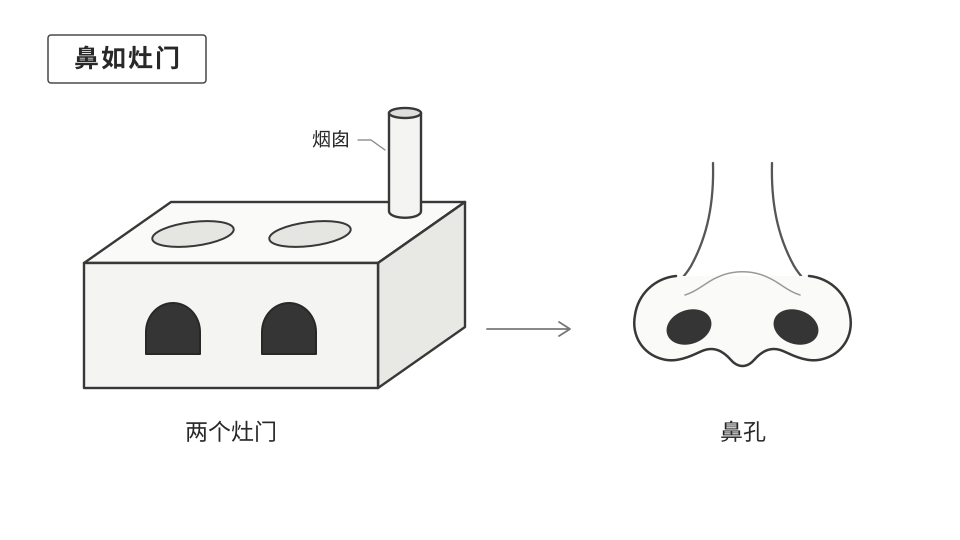 〔板书〕灶台右上加了向上的烟囱，正面加了两个半圆拱形的小门。（[00:19:58](https://www.bilibili.com/video/BV1KJsLekEfA/?p=13&t=1198)，第 35952 帧） |
| **鼻如灶门是什么样？鼻孔露多少才好？** | 〔口述〕女孩子的鼻孔就是两个灶门；鼻孔整个翻上去露出来的会破祖业；男的没关系，女的成格。「鼻孔是两个灶门」「圆圈圈的就是她」「所以一个人会破祖业」「破祖业整个两个翻上去了」「露出来了」……「男的没有关系」「女的成格」（[00:20:00–00:20:13](https://www.bilibili.com/video/BV1KJsLekEfA/?p=13&t=1200)，第 36000–36407 帧） 〔板书〕灶台下方画了一个大圈，圈里两个小圈。（[00:20:01](https://www.bilibili.com/video/BV1KJsLekEfA/?p=13&t=1201)，第 36036 帧） 〔推断〕推断：画大圈和两个小圈时，口述正说「鼻孔是两个灶门」「圆圈圈的就是她」，所以这组图应是画鼻子与两个鼻孔。（[00:20:00–00:20:03](https://www.bilibili.com/video/BV1KJsLekEfA/?p=13&t=1200)，第 36000–36119 帧） 〔口述〕鼻孔要露一点点，稍微露一点只是破点小财；完全不露是小气鬼、一毛不拔；但也不能露太多。「稍微漏一点破点小财没关系」……「完全不漏」……「那个是一毛不拔吝啬鬼啊」……「鼻孔要露一点点」「但你不能露太多懂不懂」（[00:20:19–00:20:33](https://www.bilibili.com/video/BV1KJsLekEfA/?p=13&t=1219)，第 36594–37001 帧） |
| **鼻孔对着人的孩子，祖业能传吗？** | 〔口述〕倪师举例说鼻孔这样对着人的，生活很惨，以后也没有。「你看那个非洲那些人都是这样子的」「他生活很惨然后以后也没有」（[00:20:34–00:20:37](https://www.bilibili.com/video/BV1KJsLekEfA/?p=13&t=1234)，第 37032–37139 帧） 〔口述〕如果家财万贯，生的小孩一看两个鼻孔对着你，祖业就不能传给她，因为她会把祖业败掉。「如果你家里家财万贯」……「一看她两个鼻孔对着你」……「你的祖业就不能传给她哦」「因为她会把祖业败掉」（[00:20:42–00:20:53](https://www.bilibili.com/video/BV1KJsLekEfA/?p=13&t=1242)，第 37260–37607 帧） 〔口述〕相书只说鼻如灶门主败祖业，倪师说中间脱掉很多字，其实就是暗权。「相书上面只是只说」「鼻如灶门会主败祖业」「它中间脱掉很多字」「就是暗权懂不懂我意思」（[00:20:53–00:21:01](https://www.bilibili.com/video/BV1KJsLekEfA/?p=13&t=1253)，第 37608–37847 帧） |
| **暗权的女孩子为什么最会犯小人？** | 〔口述〕她没有专业知识和理论，却主动去认定；一路听谣言就认定，然后被小人影响。「她就主动去认定了」「她并没有我们这种」「经过那么多的专业知识」……「她一路听谣言她就去认定」「然后被小人影响」（[00:21:02–00:21:12](https://www.bilibili.com/video/BV1KJsLekEfA/?p=13&t=1262)，第 37878–38189 帧） 〔口述〕这种人最会犯小人；女孩子逢了这种星个性太刚直，最容易被人利用。「这种人最会犯小人」「所以说个性太刚直」「女孩子逢了这种星」……「最容易被他利用这种」（[00:21:13–00:21:21](https://www.bilibili.com/video/BV1KJsLekEfA/?p=13&t=1273)，第 38190–38447 帧） |
| **跟这种人讲话要怎样？什么是听而明？** | 〔口述〕跟她讲话一定要做到「听而明」，不要做聪明的人，倪师强调自己没讲错国语。「所以跟她讲话的时候」「我们一定要做到听而明」「不要做聪明哦」「我没有讲错国语哦」「听而明哦」「不要做聪明的人」（[00:21:21–00:21:31](https://www.bilibili.com/video/BV1KJsLekEfA/?p=13&t=1281)，第 38448–38753 帧） 〔口述〕牢里都是很聪明的人，检察官比他更聪明，把他抓进牢；里面的都是小聪明，白痴反而进不去。「那牢里都是都是很聪明的人」「那检察官比他聪明」「再把他抓到牢里面去了」……「小聪明」「白痴都进不去了啊」（[00:21:31–00:21:40](https://www.bilibili.com/video/BV1KJsLekEfA/?p=13&t=1291)，第 38754–39029 帧） |

**总结区**

- 通用规则：如果阳失正道，阴会盛于阳，夫妻会反目，易经还赞成这种夫妻反目（[00:16:26–00:16:52](https://www.bilibili.com/video/BV1KJsLekEfA/?p=13&t=986)，第 29592–30383 帧）；女孩子拿到男人的将命，有生杀之权却是阴，主暗权不是明权；疑心重、杀伤力大，最后害到自己（[00:17:58–00:19:25](https://www.bilibili.com/video/BV1KJsLekEfA/?p=13&t=1078)，第 32364–34979 帧）；女孩子鼻如灶门、鼻孔翻上去露出来主破祖业，就是暗权，男的没关系；鼻孔露一点点为好，不露是吝啬，露太多败祖业（[00:20:00–00:21:01](https://www.bilibili.com/video/BV1KJsLekEfA/?p=13&t=1200)，第 36000–37847 帧）；女孩子逢这种星个性太刚直，听谣言就认定，最会犯小人、容易被人利用（[00:21:02–00:21:21](https://www.bilibili.com/video/BV1KJsLekEfA/?p=13&t=1262)，第 37878–38447 帧）
- 只在本例：裁缝太太的先生赌博欠债、得了性病，倪师帮她改了位置后，先生犯桃花、认识舞女，想尽办法跟太太离婚（[00:16:55–00:17:44](https://www.bilibili.com/video/BV1KJsLekEfA/?p=13&t=1015)，第 30462–31931 帧）；本块叠图只有田宅宫丁亥一处：武曲平、破军平、文曲旺、龙池旺、天哭平，大限 74~83（[00:16:25–00:16:26](https://www.bilibili.com/video/BV1KJsLekEfA/?p=13&t=985)，第 29556–29591 帧）
- 不是排盘规则，是处世方法：人力难以做到的事，可以借用一些运来解（[00:17:44–00:17:50](https://www.bilibili.com/video/BV1KJsLekEfA/?p=13&t=1064)，第 31932–32129 帧）；太太想找征信社跟踪先生：先问目的，要离婚就直接说，不离婚就别做，做了反而毁婚姻（[00:18:39–00:19:16](https://www.bilibili.com/video/BV1KJsLekEfA/?p=13&t=1119)，第 33570–34685 帧）；跟个性刚直、有暗权的人讲话要做到听而明，不要做聪明人（[00:21:21–00:21:40](https://www.bilibili.com/video/BV1KJsLekEfA/?p=13&t=1281)，第 38448–39029 帧）

**待核**

1. [00:16:33](https://www.bilibili.com/video/BV1KJsLekEfA/?p=13&t=993)，第 29796 帧板书：只认得「陰」「從」、圆圈里形似「陽」的字、「女」「失」，左侧和中间几字认不出。
2. [00:17:28](https://www.bilibili.com/video/BV1KJsLekEfA/?p=13&t=1048)，第 31440 帧「我就帮她一改」「位置一改了以后」：改的是什么位置、怎么改，本块没讲，倪师说后面会教。
3. [00:17:47](https://www.bilibili.com/video/BV1KJsLekEfA/?p=13&t=1067)，第 32010 帧「我们可以借用一些运可以来解」：字幕与语音都作「运」，指什么本块没解释。
4. [00:18:01](https://www.bilibili.com/video/BV1KJsLekEfA/?p=13&t=1081)，第 32459 帧指代 P13-D079「这个」为是（不确定），手被叠图挡住，未当依据。
5. [00:16:25](https://www.bilibili.com/video/BV1KJsLekEfA/?p=13&t=985)，第 29556 帧起叠图田宅宫里有「将军」，倪师讲的「将命」「将军的命」是否指它，本块没说。
6. [00:18:19](https://www.bilibili.com/video/BV1KJsLekEfA/?p=13&t=1099)，第 32982 帧字幕「暗杈很可怕哦」的「杈」按上下文应为「权」，已在转述中改正。
7. 第 33048、34737 帧板书「暗」后一字只能认出形似「权」，认不全。
8. [00:19:26](https://www.bilibili.com/video/BV1KJsLekEfA/?p=13&t=1166)，第 34980 帧「所以这是一个男人成女人不行」：「成」语音作「选」，原字与意思待核。
9. [00:20:09](https://www.bilibili.com/video/BV1KJsLekEfA/?p=13&t=1209)，第 36270 帧「那个那个澎恰恰」：倪师提到这个名字但没解释是谁。
10. [00:20:12](https://www.bilibili.com/video/BV1KJsLekEfA/?p=13&t=1212)，第 36372 帧「女的成格」：「成格」本块没有解释。
11. [00:20:19](https://www.bilibili.com/video/BV1KJsLekEfA/?p=13&t=1219)，第 36594 帧字幕「稍微漏一点」「完全不漏」的「漏」，语音与上下文作「露」，引文保留字幕原字。
12. [00:21:23](https://www.bilibili.com/video/BV1KJsLekEfA/?p=13&t=1283)，第 38502 帧「听而明」：倪师强调没讲错国语，但没解释具体含义。

## 紫微在辰：雄宿朝元、曲昌同宫日月科禄、天钺、七杀在午

〔叠图〕这一例视频里只贴过 5 格：交友 甲辰：紫微得、天相得、左辅庙、天伤平、天德庙、寡宿陷；子女 戊申：廉贞庙、地空庙、天空旺、孤辰平、红鸾庙、解神不；田宅 壬寅：贪狼平、地劫平、副截陷、副旬陷、天喜庙、天官平；财帛 丁未：文昌利、文曲旺、擎羊庙、华盖陷、天贵旺、恩光旺；福德 癸丑：太阳不、太阴庙禄、铃星得、天姚平、天虚庙、破碎陷。

### 5　紫微在辰：雄宿朝元、曲昌、天钺、七杀（[00:21:46–00:30:21](https://www.bilibili.com/video/BV1KJsLekEfA/?p=13&t=1306)，第 39180–54641 帧）

| 提示区 | 笔记区 |
|---|---|
| **紫微在辰这张盘从哪颗星讲起？** | 〔口述〕倪师换讲下一张盘：「诸位看下一张」「紫微星在辰」，擦板重画后说「一会我们一个一个介绍」，接着「第一个呢」从廉贞星讲起。（[00:21:46–00:22:16](https://www.bilibili.com/video/BV1KJsLekEfA/?p=13&t=1306)，第 39180–40109 帧） 〔叠图〕交友甲辰：紫微得、天相得、左辅庙同在此宫，另有天伤平、寡宿陷、天德庙。（[00:21:48–00:22:09](https://www.bilibili.com/video/BV1KJsLekEfA/?p=13&t=1308)，第 39252–39881 帧） 〔口述〕倪师说「现在紫微星在辰」「紫微星在这边」，又说「紫微星动一下」「其他星都跟着动了」。（[00:22:34–00:22:42](https://www.bilibili.com/video/BV1KJsLekEfA/?p=13&t=1354)，第 40626–40889 帧） |
| **这张盘的廉贞、贪狼落在哪里？** | 〔口述〕倪师说「廉贞星在这里看到没有」「有没有看到廉贞星在这里」「一颗星独守」，又指「贪狼在这里」，并说这里以廉贞星为主（字幕作「沩主」，见待核）。（[00:22:17–00:22:34](https://www.bilibili.com/video/BV1KJsLekEfA/?p=13&t=1337)，第 40110–40625 帧） 〔指代〕说「廉贞星在这里」时，手指的是黑板右上格：右手持粉笔按在该格，板面尚空白，左侧紧邻的叠图为「廉贞…子女 戊申」。（[00:22:17](https://www.bilibili.com/video/BV1KJsLekEfA/?p=13&t=1337)，第 40123 帧） 〔叠图〕子女戊申：廉贞庙，同宫地空庙、天空旺、红鸾庙、解神不、孤辰平、劫煞，大限 94~103。（[00:22:17–00:22:19](https://www.bilibili.com/video/BV1KJsLekEfA/?p=13&t=1337)，第 40110–40199 帧） 〔叠图〕田宅壬寅：贪狼平，同宫地劫平、天喜庙、天官平、副截陷、副旬陷，大限 34~43。（[00:22:24–00:22:29](https://www.bilibili.com/video/BV1KJsLekEfA/?p=13&t=1344)，第 40332–40493 帧） |
| **雄宿朝元格要具备什么条件？** | 〔口述〕倪师说「如果一个人命宫」「廉贞星在申宫」，语音接着说也可以在寅宫，「这两个都一样」。（[00:22:43–00:22:48](https://www.bilibili.com/video/BV1KJsLekEfA/?p=13&t=1363)，第 40890–41057 帧） 〔口述〕他强调「孤星独守一颗星独守」「一定要廉贞星在命」「而且一定要在申宫申宫还有寅宫」「合格才会成格」。（[00:22:52–00:23:08](https://www.bilibili.com/video/BV1KJsLekEfA/?p=13&t=1372)，第 41160–41663 帧） 〔口述〕「这个我们有个格叫做雄宿朝元」，随后又重复了一遍「雄宿朝元」。（[00:23:08–00:23:17](https://www.bilibili.com/video/BV1KJsLekEfA/?p=13&t=1388)，第 41664–41921 帧） 〔叠图〕叠图先在第40860帧把戊申宫名换成「命宫戊申」（廉贞庙等，内容同子女戊申），第40980帧起又出现内容相同的「命宫壬寅」，跟着倪师讲申、寅两种情形演示；此时田宅壬寅（贪狼平）仍在画面上。（[00:22:39–00:22:47](https://www.bilibili.com/video/BV1KJsLekEfA/?p=13&t=1359)，第 40794–41027 帧） |
| **雄宿朝元出哪两种人？做商人还要看什么？** | 〔口述〕这一格「发两种人」：「一种是军人武官」「还有一种生意商人」。武官「出将入相」，「做生意的人会一定会当老板」。（[00:23:17–00:23:44](https://www.bilibili.com/video/BV1KJsLekEfA/?p=13&t=1397)，第 41922–42737 帧） 〔口述〕做商人时「一定要命宫有」，「财帛宫一定要有禄」，倪师说「这当然不在话下了」。（[00:23:24–00:23:28](https://www.bilibili.com/video/BV1KJsLekEfA/?p=13&t=1404)，第 42120–42245 帧） 〔叠图〕财帛庚午：禄存庙，同宫地空庙、三台旺、红鸾旺等（此格另列紫微庙，见待核）。（[00:23:25–00:23:28](https://www.bilibili.com/video/BV1KJsLekEfA/?p=13&t=1405)，第 42150–42245 帧） 〔口述〕倪师说「诸位12章讲完以后」，开始批命时「你就一目了然」「以此类推嘛」「速度会很快」。（[00:23:29–00:23:36](https://www.bilibili.com/video/BV1KJsLekEfA/?p=13&t=1409)，第 42270–42503 帧） |
| **雄宿朝元的人后期会毁在哪里？** | 〔口述〕「但是这个八字后期会毁在什么」「桃花上面」。（[00:23:44–00:23:48](https://www.bilibili.com/video/BV1KJsLekEfA/?p=13&t=1424)，第 42738–42851 帧） 〔口述〕过去有句话：「哎呀你的命再好」「你交桃花会破财不好」，倪师说「这句话讲的就是雄宿朝元的人」。（[00:23:48–00:23:55](https://www.bilibili.com/video/BV1KJsLekEfA/?p=13&t=1428)，第 42852–43079 帧） 〔指代〕说「就是讲这个东西」之前那一刻，手指的是黑板右上格里粉笔圈出的「命」字（右上角叠图为「廉贞…命宫 戊申」）。（[00:24:00](https://www.bilibili.com/video/BV1KJsLekEfA/?p=13&t=1440)，第 43214 帧） |
| **没有八字，怎么从相貌认出这种人？** | 〔口述〕「如果没有八字我们如何看」「这就是廉贞星」：「你看那个眯眯眼这样」「笑起来眼睛这样眯眯的就他」。（[00:24:05–00:24:14](https://www.bilibili.com/video/BV1KJsLekEfA/?p=13&t=1445)，第 43362–43631 帧） 〔口述〕举例儿子带几个男孩子回家，学的就是「站在外面看到里面藏什么」：「只要有一个女的一进来你看」「另外四个都没有变脸的时候」「一个已经变了」，那个就是「这个雄宿朝元」。（[00:24:14–00:24:37](https://www.bilibili.com/video/BV1KJsLekEfA/?p=13&t=1454)，第 43632–44315 帧） 〔口述〕「哎女的也会一样对」「有的女孩子比男孩子还色」，举女孩子见到男歌星「女孩子上去就亲」「抓了还不放你看很可怕」。（[00:24:37–00:24:54](https://www.bilibili.com/video/BV1KJsLekEfA/?p=13&t=1477)，第 44316–44843 帧） |
| **曲昌同宫在哪两宫？对面会到什么星？** | 〔口述〕「第二个呢」「文曲文昌在这里」「这两个叫曲昌同宫」，又说「在丑宫也会同宫」。（[00:24:59–00:25:11](https://www.bilibili.com/video/BV1KJsLekEfA/?p=13&t=1499)，第 44982–45359 帧） 〔口述〕曲昌同宫时「一定会同时会到太阴和太阳」；「你文曲文昌在这里对面在这里」，「为什么这是未宫这是丑宫」。（[00:25:20–00:25:40](https://www.bilibili.com/video/BV1KJsLekEfA/?p=13&t=1520)，第 45600–46211 帧） 〔指代〕说「文曲文昌在这里」时手指的是上排已写文曲文昌的格；紧接说「对面在这里」时手指的是下排中间写着太阳太阴的格（叠图分别显示未宫、丑宫）。（[00:25:30–00:25:31](https://www.bilibili.com/video/BV1KJsLekEfA/?p=13&t=1530)，第 45927–45946 帧） 〔板书〕可辨：上排中间偏右一格与下排中间一格都写着以两个「文」字开头的草书，左下格可辨「贪狼」，其余认不出。（[00:25:15](https://www.bilibili.com/video/BV1KJsLekEfA/?p=13&t=1515)，第 45452 帧） 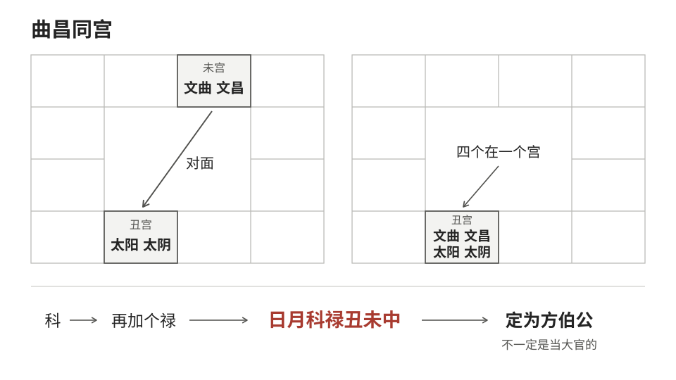 |
| **什么叫「日月科禄丑未中」？** | 〔口述〕「就是说日月有没有」「太阳太阴日月科禄」「科禄有没有科」「如果再加个禄进来的时候」「日月科禄丑未中」「在丑宫和未宫的时候」「定为方伯公」。（[00:25:40–00:26:05](https://www.bilibili.com/video/BV1KJsLekEfA/?p=13&t=1540)，第 46212–46973 帧） 〔叠图〕福德癸丑：太阳不、太阴庙并标化禄，同宫铃星得、天姚平、天虚庙、破碎陷；财帛丁未：文昌利、文曲旺，同宫擎羊庙、恩光旺、天贵旺、华盖陷。（[00:26:02–00:26:05](https://www.bilibili.com/video/BV1KJsLekEfA/?p=13&t=1562)，第 46878–46973 帧） 〔板书〕可辨：黑板左侧竖写一行，末字「公」；下排中间格有「丑」字，一道箭头从上排画向该格；其余认不出。（[00:26:07](https://www.bilibili.com/video/BV1KJsLekEfA/?p=13&t=1567)，第 47016 帧） |
| **方伯公是什么样的人？** | 〔口述〕「所谓方伯公不一定是当大官的」，是「很有名的人」，「比如说名律师名的医师」「名的会计师这是师」。（[00:26:05–00:26:18](https://www.bilibili.com/video/BV1KJsLekEfA/?p=13&t=1565)，第 46974–47363 帧） 〔口述〕这种人能接触「社会的乡绅名流」，「会直接会接触到为政的人」，但不一定真的「做总统」；倪师说「我就看过很多名律师」「还有些校长」「地方的乡绅这种人」。（[00:26:18–00:26:39](https://www.bilibili.com/video/BV1KJsLekEfA/?p=13&t=1578)，第 47364–47993 帧） 〔口述〕「智慧很高就大部分人都有」，「你看文昌文曲来会」「都有专科技术专长」，「那这个给男命最好」。（[00:26:42–00:26:50](https://www.bilibili.com/video/BV1KJsLekEfA/?p=13&t=1602)，第 48078–48305 帧） |
| **女命月亮加昌曲主什么？为何原则上不批？** | 〔口述〕女命「稍微有点例外」：「如果有月亮星进来又带文昌文曲」「这就叫做女孩子也有桃花」「我们杨贵妃就是这样子」；「三颗星同时会到」「对女人来说是桃花」。（[00:26:53–00:27:08](https://www.bilibili.com/video/BV1KJsLekEfA/?p=13&t=1613)，第 48390–48869 帧） 〔口述〕叮嘱男学生出去算命「不可以这样子哦」，不要说「你看这个女孩子桃花太好了」「我要追她」，「看到桃花都不要讲」。（[00:27:09–00:27:16](https://www.bilibili.com/video/BV1KJsLekEfA/?p=13&t=1629)，第 48870–49097 帧） 〔口述〕「我是原则上是不给她批桃花」，因为「批出来只会有只会有纠纷」；「人家私事不要去找她」「尽量不要去讲这些东西」。又说这里面有个「隐在里面的格在告诉你」。（[00:27:16–00:27:39](https://www.bilibili.com/video/BV1KJsLekEfA/?p=13&t=1636)，第 49098–49793 帧） |
| **天钺独守为什么算科甲星？** | 〔口述〕「这里有个天钺星看到没有」「这个天钺星呢独守在这边」。（[00:27:43–00:27:50](https://www.bilibili.com/video/BV1KJsLekEfA/?p=13&t=1663)，第 49890–50117 帧） 〔指代〕说「独守在这边」时手指的是黑板右侧第二排那一格（正用粉笔在格内书写），叠图显示天钺、己酉、命宫。（[00:27:48](https://www.bilibili.com/video/BV1KJsLekEfA/?p=13&t=1668)，第 50069 帧） 〔口述〕命里是天钺或文昌文曲，「这些星都代表什么」「科甲星」；除读书好以外，「如果你的流年逢到这颗星」「刚刚好那年要去考试」「都代表金榜题名」，「那反过来没有会到」「就不是金榜题名了」。（[00:27:54–00:28:16](https://www.bilibili.com/video/BV1KJsLekEfA/?p=13&t=1674)，第 50238–50885 帧） 〔指代〕说「逢到这颗星」时手指的是右侧第二排格内画圈的「天钺」，格内另写「命」。（[00:28:05](https://www.bilibili.com/video/BV1KJsLekEfA/?p=13&t=1685)，第 50554 帧） 〔板书〕可辨：右侧第二排格内圈下有「命」字；圈内草书认不出。（[00:27:59](https://www.bilibili.com/video/BV1KJsLekEfA/?p=13&t=1679)，第 50388 帧） 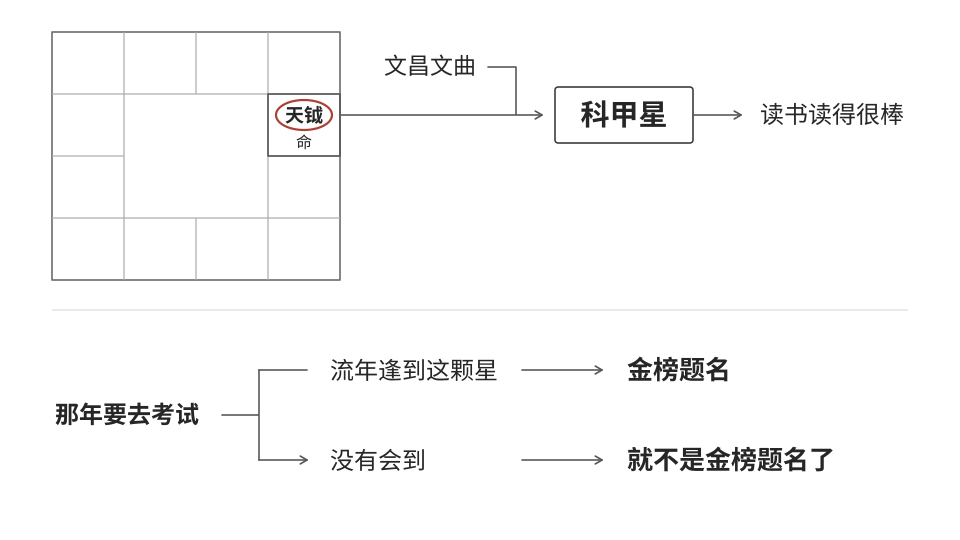 |
| **文昌文曲与天钺各偏重什么？天钺怎样主升官？** | 〔口述〕文昌文曲「完全着重在读书」「文笔才华」，还有专业，「比如说这个作家画家」。（[00:28:16–00:28:26](https://www.bilibili.com/video/BV1KJsLekEfA/?p=13&t=1696)，第 50886–51197 帧） 〔指代〕说「还有这个专业的这个」时，手掌按在上排中间偏右画圈的格子上，格内可见两个「文」字（叠图显示文昌文曲、命宫、未）。（[00:28:22](https://www.bilibili.com/video/BV1KJsLekEfA/?p=13&t=1702)，第 51081 帧） 〔口述〕「天钺星呢」「比较着重于贵人」：流年逢天钺，「命里面没有权」「但是逢到天钺星你会升」「因为有贵人在里面」，「自然而然受到得到上位的赏识」「然后提拔你上去」。（[00:28:26–00:28:46](https://www.bilibili.com/video/BV1KJsLekEfA/?p=13&t=1706)，第 51198–51785 帧） 〔口述〕「所以我们有的升官有两种情形」：「一种是送了红包」「或者是去巴结」，「还有一种呢就是这个逢到贵人」「受到贵人提携上去的」。（[00:28:46–00:28:57](https://www.bilibili.com/video/BV1KJsLekEfA/?p=13&t=1726)，第 51786–52121 帧） |
| **七杀在午为什么也算将星？** | 〔口述〕「再来看七杀在午宫看到没有」，先不管它在疾厄宫：「七杀在疾厄不是痔疮」「这都没有这都没有用的哈」。（[00:29:03–00:29:16](https://www.bilibili.com/video/BV1KJsLekEfA/?p=13&t=1743)，第 52302–52691 帧） 〔口述〕「这个如果在命宫有七杀在午」「这也称为将星」「所以我们将星很多」「将星入命」「七杀在午也是居将星」「也是将星来会」「这也是化权化将干将军呐」。（[00:29:16–00:29:35](https://www.bilibili.com/video/BV1KJsLekEfA/?p=13&t=1756)，第 52692–53273 帧） 〔指代〕说「这个」时手指的是上排写有「七殺」的格子，粉笔持续点在格内，格内另写「午」（叠图显示七杀、疾厄、午）。（[00:29:13](https://www.bilibili.com/video/BV1KJsLekEfA/?p=13&t=1753)，第 52592 帧） 〔板书〕可辨：上排左数第二格「七殺」，字上方画一小「×」，旁边「午命」二字；其余认不出。（[00:29:18](https://www.bilibili.com/video/BV1KJsLekEfA/?p=13&t=1758)，第 52757 帧） 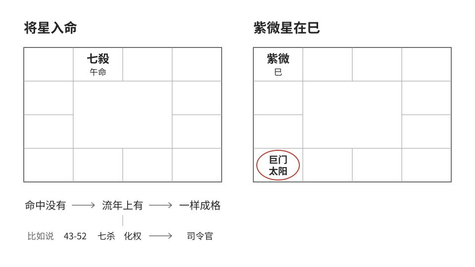 |
| **批武官命看什么？命中没有将星怎么办？** | 〔口述〕「所以如果你批个武官的命」「如果一看都没有什么将星来会」「就不要干了」。（[00:29:37–00:29:46](https://www.bilibili.com/video/BV1KJsLekEfA/?p=13&t=1777)，第 53316–53603 帧） 〔口述〕「那如果你的命中没有」「没关系」「你的流年上有一样成格」；举例 43 到 52 那十年七杀在宫里化权，「哇那个很大哦」。（[00:29:46–00:30:01](https://www.bilibili.com/video/BV1KJsLekEfA/?p=13&t=1786)，第 53604–54035 帧） 〔口述〕这种人会说「那个那个我到外岛当司令官了」，「你是大陆的话就是军区司令了」，台湾人就是「澎湖部司令马防部司令」，「就升了哈」。（[00:30:01–00:30:10](https://www.bilibili.com/video/BV1KJsLekEfA/?p=13&t=1801)，第 54036–54329 帧） 〔板书〕可辨：「七殺」格内「午命」二字；中间一格新写一字，认不出。（[00:30:00](https://www.bilibili.com/video/BV1KJsLekEfA/?p=13&t=1800)，第 54012 帧） |

**总结区**

- 通用规则：廉贞星独守命宫，且一定要在申宫或寅宫，才成雄宿朝元格，出军人武官和生意商人；做商人还要财帛宫有禄（[00:22:43–00:23:28](https://www.bilibili.com/video/BV1KJsLekEfA/?p=13&t=1363)，第 40890–42245 帧）；文曲文昌同宫在丑或未，一定会到太阳太阴；日月再加科禄在丑未中，定为方伯公，即有名、有专长、能接触为政者的人（[00:25:20–00:26:18](https://www.bilibili.com/video/BV1KJsLekEfA/?p=13&t=1520)，第 45600–47363 帧）；天钺、文昌文曲是科甲星，流年逢到又逢考试主金榜题名；流年逢天钺主得贵人提拔而升官（[00:27:54–00:28:46](https://www.bilibili.com/video/BV1KJsLekEfA/?p=13&t=1674)，第 50238–51785 帧）；七杀在午入命也是将星；批武官命若没有将星来会就不要干，命中没有而流年成格一样算（[00:29:16–00:29:54](https://www.bilibili.com/video/BV1KJsLekEfA/?p=13&t=1756)，第 52692–53831 帧）
- 只在本例：这张紫微在辰的示范盘：紫微天相左辅在交友甲辰，廉贞在戊申、贪狼在壬寅，倪师以廉贞为主讲；叠图把戊申宫名从子女换成命宫并演示寅宫情形（[00:21:48–00:22:47](https://www.bilibili.com/video/BV1KJsLekEfA/?p=13&t=1308)，第 39252–41027 帧）；本盘文昌文曲在未（叠图财帛丁未）、太阳太阴在丑且太阴化禄（叠图福德癸丑），用来讲曲昌同宫与日月科禄（[00:25:20–00:26:05](https://www.bilibili.com/video/BV1KJsLekEfA/?p=13&t=1520)，第 45600–46973 帧）
- 不是排盘规则，是处世方法：原则上不给女命批桃花，批出来只有纠纷，人家私事尽量不讲（[00:27:16–00:27:39](https://www.bilibili.com/video/BV1KJsLekEfA/?p=13&t=1636)，第 49098–49793 帧）；替人算命看到女命桃花，不可以当面调笑或借机追求（[00:27:09–00:27:16](https://www.bilibili.com/video/BV1KJsLekEfA/?p=13&t=1629)，第 48870–49097 帧）；升官有送红包、巴结与逢贵人提携几种情形（[00:28:46–00:28:57](https://www.bilibili.com/video/BV1KJsLekEfA/?p=13&t=1726)，第 51786–52121 帧）

**待核**

1. 字幕「我们以廉贞星沩主」的「沩」按上下文应为「为」，已改写为「以廉贞星为主」（[00:22:31](https://www.bilibili.com/video/BV1KJsLekEfA/?p=13&t=1351)，第 40542 帧）
2. 字幕「雄宿上要发两种人」可信度 0.56，语音为「原发两种人」，「上要」二字疑有误，笔记只引「发两种人」（[00:23:17](https://www.bilibili.com/video/BV1KJsLekEfA/?p=13&t=1397)，第 41922 帧）
3. 字幕「文曲文昌同官的时候」的「官」按上下文应为「宫」（[00:25:16](https://www.bilibili.com/video/BV1KJsLekEfA/?p=13&t=1516)，第 45504 帧）
4. 字幕「是跟它四个在一个宫」（语音「跟他四个在一个工」）所指哪四颗星没讲清，未写入笔记（[00:25:33](https://www.bilibili.com/video/BV1KJsLekEfA/?p=13&t=1533)，第 45990 帧）
5. 「日月科禄」「科禄有没有科」里的科、禄，以及「化将」「干将军」等词倪师用了但本块没有解释（[00:25:47](https://www.bilibili.com/video/BV1KJsLekEfA/?p=13&t=1547)，第 46410 帧、[00:29:32](https://www.bilibili.com/video/BV1KJsLekEfA/?p=13&t=1772)，第 53172 帧）
6. 字幕「社会权达之人」可信度 0.5，语音为「全达」，原字待核，未引用（[00:26:35](https://www.bilibili.com/video/BV1KJsLekEfA/?p=13&t=1595)，第 47850 帧）
7. 「隐在里面的格在告诉你」所说的格是什么，本块没有讲（[00:27:31](https://www.bilibili.com/video/BV1KJsLekEfA/?p=13&t=1651)，第 49530 帧）
8. 「七杀在疾厄不是痔疮」这句的意思本块没有展开（[00:29:11](https://www.bilibili.com/video/BV1KJsLekEfA/?p=13&t=1751)，第 52530 帧）
9. 字幕「如果你比如说你43-52会七杀军（星）」括号内「星」是字幕制作者加注、语音里没有，不当原话引；「军」字存疑（[00:29:54](https://www.bilibili.com/video/BV1KJsLekEfA/?p=13&t=1794)，第 53832 帧）
10. 字幕「知上任粱」可信度 0.3、语音为「这个」，对不上，略过（[00:30:11](https://www.bilibili.com/video/BV1KJsLekEfA/?p=13&t=1811)，第 54330 帧）
11. 叠图「命宫壬寅」与「命宫戊申」内容完全相同（廉贞庙、地空庙等、94~103），同时田宅壬寅仍为贪狼平，应是跟着讲寅宫情形的演示，不是本盘实际宫位（[00:22:43](https://www.bilibili.com/video/BV1KJsLekEfA/?p=13&t=1363)，第 40890 帧）
12. 叠图「财帛庚午」列出紫微庙，与本盘紫微在辰不合；数字串「4655」按图例还原不了（[00:23:25](https://www.bilibili.com/video/BV1KJsLekEfA/?p=13&t=1405)，第 42150 帧）
13. 板书图[00:25:15](https://www.bilibili.com/video/BV1KJsLekEfA/?p=13&t=1515)，第 45452 帧左下另有叠图「文昌文曲…财帛 癸丑」，与材料 ▣ 行的「福德癸丑」（太阳太阴）不同，材料未列，未当依据（[00:25:15](https://www.bilibili.com/video/BV1KJsLekEfA/?p=13&t=1515)，第 45452 帧）
14. 板书图[00:27:59](https://www.bilibili.com/video/BV1KJsLekEfA/?p=13&t=1679)，第 50388 帧右上另有叠图「天钺庙、天刑庙、八座庙、台辅…命宫 己酉」，文昌文曲那张标「命宫 丁未」，材料 ▣ 行未列，未当依据（[00:27:59](https://www.bilibili.com/video/BV1KJsLekEfA/?p=13&t=1679)，第 50388 帧）
15. 板书图[00:29:06](https://www.bilibili.com/video/BV1KJsLekEfA/?p=13&t=1746)，第 52380 帧起左上叠图「七杀旺、禄存庙…疾厄 丙午 43~52」，[00:30:00](https://www.bilibili.com/video/BV1KJsLekEfA/?p=13&t=1800)，第 54012 帧七杀带「权」，材料 ▣ 行未列，未当依据（[00:29:06](https://www.bilibili.com/video/BV1KJsLekEfA/?p=13&t=1746)，第 52380 帧、[00:30:00](https://www.bilibili.com/video/BV1KJsLekEfA/?p=13&t=1800)，第 54012 帧）
16. 板书认不出：第40200、40898、41820帧只见格线和圈，字认不出；[00:26:07](https://www.bilibili.com/video/BV1KJsLekEfA/?p=13&t=1567)，第 47016 帧左侧竖写只认得「公」；[00:27:59](https://www.bilibili.com/video/BV1KJsLekEfA/?p=13&t=1679)，第 50388 帧圈内草书认不出；[00:30:00](https://www.bilibili.com/video/BV1KJsLekEfA/?p=13&t=1800)，第 54012 帧中间格新写一字认不出（[00:22:20–00:30:00](https://www.bilibili.com/video/BV1KJsLekEfA/?p=13&t=1340)，第 40200–54012 帧）
17. 指代看不出或不确定、未当依据：「这里」第40223、40328、41087、41131帧，「这个」第44205、48000、48187、49708、52643、54296帧等

## 紫微在巳：巨日格与巨富之相、水澄桂萼、日月夹命

〔叠图〕这一例视频里只贴过 4 格：交友 丙寅：太阳旺忌、巨门庙、禄存庙、天伤平、天贵平、龙池平；田宅 丙子：天同旺、太阴庙、凤阁庙、年解庙；官禄（宫序推） 丁丑：武曲庙科、贪狼庙、天魁旺、陀罗庙、天姚平、破碎陷；父母 甲戌：右弼庙、三台旺、华盖平、恩光庙。

### 6　紫微在巳：巨日格与巨富之相（[00:30:21–00:34:31](https://www.bilibili.com/video/BV1KJsLekEfA/?p=13&t=1821)，第 54642–62159 帧）

| 提示区 | 笔记区 |
|---|---|
| **本块换讲哪一张星盘？** | 〔口述〕倪师先说「诸位看这个已宫」，接着宣布「下一章紫微星在巳」，开始讲紫微在巳的星盘。字幕「已宫」按上下文应为巳宫。（[00:30:21–00:30:58](https://www.bilibili.com/video/BV1KJsLekEfA/?p=13&t=1821)，第 54642–55757 帧） 〔板书〕本块开头板面还是上一张盘的粉笔字，可辨左下格「贪狼」，其余大多认不出。（[00:30:25](https://www.bilibili.com/video/BV1KJsLekEfA/?p=13&t=1825)，第 54756 帧） 〔板书〕重画后的新格子：左上格可辨「紫微」，其下一字形似「巳」，其余格子还是空的。（[00:30:56](https://www.bilibili.com/video/BV1KJsLekEfA/?p=13&t=1856)，第 55690 帧） 〔推断〕推断：「下一章紫微星在巳」这句前后手部记录有写 357 帧、擦 196 帧，与新旧两张板书图对照，是擦板后重画九宫格，换讲紫微在巳的盘。（[00:30:24–00:30:58](https://www.bilibili.com/video/BV1KJsLekEfA/?p=13&t=1824)，第 54720–55757 帧） |
| **紫微在巳时，巨门太阳在哪一格？** | 〔口述〕倪师让大家看左下角：「第一个诸位看下方右左下角」「巨门太阳在这里」「看到没有」「是不是出现了」。（[00:30:58–00:31:08](https://www.bilibili.com/video/BV1KJsLekEfA/?p=13&t=1858)，第 55758–56057 帧） 〔指代〕说「巨门太阳在这里」时，手正停在黑板九宫格最左下那一格书写。（[00:31:02](https://www.bilibili.com/video/BV1KJsLekEfA/?p=13&t=1862)，第 55888 帧） 〔板书〕左下格画了一个圈，圈内可辨「巨门」「太阳」。（[00:31:07](https://www.bilibili.com/video/BV1KJsLekEfA/?p=13&t=1867)，第 56028 帧） 〔叠图〕左下角：交友 丙寅——太阳旺（带忌）、巨门庙、禄存庙、天贵平、龙池平、天伤平、阴煞；临官；博士、指背、官符；小限 3, 15, 27, 39, 51, 63；大限 74~83。（[00:31:19–00:31:24](https://www.bilibili.com/video/BV1KJsLekEfA/?p=13&t=1879)，第 56370–56537 帧） |
| **讲巨日格时，化忌要不要管？** | 〔口述〕讲到「巨门在太阳这的时候」，倪师交代「你不要管化忌哦」「那只是我没有举例啊」。（[00:31:08–00:31:11](https://www.bilibili.com/video/BV1KJsLekEfA/?p=13&t=1868)，第 56058–56153 帧） 〔推断〕推断：叠图里太阳旺旁带「忌」；倪师这两句意思是讲巨日格时先不论化忌，盘上的化忌不是这次要举的例子。（[00:31:08–00:31:24](https://www.bilibili.com/video/BV1KJsLekEfA/?p=13&t=1868)，第 56058–56537 帧） |
| **巨日格要什么条件才成格？** | 〔口述〕「巨门太阳是不是庙旺对不对」「所以当巨门太阳两个都亮」「在同宫的时候」「这个我们就叫做巨日格」。（[00:31:11–00:31:24](https://www.bilibili.com/video/BV1KJsLekEfA/?p=13&t=1871)，第 56154–56537 帧） 〔指代〕说「这个我们就叫做巨日格」的「这个」时，手指一直点在左下角圈起的「巨门 太阳」那一格。（[00:31:18](https://www.bilibili.com/video/BV1KJsLekEfA/?p=13&t=1878)，第 56349 帧） 〔口述〕后面再强调一次：「巨门太阳那巨日格」「这两个入庙的时候成格」。（[00:31:43–00:31:47](https://www.bilibili.com/video/BV1KJsLekEfA/?p=13&t=1903)，第 57096–57221 帧） 〔推断〕推断：叠图上太阳旺、巨门庙，与倪师说的两颗都亮、庙旺同宫相合。（[00:31:11–00:31:24](https://www.bilibili.com/video/BV1KJsLekEfA/?p=13&t=1871)，第 56154–56537 帧） |
| **巨日格的人主什么？** | 〔口述〕「巨日格会的时候」「腰缠黄金衣服穿紫色的」「大富」，并开玩笑「不是船上的大副哦」，是「很富有的人」。（[00:31:24–00:31:38](https://www.bilibili.com/video/BV1KJsLekEfA/?p=13&t=1884)，第 56538–56957 帧） 〔板书〕黑板左侧竖写，可辨「巨日」及一字形似「格」，旁边「腰金衣紫」，下方「大富」。（[00:31:32](https://www.bilibili.com/video/BV1KJsLekEfA/?p=13&t=1892)，第 56765 帧） |
| **看巨富之人，除了盘还要看什么？** | 〔口述〕成格之外「还有相相」，接着问「大富之人你如何看他」「这个很有钱巨富哈」「就是富可敌国」。（[00:31:47–00:32:02](https://www.bilibili.com/video/BV1KJsLekEfA/?p=13&t=1907)，第 57222–57671 帧） 〔板书〕九宫格中央大格画了一个圈，圈内写「相」。（[00:31:50](https://www.bilibili.com/video/BV1KJsLekEfA/?p=13&t=1910)，第 57322 帧） 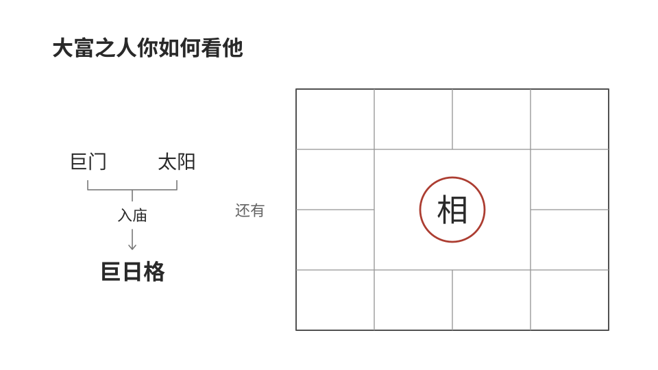 |
| **握手手软如棉代表什么？能分出富贵吗？** | 〔口述〕「第一个你来握手的时候手软如棉」「手软如棉代表两个」「一个是贵」。（[00:32:02–00:32:06](https://www.bilibili.com/video/BV1KJsLekEfA/?p=13&t=1922)，第 57672–57809 帧） 〔口述〕举例「所以我们经国先生」「手也是手软如棉」「但是他是贵」；「富也是手软如棉」。（[00:32:07–00:32:12](https://www.bilibili.com/video/BV1KJsLekEfA/?p=13&t=1927)，第 57810–57977 帧） 〔口述〕结论：「所以光握手只知道富且贵」「到底是哪个还不知道」。（[00:32:12–00:32:16](https://www.bilibili.com/video/BV1KJsLekEfA/?p=13&t=1932)，第 57978–58085 帧） |
| **耳朵比脸白或黑，各说明什么？** | 〔口述〕看这个人耳朵要白、脸比较黑（字幕「耳白过目」「耳朵很自脸比较黑」，「自」按语音改为「白」）。（[00:32:16–00:32:22](https://www.bilibili.com/video/BV1KJsLekEfA/?p=13&t=1936)，第 58086–58265 帧） 〔口述〕「如果你反的就是身体有毛病」「耳朵怎么会黑黑的」「那肾脏不好啊」「有问题快快买单了」。（[00:32:22–00:32:27](https://www.bilibili.com/video/BV1KJsLekEfA/?p=13&t=1942)，第 58266–58421 帧） 〔口述〕「所以你看尿毒的病人」「耳朵都枯枯黑黑的」；所以「耳朵要白」「比脸色还要白」，这是第一个。（[00:32:28–00:32:33](https://www.bilibili.com/video/BV1KJsLekEfA/?p=13&t=1948)，第 58446–58619 帧） |
| **巨富之人的耳形、声音、走路什么样？** | 〔口述〕「然后两个耳朵贴」「正面看不到耳朵」。（[00:32:34–00:32:37](https://www.bilibili.com/video/BV1KJsLekEfA/?p=13&t=1954)，第 58620–58715 帧） 〔口述〕「然后讲话声如洪钟很大声」。（[00:32:37–00:32:40](https://www.bilibili.com/video/BV1KJsLekEfA/?p=13&t=1957)，第 58716–58823 帧） 〔口述〕走路「像龙行虎步很大」「走起来虎虎生风的」「这是巨富」。（[00:32:40–00:32:50](https://www.bilibili.com/video/BV1KJsLekEfA/?p=13&t=1960)，第 58824–59129 帧） |
| **长得像牛又属牛，为什么算成格？** | 〔口述〕「整个像头像走起来好像头牛一样」，问他「然后先生你属什么」，答「我属牛」——「成格那是巨富大富」。（[00:32:51–00:33:01](https://www.bilibili.com/video/BV1KJsLekEfA/?p=13&t=1971)，第 59130–59453 帧） 〔口述〕倪师说见过某国产汽车公司董事长：「国产汽车公司的董事长就是这样」「那总裁像头牛一样」，讲话也是吼吼的。（[00:33:01–00:33:12](https://www.bilibili.com/video/BV1KJsLekEfA/?p=13&t=1981)，第 59454–59771 帧） 〔口述〕说出此人后倪师马上说「这个要删掉」「不然等下人家找他去了」。（[00:33:15–00:33:19](https://www.bilibili.com/video/BV1KJsLekEfA/?p=13&t=1995)，第 59850–59975 帧） 〔口述〕「那人很厚重很大要成格」「因为他整个他本身是属牛」「他整个像是这样像牛」。（[00:33:19–00:33:27](https://www.bilibili.com/video/BV1KJsLekEfA/?p=13&t=1999)，第 59976–60239 帧） |
| **牛相要哪些方面都对上才算成格？** | 〔口述〕走路「不会不会回头的」，「牛怎么会回头」「牛一直转身过来看你的」，所以「整个动作都要成格」。（[00:33:28–00:33:35](https://www.bilibili.com/video/BV1KJsLekEfA/?p=13&t=2008)，第 60240–60467 帧） 〔口述〕「然后脚很厚」「腿生的很粗啊」。（[00:33:35–00:33:37](https://www.bilibili.com/video/BV1KJsLekEfA/?p=13&t=2015)，第 60468–60539 帧） 〔口述〕声音「声似隆钟洪钟」，「耳朵很大又白」「贴的整个贴在头后面」。（[00:33:39–00:33:44](https://www.bilibili.com/video/BV1KJsLekEfA/?p=13&t=2019)，第 60570–60743 帧） |
| **动物相为什么一定要「纯」？** | 〔口述〕「人有动物相很好」「但是要纯相知不知道」，要越纯越好。（[00:33:46–00:33:54](https://www.bilibili.com/video/BV1KJsLekEfA/?p=13&t=2026)，第 60792–61043 帧） 〔口述〕以猴为例：「如果你是招风耳」「可是你整个人看起来就像猴子」，「每一只猴子都是招风耳嘛」，若看到不是招风耳的猴子，「那你看错了」「你看到看到驴去了」。（[00:33:51–00:34:03](https://www.bilibili.com/video/BV1KJsLekEfA/?p=13&t=2031)，第 60936–61295 帧） 〔口述〕举一人（人名两路不一，见待核）站着像猴子，「耳朵还越招风越好懂不懂」，动作像猴子、走路晃动，「很矫捷眼睛闪动纯猴」「都是大贵」。（[00:34:05–00:34:19](https://www.bilibili.com/video/BV1KJsLekEfA/?p=13&t=2045)，第 61356–61775 帧） 〔口述〕「你要你像动物要纯像动物」「你不能说半像半不像」「那是四不像」「就跟纯纯格的人去比差很多」，以「这巨富」收住。（[00:34:19–00:34:31](https://www.bilibili.com/video/BV1KJsLekEfA/?p=13&t=2059)，第 61776–62159 帧） |

**总结区**

- 通用规则：巨门太阳两个都亮（庙旺）、同宫，叫巨日格，腰缠黄金衣服穿紫色的，主大富（[00:31:11–00:31:33](https://www.bilibili.com/video/BV1KJsLekEfA/?p=13&t=1871)，第 56154–56819 帧）；握手手软如棉代表富或贵，光握手分不出是富还是贵（[00:32:02–00:32:16](https://www.bilibili.com/video/BV1KJsLekEfA/?p=13&t=1922)，第 57672–58085 帧）；耳朵要白、比脸色还白；反过来耳朵黑黑的是身体有毛病、肾脏不好（[00:32:16–00:32:33](https://www.bilibili.com/video/BV1KJsLekEfA/?p=13&t=1936)，第 58086–58619 帧）；人有动物相很好，但要纯像动物，半像半不像是四不像，和纯格的人差很多（[00:33:46–00:34:29](https://www.bilibili.com/video/BV1KJsLekEfA/?p=13&t=2026)，第 60792–62081 帧）
- 只在本例：紫微在巳这张示范盘，左下角巨门太阳同宫，叠图标为交友丙寅、太阳旺带忌、巨门庙；倪师说不要管化忌，只是没有举例（[00:30:24–00:31:24](https://www.bilibili.com/video/BV1KJsLekEfA/?p=13&t=1824)，第 54720–56537 帧）；某国产汽车公司董事长像头牛、本身属牛、走路不回头，倪师举为成格的巨富之相（[00:33:01–00:33:35](https://www.bilibili.com/video/BV1KJsLekEfA/?p=13&t=1981)，第 59454–60467 帧）
- 不是排盘规则，是处世方法：讲课举到真实人物后，倪师随即说这段要删掉，免得别人去找他（[00:33:15–00:33:19](https://www.bilibili.com/video/BV1KJsLekEfA/?p=13&t=1995)，第 59850–59975 帧）

**待核**

1. 字幕「诸位看这个已宫」的「已宫」按上下文改为巳宫；该句「这个」指代判为否，看不出指哪（[00:30:21](https://www.bilibili.com/video/BV1KJsLekEfA/?p=13&t=1821)，第 54642 帧）
2. 「下一章紫微星在巳」一句的语音是一串重复，属识别噪声，以字幕为准（[00:30:24](https://www.bilibili.com/video/BV1KJsLekEfA/?p=13&t=1824)，第 54720 帧）
3. 开头板书图右上角另有一张叠图（财帛 己巳、紫微旺、七杀平等），材料没有对应的叠图行，未作依据；板面是上一张盘的字，大多认不出（[00:30:25](https://www.bilibili.com/video/BV1KJsLekEfA/?p=13&t=1825)，第 54756 帧）
4. 新格子左上格「紫微」下面那个字只是形似「巳」，认不全（[00:30:56](https://www.bilibili.com/video/BV1KJsLekEfA/?p=13&t=1856)，第 55690 帧）
5. 交友丙寅叠图材料记为[00:31:21](https://www.bilibili.com/video/BV1KJsLekEfA/?p=13&t=1881)，第 56430 帧起，但板书图[00:31:07](https://www.bilibili.com/video/BV1KJsLekEfA/?p=13&t=1867)，第 56028 帧画面已可见同一叠图；叠图数字串「7483」按图例还原为 74~83，画面可见「74~83」（[00:31:07](https://www.bilibili.com/video/BV1KJsLekEfA/?p=13&t=1867)，第 56028 帧）
6. 「巨门在太阳这的时候」的「这里」指代判为不确定，未作依据（[00:31:08](https://www.bilibili.com/video/BV1KJsLekEfA/?p=13&t=1868)，第 56068 帧）
7. 黑板左侧「巨日」下面那个字只是形似「格」（[00:31:32](https://www.bilibili.com/video/BV1KJsLekEfA/?p=13&t=1892)，第 56765 帧）
8. 「就是语音语言有障碍」所指不明，可能是在说大富与大副同音，倪师没有解释，未写入（[00:31:38](https://www.bilibili.com/video/BV1KJsLekEfA/?p=13&t=1898)，第 56958 帧）
9. 「看这个人耳白过目」可能有错字，语音也作「过目」，未改（[00:32:16](https://www.bilibili.com/video/BV1KJsLekEfA/?p=13&t=1936)，第 58086 帧）
10. 「耳朵很自脸比较黑」的「自」按语音改为「白」（[00:32:19](https://www.bilibili.com/video/BV1KJsLekEfA/?p=13&t=1939)，第 58176 帧）
11. 「有问题快快买单了」的「买单」倪师没有解释（[00:32:26](https://www.bilibili.com/video/BV1KJsLekEfA/?p=13&t=1946)，第 58386 帧）
12. 国产汽车公司董事长一段按要求不写姓名（[00:33:01–00:33:14](https://www.bilibili.com/video/BV1KJsLekEfA/?p=13&t=1981)，第 59454–59849 帧）
13. 「然后声音又响耳」语音作「又下来」，两路对不上，未收（[00:33:38](https://www.bilibili.com/video/BV1KJsLekEfA/?p=13&t=2018)，第 60540 帧）
14. 「声似隆钟洪钟」的「隆钟」可能是同音字（[00:33:39](https://www.bilibili.com/video/BV1KJsLekEfA/?p=13&t=2019)，第 60570 帧）
15. 举猴相一例的人名，字幕作「王永庆」，语音作「黄伟欣」，两路对不上（[00:34:07](https://www.bilibili.com/video/BV1KJsLekEfA/?p=13&t=2047)，第 61422 帧）
16. 块末「这里」指代（手伸向下排中间偏右一格）对应的是下一块「那这里呢」，属后文，未写入（[00:34:31](https://www.bilibili.com/video/BV1KJsLekEfA/?p=13&t=2071)，第 62158 帧）

### 7　水澄桂萼、日月夹命与右弼主孤（[00:34:32–00:39:04](https://www.bilibili.com/video/BV1KJsLekEfA/?p=13&t=2072)，第 62160–70337 帧）

| 提示区 | 笔记区 |
|---|---|
| **太阴在子宫为什么叫「水澄桂萼」？** | 〔口述〕倪师说太阴星在子宫，子时是晚上十一点到一点，月亮正当头，这叫水澄桂萼：「太阴星在子宫」「在子时的时候是晚上11-1点」「月亮正当头的时候」「这个我们叫做水澄桂萼」。（[00:34:34–00:34:48](https://www.bilibili.com/video/BV1KJsLekEfA/?p=13&t=2074)，第 62220–62645 帧） 〔口述〕解释水澄桂萼的意思：太阴星在子时非常清明、非常亮，「这个太阴星在子时的时候」「非常的清明非常的亮」。（[00:34:50–00:34:54](https://www.bilibili.com/video/BV1KJsLekEfA/?p=13&t=2090)，第 62706–62843 帧） 〔指代〕说「太阴星在这个地方」前后，倪师正在板下排、中央大格正下方那一格用粉笔写字，已写出「太」字。（[00:34:33](https://www.bilibili.com/video/BV1KJsLekEfA/?p=13&t=2073)，第 62218 帧） 〔叠图〕田宅 丙子：天同旺、太阴庙（加框）、凤阁庙、蜚廉、年解庙；小限 5,17,29,41,53,65；大限 94~103；青龙、灾煞、丧门；衰。（[00:34:34–00:34:35](https://www.bilibili.com/video/BV1KJsLekEfA/?p=13&t=2074)，第 62220–62255 帧） 〔板书〕可辨：中央大格右侧竖写「水澄桂」三字，第四字被身体挡住；下排一格写有「太」字；左上角有「乙」。其余认不出。（[00:34:48](https://www.bilibili.com/video/BV1KJsLekEfA/?p=13&t=2088)，第 62652 帧） 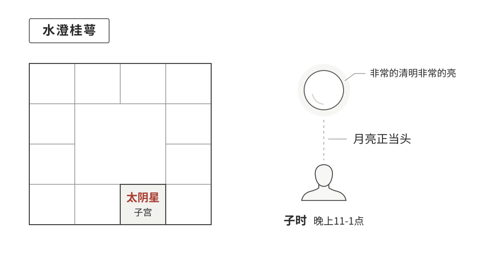 |
| **有水澄桂萼格的官是什么官？清官为什么还不够？** | 〔口述〕当官的人如果有这个格，就是非常清的清官：「就是清非常清的清官」。（[00:34:54–00:34:59](https://www.bilibili.com/video/BV1KJsLekEfA/?p=13&t=2094)，第 62844–62993 帧） 〔指代〕说「这个官（格）」时，手落在板右下方圈起的字上，圈内上字是「太」，下字看不清。（[00:34:56](https://www.bilibili.com/video/BV1KJsLekEfA/?p=13&t=2096)，第 62881 帧） 〔口述〕倪师接着说清官不一定是好官，清官会误国，要清而且明：「清官不一定是好官呐」「你都清官误国知不知道」「清要要清而且明哦」。（[00:34:59–00:35:05](https://www.bilibili.com/video/BV1KJsLekEfA/?p=13&t=2099)，第 62994–63173 帧） |
| **倪师举谁当清官的例子？「明」指什么？** | 〔口述〕举王建煊为例：「像我们王建煊他是清官了」，说台湾「台湾哪个人不贪污的」，人家打棉被有灰尘，「他打的没有灰尘的了」；当部长「他部长15万薪水」却说「不要十万块就好了」，家里24小时「插个国旗在门口」。（[00:35:05–00:35:27](https://www.bilibili.com/video/BV1KJsLekEfA/?p=13&t=2105)，第 63174–63833 帧） 〔口述〕倪师说他是清官「但不一定明」；「明就是让你适时而作」，理想很好也许要「五年以后再做或者十年以后再做」，「不要动太快知不知道」。（[00:35:27–00:35:39](https://www.bilibili.com/video/BV1KJsLekEfA/?p=13&t=2127)，第 63834–64175 帧） |
| **女命太阴在子长什么样？跟妖艳的人差在哪？** | 〔口述〕太阴在子，「那女孩子尤其拿到月亮」，你的女儿像月亮一样漂亮，「像嫦娥一样」，要以此类推。（[00:35:43–00:35:53](https://www.bilibili.com/video/BV1KJsLekEfA/?p=13&t=2143)，第 64302–64601 帧） 〔口述〕有的女孩子很妖艳，妖艳的是贪狼、廉贞：「贪狼嘛廉贞嘛都妖艳嘛」，眯眯眼、「那个桃花那不贪狼廉贞嘛」。（[00:35:53–00:36:02](https://www.bilibili.com/video/BV1KJsLekEfA/?p=13&t=2153)，第 64602–64889 帧） 〔口述〕太阴星则「哇长得非常的清纯」，非常漂亮、皮肤白而细，因为长得像月亮，「两只眼睛呀像月亮一样那么大」，「这叫做水澄桂萼」。（[00:36:03–00:36:15](https://www.bilibili.com/video/BV1KJsLekEfA/?p=13&t=2163)，第 64890–65261 帧） |
| **当官的拿到太阴在子会怎样？** | 〔口述〕「那官星入这个成格」，「所以当官的拿到这颗星」，「非常的好非常的顺利」。（[00:36:15–00:36:21](https://www.bilibili.com/video/BV1KJsLekEfA/?p=13&t=2175)，第 65262–65453 帧） 〔指代〕说「那官星入这个成格」「当官的拿到这颗星」时，右手（拿粉笔）都指在下排圈起的字上，圈内上字是「太」，下字潦草看不清。（[00:36:16–00:36:17](https://www.bilibili.com/video/BV1KJsLekEfA/?p=13&t=2176)，第 65282–65326 帧） |
| **什么叫日月夹命？主什么？** | 〔口述〕「那太阳在这边入庙」，太阴在这边入庙，「如果你的命既非这个又不是这个」，「刚好在中间」，「这就叫做日月夹命」；又说「如果命宫刚好落在这里」也叫日月夹命。（[00:36:21–00:36:35](https://www.bilibili.com/video/BV1KJsLekEfA/?p=13&t=2181)，第 65454–65861 帧） 〔指代〕说「太阴在这边入庙」「太阴在这里」时，手指下排圈起的「太」字；说「你命宫在这里啊」时，粉笔尖点在太字圈左边一格新画的小弧下方，弧内没有可读的字。（[00:36:23–00:36:32](https://www.bilibili.com/video/BV1KJsLekEfA/?p=13&t=2183)，第 65504–65764 帧） 〔叠图〕交友 丙寅：太阳旺、巨门庙、禄存庙、天贵平、龙池平、天伤平、阴煞；小限 3,15,27,39,51,63；大限 74~83；博士、指背、官符；临官。命宫 丁丑：武曲庙 化科、贪狼庙、天魁旺、陀罗庙、天姚平、破碎陷；小限 4,16,28,40,52,64；力士、天煞、贯索；帝旺。（[00:36:21–00:36:24](https://www.bilibili.com/video/BV1KJsLekEfA/?p=13&t=2181)，第 65454–65531 帧） 〔推断〕推断：叠图上太阳在寅、太阴在子，命宫在丑正处两者之间，与倪师口述「刚好在中间」「日月夹命」对得上。（[00:36:21–00:36:35](https://www.bilibili.com/video/BV1KJsLekEfA/?p=13&t=2181)，第 65454–65861 帧） 〔口述〕日月夹命「就夹财」，「一世财禄无缺」，「主一世荣华」。（[00:36:34–00:36:41](https://www.bilibili.com/video/BV1KJsLekEfA/?p=13&t=2194)，第 65826–66041 帧） |
| **被日月夹住的命宫里是什么星？丑时出有何特别？** | 〔口述〕看夹财的时候「你注意看里面是什么」，「武曲在这里是不是」，贪狼也在，「武曲贪狼是武官星」。（[00:36:41–00:36:52](https://www.bilibili.com/video/BV1KJsLekEfA/?p=13&t=2201)，第 66042–66377 帧） 〔指代〕说「武曲在这里是不是」时，粉笔在下排「财」字下方那格左侧书写、点着「武」字。（[00:36:44](https://www.bilibili.com/video/BV1KJsLekEfA/?p=13&t=2204)，第 66144 帧） 〔板书〕可辨：下排中间格有「财」「武曲」「贪狼」，贪狼下方一个圈内的字认不出；右上方竖写「水澄桂萼」；中部有一个圈起的字，认不出；格间有几条连线。（[00:36:52](https://www.bilibili.com/video/BV1KJsLekEfA/?p=13&t=2212)，第 66387 帧） 〔口述〕「很奇怪丑时出武官星的时候」会发阴，「发阴因为阴冷啊」，「晚上晚夜丑时是夜半嘛」。（[00:36:52–00:37:02](https://www.bilibili.com/video/BV1KJsLekEfA/?p=13&t=2212)，第 66378–66671 帧） |
| **武贪成格，男命女命为什么要分日月？** | 〔口述〕算到男人这个「和女人这个不一样」：「女人呢晚上出的武官星的时候」，「是正科正将星」。（[00:37:02–00:37:11](https://www.bilibili.com/video/BV1KJsLekEfA/?p=13&t=2222)，第 66672–66941 帧） 〔指代〕说「男人这个」「女人这个」时，右手指尖都按在下排中间格「贪狼」及其下方圈字一带。（[00:37:03–00:37:04](https://www.bilibili.com/video/BV1KJsLekEfA/?p=13&t=2223)，第 66702–66735 帧） 〔口述〕「诸位如果男人武贪在这里成格」，「男人最好的白天嘛」，「女人所以我们要分日月」。（[00:37:23–00:37:29](https://www.bilibili.com/video/BV1KJsLekEfA/?p=13&t=2243)，第 67290–67481 帧） 〔指代〕说「武贪在这里」时，右手食指点向板面顶排一个空格（竖线右侧），该格没有字。（[00:37:24](https://www.bilibili.com/video/BV1KJsLekEfA/?p=13&t=2244)，第 67324 帧） |
| **女命武贪成格是什么样的人？** | 〔口述〕「这女孩子即使没有当军人」，「她也是女中的豪杰」，「像那个四行仓库那个人」，「不然那么彪悍对不对」，倪师说自己都不敢去，「她一定敢去呀对不对」。（[00:37:11–00:37:22](https://www.bilibili.com/video/BV1KJsLekEfA/?p=13&t=2231)，第 66942–67289 帧） 〔口述〕倪师重复：女人成格，女中豪杰。（[00:37:30–00:37:32](https://www.bilibili.com/video/BV1KJsLekEfA/?p=13&t=2250)，第 67506–67577 帧） 〔口述〕玩笑说「你娶了个老婆是这样子的」，「那你要看好一点哦」，没事她就去游行，「示威游行抗议去了」，「然后打最前线」，「这个孔武有力」。（[00:37:33–00:37:56](https://www.bilibili.com/video/BV1KJsLekEfA/?p=13&t=2253)，第 67608–68285 帧） |
| **这张八字的右弼星在哪里？** | 〔口述〕「这张八字大概就是这样子」，几个重点讲完；「还右边有个廉破」「我讲过了嘛」；还有个右弼星在下面，「在下面一样跟右弼星孤星在这里」，右弼星在父母宫（字幕作「父母官」）。（[00:37:59–00:38:11](https://www.bilibili.com/video/BV1KJsLekEfA/?p=13&t=2279)，第 68376–68735 帧） 〔叠图〕父母 甲戌：右弼庙（加框）、三台旺、恩光庙、天月、华盖平；小限 7,19,31,43,55,67；大限 34~43；将军、华盖、岁建；死。（[00:38:06–00:38:08](https://www.bilibili.com/video/BV1KJsLekEfA/?p=13&t=2286)，第 68586–68645 帧） 〔指代〕说「右弼星孤星在这里」时，倪师正用粉笔在板面右列中格书写「右弼」，右字清楚、弼字未写完。（[00:38:07](https://www.bilibili.com/video/BV1KJsLekEfA/?p=13&t=2287)，第 68630 帧） 〔板书〕可辨：下排中间格「财」「武曲」「贪狼」；右上竖写「水澄桂萼」；左下一个大圈内可辨「太」字。右列中格（写右弼处）被讲者头部挡住，认不出；板左缘竖写的几个字认不出。（[00:38:17](https://www.bilibili.com/video/BV1KJsLekEfA/?p=13&t=2297)，第 68924 帧） 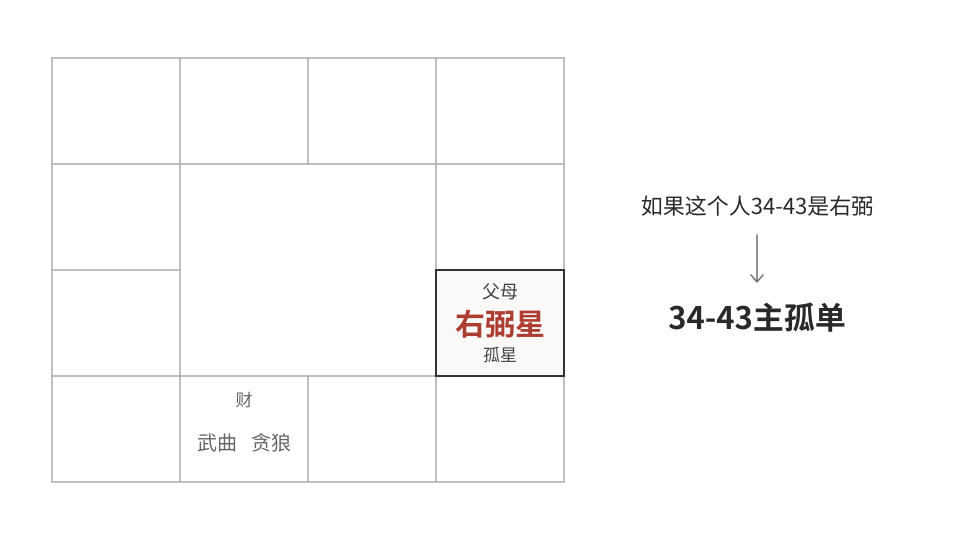 |
| **大限走到右弼主什么？配阳宅怎么看？** | 〔口述〕「你如果说我们不要管它什么宫」，「如果这个人34-43是右弼怎么办」，「那就是34-43主孤单」，「那你孤单你的婚姻到哪里去了」，「一定有问题」。（[00:38:11–00:38:24](https://www.bilibili.com/video/BV1KJsLekEfA/?p=13&t=2291)，第 68736–69149 帧） 〔推断〕推断：倪师说的「34-43」与本盘叠图父母宫甲戌的大限 34~43 一致，这个数字应取自本盘右弼所在的父母宫。（[00:38:06–00:38:18](https://www.bilibili.com/video/BV1KJsLekEfA/?p=13&t=2286)，第 68586–68945 帧） 〔口述〕「然后看看阳宅」，一看，「西北角是客厅生离」，「啊西北角厨房死别啊这种」。（[00:38:25–00:38:39](https://www.bilibili.com/video/BV1KJsLekEfA/?p=13&t=2305)，第 69174–69575 帧） |
| **倪师那位武曲贪狼命的好朋友做了什么事？** | 〔口述〕倪师边擦板边讲一个好朋友，「她刚刚讲武曲贪狼就是她的命」，「她是个女孩子」，「师大毕业以后」大家问有没有人自愿「到金门去当老师的」。（[00:38:39–00:38:57](https://www.bilibili.com/video/BV1KJsLekEfA/?p=13&t=2319)，第 69576–70115 帧） 〔口述〕「哇举手一定是这种人的」，「绝对不会有别人」，一定是这种人，说去金门就去了（字幕作「荆门」，按语音与上文改为金门）。（[00:38:57–00:39:04](https://www.bilibili.com/video/BV1KJsLekEfA/?p=13&t=2337)，第 70116–70337 帧） |

**总结区**

- 通用规则：太阴星在子宫、子时月亮正当头，叫水澄桂萼，当官的人有此格是清官，拿到这颗星非常顺利（[00:34:34–00:36:21](https://www.bilibili.com/video/BV1KJsLekEfA/?p=13&t=2074)，第 62220–65453 帧）；命宫刚好落在太阳与太阴中间叫日月夹命，夹财，主一世财禄无缺、一世荣华（[00:36:21–00:36:41](https://www.bilibili.com/video/BV1KJsLekEfA/?p=13&t=2181)，第 65454–66041 帧）；武曲贪狼是武官星；丑时出武官星男女不同：女人夜里出是正将星、成格是女中豪杰，男人最好在白天，所以要分日月（[00:36:50–00:37:32](https://www.bilibili.com/video/BV1KJsLekEfA/?p=13&t=2210)，第 66318–67577 帧）；不管什么宫，哪个十年大限逢右弼就主那十年孤单、婚姻一定有问题；再看阳宅，西北角是客厅主生离、是厨房主死别（[00:38:11–00:38:39](https://www.bilibili.com/video/BV1KJsLekEfA/?p=13&t=2291)，第 68736–69575 帧）
- 只在本例：这张八字太阴在子（叠图田宅丙子）、太阳在寅（叠图交友丙寅），命宫丁丑内为武曲贪狼，构成日月夹命（[00:36:21–00:36:52](https://www.bilibili.com/video/BV1KJsLekEfA/?p=13&t=2181)，第 65454–66377 帧）；这张八字右弼在父母宫（叠图父母甲戌，大限34~43），倪师据此假设这个人34-43主孤单（[00:38:06–00:38:24](https://www.bilibili.com/video/BV1KJsLekEfA/?p=13&t=2286)，第 68586–69149 帧）；倪师的一位女性好朋友是武曲贪狼命，师大毕业后自愿到金门当老师（[00:38:39–00:39:04](https://www.bilibili.com/video/BV1KJsLekEfA/?p=13&t=2319)，第 69576–70337 帧）
- 不是排盘规则，是处世方法：当官要清而且明，清官不一定是好官、会误国；明就是适时而作，理想再好也可以五年十年后再做，不要动太快（[00:34:59–00:35:39](https://www.bilibili.com/video/BV1KJsLekEfA/?p=13&t=2099)，第 62994–64175 帧）

**待核**

1. [00:34:40](https://www.bilibili.com/video/BV1KJsLekEfA/?p=13&t=2080)，第 62406 帧：字幕「水澄桂萼」，语音为「水尘贵恶」，按字幕与板书取「水澄桂萼」
2. [00:35:08](https://www.bilibili.com/video/BV1KJsLekEfA/?p=13&t=2108)，第 63258 帧：人名字幕作「王建煊」，语音为「王健学」，人名待核
3. [00:35:10](https://www.bilibili.com/video/BV1KJsLekEfA/?p=13&t=2110)，第 63318 帧：字幕「你叫他拿2000万人投票」意思不明，上下文接不上
4. [00:35:40](https://www.bilibili.com/video/BV1KJsLekEfA/?p=13&t=2140)，第 64200 帧：字幕「我们没有女人都很累对不对」与语音「没有女儿不过很累对不对」对不上，原话待核
5. [00:36:05](https://www.bilibili.com/video/BV1KJsLekEfA/?p=13&t=2165)，第 64956 帧：字幕「皮肤白自细细」，语音「皮肤白白细细」，笔记按「白而细」转述
6. [00:36:36](https://www.bilibili.com/video/BV1KJsLekEfA/?p=13&t=2196)，第 65904 帧：字幕「实财一世财禄无缺」，语音「财一世财路无缺」，「实财」与「财禄/财路」待核
7. [00:37:09](https://www.bilibili.com/video/BV1KJsLekEfA/?p=13&t=2229)，第 66876 帧：「正科正将星」中的「正科」本块没有解释
8. [00:37:15](https://www.bilibili.com/video/BV1KJsLekEfA/?p=13&t=2235)，第 67068 帧：「四行仓库那个人」指谁，倪师没有说明
9. [00:37:43](https://www.bilibili.com/video/BV1KJsLekEfA/?p=13&t=2263)，第 67890 帧：字幕「戴着必死的就她」可信度低（0.47），语音为「必死那是他是他好那是他厉」，原话待核
10. [00:38:02](https://www.bilibili.com/video/BV1KJsLekEfA/?p=13&t=2282)，第 68460 帧：「右边有个廉破」，倪师说「我讲过了嘛」，本块没有展开
11. [00:38:09](https://www.bilibili.com/video/BV1KJsLekEfA/?p=13&t=2289)，第 68694 帧：字幕「右弼星在父母官」，按上下文改为「父母宫」
12. [00:39:01](https://www.bilibili.com/video/BV1KJsLekEfA/?p=13&t=2341)，第 70242 帧：字幕「走到荆门去就去了」，语音为「金门」，按上文「到金门去当老师」改为金门
13. [00:36:21](https://www.bilibili.com/video/BV1KJsLekEfA/?p=13&t=2181)，第 65454 帧：叠图交友丙寅标太阳「旺」，倪师口述「太阳在这边入庙」，两者不一致
14. [00:36:21](https://www.bilibili.com/video/BV1KJsLekEfA/?p=13&t=2181)，第 65454 帧：叠图命宫丁丑的大限数字串「413」按图例还原不了，未写；[00:36:52](https://www.bilibili.com/video/BV1KJsLekEfA/?p=13&t=2212)，第 66387 帧板书图里同一格叠图宫名显示为「官禄 丁丑」、大限84~93，宫名随讲解换过
15. [00:37:24](https://www.bilibili.com/video/BV1KJsLekEfA/?p=13&t=2244)，第 67324 帧：指代备注说画面左上新出「庚午 官禄」叠图，材料▣行未列，与[00:36:52](https://www.bilibili.com/video/BV1KJsLekEfA/?p=13&t=2212)，第 66387 帧的「官禄 丁丑」冲突，待核
16. [00:34:32](https://www.bilibili.com/video/BV1KJsLekEfA/?p=13&t=2072)，第 62160 帧：板书图中交友丙寅叠图在太阳下方有红色「忌」字，材料叠图转写未列，待核
17. [00:34:32](https://www.bilibili.com/video/BV1KJsLekEfA/?p=13&t=2072)，第 62160 帧、[00:34:48](https://www.bilibili.com/video/BV1KJsLekEfA/?p=13&t=2088)，第 62652 帧：板面左上角两字、中部圈内一字认不出；[00:36:52](https://www.bilibili.com/video/BV1KJsLekEfA/?p=13&t=2212)，第 66387 帧：贪狼下方圈内一字认不出；[00:38:17](https://www.bilibili.com/video/BV1KJsLekEfA/?p=13&t=2297)，第 68924 帧：板左缘竖写字认不出，右列中格被讲者头部挡住
18. 指代拿不准、未当依据：第62399、62688、64895、65466、65558、65803、66246、68235、68846帧

## 紫微在午：月朗天门、日照雷门、明珠出海、贪居亥子

〔叠图〕这一例视频里只贴过 4 格：交友 丁卯：太阳庙、天梁庙科、铃星利、天伤陷、天虚庙、旬空平；子女（宫序推） 辛未：擎羊庙、天才平、寡宿不；福德（宫序推） 丙子：贪狼旺权、天魁旺、天喜旺；父母 乙亥：太阴庙、天马平、孤辰陷。

### 8　紫微在午：月朗天门日照雷门明珠出海（[00:39:04–00:43:28](https://www.bilibili.com/video/BV1KJsLekEfA/?p=13&t=2344)，第 70338–78245 帧）

| 提示区 | 笔记区 |
|---|---|
| **紫微在午时，太阳、太阴各在哪一宫？** | 〔口述〕倪师换一张新星盘，先定紫微在午：「诸位看这个紫微星在午宫」「这是午宫」，接着说「太阴星一定在这里」「太阳星一定在这里」，用「一定」说明紫微在午时日月位置是固定的。（[00:39:04–00:39:30](https://www.bilibili.com/video/BV1KJsLekEfA/?p=13&t=2344)，第 70338–71111 帧） 〔板书〕可辨：上排一格写「紫微」，旁边写「午」；格线已画好，其余格子还空着。（[00:39:22](https://www.bilibili.com/video/BV1KJsLekEfA/?p=13&t=2362)，第 70867 帧） 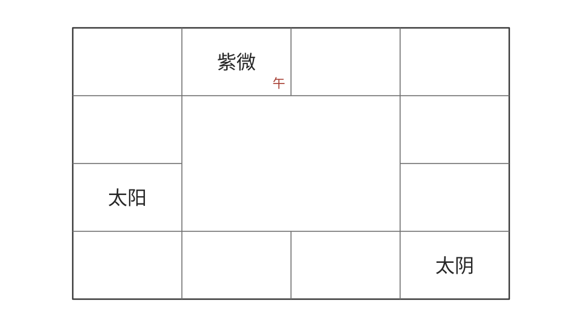 〔板书〕可辨：上排「紫微」「午」；右下格可辨「太阴」；左列中间一格可辨「太」，第二个字认不出。（[00:39:29](https://www.bilibili.com/video/BV1KJsLekEfA/?p=13&t=2369)，第 71093 帧） 〔指代〕说「太阳星一定在这里」的「这里」时，手指的是左列第三格，正在那里写「太阳」（只看清「太」字）。（[00:39:28](https://www.bilibili.com/video/BV1KJsLekEfA/?p=13&t=2368)，第 71049 帧） 〔叠图〕交友丁卯：太阳庙、天梁庙（带「科」）、铃星利、天伤陷、旬空平、天虚庙、小耗、灾煞、岁破、养，大限76~85。父母乙亥：太阴庙、天马平、台辅、孤辰陷、蜚廉、喜神、岁驿、丧门、临官，大限116~125。（[00:39:27–00:39:29](https://www.bilibili.com/video/BV1KJsLekEfA/?p=13&t=2367)，第 71010–71093 帧） |
| **卯、亥两宫各对应几点？日月这时在做什么？** | 〔口述〕倪师用时辰说日月的状态：「太阳星这是不是卯宫」「卯时是5-7点」；「太阴星在亥宫」「是晚上9-11点」。（[00:39:33–00:39:43](https://www.bilibili.com/video/BV1KJsLekEfA/?p=13&t=2373)，第 71208–71495 帧） 〔口述〕请学生想一想：「9-11点月亮正当头」「早上5-7点太阳正出来」，就是说太阴在亥时月亮正高，太阳在卯时太阳刚升起。（[00:39:43–00:39:53](https://www.bilibili.com/video/BV1KJsLekEfA/?p=13&t=2383)，第 71496–71795 帧） 〔板书〕可辨：上排「紫微」；这段时间新写的字被老师身体挡住，认不出。（[00:39:37](https://www.bilibili.com/video/BV1KJsLekEfA/?p=13&t=2377)，第 71328 帧） |
| **命在太阴那一格叫什么？命在太阳那一格叫什么？** | 〔口述〕「所以当你命在这里的时候」「我们叫做月朗天门」；接着说命宫在另一处时「我们叫做日照雷门」。（[00:39:53–00:40:11](https://www.bilibili.com/video/BV1KJsLekEfA/?p=13&t=2393)，第 71796–72341 帧） 〔指代〕说「当你命在这里」的「这里」时，手指的是右下格「太阴」，正在旁边写「亥」，所以月朗天门指命在太阴所在的亥宫。（[00:39:54–00:39:55](https://www.bilibili.com/video/BV1KJsLekEfA/?p=13&t=2394)，第 71828–71875 帧） 〔推断〕推断：说日照雷门那句时手指哪一格看不出，字幕括号里的「卯宫」是字幕制作者加的注；但后面倪师说「卯时东方震啊」「所以取个雷门」，可推出日照雷门指命在太阳所在的卯宫。（[00:40:02–00:40:57](https://www.bilibili.com/video/BV1KJsLekEfA/?p=13&t=2402)，第 72078–73721 帧） |
| **什么是明珠出海格？要不要有主星？** | 〔口述〕「那你有一天不小心刚好命……在这里」「三方四正会到」「左边是月朗天门」「右边是日照雷门」，命在这一格时「不管你有没有星」「我们就叫做明珠出海格」。（[00:40:11–00:40:28](https://www.bilibili.com/video/BV1KJsLekEfA/?p=13&t=2411)，第 72342–72863 帧） 〔指代〕说「刚好命在这里」「这个命宫在这里」时，手指的都是上排「午」右边那一格，倪师在该格写了「命」字。（[00:40:13–00:40:20](https://www.bilibili.com/video/BV1KJsLekEfA/?p=13&t=2413)，第 72409–72624 帧） 〔板书〕可辨：上排「紫微」「午」；「午」右边一格竖写「明珠出海格」，从这格向左下、右下各拉一条斜线；左列一格可辨「5-7」，其余认不出。（[00:40:28](https://www.bilibili.com/video/BV1KJsLekEfA/?p=13&t=2428)，第 72855 帧） 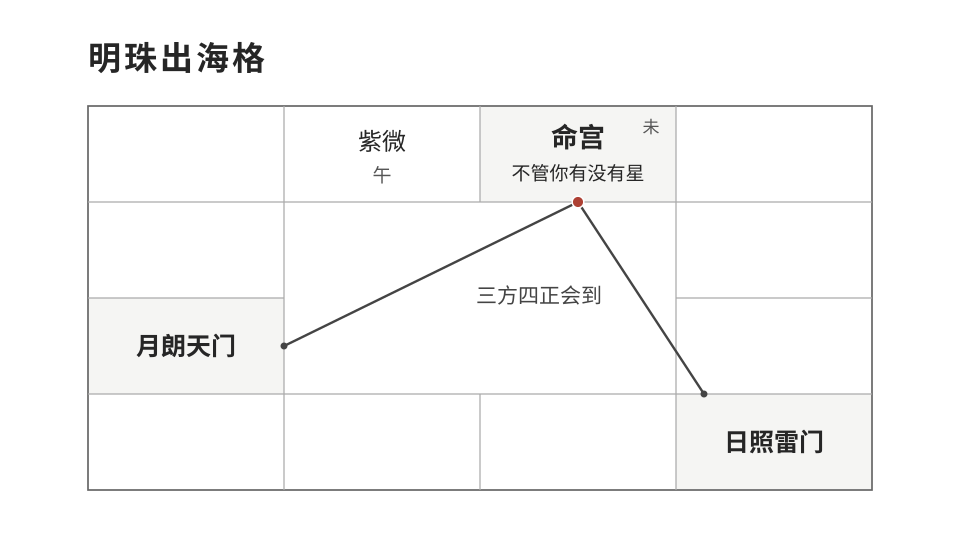 〔叠图〕叠图加出命宫辛未：擎羊庙、天才平、封诰、寡宿不、官符、月煞、吊客、死，大限6~15；与交友丁卯、父母乙亥同时显示。（[00:40:28–00:40:34](https://www.bilibili.com/video/BV1KJsLekEfA/?p=13&t=2428)，第 72864–73043 帧） 〔口述〕随后又说「我们当前的最大的大人就在这里」「月朗天门格」，说「这里」时手指尖按在右下格「太…」字处；「最大的大人」指什么没有解释，见待核。（[00:40:34–00:40:47](https://www.bilibili.com/video/BV1KJsLekEfA/?p=13&t=2434)，第 73044–73433 帧） |
| **为什么叫「雷门」？跟哪个卦有关？** | 〔口述〕「那这个怎么解释呢」「日照雷门」「东方是震卦」「卯时东方震啊」「震为雷嘛」「所以取个雷门」：卯在东方，东方是震卦，震为雷，所以叫雷门。（[00:40:47–00:40:57](https://www.bilibili.com/video/BV1KJsLekEfA/?p=13&t=2447)，第 73434–73721 帧） 〔口述〕提醒学生「你不要它想到南天门去了哈」，再强调一次「因为东方是震卦」「卯时正好是东边」。（[00:40:57–00:41:05](https://www.bilibili.com/video/BV1KJsLekEfA/?p=13&t=2457)，第 73722–73961 帧） 〔板书〕可辨：板子左边格外写了「震」；它下面竖写的一列字认不出。（[00:40:55](https://www.bilibili.com/video/BV1KJsLekEfA/?p=13&t=2455)，第 73674 帧） |
| **明珠出海格的人，六亲上有什么特点？** | 〔口述〕「如果一个女孩子的命」「命在这里是明珠出海格」，「你看日月同临同时会到」，「第一个孟子的第一个乐字就有了」——「父母双全」。（[00:41:05–00:41:18](https://www.bilibili.com/video/BV1KJsLekEfA/?p=13&t=2465)，第 73962–74363 帧） 〔指代〕说「命在这里」的「这里」时，手按在板子右上写着「命」和「明珠出海格」的那一格。（[00:41:07](https://www.bilibili.com/video/BV1KJsLekEfA/?p=13&t=2467)，第 74012 帧） 〔推断〕推断：倪师把日月同时会到命宫三方与父母双全连在一起讲，但没有解释其中的道理，也没有展开「孟子的第一个乐字」。（[00:41:09–00:41:18](https://www.bilibili.com/video/BV1KJsLekEfA/?p=13&t=2469)，第 74076–74363 帧） |
| **要看一个人父母双不双全，相上先看哪里？** | 〔口述〕「最好眼睛先偷把一下他的印堂」「日角月角先看一看」，一看如果「像我那么翘那么高」，「你不要日月父母双全」「就已经看到了」——意思是看相就能先看出父母双全。（[00:41:18–00:41:27](https://www.bilibili.com/video/BV1KJsLekEfA/?p=13&t=2478)，第 74364–74633 帧） 〔推断〕推断：这是批命时先用看相印证命盘的做法；「日角月角」具体在脸上哪里、怎样算高，本块没有解释。（[00:41:18–00:41:27](https://www.bilibili.com/video/BV1KJsLekEfA/?p=13&t=2478)，第 74364–74633 帧） |
| **日月并明格的人个性怎样？再加科权禄又如何？** | 〔口述〕「第二个呢」「像日月并明格的人」「这个人呐」「一定非常的公正廉明公正」「非常的清明的一个人」，并说明「这个是讲个性」。（[00:41:27–00:41:37](https://www.bilibili.com/video/BV1KJsLekEfA/?p=13&t=2487)，第 74634–74939 帧） 〔口述〕「如果还有什么权禄啊」「科权禄会到」，再加吉星上去就「不得了」，「这种人非常厉害」。（[00:41:38–00:41:44](https://www.bilibili.com/video/BV1KJsLekEfA/?p=13&t=2498)，第 74940–75125 帧） |
| **日月都会到，跟「一半明了」的人有什么不同？** | 〔口述〕「天生明珠出海格的人呐」「他日月都都会到」，代表24小时都明了，「他在睡觉的时候」「做梦都看到你是小人了」。（[00:41:44–00:41:56](https://www.bilibili.com/video/BV1KJsLekEfA/?p=13&t=2504)，第 75126–75503 帧） 〔口述〕对比两种「一半明了」的人：一种「白天很明了」，晚上睡觉「做梦就开始骂人了」；另一种「晚上明了白天都不明了」「白天都昏昏沉沉的」「晚上精神很好啊」。（[00:41:56–00:42:08](https://www.bilibili.com/video/BV1KJsLekEfA/?p=13&t=2516)，第 75504–75869 帧） 〔口述〕收束：「那日月并明的」「24小时都通明」。（[00:42:09–00:42:12](https://www.bilibili.com/video/BV1KJsLekEfA/?p=13&t=2529)，第 75870–75965 帧） |
| **日月并明、月朗天门的人，事业能做多大？** | 〔口述〕「那这种人的事业会做到」「像日不落国一样」，做得非常好。（[00:42:12–00:42:18](https://www.bilibili.com/video/BV1KJsLekEfA/?p=13&t=2532)，第 75966–76151 帧） 〔口述〕「那你看光一个我们一个月朗天门」「都可以做到总统啊」——单是月朗天门一个格，就能做到总统。（[00:42:18–00:42:23](https://www.bilibili.com/video/BV1KJsLekEfA/?p=13&t=2538)，第 76152–76313 帧） |
| **女命宜太阴还是太阳坐命？男命呢？反过来会怎样？** | 〔口述〕「那女孩子如果是坐太阴星在命宫」「在月朗天门是最好」；「男人应该要太阳星」「在这里才是最好」；「那这反的就有点问题」。（[00:42:23–00:42:36](https://www.bilibili.com/video/BV1KJsLekEfA/?p=13&t=2543)，第 76314–76709 帧） 〔指代〕说男人太阳星「在这里才是最好」的「这里」时，粉笔停在板左中格写着「5-7」的地方，即前面写太阳、卯时5-7点的那一格。（[00:42:30](https://www.bilibili.com/video/BV1KJsLekEfA/?p=13&t=2550)，第 76518 帧） 〔叠图〕叠图把原来的「父母乙亥」改标为「命宫乙亥」，内容仍是太阴庙、天马平、台辅、孤辰陷、蜚廉、喜神、岁驿、丧门、临官，大限改为6~15；同时显示交友丁卯。（[00:42:21–00:42:29](https://www.bilibili.com/video/BV1KJsLekEfA/?p=13&t=2541)，第 76230–76481 帧） 〔推断〕推断：叠图改标乙亥为命宫，是配合倪师说「女孩子坐太阴星在命宫」这个假设整体换宫名，不是换了一张新命例。（[00:42:23–00:42:29](https://www.bilibili.com/video/BV1KJsLekEfA/?p=13&t=2543)，第 76314–76481 帧） |
| **女命太阳在卯、太阴坐命，长相各是什么样？** | 〔口述〕「那如果一个女孩子的命」「太阳在卯宫」「早上旭日东升」，这女孩子「一跑出来就像太阳」：「热情如火」「两个眼睛眼圆圆的脸圆圆的」「然后脸上红光满面」「然后人长得非常的丰腴」。（[00:42:37–00:42:54](https://www.bilibili.com/video/BV1KJsLekEfA/?p=13&t=2557)，第 76710–77231 帧） 〔口述〕「那你反过来看」「太阴出来的一定是月亮嘛」「瘦瘦的」「白白皙皙的」「人非常的清秀」「但是两个骨碌眼睛大大的」，并说「这是月朗天门」「这是重点」。（[00:42:54–00:43:13](https://www.bilibili.com/video/BV1KJsLekEfA/?p=13&t=2574)，第 77232–77801 帧） 〔板书〕可辨：「紫微」「午」「震」「5-7」；左列中格原有字迹外多了一道弧线圈住，其余认不出。（[00:42:40](https://www.bilibili.com/video/BV1KJsLekEfA/?p=13&t=2560)，第 76812 帧） 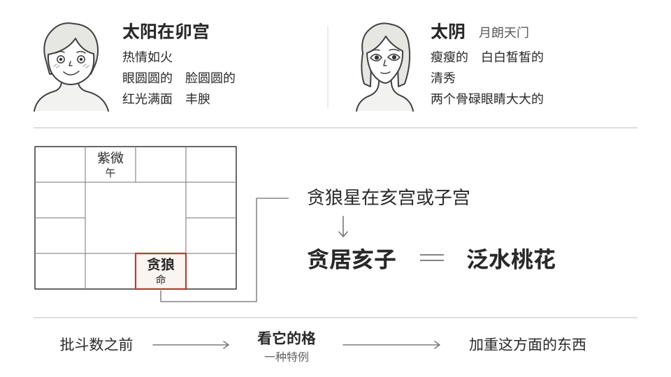 |
| **讲完日月，下一个格局从哪颗星讲起？** | 〔口述〕「还有呢」，转到贪狼：「贪狼星是不是在这里」「有没有问题」「贪狼在这里看到没有」「如果贪狼在这个地方」是命宫的时候——本块到这里还没讲完。（[00:43:13–00:43:28](https://www.bilibili.com/video/BV1KJsLekEfA/?p=13&t=2593)，第 77802–78245 帧） 〔指代〕三次说「这里」「这个地方」时，手指的都是下排倪师刚写下「贪狼」的那一格。（[00:43:16–00:43:22](https://www.bilibili.com/video/BV1KJsLekEfA/?p=13&t=2596)，第 77888–78064 帧） 〔板书〕可辨：「紫微」「午」「明珠出海格」，下排一格写「贪狼」；板子右侧另有两三个字认不出。（[00:43:20](https://www.bilibili.com/video/BV1KJsLekEfA/?p=13&t=2600)，第 78010 帧） |

**总结区**

- 通用规则：紫微在午时，太阴一定在亥、太阳一定在卯；亥是晚上9-11点月亮正当头，卯是早上5-7点太阳正出来（[00:39:25–00:39:53](https://www.bilibili.com/video/BV1KJsLekEfA/?p=13&t=2365)，第 70950–71795 帧）；命在太阴所在的亥叫月朗天门，命在太阳所在的卯叫日照雷门；「雷门」取东方震卦、震为雷（[00:39:53–00:41:05](https://www.bilibili.com/video/BV1KJsLekEfA/?p=13&t=2393)，第 71796–73961 帧）；命在未，三方四正左右会到月朗天门、日照雷门，不管有没有星都叫明珠出海格；日月同时会到主父母双全（[00:40:11–00:41:18](https://www.bilibili.com/video/BV1KJsLekEfA/?p=13&t=2411)，第 72342–74363 帧）；日月并明格的人一定公正廉明、24小时都通明，再会到科权禄就非常厉害；女命宜太阴坐命、男命宜太阳在卯，反了就有点问题（[00:41:27–00:42:36](https://www.bilibili.com/video/BV1KJsLekEfA/?p=13&t=2487)，第 74634–76709 帧）
- 只在本例：本块示范盘叠图：太阳庙、天梁带科在交友丁卯，太阴庙在父母乙亥，命宫辛未有擎羊庙（[00:39:27–00:40:34](https://www.bilibili.com/video/BV1KJsLekEfA/?p=13&t=2367)，第 71010–73043 帧）；叠图把乙亥改标命宫，是配合「女孩子坐太阴在命宫」的假设，不是换命例（[00:42:21–00:42:29](https://www.bilibili.com/video/BV1KJsLekEfA/?p=13&t=2541)，第 76230–76481 帧）
- 不是排盘规则，是处世方法：看人父母是否双全，可先偷看对方印堂和日角月角，从相上就能先看出来（[00:41:18–00:41:27](https://www.bilibili.com/video/BV1KJsLekEfA/?p=13&t=2478)，第 74364–74633 帧）

**待核**

1. [00:39:24](https://www.bilibili.com/video/BV1KJsLekEfA/?p=13&t=2364)，第 70930 帧画面左上另贴有「财帛 庚午」格（紫微庙、禄存庙、地空庙、红鸾旺、三台旺、咸池陷、天德旺，大限46~55），叠图定稿没收这一段；[00:39:27](https://www.bilibili.com/video/BV1KJsLekEfA/?p=13&t=2367)，第 71010 帧起左下换成交友丁卯
2. [00:39:23](https://www.bilibili.com/video/BV1KJsLekEfA/?p=13&t=2363)，第 70914 帧：字幕「紫微星在午官的时候」的「官」按上下文改为「宫」
3. [00:43:23](https://www.bilibili.com/video/BV1KJsLekEfA/?p=13&t=2603)，第 78090 帧：字幕「是命官的时候」的「官」按上下文改为「宫」
4. [00:40:02](https://www.bilibili.com/video/BV1KJsLekEfA/?p=13&t=2402)，第 72078 帧、[00:40:11](https://www.bilibili.com/video/BV1KJsLekEfA/?p=13&t=2411)，第 72342 帧：字幕括号里的「（卯宫）」「（未宫）」语音里没有，是字幕制作者加的注，未当倪师原话
5. [00:40:17–00:40:20](https://www.bilibili.com/video/BV1KJsLekEfA/?p=13&t=2417)，第 72510–72611 帧：倪师说「左边是月朗天门」「右边是日照雷门」，但板上太阳（卯）在左列、太阴（亥）在右下，左右是以谁的方向说的待核
6. [00:40:34](https://www.bilibili.com/video/BV1KJsLekEfA/?p=13&t=2434)，第 73044 帧：「我们当前的最大的大人就在这里」所指不明；指代标注手指右下格「太…」「7-11」，而口述亥是9-11点，板上数字待核
7. [00:39:25](https://www.bilibili.com/video/BV1KJsLekEfA/?p=13&t=2365)，第 70950 帧：说「太阴星一定在这里」时的指向标为不确定；[00:39:53](https://www.bilibili.com/video/BV1KJsLekEfA/?p=13&t=2393)，第 71805 帧、[00:40:02](https://www.bilibili.com/video/BV1KJsLekEfA/?p=13&t=2402)，第 72060 帧两处「这里」看不出指哪
8. [00:41:13](https://www.bilibili.com/video/BV1KJsLekEfA/?p=13&t=2473)，第 74190 帧：「第一个孟子的第一个乐字」倪师没有解释
9. [00:41:18](https://www.bilibili.com/video/BV1KJsLekEfA/?p=13&t=2478)，第 74364 帧：「偷把」语音作「偷拔」，原意待核；[00:41:21](https://www.bilibili.com/video/BV1KJsLekEfA/?p=13&t=2481)，第 74430 帧「日角月角」用了但没解释
10. [00:41:22](https://www.bilibili.com/video/BV1KJsLekEfA/?p=13&t=2482)，第 74466 帧：「像我那么翘那么高」语音作「那么跳」，所指部位不明
11. [00:41:40](https://www.bilibili.com/video/BV1KJsLekEfA/?p=13&t=2500)，第 75000 帧：字幕「他加吉要加上去不得了」语音作「加几药」，原话待核
12. [00:41:50](https://www.bilibili.com/video/BV1KJsLekEfA/?p=13&t=2510)，第 75312 帧：字幕「代表24小时他都管明的」语音作「都不明了」，两路对不上
13. [00:42:28](https://www.bilibili.com/video/BV1KJsLekEfA/?p=13&t=2548)，第 76440 帧：字幕「懂不懂我意思」语音作「不能为男人应该」，两路对不上，未采用
14. [00:43:02](https://www.bilibili.com/video/BV1KJsLekEfA/?p=13&t=2582)，第 77484 帧：字幕「两个骨碌眼睛大大的」语音作「光都眼睛大大」，用词待核
15. [00:39:22](https://www.bilibili.com/video/BV1KJsLekEfA/?p=13&t=2362)，第 70867 帧：板书图上叠着一块电子命盘（财帛庚午，紫微庙、禄存庙等），材料▣行没有列出，未写进笔记
16. [00:43:20](https://www.bilibili.com/video/BV1KJsLekEfA/?p=13&t=2600)，第 78010 帧：板书图上叠图显示命宫丙子、贪狼旺带「权」等，材料▣行没有列出，未写进笔记
17. 板书认不出：[00:39:05](https://www.bilibili.com/video/BV1KJsLekEfA/?p=13&t=2345)，第 70363 帧只有格线；[00:39:37](https://www.bilibili.com/video/BV1KJsLekEfA/?p=13&t=2377)，第 71328 帧新字被身体挡住；[00:39:29](https://www.bilibili.com/video/BV1KJsLekEfA/?p=13&t=2369)，第 71093 帧左格「太」后一字；[00:40:55](https://www.bilibili.com/video/BV1KJsLekEfA/?p=13&t=2455)，第 73674 帧「震」下面竖写的一列字；[00:43:20](https://www.bilibili.com/video/BV1KJsLekEfA/?p=13&t=2600)，第 78010 帧右侧两三字

### 9　贪居亥子泛水桃花与格不必在命宫（[00:43:28–00:47:47](https://www.bilibili.com/video/BV1KJsLekEfA/?p=13&t=2608)，第 78246–86015 帧）

| 提示区 | 笔记区 |
|---|---|
| **什么叫「贪居亥子」？又叫什么桃花？** | 〔口述〕接上文贪狼在这格是命宫，倪师说有一句话「叫做贪居亥子」，解释为「贪狼星在亥宫或子宫」，又「叫做泛水桃花」，「泛水桃花桃花命」。（[00:43:28–00:43:44](https://www.bilibili.com/video/BV1KJsLekEfA/?p=13&t=2608)，第 78246–78725 帧） 〔板书〕黑板右侧新写竖排粉笔字，可辨：「泛」「水」「桃」，第四字被身体挡住认不出。（[00:43:39](https://www.bilibili.com/video/BV1KJsLekEfA/?p=13&t=2619)，第 78588 帧） 〔板书〕本块开头板面，可辨：上排一格「紫微」「午」，相邻格竖写「明珠出海格」（草书），下排一格「贪狼」「命」；其余认不出。（[00:43:31](https://www.bilibili.com/video/BV1KJsLekEfA/?p=13&t=2611)，第 78348 帧） 〔叠图〕命宫 丙子：贪狼旺、化权，天魁旺、天喜旺，阴煞、飞廉、息神、贯索、冠带；大限 6~15；小限 6,18,30,42,54,66。（[00:43:44–00:43:45](https://www.bilibili.com/video/BV1KJsLekEfA/?p=13&t=2624)，第 78726–78767 帧） |
| **为什么批斗数之前要先看格？格是什么？** | 〔口述〕倪师说「我们在批斗数之前」「要去看它的格」，「所谓格就是有特例一种特例」。（[00:43:45–00:43:51](https://www.bilibili.com/video/BV1KJsLekEfA/?p=13&t=2625)，第 78768–78959 帧） 〔口述〕还没批的时候，只要成格，「要批之前就要把它加」「加重这方面的东西」，因为「天性如此」。（[00:43:52–00:44:02](https://www.bilibili.com/video/BV1KJsLekEfA/?p=13&t=2632)，第 78960–79283 帧） 〔板书〕镜头转到黑板左半，可辨：「紫微」「午」；左侧几格竖写草书和画圈处的字认不出。（[00:43:48](https://www.bilibili.com/video/BV1KJsLekEfA/?p=13&t=2628)，第 78852 帧） |
| **为什么说亥时子时沾桃花？** | 〔口述〕举例「那如果拿到个女孩子的命」，字幕原字为「太阴星在命宫在亥时子时」（与前后讲的贪狼对不上，照原字记）。（[00:44:02–00:44:06](https://www.bilibili.com/video/BV1KJsLekEfA/?p=13&t=2642)，第 79284–79391 帧） 〔口述〕自问「为什么在亥时子时沾桃花」，答「你干这个事情都是」「晚上9-11点 11-1点嘛」，白天不会，「那晚上的时候才会有桃花」。（[00:44:09–00:44:21](https://www.bilibili.com/video/BV1KJsLekEfA/?p=13&t=2649)，第 79470–79835 帧） 〔口述〕「这种现象」「那就叫做睡觉泛水桃花」。（[00:44:21–00:44:23](https://www.bilibili.com/video/BV1KJsLekEfA/?p=13&t=2661)，第 79836–79913 帧） 〔板书〕黑板右侧一格里有橙色粉笔「9-11」「11-1」，右下格也有「9-11」。（[00:45:56](https://www.bilibili.com/video/BV1KJsLekEfA/?p=13&t=2756)，第 82704 帧） 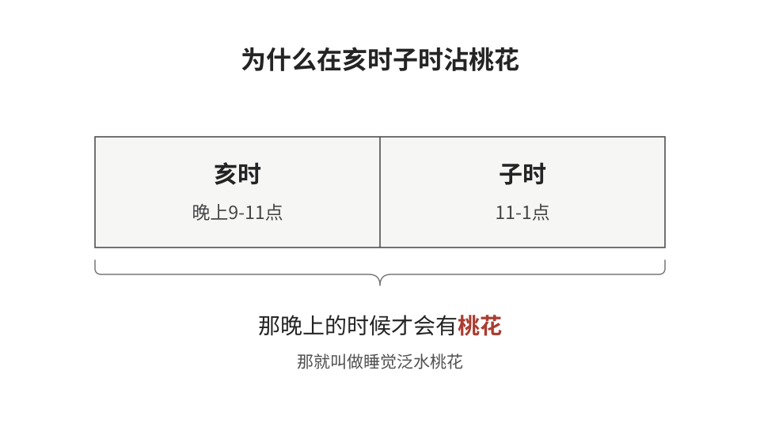 |
| **桃花命坐命一定不好吗？** | 〔口述〕「那如果女孩子只要是演艺圈的」「如果居这种命的」，「哇声名远播名气很大」「大家大家都喜欢啊」。（[00:44:23–00:44:34](https://www.bilibili.com/video/BV1KJsLekEfA/?p=13&t=2663)，第 79914–80225 帧） 〔口述〕所以「所以桃花命坐命不见得不好」，「我不喜欢你你喜欢我」「被喜欢你怎么办对不对」，「这个说走这行业的人非常好」。（[00:44:34–00:44:44](https://www.bilibili.com/video/BV1KJsLekEfA/?p=13&t=2674)，第 80226–80525 帧） |
| **男命逢此格出什么？庙旺与落陷有何差别？** | 〔口述〕「那如果给男人的话也是出武将」，但「要妙旺才是出武将」（妙旺即庙旺），「落陷都能主杀」。（[00:44:44–00:44:51](https://www.bilibili.com/video/BV1KJsLekEfA/?p=13&t=2684)，第 80526–80741 帧） 〔指代〕说「所以贪狼在这里」时手指下排写「贪狼」的那格；说「跟这里完全不一样」时手移到右下格，指着该格上部「太」字附近。（[00:44:51–00:44:53](https://www.bilibili.com/video/BV1KJsLekEfA/?p=13&t=2691)，第 80742–80795 帧） 〔口述〕贪狼「一到这里来它就落陷了」，「一到这里马上旺起来」。（[00:44:53–00:45:02](https://www.bilibili.com/video/BV1KJsLekEfA/?p=13&t=2693)，第 80796–81071 帧） 〔指代〕说「一到这里马上旺起来」时，手指黑板下排中间偏右写有「贪狼」「命」的那格。（[00:44:54](https://www.bilibili.com/video/BV1KJsLekEfA/?p=13&t=2694)，第 80832 帧） 〔叠图〕兄弟 辛亥：廉贞陷、贪狼陷，天福庙、天马平、天魁旺、孤辰陷，丧门、奏书、岁驿、蜚廉、长生；小限 9,21,33,45,57,69。（[00:44:54–00:45:02](https://www.bilibili.com/video/BV1KJsLekEfA/?p=13&t=2694)，第 80832–81071 帧） |
| **紫微在午宫会出现什么格？** | 〔口述〕倪师总结「所以紫微星在午宫的时候」「会有这种现象」，即「明珠出海格」。（[00:45:02–00:45:13](https://www.bilibili.com/video/BV1KJsLekEfA/?p=13&t=2702)，第 81072–81395 帧） 〔推断〕推断：板上「明珠出海格」竖写在「紫微 午」相邻格内，口述把它归为紫微在午宫时出现的格。（[00:43:31–00:45:13](https://www.bilibili.com/video/BV1KJsLekEfA/?p=13&t=2611)，第 78348–81395 帧） |
| **客人命宫只差一格不成格，要不要说？** | 〔口述〕「那依此类推呢」，比如这个人「奇怪他的命宫在这里」「他的命不在这里」。（[00:45:13–00:45:23](https://www.bilibili.com/video/BV1KJsLekEfA/?p=13&t=2713)，第 81396–81701 帧） 〔指代〕说「他的命宫在这里」时右手执粉笔在上排「紫微」格里，给「紫微」下面的字画圈；说「他的命不在这里」后又点在「紫微」格底边圈字正下方。（[00:45:19–00:45:22](https://www.bilibili.com/video/BV1KJsLekEfA/?p=13&t=2719)，第 81590–81675 帧） 〔板书〕「紫微」二字下方新画一个圈，圈内的字认不出；同格右侧「午」。（[00:45:23](https://www.bilibili.com/video/BV1KJsLekEfA/?p=13&t=2723)，第 81690 帧） 〔口述〕别一开始就说「你跟他说哎呀先生你好可怜哦」「你命差一格就好了」，「人家已经不是那样」；「就不是明珠出海格就讲完了嘛」「你不要去讲啊」「不要越描越黑」。（[00:45:23–00:45:42](https://www.bilibili.com/video/BV1KJsLekEfA/?p=13&t=2723)，第 81702–82271 帧） |
| **大限走到日照雷门格，适合做什么行业？** | 〔口述〕他命没有明珠出海，「12到比如他是2-11岁」，依次排下去，「好32-41会走什么」——「日照雷门日照雷门格的人呐」，白天出的太阳最好（字幕「自天」）。（[00:45:44–00:46:00](https://www.bilibili.com/video/BV1KJsLekEfA/?p=13&t=2744)，第 82320–82805 帧） 〔口述〕「所以如果他是正官带」，比如「九点钟上班下午五点钟下班」，「白天的行业大发大旺」。（[00:46:00–00:46:08](https://www.bilibili.com/video/BV1KJsLekEfA/?p=13&t=2760)，第 82806–83063 帧） 〔口述〕「那如果她刚刚好是女孩子」「在酒廊里面做事情」，「32-41 太阳出来」「那没有没有什么用都没有啊」「她在睡觉」「刚好反背」。（[00:46:08–00:46:18](https://www.bilibili.com/video/BV1KJsLekEfA/?p=13&t=2768)，第 83064–83351 帧） 〔板书〕可辨：黑板左侧「12-」「22-」两行数字（后半被身体挡住）；右侧竖写「贪居亥子」；其余认不出。（[00:45:56](https://www.bilibili.com/video/BV1KJsLekEfA/?p=13&t=2756)，第 82704 帧） |
| **反过来大限走到月朗天门，适合谁？** | 〔口述〕「那如果反过来」「她的命宫在这里呢」，「走走走走走走到这里来有没有」「刚好32-41月亮出来」「哇那那太好了」。（[00:46:18–00:46:26](https://www.bilibili.com/video/BV1KJsLekEfA/?p=13&t=2778)，第 83352–83597 帧） 〔指代〕说「她的命宫在这里呢」时右手伸到上排最右那格（原本空着），随即用橙色粉笔写下「命」；说「走到这里来」时指向右下格橙圈数字附近。（[00:46:20–00:46:22](https://www.bilibili.com/video/BV1KJsLekEfA/?p=13&t=2780)，第 83401–83462 帧） 〔口述〕如果「是刚好旺到夜生活的人」「娱乐业的人」就最合适；「这都是灵机我们在批的」。（[00:46:26–00:46:35](https://www.bilibili.com/video/BV1KJsLekEfA/?p=13&t=2786)，第 83598–83867 帧） 〔板书〕可辨：上排最右格橙色「命」；右侧竖写「泛水桃花」「贪居亥子」；中间「明珠出海格」；右下格「命」「9-11」等字部分认不出。（[00:46:24](https://www.bilibili.com/video/BV1KJsLekEfA/?p=13&t=2784)，第 83544 帧） 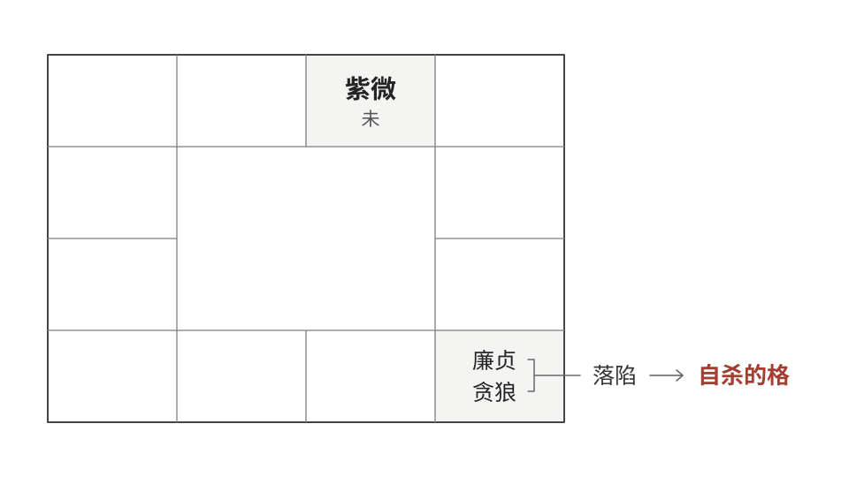 〔叠图〕父母 乙亥：太阴庙，天马平、台辅、孤辰陷、蜚廉，喜神、岁驿、丧门、临官；大限 32~41；小限 5,17,29,41,53,65。（[00:46:35–00:46:36](https://www.bilibili.com/video/BV1KJsLekEfA/?p=13&t=2795)，第 83868–83897 帧） |
| **格一定落在命宫吗？兄弟宫成格代表什么？** | 〔口述〕「所以我是要跟你讲格」，「不一定他的命宫就在这里」「随便在哪里都可以」。（[00:46:35–00:46:39](https://www.bilibili.com/video/BV1KJsLekEfA/?p=13&t=2795)，第 83868–83993 帧） 〔指代〕说「不一定他的命宫就在这里」时手指上排中间偏右那格被斜线划过的「命」字，旁边竖写「明珠出海格」。（[00:46:37](https://www.bilibili.com/video/BV1KJsLekEfA/?p=13&t=2797)，第 83925 帧） 〔口述〕「比如说命宫在这里」，「旁边是兄弟宫」，「结果变成兄弟是月朗天门」，「代表他非常好的兄弟」「非常优秀的兄弟」。（[00:46:43–00:46:53](https://www.bilibili.com/video/BV1KJsLekEfA/?p=13&t=2803)，第 84090–84407 帧） 〔指代〕说「比如说命宫在这里」时用橙色粉笔把下排中间格（左写「贪狼」）里的「命」字圈起来；说「兄弟宫在这里」时手伸到右下格右下角，正落在叠图「太阴庙 兄弟 乙亥」处。（[00:46:43–00:46:45](https://www.bilibili.com/video/BV1KJsLekEfA/?p=13&t=2803)，第 84100–84164 帧） 〔叠图〕第84150帧起同一亥宫格内容不变（太阴庙、大限 32~41 等），宫名由「父母 乙亥」改为「兄弟 乙亥」。（[00:46:39–00:46:45](https://www.bilibili.com/video/BV1KJsLekEfA/?p=13&t=2799)，第 83970–84173 帧） 〔板书〕可辨：下排「贪狼」格里的「命」字外加橙色圈；上排最右格橙色「命」；「明珠出海格」「紫微」「午」。（[00:46:47](https://www.bilibili.com/video/BV1KJsLekEfA/?p=13&t=2807)，第 84234 帧） |
| **格落在父母宫、子女宫时怎么批？** | 〔口述〕「你要会以此类推」，「他格是一定命宫不一样」；「本来应该批他的命」，「把他批成兄弟就好了嘛」。（[00:46:54–00:47:00](https://www.bilibili.com/video/BV1KJsLekEfA/?p=13&t=2814)，第 84444–84611 帧） 〔口述〕「如果是他的父母呢」「你把他批成父母就好了嘛」；「如果是子女呢」「叫她赶快生啊对不对」「生个儿子可以做天子啊」。（[00:47:00–00:47:16](https://www.bilibili.com/video/BV1KJsLekEfA/?p=13&t=2820)，第 84612–85085 帧） |
| **紫微在午这一段怎么收尾？后面还有什么？** | 〔口述〕「这个是紫微星在午宫」「一些格局我基本上粗粗略的」「跟诸位介绍一下」，「后面我们有非常多好的案例」「让诸位去看」。（[00:47:16–00:47:33](https://www.bilibili.com/video/BV1KJsLekEfA/?p=13&t=2836)，第 85086–85595 帧） 〔口述〕「我们在批的时候哈」「要天文地理批在一起给诸位看」，「所以诸位现在地理」「已经有个概念了哈」。（[00:47:33–00:47:47](https://www.bilibili.com/video/BV1KJsLekEfA/?p=13&t=2853)，第 85614–86015 帧） 〔板书〕旧板已擦去，重画了一张空白格线，格内没有字。（[00:47:42](https://www.bilibili.com/video/BV1KJsLekEfA/?p=13&t=2862)，第 85884 帧） |

**总结区**

- 通用规则：贪狼星在亥宫或子宫叫贪居亥子，即泛水桃花、桃花命；批斗数之前先看格，格是特例，成格就要加重这方面（[00:43:28–00:44:02](https://www.bilibili.com/video/BV1KJsLekEfA/?p=13&t=2608)，第 78246–79283 帧）；桃花命坐命不见得不好，女命走演艺圈声名远播；男命也出武将，要庙旺才出武将，落陷都能主杀（[00:44:23–00:44:51](https://www.bilibili.com/video/BV1KJsLekEfA/?p=13&t=2663)，第 79914–80741 帧）；大限走到日照雷门宜白天的行业，走到月朗天门宜夜生活、娱乐业的人（[00:45:53–00:46:32](https://www.bilibili.com/video/BV1KJsLekEfA/?p=13&t=2753)，第 82608–83771 帧）；格不一定在命宫，落在兄弟、父母、子女宫就把它批成那一宫（[00:46:35–00:47:16](https://www.bilibili.com/video/BV1KJsLekEfA/?p=13&t=2795)，第 83868–85085 帧）
- 只在本例：这张示范盘紫微在午宫，有明珠出海格（[00:45:02–00:45:13](https://www.bilibili.com/video/BV1KJsLekEfA/?p=13&t=2702)，第 81072–81395 帧）；假设命宫不在明珠出海那格，32-41 走日照雷门：朝九晚五的白天行业大发大旺，酒廊做事的女孩子则刚好反背（[00:45:44–00:46:18](https://www.bilibili.com/video/BV1KJsLekEfA/?p=13&t=2744)，第 82320–83351 帧）；假设命宫在上排最右格，32-41 走到月朗天门，夜生活、娱乐业的人太好（[00:46:18–00:46:32](https://www.bilibili.com/video/BV1KJsLekEfA/?p=13&t=2778)，第 83352–83771 帧）；假设命宫在下排贪狼格，旁边兄弟宫成月朗天门，代表有非常优秀的兄弟（[00:46:43–00:46:53](https://www.bilibili.com/video/BV1KJsLekEfA/?p=13&t=2803)，第 84090–84407 帧）
- 不是排盘规则，是处世方法：客人命宫只差一格不成格，别跟他说差一格就好了，不要越描越黑（[00:45:23–00:45:42](https://www.bilibili.com/video/BV1KJsLekEfA/?p=13&t=2723)，第 81702–82271 帧）

**待核**

1. [00:43:30](https://www.bilibili.com/video/BV1KJsLekEfA/?p=13&t=2610)，第 78324 帧字幕「叫做贪居亥子」可信度0.3，语音作「贪居害子」；有[00:43:33](https://www.bilibili.com/video/BV1KJsLekEfA/?p=13&t=2613)，第 78408 帧「贪狼星在亥宫或子宫」佐证，照字幕引用。
2. [00:43:44](https://www.bilibili.com/video/BV1KJsLekEfA/?p=13&t=2624)，第 78726 帧字幕「我们说所谓为什么要」可信度0.3，语音只听到「为什么要」，未引作原话。
3. [00:44:03](https://www.bilibili.com/video/BV1KJsLekEfA/?p=13&t=2643)，第 79314 帧字幕与语音都作「太阴星在命宫在亥时子时」，与前后讲的贪狼对不上，照原字记，未改成贪狼。
4. [00:44:21](https://www.bilibili.com/video/BV1KJsLekEfA/?p=13&t=2661)，第 79854 帧「睡觉泛水桃花」，语音作「睡觉看谁桃花」，「睡觉」在此何意本块未解释。
5. [00:44:14](https://www.bilibili.com/video/BV1KJsLekEfA/?p=13&t=2654)，第 79638 帧、[00:45:58](https://www.bilibili.com/video/BV1KJsLekEfA/?p=13&t=2758)，第 82752 帧字幕「自天」，语音作「白天」，按上下文改为白天。
6. [00:44:47](https://www.bilibili.com/video/BV1KJsLekEfA/?p=13&t=2687)，第 80628 帧字幕「要妙旺才是出武将」，语音「要妙望」，转述按上下文作庙旺，引文保留原字。
7. [00:46:00](https://www.bilibili.com/video/BV1KJsLekEfA/?p=13&t=2760)，第 82806 帧「正官带」（语音「正观带」），倪师用了但本块未解释。
8. [00:46:10](https://www.bilibili.com/video/BV1KJsLekEfA/?p=13&t=2770)，第 83124 帧语音作「30到41」，字幕作「32-41」，照字幕。
9. [00:46:43](https://www.bilibili.com/video/BV1KJsLekEfA/?p=13&t=2803)，第 84090 帧字幕「比如说命宫在这里（子宫）」中括号「（子宫）」是字幕制作者加的注，不当倪师原话。
10. [00:46:55](https://www.bilibili.com/video/BV1KJsLekEfA/?p=13&t=2815)，第 84462 帧字幕「他格是一定命宫不一样」语句不顺，听起来像在说格不一定在命宫，照原字记。
11. [00:44:53](https://www.bilibili.com/video/BV1KJsLekEfA/?p=13&t=2693)，第 80796 帧倪师说贪狼「一到这里来它就落陷了」，指代不确定（手被叠图挡住）；又说贪居亥子是亥宫或子宫，两说关系本块未解释。
12. 叠图：[00:44:54](https://www.bilibili.com/video/BV1KJsLekEfA/?p=13&t=2694)，第 80832 帧亥宫为「兄弟 辛亥」廉贞陷、贪狼陷，[00:46:35](https://www.bilibili.com/video/BV1KJsLekEfA/?p=13&t=2795)，第 83868 帧起亥宫为「父母 乙亥／兄弟 乙亥」太阴庙，同为亥宫干支与星曜不同，是否换了示范盘口述没说；「兄弟 辛亥」的大限数字串「113122」还原不了，未写。
13. 板书图[00:45:23](https://www.bilibili.com/video/BV1KJsLekEfA/?p=13&t=2723)，第 81690 帧右上有叠图「命宫 庚午」（紫微庙、禄存庙等），[00:45:56](https://www.bilibili.com/video/BV1KJsLekEfA/?p=13&t=2756)，第 82704 帧左下有叠图「交友 丁卯」（太阳庙化科、天梁庙、大限32~41），材料▣行未列，未写成叠图条目。
14. 板书图[00:43:31](https://www.bilibili.com/video/BV1KJsLekEfA/?p=13&t=2611)，第 78348 帧已出现「命宫 丙子」叠图（材料记[00:43:45](https://www.bilibili.com/video/BV1KJsLekEfA/?p=13&t=2625)，第 78750 帧起），[00:46:24](https://www.bilibili.com/video/BV1KJsLekEfA/?p=13&t=2784)，第 83544 帧已出现「父母 乙亥」叠图（材料记[00:46:36](https://www.bilibili.com/video/BV1KJsLekEfA/?p=13&t=2796)，第 83880 帧起），叠图出现时间待核。
15. 第81590、81675帧两处确定指代都落在上排「紫微」格，而口述先说「他的命宫在这里」后说「他的命不在这里」，[00:45:21](https://www.bilibili.com/video/BV1KJsLekEfA/?p=13&t=2721)，第 81641 帧指代不确定，命宫究竟假设在哪格待核。
16. 指代看不出或不确定、未作依据：第79438、79513、79824、81641、84014帧。
17. 板书认不出：[00:43:39](https://www.bilibili.com/video/BV1KJsLekEfA/?p=13&t=2619)，第 78588 帧右侧竖排第四字被挡；[00:43:48](https://www.bilibili.com/video/BV1KJsLekEfA/?p=13&t=2628)，第 78852 帧左半板草书；[00:45:23](https://www.bilibili.com/video/BV1KJsLekEfA/?p=13&t=2723)，第 81690 帧「紫微」下圈内字；[00:45:56](https://www.bilibili.com/video/BV1KJsLekEfA/?p=13&t=2756)，第 82704 帧左侧数字后半被挡。

## 紫微在未：廉贪自杀格、日月并明、武曲七杀兵阵

〔叠图〕这一例视频里只贴过 4 格：夫妻 庚戌：太阴旺禄、文曲陷、天空陷；兄弟（宫序推） 辛亥：廉贞陷、贪狼陷、天魁旺、天马平、天福庙、孤辰陷；田宅 癸卯：武曲陷、七杀陷、天虚庙、截空平；官禄 甲辰：太阳旺、文昌得、铃星陷、副旬陷。

### 10　紫微在未：廉贪自杀、日月并明、兵阵（[00:47:47–00:53:22](https://www.bilibili.com/video/BV1KJsLekEfA/?p=13&t=2867)，第 86016–96077 帧）

| 提示区 | 笔记区 |
|---|---|
| **紫微在未宫这张盘，右下角廉贞贪狼是什么格？** | 〔口述〕倪师换讲新盘：「现在呢」「如果紫微星在未宫」，先叫学生「第一个诸位看右下角」。（[00:47:47–00:47:58](https://www.bilibili.com/video/BV1KJsLekEfA/?p=13&t=2867)，第 86016–86363 帧） 〔口述〕贪狼挪到隔壁，跟廉贞同在右下角，两星落陷，倪师断为自杀格：「你看贪狼跑到隔壁来的时候……廉贞贪狼……这就是落陷的看到没有……这种格呢……属于自杀的格」。（[00:47:58–00:48:19](https://www.bilibili.com/video/BV1KJsLekEfA/?p=13&t=2878)，第 86364–86975 帧） 〔指代〕说「是不是廉贞贪狼在这里」「在这个右下角」时，右手正在板面右下那格写字，已写出「廉」；叠图同时标出这格是 兄弟 辛亥、廉贞 贪狼。（[00:48:03–00:48:06](https://www.bilibili.com/video/BV1KJsLekEfA/?p=13&t=2883)，第 86496–86609 帧） 〔板书〕可辨：上排一格写「紫微」，下方一个「未」字；右下格两行草书，似「廉贞」「贪狼」，笔画潦草，不能逐字确认。（[00:48:06](https://www.bilibili.com/video/BV1KJsLekEfA/?p=13&t=2886)，第 86597 帧） 〔板书〕右下格「廉贞贪狼」旁加了一个小圈，又在右侧画了一个尖顶框，框顶似「自」字；圈内和框内其余字认不出。（[00:48:17](https://www.bilibili.com/video/BV1KJsLekEfA/?p=13&t=2897)，第 86916 帧） |
| **这个自杀格落在子女宫，说的是谁？** | 〔口述〕倪师要学生举一反三：「你要会以此类推」；落在子女宫就是孩子有这个倾向：「如果你是个子女宫……代表子女会自杀」。（[00:48:21–00:48:27](https://www.bilibili.com/video/BV1KJsLekEfA/?p=13&t=2901)，第 87048–87221 帧） 〔口述〕举升学压力为例：「考高中考大学……想不开了跳楼了……因为教育失败嘛」，考试制度难，「他考不上就跳楼」。（[00:48:27–00:48:34](https://www.bilibili.com/video/BV1KJsLekEfA/?p=13&t=2907)，第 87222–87425 帧） 〔指代〕说「如果你是个子女宫」时，右手食指点在板面右下那格斜框里的字上（框顶可见「自」）；此时叠图把这格标为 子女 辛亥、廉贞 贪狼。（[00:48:25–00:48:26](https://www.bilibili.com/video/BV1KJsLekEfA/?p=13&t=2905)，第 87150–87185 帧） |
| **流年逢到夫妻宫、12–21 岁这十年逢到，各会怎样？** | 〔口述〕有的人流年走到这里刚好是夫妻宫，夫妻冲突大，觉得活着没意思就自杀：「刚好在夫妻宫……他觉得活的没有意思的……活的没有爱情了没有意思了……就自杀了」。（[00:48:36–00:48:45](https://www.bilibili.com/video/BV1KJsLekEfA/?p=13&t=2916)，第 87486–87767 帧） 〔口述〕若在 12–21 岁这十年逢到，要防孩子为恋爱寻短：「还有如果在12-21岁……如果你的儿子就逢到这个……你要小心哦……他会为恋爱而自杀……自杀倾向的很重」。（[00:48:45–00:48:53](https://www.bilibili.com/video/BV1KJsLekEfA/?p=13&t=2925)，第 87768–88019 帧） 〔指代〕说「如果你的儿子就逢到这个」时，右手食指点在右下格斜框中部（框顶可见「自」）；叠图此格显示 12~21、子女、辛亥。（[00:48:47–00:48:48](https://www.bilibili.com/video/BV1KJsLekEfA/?p=13&t=2927)，第 87828–87869 帧） 〔推断〕推断：倪师口中的「12-21岁」与叠图这一格当时标的「12~21」一致；倪师本段没有说明这个数字是怎么来的。（[00:48:45–00:48:48](https://www.bilibili.com/video/BV1KJsLekEfA/?p=13&t=2925)，第 87768–87869 帧） |
| **廉贪自杀格如果就落在命宫呢？** | 〔口述〕落命宫则是本人先天就有自杀倾向：「那如果是你的命宫出来……就先天本人就有自杀倾向……本人就叫做一哭二闹三上吊」。（[00:48:54–00:49:00](https://www.bilibili.com/video/BV1KJsLekEfA/?p=13&t=2934)，第 88020–88217 帧） 〔叠图〕命宫 辛亥：廉贞陷、贪狼陷、天魁旺、天马平、天福庙、孤辰陷，另有蜚廉、奏书、岁驿、丧门、长生；小限 9,21,33,45,57,69，大限数字串按图例为 2~11。（[00:48:54–00:48:55](https://www.bilibili.com/video/BV1KJsLekEfA/?p=13&t=2934)，第 88020–88055 帧） 〔推断〕推断：同一格辛亥的廉贞贪狼，叠图先后标成兄弟、子女、命宫，是跟着倪师「如果是……宫」的假设换宫名，讲的仍是同一张示范盘。（[00:48:03–00:48:55](https://www.bilibili.com/video/BV1KJsLekEfA/?p=13&t=2883)，第 86496–88055 帧） |
| **看到孩子有这种格，怎么用启蒙之道改他？** | 〔口述〕一看到就要设法改：「那一看哎呀糟糕……我们怎么样改他……马上要去想办法去修饰他」。（[00:49:03–00:49:07](https://www.bilibili.com/video/BV1KJsLekEfA/?p=13&t=2943)，第 88290–88415 帧） 〔口述〕小时候是「蒙」，要用启蒙的办法去掉蒙：「小的时候是蒙嘛……启蒙有没有……我们要用蒙之道……如何去去蒙把他蒙去掉」。（[00:49:08–00:49:12](https://www.bilibili.com/video/BV1KJsLekEfA/?p=13&t=2948)，第 88446–88589 帧） 〔口述〕目标是让他想得开、养成他，而不是只管教和禁止：「那如何让他想得开……如何去养成他……而不是一味的教而后禁」。（[00:49:13–00:49:19](https://www.bilibili.com/video/BV1KJsLekEfA/?p=13&t=2953)，第 88590–88775 帧） |
| **住房的位置怎么影响这个孩子？** | 〔口述〕还可以看他是家里第几个孩子、住在哪个位置，倪师说卦象上都有：「看他是第几子啊……摆哪个位置上……那个卦象上都有」。具体怎么摆，本块没讲。（[00:49:21–00:49:25](https://www.bilibili.com/video/BV1KJsLekEfA/?p=13&t=2961)，第 88848–88955 帧） 〔口述〕住进去以后想法会被慢慢改变，不是天生如此：「他住进去以后……就一天天就把他改变掉了……生下来他并不是这样子哎……那后天慢慢慢慢才会……才会养成这样子哦」。（[00:49:25–00:49:33](https://www.bilibili.com/video/BV1KJsLekEfA/?p=13&t=2965)，第 88956–89207 帧） 〔口述〕命中带这个格时，往往就被安排住到让他想不开的位置：「而他的命中是这样的时候……你就会给他住到一个这样子的位置……然后让他想不开」。（[00:49:33–00:49:38](https://www.bilibili.com/video/BV1KJsLekEfA/?p=13&t=2973)，第 89208–89345 帧） 〔口述〕父母不懂，一放就放到命的位置；应改放到运的位置：「父母亲不懂啊……一放就放到他命的位置……那我们就放的话放到运的位置」。（[00:49:38–00:49:42](https://www.bilibili.com/video/BV1KJsLekEfA/?p=13&t=2978)，第 89358–89483 帧） 〔口述〕临床多了就能看出什么命的人住什么房子：「就会看到那这什么命的人……住什么样的房子……那他注定哦跑都跑不掉」。（[00:49:44–00:49:52](https://www.bilibili.com/video/BV1KJsLekEfA/?p=13&t=2984)，第 89532–89783 帧） |
| **第二个格局：太阳太阴怎样会到叫日月并明？** | 〔口述〕倪师接着讲「第二个呢」，指出太阳、太阴的位置，说这样会到就叫日月并明，即日月同时亮：「太阳星是不是在这里……如果这样子会到的时候……我们就叫做日月并明……月亮太阳同时亮」。（[00:49:53–00:50:15](https://www.bilibili.com/video/BV1KJsLekEfA/?p=13&t=2993)，第 89808–90461 帧） 〔指代〕说「他的太阴星是不在这里」时，右手拿粉笔在板面右列中间偏下那格写「太阴」；叠图标该格为 夫妻 庚戌、太阴旺。（[00:49:54–00:50:02](https://www.bilibili.com/video/BV1KJsLekEfA/?p=13&t=2994)，第 89832–90077 帧） 〔叠图〕命宫 甲辰：太阳旺、文昌得、铃星陷、副旬陷，大限 3~12；夫妻 庚戌：太阴旺 化禄、文曲陷、天空陷，大限 103~112。（[00:49:54–00:50:02](https://www.bilibili.com/video/BV1KJsLekEfA/?p=13&t=2994)，第 89832–90077 帧） 〔板书〕左列中格写「太阳」（繁体「太陽」），右列一格写「太阴」（繁体「太陰」）。（[00:50:00](https://www.bilibili.com/video/BV1KJsLekEfA/?p=13&t=3000)，第 90012 帧） 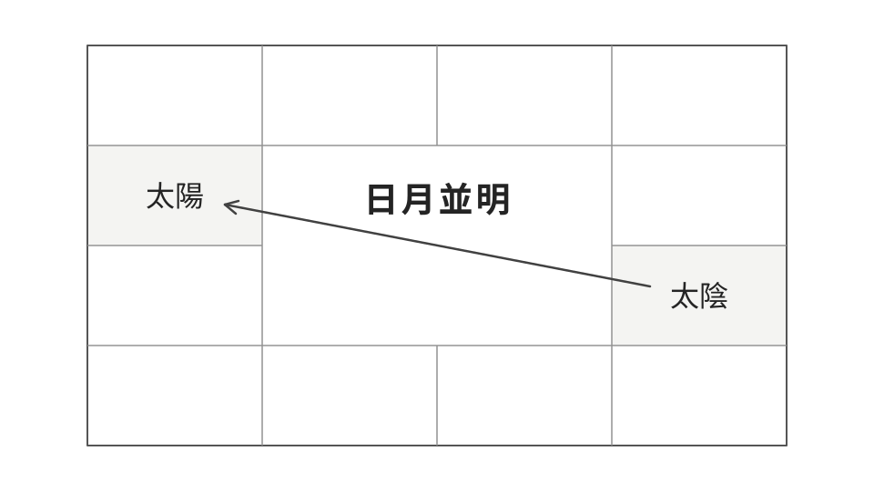 〔板书〕板中央写「日月並明」，并从右边「太陰」画一条带箭头的线指向左边「太陽」。（[00:50:12](https://www.bilibili.com/video/BV1KJsLekEfA/?p=13&t=3012)，第 90367 帧） |
| **日月并明，命宫一定要落在哪里？** | 〔口述〕倪师强调命宫位置：「这种日月并明呢……一定是命宫在这里……叫日月并明」。字幕只录到「命宫在这里」，语音接着还说了对宫在这里，以及命宫、对宫两格可以互换（语音原字见待核）。（[00:50:15–00:50:23](https://www.bilibili.com/video/BV1KJsLekEfA/?p=13&t=3015)，第 90462–90719 帧） 〔指代〕说「命宫在这里」时，手先指左列中格「太陽」右侧，再伸到右列中格指「太陰」，并在「太陰」旁用粉笔写了一个记号字。（[00:50:16–00:50:22](https://www.bilibili.com/video/BV1KJsLekEfA/?p=13&t=3016)，第 90498–90665 帧） 〔叠图〕叠图把同一组宫格改标：庚戌那格改标为命宫（太阴旺 化禄，大限 3~12），甲辰那格改标为官禄（太阳旺，大限 43~52）。（[00:50:16–00:50:22](https://www.bilibili.com/video/BV1KJsLekEfA/?p=13&t=3016)，第 90498–90665 帧） 〔板书〕右列「太陰」旁添了一个似「命」的字；左列那格也可见一个似「命」的字，「太陽」被老师身体挡住。（[00:50:23](https://www.bilibili.com/video/BV1KJsLekEfA/?p=13&t=3023)，第 90695 帧） 〔推断〕推断：结合语音和叠图先后把命宫放在太阳格、太阴格，倪师的意思是命宫在太阳或太阴其中一格、对宫是另一颗，都叫日月并明。（[00:50:15–00:50:23](https://www.bilibili.com/video/BV1KJsLekEfA/?p=13&t=3015)，第 90462–90719 帧） |
| **另一种日月并明是怎么会到的？** | 〔口述〕第二种：太阴再往上一格，太阳在另一处：「还有一种日月并明呢……就是太阴星再往上上去了啊……太阳星在这里」。（[00:50:24–00:50:30](https://www.bilibili.com/video/BV1KJsLekEfA/?p=13&t=3024)，第 90720–90911 帧） 〔口述〕倪师指出命宫刚好在某格（字幕作「命官」），从那里会出去，三方四正同样会到日月：「刚好是不是又是日月并明……有没有三方四正也是日月并明」。（[00:50:30–00:50:39](https://www.bilibili.com/video/BV1KJsLekEfA/?p=13&t=3030)，第 90912–91193 帧） 〔指代〕说「太阳星在这里」时，讲者在左上格用粉笔边写边指，已写出「太」，第二字被手挡住。（[00:50:28–00:50:30](https://www.bilibili.com/video/BV1KJsLekEfA/?p=13&t=3028)，第 90852–90911 帧） 〔叠图〕财帛 丁酉：太阴旺、禄存庙、天官平、天伤平、天虚旺，大限 82~91；官禄 癸巳：太阳旺 化权、火星得、天马平、天福旺、截空庙、孤辰陷、破碎陷，大限 42~51；另有命宫 辛丑一格，转写大多没认出。（[00:50:25–00:50:39](https://www.bilibili.com/video/BV1KJsLekEfA/?p=13&t=3025)，第 90762–91193 帧） 〔板书〕左上格新写「太陽」；右列原「太陰」往上一格可辨「太」，第二字认不出。（[00:50:30](https://www.bilibili.com/video/BV1KJsLekEfA/?p=13&t=3030)，第 90924 帧） 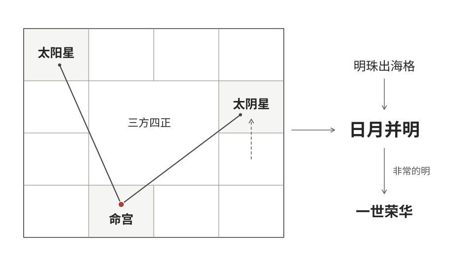 |
| **明珠出海格算什么？日月并明的人主什么？** | 〔口述〕明珠出海格也归入日月并明：「那明珠出海格……也是属于明日月并明的一种」。（[00:50:39–00:50:45](https://www.bilibili.com/video/BV1KJsLekEfA/?p=13&t=3039)，第 91194–91361 帧） 〔口述〕凡日月并明都主一生荣华，原因是非常明：「所有日月并明的人呢……主的是一世荣华……一辈子荣华……什么因为他非常的明」。（[00:50:45–00:50:56](https://www.bilibili.com/video/BV1KJsLekEfA/?p=13&t=3045)，第 91362–91685 帧） 〔板书〕板面左侧竖写一列字，可辨首字「一」，其余认不出；右边几格之间新画了几条连线。（[00:51:01](https://www.bilibili.com/video/BV1KJsLekEfA/?p=13&t=3061)，第 91837 帧） |
| **为什么说再凶的格也能变好？一念之间差多少？** | 〔口述〕倪师由「明」引申劝学生：「所以诸位呢……千万不要去做聪明的人」。（[00:50:56–00:51:00](https://www.bilibili.com/video/BV1KJsLekEfA/?p=13&t=3056)，第 91686–91811 帧） 〔口述〕抓到神就能改格：「诸位能够抓到我们的神哈……你可以从就算你的命是最凶的格……都可以变成最好的格……了解我意思吧一念之间呐」。（[00:51:01–00:51:09](https://www.bilibili.com/video/BV1KJsLekEfA/?p=13&t=3061)，第 91848–92087 帧） 〔口述〕举例：30 岁来学、念被改变，到 70 岁「一念之间差40年」；又举「所以38年大陆沦陷就不一样……有的人逃到台湾来……那一念之间」。（[00:51:09–00:51:23](https://www.bilibili.com/video/BV1KJsLekEfA/?p=13&t=3069)，第 92088–92519 帧） 〔口述〕念对了能把人的时空缩短：「我们如果你的念是对的……我们可以把一个人的时空呢……马上缩短」。（[00:51:25–00:51:30](https://www.bilibili.com/video/BV1KJsLekEfA/?p=13&t=3085)，第 92550–92717 帧） |
| **流年遇杀星想不开的人，会怎么闹？** | 〔口述〕临床上流年遇到杀星就想不开，念头卡在那里：「所以我们临床上在看的时候……遇到流年遇到杀星的时候……他就会想不开……他的念就在这里」。（[00:51:30–00:51:35](https://www.bilibili.com/video/BV1KJsLekEfA/?p=13&t=3090)，第 92718–92879 帧） 〔指代〕说「他的念就在这里」时，左手指着黑板右下格（格里草写字看不清），随后移到右侧方框区域。（[00:51:34–00:51:35](https://www.bilibili.com/video/BV1KJsLekEfA/?p=13&t=3094)，第 92844–92879 帧） 〔口述〕怎么劝都没用，照样「他还要我就是一哭二闹三上吊……然后我就是易进难出」。（[00:51:36–00:51:41](https://www.bilibili.com/video/BV1KJsLekEfA/?p=13&t=3096)，第 92880–93059 帧） 〔口述〕模仿失恋者纠缠对方：「每天要去公司找你……造成你的困扰还到你家去闹……还在你家外面淋雨……我非要娶到你不可……你跟我分手我不同意……你看她说累不累」。（[00:51:49–00:52:00](https://www.bilibili.com/video/BV1KJsLekEfA/?p=13&t=3109)，第 93276–93611 帧） |
| **这种人父母管不了，该怎么挽救、怎么劝？** | 〔口述〕是爸妈自然而然养成的，爸妈也没办法：「他爸爸妈妈自然而然……把他养成这样子……爸妈都没有办法」。（[00:52:04–00:52:09](https://www.bilibili.com/video/BV1KJsLekEfA/?p=13&t=3124)，第 93726–93875 帧） 〔口述〕用这一套方法或许能救：「利用我们这一套方法……或许还有方法能够挽救他」。（[00:52:09–00:52:13](https://www.bilibili.com/video/BV1KJsLekEfA/?p=13&t=3129)，第 93876–94007 帧） 〔口述〕光讲道理没用：「告诉他这个天涯何处无芳草啊……都是只向曲中求啊……你要很委婉跟他讲没有用的」。（[00:52:13–00:52:21](https://www.bilibili.com/video/BV1KJsLekEfA/?p=13&t=3133)，第 94008–94247 帧） 〔口述〕根子在没去掉蒙：「你讲完他他听完又忘了……他没收到……因为你没有把他蒙去掉」。（[00:52:21–00:52:29](https://www.bilibili.com/video/BV1KJsLekEfA/?p=13&t=3141)，第 94248–94487 帧） |
| **武曲七杀为什么叫兵阵死亡？** | 〔口述〕倪师转讲武曲七杀，说过去叫兵阵死亡：「诸位有没有看到武曲和七杀……这武曲七杀中间的啊……过去我们都是说的兵阵啊死亡……兵阵中间死掉」。（[00:52:33–00:52:47](https://www.bilibili.com/video/BV1KJsLekEfA/?p=13&t=3153)，第 94614–95027 帧） 〔口述〕以打仗折损作比喻：「就是我们部队……在打仗的时候出去哎……80个人去……怎么剩60个人回来……另外20个人……就是这样子懂不懂」。（[00:52:47–00:52:54](https://www.bilibili.com/video/BV1KJsLekEfA/?p=13&t=3167)，第 95028–95249 帧） 〔叠图〕田宅 癸卯：武曲陷、七杀陷、截空平、天虚庙，另有大耗、灾煞、岁破、帝旺；大限 33~42。（[00:52:33–00:52:38](https://www.bilibili.com/video/BV1KJsLekEfA/?p=13&t=3153)，第 94614–94751 帧） |
| **兵阵死亡包括哪些死法？落在哪一宫？** | 〔口述〕兵阵死亡即死于兵器、兵灾，枪击、刀杀都算：「兵阵死亡……死在兵器上面……那个人给他枪打掉……也是这样子……给人家刀子杀死……也是这样子……死在兵兵灾上面」。（[00:52:55–00:53:07](https://www.bilibili.com/video/BV1KJsLekEfA/?p=13&t=3175)，第 95250–95627 帧） 〔口述〕倪师点出位置：「这就是一个这个左下角……卯宫的时候会会到……看到没有……卯宫的时候会会到」。（[00:53:07–00:53:22](https://www.bilibili.com/video/BV1KJsLekEfA/?p=13&t=3187)，第 95628–96077 帧） 〔板书〕左列一格把两字草书圈起，似「武曲 七杀」，由圈画横线到右边写「兵陣死亡」；下排一格可辨「命」字。圈内字不能逐字确认。（[00:52:45](https://www.bilibili.com/video/BV1KJsLekEfA/?p=13&t=3165)，第 94951 帧） 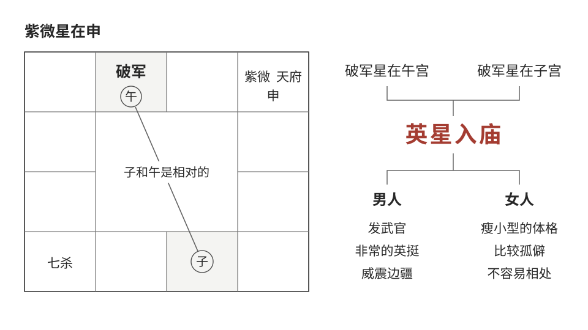 〔推断〕推断：叠图这一格是癸卯，与倪师说的「卯宫」一致；但他先说「还有右边这里呢」、后说「左下角」，方位说法不一，以「卯宫」为准。（[00:52:31–00:53:22](https://www.bilibili.com/video/BV1KJsLekEfA/?p=13&t=3151)，第 94548–96077 帧） |

**总结区**

- 通用规则：廉贞贪狼同宫落陷属于自杀的格，落在哪一宫就以此类推，看是谁有自杀倾向（[00:47:58–00:49:00](https://www.bilibili.com/video/BV1KJsLekEfA/?p=13&t=2878)，第 86364–88217 帧）；命宫在太阳或太阴其中一格、对宫是另一颗，或三方四正会到太阳太阴，都叫日月并明（[00:49:53–00:50:39](https://www.bilibili.com/video/BV1KJsLekEfA/?p=13&t=2993)，第 89808–91193 帧）；明珠出海格也属于日月并明，所有日月并明的人主一世荣华（[00:50:39–00:50:56](https://www.bilibili.com/video/BV1KJsLekEfA/?p=13&t=3039)，第 91194–91685 帧）；武曲七杀相会过去叫兵阵死亡，指死在兵器、兵灾上，枪击刀杀都算（[00:52:33–00:53:07](https://www.bilibili.com/video/BV1KJsLekEfA/?p=13&t=3153)，第 94614–95627 帧）
- 只在本例：紫微在未这张示范盘，廉贞贪狼在右下角辛亥两星皆陷，叠图随假设先后标为兄弟、子女、命宫（[00:47:58–00:48:55](https://www.bilibili.com/video/BV1KJsLekEfA/?p=13&t=2878)，第 86364–88055 帧）；同盘太阳在辰、太阴在戌，命宫设在其中一格为日月并明；太阳巳、太阴酉、命宫丑为三方四正会到的日月并明（[00:49:53–00:50:39](https://www.bilibili.com/video/BV1KJsLekEfA/?p=13&t=2993)，第 89808–91193 帧）；同盘武曲七杀在卯，叠图标为田宅（[00:52:33–00:53:22](https://www.bilibili.com/video/BV1KJsLekEfA/?p=13&t=3153)，第 94614–96077 帧）
- 不是排盘规则，是处世方法：孩子命带自杀格，要用启蒙之道去掉蒙、养成他想得开，不要一味教而后禁（[00:49:03–00:49:19](https://www.bilibili.com/video/BV1KJsLekEfA/?p=13&t=2943)，第 88290–88775 帧）；住房位置会慢慢改变人的想法，父母常把孩子放到命的位置，应放到运的位置（[00:49:20–00:49:52](https://www.bilibili.com/video/BV1KJsLekEfA/?p=13&t=2960)，第 88818–89783 帧）；不要做聪明人；一念之间能把最凶的格变成最好的格（[00:50:56–00:51:30](https://www.bilibili.com/video/BV1KJsLekEfA/?p=13&t=3056)，第 91686–92717 帧）；劝失恋想不开的人，委婉讲道理没用，要先把他的蒙去掉（[00:52:04–00:52:29](https://www.bilibili.com/video/BV1KJsLekEfA/?p=13&t=3124)，第 93726–94487 帧）

**待核**

1. [00:50:16](https://www.bilibili.com/video/BV1KJsLekEfA/?p=13&t=3016)，第 90498 帧：字幕「一定是命宫在这里」，语音为「是命宫在这里对宫在这里或者是命宫在这里对宫在这里」，后半句字幕没录到，笔记只引字幕原字
2. 字幕「在这个有下角」按上下文改为「右下角」（[00:48:07](https://www.bilibili.com/video/BV1KJsLekEfA/?p=13&t=2887)，第 86610 帧）
3. 「自杀的格」连续出现两次，当一句处理（[00:48:16–00:48:21](https://www.bilibili.com/video/BV1KJsLekEfA/?p=13&t=2896)，第 86892–87047 帧）
4. 字幕「她流年逢到的时候」用「她」，前后讲的是子女或他人，用字待核（[00:48:36](https://www.bilibili.com/video/BV1KJsLekEfA/?p=13&t=2916)，第 87486 帧）
5. 「那夫妻指定冲突很大」字幕可信度 0.56，语音为「子弟充足很大」，「指定」原话待核（[00:48:38](https://www.bilibili.com/video/BV1KJsLekEfA/?p=13&t=2918)，第 87564 帧）
6. 字幕「没有爱情了」，语音为「没有爱心的」（[00:48:41](https://www.bilibili.com/video/BV1KJsLekEfA/?p=13&t=2921)，第 87654 帧）
7. 「他会为恋爱而自杀」语音为「战汉和自杀」，两路对不上（[00:48:49](https://www.bilibili.com/video/BV1KJsLekEfA/?p=13&t=2929)，第 87894 帧）
8. 命宫辛亥大限数字串「211」按图例还原为 2~11，待核（[00:48:54](https://www.bilibili.com/video/BV1KJsLekEfA/?p=13&t=2934)，第 88020 帧）
9. 「蒙之道」「去蒙」「教而后禁」倪师用了但没解释（[00:49:10–00:49:19](https://www.bilibili.com/video/BV1KJsLekEfA/?p=13&t=2950)，第 88506–88775 帧）
10. 「看他是第几子啊」字幕可信度 0.57，语音为「地基纸」；「卦象上都有」具体怎么摆本块没讲（[00:49:21–00:49:25](https://www.bilibili.com/video/BV1KJsLekEfA/?p=13&t=2961)，第 88848–88955 帧）
11. 字幕「一天天」，语音「一千天」（[00:49:27](https://www.bilibili.com/video/BV1KJsLekEfA/?p=13&t=2967)，第 89010 帧）
12. 「命的位置」「运的位置」没有解释，「运」语音作「孕」（[00:49:39–00:49:42](https://www.bilibili.com/video/BV1KJsLekEfA/?p=13&t=2979)，第 89388–89483 帧）
13. 字幕「太阳星是不是在这里」，语音先说「看他的太阴星是不是在这里」再说太阳；指代此时写的是「太阴」（[00:49:54](https://www.bilibili.com/video/BV1KJsLekEfA/?p=13&t=2994)，第 89832 帧）
14. 「一定是命宫在这里」语音有完整的「命宫在这里对宫在这里或者是命宫在这里对宫在这里」，字幕只有前半（[00:50:16](https://www.bilibili.com/video/BV1KJsLekEfA/?p=13&t=3016)，第 90498 帧）
15. 字幕「命官」按上下文改为「命宫」（第 90912、90966 帧）；「一会出来」语音作「一汇出来」，意思待核（[00:50:32](https://www.bilibili.com/video/BV1KJsLekEfA/?p=13&t=3032)，第 90966 帧）
16. 叠图命宫辛丑转写多为□；[00:50:30](https://www.bilibili.com/video/BV1KJsLekEfA/?p=13&t=3030)，第 90924 帧板书图上该格可见天梁等字样，但叠图定稿里没有，未采用（[00:50:32–00:50:39](https://www.bilibili.com/video/BV1KJsLekEfA/?p=13&t=3032)，第 90966–91193 帧）
17. 字幕「有没有：三方四正」中的「：」是识别噪声，引文已去掉（[00:50:35](https://www.bilibili.com/video/BV1KJsLekEfA/?p=13&t=3035)，第 91062 帧）
18. 字幕「也是属于明日月并明的一种」多一个「明」，语音为「属于日月并明的一种」（[00:50:42](https://www.bilibili.com/video/BV1KJsLekEfA/?p=13&t=3042)，第 91272 帧）
19. 「千万不要去做聪明的人」后语音多一句「不要去做听明的人」，字幕没有，原话待核（[00:50:57](https://www.bilibili.com/video/BV1KJsLekEfA/?p=13&t=3057)，第 91716 帧）
20. 「诸位能够抓到我们的神」中的「神」倪师没解释（[00:51:01](https://www.bilibili.com/video/BV1KJsLekEfA/?p=13&t=3061)，第 91848 帧）
21. 「易进难出」字幕可信度 0.62，语音「意境难出」，意思没解释（[00:51:40](https://www.bilibili.com/video/BV1KJsLekEfA/?p=13&t=3100)，第 93012 帧）
22. 「都是只向曲中求啊」字幕可信度 0.79，语音「只想取中求」，原话待核（[00:52:16](https://www.bilibili.com/video/BV1KJsLekEfA/?p=13&t=3136)，第 94104 帧）
23. 「还有右边这里呢」指代为否，后又说「左下角」，方位说法不一（第 94548、95628 帧）
24. 「在打仗的时候出去哎」连续出现两次，当一句处理（[00:52:48–00:52:50](https://www.bilibili.com/video/BV1KJsLekEfA/?p=13&t=3168)，第 95058–95111 帧）
25. 「死在兵兵灾上面」字幕多一个「兵」（[00:53:05](https://www.bilibili.com/video/BV1KJsLekEfA/?p=13&t=3185)，第 95562 帧）
26. 「卯宫的时候会会到」中「会会到」意思待核（第 95706、95772 帧）
27. 板书图只见上排一格露出半个「紫」，其余被老师身体挡住（[00:47:55](https://www.bilibili.com/video/BV1KJsLekEfA/?p=13&t=2875)，第 86262 帧）
28. 板书认不全：右下格小圈和尖顶框内的字（[00:48:17](https://www.bilibili.com/video/BV1KJsLekEfA/?p=13&t=2897)，第 86916 帧）；左侧竖写一列只认得「一」（[00:51:01](https://www.bilibili.com/video/BV1KJsLekEfA/?p=13&t=3061)，第 91837 帧）；武曲七杀圈内草书不能逐字确认（[00:52:45](https://www.bilibili.com/video/BV1KJsLekEfA/?p=13&t=3165)，第 94951 帧）
29. 指代不确定或为否，未当依据：第 88252、89939、90646、90940、90973、95646 帧
30. 说「这个」时手指同一格星名下方，字迹潦草认不出（[00:48:35](https://www.bilibili.com/video/BV1KJsLekEfA/?p=13&t=2915)，第 87458 帧）；说「他的念就在这里」所指右下格字看不清（[00:51:35](https://www.bilibili.com/video/BV1KJsLekEfA/?p=13&t=3095)，第 92853 帧）

## 紫微在申：英星入庙、七杀朝斗、日月并明、巨日格

〔叠图〕这一例视频里只贴过 7 格：父母 癸巳：太阳旺权、天马平、火星得、天福旺、孤辰陷、截空庙、破碎陷；疾厄 己亥：巨门旺禄、天使旺、天姚陷、天寿旺；交友 丁酉：太阴旺、禄存庙、天伤平、天官平、天虚旺；福德 甲午：破军庙、铃星庙、副旬庙、天喜庙、解神庙；官禄 丙申（身宫）：紫微旺、天府得、陀罗陷、大耗陷；夫妻 庚寅：七杀庙、左辅庙、文昌陷；子女（宫序推） 辛丑：天梁旺、天贵旺、寡宿平。

### 11　紫微在申：英星入庙与紫府日月巨日（[00:53:22–00:57:36](https://www.bilibili.com/video/BV1KJsLekEfA/?p=13&t=3202)，第 96078–103695 帧）

| 提示区 | 笔记区 |
|---|---|
| **换一张新盘时，倪师先讲什么、为什么？** | 〔口述〕边擦板边说要先讲格：「我先开始介绍一些格」，并安慰学生「不要担心」，到真正批盘时「一个格批得非常的详细」「批大运啊批流年」。（[00:53:25–00:53:37](https://www.bilibili.com/video/BV1KJsLekEfA/?p=13&t=3205)，第 96162–96521 帧） 〔板书〕本块开头的板面是上一张盘的残留，正在擦，格里的字被身体挡住或已擦掉，认不出。（[00:53:26](https://www.bilibili.com/video/BV1KJsLekEfA/?p=13&t=3206)，第 96192 帧） 〔板书〕擦完后新画出一张空白格盘，只有横竖格线，格里还没有字。（[00:53:41](https://www.bilibili.com/video/BV1KJsLekEfA/?p=13&t=3221)，第 96658 帧） |
| **紫微在申这张盘，最主要看哪几颗星？** | 〔口述〕倪师说「这一张八字有特殊的」，先点出「诸位看一颗破军星在这里」，再说「紫微呢在申宫」「天府在这里」「七杀在这里」，并强调「最主要看这几颗星」。（[00:53:37–00:53:58](https://www.bilibili.com/video/BV1KJsLekEfA/?p=13&t=3217)，第 96522–97157 帧） 〔口述〕转身再说一遍：「紫微星在申的时候」「这一张八字」「让你们看到重点几个」。（[00:54:02–00:54:05](https://www.bilibili.com/video/BV1KJsLekEfA/?p=13&t=3242)，第 97260–97355 帧） 〔指代〕说「一颗破军星在这里」时手指的是新画盘顶行左二格（正在该格写字）；叠图显示 破军 福德 甲午。（[00:53:43](https://www.bilibili.com/video/BV1KJsLekEfA/?p=13&t=3223)，第 96709 帧） 〔指代〕说「天府在这里」时手指的是顶行右二格（右上方），之后该格出现紫微天府样的手写字；叠图显示 紫微天府 官禄 丙申。（[00:53:51](https://www.bilibili.com/video/BV1KJsLekEfA/?p=13&t=3231)，第 96940 帧） 〔板书〕可辨：顶行左二格形似「破军」，右上格形似「紫微 天府」，旁边竖写一字形似「申」，左下格一字形似草书「杀」；其余认不出。（[00:53:58](https://www.bilibili.com/video/BV1KJsLekEfA/?p=13&t=3238)，第 97164 帧） |
| **什么叫英星入庙？破军在哪两宫成格？** | 〔口述〕破军在午宫叫英星入庙：「破军星有在午宫的时候」「我们叫做英星入庙」。（[00:54:08–00:54:13](https://www.bilibili.com/video/BV1KJsLekEfA/?p=13&t=3248)，第 97464–97601 帧） 〔口述〕破军在子宫也一样：「跟破军星在子宫是一样的」「这两个是相对的」「子和午是相对的」「这也叫做英星入庙」。（[00:54:16–00:54:27](https://www.bilibili.com/video/BV1KJsLekEfA/?p=13&t=3256)，第 97692–98021 帧） 〔叠图〕叠图叠出两格：福德 甲午、福德 庚子，内容相同：破军庙、铃星庙、天喜庙、解神庙、副旬庙、天钺、天厨、阴煞、小耗、息神、贯索、冠带。（[00:54:26–00:54:27](https://www.bilibili.com/video/BV1KJsLekEfA/?p=13&t=3266)，第 97980–98021 帧） 〔板书〕可辨：顶行左二格「破军」下写「午」，往右下画一斜线，接一行「…星入…」，首字形似「荣」；其余被身体挡住。（[00:54:15](https://www.bilibili.com/video/BV1KJsLekEfA/?p=13&t=3255)，第 97656 帧） 〔板书〕可辨：下排一格新写形似「破军」，与上方「午」之间画了一条斜线相连；其余认不出。（[00:54:21](https://www.bilibili.com/video/BV1KJsLekEfA/?p=13&t=3261)，第 97841 帧） |
| **顺带讲的生肖相冲相克，举了哪些例子？** | 〔口述〕由子午相对引出地支生肖：「子丑寅卯刚好老鼠啊」「丑是牛啊」，「这两个因为相对的是午是马」「所以马跟老鼠都是相克的」。（[00:54:29–00:54:37](https://www.bilibili.com/video/BV1KJsLekEfA/?p=13&t=3269)，第 98070–98339 帧） 〔口述〕「这个未呢是羊」「羊跟牛都是相克的」；又说「那你如果是蛇」「你娶了个老鼠」「那蛇属一窝」。（[00:54:38–00:54:50](https://www.bilibili.com/video/BV1KJsLekEfA/?p=13&t=3278)，第 98340–98717 帧） 〔口述〕举学生例子：「哎羊老师我属羊我先生属老虎」「那羊入虎口好惨了」，倪师说「这个属性倒是有点」「有点好玩的」，点到为止。（[00:54:51–00:55:00](https://www.bilibili.com/video/BV1KJsLekEfA/?p=13&t=3291)，第 98742–99005 帧） 〔指代〕说「这个未呢是羊」前，粉笔点在上排「午」格右侧那一格的上部。（[00:54:37](https://www.bilibili.com/video/BV1KJsLekEfA/?p=13&t=3277)，第 98316 帧） 〔板书〕可辨：「午」右边新添一字，形似「马」，认不准。（[00:54:37](https://www.bilibili.com/video/BV1KJsLekEfA/?p=13&t=3277)，第 98316 帧） 〔板书〕可辨：左上格形似「蛇」，下排第二格形似「丑」，右上角一字只露一部分、认不出。（[00:54:48](https://www.bilibili.com/video/BV1KJsLekEfA/?p=13&t=3288)，第 98640 帧） |
| **说破军在午时、子时成格，指的是什么？** | 〔口述〕倪师说「那这午时的时候」「在中午的时候破军在午」「和子时的时候成格」，把午、子与中午、子时连起来讲，没有进一步解释。（[00:55:00–00:55:06](https://www.bilibili.com/video/BV1KJsLekEfA/?p=13&t=3300)，第 99006–99185 帧） 〔叠图〕叠图只留 福德 甲午 一格（破军庙）。（[00:55:00–00:55:02](https://www.bilibili.com/video/BV1KJsLekEfA/?p=13&t=3300)，第 99000–99060 帧） |
| **英星入庙的男命是什么样子？** | 〔口述〕「英星入庙的人呢」「是也是发武官」，男命「男人非常的英挺」「威震边疆」。（[00:55:06–00:55:14](https://www.bilibili.com/video/BV1KJsLekEfA/?p=13&t=3306)，第 99186–99437 帧） 〔口述〕重复强调「威震边疆」「威震边疆这种人」。（[00:55:14–00:55:24](https://www.bilibili.com/video/BV1KJsLekEfA/?p=13&t=3314)，第 99438–99731 帧） 〔板书〕可辨：盘中间一格写大字，形如「威…边疆」，第二字认不出；上排「午」字外加画了一个圆圈。（[00:55:25](https://www.bilibili.com/video/BV1KJsLekEfA/?p=13&t=3325)，第 99756 帧） |
| **英星入庙落在女命，体格和个性怎样？** | 〔口述〕「那如果是给女人呢」「就反过来了」「变成瘦瘦干干的」，「瘦小型的体格」。（[00:55:24–00:55:35](https://www.bilibili.com/video/BV1KJsLekEfA/?p=13&t=3324)，第 99732–100067 帧） 〔口述〕女命「个性啊会比较孤僻」「不容易相处」。（[00:55:35–00:55:42](https://www.bilibili.com/video/BV1KJsLekEfA/?p=13&t=3335)，第 100068–100271 帧） 〔板书〕可辨：板右侧新写「孤」「僻」两字；盘内斜线旁「…星入庙」可辨，首字认不准。（[00:55:39](https://www.bilibili.com/video/BV1KJsLekEfA/?p=13&t=3339)，第 100176 帧） |
| **英星入庙的人对钱财、婚姻有什么共同点？** | 〔口述〕「然后呢不重利」，「破军星本来就是这个」「对钱财不管是男人女人都一样」「他对钱财不重利看不重」。（[00:55:42–00:55:52](https://www.bilibili.com/video/BV1KJsLekEfA/?p=13&t=3342)，第 100272–100571 帧） 〔口述〕婚姻偏晚：「这种人男人女人都会怎么样」「婚姻都很晚」「都会晚婚」。（[00:55:53–00:55:59](https://www.bilibili.com/video/BV1KJsLekEfA/?p=13&t=3353)，第 100608–100775 帧） 〔板书〕可辨：「孤」「不」「僻」，另一字正在写、认不出。（[00:55:45](https://www.bilibili.com/video/BV1KJsLekEfA/?p=13&t=3345)，第 100354 帧） 〔板书〕可辨：「女」「瘦」「孤僻」「不重利」「晚婚」，「瘦」下一字形似「小」；其余认不出。（[00:55:56](https://www.bilibili.com/video/BV1KJsLekEfA/?p=13&t=3356)，第 100692 帧） |
| **紫微天府与七杀是什么位置关系？** | 〔口述〕讲完「这是英星入庙」，接着说「跟紫微星在寅宫的时候介绍过了」，然后讲紫府与七杀：「如果紫微天府在这里」「七杀就在这里」「今天紫微天府跑到这里」「七杀就跑到这里来」「这一定是相对的」。（[00:55:59–00:56:13](https://www.bilibili.com/video/BV1KJsLekEfA/?p=13&t=3359)，第 100776–101201 帧） 〔指代〕说「如果紫微天府在这里」时手指的是左下格（被叠图 紫微天府 官禄 寅 盖住）；说「七杀就在这里」时手指右上角；说「七杀就跑到这里来」时手又伸向左下格叠图右缘。（[00:56:08–00:56:10](https://www.bilibili.com/video/BV1KJsLekEfA/?p=13&t=3368)，第 101045–101129 帧） 〔叠图〕叠图：官禄 庚寅 有紫微旺、天府得、陀罗陷、大耗陷、劫煞、月德、身宫、长生；夫妻 丙申 有七杀庙、左辅庙、文昌陷、天魁、台辅、天巫。（[00:56:08–00:56:09](https://www.bilibili.com/video/BV1KJsLekEfA/?p=13&t=3368)，第 101064–101093 帧） 〔推断〕推断：本块前面叠图把紫府标在官禄丙申，此处改标在官禄庚寅、七杀在夫妻丙申，与倪师「如果紫微天府在这里」的假设对应，是示意紫府与七杀寅申互换，不是换了命例。「介绍过了」紧接这段，所指大概是紫府七杀相对这一项，拿不准。（[00:56:02–00:56:13](https://www.bilibili.com/video/BV1KJsLekEfA/?p=13&t=3362)，第 100872–101201 帧） 〔板书〕这段写的字被手挡住、认不出；板面其余可辨左上「蛇」形字、带圈的「午」、中间「威…边疆」，与前图相同。（[00:56:08](https://www.bilibili.com/video/BV1KJsLekEfA/?p=13&t=3368)，第 101064 帧） |
| **紫府坐桓、七杀朝斗这两个格主什么？** | 〔口述〕「在这里都叫做紫府坐桓」，「在这里叫七杀朝斗」，「两个格是一样的」。（[00:56:13–00:56:18](https://www.bilibili.com/video/BV1KJsLekEfA/?p=13&t=3373)，第 101202–101357 帧） 〔口述〕断语是「一辈子爵禄荣昌」，并解释「爵代表社会地位」「禄代表财禄」，「两个都会两个都在坐享」。（[00:56:18–00:56:34](https://www.bilibili.com/video/BV1KJsLekEfA/?p=13&t=3378)，第 101358–101843 帧） 〔指代〕说「在这里都叫做紫府坐桓」时手持粉笔指在左下格右上角空白处，格内其余被叠图 紫微 天府 官禄 寅 盖住。（[00:56:15](https://www.bilibili.com/video/BV1KJsLekEfA/?p=13&t=3375)，第 101261 帧） 〔板书〕这段新写的字在图里认不出；可见的仍是先前的「午」圈、「威…边疆」和右上「…天…申」形字。（[00:56:32](https://www.bilibili.com/video/BV1KJsLekEfA/?p=13&t=3392)，第 101784 帧） 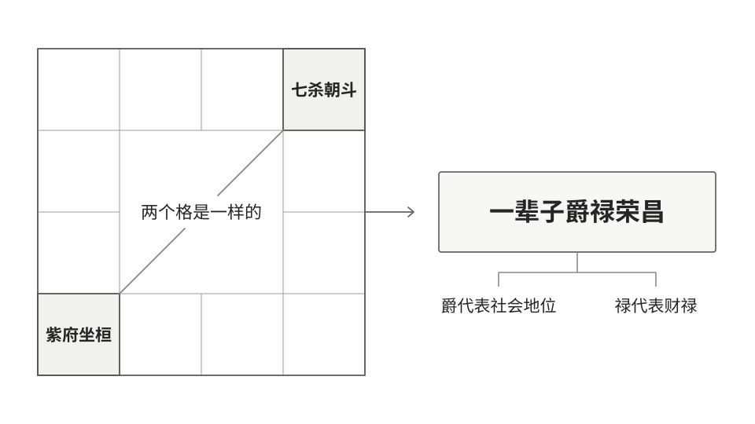 |
| **什么叫日月并明格？主什么？** | 〔口述〕「太阳在这边」，「如果太阳太阴同时会到这个命宫」「命宫在这里之后」「这就叫做日月并明格」。（[00:56:37–00:56:46](https://www.bilibili.com/video/BV1KJsLekEfA/?p=13&t=3397)，第 101922–102191 帧） 〔口述〕断语：「一辈子做事情左右逢源」「一辈子荣华」。（[00:56:46–00:56:51](https://www.bilibili.com/video/BV1KJsLekEfA/?p=13&t=3406)，第 102192–102335 帧） 〔指代〕说「太阳在这边」时粉笔正在上排一格写「太阳」（叠图 太阳 父母 巳）；说「命宫在这里」时手在下排左侧格，该格写「命丑」（叠图 命宫 辛丑）。（[00:56:36–00:56:43](https://www.bilibili.com/video/BV1KJsLekEfA/?p=13&t=3396)，第 101904–102099 帧） 〔叠图〕父母 癸巳：太阳旺并标「权」、火星得、天马平、天福旺、截空庙、孤辰陷、破碎陷、蜚廉；交友 丁酉：太阴旺、禄存庙、天官平、天伤平、天虚旺；命宫 辛丑：天梁旺、天贵旺、寡宿平。（[00:56:37–00:56:43](https://www.bilibili.com/video/BV1KJsLekEfA/?p=13&t=3397)，第 101922–102095 帧） 〔板书〕可辨：右侧新写「太阴」；其余新写的字被身体挡住，认不出。（[00:56:46](https://www.bilibili.com/video/BV1KJsLekEfA/?p=13&t=3406)，第 102192 帧） |
| **巨日格怎么成？一定要同宫吗？** | 〔口述〕「那如果巨门在对面」「太阳在这边会过来就叫做巨」；太阳在巳时，「这是不是太阳很亮」「上午9-11点到巳时」，「巨门在晚上是不是庙旺」「你看旺有没有」。（[00:56:51–00:57:03](https://www.bilibili.com/video/BV1KJsLekEfA/?p=13&t=3411)，第 102336–102713 帧） 〔口述〕「如果以这个八字来说」「它叉化禄有没有」「这叫做巨日格」，并说「成格不一定同宫」「同宫在这里」「在这里也是巨日格」。（[00:57:03–00:57:11](https://www.bilibili.com/video/BV1KJsLekEfA/?p=13&t=3423)，第 102714–102941 帧） 〔叠图〕叠图：疾厄 己亥 有巨门旺并标「禄」、天使旺、天姚陷、天寿旺。（[00:56:51–00:56:54](https://www.bilibili.com/video/BV1KJsLekEfA/?p=13&t=3411)，第 102330–102420 帧） 〔指代〕说「同宫在这里」前后，手掌张开按在左下格，掌心在一个形似「殺」的字上方。（[00:57:09](https://www.bilibili.com/video/BV1KJsLekEfA/?p=13&t=3429)，第 102886 帧） |
| **本盘化禄落父母宫，跟落命宫有何不同？** | 〔口述〕「他又化禄大财星」，「那你看这个八字」「不刚好落父母宫」「爸爸妈妈有钱」「了解我意思吧祖业很大」。（[00:57:11–00:57:18](https://www.bilibili.com/video/BV1KJsLekEfA/?p=13&t=3431)，第 102942–103157 帧） 〔口述〕对比两种落宫：「如果落到命宫的话」「生下来就有钱」「也是有祖业」；「落到父母宫的话」「他会承继祖业」「会有这种现象」。（[00:57:18–00:57:28](https://www.bilibili.com/video/BV1KJsLekEfA/?p=13&t=3438)，第 103158–103463 帧） 〔推断〕推断：叠图父母癸巳的太阳标的是「权」，「禄」标在疾厄己亥的巨门上，与口述「刚好落父母宫」对不上；口述里「他又化禄」的「他」指哪颗星也没说清。（[00:56:37–00:57:15](https://www.bilibili.com/video/BV1KJsLekEfA/?p=13&t=3397)，第 101922–103067 帧） |

**总结区**

- 通用规则：破军在午宫或子宫叫英星入庙，子午相对两者一样；男命英挺、威震边疆，女命反过来瘦小孤僻，男女都不重利、都晚婚（[00:54:08–00:55:59](https://www.bilibili.com/video/BV1KJsLekEfA/?p=13&t=3248)，第 97464–100775 帧）；紫府与七杀一定相对，紫府坐桓与七杀朝斗两个格一样，主一辈子爵禄荣昌（[00:56:07–00:56:34](https://www.bilibili.com/video/BV1KJsLekEfA/?p=13&t=3367)，第 101034–101843 帧）；太阳太阴同时会到命宫叫日月并明格，一辈子做事左右逢源、荣华（[00:56:41–00:56:51](https://www.bilibili.com/video/BV1KJsLekEfA/?p=13&t=3401)，第 102036–102335 帧）；巨门在对面、太阳会过来就叫巨日格，成格不一定同宫，同宫也是巨日格（[00:56:51–00:57:11](https://www.bilibili.com/video/BV1KJsLekEfA/?p=13&t=3411)，第 102336–102941 帧）
- 只在本例：这张紫微在申的示范盘：破军在午、紫微天府在申，七杀与紫府相对（[00:53:42–00:56:13](https://www.bilibili.com/video/BV1KJsLekEfA/?p=13&t=3222)，第 96684–101201 帧）；叠图太阳在父母癸巳、太阴在交友丁酉，倪师假设命宫在丑来讲日月并明（[00:56:36–00:56:46](https://www.bilibili.com/video/BV1KJsLekEfA/?p=13&t=3396)，第 101904–102191 帧）；本盘化禄落父母宫，主爸爸妈妈有钱、祖业大、会承继祖业；若落命宫则生下来就有钱（[00:57:11–00:57:28](https://www.bilibili.com/video/BV1KJsLekEfA/?p=13&t=3431)，第 102942–103463 帧）

**待核**

1. 「在这里都叫做紫府坐桓」照字幕原字引，「桓」是否错字待核（[00:56:13](https://www.bilibili.com/video/BV1KJsLekEfA/?p=13&t=3373)，第 101202 帧）
2. 「跟紫微星在寅宫的时候介绍过了」指的是哪一项拿不准，推断是紫府七杀相对（[00:56:02](https://www.bilibili.com/video/BV1KJsLekEfA/?p=13&t=3362)，第 100872 帧）
3. 「同宫在这里」字幕可信度 0.3，且[00:57:10](https://www.bilibili.com/video/BV1KJsLekEfA/?p=13&t=3430)，第 102903 帧的指代一说手在左下格、一说在左上叠图巳宫，冲突（[00:57:09](https://www.bilibili.com/video/BV1KJsLekEfA/?p=13&t=3429)，第 102888 帧）
4. 「是也是发武官」语音作「发五官」，「发武官」倪师没解释（[00:55:09](https://www.bilibili.com/video/BV1KJsLekEfA/?p=13&t=3309)，第 99276 帧）
5. 「我先生属老虎」语音作「属老鼠」，两路对不上；按后句「羊入虎口」暂取字幕（[00:54:51](https://www.bilibili.com/video/BV1KJsLekEfA/?p=13&t=3291)，第 98742 帧）
6. 「那诸位有一个不要教吧」意思不明（[00:54:27](https://www.bilibili.com/video/BV1KJsLekEfA/?p=13&t=3267)，第 98022 帧）
7. 「午时」「子时」成格说的是出生时辰还是宫位，没讲清（[00:55:00](https://www.bilibili.com/video/BV1KJsLekEfA/?p=13&t=3300)，第 99006 帧）
8. 「它叉化禄有没有」的「叉」疑为识别错字；「太阳在已时」的「已」应为「巳」，转述里已按「巳」写（[00:56:56](https://www.bilibili.com/video/BV1KJsLekEfA/?p=13&t=3416)，第 102480 帧、[00:57:05](https://www.bilibili.com/video/BV1KJsLekEfA/?p=13&t=3425)，第 102750 帧）
9. 「两个都在坐享」语音作「坐下」（[00:56:23](https://www.bilibili.com/video/BV1KJsLekEfA/?p=13&t=3383)，第 101496 帧）
10. 口述说化禄「刚好落父母宫」，叠图父母癸巳太阳标「权」、化禄标在疾厄己亥巨门，对不上（[00:57:14](https://www.bilibili.com/video/BV1KJsLekEfA/?p=13&t=3434)，第 103026 帧）
11. 叠图福德甲午与福德庚子两格内容完全相同，像是同一格只改了干支示意（[00:54:24](https://www.bilibili.com/video/BV1KJsLekEfA/?p=13&t=3264)，第 97938 帧）
12. 板书英星入庙首字形似「荣」，与字幕「英」不同（[00:54:15](https://www.bilibili.com/video/BV1KJsLekEfA/?p=13&t=3255)，第 97656 帧）
13. 板书「午」旁一字形似「马」，认不准（[00:54:37](https://www.bilibili.com/video/BV1KJsLekEfA/?p=13&t=3277)，第 98316 帧）；[00:56:32](https://www.bilibili.com/video/BV1KJsLekEfA/?p=13&t=3392)，第 101784 帧、[00:56:46](https://www.bilibili.com/video/BV1KJsLekEfA/?p=13&t=3406)，第 102192 帧新写的字大部分认不出

