# P15 · 8 上：紫微在酉 / 戌 / 亥 / 夫妻生离死别（00:00:00–00:55:22，共 99,680 帧）

> 2026-11-12 整理。依据 DeepSeek 逐帧记录与现成的五层材料（字幕、语音、叠图、板书、指代），由 Claude（Opus 5.5 子代理）分段起草，引文由程序逐段对过字幕。流程 2026-11-11 经站长认可。
> 依据标记：〔口述〕字幕与语音两路对得上的话，「」里是字幕原字 ·〔叠图〕后期贴的电子命盘，**不算倪师的话** ·〔板书〕粉笔字（看过那一帧原图才写）·〔指代〕「这里 / 这个」指哪（只收核过、确定的）·〔推断〕笔记作者自己的推断。每条后面的时间码可以点，跳到 B 站那一秒。

## 全集总结

**通用规则**

- 太阳在午宫叫日丽中天；命宫在午是本格、管一辈子，大限走到只管那十年，格落在别宫（如夫妻宫）要依此类推，不能被书上的格绑住（[00:00:19–00:01:48](https://www.bilibili.com/video/BV1KJsLekEfA/?p=15&t=19)，第 594–3257 帧）
- 地劫一颗星孤星独守是大凶，本宫凶、对宫也凶，流年走到对面有孤立地劫来会的宫那年就凶，凶什么事看八字、看命决定；地劫与武曲同宫则影响不大、大不了破点财（[00:05:19–00:06:40](https://www.bilibili.com/video/BV1KJsLekEfA/?p=15&t=319)，第 9594–12023 帧）
- 命占三分之一（上看天文）、运占三分之一（下看地理）、人事占三分之一，合为天人地三才；人间道加地理位置大于天命（[00:12:43–00:13:26](https://www.bilibili.com/video/BV1KJsLekEfA/?p=15&t=763)，第 22890–24185 帧）。
- 财帛宫化权与禄存在一起叫权禄相逢，这种人一定会做事业当老板（[00:19:52–00:20:09](https://www.bilibili.com/video/BV1KJsLekEfA/?p=15&t=1192)，第 35760–36287 帧）
- 福德宫十足可以当成夫妻宫来看（[00:22:39–00:22:52](https://www.bilibili.com/video/BV1KJsLekEfA/?p=15&t=1359)，第 40794–41183 帧）
- 算命是专门谈果的哲学，宗教谈因，两者是两回事；今天以前只能算命，今天以后可以改运（[00:28:42–00:30:27](https://www.bilibili.com/video/BV1KJsLekEfA/?p=15&t=1722)，第 51666–54839 帧）
- 星要得正位；官禄宫化权最好，因为当官本来就要掌权（[00:32:35–00:32:51](https://www.bilibili.com/video/BV1KJsLekEfA/?p=15&t=1955)，第 58668–59141 帧）。
- 做生意的人逢化科，代表名气很大、声名远播，不能照当官的「科甲旺」去讲（[00:39:39–00:40:06](https://www.bilibili.com/video/BV1KJsLekEfA/?p=15&t=2379)，第 71382–72203 帧）
- 化科主自由业（医师、律师、会计师、工程师、建筑师，一个人开事务所）；化科又化权，同是医生就到医学院主任、院长一级（[00:43:28–00:44:18](https://www.bilibili.com/video/BV1KJsLekEfA/?p=15&t=2608)，第 78252–79751 帧）
- 斗数看夫妻死别或生离，第一看福德宫凶：化忌、廉贞破军、廉贞贪狼都算凶（[00:47:48–00:48:23](https://www.bilibili.com/video/BV1KJsLekEfA/?p=15&t=2868)，第 86058–87101 帧）

**只在本例**

- 陈燊龄陈将军是太阳午宫坐命，倪师 69 年替他算时他是中将，断他能到参谋总长（[00:03:44–00:04:01](https://www.bilibili.com/video/BV1KJsLekEfA/?p=15&t=224)，第 6732–7235 帧）
- 这个八字的重点在福德宫，天机化忌（[00:11:14–00:11:39](https://www.bilibili.com/video/BV1KJsLekEfA/?p=15&t=674)，第 20244–20987 帧）。
- 这个男命37年出世，民国80年来算时人已死，是太太拿八字来的（[00:16:55–00:17:11](https://www.bilibili.com/video/BV1KJsLekEfA/?p=15&t=1015)，第 30456–30947 帧）
- 这个男命交友宫破军、左辅、地劫、天马，主动找朋友合伙会奔波白忙、破财、拆伙成仇，合伙必败（[00:22:52–00:25:35](https://www.bilibili.com/video/BV1KJsLekEfA/?p=15&t=1372)，第 41184–46061 帧）
- 44 岁这一格对面有杀星来会、未来十年又没有大运、本宫太阳看成月亮，叫目不见日月（[00:36:42–00:37:06](https://www.bilibili.com/video/BV1KJsLekEfA/?p=15&t=2202)，第 66072–66785 帧）。
- 本例后面大限走官禄、朋友，朋友本来就不好，最后被人杀害、丢进河里死的（[00:37:58–00:38:28](https://www.bilibili.com/video/BV1KJsLekEfA/?p=15&t=2278)，第 68346–69263 帧）
- 这个男命子女宫贪狼在午宫化禄，断一个像爸爸的儿子，将来做生意当大老板；没有化禄就当武官（[00:42:17–00:43:12](https://www.bilibili.com/video/BV1KJsLekEfA/?p=15&t=2537)，第 76128–77771 帧）

**不是排盘规则，是处世方法**

- 算命是事先知道、事先预防的工具，这是学算命的目的（[00:13:50–00:14:01](https://www.bilibili.com/video/BV1KJsLekEfA/?p=15&t=830)，第 24906–25247 帧）。
- 光算命不讲人和地，叫人去当和尚、晚婚或嫁离过婚的来化解，都是消极的废话（[00:18:27–00:19:42](https://www.bilibili.com/video/BV1KJsLekEfA/?p=15&t=1107)，第 33216–35489 帧）
- 直说「必败」对方就不做了；给怀疑的答案，他还抱侥幸心理去做（[00:25:39–00:26:11](https://www.bilibili.com/video/BV1KJsLekEfA/?p=15&t=1539)，第 46182–47153 帧）
- 看出别人是贪官命，不要当面讲、不要太直，要有分寸（[00:32:56–00:33:03](https://www.bilibili.com/video/BV1KJsLekEfA/?p=15&t=1976)，第 59280–59501 帧）。
- 同一段处境，想法不同就是天地否与地天泰，一念之间（[00:41:36–00:41:56](https://www.bilibili.com/video/BV1KJsLekEfA/?p=15&t=2496)，第 74886–75485 帧）

## 目录

**紫微在酉：太阳在午日丽中天、巨日会命、武职大利**

1. 日丽中天、巨日会命与武职大利（00:00:00–00:04:16）

**紫微在戌、亥：日月丑未、地劫孤星独守、将星入命、水中作冢**

2. 紫微在戌亥：雄宿朝元、将星、水中作冢（00:04:16–00:09:48）

**例一（男命，命宫辛酉太阳天梁）：起盘、三方四正、天人地三才**

3. 男命起盘三方四正与天人地三才（00:09:49–00:16:49）

**例一续：带丧来算、权禄相逢、福德化忌、合伙必败、以果决行**

4. 带丧来算、福德化忌与权禄日月反背（00:16:49–00:21:51）
5. 夫妻天同巨门、交友天马与合伙必败（00:21:52–00:27:24）
6. 朋友出钱当老板、算命谈果与悭吝理财（00:27:25–00:32:34）

**例一续：星得正位、大限流年、化科化忌、子女与兄弟宫**

7. 星得正位、掌财权面相与目不见日月（00:32:34–00:37:12）
8. 早年父母大限与化科化忌的断法（00:37:12–00:42:17）
9. 子女贪狼化禄、科权分别与兄弟眉相（00:42:17–00:47:02）

**夫妻死别生离：福德宫凶、阳宅、面相与死前气色**

10. 夫妻死别生离：福德、阳宅、面相（00:47:02–00:55:22）

## 紫微在酉：太阳在午日丽中天、巨日会命、武职大利

〔叠图〕这一例视频里只贴过 3 格：疾厄 戊戌：巨门旺禄、擎羊庙、天使陷、天德庙、寡宿陷；迁移 丁酉：紫微平、贪狼平、左辅陷、禄存庙、凤阁庙、天官平、年解旺；田宅 甲午：太阳庙权、文昌陷忌、天钺庙、八座旺、咸池陷、大耗旺、天姚平、天贵庙。

### 1　日丽中天、巨日会命与武职大利（[00:00:00–00:04:16](https://www.bilibili.com/video/BV1KJsLekEfA/?p=15&t=0)，第 0–7697 帧）

| 提示区 | 笔记区 |
|---|---|
| **紫微在酉时太阳在哪？为什么叫日丽中天？** | 〔口述〕接着讲紫微在酉：紫微在这里时，太阳一定在午。「紫微在这个地方的时候」「第一个太阳一定在这里」……「这叫太阳在午宫」。（[00:00:19–00:00:28](https://www.bilibili.com/video/BV1KJsLekEfA/?p=15&t=19)，第 594–869 帧） 〔口述〕午是中午 11 点到 1 点，是太阳最当头的时候：「午是中午11-1点」「那中午的时间呢」「是太阳最当头的时候」「刚刚好叫做德桓」「就是说」「太阳出的最好的时机」。（[00:00:30–00:00:42](https://www.bilibili.com/video/BV1KJsLekEfA/?p=15&t=30)，第 900–1265 帧） 〔口述〕只管这一个宫就有一个格：「所以这个有个格」「我们就是光管这个宫」「它就有个格叫做日丽中天」；又说「太阳正午的时候最热最高」「这是一个这个这个范围」「我们叫做日丽中天格」。（[00:00:42–00:01:02](https://www.bilibili.com/video/BV1KJsLekEfA/?p=15&t=42)，第 1266–1883 帧） 〔指代〕说「光管这个宫」时，粉笔点在黑板上写有「太陽」「午」的那一格；说「这个这个范围」时，用粉笔沿这一格描边。（[00:00:45–00:00:56](https://www.bilibili.com/video/BV1KJsLekEfA/?p=15&t=45)，第 1350–1682 帧） 〔板书〕可辨：上排一格写「太陽」「午」，下面一格写「11-1」「中午」；左侧竖写「日麗中天格」（「日」字被叠图挡住）。（[00:01:03](https://www.bilibili.com/video/BV1KJsLekEfA/?p=15&t=63)，第 1897 帧） 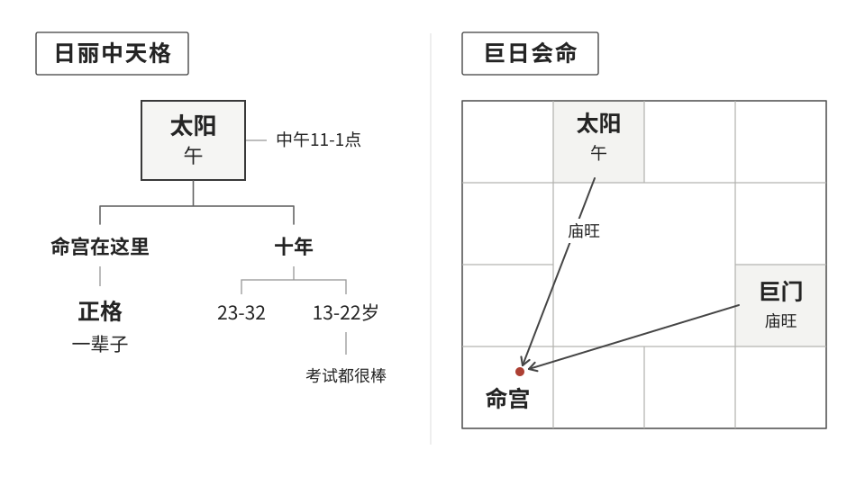 〔叠图〕示范盘午宫贴为「田宅 甲午」：太阳庙、化权，文昌陷、化忌，天钺庙、天姚平、八座旺、天贵庙、天厨、封诰、咸池陷、大耗旺、月德，另有小耗、咸池；衰；小限 12,24,36,48,60,72；大限 93~102。同时贴酉宫「迁移 丁酉」：紫微平、贪狼平、左辅陷、禄存庙、凤阁庙、天官平、蜚廉、年解旺，博士、将星、白虎；冠带；小限 3,15,27,39,51,63；大限 63~72。（[00:00:25–00:00:27](https://www.bilibili.com/video/BV1KJsLekEfA/?p=15&t=25)，第 750–827 帧） |
| **命宫在午和大限走到午，格有什么不同？** | 〔口述〕命宫就在午这一格时是正格：「如果是命宫在这里的时候」「就成为正格」「叫日丽中天格」。（[00:01:07–00:01:14](https://www.bilibili.com/video/BV1KJsLekEfA/?p=15&t=67)，第 2010–2231 帧） 〔口述〕如果只是 23-32 岁这个大限走到这一格，那只是这十年日丽中天：「23-32 在这里的时候」「这叫23-32十年是日丽中天」。（[00:01:14–00:01:24](https://www.bilibili.com/video/BV1KJsLekEfA/?p=15&t=74)，第 2232–2531 帧） 〔口述〕命宫在这里就是一辈子日丽中天，两者要分开：「那如果是命宫就在这里的时候」「那是一辈子是什么日丽中天」「这是本格和流年的格不一样」。（[00:01:24–00:01:31](https://www.bilibili.com/video/BV1KJsLekEfA/?p=15&t=84)，第 2532–2741 帧） 〔指代〕说「命宫在这里」时，在「太陽 午」格内写下「命」字并点该格；说「23-32 在这里」时，在同一格内写数字并点按该格。（[00:01:08–00:01:18](https://www.bilibili.com/video/BV1KJsLekEfA/?p=15&t=68)，第 2066–2348 帧） 〔板书〕可辨：午格内「太陽」「命」「午」，「午」上方有擦过的字迹认不出；下格「11-1」「中午」；左侧「麗中天格」。（[00:01:26](https://www.bilibili.com/video/BV1KJsLekEfA/?p=15&t=86)，第 2589 帧） 〔叠图〕叠图随口述换宫名：讲命宫时贴「命宫 甲午」，大限 3~12；讲 23-32 时贴「田宅 甲午」，大限 23~32；星曜与前一张同一格相同。（[00:01:07–00:01:18](https://www.bilibili.com/video/BV1KJsLekEfA/?p=15&t=67)，第 2010–2363 帧） |
| **日丽中天格落在夫妻宫，该怎么批？** | 〔口述〕只知道命宫在这里，可是命宫在别处时这一格成了夫妻宫，只批她那十年就看漏了：「那如果你只知道命宫在这里」「她要日丽中天的时候」「等到她的命宫在这里」「她她这里是夫妻宫」「结果你只批她十年」「你不晓得她先生就是日丽中天」。（[00:01:33–00:01:45](https://www.bilibili.com/video/BV1KJsLekEfA/?p=15&t=93)，第 2808–3161 帧） 〔口述〕要举一反三，不被书上的格框死：「要依此类推」「不能被书上写的格绑到」。（[00:01:45–00:01:48](https://www.bilibili.com/video/BV1KJsLekEfA/?p=15&t=105)，第 3162–3257 帧） 〔指代〕说「命宫在这里」「等到她的命宫在这里」时，粉笔或手指都落在「太陽 命 午」格内的「命」字处。（[00:01:35–00:01:38](https://www.bilibili.com/video/BV1KJsLekEfA/?p=15&t=95)，第 2868–2955 帧） 〔叠图〕同一午宫改贴为「夫妻 甲午」，大限 23~32，星曜与前同。这是后期换宫名示意，不是另一张盘。（[00:01:39–00:01:45](https://www.bilibili.com/video/BV1KJsLekEfA/?p=15&t=99)，第 2970–3161 帧） 〔推断〕推断：倪师用这一段说明，同一个格落在哪一宫，就要从那一宫去看（落夫妻宫就看到先生），不能只当作某个大限十年来批。（[00:01:33–00:01:48](https://www.bilibili.com/video/BV1KJsLekEfA/?p=15&t=93)，第 2808–3257 帧） |
| **13-22 岁走日丽中天，好不好？** | 〔口述〕命宫换到别处，13-22 岁这十年正好走到日丽中天：「那如果有个人命宫在这里」「结果他13-22岁刚好日丽中天」。（[00:01:51–00:01:56](https://www.bilibili.com/video/BV1KJsLekEfA/?p=15&t=111)，第 3336–3503 帧） 〔口述〕这样没什么好：那时考试很棒、当班长之类，后来就没有太阳了。「那有什么好的」「你在这个时候你对」「你就是考试都很棒」「都是当班带什么样的」「到后来就后来就没有太阳了」。（[00:01:56–00:02:03](https://www.bilibili.com/video/BV1KJsLekEfA/?p=15&t=116)，第 3504–3695 帧） 〔口述〕成格最好成在人生最精华的时候，要用理去推：「如果流年上是日丽中天成格的时候」「最好在最人生最精华的时间成格」「你用理去推用理去推」「对不对你那么小成格干嘛」。（[00:02:04–00:02:15](https://www.bilibili.com/video/BV1KJsLekEfA/?p=15&t=124)，第 3720–4055 帧） 〔口述〕所以小时候拿状元的，长大往往不行：「所以小的时候都拿状元的」「长大长大都是大时了了」；并说「像我在这个时候是第56名」。（[00:02:15–00:02:30](https://www.bilibili.com/video/BV1KJsLekEfA/?p=15&t=135)，第 4056–4517 帧） 〔指代〕说「你这个在」和「像我在这个时候」时，手指都指着黑板「13 午 22」里的「午」字。（[00:02:03–00:02:23](https://www.bilibili.com/video/BV1KJsLekEfA/?p=15&t=123)，第 3700–4303 帧） 〔板书〕可辨：午格内「太陽」「命」「13」「午」，「午」后的数字潦草；右邻一格写「命」。其余认不出。（[00:01:55](https://www.bilibili.com/video/BV1KJsLekEfA/?p=15&t=115)，第 3451 帧） 〔叠图〕同一午宫改贴为「兄弟 甲午」，大限 13~22，星曜与前同。（[00:01:53–00:01:56](https://www.bilibili.com/video/BV1KJsLekEfA/?p=15&t=113)，第 3402–3503 帧） |
| **什么情况叫巨日会命？** | 〔口述〕太阳在午，巨门在另一宫，两颗都入庙、庙旺，会到同一个宫时，命宫在那里叫巨日会命：「太阳星巨门在这里」「我们这两个入庙和入庙」「两个都是庙旺」「如果这两个会在这个宫」「这样会回来」「命宫在这个地方的时候」「也叫做巨日会命」。（[00:02:34–00:02:47](https://www.bilibili.com/video/BV1KJsLekEfA/?p=15&t=154)，第 4626–5015 帧） 〔指代〕说「命宫在这个地方」时，手在黑板左下那一格写「命」并停在格里。（[00:02:43](https://www.bilibili.com/video/BV1KJsLekEfA/?p=15&t=163)，第 4899 帧） 〔板书〕可辨：上排「太陽」格，右列一格「命」，右下一格「巨门」；从「太陽」格和「巨门」格各画一条线向左下汇聚。右列「命」下面一字认不出。（[00:02:46](https://www.bilibili.com/video/BV1KJsLekEfA/?p=15&t=166)，第 4984 帧） 〔叠图〕叠图贴出戌宫「疾厄 戊戌」：巨门旺、化禄，擎羊庙、天使陷、台辅、寡宿陷、天德庙，另有官符、攀鞍、天德；沐浴；小限 4,16,28,40,52,64；大限 53~62。午宫此时贴回「命宫 甲午」。（[00:02:35–00:02:38](https://www.bilibili.com/video/BV1KJsLekEfA/?p=15&t=155)，第 4650–4751 帧） |
| **巨日会命为什么一定是大财？** | 〔口述〕「巨日会命呢」「一定是大财」「所以说财禄很大」。（[00:02:49–00:02:56](https://www.bilibili.com/video/BV1KJsLekEfA/?p=15&t=169)，第 5094–5297 帧） 〔口述〕讲两个理由：一是先天命里就带财，二是十年大运走到那里也代表财。「那我为什么要叫做大财」「第一个就是先天命中就带财」「第二个呢」「他大运会到时」「如果你十年大运会到这个」「也代表财」。（[00:02:56–00:03:08](https://www.bilibili.com/video/BV1KJsLekEfA/?p=15&t=176)，第 5298–5657 帧） 〔板书〕可辨：板中央写「巨日会命」「大财」，「财」字画了圈。（[00:02:55](https://www.bilibili.com/video/BV1KJsLekEfA/?p=15&t=175)，第 5260 帧） 〔指代〕本块收尾说「就是要注意看这个」时，指尖停在板中央圈起来的「财」字旁。（[00:04:05](https://www.bilibili.com/video/BV1KJsLekEfA/?p=15&t=245)，第 7350 帧） |
| **巨日会命的人多半做什么行业？** | 〔口述〕巨门太阳同时会到，大部分是经商、财商，做大生意：「那巨门和太阳同时会的话」「大部分是商这是财商」「做巨贾大生意的」。（[00:03:08–00:03:16](https://www.bilibili.com/video/BV1KJsLekEfA/?p=15&t=188)，第 5658–5897 帧） 〔板书〕可辨：「巨日会命」左边写一个「商」字，下面有一道弧线连过去。（[00:03:14](https://www.bilibili.com/video/BV1KJsLekEfA/?p=15&t=194)，第 5830 帧） |
| **太阳在午坐命（日丽中天本格）主什么？** | 〔口述〕如果命宫就是太阳在午，就不是商了：「像太阳在命宫」「如果是命宫正好是」「命就是太阳出来的话」「就不是商了」。（[00:03:16–00:03:21](https://www.bilibili.com/video/BV1KJsLekEfA/?p=15&t=196)，第 5898–6059 帧） 〔口述〕这是日丽中天本格，主武职大利：「这是太阳日丽中天本格」「命你的命宫就是日丽中天的话」「主武职大利」「武职大利」。（[00:03:22–00:03:30](https://www.bilibili.com/video/BV1KJsLekEfA/?p=15&t=202)，第 6060–6323 帧） 〔板书〕可辨：左侧「日麗中天格」旁写「命」「武职大利」；右上「太陽」被圈起，圈内下方一字认不出。（[00:03:31](https://www.bilibili.com/video/BV1KJsLekEfA/?p=15&t=211)，第 6334 帧） |
| **太阳午宫坐命的人当军人能做到多高？** | 〔口述〕这种人干军人，最少也能做到参谋总长，那已经是最大了：「如果命宫只要太阳在午宫」「坐命这种人」「干军人的话」「一定会干到最少最少最少」「就干到参谋总长了」「已经最大了」。（[00:03:30–00:03:38](https://www.bilibili.com/video/BV1KJsLekEfA/?p=15&t=210)，第 6324–6545 帧） 〔口述〕又重复：「最小就可以干到参谋总长」「也可能这就是最大了」。（[00:03:40–00:03:44](https://www.bilibili.com/video/BV1KJsLekEfA/?p=15&t=220)，第 6606–6731 帧） 〔口述〕举陈将军为例：「我算过我们陈燊龄陈将军」「就是这个命」「我69年帮他算了他是中将」「我说他参谋总长」「总司令很好了」。（[00:03:44–00:04:01](https://www.bilibili.com/video/BV1KJsLekEfA/?p=15&t=224)，第 6732–7235 帧） |

**总结区**

- 通用规则：太阳在午宫叫日丽中天；命宫在午是本格、管一辈子，大限走到只管那十年，格落在别宫（如夫妻宫）要依此类推，不能被书上的格绑住（[00:00:19–00:01:48](https://www.bilibili.com/video/BV1KJsLekEfA/?p=15&t=19)，第 594–3257 帧）；成格最好在人生最精华的时间，13-22 岁就成格不好，小时拿状元、长大不行（[00:01:51–00:02:16](https://www.bilibili.com/video/BV1KJsLekEfA/?p=15&t=111)，第 3336–4103 帧）；太阳巨门都庙旺、会到命宫叫巨日会命，一定是大财：先天带财，大运走到也代表财，大部分是商、做大生意（[00:02:34–00:03:16](https://www.bilibili.com/video/BV1KJsLekEfA/?p=15&t=154)，第 4626–5897 帧）；太阳在午坐命是日丽中天本格，不是商，主武职大利，干军人最少能到参谋总长（[00:03:16–00:03:44](https://www.bilibili.com/video/BV1KJsLekEfA/?p=15&t=196)，第 5898–6731 帧）
- 只在本例：陈燊龄陈将军是太阳午宫坐命，倪师 69 年替他算时他是中将，断他能到参谋总长（[00:03:44–00:04:01](https://www.bilibili.com/video/BV1KJsLekEfA/?p=15&t=224)，第 6732–7235 帧）；倪师说自己在「13 午 22」那一段时间「是第56名」，所指的盘和意思材料没说清（[00:02:23–00:02:30](https://www.bilibili.com/video/BV1KJsLekEfA/?p=15&t=143)，第 4290–4517 帧）

**待核**

1. [00:00:37](https://www.bilibili.com/video/BV1KJsLekEfA/?p=15&t=37)，第 1122 帧：字幕「刚刚好叫做德桓」，语音「隔环」，倪师没解释这个词，照原字引。
2. [00:00:55](https://www.bilibili.com/video/BV1KJsLekEfA/?p=15&t=55)，第 1656 帧：字幕「这是一个这个这个范围（午宫）」的「（午宫）」语音里没有，是字幕制作者加的注，没有当倪师原话引。
3. [00:01:14](https://www.bilibili.com/video/BV1KJsLekEfA/?p=15&t=74)，第 2232 帧：板上「23-」后面的数字字迹潦草；[00:01:55](https://www.bilibili.com/video/BV1KJsLekEfA/?p=15&t=115)，第 3451 帧板书「13 午」后的数字也潦草，按指代标注作「22」。
4. [00:01:42](https://www.bilibili.com/video/BV1KJsLekEfA/?p=15&t=102)，第 3060 帧：字幕「你不晓得她先生就是日丽中天」，语音是「他现在就是日历中天」，两路不一致，「先生」待核。
5. [00:01:59](https://www.bilibili.com/video/BV1KJsLekEfA/?p=15&t=119)，第 3594 帧：字幕「都是当班带什么样的」，语音「当班呆」，意思待核。
6. [00:02:16](https://www.bilibili.com/video/BV1KJsLekEfA/?p=15&t=136)，第 4104 帧：字幕「长大长大都是大时了了」，语音「大事了了」，照原字引，意思待核。
7. [00:02:21](https://www.bilibili.com/video/BV1KJsLekEfA/?p=15&t=141)，第 4230 帧：字幕「这就是沟什么」，语音「这就是为什么」，按上下文改为「为什么」。
8. [00:02:23](https://www.bilibili.com/video/BV1KJsLekEfA/?p=15&t=143)，第 4290 帧：「像我在这个时候是第56名」所指什么材料没说清，照原字写。
9. [00:02:06](https://www.bilibili.com/video/BV1KJsLekEfA/?p=15&t=126)，第 3792 帧：截图里叠图「兄弟 甲午」的大限显示为 33~42，与材料转写[00:01:53](https://www.bilibili.com/video/BV1KJsLekEfA/?p=15&t=113)，第 3402 帧的 13~22 不一致。
10. [00:02:35–00:02:47](https://www.bilibili.com/video/BV1KJsLekEfA/?p=15&t=155)，第 4650–5015 帧：倪师在黑板左下格新写「命」讲巨日会命，叠图此时仍是「命宫 甲午」和「疾厄 戊戌」，没有对应那一格；第 4710、4727、4860、5520 帧的「这里 / 这个」指向都看不确定。
11. [00:02:35](https://www.bilibili.com/video/BV1KJsLekEfA/?p=15&t=155)，第 4650 帧：叠图疾厄戊戌同时列「天德」「天德庙」；[00:00:25](https://www.bilibili.com/video/BV1KJsLekEfA/?p=15&t=25)，第 750 帧田宅甲午同时列「咸池」「咸池陷」，「小耗」出现两次，是否重复待核。
12. [00:02:47](https://www.bilibili.com/video/BV1KJsLekEfA/?p=15&t=167)，第 5016 帧：字幕「懂不懂我意思」与语音「什么人我认为这好」对不上，没有收。
13. [00:03:44](https://www.bilibili.com/video/BV1KJsLekEfA/?p=15&t=224)，第 6732 帧：人名字幕「陈燊龄」，语音「陈森林」，名字待核。
14. [00:03:51](https://www.bilibili.com/video/BV1KJsLekEfA/?p=15&t=231)，第 6936 帧：「69年」照原字写，没有换算年份。
15. [00:03:53](https://www.bilibili.com/video/BV1KJsLekEfA/?p=15&t=233)，第 7008 帧：字幕「总司令很好了」，语音「我干到总生就很好了」，两路不一致，原话待核。
16. [00:00:51](https://www.bilibili.com/video/BV1KJsLekEfA/?p=15&t=51)，第 1539 帧板书右缘被画面切掉；[00:03:31](https://www.bilibili.com/video/BV1KJsLekEfA/?p=15&t=211)，第 6334 帧圈住的「太陽」下方一字认不出。

## 紫微在戌、亥：日月丑未、地劫孤星独守、将星入命、水中作冢

〔叠图〕这一例视频里只贴过 5 格：疾厄 丁未：太阳平、太阴平禄、擎羊庙、天使平、寡宿不；夫妻 庚戌：紫微闲、天相庙、右弼庙、天空陷；父母 癸丑：地劫陷、凤阁平、华盖陷、天姚平、天寿庙、年解得、龙池平；财帛 戊申：贪狼平、文昌旺、三台旺、解神不；福德 壬寅：廉贞庙、副截陷、大耗陷、天官平。

### 2　紫微在戌亥：雄宿朝元、将星、水中作冢（[00:04:16–00:09:48](https://www.bilibili.com/video/BV1KJsLekEfA/?p=15&t=256)，第 7698–17669 帧）

| 提示区 | 笔记区 |
|---|---|
| **开头念的「民国四十六年」和「下一章」各指什么？** | 〔口述〕倪师举着讲稿照念出「民国四十六年」，材料没有交代这个年份指什么，照原字记下，不推成任何人的生辰。（[00:04:16–00:04:17](https://www.bilibili.com/video/BV1KJsLekEfA/?p=15&t=256)，第 7698–7739 帧） 〔口述〕接着说「这个紫微星在戌宫看到没有」「下一章紫微星在戌」，这一句里有擦板动作，转入紫微在戌一章。（[00:04:18–00:04:25](https://www.bilibili.com/video/BV1KJsLekEfA/?p=15&t=258)，第 7740–7967 帧） 〔板书〕本块开头的板面还是旧格子，可辨：左上格圈起的「太陽」，其余字认不出。（[00:04:22](https://www.bilibili.com/video/BV1KJsLekEfA/?p=15&t=262)，第 7884 帧） 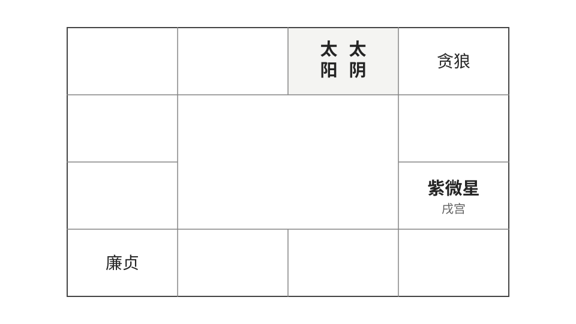 〔口述〕倪师先问「这个格的重点在哪里」，设定「如果紫微星跑到戌宫」，下面逐一讲这张示范盘的格局。（[00:04:30–00:04:37](https://www.bilibili.com/video/BV1KJsLekEfA/?p=15&t=270)，第 8100–8333 帧） |
| **紫微在戌时，日月、贪狼、廉贞各落在哪？** | 〔口述〕先讲「第一个」：「太阳和太阴同时会在这里面」，即太阳、太阴同在一宫。（[00:04:37–00:04:48](https://www.bilibili.com/video/BV1KJsLekEfA/?p=15&t=277)，第 8334–8651 帧） 〔叠图〕夫妻庚戌：紫微闲、天相庙、右弼庙、天月、天空陷；疾厄丁未：太阳平、太阴平（化禄）、擎羊庙、天使平、寡宿不。（[00:04:42–00:04:48](https://www.bilibili.com/video/BV1KJsLekEfA/?p=15&t=282)，第 8466–8651 帧） 〔口述〕接着在板上标出「那这里是贪狼」「这里是廉贞」。（[00:04:48–00:04:59](https://www.bilibili.com/video/BV1KJsLekEfA/?p=15&t=288)，第 8652–8981 帧） 〔叠图〕财帛戊申：贪狼平、文昌旺、三台旺、台辅、解神不；福德壬寅：廉贞庙、天官平、副截陷、大耗陷、阴煞、月德。（[00:04:48–00:04:53](https://www.bilibili.com/video/BV1KJsLekEfA/?p=15&t=288)，第 8652–8795 帧） 〔板书〕可辨：上排中间格「太太／陽陰」，右上格「貪」，其余潦草字认不出。（[00:04:57](https://www.bilibili.com/video/BV1KJsLekEfA/?p=15&t=297)，第 8919 帧） |
| **日月同宫在丑或未，叫什么格？** | 〔口述〕「这个在未宫」「在丑宫重复上一次讲的」「太阳太阴在这边」——日月同宫的位置讲的是未宫或丑宫。（[00:04:59–00:05:05](https://www.bilibili.com/video/BV1KJsLekEfA/?p=15&t=299)，第 8982–9179 帧） 〔指代〕说「这个在未宫」时，粉笔在「太太陽陰」那格下方写「未」；说「在丑宫」时，粉笔停在下排中间格写「丑」。（[00:05:01–00:05:03](https://www.bilibili.com/video/BV1KJsLekEfA/?p=15&t=301)，第 9030–9100 帧） 〔口述〕「叫日月科禄丑未中」「对不对」，又说日月会命、「日月同宫啊」，「这两个就是什么雄宿朝元」。（[00:05:06–00:05:14](https://www.bilibili.com/video/BV1KJsLekEfA/?p=15&t=306)，第 9180–9443 帧） 〔叠图〕另贴一格「疾厄癸丑」，星曜与疾厄丁未那格相同：太阳平、太阴平（化禄）、擎羊庙、天使平、寡宿不。（[00:05:06–00:05:08](https://www.bilibili.com/video/BV1KJsLekEfA/?p=15&t=306)，第 9180–9245 帧） 〔板书〕可辨：上排中间格「太太陽陰」，其下「未」；其余认不出。（[00:05:12](https://www.bilibili.com/video/BV1KJsLekEfA/?p=15&t=312)，第 9360 帧） |
| **地劫孤星独守，凶到什么程度？** | 〔口述〕「诸位看到下面的地劫看到没有」，地劫「上次也介绍过」。（[00:05:19–00:05:25](https://www.bilibili.com/video/BV1KJsLekEfA/?p=15&t=319)，第 9594–9773 帧） 〔口述〕「孤星独守的时候」……「这是大凶」「非常的凶」——地劫一颗星独守一宫，是大凶。（[00:05:25–00:05:38](https://www.bilibili.com/video/BV1KJsLekEfA/?p=15&t=325)，第 9774–10145 帧） 〔叠图〕父母癸丑：地劫陷、天姚平、龙池平、凤阁平、天寿庙、年解得、华盖陷。（[00:05:38–00:05:41](https://www.bilibili.com/video/BV1KJsLekEfA/?p=15&t=338)，第 10146–10247 帧） 〔板书〕可辨：左下格「地劫」，其后一字认不出；上排中间格「太太陽陰」「未」仍在；一条斜线旁有一行草书，认不出。（[00:05:32](https://www.bilibili.com/video/BV1KJsLekEfA/?p=15&t=332)，第 9966 帧） 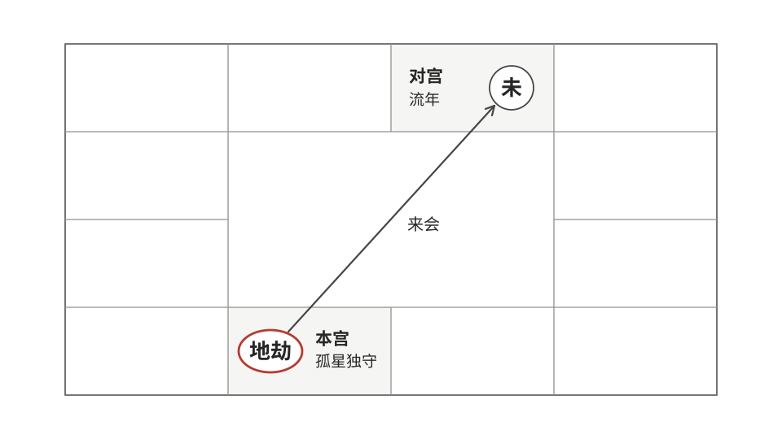 |
| **什么叫对宫也凶？到底凶什么事？** | 〔口述〕「不但本宫凶对宫也凶」，接着自问什么叫对宫也凶（字幕作「区」，按上下文改）。（[00:05:38–00:05:42](https://www.bilibili.com/video/BV1KJsLekEfA/?p=15&t=338)，第 10146–10289 帧） 〔口述〕「比如说你的流年刚好走到这里面」「就对面是一颗孤孤的地劫来会」「就代表那一年是凶」。（[00:05:43–00:05:50](https://www.bilibili.com/video/BV1KJsLekEfA/?p=15&t=343)，第 10290–10529 帧） 〔口述〕「那至于凶到底凶什么事情」「我们看八字来決定」「看他凶什么事情」「这是看命来決定」。（[00:05:51–00:06:00](https://www.bilibili.com/video/BV1KJsLekEfA/?p=15&t=351)，第 10530–10805 帧） 〔板书〕可辨：上排中间格圈起的「未」，左下格圈起的「地劫」，两处之间连着一条斜线；其余认不出。（[00:06:00](https://www.bilibili.com/video/BV1KJsLekEfA/?p=15&t=360)，第 10824 帧） 〔推断〕推断：此时叠图同时贴父母癸丑（地劫）与疾厄丁未（日月），板上圈起的「未」与「地劫」用斜线相连，示范的「对面」应是未宫与丑宫相对；倪师口述没有说出宫名。（[00:05:43–00:06:00](https://www.bilibili.com/video/BV1KJsLekEfA/?p=15&t=343)，第 10290–10824 帧） |
| **大运会到雄宿朝元又逢地劫，要注意什么？** | 〔口述〕「那在进入这个状況的时候」「这个这个大家要特别注意这个这个」：「大运会到雄宿朝元」「还有这个这个地劫星」「这种灾星会到的时候」「特别啊不要忘掉不要」。（[00:06:00–00:06:18](https://www.bilibili.com/video/BV1KJsLekEfA/?p=15&t=360)，第 10806–11351 帧） 〔口述〕「我提这个八字出来就是」「这个地方千万不要忽略掉」——提这张盘出来，就是要大家别忽略地劫这一处。（[00:06:18–00:06:22](https://www.bilibili.com/video/BV1KJsLekEfA/?p=15&t=378)，第 11352–11465 帧） 〔指代〕说「我提这个八字出来就是」「这个地方」时，粉笔点在左下圈住的「地劫」字下方。（[00:06:19](https://www.bilibili.com/video/BV1KJsLekEfA/?p=15&t=379)，第 11370 帧） |
| **武曲逢地劫与地劫独守，轻重有何不同？** | 〔口述〕「因为为什么」「因为你如果武曲星在这里」「你逢个地劫」「这个就没有什么影响影响不大」「大不了破点财而已懂不懂」。（[00:06:22–00:06:30](https://www.bilibili.com/video/BV1KJsLekEfA/?p=15&t=382)，第 11466–11729 帧） 〔口述〕「一颗星在那里」「那就要很严重」「要谨慎小特别要小心这个」。（[00:06:31–00:06:40](https://www.bilibili.com/video/BV1KJsLekEfA/?p=15&t=391)，第 11730–12023 帧） 〔指代〕说「武曲星在这里」时，倪师在左侧中间一格用粉笔写「武」，所指就是这一格。（[00:06:24](https://www.bilibili.com/video/BV1KJsLekEfA/?p=15&t=384)，第 11539 帧） 〔板书〕可辨：左侧中间格「武曲」，右边两字潦草认不全。（[00:06:28](https://www.bilibili.com/video/BV1KJsLekEfA/?p=15&t=388)，第 11664 帧） 〔推断〕推断：轻重之别在地劫有没有同宫的星——与武曲同宫只是破点财，地劫「一颗星在那里」才很严重，正对上前面说的孤星独守是大凶。（[00:06:23–00:06:40](https://www.bilibili.com/video/BV1KJsLekEfA/?p=15&t=383)，第 11496–12023 帧） |
| **紫微在亥时，哪两颗星同会、各化什么？** | 〔口述〕「诸位看紫微星在亥」「再把紫微星下降一下」「紫微星最后一个的时候」「亥宫这个地方」——擦板重画，转讲紫微在亥。（[00:06:40–00:07:10](https://www.bilibili.com/video/BV1KJsLekEfA/?p=15&t=400)，第 12024–12911 帧） 〔板书〕擦板后新画的格子，格内还没写字；左边框外残留几个旧字，认不出。（[00:07:00](https://www.bilibili.com/video/BV1KJsLekEfA/?p=15&t=420)，第 12612 帧） 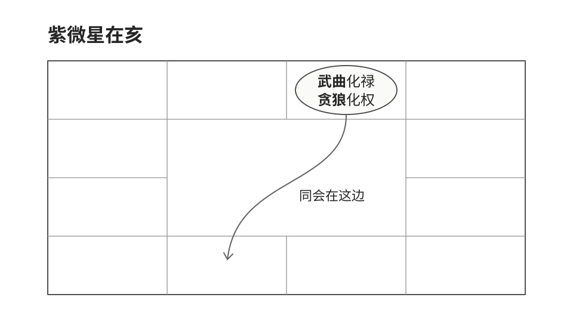 〔口述〕「诸位看上面」「是武曲还有这个贪狼」「这个时候贪狼化权」「武曲化禄」「诸位看这两颗星」「同会在这边」。（[00:07:11–00:07:28](https://www.bilibili.com/video/BV1KJsLekEfA/?p=15&t=431)，第 12942–13457 帧） 〔指代〕说「同会在这边」时，手从上排中间格往下移，停在下排左数第二格（空格，格内无字）点着。（[00:07:27](https://www.bilibili.com/video/BV1KJsLekEfA/?p=15&t=447)，第 13410 帧） 〔板书〕可辨：上排中间格圈起的「武曲」「貪狼」，下面两个小圈里的字认不出；右下格潦草字认不出。（[00:07:32](https://www.bilibili.com/video/BV1KJsLekEfA/?p=15&t=452)，第 13584 帧） |
| **什么叫将星入命？命宫在此算什么格？** | 〔口述〕「紫微星如果在巳宫的时候」「武曲贪狼会在这里……这里」「通通是属于什么」「将星入命」。字幕括号里的丑、未是字幕制作者加注，不是倪师原话。（[00:07:28–00:07:35](https://www.bilibili.com/video/BV1KJsLekEfA/?p=15&t=448)，第 13458–13667 帧） 〔指代〕说第二个「这里」时，手掌按在上排中间格圈起的「武曲 貪狼」上。（[00:07:32](https://www.bilibili.com/video/BV1KJsLekEfA/?p=15&t=452)，第 13560 帧） 〔口述〕「那如果你的命宫在这里」「就要本身应用将星格」——命宫落在武曲贪狼这一格，本身就是将星格（语音这句与字幕有出入，见待核）。（[00:07:35–00:07:39](https://www.bilibili.com/video/BV1KJsLekEfA/?p=15&t=455)，第 13668–13775 帧） 〔指代〕说「那如果你的命宫在这里」时，倪师在圈起武曲贪狼那一格的右下角写下「命」字并点住。（[00:07:37](https://www.bilibili.com/video/BV1KJsLekEfA/?p=15&t=457)，第 13710 帧） |
| **44–53 岁大运走到将星那格，为何最好？** | 〔口述〕「你如果十年大运」「44-53岁走到这里话」「那这个最好正好是什么」「升将的时候」。（[00:07:39–00:07:48](https://www.bilibili.com/video/BV1KJsLekEfA/?p=15&t=459)，第 13776–14051 帧） 〔指代〕说「走到这里」时，粉笔停在武曲贪狼那一格右侧写的「44-53」小框上。（[00:07:42](https://www.bilibili.com/video/BV1KJsLekEfA/?p=15&t=462)，第 13860 帧） 〔板书〕可辨：圈起的「武曲」「貪狼」，其右新加一个小框，框内数字认不全；其余认不出。（[00:07:43](https://www.bilibili.com/video/BV1KJsLekEfA/?p=15&t=463)，第 13893 帧） |
| **为什么有兵灾时升将特别快？** | 〔口述〕「一般来说」「如果没有兵祸」「没有这个革命没有打仗」……「按照部队的系统的话」「都在这个时候才能化将」——太平时按部队系统，要到这个大运才升将。（[00:07:48–00:07:58](https://www.bilibili.com/video/BV1KJsLekEfA/?p=15&t=468)，第 14052–14345 帧） 〔口述〕「还有兵灾出现的话」「前面的将都给干掉了」「你后面一直往上升啊就会很快」，战争时「有人30岁就干少将了」「都会有这种现象」。（[00:07:58–00:08:06](https://www.bilibili.com/video/BV1KJsLekEfA/?p=15&t=478)，第 14346–14603 帧） 〔口述〕「那在这个时候出现是最好的时候」，收住将星入命这一段。（[00:08:06–00:08:13](https://www.bilibili.com/video/BV1KJsLekEfA/?p=15&t=486)，第 14604–14813 帧） |
| **廉贞破军为什么叫水中作冢？** | 〔口述〕「廉贞破军在这里看到没有」「廉贞破军呢」「水中作冢」。（[00:08:13–00:08:24](https://www.bilibili.com/video/BV1KJsLekEfA/?p=15&t=493)，第 14814–15149 帧） 〔口述〕「廉贞破军出现在两个地方」「一个在这里」「一个在这里面」「一个在这里会同时会到」「就是死在水里面了」。字幕括号里的「酉宫」「卯宫」是字幕制作者加注，倪师只说「这里」。（[00:08:25–00:08:39](https://www.bilibili.com/video/BV1KJsLekEfA/?p=15&t=505)，第 15150–15587 帧） 〔指代〕说「廉贞破军在这里」时粉笔点在左列中下那一格（当时空格）；说「一个在这里面」时粉笔点在该格板书「廉贞破军 水中…」上；另一处「这里」是在右列第二格写字，并在那格板书「廉贞破军」旁画圈。（[00:08:14–00:08:34](https://www.bilibili.com/video/BV1KJsLekEfA/?p=15&t=494)，第 14820–15428 帧） 〔叠图〕命宫癸酉：廉贞平（化禄）、破军陷（化权）、文曲庙、天刑庙、天福庙、副截庙、副旬庙；官禄丁卯：廉贞平、破军陷、封诰。（[00:08:39–00:08:40](https://www.bilibili.com/video/BV1KJsLekEfA/?p=15&t=519)，第 15588–15611 帧） 〔板书〕可辨：左列中间格「廉貞」「破軍」「水」「中」，后面两字潦草认不全。（[00:08:28](https://www.bilibili.com/video/BV1KJsLekEfA/?p=15&t=508)，第 15240 帧） |
| **会死在水里的人，鼻子上有什么纹路？** | 〔口述〕「那死在水灾」「我们有几个地方可以看到」「第一」「死在水里面的人呢」——转讲从相上看水死。（[00:08:39–00:08:46](https://www.bilibili.com/video/BV1KJsLekEfA/?p=15&t=519)，第 15588–15785 帧） 〔口述〕「还没有到里面还没死的时候」「看到眼睛看过去」「会死在水里面呢」「鼻头上的纹子这样子的」「我再一路画下来」「这个是水中作冢」。（[00:08:47–00:09:03](https://www.bilibili.com/video/BV1KJsLekEfA/?p=15&t=527)，第 15822–16307 帧） 〔指代〕说「这个是水中作冢」的「这个」时，粉笔停在板上鼻形示意图的鼻头、鼻孔下缘，所指是图形，没有字。（[00:08:59](https://www.bilibili.com/video/BV1KJsLekEfA/?p=15&t=539)，第 16170 帧） 〔板书〕板右侧画了一对眉眼和一个鼻形示意图；右列一格可辨「廉貞」「破軍」，旁有一道弧线。（[00:08:50](https://www.bilibili.com/video/BV1KJsLekEfA/?p=15&t=530)，第 15912 帧） 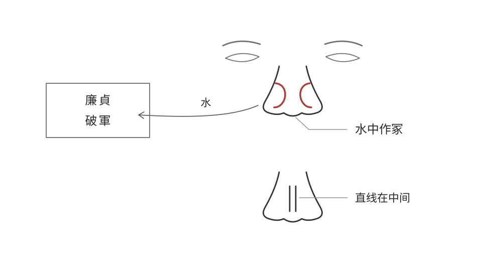 〔板书〕鼻形图两个鼻孔里各有一道弯纹，旁边可辨「水」字，箭头指向「廉貞破軍」那格；下方另画一个鼻形，中间两道直线。（[00:09:10](https://www.bilibili.com/video/BV1KJsLekEfA/?p=15&t=550)，第 16506 帧） |
| **鼻上直纹、横纹各主什么？** | 〔口述〕「还有一种鼻子呢」「一条线的就是直线在中间」，不是前面那种弯的纹。（[00:09:03–00:09:07](https://www.bilibili.com/video/BV1KJsLekEfA/?p=15&t=543)，第 16308–16439 帧） 〔口述〕「直线在中间的时候螟蛉子」「就是说义子的嘛」「收养领养孩子来养」「叫螟蛉子」。（[00:09:13–00:09:23](https://www.bilibili.com/video/BV1KJsLekEfA/?p=15&t=553)，第 16602–16895 帧） 〔板书〕可辨：第二个鼻形图左边写着「螟蛉子」三字（「螟」字潦草）。（[00:09:18](https://www.bilibili.com/video/BV1KJsLekEfA/?p=15&t=558)，第 16749 帧） 〔口述〕「还有一种鼻子呢」「上面是横纹」「不是直纹横纹」「这个就是车祸」「就在这种鼻子上横纹有车祸」。（[00:09:23–00:09:38](https://www.bilibili.com/video/BV1KJsLekEfA/?p=15&t=563)，第 16896–17369 帧） 〔口述〕「这几个是我们鼻子上纹路」「因为讲到这我顺便提醒提醒你」——鼻纹是讲到水中作冢时顺带的提醒。（[00:09:39–00:09:48](https://www.bilibili.com/video/BV1KJsLekEfA/?p=15&t=579)，第 17370–17669 帧） |

**总结区**

- 通用规则：太阳太阴同宫在丑或未会命，叫雄宿朝元（[00:04:59–00:05:14](https://www.bilibili.com/video/BV1KJsLekEfA/?p=15&t=299)，第 8982–9443 帧）；地劫一颗星孤星独守是大凶，本宫凶、对宫也凶，流年走到对面有孤立地劫来会的宫那年就凶，凶什么事看八字、看命决定；地劫与武曲同宫则影响不大、大不了破点财（[00:05:19–00:06:40](https://www.bilibili.com/video/BV1KJsLekEfA/?p=15&t=319)，第 9594–12023 帧）；武曲贪狼同会（贪狼化权、武曲化禄）叫将星入命，命宫在此本身就是将星格；太平时按部队系统到这个大运才升将，有兵灾时升得很快（[00:07:11–00:08:13](https://www.bilibili.com/video/BV1KJsLekEfA/?p=15&t=431)，第 12942–14813 帧）；廉贞破军两处同时会到叫水中作冢、主死在水里；鼻头弯纹看水死，鼻中一道直线主螟蛉子（义子、领养），鼻上横纹主车祸（[00:08:13–00:09:38](https://www.bilibili.com/video/BV1KJsLekEfA/?p=15&t=493)，第 14814–17369 帧）
- 只在本例：紫微在戌的示范盘：叠图地劫陷在父母癸丑、日月在疾厄丁未，板上以斜线连「未」与「地劫」示范对宫（推断）（[00:05:43–00:06:00](https://www.bilibili.com/video/BV1KJsLekEfA/?p=15&t=343)，第 10290–10824 帧）；紫微在亥的示范盘：假设命宫在武曲贪狼那一格，十年大运44-53岁走到这里正是升将的时候（[00:07:35–00:07:48](https://www.bilibili.com/video/BV1KJsLekEfA/?p=15&t=455)，第 13668–14051 帧）；紫微在亥一章的廉贞破军示范：叠图一处在命宫癸酉（廉贞化禄、破军化权），一处在官禄丁卯（[00:08:39–00:08:40](https://www.bilibili.com/video/BV1KJsLekEfA/?p=15&t=519)，第 15588–15611 帧）

**待核**

1. 「民国四十六年」是照念讲稿，所指年份材料没说，不推成谁的生辰（[00:04:16](https://www.bilibili.com/video/BV1KJsLekEfA/?p=15&t=256)，第 7698 帧）
2. 「太阳叉移过来了一点」可信度0.5，语音作「一点太阳和太阴同时会」，原话待核，未引用（[00:04:39](https://www.bilibili.com/video/BV1KJsLekEfA/?p=15&t=279)，第 8394 帧）
3. 「叫日月科禄丑未中」的「科禄」语音作「刻度」，两路对不上，原词待核（[00:05:06](https://www.bilibili.com/video/BV1KJsLekEfA/?p=15&t=306)，第 9180 帧）
4. 「叫目月会命…」按上下文改作日月会命、去掉句尾「…」，「日月同宫啊：」去掉「：」，两句可信度都只有0.3（[00:05:08](https://www.bilibili.com/video/BV1KJsLekEfA/?p=15&t=308)，第 9264 帧、[00:05:09](https://www.bilibili.com/video/BV1KJsLekEfA/?p=15&t=309)，第 9294 帧）
5. 「什么叫对宫也区」的「区」按上下文改作「凶」（[00:05:41](https://www.bilibili.com/video/BV1KJsLekEfA/?p=15&t=341)，第 10248 帧）
6. 叠图同为癸丑：[00:05:06](https://www.bilibili.com/video/BV1KJsLekEfA/?p=15&t=306)，第 9180 帧起贴「疾厄癸丑」（内容与疾厄丁未相同），[00:05:40](https://www.bilibili.com/video/BV1KJsLekEfA/?p=15&t=340)，第 10200 帧起贴「父母癸丑」（地劫），宫名前后不一，是换宫名示意还是叠图有误待核（[00:05:06](https://www.bilibili.com/video/BV1KJsLekEfA/?p=15&t=306)，第 9180 帧、[00:05:38](https://www.bilibili.com/video/BV1KJsLekEfA/?p=15&t=338)，第 10146 帧）
7. 指代看不出或不确定的未作依据：「会在这里面」「这边」「太阳太阴在这边」「这个这个」等（第8473、8580、8610、8730、9150、11040、11070、11119帧）
8. 板书图上可见田宅乙卯（武曲庙、地劫平、华盖平）、命宫乙亥、财帛己巳、官禄丁丑、财帛辛未等叠图，但材料无对应 ▣ 行，未作依据；其中武曲贪狼一格先后标官禄丁丑与财帛辛未，田宅乙卯与父母癸丑岁数串相同，待核（第11664、12612、13584、13893帧）
9. 「紫微星如果在巳宫的时候」：本章讲紫微在亥，此句却说巳宫（语音也作「事工」），所指待核（[00:07:28](https://www.bilibili.com/video/BV1KJsLekEfA/?p=15&t=448)，第 13458 帧）
10. 「就要本身应用将星格」语音作「本身一定是降星格」，「应用」一词待核（[00:07:37](https://www.bilibili.com/video/BV1KJsLekEfA/?p=15&t=457)，第 13716 帧）
11. 「都在这个时候才能化将」语音作「滑降」，「化将」是否即升将待核；「没有跟这个国人打仗的话」语音里没有「国人」（[00:07:56](https://www.bilibili.com/video/BV1KJsLekEfA/?p=15&t=476)，第 14292 帧、[00:07:53](https://www.bilibili.com/video/BV1KJsLekEfA/?p=15&t=473)，第 14190 帧）
12. 「雄宿朝元」「孤星独守」「将星格」本块用了但没解释含义（[00:05:11](https://www.bilibili.com/video/BV1KJsLekEfA/?p=15&t=311)，第 9354 帧、[00:05:25](https://www.bilibili.com/video/BV1KJsLekEfA/?p=15&t=325)，第 9774 帧、[00:07:37](https://www.bilibili.com/video/BV1KJsLekEfA/?p=15&t=457)，第 13716 帧）
13. 「看到眼睛看过去」意思不明；「这就告诉你是谁嘛」语音作「这就告诉你是水了」，原话待核（[00:08:49](https://www.bilibili.com/video/BV1KJsLekEfA/?p=15&t=529)，第 15888 帧、[00:09:11](https://www.bilibili.com/video/BV1KJsLekEfA/?p=15&t=551)，第 16548 帧）
14. 板书认不出的：开头旧板大部分字、紫微在戌板右中格与左下格潦草字、斜线旁一行草书、「武曲」右边两字、武曲贪狼下两个小圈字、44-53小框内数字、「水中」后两字（第7884、8919、9966、11664、13584、13893、15240帧）

## 例一（男命，命宫辛酉太阳天梁）：起盘、三方四正、天人地三才

〔叠图〕这一例视频里只贴过 7 格：财帛 丁巳：太阴陷权、禄存庙、火星得、破碎陷；命宫 辛酉：太阳平、天梁得、咸池平、天喜庙、天德不、天才旺；官禄 乙丑：天魁旺、铃星得、副截不、天空平；迁移 乙卯：天官旺、天寿陷、天福平、红鸾庙；子女 戊午：贪狼旺禄、擎羊陷、天哭陷、天虚平、天贵庙、恩光庙、旬空庙、解神庙；福德 癸亥：天机平忌、天姚陷；田宅 甲子：紫微平、右弼庙科、八座陷、截空陷。

### 3　男命起盘三方四正与天人地三才（[00:09:49–00:16:49](https://www.bilibili.com/video/BV1KJsLekEfA/?p=15&t=589)，第 17670–30287 帧）

| 提示区 | 笔记区 |
|---|---|
| **今天的案例从哪个命开始？没有电脑排盘怎么办？** | 〔口述〕倪师说今天有两个案例，开始讲天文的部分：「那今天有两个」「我们开始介绍案例」。（[00:09:49–00:09:57](https://www.bilibili.com/video/BV1KJsLekEfA/?p=15&t=589)，第 17670–17927 帧） 〔口述〕擦板重写，先看其中的男命；没有电脑排盘的，用手工排也可以：「这个先看我们这个男的」「一样你们如果没有电脑排」「手工排都没有关系」。（[00:10:01–00:10:33](https://www.bilibili.com/video/BV1KJsLekEfA/?p=15&t=601)，第 18054–19001 帧） 〔板书〕本块开头的板面还是上一张示范盘，格中草书大多认不出，不作依据。（[00:09:52](https://www.bilibili.com/video/BV1KJsLekEfA/?p=15&t=592)，第 17784 帧） 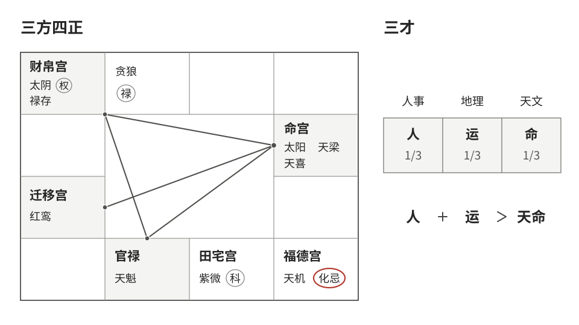 〔板书〕擦板后先画外框（第18660帧只见外框线），接着画好十二宫格子，此时格内还没有写字。（[00:10:33](https://www.bilibili.com/video/BV1KJsLekEfA/?p=15&t=633)，第 18996 帧） |
| **这个男命的命宫、财帛宫各有哪些星？** | 〔口述〕倪师念出男命的命宫主星：「诸位看他的命宫」「太阳天梁」。（[00:10:33–00:10:46](https://www.bilibili.com/video/BV1KJsLekEfA/?p=15&t=633)，第 19002–19409 帧） 〔口述〕财帛宫是太阴，带化权，还有禄存：「财帛宫太阴还有权和禄存」。（[00:10:47–00:10:52](https://www.bilibili.com/video/BV1KJsLekEfA/?p=15&t=647)，第 19410–19589 帧） 〔叠图〕命宫 辛酉：太阳平、天梁得、天喜庙、天才旺、台辅、咸池平、天德不；将军、咸池、天德；胎；大限 3~12。（[00:11:09–00:11:14](https://www.bilibili.com/video/BV1KJsLekEfA/?p=15&t=669)，第 20088–20243 帧） 〔叠图〕财帛 丁巳：太阴陷 化权、禄存庙、火星得、封诰、破碎陷、劫煞、月德；博士、劫煞、小耗；病；大限 83~92。（[00:11:09–00:11:14](https://www.bilibili.com/video/BV1KJsLekEfA/?p=15&t=669)，第 20088–20243 帧） 〔板书〕可辨：左上格「太阴」「禄存」「权」，下方一行似「财帛」；右侧中格「太阳」「天梁」「命」（草书，大致可辨）；其余认不出。（[00:10:58](https://www.bilibili.com/video/BV1KJsLekEfA/?p=15&t=658)，第 19758 帧） |
| **天魁、天喜、红鸾分别写在哪里？** | 〔口述〕倪师说用到的星讲到时就写上去，接着写天魁星：「用到讲到我们就开始就会写到」「天魁星」。本句没说天魁在哪一宫。（[00:10:53–00:11:05](https://www.bilibili.com/video/BV1KJsLekEfA/?p=15&t=653)，第 19590–19961 帧） 〔口述〕命宫有天喜，迁移宫有红鸾：「那命宫呢有天喜」「迁移宫呢有红鸾星」。（[00:11:05–00:11:14](https://www.bilibili.com/video/BV1KJsLekEfA/?p=15&t=665)，第 19962–20243 帧） 〔叠图〕官禄 乙丑：天魁旺、铃星得、副截不、天空平；病符、攀鞍、晦气；冠带；大限 43~52。迁移 乙卯：红鸾庙、天寿陷、天官旺、天福平；伏兵、息神、贯索；帝旺；标「身宫」；大限 63~72。（[00:11:09–00:11:14](https://www.bilibili.com/video/BV1KJsLekEfA/?p=15&t=669)，第 20088–20243 帧） 〔板书〕可辨：下排一格写「天魁」。（[00:10:58](https://www.bilibili.com/video/BV1KJsLekEfA/?p=15&t=658)，第 19758 帧） 〔板书〕可辨：右侧写命宫的格子里添了「天喜」，左侧中格添了「红鸾」（草书，大致可辨）。（[00:11:14](https://www.bilibili.com/video/BV1KJsLekEfA/?p=15&t=674)，第 20220 帧） |
| **为什么举这个例子？这个八字的重点在哪一宫？** | 〔口述〕倪师说这个八字有重点，所以拿来举例：「这个八字的重点呐」「为什么要举这个例子给诸位看」。（[00:11:14–00:11:22](https://www.bilibili.com/video/BV1KJsLekEfA/?p=15&t=674)，第 20244–20465 帧） 〔口述〕他说很多人批八字不会批福德宫：「这个八字有个重点」「所以我说很多人批八字哈」「就是福德宫不会批」。（[00:11:22–00:11:31](https://www.bilibili.com/video/BV1KJsLekEfA/?p=15&t=682)，第 20466–20735 帧） 〔口述〕本例福德宫是天机化忌：「你看他的福德宫」「天机怎么样化忌」。（[00:11:31–00:11:39](https://www.bilibili.com/video/BV1KJsLekEfA/?p=15&t=691)，第 20736–20987 帧） 〔板书〕可辨：右下格先写「福德」（第20645帧），随后同格添上「天机」「化忌」（第21212帧）。（[00:11:47](https://www.bilibili.com/video/BV1KJsLekEfA/?p=15&t=707)，第 21212 帧） 〔叠图〕福德 癸亥：天机平 化忌、天姚陷；飞廉、亡神、病符；长生；大限 23~32。（[00:11:50–00:11:55](https://www.bilibili.com/video/BV1KJsLekEfA/?p=15&t=710)，第 21312–21473 帧） |
| **贪狼化禄在哪？「打红框框」框的是什么？** | 〔口述〕倪师说「这个地方贪狼化禄」。这句字幕连出两次、可信度只有 0.3，语音对不上，当一句看，待核。（[00:11:41–00:11:45](https://www.bilibili.com/video/BV1KJsLekEfA/?p=15&t=701)，第 21042–21167 帧） 〔板书〕可辨：上排一格写「贪狼」，下方写「禄」。（[00:11:47](https://www.bilibili.com/video/BV1KJsLekEfA/?p=15&t=707)，第 21212 帧） 〔叠图〕子女 戊午：贪狼旺 化禄、擎羊陷、恩光庙、天贵庙、解神庙、天厨、旬空庙、天哭陷、天虚平、阴煞；力士、灾煞、岁破；死；大限 93~102。倪师本块没有说贪狼化禄所在是哪一宫。（[00:11:50–00:11:55](https://www.bilibili.com/video/BV1KJsLekEfA/?p=15&t=710)，第 21312–21473 帧） 〔口述〕倪师说要把它打红框框：「这个打红框框」。（[00:11:50–00:11:55](https://www.bilibili.com/video/BV1KJsLekEfA/?p=15&t=710)，第 21312–21473 帧） 〔板书〕可辨：上排那格的「禄」字外面画了红圈。（[00:12:00](https://www.bilibili.com/video/BV1KJsLekEfA/?p=15&t=720)，第 21624 帧） |
| **紫微化科落在哪一宫？** | 〔口述〕倪师边写边说紫微化科在田宅宫：「紫微星化科在这里」「化科在田宅宫」。（[00:11:55–00:12:07](https://www.bilibili.com/video/BV1KJsLekEfA/?p=15&t=715)，第 21474–21833 帧） 〔指代〕说「化科在这里」时，粉笔正点在黑板下排中间偏右那一格的左上角书写，即正在写紫微化科的格子。（[00:11:55–00:11:58](https://www.bilibili.com/video/BV1KJsLekEfA/?p=15&t=715)，第 21474–21557 帧） 〔叠图〕田宅 甲子：紫微平、右弼庙 化科、八座陷、截空陷；喜神、将星、岁建；沐浴；大限 33~42。（[00:11:57–00:12:07](https://www.bilibili.com/video/BV1KJsLekEfA/?p=15&t=717)，第 21510–21821 帧） 〔板书〕可辨：下排那格写「紫微」「科」「田宅」，「科」和右下格的「化忌」外面都画了红圈。（[00:12:14](https://www.bilibili.com/video/BV1KJsLekEfA/?p=15&t=734)，第 22047 帧） |
| **拿到一个八字先做什么？三方四正是哪几宫？** | 〔口述〕拿到八字先把三方四正画起来：「我们拿到八字的时候」「我们先把它三方四正；画起来」「这叫做三方四正」。（[00:12:11–00:12:20](https://www.bilibili.com/video/BV1KJsLekEfA/?p=15&t=731)，第 21930–22205 帧） 〔口述〕倪师说拿到八字不要紧张，先看三方四正，并逐一点出：「你拿到八字不要紧张」「诸位我们先看他三方四正」「这个叫命宫」「这叫财帛」「这叫做官禄」「这叫做迁移」。（[00:12:23–00:12:38](https://www.bilibili.com/video/BV1KJsLekEfA/?p=15&t=743)，第 22308–22757 帧） 〔板书〕可辨：从右侧写命宫的格子拉出几条直线，分别连到左上「财帛」格、下排「天魁」格和左侧中格。（[00:12:14](https://www.bilibili.com/video/BV1KJsLekEfA/?p=15&t=734)，第 22047 帧） 〔板书〕可辨：左侧中格写「迁移」并画了圈；下排天魁那格添写「官禄」；左上格的「财帛」也在。（[00:13:29](https://www.bilibili.com/video/BV1KJsLekEfA/?p=15&t=809)，第 24276 帧） 〔口述〕倪师说本例「迁移宫是空的」。「空」具体指什么，本块没有解释。（[00:12:38–00:12:42](https://www.bilibili.com/video/BV1KJsLekEfA/?p=15&t=758)，第 22758–22889 帧） |
| **命、运、人事各占几分？天人地三才怎么对应？** | 〔口述〕算命时命只占三分之一，这是上看天文：「我们在算命的时候」「命只有1/3」「这是上看天文」。（[00:12:43–00:12:57](https://www.bilibili.com/video/BV1KJsLekEfA/?p=15&t=763)，第 22890–23321 帧） 〔口述〕运又占三分之一，叫下看地理：「运的时候又占了1/3」「这叫做下看地理」。（[00:12:57–00:13:03](https://www.bilibili.com/video/BV1KJsLekEfA/?p=15&t=777)，第 23322–23519 帧） 〔口述〕人事再占三分之一，这叫人：「人事的部分呢」「又占了1/3」「这叫作人」。（[00:13:05–00:13:09](https://www.bilibili.com/video/BV1KJsLekEfA/?p=15&t=785)，第 23574–23693 帧） 〔口述〕合起来是天文、地理、人事，即三才：「天文地理中知人事」「所以天人地是三才」。（[00:13:09–00:13:14](https://www.bilibili.com/video/BV1KJsLekEfA/?p=15&t=789)，第 23694–23849 帧） 〔板书〕可辨：板中间写了「运」「地理」「人」，另一栏似「天」「命」；其余（含一个圈起的字）认不出。（[00:13:08](https://www.bilibili.com/video/BV1KJsLekEfA/?p=15&t=788)，第 23657 帧） |
| **人能控制哪两样？为什么能大于天命？** | 〔口述〕人能控制的是人和运，也就是人间道加上地理位置，两者加起来大于天命：「那我们能控制的是人还有运」「人间道还有地理位置」「加起来就会大于天命」。（[00:13:16–00:13:26](https://www.bilibili.com/video/BV1KJsLekEfA/?p=15&t=796)，第 23898–24185 帧） 〔口述〕倪师指着板书说「这就是大于符号」。（[00:13:26–00:13:30](https://www.bilibili.com/video/BV1KJsLekEfA/?p=15&t=806)，第 24186–24311 帧） 〔板书〕可辨：中间三栏有「运」「地理」、「人」「人事」，另有一栏似「天」「命」，「运」「人」两字画了圈；上方一行夹着加号样和像「>」的符号，字认不全。（[00:13:29](https://www.bilibili.com/video/BV1KJsLekEfA/?p=15&t=809)，第 24276 帧） 〔口述〕天和地中间是人，人是万物之灵，所以人道在正中间：「真正的天人地三才」「天和地中间」「人是万物之灵」「所以人道在正中间」。（[00:13:31–00:13:38](https://www.bilibili.com/video/BV1KJsLekEfA/?p=15&t=811)，第 24348–24557 帧） |
| **人间道包括什么？学算命的目的是什么？** | 〔口述〕我们掌握的人间道，就是易经原理、地理位置的运用、卦的变换：「那我们掌握的人间道」「就是我教你们讲易经的原理」「然后地理位置它的运用」「它的卦的变换」「易经的演绎」。（[00:13:38–00:13:48](https://www.bilibili.com/video/BV1KJsLekEfA/?p=15&t=818)，第 24558–24857 帧） 〔口述〕这样算命就成了工具，事先知道会发生什么、事先预防：「变成一个工具」「让我们事先就知道事情发生什么」「我们事先去预防」「这就是我们要学研究算命的目的」。（[00:13:50–00:14:01](https://www.bilibili.com/video/BV1KJsLekEfA/?p=15&t=830)，第 24906–25247 帧） 〔口述〕倪师强调这是正统的东西：「这是正统的中国老祖宗的东西」（字幕连出两次，当一句看）。（[00:14:05–00:14:08](https://www.bilibili.com/video/BV1KJsLekEfA/?p=15&t=845)，第 25356–25463 帧） |
| **外面的算命缺在哪？真正要解靠什么？** | 〔口述〕外面算命只算那三分之一，不管哪一派：「都是在算命只有1/3」「不管你是铁板神数紫微斗数」「外面子平法也好」。（[00:14:08–00:14:21](https://www.bilibili.com/video/BV1KJsLekEfA/?p=15&t=848)，第 25464–25841 帧） 〔口述〕只算命的话，同时间生的人都一样，算出来也不能解：「算到半天同时间生人都一样」「就完蛋了」「然后算出来不能解没有功能」。（[00:14:21–00:14:25](https://www.bilibili.com/video/BV1KJsLekEfA/?p=15&t=861)，第 25842–25967 帧） 〔口述〕真正解的时候要靠地理位置加人事：「我们要靠地理位置」「跟人事加起来才能大于2/3」，紧接着又说「才会大于1/3」，两数前后不一致，照原字记，待核。（[00:14:25–00:14:32](https://www.bilibili.com/video/BV1KJsLekEfA/?p=15&t=865)，第 25968–26165 帧） |
| **为什么天文地理人事都熟的人一定懂医？** | 〔口述〕把天文、地理、人事练得娴熟的人，一定精于医理：「能够把天文地理人事」「练的非常娴熟的人哈」「精于医理的」「一定懂医的」。（[00:14:33–00:14:46](https://www.bilibili.com/video/BV1KJsLekEfA/?p=15&t=873)，第 26190–26591 帧） 〔板书〕可辨：右侧一栏首字似「精」，其余认不出（手可能挡住）。（[00:14:46](https://www.bilibili.com/video/BV1KJsLekEfA/?p=15&t=886)，第 26580 帧） 〔口述〕举例：算出客人有心脏病，客人说真有；地理上叫他别住厕所在房子中间的房子，他家真是这样，于是换掉：「哎呀先生你有心脏病」「房子中间是厕所的房子」「真的厕所在房子中间」「他换掉」。（[00:14:49–00:14:59](https://www.bilibili.com/video/BV1KJsLekEfA/?p=15&t=889)，第 26670–26975 帧） 〔口述〕只靠地理和命，是三分之一对三分之一在拼；要靠医学技术把心脏病治好，这是医理：「地理和命在拼的时候是1/3跟1/3在拼啊」「如果医学上的技术把心脏病治好」「这是医理」。（[00:15:01–00:15:12](https://www.bilibili.com/video/BV1KJsLekEfA/?p=15&t=901)，第 27030–27365 帧） 〔口述〕否则人间道讲完，客人还是带着心脏病出去，因为来之前已经有病：「讲完你还是心脏病出去啊」「因为你已经到遇到我们之前」「就已经有病」。（[00:15:13–00:15:19](https://www.bilibili.com/video/BV1KJsLekEfA/?p=15&t=913)，第 27402–27599 帧） |
| **进入人间道的人会怎样？没病和有病各怎么办？** | 〔口述〕进入人间道、把人世间事看清楚，就会愉快、平常心，没有喜怒忧思悲恐，不受环境影响，所以不会有病：「你是平常心」「你没有喜怒忧思悲恐」「你不会被所谓的环境所影响」「所以你不会有病」。（[00:15:22–00:15:37](https://www.bilibili.com/video/BV1KJsLekEfA/?p=15&t=922)，第 27684–28121 帧） 〔口述〕还没得病时先预防，再配合地理位置，形成良性循环：「那刚开始还没得病的时候」「然后要地理位置」「那就需要良性循环起来」。（[00:15:39–00:15:46](https://www.bilibili.com/video/BV1KJsLekEfA/?p=15&t=939)，第 28170–28385 帧） 〔口述〕已经有病就要靠医学技术，若再精通医理，就没有解决不了的问题；这是中国人过去讲的天人地三才：「但是已经有病怎么办」「我们要靠医学的技术」「这是中国人的过去天人地三才」。（[00:15:46–00:15:57](https://www.bilibili.com/video/BV1KJsLekEfA/?p=15&t=946)，第 28386–28733 帧） |
| **人间道为什么不算迷信？倪师对画符、鱼缸风铃怎么说？** | 〔口述〕正式批时会从天文讲到地理、再讲到人事；地理位置可以自己选，人事上的人间道也可控：「我们就会从天文讲到地理」「讲到人事」「地理位置我们可以控制」「我住西北我住西南」「还有人事上的人间道」。（[00:16:01–00:16:13](https://www.bilibili.com/video/BV1KJsLekEfA/?p=15&t=961)，第 28836–29213 帧） 〔口述〕这些都看得到、摸得到，是老祖宗传下来的，人间道完全根据易经，不牵涉迷信：「看得到摸得到的东西」「人间道完全根据易经来的」「所以中间不牵涉任何一点的迷信」。（[00:16:15–00:16:26](https://www.bilibili.com/video/BV1KJsLekEfA/?p=15&t=975)，第 29250–29585 帧） 〔口述〕倪师郑重呼吁别再画符念咒、买鱼缸风铃玉，被他碰到会当场骂：「所以我在这里要慎重的呼吁」「你再给我画符念咒」「买鱼缸买风铃买块玉啊」「就不要不要给我碰到当场骂了」。（[00:16:26–00:16:34](https://www.bilibili.com/video/BV1KJsLekEfA/?p=15&t=986)，第 29586–29831 帧） 〔口述〕他说若觉得骂得不对，那是嫌他刚直，难道喜欢小人；这些道理很合理，世界上的知识分子都能接受：「那你就觉得是我们比较刚直的人」「那你喜欢小人嘛」「这个都是很合理的」「不要说台湾大家都能够接受」。（[00:16:37–00:16:49](https://www.bilibili.com/video/BV1KJsLekEfA/?p=15&t=997)，第 29922–30287 帧） |

**总结区**

- 通用规则：拿到八字先画三方四正，即命宫、财帛、官禄、迁移，再往下批（[00:12:11–00:12:38](https://www.bilibili.com/video/BV1KJsLekEfA/?p=15&t=731)，第 21930–22757 帧）。；命占三分之一（上看天文）、运占三分之一（下看地理）、人事占三分之一，合为天人地三才；人间道加地理位置大于天命（[00:12:43–00:13:26](https://www.bilibili.com/video/BV1KJsLekEfA/?p=15&t=763)，第 22890–24185 帧）。；外面算命只算三分之一，同时间生人都一样、算出来不能解；解要靠地理位置加人事（[00:14:08–00:14:32](https://www.bilibili.com/video/BV1KJsLekEfA/?p=15&t=848)，第 25464–26165 帧）。；已经有病要靠医学技术，所以把天文地理人事练熟的人一定懂医（[00:14:33–00:15:57](https://www.bilibili.com/video/BV1KJsLekEfA/?p=15&t=873)，第 26190–28733 帧）。
- 只在本例：本例男命（命宫辛酉）命宫太阳天梁、天喜，财帛宫太阴化权与禄存，迁移宫红鸾（[00:10:33–00:11:14](https://www.bilibili.com/video/BV1KJsLekEfA/?p=15&t=633)，第 19002–20243 帧）。；这个八字的重点在福德宫，天机化忌（[00:11:14–00:11:39](https://www.bilibili.com/video/BV1KJsLekEfA/?p=15&t=674)，第 20244–20987 帧）。；本例贪狼化禄（原话待核）、紫微化科在田宅宫，两处与化忌都打红圈（[00:11:41–00:12:07](https://www.bilibili.com/video/BV1KJsLekEfA/?p=15&t=701)，第 21042–21833 帧）。；本例迁移宫是空的（[00:12:38–00:12:42](https://www.bilibili.com/video/BV1KJsLekEfA/?p=15&t=758)，第 22758–22889 帧）。
- 不是排盘规则，是处世方法：算命是事先知道、事先预防的工具，这是学算命的目的（[00:13:50–00:14:01](https://www.bilibili.com/video/BV1KJsLekEfA/?p=15&t=830)，第 24906–25247 帧）。；进入人间道、看清人世间事，保持平常心、不受环境影响，就不会有病（[00:15:22–00:15:37](https://www.bilibili.com/video/BV1KJsLekEfA/?p=15&t=922)，第 27684–28121 帧）。；不要画符念咒、买鱼缸风铃玉，倪师碰到会当场骂（[00:16:26–00:16:34](https://www.bilibili.com/video/BV1KJsLekEfA/?p=15&t=986)，第 29586–29831 帧）。

**待核**

1. [00:11:41–00:11:45](https://www.bilibili.com/video/BV1KJsLekEfA/?p=15&t=701)，第 21042–21167 帧：「这个地方贪狼化禄」两句可信度只有 0.3，语音为「围呢周围呢画路」「好我们尽量」，对不上，当一句看。
2. [00:12:20](https://www.bilibili.com/video/BV1KJsLekEfA/?p=15&t=740)，第 22206 帧：字幕「贯索」，语音为「批个八字的」，两路对不上；倪师没有解释，叠图迁移乙卯格列有「贯索」，是否同一回事待核。
3. [00:12:38](https://www.bilibili.com/video/BV1KJsLekEfA/?p=15&t=758)，第 22758 帧：「迁移宫是空的」，「空」指什么本块没讲；叠图迁移乙卯格列有红鸾、天寿、天官、天福等。
4. [00:14:27–00:14:32](https://www.bilibili.com/video/BV1KJsLekEfA/?p=15&t=867)，第 26028–26165 帧：字幕先说「才能大于2/3」，紧接着「才会大于1/3」，前后不一致；语音两处都是「三分之二」，照原字记，不替倪师改。
5. [00:11:50–00:11:55](https://www.bilibili.com/video/BV1KJsLekEfA/?p=15&t=710)，第 21312–21473 帧：贪狼化禄所在格叠图标为「子女 戊午」，倪师本块没说是哪一宫。
6. [00:12:12](https://www.bilibili.com/video/BV1KJsLekEfA/?p=15&t=732)，第 21960 帧：叠图官禄乙丑转写有□缺字，大限数字以[00:10:58](https://www.bilibili.com/video/BV1KJsLekEfA/?p=15&t=658)，第 19758 帧原图「43~52」为准。
7. [00:16:09](https://www.bilibili.com/video/BV1KJsLekEfA/?p=15&t=969)，第 29088 帧：字幕「今天我不住东宫」，语音为「住中国」，原话待核。
8. [00:15:40](https://www.bilibili.com/video/BV1KJsLekEfA/?p=15&t=940)，第 28212 帧：字幕「就预防你感染伤寒生病了」，语音为「一番生病了」，「伤寒」两字待核；句尾「［令」是识别噪声已略去。
9. [00:09:52](https://www.bilibili.com/video/BV1KJsLekEfA/?p=15&t=592)，第 17784 帧：本块开头板面是上一张盘，格中草书认不出。
10. [00:10:39](https://www.bilibili.com/video/BV1KJsLekEfA/?p=15&t=639)，第 19192 帧：右侧中格的粉笔字被身体挡住，认不出。
11. 第23657、24276帧：三才板书上方一行的符号与字、以及一个圈起的字认不出；「大于符号」只看到像「>」的笔画，不确定。
12. [00:14:46](https://www.bilibili.com/video/BV1KJsLekEfA/?p=15&t=886)，第 26580 帧：右栏只认得首字似「精」，其余认不出。
13. 第18030、18075、20220、20316、20468、21450、21484、21630、22500、29130、29570帧：指代题为否、看不出或不确定，未作依据。
14. 第23886、24798、26652、28650帧：「冬热」「彭卵瑟」「侣真曾米」「④兌」为识别噪声，已略过。

## 例一续：带丧来算、权禄相逢、福德化忌、合伙必败、以果决行

〔叠图〕这一例视频里只贴过 7 格：命宫 辛酉：太阳平、天梁得、咸池平、天喜庙、天德不、天才旺；交友 甲寅：破军得、左辅庙、天马旺、地劫平、三台平、天伤平、孤辰平；夫妻 己未：天同不、巨门不、文昌利、文曲旺、天钺旺、天刑陷、副旬陷、大耗平；财帛 丁巳：太阴陷权、禄存庙、火星得、破碎陷；迁移 乙卯：天官旺、天寿陷、天福平、红鸾庙；子女 戊午：贪狼旺禄、擎羊陷、天哭陷、天虚平、天贵庙、恩光庙、旬空庙、解神庙；福德 癸亥：天机平忌、天姚陷。

### 4　带丧来算、福德化忌与权禄日月反背（[00:16:49–00:21:51](https://www.bilibili.com/video/BV1KJsLekEfA/?p=15&t=1009)，第 30288–39359 帧）

| 提示区 | 笔记区 |
|---|---|
| **这个男命是谁拿来算的？出生和来算是哪年？** | 〔口述〕倪师说开始批这张盘，「一边批一边再跟诸位讲」；「我今天拿这个举例」，这个人「到我面前人死了来的」。（[00:16:51–00:16:58](https://www.bilibili.com/video/BV1KJsLekEfA/?p=15&t=1011)，第 30354–30545 帧） 〔口述〕倪师交代生年和来算的时间：「这个人是37年出世的」，「民国80年……来算这男的」；又说「进来的时候我还没有看八字哦」。（[00:17:02–00:17:13](https://www.bilibili.com/video/BV1KJsLekEfA/?p=15&t=1022)，第 30684–31013 帧） 〔板书〕这段写完后的板面上可辨：「37」，其余新写的字认不出（右缘被切掉一部分）。（[00:17:11](https://www.bilibili.com/video/BV1KJsLekEfA/?p=15&t=1031)，第 30931 帧） |
| **印堂什么样的白，一看就知道来人带丧？** | 〔口述〕来的不是本人，「他当然不是他本人来啊」「太太来啊」；倪师「一看她的脸」，「脸印堂是白色的」。（[00:17:15–00:17:23](https://www.bilibili.com/video/BV1KJsLekEfA/?p=15&t=1035)，第 31056–31313 帧） 〔口述〕不是润白而是枯白；倪师提醒「你不要女孩子脸色白就完蛋了」。「什么叫做枯白」：「那白黯淡无光」，「那颜色好像牙膏一样」，好比「你把牙膏挤出来放很久」、亮的没了，又像牙膏跟泥巴和在一起「掺着一点杂质下去」。（[00:17:23–00:17:50](https://www.bilibili.com/video/BV1KJsLekEfA/?p=15&t=1043)，第 31314–32105 帧） 〔口述〕「整个面色白色暗惨暗惨暗的」，「我们就知道这个人带丧」。她穿衣服把戴孝的遮起来也没用，脸上「看见就写了我在带丧」，「所以你不用去遮外形」，倪师「一看我心里面就已经有数了」。（[00:17:50–00:18:09](https://www.bilibili.com/video/BV1KJsLekEfA/?p=15&t=1070)，第 32106–32675 帧） 〔板书〕后来的板面左侧可辨：「枯」和圈起来的「白」，旁边和下方的字认不出。（[00:20:02](https://www.bilibili.com/video/BV1KJsLekEfA/?p=15&t=1202)，第 36074 帧） 〔板书〕这段写字刚完时（第31539帧）左侧板面被讲者头部挡住，新写的字认不出。（[00:17:31](https://www.bilibili.com/video/BV1KJsLekEfA/?p=15&t=1051)，第 31539 帧） |
| **福德宫化忌，主一世怎样？** | 〔口述〕看完面相，「再一看她先生的八字」：「福德宫化忌」。倪师说「福德宫主一世的福禄」，「化忌的时候就是一世都不顺很累」。（[00:18:09–00:18:27](https://www.bilibili.com/video/BV1KJsLekEfA/?p=15&t=1089)，第 32676–33215 帧） 〔口述〕讲完算命的化解之后又回到盘上：「这你不要看其他的」，「光这一个进来化忌就很累了」，就已经很累了。（[00:19:43–00:19:49](https://www.bilibili.com/video/BV1KJsLekEfA/?p=15&t=1183)，第 35490–35687 帧） 〔推断〕推断：「光这一个进来化忌」应是回指前面说的福德宫化忌；材料里这句没明说是哪个化忌，本块也没有贴福德宫的叠图。（[00:19:44–00:19:47](https://www.bilibili.com/video/BV1KJsLekEfA/?p=15&t=1184)，第 35532–35627 帧） |
| **光算命、不讲人和地，叫人去当和尚化解，错在哪？** | 〔口述〕「那如果过去我们算命没有人和地」，就会叫这位先生「去当和尚」，「入僧庙入真道」，「可能可以化解」；倪师说「懂不懂这是算命的讲法了」。（[00:18:27–00:18:45](https://www.bilibili.com/video/BV1KJsLekEfA/?p=15&t=1107)，第 33216–33755 帧） 〔口述〕光是算命，叫他好好去当和尚、一辈子愉快，「就可以逃过这个生死大限」——倪师评：「讲完这句话叫做废话」。（[00:18:45–00:18:57](https://www.bilibili.com/video/BV1KJsLekEfA/?p=15&t=1125)，第 33756–34121 帧） |
| **外面算命对二婚命开的化解，为什么不行？** | 〔口述〕「所以外面算命哦」「他的毛病很大」：说先生婚姻有问题、「你会二婚命」，问怎么办就答「你晚点结婚就好了嘛」；问「那几岁结婚」，答「42岁」——「开玩笑我做不到」。（[00:18:57–00:19:12](https://www.bilibili.com/video/BV1KJsLekEfA/?p=15&t=1137)，第 34122–34565 帧） 〔口述〕倪师说「你今天是男的还好」「女的呢对不对」；对女命则说「很简单啊你嫁个男孩子」「离过婚的有孩子的」「你嫁给他就好了」——「所以话很好讲啊」「人家要不要啊对不对」。（[00:19:12–00:19:37](https://www.bilibili.com/video/BV1KJsLekEfA/?p=15&t=1152)，第 34566–35315 帧） 〔口述〕总评：「所以外面很多算命提出来」「算命的方法都不能化解」「讲出来是消极的」；这种命「如果我们光算命就是做僧道了」。（[00:19:15–00:19:42](https://www.bilibili.com/video/BV1KJsLekEfA/?p=15&t=1155)，第 34656–35489 帧） |
| **财帛宫化权遇禄存叫什么格？主做什么？** | 〔口述〕倪师开始逐宫批：第一个看财帛宫化权和禄存在一起，「这叫做权禄相逢」；「权禄相逢的人呢」，「他一定会去财帛」，「一定会做事业当老板」。（[00:19:49–00:20:09](https://www.bilibili.com/video/BV1KJsLekEfA/?p=15&t=1189)，第 35688–36287 帧） 〔叠图〕财帛丁巳：太阴陷、化权，禄存庙，火星得，封诰，破碎陷，劫煞，月德；博士、劫煞、小耗；病；小限 8,20,32,44,56,68，大限 83~92。（[00:19:52–00:19:56](https://www.bilibili.com/video/BV1KJsLekEfA/?p=15&t=1192)，第 35760–35903 帧） 〔板书〕板面中间一格可辨：「太阴」和圈起来的「财帛」，「太阴」下方的字和红圈里的字认不出。（[00:20:02](https://www.bilibili.com/video/BV1KJsLekEfA/?p=15&t=1202)，第 36074 帧） 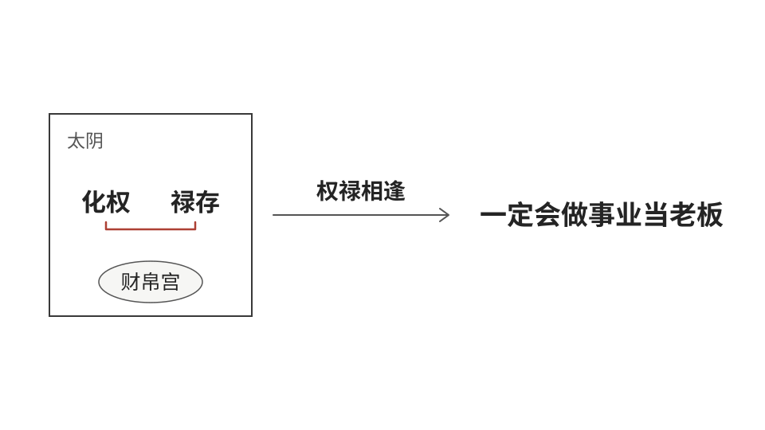 |
| **身宫在迁移，生意会往哪里发展？** | 〔口述〕「身在迁移」，「身宫是后天发展」；所以他不但会做生意当老板，「而且他生意会发展到外地去」「发展到海外去」。（[00:20:09–00:20:22](https://www.bilibili.com/video/BV1KJsLekEfA/?p=15&t=1209)，第 36288–36677 帧） 〔叠图〕迁移乙卯，标「身宫」：红鸾庙，天寿陷，天官旺，天福平；伏兵、息神、贯索；帝旺；小限 6,18,30,42,54,66，大限 63~72。（[00:20:09–00:20:12](https://www.bilibili.com/video/BV1KJsLekEfA/?p=15&t=1209)，第 36288–36383 帧） 〔板书〕这段写完后的板面上，新写的字认不出。（[00:20:13](https://www.bilibili.com/video/BV1KJsLekEfA/?p=15&t=1213)，第 36395 帧） 〔口述〕本块末尾批完官禄的话题后，倪师又说「那他常常出外去外地」，此时叠图再贴迁移乙卯。（[00:21:47–00:21:51](https://www.bilibili.com/video/BV1KJsLekEfA/?p=15&t=1307)，第 39228–39359 帧） |
| **日月反背格怎么成？主生意和夫妻怎样？** | 〔口述〕「然后这个人呢太阳在酉时下山了」，「太阴在巳时出来」，这叫「日月反背格」。（[00:20:22–00:20:31](https://www.bilibili.com/video/BV1KJsLekEfA/?p=15&t=1222)，第 36678–36959 帧） 〔叠图〕命宫辛酉：太阳平，天梁得，天喜庙，天才旺，台辅，咸池，天德；将军；胎；小限 12,24,36,48,60,72，大限 3~12。同时仍贴着财帛丁巳（太阴陷、化权）。（[00:20:28–00:20:29](https://www.bilibili.com/video/BV1KJsLekEfA/?p=15&t=1228)，第 36840–36887 帧） 〔推断〕推断：叠图太阳在命宫酉、太阴在财帛巳，正对上口述「太阳在酉」「太阴在巳」。（[00:20:22–00:20:29](https://www.bilibili.com/video/BV1KJsLekEfA/?p=15&t=1222)，第 36678–36887 帧） 〔口述〕「所以他的生意做的时候」，「一定是白天忙了晚上还要忙」，「加倍的辛苦」。（[00:20:32–00:20:37](https://www.bilibili.com/video/BV1KJsLekEfA/?p=15&t=1232)，第 36960–37133 帧） 〔口述〕规则：「一般所有的日月反背格」「主的都是夫妻聚少散多」，倪师说谁都是一样。（[00:20:37–00:20:51](https://www.bilibili.com/video/BV1KJsLekEfA/?p=15&t=1237)，第 37134–37547 帧） |
| **看他会不会做生意，该看流年还是看格？** | 〔口述〕讲到子女宫时倪师说：「他既然是一定会去做生意」，「你不要看他流年」，「你看他的格你就知道」，「他权禄在这边会做生意」。（[00:20:51–00:21:02](https://www.bilibili.com/video/BV1KJsLekEfA/?p=15&t=1251)，第 37548–37871 帧） 〔叠图〕子女戊午：贪狼旺、化禄，擎羊陷，恩光庙，天贵庙，解神庙，旬空庙，天厨，天哭陷，天虚平，阴煞；力士、灾煞、岁破；死；小限 9,21,33,45,57,69，大限 93~102。（[00:20:53–00:20:57](https://www.bilibili.com/video/BV1KJsLekEfA/?p=15&t=1253)，第 37590–37721 帧） 〔板书〕板面上可辨红圈里的「禄」，它下方新写的字认不出。（[00:21:00](https://www.bilibili.com/video/BV1KJsLekEfA/?p=15&t=1260)，第 37812 帧） |
| **没有官带、已经44岁，批命时该怎么说？** | 〔口述〕这个人只有做生意这条路，「你就你就不要去跟他说」「如果你当官会怎么样」，「他根本没有那条路嘛」，「你就那条路」。（[00:21:02–00:21:11](https://www.bilibili.com/video/BV1KJsLekEfA/?p=15&t=1262)，第 37872–38147 帧） 〔口述〕讲完了他还说「那我不做生意我去当官好了」，「这个话讲不通了」：「哎我帮他算的时候已经44岁了」，「还如果去当公务员」，「你就这个话就不要讲了」。（[00:21:11–00:21:26](https://www.bilibili.com/video/BV1KJsLekEfA/?p=15&t=1271)，第 38148–38603 帧） 〔口述〕批的时候就直说：「批的时候说先生您没有官带」。（[00:21:26–00:21:31](https://www.bilibili.com/video/BV1KJsLekEfA/?p=15&t=1286)，第 38604–38753 帧） 〔板书〕这段写完后的板面上，新写的字认不出。（[00:21:21](https://www.bilibili.com/video/BV1KJsLekEfA/?p=15&t=1281)，第 38432 帧） |
| **批八字只写一个「死」字，紫微为何不这样批？** | 〔口述〕倪师说「如果我们批八字这样子啊」，「而他这个八字一拿出来」，「我说他太太来拿给我」，「我说我就写一个字死啊」，就写完了，「写了别的还写错了嘛」。（[00:21:33–00:21:42](https://www.bilibili.com/video/BV1KJsLekEfA/?p=15&t=1293)，第 38790–39071 帧） 〔指代〕说「而他这个八字」时，手指的是黑板上圈起来的「运」下方的「地」字（地理）。（[00:21:34](https://www.bilibili.com/video/BV1KJsLekEfA/?p=15&t=1294)，第 38840 帧） 〔口述〕「可是我们在批的时候」，「如果我们今天没有这个大限」，「我们批的时候是按照这个批」。（[00:21:42–00:21:46](https://www.bilibili.com/video/BV1KJsLekEfA/?p=15&t=1302)，第 39072–39197 帧） 〔板书〕板面右上角有一个圈起来的字，认不出；字幕说写了「死」，画面上不能确认。（[00:21:38](https://www.bilibili.com/video/BV1KJsLekEfA/?p=15&t=1298)，第 38968 帧） |

**总结区**

- 通用规则：印堂白得黯淡无光、像放久掺了杂质的牙膏，是枯白不是润白，看了就知道来人带丧（[00:17:19–00:17:55](https://www.bilibili.com/video/BV1KJsLekEfA/?p=15&t=1039)，第 31194–32279 帧）；福德宫主一世的福禄，化忌时一世都不顺很累（[00:18:10–00:18:27](https://www.bilibili.com/video/BV1KJsLekEfA/?p=15&t=1090)，第 32706–33215 帧）；财帛宫化权与禄存在一起叫权禄相逢，这种人一定会做事业当老板（[00:19:52–00:20:09](https://www.bilibili.com/video/BV1KJsLekEfA/?p=15&t=1192)，第 35760–36287 帧）；所有日月反背格都主夫妻聚少散多（[00:20:37–00:20:51](https://www.bilibili.com/video/BV1KJsLekEfA/?p=15&t=1237)，第 37134–37547 帧）
- 只在本例：这个男命37年出世，民国80年来算时人已死，是太太拿八字来的（[00:16:55–00:17:11](https://www.bilibili.com/video/BV1KJsLekEfA/?p=15&t=1015)，第 30456–30947 帧）；他福德宫化忌，一世不顺很累（[00:18:09–00:18:27](https://www.bilibili.com/video/BV1KJsLekEfA/?p=15&t=1089)，第 32676–33215 帧）；财帛丁巳权禄相逢、身宫在迁移乙卯，做生意当老板并发展到外地海外（[00:19:52–00:20:22](https://www.bilibili.com/video/BV1KJsLekEfA/?p=15&t=1192)，第 35760–36677 帧）；太阳在命宫酉、太阴在财帛巳成日月反背，白天忙了晚上还要忙；算时已44岁、没有官带（[00:20:22–00:21:31](https://www.bilibili.com/video/BV1KJsLekEfA/?p=15&t=1222)，第 36678–38753 帧）
- 不是排盘规则，是处世方法：光算命不讲人和地，叫人去当和尚、晚婚或嫁离过婚的来化解，都是消极的废话（[00:18:27–00:19:42](https://www.bilibili.com/video/BV1KJsLekEfA/?p=15&t=1107)，第 33216–35489 帧）；批命顺着格局说，没有当官那条路就别跟他讲当官，直接说没有官带（[00:21:02–00:21:31](https://www.bilibili.com/video/BV1KJsLekEfA/?p=15&t=1262)，第 37872–38753 帧）

**待核**

1. [00:16:55](https://www.bilibili.com/video/BV1KJsLekEfA/?p=15&t=1015)，第 30450 帧 字幕「倒热人羽真维」是识别噪声，已略过。
2. [00:17:13](https://www.bilibili.com/video/BV1KJsLekEfA/?p=15&t=1033)，第 31014 帧 字幕「我在那个print（打印）」与语音对不上，已略过；括号「（打印）」是字幕制作者加注。
3. [00:17:02–00:17:11](https://www.bilibili.com/video/BV1KJsLekEfA/?p=15&t=1022)，第 30684–30947 帧、[00:21:21](https://www.bilibili.com/video/BV1KJsLekEfA/?p=15&t=1281)，第 38448 帧 字幕里「（1948）」「（1991）」「（3）」是字幕制作者加注，语音里没有，未当原话引用。
4. [00:17:23](https://www.bilibili.com/video/BV1KJsLekEfA/?p=15&t=1043)，第 31314 帧「这个自不是润白」、[00:17:26](https://www.bilibili.com/video/BV1KJsLekEfA/?p=15&t=1046)，第 31404 帧「不是润自而是枯白」、[00:17:38](https://www.bilibili.com/video/BV1KJsLekEfA/?p=15&t=1058)，第 31758 帧「变成自白的」中的「自」按上下文改作「白」。
5. [00:17:57](https://www.bilibili.com/video/BV1KJsLekEfA/?p=15&t=1077)，第 32328 帧 字幕「把那个戴 “孝”的遮起来看不到」里的弯引号是字幕原有标点，转述时去掉。
6. [00:18:32](https://www.bilibili.com/video/BV1KJsLekEfA/?p=15&t=1112)，第 33372 帧、[00:18:36](https://www.bilibili.com/video/BV1KJsLekEfA/?p=15&t=1116)，第 33492 帧 字幕「悟音」语音为「物鹰」，所指何意待核。
7. [00:18:39](https://www.bilibili.com/video/BV1KJsLekEfA/?p=15&t=1119)，第 33576 帧 字幕「入僧庙」语音为「神庙」，待核。
8. [00:19:04](https://www.bilibili.com/video/BV1KJsLekEfA/?p=15&t=1144)，第 34332 帧 字幕句首「•」是识别噪声，已略过。
9. [00:19:52](https://www.bilibili.com/video/BV1KJsLekEfA/?p=15&t=1192)，第 35760 帧 字幕「他的财帛宫化权和禄存是不在一起」与语音「是不是在一起」不一致，按上下文像问句，待核。
10. [00:20:28](https://www.bilibili.com/video/BV1KJsLekEfA/?p=15&t=1228)，第 36840 帧 字幕与语音都作「日圆月圆反背」，下一句作「日月反背格」，用词待核。
11. [00:20:28](https://www.bilibili.com/video/BV1KJsLekEfA/?p=15&t=1228)，第 36840 帧 命宫辛酉叠图转写里「咸池」「咸池平」「天德」「天德不」各出现两次，亮度待核。
12. [00:20:51](https://www.bilibili.com/video/BV1KJsLekEfA/?p=15&t=1251)，第 37548 帧「这边子女宫」、[00:21:00](https://www.bilibili.com/video/BV1KJsLekEfA/?p=15&t=1260)，第 37824 帧「他权禄在这边」指代都不确定；叠图子女戊午是贪狼化禄，「权禄在这边」指哪一宫待核。
13. [00:20:59](https://www.bilibili.com/video/BV1KJsLekEfA/?p=15&t=1259)，第 37776 帧 字幕「你不要看他流年」与语音对得不齐（语音前句末作「扭连」），待核。
14. [00:21:26](https://www.bilibili.com/video/BV1KJsLekEfA/?p=15&t=1286)，第 38604 帧「官带」倪师用了没解释。
15. [00:19:44](https://www.bilibili.com/video/BV1KJsLekEfA/?p=15&t=1184)，第 35532 帧「光这一个进来化忌」指哪个化忌本块没明说，推断为福德宫化忌，待核。
16. 板书：[00:17:11](https://www.bilibili.com/video/BV1KJsLekEfA/?p=15&t=1031)，第 30931 帧只认得「37」；[00:17:31](https://www.bilibili.com/video/BV1KJsLekEfA/?p=15&t=1051)，第 31539 帧被讲者挡住认不出；[00:20:13](https://www.bilibili.com/video/BV1KJsLekEfA/?p=15&t=1213)，第 36395 帧、[00:21:21](https://www.bilibili.com/video/BV1KJsLekEfA/?p=15&t=1281)，第 38432 帧新写的字认不出；[00:21:00](https://www.bilibili.com/video/BV1KJsLekEfA/?p=15&t=1260)，第 37812 帧红圈「禄」下方的字认不出；[00:21:38](https://www.bilibili.com/video/BV1KJsLekEfA/?p=15&t=1298)，第 38968 帧右上角圈内字认不出，字幕说写「死」未能确认。

### 5　夫妻天同巨门、交友天马与合伙必败（[00:21:52–00:27:24](https://www.bilibili.com/video/BV1KJsLekEfA/?p=15&t=1312)，第 39360–49349 帧）

| 提示区 | 笔记区 |
|---|---|
| **这个男命的夫妻宫有哪些星？主什么？** | 〔口述〕倪师接着看这个男命的夫妻宫：「夫妻是不是天同巨门」「还有天钺都是科甲星有没有」「还有曲昌都在什么夫妻宫」「他夫妻宫一大票星在里面」。（[00:21:52–00:22:08](https://www.bilibili.com/video/BV1KJsLekEfA/?p=15&t=1312)，第 39360–39863 帧） 〔口述〕这么多星在夫妻宫，倪师给出的「第一个意义」是太太有才艺：「他的太太多才多艺」「多才多艺」。（[00:22:10–00:22:17](https://www.bilibili.com/video/BV1KJsLekEfA/?p=15&t=1330)，第 39906–40115 帧） 〔叠图〕夫妻己未：天同不、巨门不、文昌利、文曲旺、天钺旺、天刑陷、副旬陷、大耗平、青龙、天煞、龙德、墓；小限 10,22,34,46,58,70；大限 103~112。（[00:21:52–00:21:54](https://www.bilibili.com/video/BV1KJsLekEfA/?p=15&t=1312)，第 39360–39449 帧） 〔板书〕写夫妻宫星曜后的板面：右上方格子里可辨「昌」字，其余字潦草认不出。（[00:22:05](https://www.bilibili.com/video/BV1KJsLekEfA/?p=15&t=1325)，第 39756 帧） 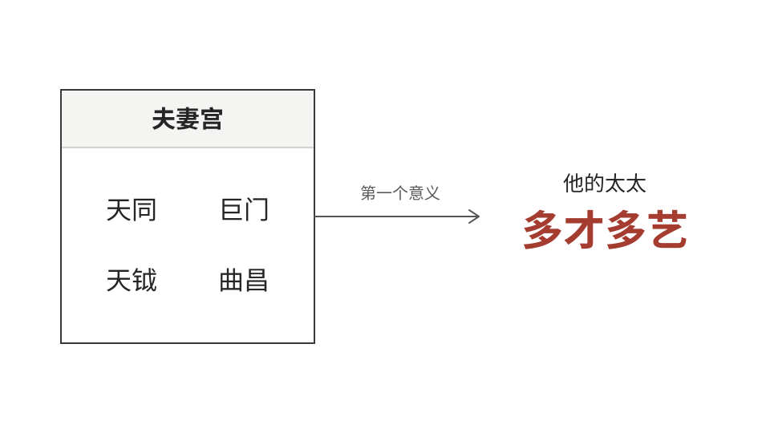 |
| **光有巨门的夫妻宫会怎样？有天同又如何？** | 〔口述〕倪师说夫妻宫本身是巨门，「如果没有这些」「天同天钺文昌文曲」「光是个巨门那夫妻吵架打架」；又说「那你如果有个巨门」「就是吵架难免的啊」「这夫妻是哪对夫妻不吵架啊」。（[00:22:17–00:22:30](https://www.bilibili.com/video/BV1KJsLekEfA/?p=15&t=1337)，第 40116–40511 帧） 〔口述〕有天同就不一样：「那天同呢这个人和」「还是不会有问题」「虽然夫妻不会生离」。（[00:22:30–00:22:35](https://www.bilibili.com/video/BV1KJsLekEfA/?p=15&t=1350)，第 40512–40655 帧） 〔指代〕说「夫妻本身巨门这个」时，手指尖按在黑板右上格、紧贴右上角叠图下方，叠图标示的是夫妻宫。（[00:22:19](https://www.bilibili.com/video/BV1KJsLekEfA/?p=15&t=1339)，第 40170 帧） 〔指代〕说「那天同呢这个人和」时，食指一直指着黑板右上格顶部手写的「青」字处，叠图同时标示夫妻宫。（[00:22:31](https://www.bilibili.com/video/BV1KJsLekEfA/?p=15&t=1351)，第 40530 帧） |
| **不会生离，福德宫又化忌，结果是什么？** | 〔口述〕倪师接着问：「那你福德宫为什么化忌」「那不会生离那就是死别了」——夫妻宫有天同不会生离，福德宫化忌，就落到死别。（[00:22:36–00:22:39](https://www.bilibili.com/video/BV1KJsLekEfA/?p=15&t=1356)，第 40692–40793 帧） 〔口述〕理由是福德宫可以当夫妻宫看：「福德宫就是讲夫妻宫啊」「我一再跟诸位讲」「福德宫是十足可以把它当成什么」「夫妻宫来看」「十足可以当成夫妻宫来看」。（[00:22:39–00:22:52](https://www.bilibili.com/video/BV1KJsLekEfA/?p=15&t=1359)，第 40794–41183 帧） 〔叠图〕福德癸亥：天机平忌、天姚陷、亡神、病符、长生、飞廉；小限 2,14,26,38,50,62；大限 23~32。（[00:22:35–00:22:36](https://www.bilibili.com/video/BV1KJsLekEfA/?p=15&t=1355)，第 40656–40691 帧） 〔推断〕推断：叠图福德癸亥里天机带「忌」，和口述「福德宫为什么化忌」对得上；但倪师在本块没有说化忌的是哪颗星。（[00:22:35–00:22:39](https://www.bilibili.com/video/BV1KJsLekEfA/?p=15&t=1355)，第 40656–40793 帧） |
| **这个男命的交友宫有哪几颗星？** | 〔口述〕倪师转看交友宫：「这个呢你看他的交友宫」「破军左辅地劫有没有」「诸位看他左下角天马是不是在这里」；后面又说「他的朋友宫这里是破军」「带左辅带地劫带天马」。（[00:22:52–00:23:27](https://www.bilibili.com/video/BV1KJsLekEfA/?p=15&t=1372)，第 41184–42221 帧） 〔指代〕说「天马是不是在这里」时，指尖按在黑板一格里「左 地 天」那一行的「天」字下方；叠图显示的是交友甲寅。（[00:23:07](https://www.bilibili.com/video/BV1KJsLekEfA/?p=15&t=1387)，第 41632 帧） 〔指代〕说「他的朋友宫这里是破军」时，食指指着板面左下方格子上沿的「地天」二字；叠图显示交友甲寅，内有破军、左辅、地劫、天马。（[00:23:23](https://www.bilibili.com/video/BV1KJsLekEfA/?p=15&t=1403)，第 42090 帧） 〔板书〕写交友宫星曜后的板面：右下方格子里可辨「破」「地天」「军」，其余认不出。（[00:23:10](https://www.bilibili.com/video/BV1KJsLekEfA/?p=15&t=1390)，第 41712 帧） 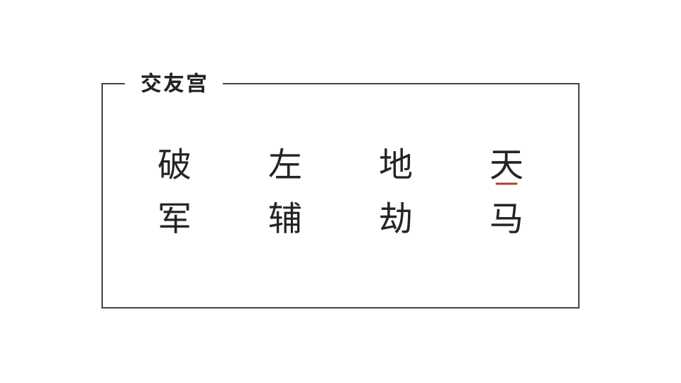 |
| **天马带地劫、破军在朋友宫，各主什么？** | 〔口述〕倪师说「诸位看这个字」「顾名思义」「他的朋友是天马带地劫」「劳多功少然后破财」。（[00:23:27–00:23:34](https://www.bilibili.com/video/BV1KJsLekEfA/?p=15&t=1407)，第 42222–42449 帧） 〔口述〕再讲破军：「破军也是破耗」「破军代表也代表征战打仗」「我不讲过军人都要有这个命」。（[00:23:35–00:23:43](https://www.bilibili.com/video/BV1KJsLekEfA/?p=15&t=1415)，第 42450–42707 帧） 〔指代〕说「诸位看这个字」前后，手掌和食指一直落在板面左下方格子「地天」一带，具体指哪一个字分辨不出。（[00:23:27](https://www.bilibili.com/video/BV1KJsLekEfA/?p=15&t=1407)，第 42218 帧） |
| **批八字为什么要分主动和被动？** | 〔口述〕倪师提醒：「我们在算命的时候」「批八字诸位注意一点」「我们有主动和被动」「主动啊还有被动」「什么叫做主动」。（[00:23:10–00:23:21](https://www.bilibili.com/video/BV1KJsLekEfA/?p=15&t=1390)，第 41700–42041 帧） 〔口述〕举的主动例子是这个男命：「那如果他主动你听啊」「他主动去找朋友合伙做生意」。（[00:23:43–00:23:49](https://www.bilibili.com/video/BV1KJsLekEfA/?p=15&t=1423)，第 42708–42887 帧） 〔板书〕讲主动、被动时在黑板右侧新写两行字，笔迹潦草，认不全，不录。（[00:23:20](https://www.bilibili.com/video/BV1KJsLekEfA/?p=15&t=1400)，第 42012 帧） |
| **山水蒙的去蒙之道，怎么用到算命上？** | 〔口述〕倪师借易经讲：「易经叫做山水蒙始蒙啊」「易经讲君子啊去蒙之道」「我们要如何将他去蒙」「就是以果決行」「用结果来替他决定他的行为行径」。（[00:23:49–00:24:14](https://www.bilibili.com/video/BV1KJsLekEfA/?p=15&t=1429)，第 42888–43643 帧） 〔板书〕黑板左侧竖写「山水蒙」三字，认得出。（[00:23:57](https://www.bilibili.com/video/BV1KJsLekEfA/?p=15&t=1437)，第 43135 帧） 〔板书〕「山水蒙」右边又写了几行，可辨其中一行首字「始」，其余认不出。（[00:24:12](https://www.bilibili.com/video/BV1KJsLekEfA/?p=15&t=1452)，第 43584 帧） |
| **算命讨论的是过程还是结果？** | 〔口述〕「算命就是一个专门讨论果的哲学」「所以算命不管中间过程」「它只论成败」；易经也一样：「所以易经呢」「也是不管过程」「它只论成败」。（[00:24:15–00:24:26](https://www.bilibili.com/video/BV1KJsLekEfA/?p=15&t=1455)，第 43650–44003 帧） 〔口述〕「世界上任何事情哦」「到了结果的时候」「不是1就是0」：做生意赚钱或赔钱、考试上不上、坐飞机「平安和凶杀两个结果」。（[00:24:28–00:24:43](https://www.bilibili.com/video/BV1KJsLekEfA/?p=15&t=1468)，第 44046–44495 帧） |
| **给客人断事，能不能说「大概」？** | 〔口述〕倪师反对含糊的话：「大概会平安什么话嘛」「你做生意大概会赚钱」「什么话不可以这样做哦」。（[00:24:43–00:24:49](https://www.bilibili.com/video/BV1KJsLekEfA/?p=15&t=1483)，第 44496–44693 帧） 〔口述〕「做生意我们帮批八字」「人来找你」「你要给人家很正确的果」。（[00:24:49–00:24:56](https://www.bilibili.com/video/BV1KJsLekEfA/?p=15&t=1489)，第 44694–44903 帧） |
| **天马落朋友宫，主动找朋友合伙会怎样？** | 〔口述〕倪师讲这个男命主动的情形：「他本来自己做生意当老板很好」「哪一天他去找他朋友合伙做」；「他的天马星落在朋友宫」「意思就是他为朋友去奔波跑路」「跑了半天白忙一场」「还要破财在朋友身上」。（[00:24:56–00:25:17](https://www.bilibili.com/video/BV1KJsLekEfA/?p=15&t=1496)，第 44904–45521 帧） 〔口述〕结局：「然后结果结果合伙拆伙的时候」「朋友之间还变成仇人」「还要打仗」「这个中间的过程是这样子」。（[00:25:17–00:25:25](https://www.bilibili.com/video/BV1KJsLekEfA/?p=15&t=1517)，第 45522–45767 帧） 〔口述〕过程讲完收成一句：「那我们断章取义了」，一句话讲完「合伙必败」「你要给人家必败」。（[00:25:25–00:25:35](https://www.bilibili.com/video/BV1KJsLekEfA/?p=15&t=1525)，第 45768–46061 帧） 〔板书〕讲「合伙必败」时在黑板左侧圈起两个字，可辨「必败」。（[00:25:35](https://www.bilibili.com/video/BV1KJsLekEfA/?p=15&t=1535)，第 46056 帧） |
| **为什么要直说「必败」，不说「大概会赔钱」？** | 〔口述〕倪师学含糊的说法：「先生您您合伙大概会赔钱」「不太好」「你考虑多考虑一下」「什么话嘛」；反之「必败讲完了」「他就不会做了我跟你讲」，含糊地说「他还抱着侥幸的心理哦」。（[00:25:39–00:25:49](https://www.bilibili.com/video/BV1KJsLekEfA/?p=15&t=1539)，第 46182–46475 帧） 〔口述〕因为「他的命中要破财」，「他的流年走到这边来的话」「他就会去跟朋友合伙」「然后破财」。（[00:25:49–00:25:54](https://www.bilibili.com/video/BV1KJsLekEfA/?p=15&t=1549)，第 46476–46625 帧） 〔口述〕客人「是有疑问来问我了」，「然后我跟你讲的又是怀疑的答案」，他就没得到答案；所以「以果決其行」「必败我就给你写必败」。（[00:25:55–00:26:11](https://www.bilibili.com/video/BV1KJsLekEfA/?p=15&t=1555)，第 46656–47153 帧） |
| **「必败」花篮的玩笑想说明什么？** | 〔口述〕倪师常开玩笑：客人跟朋友合伙开张时「打电话给我哈」「我就送你个花篮」「里面写着必败」。（[00:26:11–00:26:20](https://www.bilibili.com/video/BV1KJsLekEfA/?p=15&t=1571)，第 47154–47429 帧） 〔口述〕别人送的花篮「上面写的祝你成功」「结果人家都赔钱了对不对」「那个是谎言嘛」；「我讲实话你不接受」「我还让你事先让你不要赔钱呢」。（[00:26:24–00:26:32](https://www.bilibili.com/video/BV1KJsLekEfA/?p=15&t=1584)，第 47532–47771 帧） 〔口述〕倪师感叹实话反被嫌触霉头：「这件事好像谎言比较盛行哈」「做在表面上的比较盛行」。（[00:26:32–00:26:40](https://www.bilibili.com/video/BV1KJsLekEfA/?p=15&t=1592)，第 47772–48011 帧） |
| **反过来，财帛禄大而权在朋友宫，适合怎么合作？** | 〔口述〕倪师换成假设：「同样的如果你反过来」「如果这是他的朋友宫呢」——你主动「你投资别人」「别人化权」「朋友化权来当老板对不对」。（[00:26:42–00:26:54](https://www.bilibili.com/video/BV1KJsLekEfA/?p=15&t=1602)，第 48060–48437 帧） 〔口述〕「一个八字我们可以推到」「很多地方来」：「你财帛宫禄很大」「禄星这个化禄代表财星」，「结果没有权」「权跑到什么朋友宫上面」。（[00:26:56–00:27:16](https://www.bilibili.com/video/BV1KJsLekEfA/?p=15&t=1616)，第 48480–49109 帧） 〔口述〕结论：「那就变成你非常适合跟朋友」「做生意当老板」「朋友来当老板你来做事情」。本块到这里，下一块接着讲「反过来」的另一种情形。（[00:27:17–00:27:24](https://www.bilibili.com/video/BV1KJsLekEfA/?p=15&t=1637)，第 49110–49349 帧） 〔叠图〕跟着「如果这是他的朋友宫呢」贴出交友丁巳：太阴陷权、禄存庙、火星得、封诰、破碎陷、劫煞、月德、博士、小耗、病；小限 8,20,32,44,56,68；大限 83~92。内容与后面的财帛丁巳相同，是假设换的宫名，不是这个男命自己的交友宫。（[00:26:44–00:26:46](https://www.bilibili.com/video/BV1KJsLekEfA/?p=15&t=1604)，第 48138–48191 帧） 〔叠图〕说「你财帛宫禄很大」时贴出财帛丁巳：太阴陷禄、禄存庙、火星得、封诰、破碎陷、劫煞、月德、博士、小耗、病；小限 8,20,32,44,56,68；大限 83~92。（[00:27:00–00:27:03](https://www.bilibili.com/video/BV1KJsLekEfA/?p=15&t=1620)，第 48612–48713 帧） |

**总结区**

- 通用规则：夫妻宫光有巨门，夫妻吵架难免；有天同则不会生离（[00:22:17–00:22:35](https://www.bilibili.com/video/BV1KJsLekEfA/?p=15&t=1337)，第 40116–40655 帧）；福德宫十足可以当成夫妻宫来看（[00:22:39–00:22:52](https://www.bilibili.com/video/BV1KJsLekEfA/?p=15&t=1359)，第 40794–41183 帧）；算命和易经都不管中间过程、只论成败，结果不是1就是0（[00:24:15–00:24:43](https://www.bilibili.com/video/BV1KJsLekEfA/?p=15&t=1455)，第 43650–44495 帧）；财帛宫禄大却没有权、权在朋友宫，适合朋友当老板、自己来做事（[00:26:42–00:27:24](https://www.bilibili.com/video/BV1KJsLekEfA/?p=15&t=1602)，第 48060–49349 帧）
- 只在本例：这个男命夫妻宫天同巨门、天钺、文昌文曲，太太多才多艺；有天同不会生离，福德宫化忌就是死别（[00:21:52–00:22:39](https://www.bilibili.com/video/BV1KJsLekEfA/?p=15&t=1312)，第 39360–40793 帧）；这个男命交友宫破军、左辅、地劫、天马，主动找朋友合伙会奔波白忙、破财、拆伙成仇，合伙必败（[00:22:52–00:25:35](https://www.bilibili.com/video/BV1KJsLekEfA/?p=15&t=1372)，第 41184–46061 帧）；「如果这是他的朋友宫」一段是假设，叠图把财帛丁巳那格改叫交友丁巳来演示，不是这个男命的交友宫（[00:26:42–00:27:03](https://www.bilibili.com/video/BV1KJsLekEfA/?p=15&t=1602)，第 48060–48713 帧）
- 不是排盘规则，是处世方法：人来找你批八字，要给很正确的果，不说「大概会赚钱」这种话（[00:24:43–00:24:56](https://www.bilibili.com/video/BV1KJsLekEfA/?p=15&t=1483)，第 44496–44903 帧）；直说「必败」对方就不做了；给怀疑的答案，他还抱侥幸心理去做（[00:25:39–00:26:11](https://www.bilibili.com/video/BV1KJsLekEfA/?p=15&t=1539)，第 46182–47153 帧）；送写着「必败」的花篮的玩笑：讲实话是让人事先别赔钱，「祝你成功」反倒是谎言（[00:26:11–00:26:40](https://www.bilibili.com/video/BV1KJsLekEfA/?p=15&t=1571)，第 47154–48011 帧）

**待核**

1. [00:21:59](https://www.bilibili.com/video/BV1KJsLekEfA/?p=15&t=1319)，第 39582 帧「科甲星」：语音作「柯甲心」，按字幕记；倪师没解释什么是科甲星。
2. [00:22:30](https://www.bilibili.com/video/BV1KJsLekEfA/?p=15&t=1350)，第 40512 帧「那天同呢这个人和」：「这个人和」意思不明，指代虽确定指板上「青」字处，但「青」后面的字被挡住。
3. [00:22:36](https://www.bilibili.com/video/BV1KJsLekEfA/?p=15&t=1356)，第 40692 帧字幕「福德宫为什么化忌」，语音是「夫妻宫为什么化」；[00:22:39](https://www.bilibili.com/video/BV1KJsLekEfA/?p=15&t=1359)，第 40794 帧字幕「福德宫就是讲夫妻宫啊」，语音是「夫妻宫就是讲夫妻宫啊」，两路对不上，按字幕记。
4. [00:22:36](https://www.bilibili.com/video/BV1KJsLekEfA/?p=15&t=1356)，第 40692 帧：倪师没说福德宫化忌的是哪颗星；叠图福德癸亥显示天机平忌（[00:22:35](https://www.bilibili.com/video/BV1KJsLekEfA/?p=15&t=1355)，第 40656 帧）。
5. [00:23:07](https://www.bilibili.com/video/BV1KJsLekEfA/?p=15&t=1387)，第 41632 帧指代说指的是「右下方格子」，[00:23:23](https://www.bilibili.com/video/BV1KJsLekEfA/?p=15&t=1403)，第 42090 帧指代说是「左下方格子」，镜头不同，位置描述不一致。
6. [00:23:27](https://www.bilibili.com/video/BV1KJsLekEfA/?p=15&t=1407)，第 42222 帧「诸位看这个字」「顾名思义」：具体指哪个字分辨不出。
7. [00:23:41](https://www.bilibili.com/video/BV1KJsLekEfA/?p=15&t=1421)，第 42630 帧「军人都要有这个命」：指代看不出，倪师在本块没说是什么命。
8. [00:23:54](https://www.bilibili.com/video/BV1KJsLekEfA/?p=15&t=1434)，第 43026 帧「始蒙」、[00:24:00](https://www.bilibili.com/video/BV1KJsLekEfA/?p=15&t=1440)，第 43200 帧「去蒙之道」：倪师没解释。
9. [00:24:08](https://www.bilibili.com/video/BV1KJsLekEfA/?p=15&t=1448)，第 43458 帧「以果決行」：语音作「以果觉醒」；[00:26:07](https://www.bilibili.com/video/BV1KJsLekEfA/?p=15&t=1567)，第 47022 帧又说「以果決其行」，两处说法不同，照原字记。
10. [00:25:05](https://www.bilibili.com/video/BV1KJsLekEfA/?p=15&t=1505)，第 45150 帧字幕「（马星）」括号里的字是字幕制作者加的注，不当倪师原话。
11. [00:25:27](https://www.bilibili.com/video/BV1KJsLekEfA/?p=15&t=1527)，第 45828 帧字幕「亠句话讲完」，按上下文改为「一句话讲完」。
12. [00:25:36](https://www.bilibili.com/video/BV1KJsLekEfA/?p=15&t=1536)，第 46098 帧「往曲中求」：倪师没解释，照原字记；同句「宁（你们）」括号是字幕制作者加注。
13. [00:25:50](https://www.bilibili.com/video/BV1KJsLekEfA/?p=15&t=1550)，第 46524 帧「他的流年走到这边来的话」：「这边」指代不确定，不当依据。
14. [00:26:44](https://www.bilibili.com/video/BV1KJsLekEfA/?p=15&t=1604)，第 48138 帧叠图交友丁巳写「太阴陷权」，[00:27:00](https://www.bilibili.com/video/BV1KJsLekEfA/?p=15&t=1620)，第 48612 帧同一格财帛丁巳写「太阴陷禄」，是不是跟着「你财帛宫禄很大」的假设改的，材料没说。
15. [00:27:19](https://www.bilibili.com/video/BV1KJsLekEfA/?p=15&t=1639)，第 49176 帧字幕「做生意当老板」，语音是「事情当老板」，两路不一致；下一句又是「朋友来当老板你来做事情」，谁当老板以下一句为准待核。
16. 板书：[00:22:05](https://www.bilibili.com/video/BV1KJsLekEfA/?p=15&t=1325)，第 39756 帧只认得「昌」；[00:23:10](https://www.bilibili.com/video/BV1KJsLekEfA/?p=15&t=1390)，第 41712 帧只认得「破」「地天」「军」；[00:23:20](https://www.bilibili.com/video/BV1KJsLekEfA/?p=15&t=1400)，第 42012 帧新写两行认不全；[00:24:12](https://www.bilibili.com/video/BV1KJsLekEfA/?p=15&t=1452)，第 43584 帧除「山水蒙」「始」外认不出；[00:27:02](https://www.bilibili.com/video/BV1KJsLekEfA/?p=15&t=1622)，第 48680 帧、[00:27:10](https://www.bilibili.com/video/BV1KJsLekEfA/?p=15&t=1630)，第 48912 帧新写的字认不出。

### 6　朋友出钱当老板、算命谈果与悭吝理财（[00:27:25–00:32:34](https://www.bilibili.com/video/BV1KJsLekEfA/?p=15&t=1645)，第 49350–58625 帧）

| 提示区 | 笔记区 |
|---|---|
| **朋友宫全是财星、自己命宫化权，会怎样？** | 〔推断〕推断：本块开头的「反过来」接上文——上文讲财禄很大却没有权、权跑到朋友宫，就适合朋友当老板、你来做事；这里讲相反的情形。（[00:27:25–00:27:26](https://www.bilibili.com/video/BV1KJsLekEfA/?p=15&t=1645)，第 49350–49391 帧） 〔口述〕倪师说反过来，如果朋友宫没有空劫破，而是武曲贪破军这类财星：「如果你的朋友宫全部不是空劫破……全部是武曲贪破军了……财星通通在朋友宫」。（[00:27:26–00:27:33](https://www.bilibili.com/video/BV1KJsLekEfA/?p=15&t=1646)，第 49392–49595 帧） 〔口述〕这时自己命宫化权，就变成跟朋友合伙，朋友出钱、自己当老板：「你的命宫是化权……就变成你跟朋友合伙……朋友出钱你来当老板……你来做会赚钱」。（[00:27:35–00:27:42](https://www.bilibili.com/video/BV1KJsLekEfA/?p=15&t=1655)，第 49650–49871 帧） 〔指代〕说「而你财星通通在这里」时，手掌平按在板面左下方格子「三 地天」一行附近，紧挨叠图右边。（[00:27:34](https://www.bilibili.com/video/BV1KJsLekEfA/?p=15&t=1654)，第 49620 帧） 〔叠图〕叠图贴出「交友 乙巳」：武曲旺、破军旺、文曲庙、天钺旺、天空庙、天刑陷、天喜庙、孤辰陷、天巫等；同时有「命宫 辛酉」：太阳平、天梁得，另有一个「权」字。交友乙巳是跟着倪师「如果你的朋友宫……」演示的，不是本例男命自己的交友宫。（[00:27:35–00:27:36](https://www.bilibili.com/video/BV1KJsLekEfA/?p=15&t=1655)，第 49650–49685 帧） |
| **朋友宫这样的人，为什么认识的都是有钱人？** | 〔口述〕倪师说命中朋友宫这样，就会专门认识有钱人：「他的命中朋友这样子……他就会专门认识这些人……他认识的都是有钱人」。（[00:27:44–00:27:51](https://www.bilibili.com/video/BV1KJsLekEfA/?p=15&t=1664)，第 49932–50141 帧） 〔口述〕这些朋友是从小一起长大、家境都好的：「都是几个朋友……都是很好的从小一起长大……家里的环境都很好的」，然后他就去做。（[00:27:51–00:27:58](https://www.bilibili.com/video/BV1KJsLekEfA/?p=15&t=1671)，第 50142–50369 帧） 〔口述〕倪师强调要推理：「再推所以要推理……推理可以推理到无限的」。（[00:27:59–00:28:02](https://www.bilibili.com/video/BV1KJsLekEfA/?p=15&t=1679)，第 50370–50465 帧） 〔板书〕本块开头的板面，可辨：「财帛」（画圈）、画圈的「运」（板上写作繁体「運」）、左下的「地天」「破」，其余认不出。（[00:27:25](https://www.bilibili.com/video/BV1KJsLekEfA/?p=15&t=1645)，第 49350 帧） |
| **反过来他才14岁来算，怎么跟妈妈、跟他本人说？** | 〔口述〕倪师设想反过来，孩子才14岁，妈妈带来请倪先生看：「反过来如果他今年才14岁」「他妈妈来哎倪先生……你帮我儿子看一下」。（[00:28:02–00:28:09](https://www.bilibili.com/video/BV1KJsLekEfA/?p=15&t=1682)，第 50466–50699 帧） 〔口述〕对妈妈要直说交的朋友都不好、会拉他破财：「这个人交的朋友都不好……他一天到晚这个朋友来找他……是非做犯法出去打架啊……然后找他吃安非他命啊就破财……然后找他赌场上赌钱……这不行」，并说「这样子讲话的」。（[00:28:12–00:28:23](https://www.bilibili.com/video/BV1KJsLekEfA/?p=15&t=1692)，第 50760–51107 帧） 〔口述〕孩子本人来，就劝他别交很多朋友：「哎弟弟你太来的太好了……你就不要去交很多朋友……朋友都是破财……你这辈子就交不到很好的朋友」。（[00:28:25–00:28:32](https://www.bilibili.com/video/BV1KJsLekEfA/?p=15&t=1705)，第 51156–51383 帧） 〔口述〕倪师收一句：「这就是果来決其行」。这句字幕可信度低、语音对不上，倪师也没解释。（[00:28:34–00:28:36](https://www.bilibili.com/video/BV1KJsLekEfA/?p=15&t=1714)，第 51420–51503 帧） 〔推断〕推断：这里先知道结果（朋友都破财），再据此决定怎么做（不交很多朋友），倪师把这叫「果来決其行」；对妈妈和对孩子说法不同，是讲怎么跟客户说话。（[00:28:02–00:28:36](https://www.bilibili.com/video/BV1KJsLekEfA/?p=15&t=1682)，第 50466–51503 帧） |
| **算命跟宗教有什么不同？** | 〔口述〕倪师说研究命时常忘掉算命的精神：「算命的精神是什么……算命是个专门谈果的哲学啊」。（[00:28:42–00:28:49](https://www.bilibili.com/video/BV1KJsLekEfA/?p=15&t=1722)，第 51666–51875 帧） 〔口述〕宗教则谈因：「所有的宗教的东西……不管你是什么基督教佛教……通通在谈因」，「所以佛教在谈因论」。（[00:28:49–00:28:55](https://www.bilibili.com/video/BV1KJsLekEfA/?p=15&t=1729)，第 51876–52055 帧） 〔口述〕算命只谈果，事先知道结果就能帮人做决策：「我们算命只谈果啊……事先就知道结果……当然可以帮你做決策……所以它是另外一条路」。（[00:28:56–00:29:03](https://www.bilibili.com/video/BV1KJsLekEfA/?p=15&t=1736)，第 52092–52319 帧） 〔口述〕「你怎么会把算命跟宗教扯在一起呢……那两回事」。（[00:29:04–00:29:09](https://www.bilibili.com/video/BV1KJsLekEfA/?p=15&t=1744)，第 52320–52475 帧） 〔板书〕边说边在右侧板上写字，可辨：「因」，上方的字认不出。（[00:28:53](https://www.bilibili.com/video/BV1KJsLekEfA/?p=15&t=1733)，第 52005 帧） 〔板书〕接着在「因」右边写「果」并画圈，可辨：「因」和画圈的「果」，上方两字认不出。（[00:29:00](https://www.bilibili.com/video/BV1KJsLekEfA/?p=15&t=1740)，第 52221 帧） |
| **打着宗教招牌算命，倪师怎么看？** | 〔口述〕倪师说自古真正的宗教不搞算命：「所以自古真正的宗教……没有人在搞算命的」。（[00:29:09–00:29:14](https://www.bilibili.com/video/BV1KJsLekEfA/?p=15&t=1749)，第 52476–52631 帧） 〔口述〕现在很多人打宗教招牌算命：「那现在很多人……打着宗教的招牌……在我在算命」。（[00:29:15–00:29:19](https://www.bilibili.com/video/BV1KJsLekEfA/?p=15&t=1755)，第 52662–52787 帧） 〔口述〕倪师骂这类人：「这混蛋了……他自己自己制造出来……胡说八道的」，又说「那两个路不一样嘛对不对」。（[00:29:21–00:29:30](https://www.bilibili.com/video/BV1KJsLekEfA/?p=15&t=1761)，第 52830–53111 帧） |
| **找宗教家谈与找命学家谈，差在哪？为什么批得快？** | 〔口述〕心情郁闷去找宗教家，他讲前世因：「所以你心情很郁闷的时候……你找宗教家去谈……他就跟你说哎呀……因为你的前世什么样」，听完说原来这样，「出去的时候似是非是」。（[00:29:30–00:29:40](https://www.bilibili.com/video/BV1KJsLekEfA/?p=15&t=1770)，第 53112–53423 帧） 〔口述〕找命学家谈则是谈结果：「如果找我们命学家谈」，倪师说「算命就是谈结果啊」，若「跟你谈因谈了半天」就不对。（[00:29:40–00:29:53](https://www.bilibili.com/video/BV1KJsLekEfA/?p=15&t=1780)，第 53424–53813 帧） 〔口述〕倪师说若每天谈因，「我就坐那里……头发就白掉了……然后一天讲一个就够了」。（[00:29:55–00:30:00](https://www.bilibili.com/video/BV1KJsLekEfA/?p=15&t=1795)，第 53856–54029 帧） 〔口述〕谈果就快：「我们谈果速度很快……一下子十二十分钟批完」；一辈子想的事很多，「真的面临到结果的时候时间很短……我就把那个很短的加起来……当然20分钟就讲完了」。（[00:30:01–00:30:13](https://www.bilibili.com/video/BV1KJsLekEfA/?p=15&t=1801)，第 54030–54395 帧） |
| **不同年纪来算有何不同？今天以前、以后怎么分？** | 〔口述〕不同年纪来算，结果不一样：「所以我们在算命的时候……你10岁20岁 30岁 40岁……来给我们算……结果不一样」。（[00:30:16–00:30:22](https://www.bilibili.com/video/BV1KJsLekEfA/?p=15&t=1816)，第 54480–54671 帧） 〔口述〕以来算命那天为界：「那来算命今天以前……只能帮你算命……今天以后统统可以改运……就在这里」。（[00:30:22–00:30:27](https://www.bilibili.com/video/BV1KJsLekEfA/?p=15&t=1822)，第 54672–54839 帧） 〔指代〕说「今天以后统统可以改运」「就在这里」时，握拳用指节顶在黑板中部圈起的「运」（板上写作「運」）字圈下缘。（[00:30:26](https://www.bilibili.com/video/BV1KJsLekEfA/?p=15&t=1826)，第 54795 帧） |
| **40岁来算、合伙必败，早来晚来差在哪？** | 〔口述〕倪师设想他40岁才来算：「好了他今年40岁来找你算」「你跟他说你跟朋友合伙必败」；对方说「哎呀对嘛早早点来找就好了……不然我就不要破那么多财了」。（[00:30:28–00:30:35](https://www.bilibili.com/video/BV1KJsLekEfA/?p=15&t=1828)，第 54840–55073 帧） 〔口述〕倪师用价钱开玩笑：「那我就跟他讲先生现在来是5000」「早点来是2000你不来」「破了5000万的时候来找我花5000块」。（[00:30:36–00:30:43](https://www.bilibili.com/video/BV1KJsLekEfA/?p=15&t=1836)，第 55104–55301 帧） 〔口述〕很多人破大财是省小钱：「这个很多人会破大财都是……省省小钱赔赔赔大钱」，平时「自己嘛省吃俭用」，却「到股票市场赔一缸子在里面」。（[00:30:50–00:31:00](https://www.bilibili.com/video/BV1KJsLekEfA/?p=15&t=1850)，第 55512–55823 帧） 〔口述〕举例吃卤肉饭一颗饭都省下来吃光，「结果在里面赔了好几千万」「这种人很多」。（[00:31:00–00:31:07](https://www.bilibili.com/video/BV1KJsLekEfA/?p=15&t=1860)，第 55824–56021 帧） |
| **他财帛宫有破财的星吗？禄存、鼻孔说明什么？** | 〔叠图〕叠图贴出「财帛 丁巳」：太阴陷、权、禄存庙、火星得、破碎陷、封诰、小耗、月德等；同时贴出「交友 甲寅」：破军得、左辅庙、地劫平、天马旺、三台平、天伤平、天巫、孤辰平等。（[00:31:08–00:31:10](https://www.bilibili.com/video/BV1KJsLekEfA/?p=15&t=1868)，第 56064–56123 帧） 〔口述〕倪师说他财帛宫没有破财的星、有禄存，很小气：「你看他财帛宫都没有破财的星」「禄存你看他小不小气呀」，接着一句「一看就知道他很小气嘛」（字幕前面两字作「地厂」，意思不明）。（[00:31:08–00:31:13](https://www.bilibili.com/video/BV1KJsLekEfA/?p=15&t=1868)，第 56064–56213 帧） 〔口述〕看相也对得上：「然后坐到你面前一看……鼻孔都看不到……这是小气鬼」。（[00:31:13–00:31:16](https://www.bilibili.com/video/BV1KJsLekEfA/?p=15&t=1873)，第 56214–56303 帧） 〔口述〕倪师说这叫悭吝的人（字幕先作「悭音」，下一句作「悭吝」），「这叫做悭吝的人呐」；但算命时不要当面讲他是悭吝的人，「我们可以算到本性啊」，就是吝啬（字幕作「音啬」）、「就很小气的人」。（[00:31:19–00:31:34](https://www.bilibili.com/video/BV1KJsLekEfA/?p=15&t=1879)，第 56376–56825 帧） 〔板书〕倪师说「这个字要这样写」并在左侧板上写字，可辨：「山」「水」，旁边新写的「悭」「吝」两字，其余认不出。（[00:31:31](https://www.bilibili.com/video/BV1KJsLekEfA/?p=15&t=1891)，第 56752 帧） |
| **孩子财帛宫破军地劫天马，父母要小心什么？** | 〔口述〕倪师说反过来、以此类推：「那有一个人反过来……你以此类推……有一个人财帛宫……如果在这里怎么办」。（[00:31:34–00:31:38](https://www.bilibili.com/video/BV1KJsLekEfA/?p=15&t=1894)，第 56826–56969 帧） 〔叠图〕叠图贴出「财帛 甲寅」，内容与前面的「交友 甲寅」相同（破军、左辅、地劫、天马等），是跟着「有一个人财帛宫如果在这里」换的宫名。（[00:31:37–00:31:38](https://www.bilibili.com/video/BV1KJsLekEfA/?p=15&t=1897)，第 56916–56969 帧） 〔口述〕生的孩子财帛宫是破军地劫天马，就别给他很多钱：「你如果生了个小孩子……他的财帛宫是在这里破军地劫天马……就是你小心了……你不要不要不要给他很多钱了」。（[00:31:39–00:31:48](https://www.bilibili.com/video/BV1KJsLekEfA/?p=15&t=1899)，第 56970–57245 帧） 〔指代〕说「他的财帛宫是在这里」时手指伸向左下角，那里被叠图盖住，叠图显示「破军 左辅 地劫 天马」「财帛 甲寅」。（[00:31:40](https://www.bilibili.com/video/BV1KJsLekEfA/?p=15&t=1900)，第 57022 帧） 〔口述〕「这个你有多少钱……最好不要给你儿子知道……他就想尽办法把你花光」。（[00:31:48–00:31:54](https://www.bilibili.com/video/BV1KJsLekEfA/?p=15&t=1908)，第 57246–57449 帧） |
| **怎么用64个象的位置让孩子变得会理财？** | 〔口述〕孩子才几岁就看出来，可以给他摆位置：「如果你儿子一生下来才几岁……我们就知道……我们就给你摆个小小气的位置……你会理财的位置」。（[00:31:56–00:32:04](https://www.bilibili.com/video/BV1KJsLekEfA/?p=15&t=1916)，第 57492–57731 帧） 〔口述〕理财的位置在64个象里找：「那理财的位置在64个象里面……我们看看找找哪个象是他的……因为一个人有八个位置可以去睡」。（[00:32:04–00:32:09](https://www.bilibili.com/video/BV1KJsLekEfA/?p=15&t=1924)，第 57732–57893 帧） 〔口述〕长子以雷为主：「如果是长子你以雷为主对不对……那就找八个雷的位置……看看哪个雷禄比较大……给他丢进去……他就变得小气了」。（[00:32:09–00:32:16](https://www.bilibili.com/video/BV1KJsLekEfA/?p=15&t=1929)，第 57894–58103 帧） 〔口述〕住久了面相也变：「然后睡在里面住越住越久……鼻孔就越来越收起来」，最后说「这个这个诸位要考虑这些问题」。（[00:32:16–00:32:34](https://www.bilibili.com/video/BV1KJsLekEfA/?p=15&t=1936)，第 58104–58625 帧） 〔推断〕推断：本块倪师没有讲八个雷的位置具体怎么找、「雷禄」大小怎么比，只给了「长子以雷为主、挑雷禄大的位置去睡」这个思路。（[00:32:09–00:32:15](https://www.bilibili.com/video/BV1KJsLekEfA/?p=15&t=1929)，第 57894–58055 帧） |

**总结区**

- 通用规则：朋友宫全是武曲贪破军这类财星、自己命宫化权，主跟朋友合伙、朋友出钱你当老板，认识的都是有钱人（[00:27:26–00:27:51](https://www.bilibili.com/video/BV1KJsLekEfA/?p=15&t=1646)，第 49392–50141 帧）；算命是专门谈果的哲学，宗教谈因，两者是两回事；今天以前只能算命，今天以后可以改运（[00:28:42–00:30:27](https://www.bilibili.com/video/BV1KJsLekEfA/?p=15&t=1722)，第 51666–54839 帧）；财帛宫是破军地劫天马的孩子，父母不要给他很多钱、别让他知道有多少钱，否则会被花光（[00:31:36–00:31:54](https://www.bilibili.com/video/BV1KJsLekEfA/?p=15&t=1896)，第 56892–57449 帧）；一个人有八个位置可以去睡，长子以雷为主，找八个雷位置里雷禄较大的给他睡，可变得会理财（[00:32:04–00:32:16](https://www.bilibili.com/video/BV1KJsLekEfA/?p=15&t=1924)，第 57732–58103 帧）
- 只在本例：本例男命叠图财帛丁巳有禄存、没有破财的星，倪师断他小气、悭吝，看相鼻孔都看不到（[00:31:08–00:31:34](https://www.bilibili.com/video/BV1KJsLekEfA/?p=15&t=1868)，第 56064–56825 帧）；倪师假设「他」40岁来算，跟他说跟朋友合伙必败（推断指本例男命，待核）（[00:30:28–00:30:31](https://www.bilibili.com/video/BV1KJsLekEfA/?p=15&t=1828)，第 54840–54959 帧）
- 不是排盘规则，是处世方法：14岁孩子妈妈来算，直说他交的朋友都会拉他破财；孩子本人来，就劝他别交很多朋友（[00:28:02–00:28:32](https://www.bilibili.com/video/BV1KJsLekEfA/?p=15&t=1682)，第 50466–51383 帧）；算命时不要当面说客人是悭吝的人（[00:31:20–00:31:23](https://www.bilibili.com/video/BV1KJsLekEfA/?p=15&t=1880)，第 56424–56507 帧）；早点来算花小钱，很多人省小钱赔大钱、省吃俭用却在股票里赔几千万（[00:30:36–00:31:07](https://www.bilibili.com/video/BV1KJsLekEfA/?p=15&t=1836)，第 55104–56021 帧）；打着宗教招牌算命是胡说八道，算命与宗教不要扯在一起（[00:29:04–00:29:26](https://www.bilibili.com/video/BV1KJsLekEfA/?p=15&t=1744)，第 52320–52991 帧）

**待核**

1. 「而你财星通通在这里」：前一句说财星在朋友宫，这句又说财星在这里，紧接着说命宫化权，是否应为「权星」，字幕与语音都作「财星 / 财心」，待核（[00:27:33](https://www.bilibili.com/video/BV1KJsLekEfA/?p=15&t=1653)，第 49596 帧）
2. 「这就是果来決其行」字幕可信度 0.5，语音作「这就是过来学习去」，两路对不上；倪师也没解释这句（[00:28:34](https://www.bilibili.com/video/BV1KJsLekEfA/?p=15&t=1714)，第 51420 帧）
3. 「先生离婚讲完」字幕可信度 0.41，语音作「你了解我意思」，意思不明，未写进笔记（[00:29:43](https://www.bilibili.com/video/BV1KJsLekEfA/?p=15&t=1783)，第 53508 帧）
4. 「出去的时候似是非是」连着出现两次，当一句看；「似是非是」原字照录（[00:29:39–00:29:40](https://www.bilibili.com/video/BV1KJsLekEfA/?p=15&t=1779)，第 53382–53423 帧）
5. 「如果我搞了十几年」语音作「十几天」（[00:29:53](https://www.bilibili.com/video/BV1KJsLekEfA/?p=15&t=1793)，第 53814 帧）
6. 「可仁地尺」是识别噪声，略过（[00:30:30](https://www.bilibili.com/video/BV1KJsLekEfA/?p=15&t=1830)，第 54900 帧）
7. 「现在来是5000」语音作「现在是午前」，照字幕原字写，未换算（[00:30:36](https://www.bilibili.com/video/BV1KJsLekEfA/?p=15&t=1836)，第 55104 帧）
8. 「地厂一看就知道他很小气嘛」的「地厂」语音作「一个就大」，对不上，意思不明（[00:31:12](https://www.bilibili.com/video/BV1KJsLekEfA/?p=15&t=1872)，第 56178 帧）
9. 「那这边怎么破大财了解下」：「这边」指哪看不出（D126），句意不明（[00:31:16](https://www.bilibili.com/video/BV1KJsLekEfA/?p=15&t=1876)，第 56304 帧）
10. 错字改正：「悭音」改作「悭吝」（[00:31:19](https://www.bilibili.com/video/BV1KJsLekEfA/?p=15&t=1879)，第 56376 帧、[00:31:21](https://www.bilibili.com/video/BV1KJsLekEfA/?p=15&t=1881)，第 56448 帧），「音啬」改作「吝啬」（[00:31:26](https://www.bilibili.com/video/BV1KJsLekEfA/?p=15&t=1886)，第 56586 帧）
11. 「雷禄」「64个象」「八个位置」倪师在本块没有解释（[00:32:04–00:32:15](https://www.bilibili.com/video/BV1KJsLekEfA/?p=15&t=1924)，第 57732–58055 帧）
12. 「这样破攻破」「然后做做做做做鼻孔缩」意思不明，未写进笔记（[00:32:22–00:32:24](https://www.bilibili.com/video/BV1KJsLekEfA/?p=15&t=1942)，第 58260–58343 帧）
13. 叠图「交友 乙巳」是跟着假设演示的，不是本例男命的交友宫（[00:27:35](https://www.bilibili.com/video/BV1KJsLekEfA/?p=15&t=1655)，第 49650 帧）
14. 叠图「命宫 辛酉」里的「权」没标明附在哪颗星上（[00:27:35](https://www.bilibili.com/video/BV1KJsLekEfA/?p=15&t=1655)，第 49650 帧）
15. 叠图「财帛 甲寅」与「交友 甲寅」内容相同，是换宫名演示（[00:31:37](https://www.bilibili.com/video/BV1KJsLekEfA/?p=15&t=1897)，第 56916 帧）
16. 板书图[00:28:53](https://www.bilibili.com/video/BV1KJsLekEfA/?p=15&t=1733)，第 52005 帧、[00:29:00](https://www.bilibili.com/video/BV1KJsLekEfA/?p=15&t=1740)，第 52221 帧画面左下已贴着「交友 甲寅」叠图（破军、左辅、地劫、天马，大限 53~62），早于叠图转写所记的[00:31:09](https://www.bilibili.com/video/BV1KJsLekEfA/?p=15&t=1869)，第 56070 帧起，材料该时段未列此叠图（[00:28:53](https://www.bilibili.com/video/BV1KJsLekEfA/?p=15&t=1733)，第 52005 帧）
17. 板书认不全：[00:27:25](https://www.bilibili.com/video/BV1KJsLekEfA/?p=15&t=1645)，第 49350 帧只认得「财帛」「运（運）」「地天」「破」；[00:28:53](https://www.bilibili.com/video/BV1KJsLekEfA/?p=15&t=1733)，第 52005 帧、[00:29:00](https://www.bilibili.com/video/BV1KJsLekEfA/?p=15&t=1740)，第 52221 帧右上方的字认不出；[00:31:31](https://www.bilibili.com/video/BV1KJsLekEfA/?p=15&t=1891)，第 56752 帧只认得「山」「水」「悭」「吝」（[00:27:25](https://www.bilibili.com/video/BV1KJsLekEfA/?p=15&t=1645)，第 49350 帧）
18. 指代不确定：[00:31:29](https://www.bilibili.com/video/BV1KJsLekEfA/?p=15&t=1889)，第 56670 帧「这个」（D128）、[00:31:37](https://www.bilibili.com/video/BV1KJsLekEfA/?p=15&t=1897)，第 56921 帧「如果在这里」（D129）落点看不清（[00:31:29](https://www.bilibili.com/video/BV1KJsLekEfA/?p=15&t=1889)，第 56670 帧）

## 例一续：星得正位、大限流年、化科化忌、子女与兄弟宫

| 巳 | 午 | 未 | 申 |
|---|---|---|---|
| **财帛 丁巳** 太阴陷权 禄存庙 火星得 | **子女 戊午** 贪狼旺禄 擎羊陷 | （未：没贴过） | **兄弟 庚申** 武曲得 天相庙 地空庙 |
| （辰：没贴过） | **例一续：星得正位、大限流年、化科化忌、子女与兄弟宫 · 命宫辛酉（宫序推）** | 据视频叠图重排 | （酉：没贴过） |
| （卯：没贴过） | 后期贴图，不算倪师的话 |  | **父母 壬戌** 七杀庙 |
| **交友 甲寅** 破军得 左辅庙 天马旺 地劫平 | **官禄 乙丑** 天魁旺 铃星得 | **田宅 甲子** 紫微平 右弼庙科 | **福德 癸亥** 天机平忌 |

按视频里这张盘逐格重画（我们自己画的图，不是视频截图）；同一个人的 3 段合成一张；数据见 [命盘-P15-例一.json](图/命盘-P15-例一.json)。

### 7　星得正位、掌财权面相与目不见日月（[00:32:34–00:37:12](https://www.bilibili.com/video/BV1KJsLekEfA/?p=15&t=1954)，第 58626–66965 帧）

| 提示区 | 笔记区 |
|---|---|
| **星为什么要得正位？官禄宫化权好在哪？** | 〔口述〕倪师提醒这里是重点：星要得正位。「诸位要这个重点来了」「要星啊要得正位」「得到正位」。（[00:32:35–00:32:46](https://www.bilibili.com/video/BV1KJsLekEfA/?p=15&t=1955)，第 58668–58985 帧） 〔板书〕黑板上竖写一列，可辨：「星」「得」「正」，下面一字被讲者身体挡住，认不全。（[00:32:46](https://www.bilibili.com/video/BV1KJsLekEfA/?p=15&t=1966)，第 58990 帧） 〔口述〕举例官禄宫化权，这是最好的，因为当官本来就要掌权：「比如说官禄宫化权」「这最好了」「官当官的本来就要掌权嘛」。（[00:32:46–00:32:51](https://www.bilibili.com/video/BV1KJsLekEfA/?p=15&t=1966)，第 58986–59141 帧） |
| **官禄宫化禄的第一种是什么人？** | 〔口述〕官禄宫化禄分两种，第一种是贪官：「那这个官禄宫化禄」「这两个一个是贪官」。（[00:32:51–00:32:55](https://www.bilibili.com/video/BV1KJsLekEfA/?p=15&t=1971)，第 59142–59279 帧） 〔指代〕说「那这个官禄宫化禄」时，手指的是黑板下排中间格「天」字附近（后一字潦草看不清）。（[00:32:51](https://www.bilibili.com/video/BV1KJsLekEfA/?p=15&t=1971)，第 59138 帧） 〔叠图〕画面贴出官禄乙丑：天魁旺、铃星得、副截不、天空平，冠带，病符、攀鞍、晦气；小限 4, 16, 28, 40, 52, 64；大限 43~52。（[00:32:53–00:32:55](https://www.bilibili.com/video/BV1KJsLekEfA/?p=15&t=1973)，第 59202–59279 帧） 〔口述〕再说一遍第一种：「这个官禄宫如果财禄很大」「贪官这是第一种」。（[00:33:06–00:33:08](https://www.bilibili.com/video/BV1KJsLekEfA/?p=15&t=1986)，第 59586–59669 帧） 〔指代〕说「把你干掉」之后那个「这个」时，手指的是黑板下排「天」字（后一字潦草）。（[00:33:05](https://www.bilibili.com/video/BV1KJsLekEfA/?p=15&t=1985)，第 59550 帧） |
| **看出别人是贪官命，该怎么开口？** | 〔口述〕倪师说他跟学生讲可以，但学生看到了不要当面讲，不要太直，要有分寸：「你你看到我跟你讲可以哦」「你看到不要讲哦」「你不要太直刚直可以」「要要有分寸的哦」。（[00:32:56–00:33:03](https://www.bilibili.com/video/BV1KJsLekEfA/?p=15&t=1976)，第 59280–59501 帧） 〔口述〕接着说「你不要太过贪官」「人家把你干掉」，大意是讲得太过会惹祸，但这两句具体指谁不清楚。（[00:33:03–00:33:05](https://www.bilibili.com/video/BV1KJsLekEfA/?p=15&t=1983)，第 59502–59573 帧） |
| **官禄宫化禄的第二种：什么叫掌财权？** | 〔口述〕第二种不是贪官，官禄宫禄星很大，是在银行当主管：「还有一种他不是贪官」「他的官禄宫禄星很大」……「在银行当主管」「银行啊也是当官呐」。（[00:33:09–00:33:18](https://www.bilibili.com/video/BV1KJsLekEfA/?p=15&t=1989)，第 59670–59957 帧） 〔口述〕这种人手里一批就是一百亿，可钱不是他的，自己只拿薪水，钱不多但权很大，叫掌财权：「他手一批100亿结果钱不是他的」「他每个月拿几十万的薪水」「十几万的薪水对不对」「他权很大那叫做掌财权」。（[00:33:20–00:33:30](https://www.bilibili.com/video/BV1KJsLekEfA/?p=15&t=2000)，第 60018–60317 帧） 〔指代〕说「掌财权 这个」时，手指的是黑板下排中格「天」字附近。（[00:33:32](https://www.bilibili.com/video/BV1KJsLekEfA/?p=15&t=2012)，第 60360 帧） 〔口述〕倪师强调「这个要特别注意的」。（[00:33:33–00:33:35](https://www.bilibili.com/video/BV1KJsLekEfA/?p=15&t=2013)，第 60390–60467 帧） |
| **财权和官权怎么从面相区分？哪两种鼻子大富？** | 〔口述〕区分财权和官权不难，看颧骨、看鼻子：「那财权和官权我们怎么区分」「一点都不难」「那个看颧骨看鼻子」。（[00:33:35–00:33:47](https://www.bilibili.com/video/BV1KJsLekEfA/?p=15&t=2015)，第 60468–60821 帧） 〔口述〕大鼻子有两种是巨富。第一种瘦长细，像悬胆，连到两边鼻翼，两边兰台廷尉都看不到，像把猪胆挂起来：「就是一个瘦瘦长长细细」「像个悬胆一样」……「这两个兰台廷尉都看不到」「一个你把那猪胆挂起来」……「那是大富」。（[00:33:53–00:34:08](https://www.bilibili.com/video/BV1KJsLekEfA/?p=15&t=2033)，第 61014–61457 帧） 〔口述〕第二种是狮鼻，肉多、直筒筒下来，也是大富：「还有一种像狮鼻」「肉很多这样直筒的」「直筒筒下来」「那是大富」。（[00:34:08–00:34:13](https://www.bilibili.com/video/BV1KJsLekEfA/?p=15&t=2048)，第 61458–61607 帧） |
| **谢森中的鼻子为什么是掌财权而不是自己富？** | 〔口述〕举当时中央银行总裁谢森中为例：「诸位以后看看我们中央银行的总裁」「谢森中那个鼻子很大」。（[00:33:47–00:33:53](https://www.bilibili.com/video/BV1KJsLekEfA/?p=15&t=2027)，第 60822–61013 帧） 〔口述〕他鼻子长得好，男人的鼻子管事业，但不够直筒，所以变成财权很大，钱不是他的，是帮人管钱：「鼻子是长得很好」「男人的鼻子是管事业啊」「对不对可是没有那么直筒啊」……「他就变成财权很大」……「不是说钱是他的」「他在帮人家管钱的人」。（[00:34:15–00:34:27](https://www.bilibili.com/video/BV1KJsLekEfA/?p=15&t=2055)，第 61650–62027 帧） |
| **老板挑掌柜，为什么先看鼻孔漏不漏？** | 〔口述〕帮人管钱的人以前叫掌柜，管财权：「这以前我们就叫掌柜」……「以前掌柜就这样子啊」「管财权啊」。（[00:34:27–00:34:36](https://www.bilibili.com/video/BV1KJsLekEfA/?p=15&t=2067)，第 62028–62303 帧） 〔口述〕老板挑掌柜先看鼻子，鼻子好、鼻孔不漏，就让他管财，这种人在店里捡到客人掉的钱都会交回：「那些老板挑挑掌柜的时候先看呐」……「他这个鼻孔又不漏」「啊太好了你把他做个财权」「连在店里面捡到客人掉的钱」「他都会给我」……「他不会拿的」「这个最好」。（[00:34:36–00:34:53](https://www.bilibili.com/video/BV1KJsLekEfA/?p=15&t=2076)，第 62304–62807 帧） |
| **批这个八字的流年，各段大限在哪？** | 〔口述〕回到这个男命的八字，要注意看流年：「还有这个八字」「如果我们来批」「这个流年的时候诸位注意看流年」。（[00:34:53–00:35:04](https://www.bilibili.com/video/BV1KJsLekEfA/?p=15&t=2093)，第 62808–63149 帧） 〔口述〕倪师逐段点出各大限在哪一格。字幕只录到「53-62在这里」，语音里前面还有 23 到 32、33 到 42、43 到 52 各「在这里」。（[00:35:05–00:35:18](https://www.bilibili.com/video/BV1KJsLekEfA/?p=15&t=2105)，第 63150–63551 帧） 〔叠图〕画面贴出一排四宫：交友甲寅（大限 53~62，小限 5, 17, 29, 41, 53, 65）、官禄乙丑（43~52）、田宅甲子（33~42，小限 3, 15, 27, 39, 51, 63）、福德癸亥（23~32，小限 2, 14, 26, 38, 50, 62）。（[00:35:05–00:35:18](https://www.bilibili.com/video/BV1KJsLekEfA/?p=15&t=2105)，第 63150–63551 帧） 〔叠图〕交友甲寅：破军得、左辅庙、地劫平、天马旺、三台平、天伤平、天巫、孤辰平，大耗、丧门、岁驿，临官。田宅甲子：紫微平、右弼庙化科、八座陷、截空陷。福德癸亥：天机平化忌、天姚陷。（[00:35:05–00:35:18](https://www.bilibili.com/video/BV1KJsLekEfA/?p=15&t=2105)，第 63150–63551 帧） |
| **53-62 这一宫为什么说未来十年无大运？** | 〔口述〕看下面的十年大运，第一个就是未来十年无大运，大限在前十年：「诸位注意看下面的十年大运」「第一个」「未来十年无大运」「大限在前十年」。（[00:35:18–00:35:42](https://www.bilibili.com/video/BV1KJsLekEfA/?p=15&t=2118)，第 63552–64265 帧） 〔板书〕粉红粉笔竖写两列。可辨：一列以「①」起，有「未」「来」「十」；另一列有「限」「在」「前」「十」。其余被讲者挡住或字迹认不全。板面下方另可辨「破七」「地天」。（[00:35:38](https://www.bilibili.com/video/BV1KJsLekEfA/?p=15&t=2138)，第 64152 帧） 〔口述〕53-62 这一宫全是耗星，本宫全是杀星，这十年没有大运，破得很凶：「53-62 全部是耗星」「看到没有」「你看本宫全部是杀星」「这个时候他没有大运」「破得很凶」。（[00:35:42–00:35:52](https://www.bilibili.com/video/BV1KJsLekEfA/?p=15&t=2142)，第 64266–64583 帧） 〔指代〕说「你看本宫全部是杀星」之后的「这个」时，手掌按在黑板上写有「破七 地天」的那一格；叠图同时用绿框框出破军、左辅、地劫、天马。（[00:35:49](https://www.bilibili.com/video/BV1KJsLekEfA/?p=15&t=2149)，第 64470 帧） 〔口述〕所以要小心前面，53 岁以后已经没有了；十年一个宫地看，前面一定会有灾，这是第一个重点：「诸位呢就要小心前面」「就是说53岁以后他已经没有了」……「我们先看十年一个宫十年一个宫」「一定前面就会有灾」「这是第一个重点」。（[00:35:52–00:36:06](https://www.bilibili.com/video/BV1KJsLekEfA/?p=15&t=2152)，第 64584–65003 帧） |
| **第二个重点：化忌在本宫和在对宫一样吗？** | 〔口述〕化忌在本宫，和化忌在对宫，不一样：「第二个重点呢」「化忌在本宫」「还有化忌在对宫呢不一样」。（[00:36:06–00:36:12](https://www.bilibili.com/video/BV1KJsLekEfA/?p=15&t=2166)，第 65004–65183 帧） 〔板书〕这 2 秒写了什么认不出。板面右下格可辨「天机」和被圈起来、像「化忌」的字样，但看不出是不是这时新写的。（[00:36:12](https://www.bilibili.com/video/BV1KJsLekEfA/?p=15&t=2172)，第 65184 帧） 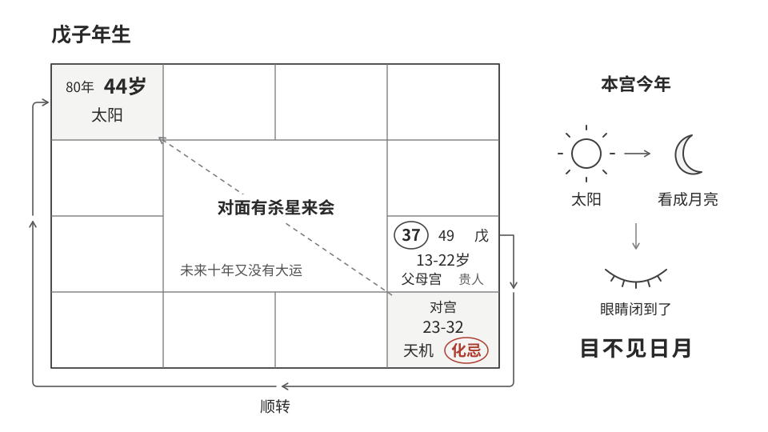 |
| **他戊子年生，子年 37 岁落在哪一格？** | 〔口述〕他是戊子年生，子年时 37 岁就在这一格，男命顺转：「诸位看他是成子的」（字幕「成子」按下一句应是戊子）「戊子年生的」「我们子年的时候」「37岁在这里」「37 49 都在这边」「男孩子是不是顺转」。（[00:36:12–00:36:24](https://www.bilibili.com/video/BV1KJsLekEfA/?p=15&t=2172)，第 65184–65549 帧） 〔指代〕说「37岁在这里」时，手持粉笔按在右列写有「戊」的那一格，随后在那里写下并圈出「37」。（[00:36:18](https://www.bilibili.com/video/BV1KJsLekEfA/?p=15&t=2178)，第 65360 帧） 〔板书〕可辨：右列一格写「戊」，旁边圈出「37」，圈下有一条向下的箭头。（[00:36:23](https://www.bilibili.com/video/BV1KJsLekEfA/?p=15&t=2183)，第 65513 帧） |
| **民国 80 年他虚岁几岁？为什么叫目不见日月？** | 〔口述〕从 37 往下数，80 年今年虚岁 44，正好落在这一格：「80年……37今年虚岁是不是44」「44岁是不是刚好在这里」「有没有注意哦」。（[00:36:26–00:36:38](https://www.bilibili.com/video/BV1KJsLekEfA/?p=15&t=2186)，第 65604–65963 帧） 〔板书〕可辨：黑板左侧一个圆圈里，上方像「44」，下方一字认不出。（[00:36:37](https://www.bilibili.com/video/BV1KJsLekEfA/?p=15&t=2197)，第 65928 帧） 〔口述〕要把盘当成图来读，不要当文字：第一，对面有杀星来会；未来十年又没有大运：「你把它不要把它当成文字」「当成图来读」「第一个对面有杀星来会」「未来十年又没有大运」。（[00:36:38–00:36:47](https://www.bilibili.com/video/BV1KJsLekEfA/?p=15&t=2198)，第 65964–66221 帧） 〔口述〕本宫今年的太阳看成月亮，白天出去把太阳看成月亮、眼睛闭了才看不到日月，叫目不见日月，死了当然看不到日月：「那本宫今年呢」「太阳把它看成月亮」……「叫做目不见日月」「你死掉当然看不到日月啊」。（[00:36:47–00:37:06](https://www.bilibili.com/video/BV1KJsLekEfA/?p=15&t=2207)，第 66222–66785 帧） 〔口述〕本块以「所以大限在这个时候」结束，这句话还没讲完。（[00:37:08–00:37:12](https://www.bilibili.com/video/BV1KJsLekEfA/?p=15&t=2228)，第 66840–66965 帧） |

**总结区**

- 通用规则：星要得正位；官禄宫化权最好，因为当官本来就要掌权（[00:32:35–00:32:51](https://www.bilibili.com/video/BV1KJsLekEfA/?p=15&t=1955)，第 58668–59141 帧）。；官禄宫化禄有两种：一种是贪官，一种是掌财权，比如在银行当主管、钱不是他的（[00:32:51–00:33:32](https://www.bilibili.com/video/BV1KJsLekEfA/?p=15&t=1971)，第 59142–60389 帧）。；财权和官权看颧骨、看鼻子区分：悬胆鼻、直筒的狮鼻是大富；鼻子好但不够直筒，是替人管钱的掌财权（[00:33:35–00:34:27](https://www.bilibili.com/video/BV1KJsLekEfA/?p=15&t=2015)，第 60468–62027 帧）。；化忌在本宫和化忌在对宫不一样（[00:36:06–00:36:12](https://www.bilibili.com/video/BV1KJsLekEfA/?p=15&t=2166)，第 65004–65183 帧）。
- 只在本例：这个男命 53-62 那一宫全是耗星、杀星，未来十年无大运，大限在前十年，53 岁以后已经没有了（[00:35:05–00:36:06](https://www.bilibili.com/video/BV1KJsLekEfA/?p=15&t=2105)，第 63150–65003 帧）。；他戊子年生、男命顺转，子年 37 岁，80 年虚岁 44 岁正落在倪师所指的那一格（[00:36:12–00:36:38](https://www.bilibili.com/video/BV1KJsLekEfA/?p=15&t=2172)，第 65184–65963 帧）。；44 岁这一格对面有杀星来会、未来十年又没有大运、本宫太阳看成月亮，叫目不见日月（[00:36:42–00:37:06](https://www.bilibili.com/video/BV1KJsLekEfA/?p=15&t=2202)，第 66072–66785 帧）。
- 不是排盘规则，是处世方法：看出别人是贪官命，不要当面讲、不要太直，要有分寸（[00:32:56–00:33:03](https://www.bilibili.com/video/BV1KJsLekEfA/?p=15&t=1976)，第 59280–59501 帧）。；老板挑掌柜先看鼻子，鼻孔不漏的人捡到客人的钱都会交回，最适合管财（[00:34:36–00:34:53](https://www.bilibili.com/video/BV1KJsLekEfA/?p=15&t=2076)，第 62304–62807 帧）。

**待核**

1. 「四仁地尺」「作地天」「活地大」「炸地尺」字幕可信度 0.3、语音对不上，当识别噪声略过（第 59574–59585、59718–59729 帧）。
2. 「就代表他在党」语音只有「表他」，「在党」二字待核（[00:33:12](https://www.bilibili.com/video/BV1KJsLekEfA/?p=15&t=1992)，第 59778 帧）。
3. 「你不要太过贪官」「人家把你干掉」句意和所指不清（[00:33:03–00:33:05](https://www.bilibili.com/video/BV1KJsLekEfA/?p=15&t=1983)，第 59502–59573 帧）。
4. 「兰台廷尉」倪师没解释，语音作「南台庭位」，照字幕原字引（[00:34:02](https://www.bilibili.com/video/BV1KJsLekEfA/?p=15&t=2042)，第 61284 帧）。
5. 「谢森中」语音作「谢森周」，照字幕原字引（第 60906、61608 帧）。
6. 「诸位看他是成子的」照字幕原字引，「成」按下一句「戊子年生的」应是「戊」（[00:36:12](https://www.bilibili.com/video/BV1KJsLekEfA/?p=15&t=2172)，第 65184 帧）。
7. 「37 49 都在这边」语音是「25 37 49」，照字幕原字引；说「这边」时手没有指黑板，指哪里看不出（[00:36:20–00:36:21](https://www.bilibili.com/video/BV1KJsLekEfA/?p=15&t=2180)，第 65406–65450 帧）。
8. 字幕「80年（1991）」的括号注是字幕制作者加的，不当倪师原话引（[00:36:26](https://www.bilibili.com/video/BV1KJsLekEfA/?p=15&t=2186)，第 65604 帧）。
9. 「53-62在这里」等四处「这里」，手指落点都看不出或拿不准（第 63190、63280、63370、63490 帧）。
10. 「诸位呢就要小心前面」「一定前面就会有灾」里的「前面」指哪一段大限，本块没讲清，下一块接着讲早年大限（[00:35:52–00:36:03](https://www.bilibili.com/video/BV1KJsLekEfA/?p=15&t=2152)，第 64584–64901 帧）。
11. 化忌在本宫和在对宫到底怎么不一样、这个男命的化忌在哪一宫，本块口头没讲清；叠图福德癸亥有天机化忌（[00:36:06–00:36:12](https://www.bilibili.com/video/BV1KJsLekEfA/?p=15&t=2166)，第 65004–65183 帧）。
12. 「本宫今年呢太阳把它看成月亮」的本宫是哪一宫、太阳指哪颗星没讲明；板书图[00:36:37](https://www.bilibili.com/video/BV1KJsLekEfA/?p=15&t=2197)，第 65928 帧右上角同时贴着财帛丁巳叠图（太阴陷、禄存庙，小限里的 44 加了底线，大限 83~92），但本块材料没有对应的叠图行，44 岁的「这里」是否就是这一宫待核（[00:36:37–00:36:51](https://www.bilibili.com/video/BV1KJsLekEfA/?p=15&t=2197)，第 65928–66341 帧）。
13. 板书认不全：[00:32:46](https://www.bilibili.com/video/BV1KJsLekEfA/?p=15&t=1966)，第 58990 帧第四字被挡；[00:35:38](https://www.bilibili.com/video/BV1KJsLekEfA/?p=15&t=2138)，第 64152 帧两列粉红字大半认不全；[00:36:12](https://www.bilibili.com/video/BV1KJsLekEfA/?p=15&t=2172)，第 65184 帧这 2 秒新写的笔画认不出；[00:36:37](https://www.bilibili.com/video/BV1KJsLekEfA/?p=15&t=2197)，第 65928 帧圈中下方一字认不出。
14. [00:32:34](https://www.bilibili.com/video/BV1KJsLekEfA/?p=15&t=1954)，第 58632 帧（本块开头的板面）是前面讲过的旧板书，本块没有引用。

### 8　早年父母大限与化科化忌的断法（[00:37:12–00:42:17](https://www.bilibili.com/video/BV1KJsLekEfA/?p=15&t=2232)，第 66966–76127 帧）

| 提示区 | 笔记区 |
|---|---|
| **早年 13-22 岁的大限在哪一宫？这十年有没有大运？** | 〔口述〕倪师举例：「23-32在这边他是不是化忌」，接着问小时候是不是也有大限、早年的大限在哪里。（[00:37:12–00:37:28](https://www.bilibili.com/video/BV1KJsLekEfA/?p=15&t=2232)，第 66966–67469 帧） 〔指代〕说「这边」时右臂伸直，手指的是黑板右下写有「天机 化忌」（化忌加红圈）的那一格；同一刻叠图显示天机平忌、23~32 福德癸亥。（[00:37:14–00:37:16](https://www.bilibili.com/video/BV1KJsLekEfA/?p=15&t=2234)，第 67032–67097 帧） 〔口述〕早年大限「在父母上面」，「也就是说他13-22岁这一时候」「不管他是什么灾星」「虽然未来十年没有大运」，「可是这时候他有贵人」，贵人就是父母宫。（[00:37:29–00:37:45](https://www.bilibili.com/video/BV1KJsLekEfA/?p=15&t=2249)，第 67470–67973 帧） 〔叠图〕父母 壬戌：七杀庙、凤阁庙、天月、寡宿陷、年解庙；长生十二神为养；奏书、月煞、吊客；小限 1,13,25,37,49,61；大限 13~22。（[00:37:29–00:37:31](https://www.bilibili.com/video/BV1KJsLekEfA/?p=15&t=2249)，第 67470–67541 帧） 〔板书〕可辨：右侧一格写「13-22」，下方似「□戌」，旁边圆圈里一字认不出；再下一格可辨「天机」「化」，其余认不出。（[00:37:35](https://www.bilibili.com/video/BV1KJsLekEfA/?p=15&t=2255)，第 67668 帧） |
| **父母宫这十年，父母在他身边起什么作用？** | 〔口述〕这段时间就是「读初中高中大学这段时间呢」，父母是他这十年大限的值星官（字幕「值值星官」，待核）；「爸爸妈妈在旁边」「这个灾会没有」。（[00:37:45–00:37:58](https://www.bilibili.com/video/BV1KJsLekEfA/?p=15&t=2265)，第 67974–68345 帧） 〔叠图〕同时贴出 福德 癸亥：天机平 化忌、天姚陷；长生；飞廉、亡神、病符；小限 2,14,26,38,50,62；大限 23~32。（[00:37:29–00:37:31](https://www.bilibili.com/video/BV1KJsLekEfA/?p=15&t=2249)，第 67470–67541 帧） |
| **后面的大限走到哪里？他最后是怎么死的？** | 〔口述〕学生会问为什么后面会有灾，倪师答：「他后面是官禄跟朋友」「他的朋友本来就不好对不对」「所以他死的时候是被人家杀死的」「丢在水里面死的」。（[00:37:58–00:38:12](https://www.bilibili.com/video/BV1KJsLekEfA/?p=15&t=2278)，第 68346–68783 帧） 〔叠图〕交友 甲寅：三台平、地劫平、天伤平、天巫、天马旺、孤辰平、左辅庙、破军得；临官；丧门、大耗、岁驿；大限 53~62。官禄 乙丑：副截不、天空平、天魁旺、铃星得；冠带；攀鞍、晦气、病符；大限 43~52。（[00:38:02–00:38:07](https://www.bilibili.com/video/BV1KJsLekEfA/?p=15&t=2282)，第 68460–68633 帧） 〔口述〕「人家为什么不杀我要杀他」，「一定是知道你有什么嘛」；他开名车（字幕「宾士」「奥斯莫比车」），晚上回来「就被抓去干掉」，丢到河里面去了。（[00:38:12–00:38:28](https://www.bilibili.com/video/BV1KJsLekEfA/?p=15&t=2292)，第 68784–69263 帧） 〔口述〕题外话：尸体在基隆河里，两岸警察在岸边看，「飘过来是我飘过去就是你的」，大家都想推过去，省得办一个大案子。（[00:38:28–00:38:51](https://www.bilibili.com/video/BV1KJsLekEfA/?p=15&t=2308)，第 69264–69959 帧） 〔推断〕推断：叠图上父母 13~22、福德 23~32 之后，官禄 43~52、交友 53~62，与倪师说的「后面是官禄跟朋友」顺序对得上；倪师在本块没说出事是哪一年、几岁。（[00:37:29–00:38:07](https://www.bilibili.com/video/BV1KJsLekEfA/?p=15&t=2249)，第 67470–68633 帧） |
| **这张盘「可惜」在哪里？紫微化科落在哪个大限？** | 〔口述〕「这会看大限了」，「这个八字可惜在哪里哈」，「可惜在一个紫微星化科」，「紫微星化科在33-42」。（[00:38:56–00:39:11](https://www.bilibili.com/video/BV1KJsLekEfA/?p=15&t=2336)，第 70104–70541 帧） 〔板书〕可辨：下方一格写「33-42」，其上一格有红圈的一字似「科」；右上方可辨「紫」，另有一个加圈的「果」，其余认不出。（[00:39:06](https://www.bilibili.com/video/BV1KJsLekEfA/?p=15&t=2346)，第 70380 帧） 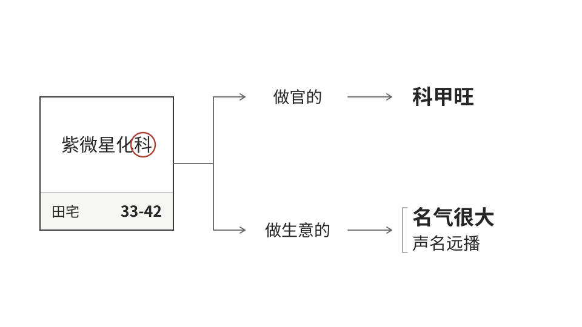 〔指代〕说「这个科」时右手食指指的是黑板右下格里红圈的「科」字，格下可见田宅和 33-42；材料注明叠图也显示田宅 33~42 化科。（[00:39:57–00:39:59](https://www.bilibili.com/video/BV1KJsLekEfA/?p=15&t=2397)，第 71928–71993 帧） |
| **如果这人是做官的，33-42 化科怎么断？** | 〔口述〕「诸位我们批八字我们要会判断」「怎么样判断」：「如果这个整个命格」「他根本不会做生意」「他是个做官的」，那 33-42 化科就是最好的（字幕「大利最好」，待核）。（[00:39:11–00:39:21](https://www.bilibili.com/video/BV1KJsLekEfA/?p=15&t=2351)，第 70542–70835 帧） 〔口述〕当官的要靠科（这句两路对不上，待核），考生能考特考，考上了就上去，「就科就上去了」；中间几句字面不清，见待核。（[00:39:21–00:39:37](https://www.bilibili.com/video/BV1KJsLekEfA/?p=15&t=2361)，第 70836–71321 帧） |
| **如果他是做生意的，这个化科代表什么？** | 〔口述〕「如果他是做生意的」「这个科对他怎么样」「没有用懂不懂我意思」；你跟他说「您33-42 你科甲旺」，他会说「对不起你 33-42我在做生意」，「你搞错了」。（[00:39:39–00:39:55](https://www.bilibili.com/video/BV1KJsLekEfA/?p=15&t=2379)，第 71382–71855 帧） 〔推断〕推断：结合上下文，「没有用」指把化科照当官、考试的讲法套给生意人说不通，并不是说化科对生意人毫无意义，因为倪师紧接着讲了化科对生意人的意思。（[00:39:40–00:40:06](https://www.bilibili.com/video/BV1KJsLekEfA/?p=15&t=2380)，第 71418–72203 帧） 〔口述〕「所以如果这个时候做生意进来」，「33-42 化科就代表不代表做生意」，「这个科就代表什么」——「名气很大声名远播」。（[00:39:56–00:40:06](https://www.bilibili.com/video/BV1KJsLekEfA/?p=15&t=2396)，第 71880–72203 帧） 〔板书〕黑板右侧用橙色粉笔竖写「名气大」，旁边画了一道括线；右上可辨「因」和加圈的「果」，其余认不出。（[00:40:05](https://www.bilibili.com/video/BV1KJsLekEfA/?p=15&t=2405)，第 72173 帧） |
| **33-42 化科、对面化禄，合起来怎么断？** | 〔口述〕「所以他33-42做的很好」「然后对面是化禄」「你赚钱而且声名很大」，「你会在工商业做个举足轻重的角色」，「青年有成」，「所以他一定会去做生意」。（[00:40:08–00:40:25](https://www.bilibili.com/video/BV1KJsLekEfA/?p=15&t=2408)，第 72246–72755 帧） |
| **23-32 十年化忌，他刚出社会会怎样？** | 〔口述〕「他十年化忌的时候就代表说」「这十年中他诸多不顺」：毕业出来先去帮人家做、「去领固定的薪水」，「做了半年越做越火大」，「做到半年都是是非口舌」。（[00:40:25–00:40:42](https://www.bilibili.com/video/BV1KJsLekEfA/?p=15&t=2425)，第 72756–73289 帧） 〔口述〕倪师替他说：「该轮到我的轮不到我」「老板承诺给我年终奖金给我多少」「结果事后又反悔了」，那时某项法律还没通过（字幕「劳纪法律」，待核），所以「我都干脆不要做了」。（[00:40:43–00:40:50](https://www.bilibili.com/video/BV1KJsLekEfA/?p=15&t=2443)，第 73290–73523 帧） 〔口述〕「那33岁以后我就开始做生意」「当老板了」，「大运就跳过来了你懂吧」，「所以他会做生意当老板」「33岁以后开始」。（[00:40:50–00:41:02](https://www.bilibili.com/video/BV1KJsLekEfA/?p=15&t=2450)，第 73524–73871 帧） |
| **他 28 岁来算命，该怎么跟他讲？** | 〔口述〕「他28岁来找你算命怎么办」「你要怎么讲这个话」：「因为你这十年不好」，「你要在乎你学到多少东西」，「你之所以后面会很好」「是因为这个时候你学到很多东西」。（[00:41:02–00:41:22](https://www.bilibili.com/video/BV1KJsLekEfA/?p=15&t=2462)，第 73872–74477 帧） 〔指代〕说「这十年」时手指点着黑板右下写「天机…化」的那一格（第 74030 帧），格子下半被手挡住；材料注明叠图显示福德 23~32。（[00:41:07–00:41:10](https://www.bilibili.com/video/BV1KJsLekEfA/?p=15&t=2467)，第 74010–74129 帧） 〔口述〕「所以如果你每天在乎你赚多少钱」，「你每天上班都很痛苦」；如果说「32岁以前我就帮人家做」「领人家的薪水」「来学做老板的经验」，「你每天工作就很愉快」。（[00:41:22–00:41:36](https://www.bilibili.com/video/BV1KJsLekEfA/?p=15&t=2482)，第 74478–74885 帧） 〔指代〕说「你的想法在这里」时，右手握拳抵住额头，指的是自己的头，没有指黑板。（[00:41:22–00:41:25](https://www.bilibili.com/video/BV1KJsLekEfA/?p=15&t=2482)，第 74478–74579 帧） |
| **「天地否」与「地天泰」，倪师用它说明什么？** | 〔口述〕两种想法就是「一个天地否一个地天泰」（这句连说两次），「这就是人间道」。（[00:41:36–00:41:44](https://www.bilibili.com/video/BV1KJsLekEfA/?p=15&t=2496)，第 74886–75137 帧） 〔口述〕「所以天地否和地天泰是序卦」「我们下堂课会介绍」，「一念之间就进去了」。（[00:41:44–00:41:49](https://www.bilibili.com/video/BV1KJsLekEfA/?p=15&t=2504)，第 75138–75299 帧） 〔口述〕「然后他在32岁以前」「听了你的话以后」「他就开始很愉快了」「已经种进去了」。（[00:41:50–00:41:56](https://www.bilibili.com/video/BV1KJsLekEfA/?p=15&t=2510)，第 75300–75485 帧） |
| **做算命师，本身要有什么修养？** | 〔口述〕「所以诸位你看看」「我们要做个算命师」「本身的修养要有多少」。（[00:41:56–00:42:02](https://www.bilibili.com/video/BV1KJsLekEfA/?p=15&t=2516)，第 75486–75671 帧） 〔口述〕外面的算命师「看两本书就够了」，搞不好他帮你算的时候还在下面偷看书（字幕「先看好然后下面书在下面偷看」，与语音不一致，待核），「对啊一定的嘛」。（[00:42:02–00:42:17](https://www.bilibili.com/video/BV1KJsLekEfA/?p=15&t=2522)，第 75672–76127 帧） |

**总结区**

- 通用规则：当官的人逢大限化科最好，考试、特考可以「就科就上去了」（[00:39:11–00:39:37](https://www.bilibili.com/video/BV1KJsLekEfA/?p=15&t=2351)，第 70542–71321 帧）；做生意的人逢化科，代表名气很大、声名远播，不能照当官的「科甲旺」去讲（[00:39:39–00:40:06](https://www.bilibili.com/video/BV1KJsLekEfA/?p=15&t=2379)，第 71382–72203 帧）；十年大限化忌，代表这十年诸多不顺（[00:40:25–00:40:30](https://www.bilibili.com/video/BV1KJsLekEfA/?p=15&t=2425)，第 72756–72917 帧）
- 只在本例：本例男命 13-22 岁大限在父母宫，读书那十年虽无大运，但父母是贵人，灾会没有（[00:37:16–00:37:58](https://www.bilibili.com/video/BV1KJsLekEfA/?p=15&t=2236)，第 67098–68345 帧）；本例后面大限走官禄、朋友，朋友本来就不好，最后被人杀害、丢进河里死的（[00:37:58–00:38:28](https://www.bilibili.com/video/BV1KJsLekEfA/?p=15&t=2278)，第 68346–69263 帧）；本例 23-32 化忌：毕业后领固定薪水诸多不顺，33 岁以后开始做生意当老板（[00:40:25–00:41:02](https://www.bilibili.com/video/BV1KJsLekEfA/?p=15&t=2425)，第 72756–73871 帧）；本例 33-42 紫微化科、对面化禄：赚钱又声名大，在工商业举足轻重、青年有成（[00:38:59–00:40:25](https://www.bilibili.com/video/BV1KJsLekEfA/?p=15&t=2339)，第 70188–72755 帧）
- 不是排盘规则，是处世方法：客人 28 岁走化忌大限来算时，劝他在乎学到多少东西、把领薪水当成学做老板的经验，每天工作就愉快（[00:41:02–00:41:36](https://www.bilibili.com/video/BV1KJsLekEfA/?p=15&t=2462)，第 73872–74885 帧）；同一段处境，想法不同就是天地否与地天泰，一念之间（[00:41:36–00:41:56](https://www.bilibili.com/video/BV1KJsLekEfA/?p=15&t=2496)，第 74886–75485 帧）；做算命师本身要有修养，不能像外面看两本书就去算（[00:41:56–00:42:17](https://www.bilibili.com/video/BV1KJsLekEfA/?p=15&t=2516)，第 75486–76127 帧）

**待核**

1. [00:37:14](https://www.bilibili.com/video/BV1KJsLekEfA/?p=15&t=2234)，第 67032 帧：字幕「23-32」，语音作「83」，两路数字不一致，按字幕和叠图 23~32 取。
2. [00:37:49](https://www.bilibili.com/video/BV1KJsLekEfA/?p=15&t=2269)，第 68070 帧：字幕「值值星官」、语音「执行官」，可能是「值星官」，倪师未解释。
3. [00:38:19–00:38:24](https://www.bilibili.com/video/BV1KJsLekEfA/?p=15&t=2299)，第 68988–69131 帧：字幕「宾士」「奥斯莫比车」，语音作「兵士」「摩比尔车」，车名待核。
4. [00:38:52](https://www.bilibili.com/video/BV1KJsLekEfA/?p=15&t=2332)，第 69960 帧：「所以淡水河那边」可信度 0.3，已并入题外话不单引。
5. [00:38:59](https://www.bilibili.com/video/BV1KJsLekEfA/?p=15&t=2339)，第 70188 帧：倪师讲紫微盘时说「这个八字」「我们批八字」，原字照录。
6. [00:39:07](https://www.bilibili.com/video/BV1KJsLekEfA/?p=15&t=2347)，第 70428 帧：句首「［」是识别噪声，引文已去掉。
7. [00:39:18](https://www.bilibili.com/video/BV1KJsLekEfA/?p=15&t=2358)，第 70758 帧：字幕「大利最好」、语音「大力最好」，原字待核。
8. [00:39:21](https://www.bilibili.com/video/BV1KJsLekEfA/?p=15&t=2361)，第 70836 帧：字幕「因为当官的要科用」，语音「当官的叫科家」，两路对不上。
9. [00:39:22–00:39:27](https://www.bilibili.com/video/BV1KJsLekEfA/?p=15&t=2362)，第 70878–71033 帧：「特岗」「考考那个政府漂白」「黑官的家政特考」字面意思不清，不作解释。
10. [00:39:27](https://www.bilibili.com/video/BV1KJsLekEfA/?p=15&t=2367)，第 71034 帧：字幕「天子就发布命令啊」、语音「天使就发布命令啊」，待核。
11. [00:39:47](https://www.bilibili.com/video/BV1KJsLekEfA/?p=15&t=2387)，第 71628 帧：字幕「科甲旺」、语音「科两个」；「科甲」一词倪师未解释。
12. [00:40:09](https://www.bilibili.com/video/BV1KJsLekEfA/?p=15&t=2409)，第 72282 帧：「对面是化禄」，倪师没说是哪颗星化禄，本块叠图里也没有显示，待核。
13. [00:40:22](https://www.bilibili.com/video/BV1KJsLekEfA/?p=15&t=2422)，第 72684 帧：字幕「其年有成」按同音视为「青年有成」，引文取[00:40:17](https://www.bilibili.com/video/BV1KJsLekEfA/?p=15&t=2417)，第 72534 帧的「青年有成」。
14. [00:40:32](https://www.bilibili.com/video/BV1KJsLekEfA/?p=15&t=2432)，第 72960 帧：「一定刚开始就车子将人家跑咯（3）」语音对不上，已略过。
15. [00:40:36](https://www.bilibili.com/video/BV1KJsLekEfA/?p=15&t=2436)，第 73086 帧：字幕「做的很无助」、语音「做得很困住」，未引用。
16. [00:40:47](https://www.bilibili.com/video/BV1KJsLekEfA/?p=15&t=2447)，第 73434 帧：字幕「劳纪法律」、语音「牢记法」，指哪条法律倪师未说明。
17. [00:40:49](https://www.bilibili.com/video/BV1KJsLekEfA/?p=15&t=2449)，第 73476 帧：「赌烂（台语：相当讨厌）」括号是字幕制作者加的注，不当倪师原话。
18. [00:41:11](https://www.bilibili.com/video/BV1KJsLekEfA/?p=15&t=2471)，第 74130 帧：语音有「你不要在乎赚到多少钱」，字幕这一句没有，未当原话引用。
19. [00:41:44](https://www.bilibili.com/video/BV1KJsLekEfA/?p=15&t=2504)，第 75138 帧：天地否、地天泰、序卦本块未解释，倪师说下堂课介绍，不补。
20. [00:42:07](https://www.bilibili.com/video/BV1KJsLekEfA/?p=15&t=2527)，第 75822 帧：字幕「先看好然后下面书在下面偷看」，语音「上面书在上面偷看」，原话待核。
21. [00:37:12](https://www.bilibili.com/video/BV1KJsLekEfA/?p=15&t=2232)，第 66966 帧板书：本块开头板面左侧有红色粉笔竖写数行，认不出。
22. [00:37:35](https://www.bilibili.com/video/BV1KJsLekEfA/?p=15&t=2255)，第 67668 帧板书：「13-22」下方似「□戌」，旁边圆圈里的字认不出。
23. [00:39:06](https://www.bilibili.com/video/BV1KJsLekEfA/?p=15&t=2346)，第 70380 帧板书：红圈里的字似「科」，右上「紫」「果」以外的字认不出。
24. 第 70635、71887、74336 帧：指代标为「是（不确定）」，未当依据。
25. [00:38:02](https://www.bilibili.com/video/BV1KJsLekEfA/?p=15&t=2282)，第 68460 帧叠图：交友甲寅、官禄乙丑的小限数字串（「415365」「51729」「405264」「41628」）未见原图核对，笔记里只写了大限 53~62、43~52。

### 9　子女贪狼化禄、科权分别与兄弟眉相（[00:42:17–00:47:02](https://www.bilibili.com/video/BV1KJsLekEfA/?p=15&t=2537)，第 76128–84683 帧）

| 提示区 | 笔记区 |
|---|---|
| **本例子女宫贪狼，为什么断有一个儿子？** | 〔口述〕倪师指着子女宫的贪狼星讲：看命时先不管阴星阳星，「贪狼星这种武官星出现的时候」「杀破狼七杀破军贪狼都是阳星」「你都把他当作男的」「所以他会有一个儿子」。（[00:42:17–00:42:36](https://www.bilibili.com/video/BV1KJsLekEfA/?p=15&t=2537)，第 76128–76703 帧） 〔指代〕说「这个贪狼星」时，手指的是板上方红圈里的「禄」字及其下方的字；贪狼字样板上看不清。（[00:42:19](https://www.bilibili.com/video/BV1KJsLekEfA/?p=15&t=2539)，第 76178 帧） 〔叠图〕子女 戊午：贪狼旺、擎羊陷、恩光庙、天贵庙、解神庙、天厨、旬空庙、天哭陷、天虚平、阴煞、力士、灾煞、岁破、死；小限 9,21,33,45,57,69；大限 93~102。（[00:43:18–00:43:19](https://www.bilibili.com/video/BV1KJsLekEfA/?p=15&t=2598)，第 77952–77993 帧） 〔板书〕本块开头板面：可辨上方红圈里一字像「禄」，中部「人事」，右侧「37」，其余认不出。（[00:42:17](https://www.bilibili.com/video/BV1KJsLekEfA/?p=15&t=2537)，第 76128 帧） 〔板书〕讲「当作男的」时写了约 5 秒之后：可辨板上方新出现一个圆圈，圈里一字像「男」（拿不准），其余认不出。（[00:42:35](https://www.bilibili.com/video/BV1KJsLekEfA/?p=15&t=2555)，第 76675 帧） |
| **女儿怎么看？加上太太八字会变成几个儿子？** | 〔口述〕接着说「算命的说我们女儿不看」「女儿不要看」，意思本块没讲清，照原字记下。（[00:42:36–00:42:40](https://www.bilibili.com/video/BV1KJsLekEfA/?p=15&t=2556)，第 76704–76829 帧） 〔口述〕下一张就是他太太的八字；把太太八字拿出来，「如果他太太命里面还有一个儿子」「变两个儿子」「那一个像爸爸一个像妈妈」。太太的八字本块没有讲。（[00:42:42–00:42:52](https://www.bilibili.com/video/BV1KJsLekEfA/?p=15&t=2562)，第 76860–77189 帧） |
| **像爸爸的儿子贪狼午宫化禄，将来做什么？** | 〔口述〕「像爸爸这个儿子」「你看他是贪狼在午宫化禄」「贪居子午有没有最旺」，「又化禄他这个儿子将来干什么的」——「做生意当大老板」。（[00:42:54–00:43:10](https://www.bilibili.com/video/BV1KJsLekEfA/?p=15&t=2574)，第 77232–77717 帧） 〔指代〕说「像爸爸这个儿子」和「他这个儿子将来干什么」时，食指点的都是板上方红圈里的「禄」字。（[00:42:55–00:43:05](https://www.bilibili.com/video/BV1KJsLekEfA/?p=15&t=2575)，第 77276–77558 帧） 〔口述〕「如果没有化禄武官」「你叫他当武官」，又开玩笑说「不是去军机采购泄密啊」，「也会当武官」「但是可能会出这个事情」。（[00:43:10–00:43:22](https://www.bilibili.com/video/BV1KJsLekEfA/?p=15&t=2590)，第 77718–78083 帧） 〔口述〕学员答的只差一点：「所以一个点之差」「那实际上大家都没有错」，只是刚开始进入，「都比较紧张」。（[00:43:23–00:43:28](https://www.bilibili.com/video/BV1KJsLekEfA/?p=15&t=2603)，第 78108–78251 帧） |
| **儿子若不是化禄而是化科，主什么行业？** | 〔口述〕「不是贪狼化禄如果是化科呢」——「自由业」，「医师律师会计师工程师建筑师」；「自由业不是专科技术专长」，是「一个人打仗」。（[00:43:28–00:43:41](https://www.bilibili.com/video/BV1KJsLekEfA/?p=15&t=2608)，第 78252–78653 帧） 〔口述〕自由业「我干小兵我也是老板」「我干上将还是老板」，「自由业一个一个人开一个事务所」「就是这样子的」。（[00:43:41–00:43:50](https://www.bilibili.com/video/BV1KJsLekEfA/?p=15&t=2621)，第 78654–78905 帧） 〔口述〕随后说「武官坐命然后一个化科就够了」，这句接的是哪种情形本块没展开。（[00:43:50–00:43:52](https://www.bilibili.com/video/BV1KJsLekEfA/?p=15&t=2630)，第 78906–78989 帧） |
| **化科再加化权，跟只有化科差在哪一级？** | 〔口述〕学生问「老师那科和权碰在一起怎么办」，答「很简单嘛」「同样是医生」：光一个化科的，「就在开个小诊所」「或者不错到医学院当教授」。（[00:43:55–00:44:09](https://www.bilibili.com/video/BV1KJsLekEfA/?p=15&t=2635)，第 79074–79487 帧） 〔口述〕「那如果化科化权呢」，「所以医学院的主任院长」，也是医生，层级更高。（[00:44:09–00:44:18](https://www.bilibili.com/video/BV1KJsLekEfA/?p=15&t=2649)，第 79488–79751 帧） 〔口述〕「只有一个化科」的，「可能他只能考到律师科」「然后当个律师」；有的人「没事就干干法官司法官」「没事干干律师又换来回去的」。（[00:44:19–00:44:28](https://www.bilibili.com/video/BV1KJsLekEfA/?p=15&t=2659)，第 79776–80051 帧） 〔口述〕「这是各安天命」；「所以我们如果立一个法则来批」「你不会批的」，「可是告诉你这个原则」「你就会了」——讲的是懂原则自己加减。（[00:44:28–00:44:40](https://www.bilibili.com/video/BV1KJsLekEfA/?p=15&t=2668)，第 80052–80417 帧） |
| **本例兄弟宫武曲天相，能马上断兄弟好吗？** | 〔口述〕「诸位再看这个八字」「他的兄弟宫」，「天相武曲天相在里面」；要大家「把我前面讲的武曲天相先忘掉」，「你看这个字就知道好星嘛」。（[00:44:40–00:44:59](https://www.bilibili.com/video/BV1KJsLekEfA/?p=15&t=2680)，第 80418–80981 帧） 〔口述〕「你说你兄弟很坏」「这个搞错了」；但「看到好星的时候」「先不要确定他」，要「看看他的眉毛」。（[00:44:59–00:45:09](https://www.bilibili.com/video/BV1KJsLekEfA/?p=15&t=2699)，第 80982–81299 帧） 〔指代〕说「你看这个字就知道好星」时，手指的是右上格圈住的字下方一组橙色粉笔字，可认出「天」「相」。（[00:44:57](https://www.bilibili.com/video/BV1KJsLekEfA/?p=15&t=2697)，第 80910 帧） 〔叠图〕兄弟 庚申：武曲得、天相庙、地空庙、蜚廉、小耗、指背、白虎、绝；小限 11,23,35,47,59,71；大限 113~122。（[00:44:41–00:44:43](https://www.bilibili.com/video/BV1KJsLekEfA/?p=15&t=2681)，第 80454–80519 帧） 〔板书〕可辨：右上格橙色粉笔「天」「相」，左边一字认不出；左下格可辨「地天」，其余认不出。（[00:44:56](https://www.bilibili.com/video/BV1KJsLekEfA/?p=15&t=2696)，第 80880 帧） 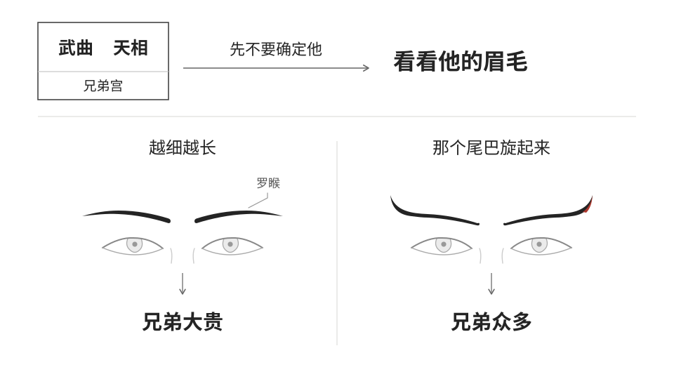 |
| **眉毛怎样看兄弟？细长主什么？** | 〔口述〕「我们人的眉毛呢」「是兄弟宫」，「左边呢我们叫罗睺」；「兄弟要眉毛最好要细要长」，「越细越长代表」「兄弟大贵」。（[00:45:10–00:45:30](https://www.bilibili.com/video/BV1KJsLekEfA/?p=15&t=2710)，第 81300–81923 帧） 〔板书〕可辨：板左侧画了两道横线（像两条眉毛），上方分别写着像「計都」和「羅」加一个认不清的字，右边横线下写「兄弟」，其余认不出。（[00:45:28](https://www.bilibili.com/video/BV1KJsLekEfA/?p=15&t=2728)，第 81864 帧） 〔口述〕「有的人眉毛很细长」，「那个尾巴旋起来」，「眼尾的尾巴往上旋呐」，主「兄弟众多」。（[00:45:30–00:45:43](https://www.bilibili.com/video/BV1KJsLekEfA/?p=15&t=2730)，第 81924–82301 帧） 〔板书〕讲眉尾上旋时写了约 6 秒之后：眉线下方新写的几笔认不出（可能是图形）。（[00:45:36](https://www.bilibili.com/video/BV1KJsLekEfA/?p=15&t=2736)，第 82107 帧） |
| **眉尾上旋的人兄弟「性不定」，怎么讲？** | 〔口述〕兄弟众多「但是狼性不常」，「这黑道的角头老大」「也这样子的」；「眉毛尾往上狼性不常的人」，「他的兄弟性有时候很正」「有时候又很不正」「性不定」。（[00:45:43–00:46:04](https://www.bilibili.com/video/BV1KJsLekEfA/?p=15&t=2743)，第 82302–82937 帧） 〔口述〕字幕接着是「这是代表兄弟很冲动」，这句字幕可信度低、语音对不上（见待核），只作参考。（[00:46:04–00:46:06](https://www.bilibili.com/video/BV1KJsLekEfA/?p=15&t=2764)，第 82938–83009 帧） 〔板书〕可辨：新写一竖行，有「性」「不」两字，第一字像「狼」，最后一字认不清，其余认不出。（[00:45:48](https://www.bilibili.com/video/BV1KJsLekEfA/?p=15&t=2748)，第 82452 帧） |
| **命盘配合面相看，好处在哪？** | 〔口述〕「那如果这个命上面」「再配合相上面加在一起的时候」「很清楚」，「就不会不会被误解」。（[00:46:07–00:46:20](https://www.bilibili.com/video/BV1KJsLekEfA/?p=15&t=2767)，第 83010–83411 帧） 〔板书〕这段写了约 4 秒，但这张图里可见的板面跟上一张一样，看不出新写的字（可能写在画面外），认不出。（[00:46:16](https://www.bilibili.com/video/BV1KJsLekEfA/?p=15&t=2776)，第 83280 帧） |
| **本例跟兄弟合伙谁当老板？跟朋友合伙行吗？** | 〔口述〕「那他的命中是化权化禄」「那他的兄弟没有」，跟兄弟合伙就「变成兄弟来做他的相」，「他来做主他来当老板」，「兄弟姐妹来当股东」「帮他做事情」，「他刚好做天子」。（[00:46:20–00:46:32](https://www.bilibili.com/video/BV1KJsLekEfA/?p=15&t=2780)，第 83412–83771 帧） 〔口述〕兄弟分文武，「一个他兄弟可以做武」「一个做文」：「武的话当业务经理」，「文的话当里面的行政经理」「人事经理」，在外面跑业务的是武；「所以才兄弟助力大」，合伙时他当老板、兄弟当股东。（[00:46:32–00:46:48](https://www.bilibili.com/video/BV1KJsLekEfA/?p=15&t=2792)，第 83772–84251 帧） 〔口述〕「那这个跟朋友合伙绝对不行」；本例讲到「这是大致」收住。（[00:46:48–00:47:02](https://www.bilibili.com/video/BV1KJsLekEfA/?p=15&t=2808)，第 84252–84683 帧） 〔叠图〕讲合伙时贴出 财帛 丁巳：太阴陷权、禄存庙、火星得、破碎陷、封诰、月德、博士、小耗、劫煞、病；小限 8,20,32,44,56,68；大限 83~92。（[00:46:45–00:46:48](https://www.bilibili.com/video/BV1KJsLekEfA/?p=15&t=2805)，第 84174–84251 帧） 〔叠图〕说朋友合伙时贴出 交友 甲寅：破军得、左辅庙、天马旺、地劫平、三台平、天伤平、孤辰平、天巫、临官、大耗、岁驿、丧门；小限 5,17,29,41,53,65；大限 53~62。（[00:46:48–00:46:57](https://www.bilibili.com/video/BV1KJsLekEfA/?p=15&t=2808)，第 84252–84520 帧） |

**总结区**

- 通用规则：贪狼这类武官星出现时，杀破狼（七杀、破军、贪狼）都是阳星，在子女宫当作男的看（[00:42:29–00:42:36](https://www.bilibili.com/video/BV1KJsLekEfA/?p=15&t=2549)，第 76482–76703 帧）；化科主自由业（医师、律师、会计师、工程师、建筑师，一个人开事务所）；化科又化权，同是医生就到医学院主任、院长一级（[00:43:28–00:44:18](https://www.bilibili.com/video/BV1KJsLekEfA/?p=15&t=2608)，第 78252–79751 帧）；眉毛是兄弟宫：越细越长兄弟大贵；眉尾往上旋兄弟众多，但兄弟性不定（[00:45:10–00:46:04](https://www.bilibili.com/video/BV1KJsLekEfA/?p=15&t=2710)，第 81300–82937 帧）；看到好星先不要下定论，命盘再配合面相一起看才清楚、不会误解（[00:45:02–00:46:20](https://www.bilibili.com/video/BV1KJsLekEfA/?p=15&t=2702)，第 81084–83411 帧）
- 只在本例：这个男命子女宫贪狼在午宫化禄，断一个像爸爸的儿子，将来做生意当大老板；没有化禄就当武官（[00:42:17–00:43:12](https://www.bilibili.com/video/BV1KJsLekEfA/?p=15&t=2537)，第 76128–77771 帧）；太太八字若也有一个儿子就是两个儿子，一个像爸爸一个像妈妈；太太八字本块未讲（[00:42:42–00:42:52](https://www.bilibili.com/video/BV1KJsLekEfA/?p=15&t=2562)，第 76860–77189 帧）；这个男命兄弟宫武曲天相是好星，但要配看眉毛再定（[00:44:40–00:45:09](https://www.bilibili.com/video/BV1KJsLekEfA/?p=15&t=2680)，第 80418–81299 帧）；这个男命命中化权化禄而兄弟没有，跟兄弟合伙他当老板、兄弟当股东一文一武，跟朋友合伙绝对不行（[00:46:20–00:46:59](https://www.bilibili.com/video/BV1KJsLekEfA/?p=15&t=2780)，第 83412–84581 帧）
- 不是排盘规则，是处世方法：跟兄弟合伙时，由命中有权禄的人做主当老板，兄弟一个管外面业务、一个管里面行政人事（[00:46:20–00:46:45](https://www.bilibili.com/video/BV1KJsLekEfA/?p=15&t=2780)，第 83412–84173 帧）

**待核**

1. [00:42:36–00:42:40](https://www.bilibili.com/video/BV1KJsLekEfA/?p=15&t=2556)，第 76704–76829 帧：「算命的说我们女儿不看」「女儿不要看」意思不清，照原字记。
2. [00:42:35](https://www.bilibili.com/video/BV1KJsLekEfA/?p=15&t=2555)，第 76675 帧：板书上方圆圈里的字像「男」，是否本次所写、是否真是「男」拿不准。
3. [00:42:17](https://www.bilibili.com/video/BV1KJsLekEfA/?p=15&t=2537)，第 76128 帧：截图左上已出现子女戊午叠图，贪狼下有红底「禄」；材料叠图转写里没有「禄」，且标的出现时间约[00:43:19](https://www.bilibili.com/video/BV1KJsLekEfA/?p=15&t=2599)，第 77970 帧，比截图晚，叠图转写可能有遗漏。
4. [00:43:16–00:43:18](https://www.bilibili.com/video/BV1KJsLekEfA/?p=15&t=2596)，第 77886–77951 帧：「不是去军机采购泄密啊」连出现两次，当一句看；所指何事本块没解释。
5. [00:43:50](https://www.bilibili.com/video/BV1KJsLekEfA/?p=15&t=2630)，第 78906 帧：「武官坐命然后一个化科就够了」接的是哪种情形、指谁，本块没讲清。
6. [00:44:14](https://www.bilibili.com/video/BV1KJsLekEfA/?p=15&t=2654)，第 79638 帧：字幕「医学院的主任院长」，语音是「到医院当主任当院长」，两路不一致。
7. [00:45:15](https://www.bilibili.com/video/BV1KJsLekEfA/?p=15&t=2715)，第 81456 帧：语音有「右边呢我们叫基督」，字幕只有「左边呢我们叫罗睺」；板书两组字像「計都」「羅□」，左右对应关系待核。
8. [00:45:28](https://www.bilibili.com/video/BV1KJsLekEfA/?p=15&t=2728)，第 81864 帧：画面右下另贴了一张「面部十二宫图」，材料没有转写，未当依据。
9. [00:45:36](https://www.bilibili.com/video/BV1KJsLekEfA/?p=15&t=2736)，第 82104 帧：字幕「眼尾的尾巴往上旋呐」，上下文讲的是眉毛，「眼尾」是否「眉尾」待核，未改字。
10. [00:45:43](https://www.bilibili.com/video/BV1KJsLekEfA/?p=15&t=2743)，第 82302 帧：「但是狼性不常」照原字引，语音是「狼性不长」，用词待核。
11. [00:46:04](https://www.bilibili.com/video/BV1KJsLekEfA/?p=15&t=2764)，第 82938 帧：字幕「这是代表兄弟很冲动」（可信度 0.39），语音像「代表兄弟很终多」，两路对不上。
12. [00:46:25](https://www.bilibili.com/video/BV1KJsLekEfA/?p=15&t=2785)，第 83556 帧、[00:46:31](https://www.bilibili.com/video/BV1KJsLekEfA/?p=15&t=2791)，第 83736 帧：「兄弟来做他的相」「他刚好做天子」用了没解释。
13. [00:46:39](https://www.bilibili.com/video/BV1KJsLekEfA/?p=15&t=2799)，第 83982 帧：字幕「文（武）的话到外面去做sales（销售）」里括号是字幕制作者加的注，未当原话引。
14. [00:46:45](https://www.bilibili.com/video/BV1KJsLekEfA/?p=15&t=2805)，第 84174 帧：口述「命中是化权化禄」时叠图贴的是财帛丁巳（太阴陷权），口述没点名是哪一宫，二者是否对应待核。
15. [00:45:36](https://www.bilibili.com/video/BV1KJsLekEfA/?p=15&t=2736)，第 82107 帧、[00:46:16](https://www.bilibili.com/video/BV1KJsLekEfA/?p=15&t=2776)，第 83280 帧：这两段新写的板书认不出或不在画面内。
16. 第 77160、77219、80326、83010 帧：这几处「这个」的指向标为不确定，未当依据。

## 夫妻死别生离：福德宫凶、阳宅、面相与死前气色

〔叠图〕这一例视频里只贴过 1 格：福德 癸亥：天机平忌、天姚陷。

### 10　夫妻死别生离：福德、阳宅、面相（[00:47:02–00:55:22](https://www.bilibili.com/video/BV1KJsLekEfA/?p=15&t=2822)，第 84684–99679 帧）

| 提示区 | 笔记区 |
|---|---|
| **另一个命留到下堂；夫妻死别生离为何要讲？** | 〔口述〕过渡：倪师说还有「另外一个命」，但「因为今天时间的关系哈」，「我们再把那个命」「移到下一堂课去讲」。另一个命本集没讲。（[00:47:05–00:47:36](https://www.bilibili.com/video/BV1KJsLekEfA/?p=15&t=2825)，第 84750–85709 帧） 〔板书〕本块开头的板面还是上一段的板书，可辨圈起的「运」「人」，以及「地理」「人事」，其余认不出。（[00:47:07](https://www.bilibili.com/video/BV1KJsLekEfA/?p=15&t=2827)，第 84819 帧） 〔板书〕擦板后板面基本空白，只左边缘剩几个字，认不出。（[00:47:23](https://www.bilibili.com/video/BV1KJsLekEfA/?p=15&t=2843)，第 85314 帧） 〔口述〕转入新题：「夫死别了夫妻死别」「这很重要了」「还有生离」，并强调「我讲这是一定的」「一定会发生的」。（[00:47:39–00:47:48](https://www.bilibili.com/video/BV1KJsLekEfA/?p=15&t=2859)，第 85776–86057 帧） 〔板书〕可辨：「死别」「生离」两列，上方一字认不全，其余认不出。（[00:47:46](https://www.bilibili.com/video/BV1KJsLekEfA/?p=15&t=2866)，第 85980 帧） |
| **斗数里看夫妻死别生离，第一看哪一宫、什么算凶？** | 〔口述〕倪师先说「在八字里面看的时候」，接着说「斗数里面看」「第一个」「福德宫凶」。八字怎么看本块没有展开。（[00:47:48–00:47:57](https://www.bilibili.com/video/BV1KJsLekEfA/?p=15&t=2868)，第 86058–86327 帧） 〔口述〕什么叫凶：「像化忌就是凶」「廉破就是凶」「廉贞破军」，又说「我讲廉贪就是廉贞贪狼」；「这是代表夫妻死别」「或者是生离」。（[00:48:00–00:48:23](https://www.bilibili.com/video/BV1KJsLekEfA/?p=15&t=2880)，第 86400–87101 帧） 〔板书〕可辨：一个圈形符号，其后「福德」「凶」，下有一横线；圈形符号认不出。（[00:47:56](https://www.bilibili.com/video/BV1KJsLekEfA/?p=15&t=2876)，第 86305 帧） 〔板书〕第二行可辨「化忌、廉破」；之后补写为「化忌、廉破、廉贪」，其中「化忌」在这张图里被身体挡住，只可辨「廉破、廉贪」。（[00:48:05](https://www.bilibili.com/video/BV1KJsLekEfA/?p=15&t=2885)，第 86568 帧） 〔板书〕可辨：「廉破」「廉贪」两词，前面被倪师身体挡住。（[00:48:18](https://www.bilibili.com/video/BV1KJsLekEfA/?p=15&t=2898)，第 86964 帧） |
| **叠图贴出的三个「福德」格各是什么？是同一张盘吗？** | 〔叠图〕福德癸亥：天机平、化忌（「忌」红底），天姚陷；小限 2,14,26,38,50,62；大限 23~32；飞廉、亡神、病符、长生。（[00:47:53–00:47:57](https://www.bilibili.com/video/BV1KJsLekEfA/?p=15&t=2873)，第 86196–86327 帧） 〔叠图〕福德癸酉：廉贞平、破军陷，文曲庙、天刑庙、天福庙、副截庙、副旬庙；小限 8,20,32,44,56,68；大限 104~113；奏书、息神、病符、墓。（[00:48:04–00:48:06](https://www.bilibili.com/video/BV1KJsLekEfA/?p=15&t=2884)，第 86532–86597 帧） 〔叠图〕福德辛巳：廉贞陷、贪狼陷，凤阁庙、年解旺；流年 1,13,25,37,49；小限 11,23,35,47,59；大限 23~32；伏兵、指背、岁建、病。（[00:48:08–00:48:10](https://www.bilibili.com/video/BV1KJsLekEfA/?p=15&t=2888)，第 86646–86729 帧） 〔推断〕推断：三格干支各不相同，分别跟着口述「化忌」「廉破」「廉贪」逐一贴出，是把别的格贴成「福德」来演示，不能当成同一个人的福德宫，也不是本集案例男命的盘。（[00:47:53–00:48:17](https://www.bilibili.com/video/BV1KJsLekEfA/?p=15&t=2873)，第 86196–86915 帧） |
| **阳宅上哪些方位主死先生、死妻、生离？** | 〔口述〕「阳宅都一样」：「西北方是厨房死先生」，「西南方是厨房死妻」，「然后西北方呢是客厅生离」。（[00:48:23–00:48:50](https://www.bilibili.com/video/BV1KJsLekEfA/?p=15&t=2903)，第 87102–87917 帧） 〔板书〕可辨：「阳宅」，其后一个圈形符号和两字，认不全。（[00:48:25](https://www.bilibili.com/video/BV1KJsLekEfA/?p=15&t=2905)，第 87158 帧） 〔板书〕可辨：方框里「死夫」，下方方框里「死妻」（「死」字部分被身体挡住）。（[00:48:41](https://www.bilibili.com/video/BV1KJsLekEfA/?p=15&t=2921)，第 87636 帧） |
| **为什么劝了半天还是离？命、地理、人间道各占几分？** | 〔口述〕「必须命上有灾」，再加阳宅，「加起来就是2/3了」「就大于人事」。即「他的命上要离婚」，「阳宅上又是夫妻生离的位置」。（[00:48:50–00:49:09](https://www.bilibili.com/video/BV1KJsLekEfA/?p=15&t=2930)，第 87918–88481 帧） 〔口述〕「天和地命是1/3地理是1/3」；遇到这种情形「我们用人间道」「用1/3的人间道」，结果「劝了半天还是离掉」，「因为命1/3地1/3 加起来2/3」「就大于我们的人间道」。（[00:49:09–00:49:28](https://www.bilibili.com/video/BV1KJsLekEfA/?p=15&t=2949)，第 88482–89045 帧） 〔板书〕可辨：圈起的一字（形似「令」，按口述推断是「命」）、圈起的「人」、「阳宅」、「运」，有箭头指向「生离」；其余认不出。（[00:49:00](https://www.bilibili.com/video/BV1KJsLekEfA/?p=15&t=2940)，第 88208 帧） 〔板书〕在上图基础上补了几个「1/3」：圈起的命字旁、左下、「运」字前各一个「1/3」。（[00:49:17](https://www.bilibili.com/video/BV1KJsLekEfA/?p=15&t=2957)，第 88713 帧） |
| **进入易经很神的阶段，还需要靠运吗？** | 〔口述〕「如果是进入到易经的」「很神的阶段的时候」，「诸位把运拿掉」「光是命和人间道」「你就不需要运」；「随便你睡东北西南东北西南」「你是你是金刚不坏」。（[00:49:28–00:49:45](https://www.bilibili.com/video/BV1KJsLekEfA/?p=15&t=2968)，第 89046–89555 帧） 〔口述〕「所以我们只要命随便两个加在一起」「它的意义就不一样」；「如果你要完全靠运气改的话就很累」。（[00:49:46–00:49:52](https://www.bilibili.com/video/BV1KJsLekEfA/?p=15&t=2986)，第 89592–89789 帧） 〔口述〕举例：「因为建筑师不懂啊」「给你乱画」；有人「住小房子时候大发财」，「赚了钱以后就买了个大房子」「住进去后赔光光了」，又「跑到吴兴街去租个房子」「又把好几亿赚过来」，「前前后后三个房」「一共才租6年」。倪师说「我后面都会有案例」。（[00:49:54–00:50:35](https://www.bilibili.com/video/BV1KJsLekEfA/?p=15&t=2994)，第 89838–91073 帧） |
| **相上怎么看生离与已死？眼纹、奸门、印堂各主什么？** | 〔口述〕「然后我们在相上面来说」：「眼睛纹往下走」「都是生离」。（[00:50:35–00:50:42](https://www.bilibili.com/video/BV1KJsLekEfA/?p=15&t=3035)，第 91074–91271 帧） 〔口述〕死别时「在眼睛鱼尾的地方」「奸门的地方呢」「都会有叉」「或者是暗暗黑暗」「非常的黑暗」，「那这个是已死」。（[00:50:42–00:50:56](https://www.bilibili.com/video/BV1KJsLekEfA/?p=15&t=3042)，第 91272–91697 帧） 〔指代〕说「那这个是已死」时，手指正点在黑板上竖写的「黑暗」两字的「暗」字上。（[00:50:53](https://www.bilibili.com/video/BV1KJsLekEfA/?p=15&t=3053)，第 91598 帧） 〔口述〕印堂上也会看到白色（字幕作「自色」，按语音改「白」），「这是已死」「白色」；「如果对方没有死」，「你的相上面注定要死」。（[00:50:57–00:51:10](https://www.bilibili.com/video/BV1KJsLekEfA/?p=15&t=3057)，第 91716–92129 帧） 〔板书〕可辨：「黑暗」，其右「已」「死」上下两字，方框里「死夫」，另有两个眼形图；其余认不出。（[00:51:04](https://www.bilibili.com/video/BV1KJsLekEfA/?p=15&t=3064)，第 91924 帧） |
| **男人什么脸相主死别？为何没事哭、没事笑都不对？** | 〔口述〕男人看「这个哭脸」：「男人看起来脸在哭」，「就是说每天很悲戚难过」。（[00:51:11–00:51:23](https://www.bilibili.com/video/BV1KJsLekEfA/?p=15&t=3071)，第 92130–92495 帧） 〔口述〕「那你没事在那边哭什么」，「没事在那里笑也不对」，「无事而笑」「那个心生毒计」「那个歹人嘛」。（[00:51:23–00:51:32](https://www.bilibili.com/video/BV1KJsLekEfA/?p=15&t=3083)，第 92496–92765 帧） 〔板书〕可辨：方框里「死夫」「死妻」，「黑暗」「已死」，右边「生离」，右下圈起的「哭」字；其余认不出。（[00:51:18](https://www.bilibili.com/video/BV1KJsLekEfA/?p=15&t=3078)，第 92343 帧） |
| **女人什么相主死别？「面大骨粗」指肉还是骨？** | 〔口述〕「那女人呢」「如果是夫妻要死别的都是」「面大骨粗」，「脸孔比较大」「骨头比较粗」。（[00:51:34–00:51:46](https://www.bilibili.com/video/BV1KJsLekEfA/?p=15&t=3094)，第 92844–93185 帧） 〔口述〕提醒照镜子发现脸骨变大要注意；「那我讲的是不是肉」「你脸胖胖的没关系啊」「皮骨相连懂吗」，「皮骨骨头长得很大」「面面孔变得很小」「这都是主死别」。（[00:51:46–00:52:02](https://www.bilibili.com/video/BV1KJsLekEfA/?p=15&t=3106)，第 93186–93671 帧） 〔板书〕可辨：右上「面大」，其后两字认不全；三个方框中前两个是「死夫」「死妻」，第三个框里的字认不出；右下圈起「哭」。（[00:51:44](https://www.bilibili.com/video/BV1KJsLekEfA/?p=15&t=3104)，第 93134 帧） |
| **人死前多久会现气色？为什么要事前有警觉？** | 〔口述〕相上发现这些而「没有死的那一半」，「你就要注意你另外一半」：「人死之前两个礼拜会有气色」，「因为死的时候不见得是病」。（[00:52:02–00:52:12](https://www.bilibili.com/video/BV1KJsLekEfA/?p=15&t=3122)，第 93672–93989 帧） 〔口述〕举的死因：「有的时候凶杀」，「有时从楼上不小心摔下去」，「有时候打高尔夫球不小心脖子扭断掉」，「还有人误食农药」「把它当汽水喝」「结果喝到巴拉松」；「死之前都可以看到气色」。（[00:52:13–00:52:31](https://www.bilibili.com/video/BV1KJsLekEfA/?p=15&t=3133)，第 93990–94541 帧） 〔口述〕讲为什么要学：亲友或「左右街坊邻居过世了以后」去拜访，家人说「其实我过世前就发现」「就是都有这些预兆」；很多人事前认为不可能，「事后在那边后悔」。（[00:52:32–00:53:12](https://www.bilibili.com/video/BV1KJsLekEfA/?p=15&t=3152)，第 94584–95771 帧） 〔口述〕「我就让诸位学到这一点」「事前有警觉性」。「那有没有办法解」——「有」。（[00:53:13–00:53:21](https://www.bilibili.com/video/BV1KJsLekEfA/?p=15&t=3193)，第 95790–96053 帧） |
| **斗数能算到死期吗？「纱薄烟罩」是什么气色？** | 〔口述〕「这易经卦斗数可以到什么程度」：「我们可以把他哪个时候死」「都把它算出来」，知道时间到了、牛鬼蛇神来找他；「牛鬼蛇神会入相的哦」。（[00:53:26–00:53:41](https://www.bilibili.com/video/BV1KJsLekEfA/?p=15&t=3206)，第 96180–96659 帧） 〔口述〕例：「注定中午11点还是1点」，「到了10点多11点的时候」一看，「我们能看脸上」「叫做纱薄烟罩」：「就是我们脸上变成红色」「但是一个个毛孔都变成青色的」，「就代表牛鬼蛇神进来了」「意思就是死神接近你了」。（[00:53:42–00:54:10](https://www.bilibili.com/video/BV1KJsLekEfA/?p=15&t=3222)，第 96684–97511 帧） 〔口述〕「在中国的相上面都有记载」；国外有人通灵说人背后蜡烛快灭了，倪师说「看他脸就知道写在脸上」「所以我们没有什么通灵」「通通是经历中国好几千年的经验」「累积下来」。（[00:54:10–00:54:29](https://www.bilibili.com/video/BV1KJsLekEfA/?p=15&t=3250)，第 97512–98075 帧） 〔口述〕已经附上身、「有这种气色的话」，可以说没有办法救回来了。（[00:54:31–00:54:39](https://www.bilibili.com/video/BV1KJsLekEfA/?p=15&t=3271)，第 98136–98375 帧） |
| **先做头七「抓错人」的说法，倪师自己怎么定性？** | 〔口述〕「我们为什么要算那一天」：「算那天之前一天」「我们先给他做头七」「让他象先出现一下」「就抓错人了」；「那抓到隔壁会怎样」「我就不知道了」。（[00:54:39–00:54:51](https://www.bilibili.com/video/BV1KJsLekEfA/?p=15&t=3279)，第 98376–98741 帧） 〔口述〕举学生的事：「我们有曾经有过去学生这样做啊」，做完后「第二天隔壁邻居先生」「出车祸死掉了」；倪师答「各安天命」「我也不是我做的」，「只是我们计算到那时候」。（[00:54:54–00:55:07](https://www.bilibili.com/video/BV1KJsLekEfA/?p=15&t=3294)，第 98832–99233 帧） 〔口述〕倪师自己说「哎到底是不是害到别人」不可知，「为什么因为也不知道对方八字」，最后定性：「这个部分是属于无法验证的部分」。（[00:55:08–00:55:22](https://www.bilibili.com/video/BV1KJsLekEfA/?p=15&t=3308)，第 99258–99679 帧） |

**总结区**

- 通用规则：斗数看夫妻死别或生离，第一看福德宫凶：化忌、廉贞破军、廉贞贪狼都算凶（[00:47:48–00:48:23](https://www.bilibili.com/video/BV1KJsLekEfA/?p=15&t=2868)，第 86058–87101 帧）；阳宅：西北方是厨房死先生，西南方是厨房死妻，西北方是客厅生离（[00:48:23–00:48:50](https://www.bilibili.com/video/BV1KJsLekEfA/?p=15&t=2903)，第 87102–87917 帧）；命上有灾占 1/3、阳宅地理占 1/3，加起来 2/3 大于 1/3 的人间道，所以劝了半天还是离（[00:48:50–00:49:28](https://www.bilibili.com/video/BV1KJsLekEfA/?p=15&t=2930)，第 87918–89045 帧）；相上眼睛纹往下走主生离，鱼尾奸门有叉或黑暗、印堂白色是已死，男人哭脸、女人面大骨粗（皮骨相连）主死别；人死前两个礼拜会有气色，死神接近时脸红而毛孔青叫纱薄烟罩（[00:50:35–00:54:10](https://www.bilibili.com/video/BV1KJsLekEfA/?p=15&t=3035)，第 91074–97511 帧）
- 只在本例：倪师讲某人住小房子大发财、搬大房子赔光、再回吴兴街租三十几平的房子又赚回好几亿，前后三个房子共 6 年（[00:50:09–00:50:35](https://www.bilibili.com/video/BV1KJsLekEfA/?p=15&t=3009)，第 90282–91073 帧）；学生照着先做头七，第二天隔壁邻居先生出车祸死掉，倪师自己说这个部分属于无法验证的部分（[00:54:39–00:55:22](https://www.bilibili.com/video/BV1KJsLekEfA/?p=15&t=3279)，第 98376–99679 帧）
- 不是排盘规则，是处世方法：学这些是为了事前有警觉性，别等事后后悔（[00:52:32–00:53:21](https://www.bilibili.com/video/BV1KJsLekEfA/?p=15&t=3152)，第 94584–96053 帧）；无事而哭、无事而笑都不对，无事而笑是心生毒计的歹人（[00:51:23–00:51:32](https://www.bilibili.com/video/BV1KJsLekEfA/?p=15&t=3083)，第 92496–92765 帧）；进入易经很神的阶段可以不靠运，只靠运气改很累（[00:49:28–00:49:52](https://www.bilibili.com/video/BV1KJsLekEfA/?p=15&t=2968)，第 89046–89789 帧）

**待核**

1. [00:47:02](https://www.bilibili.com/video/BV1KJsLekEfA/?p=15&t=2822)，第 84684 帧「诸位看这个」：指代标注为否，手在翻讲义，看不出所指。
2. 第 85020、85092 帧字幕「S刊）」「S刊小南」是识别噪声，已略过。
3. [00:47:48](https://www.bilibili.com/video/BV1KJsLekEfA/?p=15&t=2868)，第 86058 帧「在八字里面看的时候」：八字怎么看本块没有展开。
4. [00:47:46](https://www.bilibili.com/video/BV1KJsLekEfA/?p=15&t=2866)，第 85980 帧板书「死别」「生离」上方一字认不全；[00:47:56](https://www.bilibili.com/video/BV1KJsLekEfA/?p=15&t=2876)，第 86305 帧「福德」前的圈形符号认不出；[00:48:25](https://www.bilibili.com/video/BV1KJsLekEfA/?p=15&t=2905)，第 87158 帧「阳宅」后两字认不全。
5. [00:49:00](https://www.bilibili.com/video/BV1KJsLekEfA/?p=15&t=2940)，第 88208 帧板书圈里一字形似「令」，按口述推断为「命」，未能确认。
6. [00:48:04](https://www.bilibili.com/video/BV1KJsLekEfA/?p=15&t=2884)，第 86532 帧叠图转写「秦书」，原图为「奏书」；福德癸亥与福德辛巳都标大限 23~32 但干支不同，三格是演示，不是同一张盘。
7. [00:49:53](https://www.bilibili.com/video/BV1KJsLekEfA/?p=15&t=2993)，第 89790 帧字幕「有时候要住厕所」，语音作「要住客厅」，两路对不上。
8. [00:49:58](https://www.bilibili.com/video/BV1KJsLekEfA/?p=15&t=2998)，第 89952 帧「所有建筑师画出来都是形」，语音作「画财都是行」，意思不明。
9. [00:50:06–00:50:09](https://www.bilibili.com/video/BV1KJsLekEfA/?p=15&t=3006)，第 90186–90281 帧「上帝有规定」「你住的好的房子就就就不会破产」，口气像反话，语音作「破财」，待核。
10. [00:50:56](https://www.bilibili.com/video/BV1KJsLekEfA/?p=15&t=3056)，第 91698 帧字幕「客以越」是识别噪声，已略过。
11. [00:50:57](https://www.bilibili.com/video/BV1KJsLekEfA/?p=15&t=3057)，第 91716 帧字幕「自色」按语音与上下文改为「白色」。
12. [00:51:15](https://www.bilibili.com/video/BV1KJsLekEfA/?p=15&t=3075)，第 92250 帧「这个哭脸」指代不确定，未作依据。
13. [00:51:53](https://www.bilibili.com/video/BV1KJsLekEfA/?p=15&t=3113)，第 93402 帧「皮骨相连」语音作「屁股」；[00:51:58](https://www.bilibili.com/video/BV1KJsLekEfA/?p=15&t=3118)，第 93552 帧「面面孔变得很小」与前文「面大」看似相反，本块没解释。
14. 第 93888、94440 帧字幕「气色」语音作「七次」，按字幕取「气色」。
15. [00:52:32](https://www.bilibili.com/video/BV1KJsLekEfA/?p=15&t=3152)，第 94560 帧字幕「細正」按语音改为「纠正」；[00:53:08](https://www.bilibili.com/video/BV1KJsLekEfA/?p=15&t=3188)，第 95640 帧「认沩」按语音为「认为」。
16. [00:53:42](https://www.bilibili.com/video/BV1KJsLekEfA/?p=15&t=3222)，第 96660 帧字幕「比如说你是周五」语音作「你是注」，疑为噪声，未采用。
17. [00:53:51](https://www.bilibili.com/video/BV1KJsLekEfA/?p=15&t=3231)，第 96948 帧「纱薄烟罩」语音作「沙脱烟灶」，两路对不上，用字待核。
18. [00:54:43](https://www.bilibili.com/video/BV1KJsLekEfA/?p=15&t=3283)，第 98496 帧「让他象先出现一下」意思不明。
19. [00:51:44](https://www.bilibili.com/video/BV1KJsLekEfA/?p=15&t=3104)，第 93134 帧板书第三个方框里的字、「面大」后两字认不出。
20. [00:55:16](https://www.bilibili.com/video/BV1KJsLekEfA/?p=15&t=3316)，第 99486 帧语音末尾「感谢观看」是频道口播，不是倪师的话。

