# P17 · 9 上：再婚改运法 / 挑子女时间 / 中年丧偶面相 / 化忌冲命（00:00:00–00:54:13，共 97,598 帧）

> 2026-11-11 整理。依据 DeepSeek 逐帧记录与现成的五层材料（字幕、语音、叠图、板书、指代），由 Claude（Opus 5.5 子代理）分段起草，引文由程序逐段对过字幕。流程 2026-11-11 经站长认可。
> 依据标记：〔口述〕字幕与语音两路对得上的话，「」里是字幕原字 ·〔叠图〕后期贴的电子命盘，**不算倪师的话** ·〔板书〕粉笔字（看过那一帧原图才写）·〔指代〕「这里 / 这个」指哪（只收核过、确定的）·〔推断〕笔记作者自己的推断。每条后面的时间码可以点，跳到 B 站那一秒。

## 全集总结

**通用规则**

- 女人的命福德宫非常重要，福德宫讲的也等于夫妻，福德宫很差就根本不用谈（[00:00:17–00:00:37](https://www.bilibili.com/video/BV1KJsLekEfA/?p=17&t=17)，第 522–1121 帧）
- 太阳除代表爸爸还代表丈夫；福德宫遇廉破，太阳就不见了，冲夫妻，不是生离就是死别；太阳旺死别大于生离，太阳陷地主生离（[00:10:13–00:11:08](https://www.bilibili.com/video/BV1KJsLekEfA/?p=17&t=613)，第 18390–20057 帧）
- 看红鸾落在哪一宫，就知道婚姻受谁左右：父母宫受父母之言，子女宫因子女之命，朋友宫被朋友怂恿，命宫自己决定（[00:15:50–00:16:37](https://www.bilibili.com/video/BV1KJsLekEfA/?p=17&t=950)，第 28524–29939 帧）
- 女人要红鸾星再动，一律放到东南角；东南角代表没有婚姻的女孩子，会很快嫁人（[00:23:41–00:24:18](https://www.bilibili.com/video/BV1KJsLekEfA/?p=17&t=1421)，第 42636–43763 帧）
- 改了之后，流年一定要进入「有人的宫」才会成；女人的福德代表先生（[00:25:10–00:25:27](https://www.bilibili.com/video/BV1KJsLekEfA/?p=17&t=1510)，第 45324–45833 帧）
- 挑流年挑先生的方法与挑子女一样：只挑哪一年怀孕，不必挑开刀生产的时间，也不挑月份（[00:31:37–00:32:17](https://www.bilibili.com/video/BV1KJsLekEfA/?p=17&t=1897)，第 56910–58139 帧）
- 凡女命中年丧偶有一定的相：中庭短（上下高、中间最短）；面大、骨粗、声沙，三样有一样就成格；鱼尾奸门有乱纹或黑点（[00:33:26–00:36:08](https://www.bilibili.com/video/BV1KJsLekEfA/?p=17&t=2006)，第 60192–65051 帧）
- 化忌只要冲命就是半空折翅，机月同梁也会被杀死或意外死亡，半空折翅的限一定在中年（[00:37:22–00:37:59](https://www.bilibili.com/video/BV1KJsLekEfA/?p=17&t=2242)，第 67284–68399 帧）
- 过继、劝晚婚这类命解是消极的，要用积极的运解，例如睡东宫、脚朝有解厄制化之星的延年方（[00:45:47–00:47:06](https://www.bilibili.com/video/BV1KJsLekEfA/?p=17&t=2747)，第 82428–84785 帧）
- 批流年：一个宫代表十年也可代表一年，运一定要做加减，好的加重或减半、坏的加重（[00:53:35–00:53:54](https://www.bilibili.com/video/BV1KJsLekEfA/?p=17&t=3215)，第 96456–97037 帧）

**只在本例**

- 福德宫又是廉破，倪师断夫妻感情没问题，而是死别（[00:11:11–00:11:53](https://www.bilibili.com/video/BV1KJsLekEfA/?p=17&t=671)，第 20130–21419 帧）
- 37 岁改，38 岁太阴化忌在朋友宫、39 岁事业宫都不会成，要拖到 41 岁福德才成（[00:24:51–00:25:27](https://www.bilibili.com/video/BV1KJsLekEfA/?p=17&t=1491)，第 44742–45833 帧）
- 41 岁年底改住东南角、脚朝东北，42 岁红鸾进来结婚，先生是天钺、对面巨门太阳（[00:28:14–00:28:30](https://www.bilibili.com/video/BV1KJsLekEfA/?p=17&t=1694)，第 50838–51329 帧）
- 男命民国42年生，武曲在命宫（叠图壬戌），迁移（叠图丙辰）贪狼、火星并化忌，倪师说化忌对冲命，非常凶（[00:36:19–00:37:28](https://www.bilibili.com/video/BV1KJsLekEfA/?p=17&t=2179)，第 65382–67445 帧）
- 先把灾锁定在中年那个限，民国82年这位要竞选的男子早上下楼时被枪击致命（[00:38:51–00:39:29](https://www.bilibili.com/video/BV1KJsLekEfA/?p=17&t=2331)，第 69942–71075 帧）
- 出生当天医院火灾抱错，与亲生父母离散，应验二姓宜生；倪师说因此中年的限就不用批了（[00:42:32–00:42:45](https://www.bilibili.com/video/BV1KJsLekEfA/?p=17&t=2552)，第 76578–76955 帧、[00:44:37–00:44:42](https://www.bilibili.com/video/BV1KJsLekEfA/?p=17&t=2677)，第 80322–80465 帧、[00:45:36–00:45:39](https://www.bilibili.com/video/BV1KJsLekEfA/?p=17&t=2736)，第 82080–82187 帧）
- 16–25 岁七杀天马离开父母、外地求学；26 岁大小二限逢红鸾，婚姻在劫难逃（[00:50:45–00:51:41](https://www.bilibili.com/video/BV1KJsLekEfA/?p=17&t=3045)，第 91374–93059 帧）

**不是排盘规则，是处世方法**

- 劝至亲好友避灾要以刚中：只说一句「你搬」就走，等对方追来问为什么再讲，对方才收得到（[00:14:19–00:14:49](https://www.bilibili.com/video/BV1KJsLekEfA/?p=17&t=859)，第 25770–26687 帧）
- 替人决定婚姻，不管结果好坏，做决定的人都倒霉（[00:17:15–00:17:52](https://www.bilibili.com/video/BV1KJsLekEfA/?p=17&t=1035)，第 31056–32171 帧）
- 改宅的力量很大，不要乱给人动（[00:25:58–00:26:04](https://www.bilibili.com/video/BV1KJsLekEfA/?p=17&t=1558)，第 46764–46925 帧）
- 帮人挑时机一念之差就会害死人，必须看清楚（[00:31:18–00:31:36](https://www.bilibili.com/video/BV1KJsLekEfA/?p=17&t=1878)，第 56346–56909 帧）
- 怀疑对方不是亲生的，不要当场讲出来，用暗示的方法问，问不出就不讲（[00:43:47–00:44:12](https://www.bilibili.com/video/BV1KJsLekEfA/?p=17&t=2627)，第 78822–79577 帧）

## 目录

**例一（叠图命盘：命宫癸未）**

1. 女命福德廉破、地劫早灾与财官迁移（00:00:00–00:05:39）
2. 父母、朋友、兄弟、疾厄与太阳断婚姻（00:05:39–00:11:10）
3. 廉破死别、搬错房、劝人法与红鸾落宫（00:11:11–00:16:39）
4. 不替人定婚姻、不劝和；一子送终怎改（00:16:39–00:22:10）
5. 西南坤卦、东南再婚与改宅时机（00:22:10–00:27:58）
6. 改住处促成再婚与挑年怀孕（00:27:58–00:33:24）

**过渡 + 例二（叠图命盘：命宫壬戌，只贴过命宫、迁移两格）**

7. 女命丧偶三相，化忌冲命中年折翅（00:33:24–00:40:49）

**例三（叠图命盘：命宫己未）**

8. 抱错的婴儿：二姓宜生与命解运解（00:40:49–00:47:40）
9. 伤眼方位、例三婚姻与逐限运程（00:47:40–00:54:13）

## 例一（叠图命盘：命宫癸未）

| 巳 | 午 | 未 | 申 |
|---|---|---|---|
| **夫妻 辛巳** 紫微旺科 七杀平 左辅平 天马平 火星得 | **兄弟 壬午** 铃星庙 | **命宫 癸未** 地劫平 | **父母 甲申** 天钺庙 |
| **子女 庚辰** 天机利禄 天梁庙权 擎羊庙 | **例一 · 命宫癸未** | 据视频叠图重排 | **福德 乙酉** 廉贞平 破军陷 右弼陷 |
| **财帛 己卯** 天相陷 禄存庙 地空平 | 后期贴图，不算倪师的话 |  | **田宅 丙戌** （无主星、辅星） |
| **疾厄 戊寅** 太阳旺 巨门庙 文昌陷 陀罗陷 | **迁移 己丑** 武曲庙 贪狼庙 | **交友 戊子** 天同旺 太阴庙忌 文曲得 天魁旺 | **官禄 丁亥**（身宫） 天府得 |

按视频里这张盘逐格重画（我们自己画的图，不是视频截图）；数据见 [命盘-P17-例一.json](图/命盘-P17-例一.json)。

### 1　女命福德廉破、地劫早灾与财官迁移（[00:00:00–00:05:39](https://www.bilibili.com/video/BV1KJsLekEfA/?p=17&t=0)，第 0–10187 帧）

| 提示区 | 笔记区 |
|---|---|
| **看女人的命，为什么福德宫非常重要？** | 〔口述〕这一例是民国44年出生的人，倪师说拿这个例子，是因为「就前面是一个先生的太太」。（[00:00:04–00:00:17](https://www.bilibili.com/video/BV1KJsLekEfA/?p=17&t=4)，第 120–521 帧） 〔口述〕「诸位记得哈……女人的命呐……这个福德非常的重要」；又说「很多人命书上面这个福德宫……他们解释的不是很好」。（[00:00:17–00:00:27](https://www.bilibili.com/video/BV1KJsLekEfA/?p=17&t=17)，第 522–821 帧） 〔指代〕说「这个福德宫」时，粉笔尖点在板面右侧一宫格里手写的「福德」两字下方；叠图同时框出福德乙酉。（[00:00:24](https://www.bilibili.com/video/BV1KJsLekEfA/?p=17&t=24)，第 737 帧） 〔口述〕倪师把福德宫和夫妻连在一起讲：「其实福德宫讲的也是等于是夫妻」，「所以如果你不要管那个命……如果福德宫很差的时候……那根本就已经不用谈了」。（[00:00:27–00:00:37](https://www.bilibili.com/video/BV1KJsLekEfA/?p=17&t=27)，第 822–1121 帧） 〔指代〕说到福德宫很差、不用谈时，持粉笔的手停在板上手写「福德」两字正下方。（[00:00:36](https://www.bilibili.com/video/BV1KJsLekEfA/?p=17&t=36)，第 1108 帧） |
| **本例福德宫里坐的是什么星？** | 〔叠图〕福德 乙酉：廉贞平、破军陷、右弼陷；胎；飞廉、灾煞、丧门；印有 23~32，以及岁数 5,17,29、41,53,65。（[00:00:27–00:00:30](https://www.bilibili.com/video/BV1KJsLekEfA/?p=17&t=27)，第 822–923 帧） 〔口述〕倪师点出本例福德宫是廉破：「那这个福德宫的话廉破」。（[00:00:37–00:00:40](https://www.bilibili.com/video/BV1KJsLekEfA/?p=17&t=37)，第 1122–1217 帧） 〔指代〕接着说「这个」时，食指指在同一宫格「破军」「廉贞」两行手写字下方，指尖靠近「廉贞」。（[00:00:42](https://www.bilibili.com/video/BV1KJsLekEfA/?p=17&t=42)，第 1267 帧） 〔板书〕可辨：竖写「破军」「廉贞」，下面一个像「八」的笔画，再下是「福德」；下一格可辨「田宅」；左下角一格像是「太阴」和一个「忌」字；其余认不出。（[00:01:02](https://www.bilibili.com/video/BV1KJsLekEfA/?p=17&t=62)，第 1884 帧） 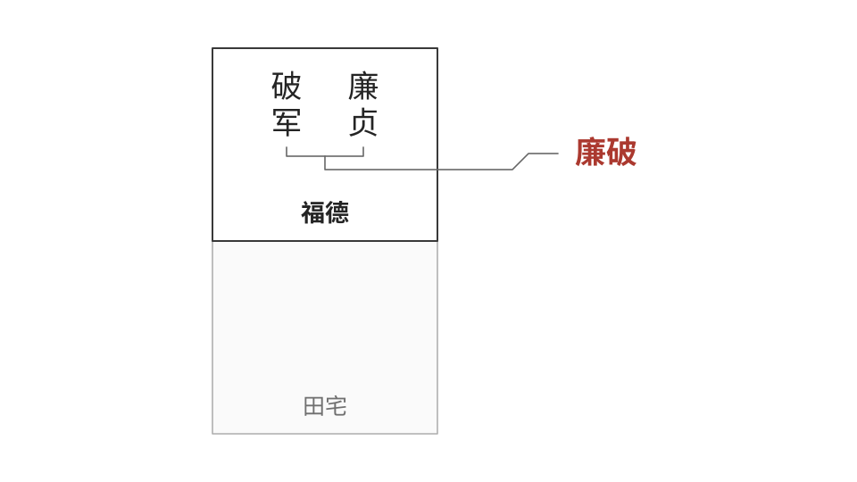 |
| **廉破、廉杀各有什么说法？廉破主什么？** | 〔口述〕廉破的说法是水里做坟墓：「诸位知道廉破呢……这个水里面做坟墓……就是水中作冢啊」。（[00:00:40–00:00:50](https://www.bilibili.com/video/BV1KJsLekEfA/?p=17&t=40)，第 1218–1511 帧） 〔指代〕说「这个水里面做坟墓」时，食指一直指着板上福德宫格「廉贞」下方，手没有动。（[00:00:46](https://www.bilibili.com/video/BV1KJsLekEfA/?p=17&t=46)，第 1381 帧） 〔口述〕又提廉贞七杀：「廉贞七杀半路埋尸」，随即说「这两个倒是无所谓」。（[00:00:50–00:00:53](https://www.bilibili.com/video/BV1KJsLekEfA/?p=17&t=50)，第 1512–1613 帧） 〔口述〕重点在廉破主横祸与孤单：「最重要的是什么呀……廉破就是一种横祸……一种是意外灾……还有主的呢……会主的比较什么……比较孤单孤单」。（[00:00:53–00:01:06](https://www.bilibili.com/video/BV1KJsLekEfA/?p=17&t=53)，第 1614–1991 帧） 〔口述〕所以女人拿到这种格，见福德宫很差就要提防：「一看到福德宫很差的时候……心里面就要有心中要警惕……会有问题会有状况会发生」。（[00:01:06–00:01:16](https://www.bilibili.com/video/BV1KJsLekEfA/?p=17&t=66)，第 1992–2309 帧） |
| **单宫地劫坐命、没有吉星同宫，会怎样？** | 〔叠图〕命宫 癸未：地劫平、截空庙、华盖陷；墓；将军、华盖、岁建；印有 3~12，以及岁数 7,19,31、43,55,67。（[00:01:17–00:01:21](https://www.bilibili.com/video/BV1KJsLekEfA/?p=17&t=77)，第 2310–2441 帧） 〔口述〕本例是单宫地劫坐命：「然后单宫地劫坐命的……地劫在命宫啊……光是一颗地劫星……如果没有吉星在同宫的时候」。（[00:01:17–00:01:27](https://www.bilibili.com/video/BV1KJsLekEfA/?p=17&t=77)，第 2310–2639 帧） 〔口述〕倪师说他算过这种会致命的：「我就算过有人会致命的」，接着说「但这个好好在哪里……她是早年难杀」。（[00:01:28–00:01:34](https://www.bilibili.com/video/BV1KJsLekEfA/?p=17&t=88)，第 2664–2837 帧） |
| **地劫若对面有化忌来冲，会怎样？** | 〔口述〕「早年地劫……如果是这个地劫……对面有化忌来冲……那就早年也完了」。（[00:01:34–00:01:41](https://www.bilibili.com/video/BV1KJsLekEfA/?p=17&t=94)，第 2838–3041 帧） 〔指代〕说「如果是这个地劫」时，粉笔停在板上左上命宫格内（同格写有「3-12」「命」），正在画指向格内最上方那行字的箭头。（[00:01:37](https://www.bilibili.com/video/BV1KJsLekEfA/?p=17&t=97)，第 2912 帧） 〔叠图〕此时贴出迁移 己丑：武曲庙并印「忌」、贪狼庙、天虚庙、破碎陷；冠带；伏兵、岁破、月煞；印有 63~72，以及岁数 1,13,25、37,49,61。（[00:01:38](https://www.bilibili.com/video/BV1KJsLekEfA/?p=17&t=98)，第 2940–2969 帧） 〔推断〕推断：倪师说「对面有化忌来冲」时，叠图正好贴出迁移己丑带「忌」的武曲；但口述没有点名是哪一宫、哪颗星化忌。（[00:01:38](https://www.bilibili.com/video/BV1KJsLekEfA/?p=17&t=98)，第 2940–2969 帧） |
| **本例早年哪几岁凶？为什么落在七岁？** | 〔口述〕「所以她是第一个3-12岁……早年的时候比较凶」。（[00:01:41–00:01:46](https://www.bilibili.com/video/BV1KJsLekEfA/?p=17&t=101)，第 3042–3191 帧） 〔口述〕早年家境：「这先天没有祖业……下家里面会比较辛苦……这辛苦成家」。（[00:01:47–00:01:52](https://www.bilibili.com/video/BV1KJsLekEfA/?p=17&t=107)，第 3234–3383 帧） 〔口述〕数岁数的办法：「比如1岁 2岁3岁4岁 5岁 6岁7岁……我们一个宫可以代表一年……男孩子是顺转」。（[00:01:54–00:02:01](https://www.bilibili.com/video/BV1KJsLekEfA/?p=17&t=114)，第 3426–3653 帧） 〔口述〕数到七岁正好是地劫：「那123456在七岁那年呢……她的本身地劫……七岁那年比较有灾」。（[00:02:01–00:02:10](https://www.bilibili.com/video/BV1KJsLekEfA/?p=17&t=121)，第 3654–3923 帧） 〔推断〕推断：命宫叠图的岁数首位是 7（第2685帧截图里这个 7 加了绿框），与倪师说的七岁那年有灾对得上；口述没有明说两者的关系。（[00:01:29](https://www.bilibili.com/video/BV1KJsLekEfA/?p=17&t=89)，第 2685 帧） |
| **小孩七岁以前有夭折之象，从哪里看出来？** | 〔口述〕倪师说小孩子凡是在七岁以前有灾、有夭折的现象，「有两个地方可以看出来」。（[00:02:10–00:02:25](https://www.bilibili.com/video/BV1KJsLekEfA/?p=17&t=130)，第 3924–4373 帧） 〔口述〕「第一个善解人意……行动啊像大人一样」；家长会觉得「哎呀好聪明啊……这个儿子太好了」，「然后动作像大人一样……没有小孩子的天真」。（[00:02:25–00:02:47](https://www.bilibili.com/video/BV1KJsLekEfA/?p=17&t=145)，第 4374–5021 帧） 〔口述〕接着讲夭折：「那相上面有……命上面也有的话……就会来了」。（[00:02:47–00:02:54](https://www.bilibili.com/video/BV1KJsLekEfA/?p=17&t=167)，第 5022–5243 帧） 〔板书〕可辨：黑板左边竖写「7」「前」，圈着的「①」「②」，另有两字形似「夭折」；其余认不出。（[00:02:21](https://www.bilibili.com/video/BV1KJsLekEfA/?p=17&t=141)，第 4247 帧） 〔板书〕在①②旁边新添了几行字，可辨「善」「动」「人」，其余认不出。（[00:02:38](https://www.bilibili.com/video/BV1KJsLekEfA/?p=17&t=158)，第 4764 帧） |
| **该怎样对待小孩子？** | 〔口述〕「所以要保持小孩子的天真活泼……把小孩子的天真活泼抑制掉……反而不好」。（[00:02:54–00:03:03](https://www.bilibili.com/video/BV1KJsLekEfA/?p=17&t=174)，第 5244–5513 帧） 〔口述〕批评让孩子从小装成大人：「在人面前像大人……你就想办法让他死亡」。（[00:03:05–00:03:08](https://www.bilibili.com/video/BV1KJsLekEfA/?p=17&t=185)，第 5574–5669 帧） 〔口述〕「就是小孩子要小孩子的天真……我们说赤子之心啊……要保持到六七十岁都可以的」，并收束说「那这是地劫的意思」。（[00:03:09–00:03:18](https://www.bilibili.com/video/BV1KJsLekEfA/?p=17&t=189)，第 5670–5945 帧） |
| **禄存坐财帛的人有什么特点？** | 〔叠图〕财帛 己卯：天相陷、禄存庙、地空平、凤阁旺、蜚廉、年解庙；帝旺；博士、将星、白虎；印有 83~92，以及岁数 11,23,35、47,59,71。（[00:03:19–00:03:20](https://www.bilibili.com/video/BV1KJsLekEfA/?p=17&t=199)，第 5970–6005 帧） 〔口述〕批这种命要看财帛和官禄：「你看他财帛跟官禄……像这个财帛是禄存」。（[00:03:20–00:03:23](https://www.bilibili.com/video/BV1KJsLekEfA/?p=17&t=200)，第 6006–6113 帧） 〔口述〕「禄存化禄啊武曲贪狼……这都是属于大的财星」，倪师说这是前面介绍过的。（[00:03:24–00:03:29](https://www.bilibili.com/video/BV1KJsLekEfA/?p=17&t=204)，第 6144–6281 帧） 〔口述〕「禄存坐财帛这种人呢……第一个她非常善于理财……讲比较不好听的就是守财……她比较小气」。（[00:03:32–00:03:42](https://www.bilibili.com/video/BV1KJsLekEfA/?p=17&t=212)，第 6372–6689 帧） 〔口述〕相上也看得到：「那在相上面也可以看到……鼻孔非常小……那么大的人要用棉花棒去掏鼻孔……这种都是小气得要死的人」。（[00:03:43–00:03:55](https://www.bilibili.com/video/BV1KJsLekEfA/?p=17&t=223)，第 6690–7055 帧） |
| **本例命中没有权禄，权禄在哪里？** | 〔口述〕「那她由于她的命中没有权禄」，接着让学生看「她权禄在周围看到没有」。（[00:03:55–00:04:00](https://www.bilibili.com/video/BV1KJsLekEfA/?p=17&t=235)，第 7056–7223 帧） 〔口述〕「我们一般算命把四个科权禄忌……我们打圈起来……你看她权禄都在周围」。（[00:04:02–00:04:07](https://www.bilibili.com/video/BV1KJsLekEfA/?p=17&t=242)，第 7260–7421 帧） 〔叠图〕同时贴出三宫：夫妻 辛巳，紫微旺带「科」、七杀平；子女 庚辰，天机利带「禄」、天梁庙带「权」；交友 戊子，天同旺、太阴庙带「忌」。（[00:03:58–00:04:00](https://www.bilibili.com/video/BV1KJsLekEfA/?p=17&t=238)，第 7146–7223 帧） 〔推断〕推断：叠图里的「禄」「权」都在子女庚辰，不在命宫癸未，与「命中没有权禄」相合；口述没有点名权禄落在哪一宫。（[00:03:58–00:04:07](https://www.bilibili.com/video/BV1KJsLekEfA/?p=17&t=238)，第 7146–7421 帧） |
| **什么叫府相会命？这种人适合做什么？** | 〔口述〕「所以她本身她是府相……这叫做府相会命」，「天府天相直接会到命叫府相会命」。（[00:04:07–00:04:20](https://www.bilibili.com/video/BV1KJsLekEfA/?p=17&t=247)，第 7422–7829 帧） 〔口述〕「那府相会命的人呢……天生的是佐才」，「就辅佐人家的人才」，「比如说当总经理董事长的秘书助理……当副将这种最好」。（[00:04:21–00:04:36](https://www.bilibili.com/video/BV1KJsLekEfA/?p=17&t=261)，第 7830–8303 帧） 〔叠图〕官禄 丁亥：天府得、龙池旺、天哭平；标「身」；病符、指背、官符；印有 43~52。另见财帛己卯里有天相陷。（[00:04:09–00:04:12](https://www.bilibili.com/video/BV1KJsLekEfA/?p=17&t=249)，第 7476–7565 帧） 〔板书〕可辨两列竖写粉笔字，大致是「府相会命」四字。（[00:04:16](https://www.bilibili.com/video/BV1KJsLekEfA/?p=17&t=256)，第 7704 帧） 〔板书〕可辨竖写「天生佐」，末一字像「才」。（[00:04:29](https://www.bilibili.com/video/BV1KJsLekEfA/?p=17&t=269)，第 8085 帧） |
| **迁移见武贪，男命女命各主什么？** | 〔口述〕「那如果到迁移到外地去的话……武贪来会武贪这两颗星呢……也是属于财星……它是属于武官」。（[00:04:36–00:04:49](https://www.bilibili.com/video/BV1KJsLekEfA/?p=17&t=276)，第 8304–8699 帧） 〔口述〕若是男命：「是男人的话……武官大利武职啊会非常的好」，因为「武职大部分漂泊在外」，「迁移宫是武职进来最好」。（[00:04:52–00:04:59](https://www.bilibili.com/video/BV1KJsLekEfA/?p=17&t=292)，第 8760–8993 帧） 〔口述〕本例是女命：「她本身是女孩子……她到迁移去的话」，女命遇武官的星「主的是孤单」，「所以女孩子很怕遇到武官的星」；武官的星有「武曲贪狼啊破军七杀啊」。（[00:05:01–00:05:32](https://www.bilibili.com/video/BV1KJsLekEfA/?p=17&t=301)，第 9042–9971 帧） 〔板书〕黑板右侧竖写，可辨「武」，下一字像「官」。（[00:04:51](https://www.bilibili.com/video/BV1KJsLekEfA/?p=17&t=291)，第 8758 帧） 〔板书〕黑板右上可辨「凡」「遇」「武」以及「女命」，其余认不出。（[00:05:16](https://www.bilibili.com/video/BV1KJsLekEfA/?p=17&t=316)，第 9504 帧） |

**总结区**

- 通用规则：女人的命福德宫非常重要，福德宫讲的也等于夫妻，福德宫很差就根本不用谈（[00:00:17–00:00:37](https://www.bilibili.com/video/BV1KJsLekEfA/?p=17&t=17)，第 522–1121 帧）；单宫地劫坐命、没有吉星同宫，有人会致命；若对面有化忌来冲，早年也完了（[00:01:17–00:01:41](https://www.bilibili.com/video/BV1KJsLekEfA/?p=17&t=77)，第 2310–3041 帧）；小孩子凡是七岁以前有夭折之象，看善解人意、行动像大人、没有小孩子的天真（[00:02:10–00:02:47](https://www.bilibili.com/video/BV1KJsLekEfA/?p=17&t=130)，第 3924–5021 帧）；女命凡遇武官的星（武曲、贪狼、破军、七杀）主孤单；男命迁移宫见武职最好（[00:04:52–00:05:32](https://www.bilibili.com/video/BV1KJsLekEfA/?p=17&t=292)，第 8760–9971 帧）
- 只在本例：这位女命福德宫是廉破，主横祸、意外灾与孤单（[00:00:37–00:01:06](https://www.bilibili.com/video/BV1KJsLekEfA/?p=17&t=37)，第 1122–1991 帧）；命宫单宫地劫，3-12 岁早年较凶，数到七岁那年有灾，先天没有祖业、辛苦成家（[00:01:17–00:02:10](https://www.bilibili.com/video/BV1KJsLekEfA/?p=17&t=77)，第 2310–3923 帧）；财帛坐禄存，善于理财、守财、小气；命中没有权禄，权禄在周围（[00:03:20–00:04:07](https://www.bilibili.com/video/BV1KJsLekEfA/?p=17&t=200)，第 6006–7421 帧）；府相会命，天生佐才，宜做秘书助理、副将；迁移见武贪，因是女命而主孤单（[00:04:07–00:05:25](https://www.bilibili.com/video/BV1KJsLekEfA/?p=17&t=247)，第 7422–9773 帧）
- 不是排盘规则，是处世方法：要保持小孩子的天真活泼，不要抑制，也不要让孩子在人前装大人；赤子之心可以保持到六七十岁（[00:02:54–00:03:14](https://www.bilibili.com/video/BV1KJsLekEfA/?p=17&t=174)，第 5244–5843 帧）；女命见福德宫很差，心里要警惕会有状况发生（[00:01:06–00:01:16](https://www.bilibili.com/video/BV1KJsLekEfA/?p=17&t=66)，第 1992–2309 帧）

**待核**

1. [00:00:04](https://www.bilibili.com/video/BV1KJsLekEfA/?p=17&t=4)，第 120 帧：字幕作「民国44年（1995）出世的」，括注 1995 语音里没有，来历待核；语音此句也只听到「年次了现在这个八」。
2. [00:00:48](https://www.bilibili.com/video/BV1KJsLekEfA/?p=17&t=48)，第 1446 帧：字幕「水中作冢」，语音作「做种」，「冢」字待核。
3. [00:00:51](https://www.bilibili.com/video/BV1KJsLekEfA/?p=17&t=51)，第 1554 帧：「这两个倒是无所谓」里「这两个」指什么，本块没说明。
4. 第 1764、1836 帧：字幕「主」，语音作「阻」，按上下文取「主」，待核。
5. [00:01:32](https://www.bilibili.com/video/BV1KJsLekEfA/?p=17&t=92)，第 2766 帧：字幕「她是早年难杀」，语音作「他是早年来上早」，两路对不上，「难杀」待核。
6. [00:01:39](https://www.bilibili.com/video/BV1KJsLekEfA/?p=17&t=99)，第 2970 帧：字幕「那就早年也完了」，语音作「早年有晚」，待核。
7. [00:01:58](https://www.bilibili.com/video/BV1KJsLekEfA/?p=17&t=118)，第 3558 帧：语音多出「孩子是逆转」，字幕只有「男孩子是顺转」，女命怎么转本笔记没收；「顺转」从哪一宫起算本块也没讲。
8. 第 4146、5022 帧：字幕「天折」按语音与上下文改作「夭折」。
9. [00:02:23](https://www.bilibili.com/video/BV1KJsLekEfA/?p=17&t=143)，第 4308 帧：「有两个地方可以看出来」，随后讲了善解人意、行动像大人，又讲「相上面有、命上面也有」，两个地方具体指哪两处待核；板书①②后面的字大多认不出。
10. [00:03:03](https://www.bilibili.com/video/BV1KJsLekEfA/?p=17&t=183)，第 5514 帧：字幕「很多人从小就让小孩子穿西装打领带」，语音作「他才吸到大人」，对不上，未引用。
11. [00:03:57](https://www.bilibili.com/video/BV1KJsLekEfA/?p=17&t=237)，第 7110 帧：字幕「•就是直接会过来」，语音作「就是直接挥过来」，意思不明。
12. [00:04:22](https://www.bilibili.com/video/BV1KJsLekEfA/?p=17&t=262)，第 7872 帧：字幕「佐才」，语音作「佐财」，板书末字像「才」，待核。
13. 第 9228、9420 帧：字幕「凤是」按语音改作「凡是」。
14. [00:01:38](https://www.bilibili.com/video/BV1KJsLekEfA/?p=17&t=98)，第 2940 帧与第 6960、8208 帧：迁移己丑叠图前一次印「武曲庙忌」，后两次只印「武曲庙」，「忌」字前后不一致，待核。
15. [00:03:52](https://www.bilibili.com/video/BV1KJsLekEfA/?p=17&t=232)，第 6960 帧：官禄丁亥叠图的岁数串有缺字（□15□、□5□），未采用。
16. 板书认不出：[00:00:19](https://www.bilibili.com/video/BV1KJsLekEfA/?p=17&t=19)，第 581 帧（右侧宫格的手写字潦草）、[00:01:29](https://www.bilibili.com/video/BV1KJsLekEfA/?p=17&t=89)，第 2685 帧、[00:01:33](https://www.bilibili.com/video/BV1KJsLekEfA/?p=17&t=93)，第 2800 帧（只见左上格一个箭头）、[00:02:11](https://www.bilibili.com/video/BV1KJsLekEfA/?p=17&t=131)，第 3946 帧（讲者背身挡住）、[00:04:07](https://www.bilibili.com/video/BV1KJsLekEfA/?p=17&t=247)，第 7416 帧（新写内容认不出）。
17. 指代看不出或不确定，未当依据：第 376、2710、3307、5014、5640、6395、8704、9004、9980 帧。
18. [00:05:36](https://www.bilibili.com/video/BV1KJsLekEfA/?p=17&t=336)，第 10098 帧：「所以我们看是什么星」话没讲完，接下一块。

### 2　父母、朋友、兄弟、疾厄与太阳断婚姻（[00:05:39–00:11:10](https://www.bilibili.com/video/BV1KJsLekEfA/?p=17&t=339)，第 10188–20129 帧）

| 提示区 | 笔记区 |
|---|---|
| **星的阴阳跟男女不合，会怎样？** | 〔口述〕接着前面的武官星，倪师说要看是什么人遇到：「那要看什么人遇到……那男人呢……遇到比较阴柔的星也不好……会变成这样……会比较孤单一点」。（[00:05:39–00:05:50](https://www.bilibili.com/video/BV1KJsLekEfA/?p=17&t=339)，第 10188–10517 帧） |
| **父母宫里太阴、太阳各代表谁？日月同亮主什么？** | 〔口述〕转入逐宫看：「那还有我们一个个宫看……你看她的父母宫……太阴代表妈妈……太阳代表爸爸……日月同亮有没有」。（[00:05:50–00:06:01](https://www.bilibili.com/video/BV1KJsLekEfA/?p=17&t=350)，第 10518–10841 帧） 〔口述〕日月同亮主旺父母：「日月同亮代表说他这个旺父母」，「所谓旺父母就是说对家里面很孝顺」，并且很敬重。（[00:06:01–00:06:12](https://www.bilibili.com/video/BV1KJsLekEfA/?p=17&t=361)，第 10842–11189 帧） 〔叠图〕父母甲申：天钺庙、红鸾庙、八座庙、天福庙、天空旺、孤辰平、天巫、劫煞等，格内没有太阳、太阴。同时贴出交友戊子：天同旺、太阴庙且化忌、文曲得、天魁旺、天贵庙、咸池陷、天伤陷。（[00:05:53–00:05:55](https://www.bilibili.com/video/BV1KJsLekEfA/?p=17&t=353)，第 10590–10655 帧） 〔叠图〕疾厄戊寅：太阳旺、巨门庙、文昌陷、陀罗陷、天喜庙、天姚旺、天才庙、恩光平、天使平、台辅。（[00:05:58–00:05:59](https://www.bilibili.com/video/BV1KJsLekEfA/?p=17&t=358)，第 10740–10793 帧） 〔推断〕推断：叠图里太阴在交友戊子（庙）、太阳在疾厄戊寅（旺），父母甲申格里没有日月；倪师说「日月同亮」时没讲日月各在哪一宫，看来指的是这两颗星都亮。（[00:05:53–00:06:01](https://www.bilibili.com/video/BV1KJsLekEfA/?p=17&t=353)，第 10590–10841 帧） |
| **太阴化忌，落陷和入庙结果有何不同？** | 〔口述〕「但是她太阴星是化忌的」，「太阴星化忌代表跟母跟妈妈」；「一般来说如果是落陷的话……化忌落陷化忌的话……就是妈妈会比较早走」。（[00:06:09–00:06:22](https://www.bilibili.com/video/BV1KJsLekEfA/?p=17&t=369)，第 11082–11489 帧） 〔口述〕入庙化忌则相反：「那是入庙化忌的就不会……而是妈妈跟她感情特别好……而妈妈会为她担心烦恼」。（[00:06:23–00:06:29](https://www.bilibili.com/video/BV1KJsLekEfA/?p=17&t=383)，第 11490–11699 帧） 〔推断〕推断：叠图交友戊子里太阴是「庙」又化忌，本例属于倪师说的入庙化忌一类（妈妈感情好、为她担心），不是落陷早走那一类。（[00:06:09–00:06:29](https://www.bilibili.com/video/BV1KJsLekEfA/?p=17&t=369)，第 11082–11699 帧） |
| **妈妈为什么替她担心烦恼？** | 〔口述〕倪师自问自答，只点到廉破：「那你说为什么担心烦恼……你看这个廉破就晓得了」，没有再展开。（[00:06:30–00:06:34](https://www.bilibili.com/video/BV1KJsLekEfA/?p=17&t=390)，第 11700–11849 帧） 〔叠图〕此时贴出福德乙酉：廉贞平、破军陷、右弼陷。（[00:06:30–00:06:31](https://www.bilibili.com/video/BV1KJsLekEfA/?p=17&t=390)，第 11700–11735 帧） 〔板书〕本块开头板面右侧一格可辨「破军」「廉贞」，其下疑似「福德」，其余认不出。（[00:05:42](https://www.bilibili.com/video/BV1KJsLekEfA/?p=17&t=342)，第 10280 帧） 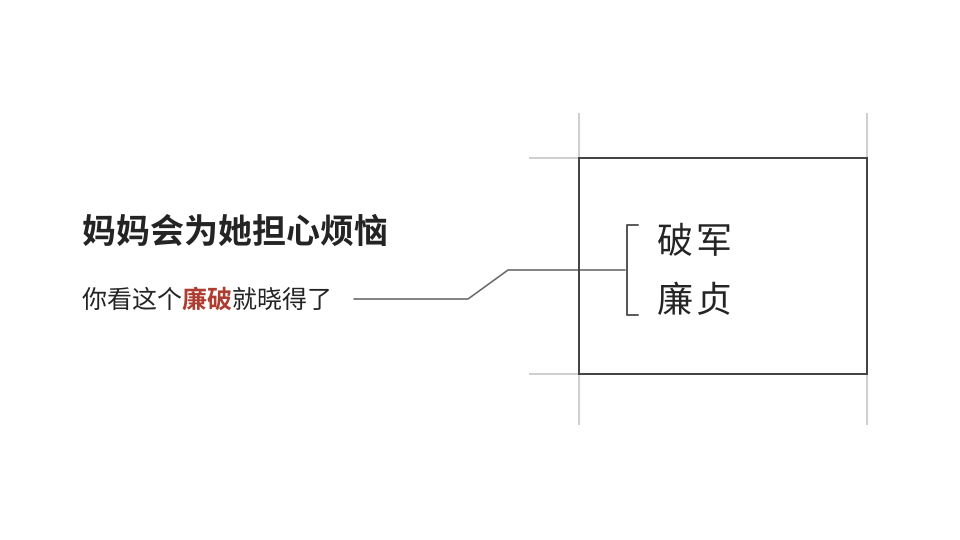 |
| **化忌落在朋友宫，主什么？** | 〔口述〕「还有这化忌在朋友宫」，并提一句「我们算命有主动和被动的关系」「什么叫主动被动」，随即回到盘上举例。（[00:06:36–00:06:43](https://www.bilibili.com/video/BV1KJsLekEfA/?p=17&t=396)，第 11880–12119 帧） 〔指代〕说「这个人的命中的朋友」时，手掌平按在黑板右上格，手指下看得见手写的「命」字，随后用食指往下指该格下方的字。（[00:06:44–00:06:49](https://www.bilibili.com/video/BV1KJsLekEfA/?p=17&t=404)，第 12120–12281 帧） 〔口述〕「你看这个人的命中的朋友是化忌」，「就是说她交的朋友都不是很好」；然后她不会识人，「她就把坏人当好人」。倪师插一句「我一再教诸位如何识人」。（[00:06:44–00:07:06](https://www.bilibili.com/video/BV1KJsLekEfA/?p=17&t=404)，第 12120–12785 帧） 〔口述〕结局：「然后就跟人家合伙做生意……做了半天她的结果就化忌……化忌就是事与愿违」，朋友变仇人。（[00:07:06–00:07:14](https://www.bilibili.com/video/BV1KJsLekEfA/?p=17&t=426)，第 12786–13043 帧） |
| **跟客户怎么讲？什么叫以果决行？** | 〔口述〕「所以你不用讲那么复杂的过程……直接告诉她个结果……与人合伙或者是跟人家作保……结果必败」。（[00:07:14–00:07:22](https://www.bilibili.com/video/BV1KJsLekEfA/?p=17&t=434)，第 13044–13277 帧） 〔口述〕「易经教我们的原则……以果决行」，即用结果来决定她的行动，「这最正确」。（[00:07:22–00:07:36](https://www.bilibili.com/video/BV1KJsLekEfA/?p=17&t=442)，第 13278–13709 帧） 〔板书〕黑板右侧竖写，可辨「以」「果」（果字画了圈）「决」「行」；左边一列疑似「凡遇」，其余认不出。（[00:07:30](https://www.bilibili.com/video/BV1KJsLekEfA/?p=17&t=450)，第 13527 帧） 〔口述〕对比外面的人：「自以为是科学家的人？……通通在谈因了……因都不对了……因为了半天结果还是一样……结果没有用」。（[00:07:37–00:07:47](https://www.bilibili.com/video/BV1KJsLekEfA/?p=17&t=457)，第 13710–14021 帧） |
| **兄弟宫铃星，对面化忌来冲，主什么？** | 〔口述〕「像这个兄弟宫……注意看啊……铃星对面是化忌来冲」；「铃星是杀星……也就是说她有兄弟……但是铃星本身是杀星」，又说「羊陀火铃空劫都是一些灾星」。（[00:07:50–00:08:14](https://www.bilibili.com/video/BV1KJsLekEfA/?p=17&t=470)，第 14124–14843 帧） 〔叠图〕兄弟壬午：铃星庙、三台旺、天寿平、天厨、副截庙；同时画面右下仍贴着交友戊子（太阴庙、化忌）。（[00:07:50–00:07:53](https://www.bilibili.com/video/BV1KJsLekEfA/?p=17&t=470)，第 14124–14219 帧） 〔板书〕可辨圈起的「杀」和其下的「兄弟」，顶上圆圈里疑似「铃星」；第 15092 帧「兄弟」左边又多一个圆圈，圈内疑似「忌」。其余认不出。（[00:08:10](https://www.bilibili.com/video/BV1KJsLekEfA/?p=17&t=490)，第 14724 帧） 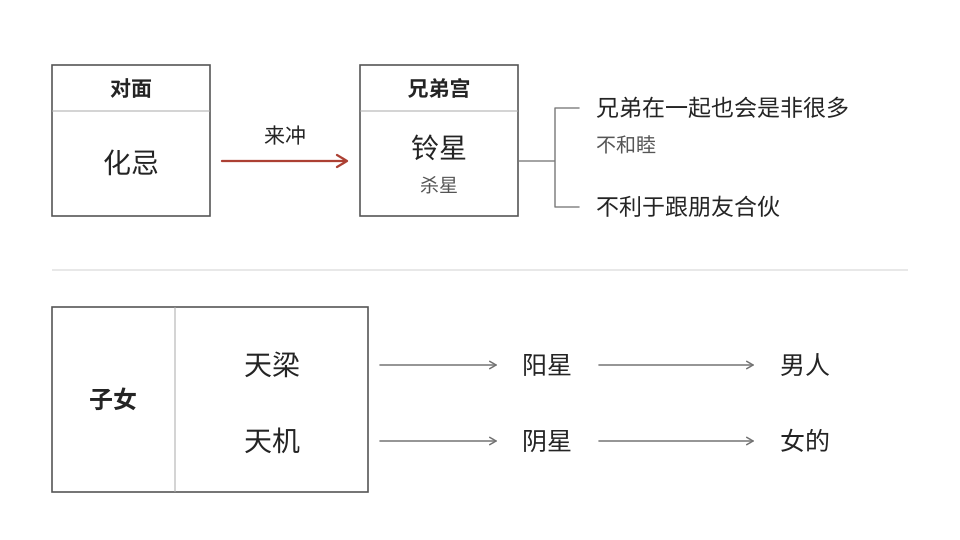 〔口述〕「但是兄弟带来的也是什么呀……祸害对面是化忌……所以他不但不利于跟朋友合伙……兄弟在一起也会是非很多」，感情不好、不和睦，「所以也六亲方面……也不适合他合伙做事业」。（[00:08:15–00:08:33](https://www.bilibili.com/video/BV1KJsLekEfA/?p=17&t=495)，第 14862–15401 帧） 〔推断〕推断：倪师说的「对面」的化忌，本块没点明是哪一宫；讲这段时画面同时贴着兄弟壬午和交友戊子（太阴化忌）两格。（[00:07:50–00:07:58](https://www.bilibili.com/video/BV1KJsLekEfA/?p=17&t=470)，第 14124–14351 帧） |
| **子女宫天梁、天机，各代表男还是女？** | 〔口述〕「这个命上面的子女啊……天梁注意看这天梁……天梁星是阳星……代表男人……天机星是女的……代表阴的」。（[00:08:33–00:08:45](https://www.bilibili.com/video/BV1KJsLekEfA/?p=17&t=513)，第 15402–15773 帧） 〔叠图〕子女庚辰：天机利、化禄；天梁庙、化权；擎羊庙、天官旺、天德庙、寡宿陷。（[00:08:35–00:08:38](https://www.bilibili.com/video/BV1KJsLekEfA/?p=17&t=515)，第 15468–15551 帧） 〔指代〕说「所以一个阳星在这里」的「这里」时，食指指向黑板中部「禄」字圆圈右侧那个圆圈的下缘，圈内字认不清。（[00:08:45–00:08:46](https://www.bilibili.com/video/BV1KJsLekEfA/?p=17&t=525)，第 15774–15809 帧） 〔口述〕「所以她会有一个男的在里面……那她的命中一个男人……那如果先生命里面……还有一个男人的话……就变成两个男人」，接着说「一个像妈妈」。（[00:08:47–00:08:55](https://www.bilibili.com/video/BV1KJsLekEfA/?p=17&t=527)，第 15810–16073 帧） 〔板书〕可辨「夫妻」二字，其下一个圆圈里是「禄」，另一个圆圈认不全；其余认不出。（[00:08:53](https://www.bilibili.com/video/BV1KJsLekEfA/?p=17&t=533)，第 16017 帧） |
| **天梁化权是什么样的权？** | 〔口述〕「那我们不谈女的……那像爸爸这男人呢……不是像妈妈这个男的……她这个太太命里面……像他妈妈这男人呢化权」（字幕可信度低）。（[00:08:55–00:09:05](https://www.bilibili.com/video/BV1KJsLekEfA/?p=17&t=535)，第 16074–16379 帧） 〔指代〕说「像妈妈这个男的」时，整条手臂伸到画面最右侧，手指点在右缘红线附近（第 2 行），所指的字在画面边缘被切掉，认不出。（[00:08:59–00:09:00](https://www.bilibili.com/video/BV1KJsLekEfA/?p=17&t=539)，第 16194–16229 帧） 〔口述〕「天梁星化权进来的时候……这个天梁啊是武官权……武官权像司法官外交官」。（[00:09:06–00:09:14](https://www.bilibili.com/video/BV1KJsLekEfA/?p=17&t=546)，第 16380–16637 帧） |
| **看疾厄宫，为什么不能只看一个宫？** | 〔口述〕「疾厄宫诸位看疾厄的时候……首先看整个通盘……通盘要兼看……你不能光看一个宫而已」。（[00:09:20–00:09:27](https://www.bilibili.com/video/BV1KJsLekEfA/?p=17&t=560)，第 16806–17033 帧） 〔口述〕反例：「不能说啊这个这个巨门星……太阳星在疾厄宫代表什么……这个不准的」。（[00:09:27–00:09:33](https://www.bilibili.com/video/BV1KJsLekEfA/?p=17&t=567)，第 17034–17201 帧） 〔推断〕推断：倪师举的巨门、太阳两颗星，正是叠图疾厄戊寅格里的巨门庙、太阳旺。（[00:05:58–00:09:33](https://www.bilibili.com/video/BV1KJsLekEfA/?p=17&t=358)，第 10740–17201 帧） |
| **本例盘局最凶在哪两宫？各主身体哪里？** | 〔口述〕「整个盘局一看的时候……最凶的是在哪里……一个是未宫……一个是什么酉宫酉宫……酉宫主的是肾……未宫主的是什么小肠」。（[00:09:33–00:09:51](https://www.bilibili.com/video/BV1KJsLekEfA/?p=17&t=573)，第 17202–17741 帧） 〔叠图〕命宫癸未：地劫平、截空庙、华盖陷；随后同时贴出福德乙酉（廉贞平、破军陷、右弼陷）。（[00:09:37–00:09:44](https://www.bilibili.com/video/BV1KJsLekEfA/?p=17&t=577)，第 17334–17531 帧） 〔板书〕可辨圈起的「未」和「命」，「未」右边竖写两字疑似「小肠」，其下一个圆圈里的字认不全；其余认不出。（[00:10:05](https://www.bilibili.com/video/BV1KJsLekEfA/?p=17&t=605)，第 18168 帧） 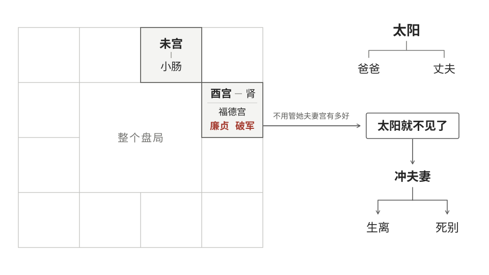 |
| **她的头和肾为什么灾多？** | 〔口述〕「五官头面四肢头面来说的话……这个（未宫）是主的是头……你看这个头是铃星火跟地劫……头这灾比较多」。（[00:09:51–00:10:01](https://www.bilibili.com/video/BV1KJsLekEfA/?p=17&t=591)，第 17742–18035 帧） 〔指代〕说「这个」时，手持粉笔点在黑板上方中间格「命」圈右侧、「阳」字下方，同一格内圈着「未」「命」。（[00:09:51–00:09:54](https://www.bilibili.com/video/BV1KJsLekEfA/?p=17&t=591)，第 17742–17831 帧） 〔口述〕「那有些病比如说中风……那就是头的灾……还有肾脏……后天来说肾脏灾会比较多……这是她的致命伤」。（[00:10:01–00:10:12](https://www.bilibili.com/video/BV1KJsLekEfA/?p=17&t=601)，第 18036–18389 帧） |
| **太阳还代表谁？福德宫遇廉破对婚姻如何？** | 〔口述〕「那整个盘局来说……太阳代表爸爸以外……太阳还代表丈夫」。（[00:10:13–00:10:21](https://www.bilibili.com/video/BV1KJsLekEfA/?p=17&t=613)，第 18390–18641 帧） 〔口述〕「结果这个女孩子福德宫……一遇到廉破的时候……你不用管她夫妻宫有多好……不用管她夫妻宫福德宫廉破的时候……这个太阳就不见了」。（[00:10:21–00:10:33](https://www.bilibili.com/video/BV1KJsLekEfA/?p=17&t=621)，第 18642–19001 帧） 〔叠图〕夫妻辛巳：紫微旺、化科；七杀平、左辅平、天马平、火星得、旬空庙、天月。（[00:10:25–00:10:28](https://www.bilibili.com/video/BV1KJsLekEfA/?p=17&t=625)，第 18750–18845 帧） 〔板书〕右侧格可辨「破军」「廉贞」，旁边一个圆圈里的字疑似「肾」，有箭头指向「廉贞」；下方一行认不全。（[00:10:23](https://www.bilibili.com/video/BV1KJsLekEfA/?p=17&t=623)，第 18708 帧） 〔口述〕「待会我们后面还有例子给诸位看……太阳星不见的时候冲夫妻……也就是说夫妻代表……不是生离就是死别」。（[00:10:33–00:10:45](https://www.bilibili.com/video/BV1KJsLekEfA/?p=17&t=633)，第 19002–19373 帧） |
| **生离还是死别，怎样从太阳亮度分？** | 〔口述〕「一般来说廉破这种灾的话……死别会大于大于生离……为什么因为你太阳旺啊……太阳旺那么厉害」。（[00:10:45–00:10:53](https://www.bilibili.com/video/BV1KJsLekEfA/?p=17&t=645)，第 19374–19601 帧） 〔口述〕「如果是生离的话……太阳就陷地」；后面又说太阳「陷地的时候……代表的是生离」，太阳星要「以它的亮度来谈」。（[00:10:53–00:11:08](https://www.bilibili.com/video/BV1KJsLekEfA/?p=17&t=653)，第 19602–20057 帧） 〔口述〕插讲反背：「一般来说女孩子的命啊……只要太阳是反背的……就是说晚上出太阳……白天出月亮刚好反背的话」，这句在本块没讲出结论。（[00:10:56–00:11:02](https://www.bilibili.com/video/BV1KJsLekEfA/?p=17&t=656)，第 19686–19865 帧） 〔推断〕推断：叠图疾厄戊寅里太阳是「旺」，福德乙酉是廉贞、破军，本例正合倪师说的「太阳星又旺这个又廉破」，按他本块的说法偏死别。（[00:10:49–00:11:10](https://www.bilibili.com/video/BV1KJsLekEfA/?p=17&t=649)，第 19494–20129 帧） |

**总结区**

- 通用规则：太阴星化忌落陷，妈妈会比较早走；入庙化忌则妈妈跟她感情特别好、会为她担心烦恼（[00:06:09–00:06:29](https://www.bilibili.com/video/BV1KJsLekEfA/?p=17&t=369)，第 11082–11699 帧）；看疾厄要先看整个通盘，不能只凭某颗星在疾厄宫来断（[00:09:20–00:09:33](https://www.bilibili.com/video/BV1KJsLekEfA/?p=17&t=560)，第 16806–17201 帧）；酉宫主肾，未宫主小肠、主头（[00:09:44–00:09:55](https://www.bilibili.com/video/BV1KJsLekEfA/?p=17&t=584)，第 17532–17855 帧）；太阳除代表爸爸还代表丈夫；福德宫遇廉破，太阳就不见了，冲夫妻，不是生离就是死别；太阳旺死别大于生离，太阳陷地主生离（[00:10:13–00:11:08](https://www.bilibili.com/video/BV1KJsLekEfA/?p=17&t=613)，第 18390–20057 帧）
- 只在本例：日月同亮，旺父母，对家里孝顺敬重；太阴入庙化忌，妈妈跟她感情好、为她担心（[00:06:01–00:06:29](https://www.bilibili.com/video/BV1KJsLekEfA/?p=17&t=361)，第 10842–11699 帧）；化忌在朋友宫：交友不好、不会识人，与人合伙或给人作保结果必败（[00:06:36–00:07:22](https://www.bilibili.com/video/BV1KJsLekEfA/?p=17&t=396)，第 11880–13277 帧）；兄弟宫铃星、对面化忌来冲：兄弟带来祸害，兄弟间是非多、不和睦，六亲方面也不适合合伙（[00:07:50–00:08:33](https://www.bilibili.com/video/BV1KJsLekEfA/?p=17&t=470)，第 14124–15401 帧）；盘局最凶在未宫、酉宫：头的灾多（如中风），后天肾脏灾多，是她的致命伤（[00:09:33–00:10:12](https://www.bilibili.com/video/BV1KJsLekEfA/?p=17&t=573)，第 17202–18389 帧）
- 不是排盘规则，是处世方法：跟客户不用讲复杂过程，直接告诉结果（[00:07:14–00:07:22](https://www.bilibili.com/video/BV1KJsLekEfA/?p=17&t=434)，第 13044–13277 帧）；以果决行：用结果来决定行动，不在因上空谈（[00:07:22–00:07:47](https://www.bilibili.com/video/BV1KJsLekEfA/?p=17&t=442)，第 13278–14021 帧）

**待核**

1. [00:05:42](https://www.bilibili.com/video/BV1KJsLekEfA/?p=17&t=342)，第 10266 帧：语音多出「女人呢遇到比较阳刚的心也不好」，字幕这句只有男人遇阴柔星，女人那半句待核。
2. [00:06:01](https://www.bilibili.com/video/BV1KJsLekEfA/?p=17&t=361)，第 10842 帧「日月同亮」：叠图父母甲申格里没有太阳太阴，倪师说的日月在哪一宫本块没讲。
3. [00:06:31](https://www.bilibili.com/video/BV1KJsLekEfA/?p=17&t=391)，第 11736 帧「你看这个廉破就晓得了」：廉破为什么让妈妈担心，本块没解释。
4. [00:06:38](https://www.bilibili.com/video/BV1KJsLekEfA/?p=17&t=398)，第 11958 帧「主动和被动的关系」：倪师提出了，本块没展开解释。
5. 第 12552、12660 帧字幕作「视人」，按[00:07:00](https://www.bilibili.com/video/BV1KJsLekEfA/?p=17&t=420)，第 12612 帧「如何识人」改为「识人」。
6. [00:07:30](https://www.bilibili.com/video/BV1KJsLekEfA/?p=17&t=450)，第 13524 帧字幕「以果来決定」用了繁体「決」，未直接引用，只转述。
7. [00:08:08](https://www.bilibili.com/video/BV1KJsLekEfA/?p=17&t=488)，第 14658 帧「一颗凶杀星坐命」：讲的是兄弟宫的铃星却说「坐命」，语音作「一颗兄弟杀心作命」，原意待核。
8. [00:07:54](https://www.bilibili.com/video/BV1KJsLekEfA/?p=17&t=474)，第 14238 帧「铃星对面是化忌来冲」：「对面」指哪一宫本块没明说。
9. [00:08:33](https://www.bilibili.com/video/BV1KJsLekEfA/?p=17&t=513)，第 15402 帧起：从「这个命上面的子女」讲到天梁天机男女，再到「先生命里面还有一个男人」，讲得跳跃，其间关系待核。
10. [00:08:53](https://www.bilibili.com/video/BV1KJsLekEfA/?p=17&t=533)，第 15996 帧：字幕只有「一个像妈妈」，语音是「一个像爸爸一个像妈妈」，前半句待核。
11. [00:08:58–00:09:05](https://www.bilibili.com/video/BV1KJsLekEfA/?p=17&t=538)，第 16152–16379 帧：「像爸爸这男人」「像妈妈这个男的」「像他妈妈这男人呢化权」字幕可信度 0.34–0.62，具体意思待核。
12. [00:09:07](https://www.bilibili.com/video/BV1KJsLekEfA/?p=17&t=547)，第 16428 帧「武官权」：倪师用了这个词，只举了司法官、外交官，没有解释；[00:09:14](https://www.bilibili.com/video/BV1KJsLekEfA/?p=17&t=554)，第 16638 帧「大部分人的司法官」语音作「大部分人都按司法官」，句意不明，未收。
13. [00:09:16](https://www.bilibili.com/video/BV1KJsLekEfA/?p=17&t=556)，第 16680 帧「天梁星化权的」后紧接「疾厄宫」，语音为「良心画拳极二宫」，这两句是否连读成一句待核。
14. [00:09:47](https://www.bilibili.com/video/BV1KJsLekEfA/?p=17&t=587)，第 17616 帧「小肠」：字幕可信度 0.49，语音作「销商」；[00:10:05](https://www.bilibili.com/video/BV1KJsLekEfA/?p=17&t=605)，第 18168 帧板书疑似「小肠」，待核。
15. [00:09:55](https://www.bilibili.com/video/BV1KJsLekEfA/?p=17&t=595)，第 17856 帧「头是铃星火跟地劫」：叠图命宫癸未格只见地劫平，铃星在兄弟壬午、火星在夫妻辛巳，铃、火怎么算到头上本块没说。
16. [00:10:57](https://www.bilibili.com/video/BV1KJsLekEfA/?p=17&t=657)，第 19734 帧「太阳是反背的」：本块只解释为晚上出太阳、白天出月亮，结论没说完。
17. [00:11:04](https://www.bilibili.com/video/BV1KJsLekEfA/?p=17&t=664)，第 19938 帧「太阳星如果太太旺的时」句子不完整；[00:11:08](https://www.bilibili.com/video/BV1KJsLekEfA/?p=17&t=668)，第 20058 帧那句接到后文，本块未收后文。
18. 板书认不出：[00:05:42](https://www.bilibili.com/video/BV1KJsLekEfA/?p=17&t=342)，第 10280 帧大部分；[00:08:10](https://www.bilibili.com/video/BV1KJsLekEfA/?p=17&t=490)，第 14724 帧顶上圆圈疑似「铃星」；[00:08:23](https://www.bilibili.com/video/BV1KJsLekEfA/?p=17&t=503)，第 15092 帧圆圈疑似「忌」；[00:08:53](https://www.bilibili.com/video/BV1KJsLekEfA/?p=17&t=533)，第 16017 帧另一圆圈；[00:09:07](https://www.bilibili.com/video/BV1KJsLekEfA/?p=17&t=547)，第 16426 帧左侧新写的几行（有两个圆圈）全部认不出；[00:09:56](https://www.bilibili.com/video/BV1KJsLekEfA/?p=17&t=596)，第 17904 帧新写的字被身体挡住或认不出；[00:10:23](https://www.bilibili.com/video/BV1KJsLekEfA/?p=17&t=623)，第 18708 帧圆圈疑似「肾」。
19. 指代看不出或不确定：第 10913、13981、14069、14280、15346、16171、16236、16286、17047、18898 帧，均未当依据。
20. 叠图父母甲申的「解神不」，「不」字不像庙旺陷，转写可能有误，未收。

### 3　廉破死别、搬错房、劝人法与红鸾落宫（[00:11:11–00:16:39](https://www.bilibili.com/video/BV1KJsLekEfA/?p=17&t=671)，第 20130–29975 帧）

| 提示区 | 笔记区 |
|---|---|
| **福德宫又是廉破，夫妻是感情问题还是死别？** | 〔口述〕倪师说福德宫又是廉破，这「代表夫妻感情没有问题」「而代表的是死别」，并说「我们用这个推理最好」。（[00:11:11–00:11:18](https://www.bilibili.com/video/BV1KJsLekEfA/?p=17&t=671)，第 20130–20345 帧） 〔叠图〕右上角：福德 乙酉——廉贞平、破军陷、右弼陷，另有飞廉、灾煞、丧门、胎；大限 23~32；小限 5,17,29,41,53,65。（[00:11:13–00:11:15](https://www.bilibili.com/video/BV1KJsLekEfA/?p=17&t=673)，第 20208–20267 帧） 〔叠图〕左下角：疾厄 戊寅——太阳旺、巨门庙、文昌陷、陀罗陷、天喜庙、天姚旺、恩光平、天才庙、天使平、台辅、龙德，另有官符、亡神、临官；大限 73~82；小限 12,24,36,48,60,72。（[00:11:13–00:11:15](https://www.bilibili.com/video/BV1KJsLekEfA/?p=17&t=673)，第 20208–20267 帧） |
| **太阳旺的女命为什么叫旺夫命？旺夫就能白头偕老吗？** | 〔口述〕倪师说「像这个是旺太阳旺的时候」「我们一般来说这种八字」「这种女孩子是旺夫命」；旺夫命就是她做很多事情「不会让先生有后顾之忧」「这种叫旺夫」。（[00:11:20–00:11:32](https://www.bilibili.com/video/BV1KJsLekEfA/?p=17&t=680)，第 20424–20765 帧） 〔口述〕倪师又说「但是上帝并没有说旺夫命的人一定会白头偕老」「这是两回事啊」；贤妻良母嫁的先生不一定很好，很好的先生娶的老婆也不一定很好，「这是两回事」。（[00:11:32–00:11:46](https://www.bilibili.com/video/BV1KJsLekEfA/?p=17&t=692)，第 20766–21185 帧） 〔口述〕回到本例：「她她是旺夫命」，但「这是廉破」「廉贞破军很凶」。（[00:11:46–00:11:53](https://www.bilibili.com/video/BV1KJsLekEfA/?p=17&t=706)，第 21186–21419 帧） |
| **本例出事是哪一年、虚岁几岁？** | 〔口述〕倪师说「那我们来看流年」，民国 80 年（1991），按虚岁算；他先说「虚岁的什么37岁」，又说「啊不是37对」，字幕随后出现 36、37 两个数，最后按「37岁她那年呢」往下讲。（[00:11:54–00:12:27](https://www.bilibili.com/video/BV1KJsLekEfA/?p=17&t=714)，第 21420–22433 帧） 〔板书〕可辨：一个格子里「兄弟」二字下方写了「80」，再往下是加圈的「37.」，其余认不出。（[00:12:14](https://www.bilibili.com/video/BV1KJsLekEfA/?p=17&t=734)，第 22037 帧） 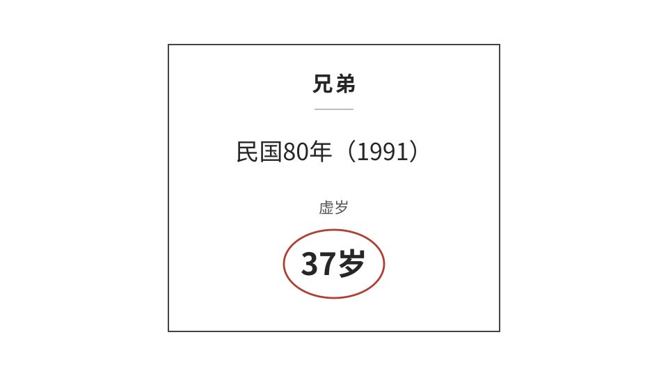 |
| **看命为什么还要配阳宅？她原来住五楼时格局怎样？** | 〔口述〕讲到 37 岁那年的阳宅部分，倪师说「我们天文的部分……一定要跟地理的部分来配合」「房子有东南西北」。（[00:12:15–00:12:33](https://www.bilibili.com/video/BV1KJsLekEfA/?p=17&t=735)，第 22068–22619 帧） 〔板书〕可辨：「5F」，旁边两字似「陽宅」（认不准）；下面画一个方框，上方标「S」、左边「E」、右边「W」，下方一个字母似「N」。（[00:12:35](https://www.bilibili.com/video/BV1KJsLekEfA/?p=17&t=755)，第 22666 帧） 〔口述〕「她原来呢住在家里的五楼」，一到五楼都是她们家的；五楼「房间比较小」「但是主卧房是在什么西北角」，那时「非常的顺哦」。（[00:12:34–00:12:53](https://www.bilibili.com/video/BV1KJsLekEfA/?p=17&t=754)，第 22620–23207 帧） 〔板书〕5F 方框的右下角（右边 W、下边那一侧）加画了一个小框，框里一个字认不出。（[00:12:46](https://www.bilibili.com/video/BV1KJsLekEfA/?p=17&t=766)，第 23004 帧） 〔推断〕推断：按板书标的方位（右 W、下似 N），这个小框落在西北角，与口述「主卧房……西北角」对得上；框里那个字是不是「卧」无法确认。（[00:12:42–00:12:46](https://www.bilibili.com/video/BV1KJsLekEfA/?p=17&t=762)，第 22884–23004 帧） |
| **搬到二楼后，西北角放了什么？** | 〔口述〕到了民国 80 年年初，她换了房间，「从五楼呢搬到二楼」，「因为什么因为五楼太小」「挤不下了二楼比较大」；主卧房搬过来，「结果把厨房改到这个西北角」。（[00:12:53–00:13:11](https://www.bilibili.com/video/BV1KJsLekEfA/?p=17&t=773)，第 23208–23741 帧） 〔指代〕说「改到这个西北角」时，手指的是黑板下方 2F 平面图右下角框里的「厨」字。（[00:13:06](https://www.bilibili.com/video/BV1KJsLekEfA/?p=17&t=786)，第 23608 帧） 〔板书〕可辨：在 5F 方框下方又画了一个方框，标「2F」，上「S」、左「E」、右「W」，下方字母似「N」；右下角小框里是「厨」，左上角另有一个小框，框里的字认不出；右下一片被画了一个大圈。（[00:13:08](https://www.bilibili.com/video/BV1KJsLekEfA/?p=17&t=788)，第 23652 帧） 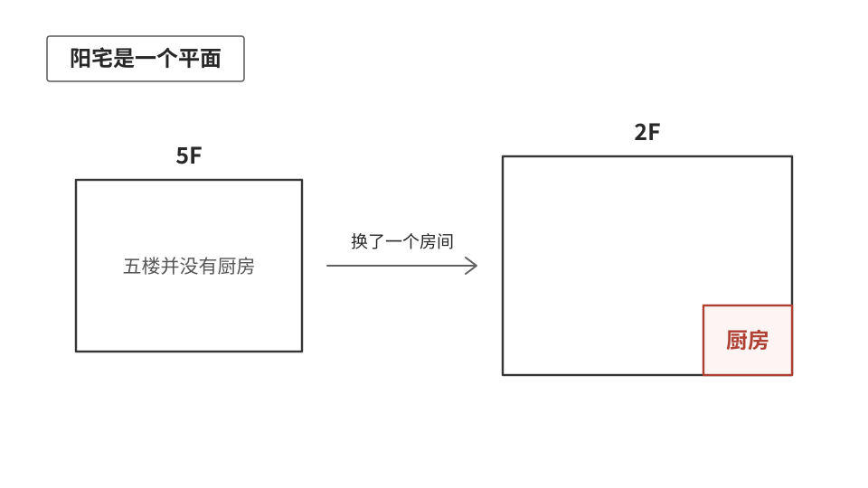 〔口述〕倪师补充：一到五楼都是她们的，她二楼的时候「刚好把它改在西北角」；她住五楼的时候「五楼并没有厨房哎」「厨房在二楼」。（[00:13:11–00:13:23](https://www.bilibili.com/video/BV1KJsLekEfA/?p=17&t=791)，第 23742–24107 帧） |
| **阳宅要怎么看？命里有灾的人会怎么选房子？** | 〔口述〕倪师说「这里要提出来就是」「我们阳宅是一个平面」，要一个平面一个平面来看。（[00:13:23–00:13:27](https://www.bilibili.com/video/BV1KJsLekEfA/?p=17&t=803)，第 24108–24221 帧） 〔口述〕「她的命中有这个灾」「她就会把吉宅换成凶宅来住」。（[00:13:27–00:13:33](https://www.bilibili.com/video/BV1KJsLekEfA/?p=17&t=807)，第 24222–24401 帧） 〔板书〕可辨：5F 方框左上部写了「吉」；黑板左上角另有一个加圈的字似「因」（认不准），其左一字认不出；2F 方框左上小框被手挡住。（[00:13:40](https://www.bilibili.com/video/BV1KJsLekEfA/?p=17&t=820)，第 24626 帧） 〔推断〕推断：5F 平面图写「吉」，与口述「把吉宅换成凶宅来住」相对应，即五楼是吉宅、搬去的二楼是凶宅；倪师在本块没有逐字这样说。（[00:13:29–00:13:40](https://www.bilibili.com/video/BV1KJsLekEfA/?p=17&t=809)，第 24276–24626 帧） |
| **客户自己说的搬家理由是什么？倪师怎么看这些理由？** | 〔口述〕这个客户表面上的原因：「因为我们房子太小」「我们家住不下」；还有「我先生年初开刀身体不太好」「那爬五楼比较辛苦」，常常做生意回来还要爬五楼睡觉，「算了我就搬到二楼去」。（[00:13:33–00:13:53](https://www.bilibili.com/video/BV1KJsLekEfA/?p=17&t=813)，第 24402–25001 帧） 〔口述〕倪师说「她的因为都会造成她」「一直往这个萝卜坑里面跳」。（[00:13:53–00:13:58](https://www.bilibili.com/video/BV1KJsLekEfA/?p=17&t=833)，第 25002–25163 帧） 〔口述〕「以后你们看的时候很好玩」：「你问她为什么你要这样住」，「她就会讲很多因为」，讲完半天「就结果还是住进去了」，「因为命中有这个灾」「她就会一直往那个陷里面跑」，往坑里面跳。（[00:14:02–00:14:16](https://www.bilibili.com/video/BV1KJsLekEfA/?p=17&t=842)，第 25278–25697 帧） |
| **至亲好友命中有灾、还没发生，怎么劝才听得进？** | 〔口述〕倪师说「所以我们常常要教诸位如何讲话」「如何说服人」，说服人「要以刚中」，接着问「怎么叫刚中」。（[00:14:19–00:14:31](https://www.bilibili.com/video/BV1KJsLekEfA/?p=17&t=859)，第 25770–26153 帧） 〔口述〕遇到这种情形「是你的至亲好友」，「她还没有发生对不对」，「你就告诉她你搬是吧」，「讲完了你就走了」；「她一定会后面来追你」，问你为什么，「这个时候你跟她讲」「她才会收到」。（[00:14:31–00:14:49](https://www.bilibili.com/video/BV1KJsLekEfA/?p=17&t=871)，第 26154–26687 帧） 〔口述〕不然你跟她讲，「她听了但是没有收到」「她不会按照你的话去做」。（[00:14:50–00:14:54](https://www.bilibili.com/video/BV1KJsLekEfA/?p=17&t=890)，第 26700–26831 帧） |
| **天天好言苦劝，为什么反而会害了人？** | 〔口述〕像做好人那样，「每天好好先生跟她说」，拜托、说我很关心你、「求求你一定要这样子做」——「你越讲了半天」「她越讲她越不会去做」。（[00:14:54–00:15:04](https://www.bilibili.com/video/BV1KJsLekEfA/?p=17&t=894)，第 26832–27125 帧） 〔口述〕结果这个客人、客户「或者是你的朋友这样」「因为你而死」「你知不知道」，「因为你讲话的方法不对」。之后倪师强调说话很重要（这几句字幕识别乱码，依语音转述）。（[00:15:04–00:15:18](https://www.bilibili.com/video/BV1KJsLekEfA/?p=17&t=904)，第 27126–27545 帧） |
| **37 岁出事后要问什么？本例天喜、红鸾在哪？** | 〔口述〕倪师问：「所以她这个一发生以后」，37 岁发生以后，「这个后面呢」「还会不会再有太阳」；接着说「诸位看看她的天喜红鸾星在哪里」「我们把它写上去」，「天喜星在这里有没有」「红鸾星在这里」。（[00:15:18–00:15:40](https://www.bilibili.com/video/BV1KJsLekEfA/?p=17&t=918)，第 27546–28217 帧） 〔指代〕说「天喜星在这里」时，手指的是黑板左下格他正在写的「天」字。（[00:15:34](https://www.bilibili.com/video/BV1KJsLekEfA/?p=17&t=934)，第 28028 帧） 〔指代〕说「红鸾星在这里」时，手指的是黑板右上角格他正在写的「红」字。（[00:15:37](https://www.bilibili.com/video/BV1KJsLekEfA/?p=17&t=937)，第 28136 帧） 〔叠图〕左下角疾厄 戊寅格再次出现，天喜庙加了蓝框。（[00:15:37–00:15:40](https://www.bilibili.com/video/BV1KJsLekEfA/?p=17&t=937)，第 28128–28217 帧） |
| **红鸾落父母宫，第一次婚姻怎样、几岁结婚？** | 〔叠图〕右下角：父母 甲申——红鸾庙（加蓝框）、天钺庙、八座庙、天福庙、解神不、天巫、天空旺、孤辰平、劫煞，另有奏书、晦气、绝；大限 13~22；小限 6,18,30,42,54,66。（[00:15:37–00:15:40](https://www.bilibili.com/video/BV1KJsLekEfA/?p=17&t=937)，第 28128–28217 帧） 〔板书〕可辨：黑板右上角加圈的「红鸾」二字，其余新字认不出。（[00:15:49](https://www.bilibili.com/video/BV1KJsLekEfA/?p=17&t=949)，第 28476 帧） 〔口述〕倪师说第一个大限（字幕作 13-22）「她天喜红鸾星进来」，「所以她第一次的婚姻是受父母之言」；「红鸾星落父母宫」「受父母之言去结婚」「所以结婚比较早」「22岁以前」。（[00:15:43–00:15:58](https://www.bilibili.com/video/BV1KJsLekEfA/?p=17&t=943)，第 28296–28745 帧） 〔推断〕推断：「22岁以前」与叠图父母宫大限 13~22 的末岁一致，应指同一段运；倪师没有明说两者的关系。（[00:15:37–00:15:58](https://www.bilibili.com/video/BV1KJsLekEfA/?p=17&t=937)，第 28128–28745 帧） |
| **红鸾在子女宫、朋友宫、命宫各主什么？看红鸾能知道什么？** | 〔口述〕「有的红鸾星在子女宫」「是因为子女之命而结婚」。（[00:15:58–00:16:06](https://www.bilibili.com/video/BV1KJsLekEfA/?p=17&t=958)，第 28746–29003 帧） 〔口述〕「有的红鸾星在朋友宫」「那是被怂朋友怂恿的推上去就结婚了」「什么咖都有」。（[00:16:09–00:16:18](https://www.bilibili.com/video/BV1KJsLekEfA/?p=17&t=969)，第 29088–29345 帧） 〔口述〕「那红鸾星在命宫的人呢」「主见比较强」，「我自己决定我的婚姻」，「那好歹不管是离婚死别还是一世夫妻」「都自己可以决定」。（[00:16:18–00:16:30](https://www.bilibili.com/video/BV1KJsLekEfA/?p=17&t=978)，第 29346–29711 帧） 〔叠图〕红鸾那一格的宫名先后改成「子女 庚辰」（大限 83~92）和「命宫 癸未」（3~12），格内星曜与父母甲申那一格完全相同。（[00:15:58–00:16:18](https://www.bilibili.com/video/BV1KJsLekEfA/?p=17&t=958)，第 28746–29345 帧） 〔口述〕规则：「所以红鸾星你如果看这个人命」「一看她红鸾星落在哪里」「你就知道这个人的婚姻」「十足受到谁的左右」。（[00:16:30–00:16:37](https://www.bilibili.com/video/BV1KJsLekEfA/?p=17&t=990)，第 29712–29939 帧） |

**总结区**

- 通用规则：太阳旺的女命一般是旺夫命（做很多事不让先生有后顾之忧），但旺夫和白头偕老是两回事（[00:11:20–00:11:46](https://www.bilibili.com/video/BV1KJsLekEfA/?p=17&t=680)，第 20424–21185 帧）；天文的部分一定要跟地理的部分配合，阳宅要一个平面一个平面来看（[00:12:15–00:13:27](https://www.bilibili.com/video/BV1KJsLekEfA/?p=17&t=735)，第 22068–24221 帧）；命中有灾的人会自己把吉宅换成凶宅来住，问她理由会讲很多因为，结果还是住进去（[00:13:27–00:14:16](https://www.bilibili.com/video/BV1KJsLekEfA/?p=17&t=807)，第 24222–25697 帧）；看红鸾落在哪一宫，就知道婚姻受谁左右：父母宫受父母之言，子女宫因子女之命，朋友宫被朋友怂恿，命宫自己决定（[00:15:50–00:16:37](https://www.bilibili.com/video/BV1KJsLekEfA/?p=17&t=950)，第 28524–29939 帧）
- 只在本例：福德宫又是廉破，倪师断夫妻感情没问题，而是死别（[00:11:11–00:11:53](https://www.bilibili.com/video/BV1KJsLekEfA/?p=17&t=671)，第 20130–21419 帧）；出事在民国 80 年、虚岁 37 岁（36、37 之间有改口）（[00:11:54–00:12:27](https://www.bilibili.com/video/BV1KJsLekEfA/?p=17&t=714)，第 21420–22433 帧）；原住五楼、主卧在西北角很顺；民国 80 年年初搬到二楼，厨房改在西北角（[00:12:34–00:13:23](https://www.bilibili.com/video/BV1KJsLekEfA/?p=17&t=754)，第 22620–24107 帧）；红鸾在父母宫（叠图大限 13~22），第一次婚姻受父母之言、22 岁以前早婚（[00:15:37–00:15:58](https://www.bilibili.com/video/BV1KJsLekEfA/?p=17&t=937)，第 28128–28745 帧）
- 不是排盘规则，是处世方法：劝至亲好友避灾要以刚中：只说一句「你搬」就走，等对方追来问为什么再讲，对方才收得到（[00:14:19–00:14:49](https://www.bilibili.com/video/BV1KJsLekEfA/?p=17&t=859)，第 25770–26687 帧）；每天好好先生苦苦哀求，越讲对方越不做；讲话方法不对，可能让对方因你而死（[00:14:54–00:15:18](https://www.bilibili.com/video/BV1KJsLekEfA/?p=17&t=894)，第 26832–27545 帧）

**待核**

1. [00:11:11](https://www.bilibili.com/video/BV1KJsLekEfA/?p=17&t=671)，第 20130 帧：字幕「福德宫叉廉破」，按上下文改作「福德宫又是廉破」，「叉」疑为「又」。
2. [00:11:15](https://www.bilibili.com/video/BV1KJsLekEfA/?p=17&t=675)，第 20268 帧「我们用这个推理最好」、[00:11:20](https://www.bilibili.com/video/BV1KJsLekEfA/?p=17&t=680)，第 20424 帧「像这个是旺太阳旺的时候」：两处「这个」指什么看不出（指代标为不确定）。
3. [00:12:00–00:12:15](https://www.bilibili.com/video/BV1KJsLekEfA/?p=17&t=720)，第 21600–22067 帧：虚岁 36 还是 37 有改口，字幕「民国八十年（1991）是3637」，语音「三六三七」；后文按 37 岁讲，板书圈的是「37.」。
4. [00:11:47](https://www.bilibili.com/video/BV1KJsLekEfA/?p=17&t=707)，第 21234 帧：字幕「但是夫妻要走」与语音「不计较走」对不上，原话待核。
5. [00:12:36](https://www.bilibili.com/video/BV1KJsLekEfA/?p=17&t=756)，第 22686 帧：字幕「一二三四五楼套间整楼都是她们的」与语音「二三十五楼套庭祖宗堂」对不上，「套间」等字待核。
6. [00:12:56](https://www.bilibili.com/video/BV1KJsLekEfA/?p=17&t=776)，第 23280 帧：字幕「换了一个房间」，语音「换了一个房子」，未引原话。
7. [00:12:35](https://www.bilibili.com/video/BV1KJsLekEfA/?p=17&t=755)，第 22666 帧板书：「5F」旁两字似「陽宅」，方框下方字母似「N」，都未能确认。
8. [00:12:46](https://www.bilibili.com/video/BV1KJsLekEfA/?p=17&t=766)，第 23004 帧板书：5F 方框右下小框内的字认不出（是否「卧」未能确认）。
9. [00:13:08](https://www.bilibili.com/video/BV1KJsLekEfA/?p=17&t=788)，第 23652 帧板书：2F 方框左上小框内的字认不出。
10. [00:13:40](https://www.bilibili.com/video/BV1KJsLekEfA/?p=17&t=820)，第 24626 帧板书：黑板左上角加圈的字似「因」，其左一字认不出；2F 方框左上小框被手挡。
11. [00:13:25](https://www.bilibili.com/video/BV1KJsLekEfA/?p=17&t=805)，第 24174 帧：字幕「一个平面来开」，按上下文改作「来看」。
12. 第 24222、25536 帧：「命中有这个灾」的「这个灾」具体指什么，指代看不出，倪师在本块也没有点明是哪一种灾。
13. [00:13:55](https://www.bilibili.com/video/BV1KJsLekEfA/?p=17&t=835)，第 25056 帧：说「往这个萝卜坑里面跳」时手指 2F 平面图上方，具体所指看不出（指代不确定）。
14. [00:14:25](https://www.bilibili.com/video/BV1KJsLekEfA/?p=17&t=865)，第 25950 帧：字幕「以果決其行有没有」，语音「果决其心有没有」，原话待核；「刚中」只用例子说明，没有正面定义。
15. [00:14:38](https://www.bilibili.com/video/BV1KJsLekEfA/?p=17&t=878)，第 26358 帧：字幕只有一个「死」字，语音是「讲完了」，两路对不上，原话待核。
16. [00:15:07](https://www.bilibili.com/video/BV1KJsLekEfA/?p=17&t=907)，第 27234 帧：字幕「因为你而死」，语音「你儿子」，音近但未完全对上，待核。
17. [00:15:15–00:15:18](https://www.bilibili.com/video/BV1KJsLekEfA/?p=17&t=915)，第 27450–27545 帧：字幕识别乱码（「所以洗活很重要」「益重砂王液当，」「含旅」），语音「说话很重要」，笔记依语音转述。
18. [00:15:21](https://www.bilibili.com/video/BV1KJsLekEfA/?p=17&t=921)，第 27648 帧：字幕「37罗发生」疑为「37岁发生」，未引原话。
19. [00:15:28](https://www.bilibili.com/video/BV1KJsLekEfA/?p=17&t=928)，第 27840 帧：「还会不会再有太阳」中的「太阳」指什么，本块没有解释。
20. [00:15:44](https://www.bilibili.com/video/BV1KJsLekEfA/?p=17&t=944)，第 28338 帧：字幕「第一个13-22」，语音「十三岁的时候」，是指 13~22 岁大限还是 13 岁，待核。
21. [00:15:58–00:16:18](https://www.bilibili.com/video/BV1KJsLekEfA/?p=17&t=958)，第 28746–29345 帧：叠图把红鸾那一格改名为子女庚辰、命宫癸未，星曜与父母甲申完全相同，应是后期示意，不是本命盘这两宫的原貌；文件开头标本例命宫为癸未，这一格星曜不能当本命宫看。
22. 第 25368、26392、29112 帧板书图：看不出新写的、认得出的字。

### 4　不替人定婚姻、不劝和；一子送终怎改（[00:16:39–00:22:10](https://www.bilibili.com/video/BV1KJsLekEfA/?p=17&t=999)，第 29976–39911 帧）

| 提示区 | 笔记区 |
|---|---|
| **本例第一次婚姻是谁做的主？出事后怎样？** | 〔口述〕倪师说这里出了问题：当年是她妈妈一力促成这门婚事，「当年她的妈妈极端赞成……还非要她去嫁这个」，并点出「太阴星化忌哦极端赞成」。（[00:16:40–00:16:50](https://www.bilibili.com/video/BV1KJsLekEfA/?p=17&t=1000)，第 30006–30305 帧） 〔口述〕母亲必然插手她的婚姻，父亲不在意：「因为她妈妈势必会管她的婚姻」「她爸啊无所谓」。（[00:16:50–00:16:54](https://www.bilibili.com/video/BV1KJsLekEfA/?p=17&t=1010)，第 30306–30443 帧） 〔口述〕婚姻出事以后，做妈妈的难以面对女儿：「结果出了这个事情以后……你做妈妈怎么办……怎么跟女儿去交代」。（[00:16:54–00:17:00](https://www.bilibili.com/video/BV1KJsLekEfA/?p=17&t=1014)，第 30444–30623 帧） 〔叠图〕叠图此时框出交友戊子：太阴庙且化忌，同宫有天同旺、文曲得、天魁旺、天贵庙等；小限 2,14,26,38,50,62，大限 53~62。另标父母甲申：红鸾庙、天钺庙、八座庙、天福庙、天空旺、孤辰平等，大限 13~22。（[00:16:41–00:16:44](https://www.bilibili.com/video/BV1KJsLekEfA/?p=17&t=1001)，第 30048–30149 帧） 〔板书〕板面左下角有两个圆圈，可辨「太阴」和「忌」。这张图是本块后段拍到的，什么时候写上去的从图上看不出。（[00:21:38](https://www.bilibili.com/video/BV1KJsLekEfA/?p=17&t=1298)，第 38943 帧） |
| **别人谈婚论嫁，旁人该怎么帮？** | 〔口述〕倪师说他常劝人别插手：「所以我们常常跟人家说你不要做第三者」。（[00:17:00–00:17:05](https://www.bilibili.com/video/BV1KJsLekEfA/?p=17&t=1020)，第 30624–30767 帧） 〔口述〕不管对方要嫁谁、娶谁，把情况客观分析给她听，不替她拿主意：「你跟她很客观分析完」……「让她自己决定」。（[00:17:05–00:17:11](https://www.bilibili.com/video/BV1KJsLekEfA/?p=17&t=1025)，第 30768–30953 帧） 〔口述〕她自己定了，结果由她自己担：「不管好与坏」「她自己会承担」。（[00:17:11–00:17:15](https://www.bilibili.com/video/BV1KJsLekEfA/?p=17&t=1031)，第 30954–31055 帧） |
| **父母替女儿定婚事，为什么好坏都落埋怨？** | 〔口述〕婚姻结得好，父亲会到处邀功，女儿反而不回来：「你女儿也不一定回来」「为什么因为你会到处去说」「我女儿婚姻很好」「就是因为我她才婚姻很好」。（[00:17:15–00:17:33](https://www.bilibili.com/video/BV1KJsLekEfA/?p=17&t=1035)，第 31056–31619 帧） 〔口述〕倪师评这类人：「喜欢就干涉别人的事情」……「永远把功劳」「都放在自己身上」。（[00:17:34–00:17:39](https://www.bilibili.com/video/BV1KJsLekEfA/?p=17&t=1054)，第 31620–31781 帧） 〔口述〕婚姻不好，女儿也不回来，因为人是你挑的：「她也不会回来看你为什么」「当年你帮她挑的」。（[00:17:39–00:17:46](https://www.bilibili.com/video/BV1KJsLekEfA/?p=17&t=1059)，第 31782–32003 帧） 〔口述〕结论：「千万不要去做这个」，「所以不管她结果婚姻好还是不好」「做决定的人都倒霉」。（[00:17:46–00:17:52](https://www.bilibili.com/video/BV1KJsLekEfA/?p=17&t=1066)，第 32004–32171 帧） |
| **夫妻吵架，旁人去插手会落得什么下场？** | 〔口述〕倪师说夫妻吵架别去掺和：「你不要神经病去……干涉」。（[00:17:52–00:17:57](https://www.bilibili.com/video/BV1KJsLekEfA/?p=17&t=1072)，第 32172–32333 帧） 〔口述〕插手的人不出一天就成了两人的仇人：「你干涉完不要24个小时」……「第二天早上」「你就变成两个人的仇人」。（[00:17:57–00:18:03](https://www.bilibili.com/video/BV1KJsLekEfA/?p=17&t=1077)，第 32334–32507 帧） 〔口述〕夫妻晚上吵完就和好，转头怪你：「床头打架床尾和」「早上起来两个人都在恨你」，说你「破坏我的婚姻」，「昨天不但不劝和」「你还劝离」。（[00:18:03–00:18:13](https://www.bilibili.com/video/BV1KJsLekEfA/?p=17&t=1083)，第 32508–32807 帧） |
| **朋友夫妻上门要离婚，倪师是怎么做的？** | 〔口述〕倪师先问「遇到夫妻争执的问题怎么解决」，自答「这很简单」，接着讲自己的经历：「有一次我的朋友来找我」。（[00:18:13–00:18:20](https://www.bilibili.com/video/BV1KJsLekEfA/?p=17&t=1093)，第 32808–33029 帧） 〔口述〕朋友夫妻进门要他帮忙「我们俩离婚签字」，他问「现在几点」，「马上12点」，就签了字，「我就签字签完走了」，接着是「我签完字我进去睡觉」。（[00:18:23–00:18:54](https://www.bilibili.com/video/BV1KJsLekEfA/?p=17&t=1103)，第 33108–34025 帧） 〔口述〕结果「两个人出去」。字幕接着是「手牵着手出去的」，但语音没对上，这半句只能存疑。（[00:18:54–00:18:59](https://www.bilibili.com/video/BV1KJsLekEfA/?p=17&t=1134)，第 34026–34181 帧） 〔口述〕签字那一刻对方的反应：「一签字下去」「眼泪当场就掉下来了」，倪师则「好了没事了我就走了」。（[00:19:26–00:19:32](https://www.bilibili.com/video/BV1KJsLekEfA/?p=17&t=1166)，第 34986–35177 帧） |
| **签字这招背后是什么道理？** | 〔口述〕倪师说这是「生死一线之间嘛」，又提到「我不是讲一吗」「生也是一嘛」；语音转写里接着还有一句死也是一，字幕上没有这句。（[00:19:00–00:19:10](https://www.bilibili.com/video/BV1KJsLekEfA/?p=17&t=1140)，第 34212–34517 帧） 〔板书〕板面左侧写了很大的「生」字，下面一横，横下是「死」字，两字都认得清。（[00:19:09](https://www.bilibili.com/video/BV1KJsLekEfA/?p=17&t=1149)，第 34476 帧） 〔口述〕要让对方看到最坏的结果：「你让他看到最坏的打算嘛」「这易经就告诉我们」「做什么事情做最坏的打算」。（[00:19:10–00:19:16](https://www.bilibili.com/video/BV1KJsLekEfA/?p=17&t=1150)，第 34518–34697 帧） 〔口述〕劝不劝都改变不了对方，干脆照办：「他不离也不会离」……「他要离也会离」「你再怎么做都没有用」「他要什么你就给什么」「因为你是朋友嘛」。（[00:19:17–00:19:26](https://www.bilibili.com/video/BV1KJsLekEfA/?p=17&t=1157)，第 34728–34985 帧） |
| **一直当和事佬劝和，会怎样？** | 〔口述〕劝到天亮也没用，下次还找你：「劝到早上第二天早上」「你们变成熊猫」……「下次吵架还是找你」「因为你是和事佬」。（[00:19:34–00:19:43](https://www.bilibili.com/video/BV1KJsLekEfA/?p=17&t=1174)，第 35220–35501 帧） 〔口述〕一旦开始劝，不想离的一方就会拉你评理：「他们下次吵架有一方不想离婚的」「那一方就说我们去找他来评评理」「因为他知道你会劝」。（[00:19:44–00:19:53](https://www.bilibili.com/video/BV1KJsLekEfA/?p=17&t=1184)，第 35532–35813 帧） 〔口述〕倪师自己签字那次之后：「从那一次以后」……「从此吵架不敢来找我了」。（[00:19:53–00:19:57](https://www.bilibili.com/video/BV1KJsLekEfA/?p=17&t=1193)，第 35814–35933 帧） 〔口述〕劝和的人累坏了：「所以你们很累」，「白天忙到晚上」还要通宵调解，「当和事佬然后两个眼睛通红的」。（[00:20:02–00:20:10](https://www.bilibili.com/video/BV1KJsLekEfA/?p=17&t=1202)，第 36084–36311 帧） |
| **看眼睛：红丝贯睛和血丝布满各说明什么？** | 〔口述〕早上上班时看人的眼睛：「你看那个人你的眼睛啊」「黑珠子在这边」，随后说出「红丝贯睛」。（[00:20:10–00:20:18](https://www.bilibili.com/video/BV1KJsLekEfA/?p=17&t=1210)，第 36312–36569 帧） 〔指代〕说「黑珠子在这边」时，粉笔尖停在板面左下刚画的眼睛形图内部，指的是这个图，不是字。（[00:20:15](https://www.bilibili.com/video/BV1KJsLekEfA/?p=17&t=1215)，第 36453 帧） 〔板书〕板面左侧画了一个眼睛形图：外面一个椭圆，里面一个圆，再一条横线，图上没有字。（[00:20:24](https://www.bilibili.com/video/BV1KJsLekEfA/?p=17&t=1224)，第 36744 帧） 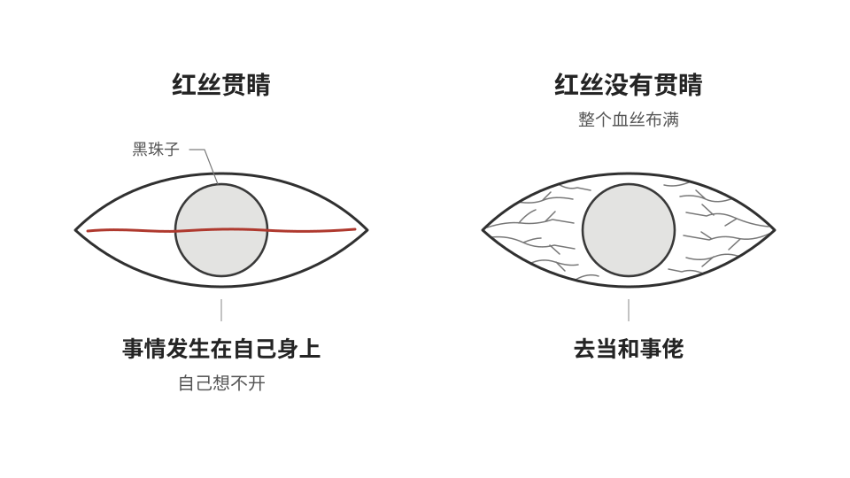 〔口述〕红丝贯睛主自己的事：「红丝贯睛是自己想不开」「事情发生在自己身上」。（[00:20:19–00:20:22](https://www.bilibili.com/video/BV1KJsLekEfA/?p=17&t=1219)，第 36570–36677 帧） 〔口述〕红丝没贯睛而满眼血丝，是替别人操心：「如果红丝没有贯睛」「整个血丝布满」「就是去当和事佬神经病」，「这一看就晓得」。（[00:20:22–00:20:36](https://www.bilibili.com/video/BV1KJsLekEfA/?p=17&t=1222)，第 36678–37103 帧） |
| **回到本例：后半生红鸾和送终怎么批？** | 〔口述〕倪师说「那我们言归正传」，然后「像这个人后半生红鸾星都没有动」。（[00:20:36–00:20:43](https://www.bilibili.com/video/BV1KJsLekEfA/?p=17&t=1236)，第 37104–37295 帧） 〔口述〕如果只照命算下去：「如果光算命的话下去」「这个人呢一子送终」，又问「会不会批啊」，接着重复是一个儿子送终。（[00:20:43–00:20:53](https://www.bilibili.com/video/BV1KJsLekEfA/?p=17&t=1243)，第 37296–37595 帧） 〔叠图〕叠图框出子女庚辰：天机利化禄、天梁庙化权、擎羊庙、天官旺、副旬陷、寡宿陷、天德庙，另有力士、攀鞍、天德、衰；小限 10,22,34,46,58,70，大限 93~102。（[00:20:50](https://www.bilibili.com/video/BV1KJsLekEfA/?p=17&t=1250)，第 37500–37517 帧） 〔板书〕板面左侧竖写几个字，可辨「一」「子」，其余认不出。（[00:20:50](https://www.bilibili.com/video/BV1KJsLekEfA/?p=17&t=1250)，第 37520 帧） 〔推断〕推断：讲「一子送终」时叠图正框着子女宫，但倪师在本块没说这句断语是从哪颗星、哪个宫看出来的。（[00:20:45–00:20:53](https://www.bilibili.com/video/BV1KJsLekEfA/?p=17&t=1245)，第 37374–37595 帧） |
| **要改变命运，倪师先给妻子、妈妈下了什么定义？** | 〔口述〕倪师说能改：「有没有办法改变她」「当然有办法」「我教你怎么改变啊」。（[00:20:53–00:20:58](https://www.bilibili.com/video/BV1KJsLekEfA/?p=17&t=1253)，第 37596–37763 帧） 〔口述〕先分名称：「已婚的女人」「我们在名上形上面」「结了婚的女人我们叫做妻子」「有子女的我们叫做妈妈」。（[00:20:58–00:21:13](https://www.bilibili.com/video/BV1KJsLekEfA/?p=17&t=1258)，第 37764–38195 帧） 〔口述〕他自己也说听起来像废话，「你看我讲好像废话一样」，但要点是「反正都是妻子和妈妈是相等的」。（[00:21:13–00:21:25](https://www.bilibili.com/video/BV1KJsLekEfA/?p=17&t=1273)，第 38196–38555 帧） 〔板书〕板面左侧竖写几个字，可辨「已」「有」，其余认不出；旁边圆圈里的字也认不出。（[00:21:14](https://www.bilibili.com/video/BV1KJsLekEfA/?p=17&t=1274)，第 38240 帧） |
| **西南角跟妈妈有什么关系？** | 〔口述〕倪师先声明「我不是乱写」，说别人问他是不是「脑神经原来就有问题」，他反说「我发现你们才有问题」。（[00:21:25–00:21:35](https://www.bilibili.com/video/BV1KJsLekEfA/?p=17&t=1285)，第 38556–38879 帧） 〔口述〕接着讲方位：「东南西北」「因为西南角是妈妈的位置」。（[00:21:36–00:21:41](https://www.bilibili.com/video/BV1KJsLekEfA/?p=17&t=1296)，第 38880–39059 帧） 〔板书〕可辨：板面右侧有一个方框，框里一个字，其余认不出；图里没看到「东南西北」之类的字。（[00:21:38](https://www.bilibili.com/video/BV1KJsLekEfA/?p=17&t=1298)，第 38943 帧） 〔推断〕推断：倪师从「怎么改变一子送终」讲到「妻子和妈妈相等」，再讲到「西南角是妈妈的位置」，三者怎样接成改法，本块还没讲完。（[00:20:53–00:21:41](https://www.bilibili.com/video/BV1KJsLekEfA/?p=17&t=1253)，第 37596–39059 帧） |
| **「妈妈」的定义有多宽？什么叫单女孤女？** | 〔口述〕倪师提醒要弄清定义：「你如果你不了解」「妈妈的定义是什么」。（[00:21:42–00:21:47](https://www.bilibili.com/video/BV1KJsLekEfA/?p=17&t=1302)，第 39060–39233 帧） 〔口述〕举例：有人「没有结婚生了小孩了」，也是「做妈妈」。（[00:21:47–00:21:54](https://www.bilibili.com/video/BV1KJsLekEfA/?p=17&t=1307)，第 39234–39431 帧） 〔口述〕也有人「是离了婚的」「对吧没有小孩」；「离过婚或者是有小孩的」，「反正单女孤女啊」「孤女」。本块到「孤女」为止。（[00:21:54–00:22:10](https://www.bilibili.com/video/BV1KJsLekEfA/?p=17&t=1314)，第 39432–39911 帧） |

**总结区**

- 通用规则：红丝贯睛是自己想不开、事情发生在自己身上；红丝没贯睛而整个血丝布满，是去替人当和事佬（[00:20:19–00:20:36](https://www.bilibili.com/video/BV1KJsLekEfA/?p=17&t=1219)，第 36570–37103 帧）；结了婚的女人叫妻子，有子女的叫妈妈，妻子和妈妈是相等的（[00:20:58–00:21:25](https://www.bilibili.com/video/BV1KJsLekEfA/?p=17&t=1258)，第 37764–38555 帧）；西南角是妈妈的位置（[00:21:36–00:21:41](https://www.bilibili.com/video/BV1KJsLekEfA/?p=17&t=1296)，第 38880–39059 帧）
- 只在本例：她第一次婚姻是妈妈极端赞成、非要她嫁的，倪师连着讲到太阴星化忌，叠图上太阴化忌在交友戊子（[00:16:40–00:16:50](https://www.bilibili.com/video/BV1KJsLekEfA/?p=17&t=1000)，第 30006–30305 帧）；她妈妈势必管她的婚姻，爸爸无所谓（[00:16:50–00:16:54](https://www.bilibili.com/video/BV1KJsLekEfA/?p=17&t=1010)，第 30306–30443 帧）；这个人后半生红鸾星没有动，光照命算下去是一子送终（[00:20:37–00:20:53](https://www.bilibili.com/video/BV1KJsLekEfA/?p=17&t=1237)，第 37134–37595 帧）
- 不是排盘规则，是处世方法：别人的婚事不要做第三者：客观分析完，让当事人自己决定、自己承担（[00:17:00–00:17:15](https://www.bilibili.com/video/BV1KJsLekEfA/?p=17&t=1020)，第 30624–31055 帧）；替人决定婚姻，不管结果好坏，做决定的人都倒霉（[00:17:15–00:17:52](https://www.bilibili.com/video/BV1KJsLekEfA/?p=17&t=1035)，第 31056–32171 帧）；夫妻吵架不要去干涉，插手的人第二天就成了两个人的仇人（[00:17:52–00:18:13](https://www.bilibili.com/video/BV1KJsLekEfA/?p=17&t=1072)，第 32172–32807 帧）；朋友闹离婚，让他看到最坏的打算，他要什么就给什么，劝和反而累自己（[00:19:00–00:20:10](https://www.bilibili.com/video/BV1KJsLekEfA/?p=17&t=1140)，第 34212–36311 帧）

**待核**

1. 本块开头叠图标「命宫癸未」大限 3~12，星曜与紧接着的父母甲申完全相同，像是前一块后期把同一格改宫名示意的残留，不是本命例命宫的真实内容（[00:16:39](https://www.bilibili.com/video/BV1KJsLekEfA/?p=17&t=999)，第 29976 帧）
2. 交友戊子叠图里「咸池」「咸池陷」、「大耗」「大耗旺」各出现两次，疑似转写重复（[00:16:41](https://www.bilibili.com/video/BV1KJsLekEfA/?p=17&t=1001)，第 30048 帧）
3. 指代 D060：说「去嫁这个人」时手伸向右下格、像指「太阴」，但标注为不确定，未作依据（[00:16:45](https://www.bilibili.com/video/BV1KJsLekEfA/?p=17&t=1005)，第 30173 帧）
4. 「还非要她去嫁这个」字幕可信度 0.62，语音作「他去嫁这个人太阴心化」（[00:16:45](https://www.bilibili.com/video/BV1KJsLekEfA/?p=17&t=1005)，第 30150 帧）
5. 倪师把太阴星化忌与妈妈连着讲，本块没有解释太阴为何对应母亲，也没说交友宫在这里起什么作用（[00:16:48](https://www.bilibili.com/video/BV1KJsLekEfA/?p=17&t=1008)，第 30240 帧）
6. 字幕用繁体「決」，引文里改成简体「决」（第 30870、30954、32118 帧）
7. 字幕「你女儿也不一定回来」，语音作「女儿也不愿意回来」（[00:17:25](https://www.bilibili.com/video/BV1KJsLekEfA/?p=17&t=1045)，第 31356 帧）
8. 字幕「太太两个人进来」，语音作「他有两个人寄来」，两路对不上（[00:18:21](https://www.bilibili.com/video/BV1KJsLekEfA/?p=17&t=1101)，第 33030 帧）
9. 字幕「我进去睡觉」语音作「我就去吃家了」；「我签完字我进去睡觉」语音只有「就两」（第 33282、34020 帧）
10. 字幕「手牵着手出去的」可信度 0.43，语音作「的时候出去了」，这半句待核（[00:18:55](https://www.bilibili.com/video/BV1KJsLekEfA/?p=17&t=1135)，第 34050 帧）
11. 字幕栏只有「生也是一嘛」，「死也是一」只见于语音转写和板书图上的烧录字幕；「我不是讲一吗」指之前讲过的什么，本块没说（[00:19:07](https://www.bilibili.com/video/BV1KJsLekEfA/?p=17&t=1147)，第 34416 帧）
12. 「你们变成熊猫」是什么意思，本块没解释（[00:19:36](https://www.bilibili.com/video/BV1KJsLekEfA/?p=17&t=1176)，第 35298 帧）
13. [00:20:37](https://www.bilibili.com/video/BV1KJsLekEfA/?p=17&t=1237)，第 37128 帧字幕识别为乱码「¥江E呈 ［维唯」，语音只有「像」，原话待核
14. 指代 D063、D064：说「像这个人」「这个人呢」时看不出手指在哪，未作依据（第 37132、37366 帧）
15. 「红鸾星都没有动」的「动」指什么、「一子送终」从盘上哪里看出，本块都没解释（[00:20:37–00:20:53](https://www.bilibili.com/video/BV1KJsLekEfA/?p=17&t=1237)，第 37134–37595 帧）
16. 「我们在名上形上面」语音作「在名上行上面」，「名上形上」是什么意思本块没解释（[00:21:01](https://www.bilibili.com/video/BV1KJsLekEfA/?p=17&t=1261)，第 37836 帧）
17. 板书认不出的地方：本块开头板面只认得圆圈里的「37」（[00:16:41](https://www.bilibili.com/video/BV1KJsLekEfA/?p=17&t=1001)，第 30036 帧）；[00:20:38](https://www.bilibili.com/video/BV1KJsLekEfA/?p=17&t=1238)，第 37140 帧认不出新写的字；[00:21:21](https://www.bilibili.com/video/BV1KJsLekEfA/?p=17&t=1281)，第 38454 帧与[00:21:14](https://www.bilibili.com/video/BV1KJsLekEfA/?p=17&t=1274)，第 38240 帧相比看不出新增的可辨字；[00:21:14](https://www.bilibili.com/video/BV1KJsLekEfA/?p=17&t=1274)，第 38240 帧圆圈里的字认不出；[00:21:38](https://www.bilibili.com/video/BV1KJsLekEfA/?p=17&t=1298)，第 38943 帧右侧方框里的字形近「母」，但不能确定
18. 字幕到「生也是一嘛」为止，语音转写后面还多出一句死也是一，字幕没有打出来，需要回听确认（[00:19:07–00:19:10](https://www.bilibili.com/video/BV1KJsLekEfA/?p=17&t=1147)，第 34416–34511 帧）

### 5　西南坤卦、东南再婚与改宅时机（[00:22:10–00:27:58](https://www.bilibili.com/video/BV1KJsLekEfA/?p=17&t=1330)，第 39912–50345 帧）

| 提示区 | 笔记区 |
|---|---|
| **孤女为什么不宜住房子的西南角？** | 〔口述〕接着上文讲孤女：如果不想当尼姑，就别去住西南角——「你如果孤女一个……你去住西南角的位置……那就恰好就是孤女了」。（[00:22:10–00:22:20](https://www.bilibili.com/video/BV1KJsLekEfA/?p=17&t=1330)，第 39912–40205 帧） 〔口述〕倪师把它说成通则：「所以一个房子在西南角的位置……不管你是已婚……都不适合单身去住」，又叮嘱「记得哦……都不可以单身去住」。（[00:22:20–00:22:31](https://www.bilibili.com/video/BV1KJsLekEfA/?p=17&t=1340)，第 40206–40541 帧） 〔口述〕西南角对应坤卦，六爻都是阴：「这是坤卦……一个阴已经够累了……它六个阴看到没有……一票尼姑在里边」。（[00:22:31–00:22:40](https://www.bilibili.com/video/BV1KJsLekEfA/?p=17&t=1351)，第 40542–40805 帧） 〔板书〕可辨：右上方画了上下排列的六道断开的短横（两列短划），旁边一个形似「坤」的字；下面一个大方框，框内右上角小格里一个形似「母」的字；方框左边一个形似「尼」的字。其余认不出。（[00:22:38](https://www.bilibili.com/video/BV1KJsLekEfA/?p=17&t=1358)，第 40758 帧） 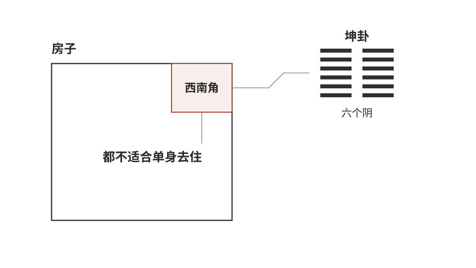 |
| **女儿跟妈妈同住西南角，爸爸会怎样？** | 〔口述〕倪师说这种情况经常碰到：「女儿跟妈妈一起住在西南角你看看……爸爸很惨的……爸爸住西厢啊……这个爸爸有没有地位……没有地位啊」。（[00:22:44–00:22:59](https://www.bilibili.com/video/BV1KJsLekEfA/?p=17&t=1364)，第 40920–41375 帧） 〔指代〕说「这个」时，手指压在板面右上方大方框内右侧上格（形似打叉的「母」字）的下沿与下格交界处，正在下格写字。（[00:22:55](https://www.bilibili.com/video/BV1KJsLekEfA/?p=17&t=1375)，第 41261 帧） 〔口述〕举的情形是：妈妈疼女儿，希望她嫁个好先生，女儿刚离婚回家住，「那她妈就把女儿拉到她一起住」。（[00:22:59–00:23:09](https://www.bilibili.com/video/BV1KJsLekEfA/?p=17&t=1379)，第 41376–41681 帧） 〔口述〕母女同住就成了两个坤：「对啊那两个坤……两个都是妈妈住在一起嘛……你从此就坤嘛……就不见阳六阴都是阴爻啊……所以只有女人存在」。（[00:23:09–00:23:23](https://www.bilibili.com/video/BV1KJsLekEfA/?p=17&t=1389)，第 41682–42095 帧） 〔板书〕可辨：右侧大方框内的小格里有「母」字，它下面一格的字形似「女」，认不准；其余认不出。（这张图是稍后的板面，写这两格时的板书图第41328帧没拍到这个方框。）（[00:25:21](https://www.bilibili.com/video/BV1KJsLekEfA/?p=17&t=1521)，第 45648 帧） |
| **一进门全是高跟鞋，说明这房子怎样？** | 〔口述〕看阳宅或到朋友家：「一走进去一看门口全部是高跟鞋……因为通通是偏南的懂吗」。（[00:23:23–00:23:29](https://www.bilibili.com/video/BV1KJsLekEfA/?p=17&t=1403)，第 42096–42293 帧） 〔口述〕「偏南边的都是女人……这种是属于女人住的房子……不好」，而且「不管是已婚未婚的女人……不管她是妈妈还是离过婚的」都一样。（[00:23:29–00:23:41](https://www.bilibili.com/video/BV1KJsLekEfA/?p=17&t=1409)，第 42294–42635 帧） |
| **要她红鸾星再动，该把她放到哪个方位？** | 〔口述〕「如果你要她红鸾星再动的时候……都一律把她放到东南角」。（[00:23:41–00:23:47](https://www.bilibili.com/video/BV1KJsLekEfA/?p=17&t=1421)，第 42636–42839 帧） 〔口述〕倪师提到这是象数的道理：「时就是易经所谓的象和数……我们这一派叫象数宗」（这两句两路识别都不好，见待核）。（[00:23:58–00:24:03](https://www.bilibili.com/video/BV1KJsLekEfA/?p=17&t=1438)，第 43146–43295 帧） 〔口述〕举例：「东南角放进去……三女住到大女儿位置……会变成妹妹结婚……姐姐还没结婚」。（[00:24:05–00:24:11](https://www.bilibili.com/video/BV1KJsLekEfA/?p=17&t=1445)，第 43356–43535 帧） 〔口述〕结论：「所以东南角代表一个……没有没有没有婚姻的女孩子……会很快的嫁了嫁一个先生了」。（[00:24:11–00:24:18](https://www.bilibili.com/video/BV1KJsLekEfA/?p=17&t=1451)，第 43536–43763 帧） 〔板书〕可辨：左边「孤女」；右边新画一个方框，方框上方「S」、左边「E」；方框上面那一格可辨「兄弟」。其余认不出。（[00:24:09](https://www.bilibili.com/video/BV1KJsLekEfA/?p=17&t=1449)，第 43488 帧） 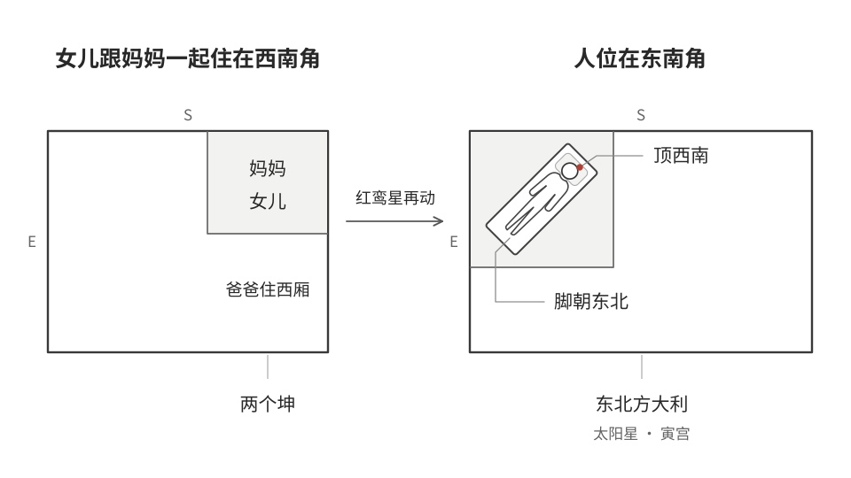 |
| **她为什么东北角最好？人在房里怎么摆？** | 〔口述〕「然后我们来看她的流年……太阳星在这边……所以她的东北角最好啊」，接着在板上标东、西、南、北。（[00:24:18–00:24:34](https://www.bilibili.com/video/BV1KJsLekEfA/?p=17&t=1458)，第 43764–44225 帧） 〔指代〕说「这里是西」时，倪师在板右侧写下并圈出「W」；说「这里是南」时，在上方「杀 / 兄弟」那格旁写「S」并画圈。（[00:24:29–00:24:31](https://www.bilibili.com/video/BV1KJsLekEfA/?p=17&t=1469)，第 44097–44152 帧） 〔口述〕「那刚好是在寅宫最好的话……我们就是叫她东北方大利……所以人位在东南角……头呢顶西南脚朝东北」。（[00:24:34–00:24:48](https://www.bilibili.com/video/BV1KJsLekEfA/?p=17&t=1474)，第 44226–44669 帧） 〔板书〕可辨：方框上方「S」、左边「E」；板右侧一个圈起的「W」；左上方另有一个圈起的「S」。其余认不出。（[00:24:33](https://www.bilibili.com/video/BV1KJsLekEfA/?p=17&t=1473)，第 44208 帧） 〔板书〕可辨：方框上方「S」、左边「E」；方框左上角小格里斜画了一个小框，一条箭头从小框指向左下；板中间另有一个圈起的「E」。小框里的字认不出。（[00:24:46](https://www.bilibili.com/video/BV1KJsLekEfA/?p=17&t=1486)，第 44608 帧） |
| **37 岁就改，为什么 38、39 岁都不会成？** | 〔口述〕「这第一个改上去……第二个我们来看她流年……如果37岁改」。（[00:24:51–00:25:02](https://www.bilibili.com/video/BV1KJsLekEfA/?p=17&t=1491)，第 44742–45077 帧） 〔口述〕38 岁时太阴化忌在朋友宫，「化忌不会成」；「38 39岁进入事业宫也不会成」。（字幕把 38 识别成 28，见待核。）（[00:25:02–00:25:10](https://www.bilibili.com/video/BV1KJsLekEfA/?p=17&t=1502)，第 45078–45323 帧） 〔叠图〕交友 戊子标「38」：太阴庙、化忌，天同旺，文曲得，天魁旺；官禄 丁亥标「39」：天府得；迁移 己丑标「37」：武曲庙，贪狼庙。（[00:24:59–00:25:02](https://www.bilibili.com/video/BV1KJsLekEfA/?p=17&t=1499)，第 44970–45071 帧） |
| **「有人的宫」指什么？为什么要拖到 41 岁？** | 〔口述〕一定要进入有人的宫才会成：「40岁田宅宫……还是要回到41岁……再进入的时候要到41岁才会成」。（[00:25:10–00:25:19](https://www.bilibili.com/video/BV1KJsLekEfA/?p=17&t=1510)，第 45324–45593 帧） 〔口述〕「所以即使你37岁帮她改……也会经历拖拖拖拖拖……拖到有人的福德……女人的福德就代表什么啊先生」。（[00:25:19–00:25:27](https://www.bilibili.com/video/BV1KJsLekEfA/?p=17&t=1519)，第 45594–45833 帧） 〔叠图〕田宅 丙戌标「40」：天刑庙；福德 乙酉标「41」：廉贞平，破军陷，右弼陷；父母 甲申标「42」：红鸾庙，天福庙，八座庙。第45648帧画面里这三个数字加了绿框。（[00:25:10–00:25:12](https://www.bilibili.com/video/BV1KJsLekEfA/?p=17&t=1510)，第 45324–45389 帧） 〔板书〕可辨：板中间写了一个「40」，其余新写的字认不出。（[00:25:21](https://www.bilibili.com/video/BV1KJsLekEfA/?p=17&t=1521)，第 45648 帧） 〔推断〕推断：倪师说要进入「有人的宫」才会成，又说女人的福德代表先生，所以 41 岁的福德宫算「有人的宫」；田宅宫为什么不算，本块没讲。（[00:25:10–00:25:27](https://www.bilibili.com/video/BV1KJsLekEfA/?p=17&t=1510)，第 45324–45833 帧） |
| **第二次结婚前一定要做到什么？** | 〔口述〕「但是第二次的时候……绝绝对不要历史重演……你第二次结婚的时候……一定要强调主卧房在西北角……没有这条件不能结婚」。（[00:25:27–00:25:40](https://www.bilibili.com/video/BV1KJsLekEfA/?p=17&t=1527)，第 45834–46217 帧） 〔口述〕「如果你一不慎……她婚前做了（住东南）婚后没做（佳西北）……我们这个动作……等于是害了她……不是帮助她」。括号里的字语音里没有，见待核。（[00:25:40–00:25:51](https://www.bilibili.com/video/BV1KJsLekEfA/?p=17&t=1540)，第 46218–46553 帧） 〔口述〕「让她再一次（死别）发生这个事情……本来命上面没有……被你搞成有的懂不懂」。（[00:25:51–00:25:58](https://www.bilibili.com/video/BV1KJsLekEfA/?p=17&t=1551)，第 46554–46763 帧） 〔板书〕可辨：左侧方框上方「S」，左上角小格里斜画一个小框；方框右下新画了一个小框，框里的字认不出。（[00:25:38](https://www.bilibili.com/video/BV1KJsLekEfA/?p=17&t=1538)，第 46152 帧） 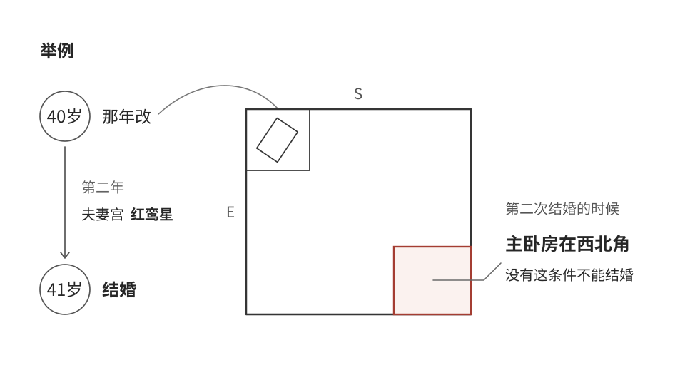 〔板书〕可辨：同一方框里多了一个圈起的「A」，下方另有一个圈起的字母，形似「R」，认不准。其余认不出。（[00:25:52](https://www.bilibili.com/video/BV1KJsLekEfA/?p=17&t=1552)，第 46560 帧） |
| **改宅的力量有多大？40 岁改会怎样？** | 〔口述〕「所以我们这个运一动力量很大……你不要乱给她动」。（[00:25:58–00:26:04](https://www.bilibili.com/video/BV1KJsLekEfA/?p=17&t=1558)，第 46764–46925 帧） 〔口述〕举例：「比如说这一年是40岁……刚好你40岁那年改到这个年……刚好她的第二年是什么……夫妻宫她就红鸾星……就会41岁结婚」。（[00:26:09–00:26:19](https://www.bilibili.com/video/BV1KJsLekEfA/?p=17&t=1569)，第 47070–47375 帧） 〔指代〕说「改到这个年」时，手指落在房屋图左上角斜放的小方框上（框内字看不清）；此前他从圈起的「40」处画弧线到房屋图顶边，并写了「S」。（[00:26:12](https://www.bilibili.com/video/BV1KJsLekEfA/?p=17&t=1572)，第 47179 帧） 〔口述〕这个 41 岁的婚是改出来的：「这是我们帮她改出来才有的」。（[00:26:20–00:26:22](https://www.bilibili.com/video/BV1KJsLekEfA/?p=17&t=1580)，第 47406–47477 帧） 〔板书〕可辨：圈起的「40」和圈起的「41」；「40」处有一条弧线连到房屋图顶边；房屋图上方「S」、左边「E」，左上角有斜放的小框。框内字认不出。（[00:26:19](https://www.bilibili.com/video/BV1KJsLekEfA/?p=17&t=1579)，第 47388 帧） |
| **什么时机下手改？这两年不好时先怎么办？** | 〔口述〕「所以改的时候……决定在什么时机我们改……她来找我们的这个时机……还有我们她我们在看她八字的时候……我们帮她改的时机很重要」。（[00:26:22–00:26:35](https://www.bilibili.com/video/BV1KJsLekEfA/?p=17&t=1582)，第 47478–47855 帧） 〔口述〕倪师强调他一直讲「决定什么时机下手」；本例「那这两年都不好……反正都不好……我们先不要去改她……我们让她住在西南角坤卦」。（[00:26:35–00:26:45](https://www.bilibili.com/video/BV1KJsLekEfA/?p=17&t=1595)，第 47856–48155 帧） |
| **什么叫「名位相等」？有什么用？** | 〔口述〕让她住西南角坤卦，「为什么因为名位相等」，不管男人女人都一样（「名位」那几句字幕识别不清，见待核）。（[00:26:45–00:26:50](https://www.bilibili.com/video/BV1KJsLekEfA/?p=17&t=1605)，第 48156–48329 帧） 〔口述〕「她的名字叫妈妈……住妈妈的位置……名位相等的时候发事业……你的名字叫长女去住东南」。（[00:26:54–00:27:04](https://www.bilibili.com/video/BV1KJsLekEfA/?p=17&t=1614)，第 48426–48749 帧） 〔口述〕「名位相等的时候发事业……因为你位置住对了……可以用你的名字来做事业当老板」。（[00:27:05–00:27:10](https://www.bilibili.com/video/BV1KJsLekEfA/?p=17&t=1625)，第 48750–48929 帧） 〔推断〕推断：前面说「三女住到大女儿位置」会妹妹先结婚、东南角让没有婚姻的女孩子很快嫁人，这里又说「长女去住东南」，可见东南对应长女的位置；同理，让她住西南坤卦是对应「妈妈」的位置。（[00:24:05–00:27:04](https://www.bilibili.com/video/BV1KJsLekEfA/?p=17&t=1445)，第 43356–48749 帧） |
| **她的先生是紫微七杀，说明什么？她该怎么做？** | 〔叠图〕夫妻 辛巳：紫微旺、化科，七杀平，左辅平，天马平，火星得，旬空庙。（[00:27:11–00:27:12](https://www.bilibili.com/video/BV1KJsLekEfA/?p=17&t=1631)，第 48930–48989 帧） 〔口述〕「你看她命上面先生是紫微七杀……不但代表先生是独子或长子以外……而且代表先生头顶上面没有人……做事业当老板」。（「没有人」语音作「有人」，见待核。）（[00:27:11–00:27:19](https://www.bilibili.com/video/BV1KJsLekEfA/?p=17&t=1631)，第 48930–49193 帧） 〔口述〕所以「那她先生走掉以后……她应该当公司负责人她去继承」。（[00:27:19–00:27:25](https://www.bilibili.com/video/BV1KJsLekEfA/?p=17&t=1639)，第 49194–49361 帧） |
| **本例怎么改：先做什么，再做什么？** | 〔口述〕「先改西南角……改西南角让她名位相等……名字等于位……反过来位等于名……位等于名是发事业」。（[00:27:25–00:27:35](https://www.bilibili.com/video/BV1KJsLekEfA/?p=17&t=1645)，第 49362–49667 帧） 〔口述〕再把后面的灾去掉：「明年后年的灾通通去掉……廉破的灾都去掉」。（[00:27:37–00:27:40](https://www.bilibili.com/video/BV1KJsLekEfA/?p=17&t=1657)，第 49734–49811 帧） 〔口述〕然后让她进入父母宫（字幕作「然母宫」），从「到这一年37」数到「41岁」，倪师说「所以一念之间哈」。（[00:27:40–00:27:47](https://www.bilibili.com/video/BV1KJsLekEfA/?p=17&t=1660)，第 49812–50027 帧） 〔推断〕推断：叠图里福德 乙酉标 41、有廉贞平和破军陷，父母 甲申标 42、有红鸾庙；「廉破的灾」「进入父母宫」可能分别对应这两格，但本块倪师没把岁数和宫位一一说明。（[00:25:10–00:27:42](https://www.bilibili.com/video/BV1KJsLekEfA/?p=17&t=1510)，第 45324–49883 帧） |

**总结区**

- 通用规则：房子的西南角是坤卦、六爻皆阴，不管已婚未婚，都不适合女子单身去住（[00:22:20–00:22:40](https://www.bilibili.com/video/BV1KJsLekEfA/?p=17&t=1340)，第 40206–40805 帧）；女人要红鸾星再动，一律放到东南角；东南角代表没有婚姻的女孩子，会很快嫁人（[00:23:41–00:24:18](https://www.bilibili.com/video/BV1KJsLekEfA/?p=17&t=1421)，第 42636–43763 帧）；改了之后，流年一定要进入「有人的宫」才会成；女人的福德代表先生（[00:25:10–00:25:27](https://www.bilibili.com/video/BV1KJsLekEfA/?p=17&t=1510)，第 45324–45833 帧）；名位相等时发事业：名字叫妈妈就住妈妈的位置，名字叫长女就住东南（[00:26:45–00:27:10](https://www.bilibili.com/video/BV1KJsLekEfA/?p=17&t=1605)，第 48156–48929 帧）
- 只在本例：她的东北角最好、东北方大利；人位在东南角，头顶西南、脚朝东北（[00:24:18–00:24:48](https://www.bilibili.com/video/BV1KJsLekEfA/?p=17&t=1458)，第 43764–44669 帧）；37 岁改，38 岁太阴化忌在朋友宫、39 岁事业宫都不会成，要拖到 41 岁福德才成（[00:24:51–00:25:27](https://www.bilibili.com/video/BV1KJsLekEfA/?p=17&t=1491)，第 44742–45833 帧）；夫妻宫紫微七杀：先生是独子或长子、做事业当老板；先生走后她应当公司负责人去继承（[00:27:11–00:27:25](https://www.bilibili.com/video/BV1KJsLekEfA/?p=17&t=1631)，第 48930–49361 帧）；先改西南角让她名位相等发事业，去掉明年后年廉破的灾，再让她进入父母宫、到 41 岁（[00:27:25–00:27:47](https://www.bilibili.com/video/BV1KJsLekEfA/?p=17&t=1645)，第 49362–50027 帧）
- 不是排盘规则，是处世方法：第二次结婚一定要强调主卧房在西北角，没有这条件不能结婚；婚前改了婚后没做，等于害她（[00:25:27–00:25:58](https://www.bilibili.com/video/BV1KJsLekEfA/?p=17&t=1527)，第 45834–46763 帧）；改宅的力量很大，不要乱给人动（[00:25:58–00:26:04](https://www.bilibili.com/video/BV1KJsLekEfA/?p=17&t=1558)，第 46764–46925 帧）；改的时机很重要，要看她来找我们的时机和她的八字，决定什么时机下手（[00:26:22–00:26:39](https://www.bilibili.com/video/BV1KJsLekEfA/?p=17&t=1582)，第 47478–47993 帧）

**待核**

1. [00:22:28](https://www.bilibili.com/video/BV1KJsLekEfA/?p=17&t=1348)，第 40446 帧：字幕「辛旨甫早业」，语音只有「记」，原话听不清，未收。
2. [00:22:31](https://www.bilibili.com/video/BV1KJsLekEfA/?p=17&t=1351)，第 40542 帧、[00:23:09](https://www.bilibili.com/video/BV1KJsLekEfA/?p=17&t=1389)，第 41682 帧：「坤卦」「两个坤」语音作「困掛」「两个困」，按上下文作坤。
3. [00:23:27–00:23:32](https://www.bilibili.com/video/BV1KJsLekEfA/?p=17&t=1407)，第 42228–42365 帧：字幕「偏南」「偏南边的都是女人」，语音作「偏男」「便好都是女人」，[00:23:29](https://www.bilibili.com/video/BV1KJsLekEfA/?p=17&t=1409)，第 42294 帧字幕可信度仅 0.36；是「偏南」还是「偏男」待核。
4. [00:23:41](https://www.bilibili.com/video/BV1KJsLekEfA/?p=17&t=1421)，第 42636 帧、[00:26:15](https://www.bilibili.com/video/BV1KJsLekEfA/?p=17&t=1575)，第 47256 帧：「红鸾星」语音作「红蓝星」，按字幕取红鸾。
5. [00:23:55](https://www.bilibili.com/video/BV1KJsLekEfA/?p=17&t=1435)，第 43062 帧：字幕「这里有个时时的问题」，语音「个十的问题十」，「时」指什么没解释；[00:23:58–00:24:03](https://www.bilibili.com/video/BV1KJsLekEfA/?p=17&t=1438)，第 43146–43295 帧「象和数」「象数宗」语音作「象和树」「象树中」，倪师没解释象数宗。
6. [00:24:08](https://www.bilibili.com/video/BV1KJsLekEfA/?p=17&t=1448)，第 43446 帧：「三女住到大女儿位置」，为什么东南是大女儿位置这里没直接讲，要到[00:26:58](https://www.bilibili.com/video/BV1KJsLekEfA/?p=17&t=1618)，第 48564 帧「长女去住东南」才对上。
7. [00:24:26](https://www.bilibili.com/video/BV1KJsLekEfA/?p=17&t=1466)，第 43992 帧：字幕「这里八字上这里是东」，语音「巴士上」，「八字上」何意不明。
8. [00:24:34](https://www.bilibili.com/video/BV1KJsLekEfA/?p=17&t=1474)，第 44226 帧：「寅宫」语音作「隐功」，按上下文作寅宫。
9. [00:24:22](https://www.bilibili.com/video/BV1KJsLekEfA/?p=17&t=1462)，第 43866 帧：「太阳星在这边」所指的指代 D069 为不确定；第44208、44608帧画面左下角贴着叠图「疾厄 戊寅」（太阳旺加蓝框、巨门庙、文昌陷、陀罗陷、天喜庙等），但材料的▣行没有列出，倪师也没明说寅宫就是这一格。
10. [00:25:02](https://www.bilibili.com/video/BV1KJsLekEfA/?p=17&t=1502)，第 45078 帧：字幕「28岁的时候」，语音作「38岁的时候」，按上下文当作 38 岁；倪师说「朋友宫」「事业宫」，叠图写的是「交友」「官禄」。
11. [00:25:10](https://www.bilibili.com/video/BV1KJsLekEfA/?p=17&t=1510)，第 45324 帧：字幕「淀要进入有人的宫」，语音「一定要进入有人的工」，按语音作「一定要」；「有人的宫」倪师没下定义。
12. [00:25:13](https://www.bilibili.com/video/BV1KJsLekEfA/?p=17&t=1513)，第 45390 帧：「40岁田宅宫」字幕可信度 0.35，语音「岁前载工」，「田宅」二字待核。
13. [00:25:24](https://www.bilibili.com/video/BV1KJsLekEfA/?p=17&t=1524)，第 45726 帧：「女人的福德就代表什么啊先生」语音作「本福德在哪先生」，两路只对上「福德」「先生」。
14. [00:25:37](https://www.bilibili.com/video/BV1KJsLekEfA/?p=17&t=1537)，第 46128 帧：「没有这条件不能结婚」语音作「这团队不能结婚」。
15. [00:25:43](https://www.bilibili.com/video/BV1KJsLekEfA/?p=17&t=1543)，第 46302 帧：字幕里的「（住东南）」「（佳西北）」和[00:25:51](https://www.bilibili.com/video/BV1KJsLekEfA/?p=17&t=1551)，第 46554 帧的「（死别）」语音里都没有，像字幕制作者加的注；「佳西北」疑为「住西北」。
16. [00:25:58](https://www.bilibili.com/video/BV1KJsLekEfA/?p=17&t=1558)，第 46764 帧：字幕「这个运一动力量很大」，语音「这个运动力量很大」，原话待核。
17. [00:26:13–00:26:16](https://www.bilibili.com/video/BV1KJsLekEfA/?p=17&t=1573)，第 47202–47303 帧：「第二年是什么」「夫妻宫她就红鸾星」语音作「福西」「哥她就红蓝星」，「夫妻宫」待核；叠图上红鸾在父母 甲申（标 42），与「41岁结婚」怎么对上本块没讲。
18. [00:26:39](https://www.bilibili.com/video/BV1KJsLekEfA/?p=17&t=1599)，第 47994 帧：「这两年都不好」指哪两年，本块没说清。
19. [00:26:51–00:26:54](https://www.bilibili.com/video/BV1KJsLekEfA/?p=17&t=1611)，第 48330–48425 帧：字幕「只要是名三位哈」「名=位」，语音「名等一位」，原话大概是「名等于位」一类，待核。
20. [00:26:58](https://www.bilibili.com/video/BV1KJsLekEfA/?p=17&t=1618)，第 48564 帧：语音比字幕多出「儿子你去住东宫」「你的名字叫丈夫去住西北」，字幕没有，未收进笔记。
21. [00:27:15](https://www.bilibili.com/video/BV1KJsLekEfA/?p=17&t=1635)，第 49074 帧：字幕「先生头顶上面没有人」，语音作「先生头顶上面有人」，两路相反，待核。
22. [00:27:22](https://www.bilibili.com/video/BV1KJsLekEfA/?p=17&t=1642)，第 49266 帧：「公司负责人」语音作「公司副任」。
23. [00:27:35](https://www.bilibili.com/video/BV1KJsLekEfA/?p=17&t=1655)，第 49668 帧：字幕「然后今年已经把这两个化」，语音「续一直把这两个话记明」，听不清，未收。
24. [00:27:40](https://www.bilibili.com/video/BV1KJsLekEfA/?p=17&t=1660)，第 49812 帧：字幕「然母宫」，语音「父母公」，改作父母宫；[00:27:45](https://www.bilibili.com/video/BV1KJsLekEfA/?p=17&t=1665)，第 49956 帧「一念之间」语音作「一年之间」。
25. [00:27:52–00:27:58](https://www.bilibili.com/video/BV1KJsLekEfA/?p=17&t=1672)，第 50178–50345 帧：字幕「你看朋年化思」「以她80年说（1991）88 81年化忌」可信度 0.3，语音「明年化季」「80年化季」，年份对不上，未收。
26. [00:27:39](https://www.bilibili.com/video/BV1KJsLekEfA/?p=17&t=1659)，第 49776 帧：「廉破的灾都去掉」字幕可信度仅 0.3，语音「破的栽充都去掉」。
27. 板书：[00:22:10](https://www.bilibili.com/video/BV1KJsLekEfA/?p=17&t=1330)，第 39912 帧开头板面大多认不出；[00:22:57](https://www.bilibili.com/video/BV1KJsLekEfA/?p=17&t=1377)，第 41328 帧镜头偏左，没拍到右侧方框；[00:24:15](https://www.bilibili.com/video/BV1KJsLekEfA/?p=17&t=1455)，第 43656 帧这次新写的几笔看不出是哪几个字；[00:25:21](https://www.bilibili.com/video/BV1KJsLekEfA/?p=17&t=1521)，第 45648 帧「母」下面一字形似「女」、[00:25:52](https://www.bilibili.com/video/BV1KJsLekEfA/?p=17&t=1552)，第 46560 帧圈中字母形似「R」，都认不准。
28. 指代：D067、D068、D069、D070、D071、D072、D075、D077、D079 为不确定或否，未当依据。
29. 叠图：夫妻 辛巳的数字串「103112、455769、92133」没有还原，未写。

### 6　改住处促成再婚与挑年怀孕（[00:27:58–00:33:24](https://www.bilibili.com/video/BV1KJsLekEfA/?p=17&t=1678)，第 50346–60137 帧）

| 提示区 | 笔记区 |
|---|---|
| **37 到 41 岁这几年为什么不好？先改住哪里？** | 〔口述〕倪师说这几年一路走下来「到到41岁都是廉破都是灾星」，财也不好，「连财星都不进来」。前面一句提到天府星是小星、没有大财星，但这句字幕识别很差，只能大意参考。（[00:27:58–00:28:02](https://www.bilibili.com/video/BV1KJsLekEfA/?p=17&t=1678)，第 50346–50471 帧） 〔叠图〕画面右侧贴出：福德乙酉，廉贞平、破军陷、右弼陷，大限 23~32，绿框标 41；父母甲申绿框标 42；田宅丙戌绿框标 40。（[00:27:58–00:28:00](https://www.bilibili.com/video/BV1KJsLekEfA/?p=17&t=1678)，第 50364–50429 帧） 〔板书〕本块开头的板面。可辨：左侧圆圈里的「夫妻」，中间两个圆圈里的「A」「B」，上方圆圈里的「S」，右下角露出一个「4」；其余认不出，部分被老师身体和叠图挡住。（[00:28:00](https://www.bilibili.com/video/BV1KJsLekEfA/?p=17&t=1680)，第 50400 帧） 〔口述〕这段时间先把她改住西南角：「让她1年2年3年4年」，「四年的事业财运非常的好」。（[00:28:02–00:28:08](https://www.bilibili.com/video/BV1KJsLekEfA/?p=17&t=1682)，第 50472–50657 帧） |
| **41 岁年底为什么要搬去东南角、脚朝东北？** | 〔口述〕进入这一年就可以换了，因为后面进入父母宫，「父母是人啊」，「红鸾星进来」。（[00:28:08–00:28:14](https://www.bilibili.com/video/BV1KJsLekEfA/?p=17&t=1688)，第 50658–50837 帧） 〔口述〕具体做法：「小姐你41岁年底的时候」「西南角不要住了去住东南角」「然后脚朝东北」，「一进去以后42岁一结婚」。（[00:28:14–00:28:24](https://www.bilibili.com/video/BV1KJsLekEfA/?p=17&t=1694)，第 50838–51125 帧） 〔叠图〕父母甲申：红鸾庙、八座庙、天福庙、天空旺、孤辰平、劫煞、天巫，大限 13~22，绿框标 42。（[00:27:58–00:28:00](https://www.bilibili.com/video/BV1KJsLekEfA/?p=17&t=1678)，第 50364–50429 帧） 〔口述〕结婚这一年，「一结婚红鸾星进来」。（[00:28:24–00:28:25](https://www.bilibili.com/video/BV1KJsLekEfA/?p=17&t=1704)，第 51126–51167 帧） |
| **42 岁遇到的先生是什么星？这样安排有何好处？** | 〔口述〕她遇到的先生是天钺（字幕作「天魁（钺）」），「对面是什么巨门太阳」。（[00:28:25–00:28:30](https://www.bilibili.com/video/BV1KJsLekEfA/?p=17&t=1705)，第 51168–51329 帧） 〔叠图〕父母甲申一格有天钺庙；此时另贴出疾厄戊寅：太阳旺、巨门庙、文昌陷、陀罗陷、天喜庙、天姚旺。倪师说的「对面」，叠图上对应的是这一格。（[00:28:31–00:28:33](https://www.bilibili.com/video/BV1KJsLekEfA/?p=17&t=1711)，第 51330–51413 帧） 〔口述〕倪师强调这是人为安排出来的：「这是我们把遥控控出来的」，「懂不懂把它变出来的」。（[00:28:31–00:28:35](https://www.bilibili.com/video/BV1KJsLekEfA/?p=17&t=1711)，第 51330–51467 帧） 〔口述〕问这样住有没有好处，答「当然有好处啊」，「这个是就是一个缘呐」；好处是免得她一辈子的福德都落在廉破（字幕与语音这句有出入）。（[00:28:35–00:28:49](https://www.bilibili.com/video/BV1KJsLekEfA/?p=17&t=1715)，第 51468–51899 帧） |
| **算到克夫这类格，倪师怎么处理？为什么？** | 〔口述〕「但是记得一定要强调」，「像这种这种命格的人」，「就算我们算到这种格」「我都我都避而不谈」。（[00:28:50–00:28:58](https://www.bilibili.com/video/BV1KJsLekEfA/?p=17&t=1730)，第 51900–52157 帧） 〔口述〕举例：有人说某个女孩子一嫁先生，先生就死了，「那女人克夫啊」，「以前都不得了啊」；算命先生这样讲了，婆婆再一看，两个人一起骂。（[00:28:58–00:29:10](https://www.bilibili.com/video/BV1KJsLekEfA/?p=17&t=1738)，第 52158–52505 帧） 〔口述〕结果「那媳妇真的活活给整惨」，倪师说那婆婆「跟那个相命先生都该杀懂不懂」「混蛋啊」。（[00:29:10–00:29:22](https://www.bilibili.com/video/BV1KJsLekEfA/?p=17&t=1750)，第 52506–52889 帧） |
| **改到 42 岁结婚，再嫁的先生会是什么样？** | 〔指代〕说「那我们如何把她改到这个」时，食指点在黑板右上一个横长方框的下沿，框里看得见粉笔「4」，其余字模糊。（[00:29:23](https://www.bilibili.com/video/BV1KJsLekEfA/?p=17&t=1763)，第 52913 帧） 〔口述〕「让她42岁结婚的话」，「她嫁的再嫁的先生」「如同她父亲一样」，「会年龄大她很多」，「然后像爸爸对女儿一样好」。（[00:29:25–00:29:35](https://www.bilibili.com/video/BV1KJsLekEfA/?p=17&t=1765)，第 52950–53255 帧） 〔口述〕比喻：看到先生对太太像爸爸对女儿，「你看爸爸对女儿都很偏心呢」；对儿子「丢个牛仔裤给你就好了」，女儿跑过来就什么都买。（[00:29:35–00:29:51](https://www.bilibili.com/video/BV1KJsLekEfA/?p=17&t=1775)，第 53256–53753 帧） 〔口述〕收束：「所以说这个我们就促成人家的红鸾」。（[00:29:51–00:29:53](https://www.bilibili.com/video/BV1KJsLekEfA/?p=17&t=1791)，第 53754–53819 帧） 〔推断〕推断：倪师用「再嫁」一词，结合本块后面「37岁她当年才出事」的说法，42 岁这次在本例里是第二次婚姻。（[00:29:26–00:31:07](https://www.bilibili.com/video/BV1KJsLekEfA/?p=17&t=1766)，第 52992–56021 帧） |
| **不跟客户细讲，客户为什么肯照做？** | 〔口述〕告诉她这样做时，没时间跟客户一条条讨论「你这样子做的话」「你会怎么怎么好」，「你没有时间去讨论它」。前一句字幕先说没有时间、又说有很多时间，有出入。（[00:29:54–00:30:05](https://www.bilibili.com/video/BV1KJsLekEfA/?p=17&t=1794)，第 53820–54161 帧） 〔口述〕她不知道其中道理，倪师说「知之和不知都是知」，她就这样「她就相信先迷后得」。（[00:30:05–00:30:12](https://www.bilibili.com/video/BV1KJsLekEfA/?p=17&t=1805)，第 54162–54365 帧） 〔口述〕她为什么信？「因为你这样做无伤嘛」：不是叫她改信别的教，「也不是叫我买块玉」「也不是叫我花三十几万去做个法」，画符念咒也没有。（[00:30:12–00:30:24](https://www.bilibili.com/video/BV1KJsLekEfA/?p=17&t=1812)，第 54366–54731 帧） 〔口述〕所以「我就听你的话去做」，「叫做先迷后得」。（[00:30:24–00:30:27](https://www.bilibili.com/video/BV1KJsLekEfA/?p=17&t=1824)，第 54732–54827 帧） |
| **什么叫阴德？哪种做法是自欺欺人？** | 〔口述〕「结果她得到」，得到的时候「她可能把你忘掉了」。（[00:30:27–00:30:31](https://www.bilibili.com/video/BV1KJsLekEfA/?p=17&t=1827)，第 54828–54935 帧） 〔口述〕「什么叫阴德」：「就是你帮助了人家」「人家还不知道你帮助她」。（[00:30:31–00:30:37](https://www.bilibili.com/video/BV1KJsLekEfA/?p=17&t=1831)，第 54936–55139 帧） 〔口述〕现在很多人到庙里天天说「我要去多积一些阴德」，有钱人去帮没钱人「洗衣服煮饭烧菜」，以为在做功德，倪师斥为「这狗屁这自欺欺人的行为」。（[00:30:38–00:30:52](https://www.bilibili.com/video/BV1KJsLekEfA/?p=17&t=1838)，第 55140–55571 帧） 〔口述〕再重申：「我们帮助人家人家还不知道」。（[00:30:52–00:30:57](https://www.bilibili.com/video/BV1KJsLekEfA/?p=17&t=1852)，第 55572–55721 帧） |
| **帮人挑时机挑错了会怎样？** | 〔口述〕「要挑如何帮她挑什么时机下手」，「你不要给她挑了化忌的时候好了」。（[00:30:57–00:31:04](https://www.bilibili.com/video/BV1KJsLekEfA/?p=17&t=1857)，第 55722–55949 帧） 〔口述〕反例：37 岁当年出事，当年就把她改到东南角（字幕作「南角」），第二年一结婚「交个朋友是化忌的」「然后结婚了那惨了」；过三年「廉破又逢到了又买单了」。（[00:31:05–00:31:18](https://www.bilibili.com/video/BV1KJsLekEfA/?p=17&t=1865)，第 55950–56345 帧） 〔口述〕客户回头说照你的话做反而出事，「你看你都害死人」，「害死人杀人于无形」，「因为你一念之差」。（[00:31:18–00:31:30](https://www.bilibili.com/video/BV1KJsLekEfA/?p=17&t=1878)，第 56346–56723 帧） 〔口述〕「所以我们帮人家挑的时候」要「看清楚挑什么时机」，「挑流年」。（[00:31:30–00:31:36](https://www.bilibili.com/video/BV1KJsLekEfA/?p=17&t=1890)，第 56724–56909 帧） 〔叠图〕此时贴出交友戊子：天同旺、太阴庙、文曲得、天魁旺、天贵庙；另有官禄丁亥（天府得、身宫）、迁移己丑（武曲庙、贪狼庙）。（[00:31:02–00:31:04](https://www.bilibili.com/video/BV1KJsLekEfA/?p=17&t=1862)，第 55878–55949 帧） |
| **帮人挑生孩子，倪师挑什么、不挑什么？** | 〔口述〕「这个挑流年挑先生的方法」「跟我们挑儿子女儿是一样的」。（[00:31:37–00:31:42](https://www.bilibili.com/video/BV1KJsLekEfA/?p=17&t=1897)，第 56910–57071 帧） 〔口述〕很多人来问「要挑什么时间开开刀生产」，倪师说「其实不必要」，只挑「在哪一年怀孕就可以了」。（[00:31:43–00:31:52](https://www.bilibili.com/video/BV1KJsLekEfA/?p=17&t=1903)，第 57102–57371 帧） 〔口述〕例：看到「天梁天机权禄重逢」，「这很好啊」，「我们叫她这年怀孕」；「这一年怀孕第二年生」，「生下来子女就是天机天梁权禄重逢」。怀孕十个月，「你十个月总会算嘛」。（[00:31:54–00:32:13](https://www.bilibili.com/video/BV1KJsLekEfA/?p=17&t=1914)，第 57444–58001 帧） 〔叠图〕子女庚辰：天机利、化禄，天梁庙、化权（两星加框），擎羊庙、天官旺、寡宿陷，大限 93~102；上方夫妻辛巳：紫微旺、化科，七杀平、左辅平、火星得、天马平。（[00:31:54–00:31:56](https://www.bilibili.com/video/BV1KJsLekEfA/?p=17&t=1914)，第 57444–57497 帧） 〔板书〕可辨：右侧圆圈里「夫妻」，中部偏右草写「子女」；「子女」下方两行像是「天机」和「禄权」，不能确定；其余认不出。（[00:32:01](https://www.bilibili.com/video/BV1KJsLekEfA/?p=17&t=1921)，第 57642 帧） |
| **怀孕挑不挑月份？要注意什么？** | 〔口述〕「我只挑什么时候怀孕」，就是挑哪一年，「我也不挑什么月啊」。（[00:32:13–00:32:17](https://www.bilibili.com/video/BV1KJsLekEfA/?p=17&t=1933)，第 58002–58139 帧） 〔口述〕十个月算下来，「至少要 6月份以后嘛」，又说四月份、六月份以后都没关系；「你不要挑到一月怀孕」，否则「那你的这个基本常识都没有」「就没有办法教你」。（[00:32:18–00:32:27](https://www.bilibili.com/video/BV1KJsLekEfA/?p=17&t=1938)，第 58140–58427 帧） 〔指代〕说「那年尾年中以后怀孕的话」、第二年生的是「这个」时，食指持续点在黑板上草写的「子女」二字左上方。（[00:32:31](https://www.bilibili.com/video/BV1KJsLekEfA/?p=17&t=1951)，第 58535 帧） 〔推断〕推断：要求年中、年尾以后才怀孕，是为了配合前面「这一年怀孕第二年生」，让孩子落在第二年出生；倪师本块没有把这层逐字说出来。（[00:32:08–00:32:32](https://www.bilibili.com/video/BV1KJsLekEfA/?p=17&t=1928)，第 57846–58571 帧） 〔板书〕与第 57642 帧板面看不出差别，可辨仍是「夫妻」「子女」，其余认不出。（[00:32:10](https://www.bilibili.com/video/BV1KJsLekEfA/?p=17&t=1930)，第 57912 帧） |
| **这样挑出来，父母和孩子的命有什么妙处？** | 〔口述〕「然后更妙的是什么」：「父母孩子三个八字并在一起」，「三个格是一模一样的」，「同一个格哦」。（[00:32:32–00:32:40](https://www.bilibili.com/video/BV1KJsLekEfA/?p=17&t=1952)，第 58572–58811 帧） 〔指代〕说「然后妈妈的命从这里出来」时，右手伸进右上叠图边缘、天机天梁禄权那一格附近，所指的板面被叠图盖住。（[00:32:41](https://www.bilibili.com/video/BV1KJsLekEfA/?p=17&t=1961)，第 58837 帧） 〔口述〕「子女的命宫就在这里」，「然后生下来就这样一样」「一模一样」。（[00:32:42–00:32:46](https://www.bilibili.com/video/BV1KJsLekEfA/?p=17&t=1962)，第 58860–58997 帧） |
| **事前挑怀孕和仪器验男女，差在哪里？** | 〔口述〕「我们挑出来的」，「而不是事后在排」生小孩开刀时间，「而是事前再决定什么时候怀孕」。（[00:32:46–00:32:54](https://www.bilibili.com/video/BV1KJsLekEfA/?p=17&t=1966)，第 58998–59237 帧） 〔口述〕「所以真正这个是很科学的东西」；「我常常讲你根本还没怀孕」「就知道你男女了」。（[00:32:54–00:33:00](https://www.bilibili.com/video/BV1KJsLekEfA/?p=17&t=1974)，第 59238–59405 帧） 〔口述〕科技要等怀孕到一定程度才能看，有时还看错：「把那个子宫里面的肌瘤看成生殖器」，以为是男的，生下来是女的，「这仪器都有误差啊」。（[00:33:00–00:33:15](https://www.bilibili.com/video/BV1KJsLekEfA/?p=17&t=1980)，第 59406–59861 帧） 〔口述〕「我们还没有怀孕就知道了」，「那生男生女都没有问题」；问会不会搞错，答「不会」。（[00:33:15–00:33:24](https://www.bilibili.com/video/BV1KJsLekEfA/?p=17&t=1995)，第 59862–60137 帧） |

**总结区**

- 通用规则：替人挑时机，不要挑到化忌的时候；要看清流年再下手（[00:30:57–00:31:36](https://www.bilibili.com/video/BV1KJsLekEfA/?p=17&t=1857)，第 55722–56909 帧）；挑流年挑先生的方法与挑子女一样：只挑哪一年怀孕，不必挑开刀生产的时间，也不挑月份（[00:31:37–00:32:17](https://www.bilibili.com/video/BV1KJsLekEfA/?p=17&t=1897)，第 56910–58139 帧）；这一年怀孕、第二年生，挑在年中、年尾以后怀孕，不要挑到一月（[00:32:08–00:32:32](https://www.bilibili.com/video/BV1KJsLekEfA/?p=17&t=1928)，第 57846–58571 帧）
- 只在本例：到 41 岁都是廉破灾星，先改住西南角，换来四年事业财运很好（[00:27:58–00:28:08](https://www.bilibili.com/video/BV1KJsLekEfA/?p=17&t=1678)，第 50346–50657 帧）；41 岁年底改住东南角、脚朝东北，42 岁红鸾进来结婚，先生是天钺、对面巨门太阳（[00:28:14–00:28:30](https://www.bilibili.com/video/BV1KJsLekEfA/?p=17&t=1694)，第 50838–51329 帧）；再嫁的先生如同她父亲，年龄大她很多，像爸爸对女儿一样好（[00:29:25–00:29:35](https://www.bilibili.com/video/BV1KJsLekEfA/?p=17&t=1765)，第 52950–53255 帧）；看到天机天梁权禄重逢，叫她这年怀孕、第二年生，子女就是天机天梁权禄重逢（[00:31:54–00:32:13](https://www.bilibili.com/video/BV1KJsLekEfA/?p=17&t=1914)，第 57444–58001 帧）
- 不是排盘规则，是处世方法：算到克夫这类格避而不谈，以免媳妇被婆婆和算命先生整惨（[00:28:50–00:29:22](https://www.bilibili.com/video/BV1KJsLekEfA/?p=17&t=1730)，第 51900–52889 帧）；做法对客户无伤，不必多讨论，客户照做即先迷后得（[00:29:54–00:30:27](https://www.bilibili.com/video/BV1KJsLekEfA/?p=17&t=1794)，第 53820–54827 帧）；阴德是帮了人家而人家还不知道；到庙里帮人做事自称积阴德是自欺欺人（[00:30:31–00:30:57](https://www.bilibili.com/video/BV1KJsLekEfA/?p=17&t=1831)，第 54936–55721 帧）；帮人挑时机一念之差就会害死人，必须看清楚（[00:31:18–00:31:36](https://www.bilibili.com/video/BV1KJsLekEfA/?p=17&t=1878)，第 56346–56909 帧）

**待核**

1. [00:27:58](https://www.bilibili.com/video/BV1KJsLekEfA/?p=17&t=1678)，第 50346 帧：字幕「天府星是彷小星浮有大财星」可信度 0.3，语音（前一句）作「天府心是一个小星没有大」，原话待核。
2. [00:28:25](https://www.bilibili.com/video/BV1KJsLekEfA/?p=17&t=1705)，第 51168 帧：字幕作「天魁（钺）」，字幕自带改正，笔记按「天钺」写；叠图父母甲申是天钺庙。
3. [00:28:31](https://www.bilibili.com/video/BV1KJsLekEfA/?p=17&t=1711)，第 51330 帧：「遥控」「把它变出来」是倪师的说法，本块没有解释具体指什么。
4. [00:28:46](https://www.bilibili.com/video/BV1KJsLekEfA/?p=17&t=1726)，第 51780 帧：字幕「一辈子没福德居廉破」，语音「一辈子的福德就连破」，两路有出入，笔记只取大意。
5. [00:29:17](https://www.bilibili.com/video/BV1KJsLekEfA/?p=17&t=1757)，第 52722 帧：字幕「相命先生」照录，即算命先生。
6. [00:29:55–00:29:59](https://www.bilibili.com/video/BV1KJsLekEfA/?p=17&t=1795)，第 53868–53987 帧：字幕先说「你没有时间跟」，接着「你有很多的时间跟客户去讨讨论说」，与后面「你没有时间去讨论它」矛盾，原话待核。
7. [00:30:08](https://www.bilibili.com/video/BV1KJsLekEfA/?p=17&t=1808)，第 54240 帧：「知之和不知都是知」，倪师未解释，含义待核。
8. 第 54318、54762 帧：「先迷后得」，语音作「先迷后德」，按字幕写；倪师只说听你的话去做叫做先迷后得，未进一步解释。
9. [00:31:05](https://www.bilibili.com/video/BV1KJsLekEfA/?p=17&t=1865)，第 55950 帧：字幕「对不到」，语音「对不对」，按语音理解。
10. [00:31:08](https://www.bilibili.com/video/BV1KJsLekEfA/?p=17&t=1868)，第 56052 帧：字幕「改上去南角」，语音「改上去东南交」，笔记按东南角写。
11. [00:31:11](https://www.bilibili.com/video/BV1KJsLekEfA/?p=17&t=1871)，第 56136 帧：「交个朋友是化忌的」与叠图交友戊子是否有关，倪师没有明说。
12. [00:31:14](https://www.bilibili.com/video/BV1KJsLekEfA/?p=17&t=1874)，第 56226 帧：字幕「三年叉又餐单了」识别差，语音「三年又买单了」；「买单」在此的确切意思倪师未解释。
13. [00:31:18](https://www.bilibili.com/video/BV1KJsLekEfA/?p=17&t=1878)，第 56346 帧：字幕「我我我我很辛意啊」，语音「我很辛苦啊」，原话待核。
14. [00:31:32](https://www.bilibili.com/video/BV1KJsLekEfA/?p=17&t=1892)，第 56766 帧：字幕「眼睛要看招子要放宗点」、语音「看招招放这样看」，听不清，未引用。
15. 第 57372、58428、58434 帧：字幕片段「四年」「2年」「财年」可信度 0.3，语音无，意思不明。
16. [00:32:18–00:32:21](https://www.bilibili.com/video/BV1KJsLekEfA/?p=17&t=1938)，第 58164–58259 帧：先说「至少要 6月份以后」，又说四月份以后、六月份以后都没关系，两说并存，待核。
17. [00:32:30](https://www.bilibili.com/video/BV1KJsLekEfA/?p=17&t=1950)，第 58518 帧：字幕「第二年生的是这不午」，语音与指代标注作「是这个」，按「这个」理解。
18. [00:32:33–00:32:40](https://www.bilibili.com/video/BV1KJsLekEfA/?p=17&t=1953)，第 58608–58811 帧：「三个八字并在一起」「三个格是一模一样的」具体指什么，本块没有解释。
19. [00:32:42](https://www.bilibili.com/video/BV1KJsLekEfA/?p=17&t=1962)，第 58885 帧：说「子女的命宫就在这里」时手正在移动，指的是黑板「子女」还是左上方方框，看不出。
20. 第 51794、51809、53759 帧：三处「这个」指代标注为不确定，未作依据。
21. [00:28:00](https://www.bilibili.com/video/BV1KJsLekEfA/?p=17&t=1680)，第 50400 帧：板书图上交友戊子太阴下方可见红底「忌」字，但材料叠图转写里没有列出化忌，待核。
22. [00:27:58](https://www.bilibili.com/video/BV1KJsLekEfA/?p=17&t=1678)，第 50364 帧：叠图父母甲申首次转写为「天□庙」，[00:31:02](https://www.bilibili.com/video/BV1KJsLekEfA/?p=17&t=1862)，第 55878 帧转写与板书图都显示为天钺庙，笔记按天钺写。
23. 第 50400、57642、57912 帧：板书大部分认不出；「子女」下方两行像「天机」「禄权」，未能确认。

## 过渡 + 例二（叠图命盘：命宫壬戌，只贴过命宫、迁移两格）

〔叠图〕这一例视频里只贴过 2 格：迁移 丙辰：贪狼庙忌、火星陷、天喜陷、寡宿陷、解神庙；命宫 壬戌：武曲庙、地空陷、大耗平、天姚庙、恩光庙、红鸾陷。

### 7　女命丧偶三相，化忌冲命中年折翅（[00:33:24–00:40:49](https://www.bilibili.com/video/BV1KJsLekEfA/?p=17&t=2004)，第 60138–73475 帧）

| 提示区 | 笔记区 |
|---|---|
| **女命中年丧偶，倪师说相上有什么共同点？** | 〔口述〕倪师提醒要注意一点：凡是女命中年丧偶的，在面相上有一定的相可看。原话「要注意一点」「这个凡是哦女命啊」「凡啊中年丧偶」「丧偶的人有一定的相有一定的相」。（[00:33:26–00:33:51](https://www.bilibili.com/video/BV1KJsLekEfA/?p=17&t=2006)，第 60192–60959 帧） 〔板书〕黑板第一行写的是这句总纲，可辨：「女命凡中年丧」，后面几个字被老师挡住，其余认不出。（[00:33:48](https://www.bilibili.com/video/BV1KJsLekEfA/?p=17&t=2028)，第 60862 帧） 〔板书〕同一行写完后可辨：「女命凡中年丧偶」和「一定相」，「丧偶」与「一定」之间一个字认不出。（[00:35:13](https://www.bilibili.com/video/BV1KJsLekEfA/?p=17&t=2113)，第 63403 帧） |
| **第一个相是什么？脸的上、中、下三段怎么分？** | 〔口述〕第一个相是「中庭短」。原话「第一个」「中庭短」。（[00:33:52–00:33:59](https://www.bilibili.com/video/BV1KJsLekEfA/?p=17&t=2032)，第 60960–61181 帧） 〔口述〕倪师在黑板上画一张脸，依次标出额头、眉毛、鼻子、人中、嘴巴：「我们的脸呐」「这个是额头」「这是眉毛」「鼻子」「人中」「嘴巴」。（[00:33:59–00:34:14](https://www.bilibili.com/video/BV1KJsLekEfA/?p=17&t=2039)，第 61182–61637 帧） 〔口述〕额头到眉毛是上，眉毛往下到鼻子是中，鼻子下面往下是下：「从额呢到眉毛这一段叫做上」「这一段呢到这里叫做中」「从鼻孔鼻子下面到下面叫做下」。（[00:34:14–00:34:30](https://www.bilibili.com/video/BV1KJsLekEfA/?p=17&t=2054)，第 61638–62117 帧） 〔指代〕说「到这里叫做中」的「这里」时，手指的是脸图上鼻子下端：粉笔沿鼻梁画粉红竖线，停在鼻底，当时那里还没有写字。（[00:34:22](https://www.bilibili.com/video/BV1KJsLekEfA/?p=17&t=2062)，第 61879 帧） 〔板书〕脸图上用粉红色画了分段横线和中间竖线，右侧可辨标了「上」「中」「下」三个字。（[00:34:38](https://www.bilibili.com/video/BV1KJsLekEfA/?p=17&t=2078)，第 62340 帧） 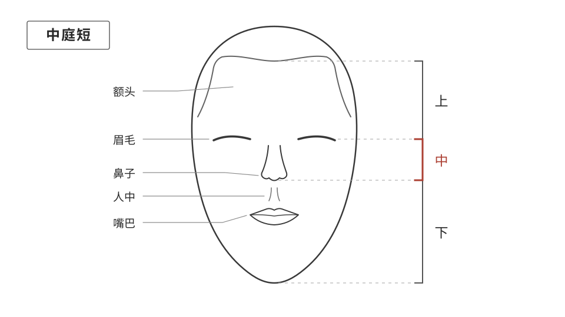 |
| **上庭高、中庭短是什么样？天人地对哪一段？** | 〔口述〕额头那一段很高，就叫上庭高：「如果说上庭很高」「上庭非常的高」「这就叫上庭」。（[00:34:32–00:34:45](https://www.bilibili.com/video/BV1KJsLekEfA/?p=17&t=2072)，第 62184–62555 帧） 〔指代〕说「这个叫上庭」的「这个」时，手按在脸图额头那一段（额顶横线到眉线之间），画粉红竖线，指的是额头一段，没有指字。（[00:34:40](https://www.bilibili.com/video/BV1KJsLekEfA/?p=17&t=2080)，第 62419 帧） 〔口述〕上中下三段也叫天人地；中庭短的意思是上下两段都高、中间最短：「我们也叫天人地」「中庭短上下都高中间最短」。（[00:34:45–00:34:55](https://www.bilibili.com/video/BV1KJsLekEfA/?p=17&t=2085)，第 62556–62855 帧） 〔板书〕可辨：脸图额头段左侧粉红「天」、右侧「上」字，其后一字认不准；鼻子段左「人」右「中」；嘴巴段右「下」，左侧一字认不出。（[00:34:52](https://www.bilibili.com/video/BV1KJsLekEfA/?p=17&t=2092)，第 62784 帧） 〔推断〕推断：板书把「天」写在「上」那段、「人」写在「中」那段，可见天人地与上中下是按顺序一一对应的；倪师口头只说了「我们也叫天人地」，没有逐段说。（[00:34:45–00:34:55](https://www.bilibili.com/video/BV1KJsLekEfA/?p=17&t=2085)，第 62556–62855 帧） |
| **第二个相是什么？三样都要具备吗？** | 〔口述〕第二个相是脸大、骨粗、声音沙：「第二个相」「面大骨粗声沙」。（[00:34:58–00:35:10](https://www.bilibili.com/video/BV1KJsLekEfA/?p=17&t=2098)，第 62940–63317 帧） 〔口述〕三样不必同时出现，有一样就算成格：「有的人是面大」「有的是声沙」「不三个同时来那是肯定的」「一个就成格了」。（[00:35:10–00:35:17](https://www.bilibili.com/video/BV1KJsLekEfA/?p=17&t=2110)，第 63318–63521 帧） 〔口述〕声沙这一条不用见到人，听声音就知道：「你还没看到人」「走到门口一听就」「听声音就晓得了」。（[00:35:19–00:35:25](https://www.bilibili.com/video/BV1KJsLekEfA/?p=17&t=2119)，第 63576–63779 帧） 〔板书〕可辨：第二行「① 中庭短」，第三行「② 面大」、「粗」、「声沙」，「面大」和「声沙」下有横线；「粗」前一个字认不出，其余认不出。（[00:35:13](https://www.bilibili.com/video/BV1KJsLekEfA/?p=17&t=2113)，第 63403 帧） |
| **第三个相看脸上哪里？看什么？** | 〔口述〕第三个相看鱼尾奸门，那里有乱纹或者黑点：「第三个呢」「鱼尾纹的奸门的时候有乱纹」「乱纹呐或者是黑点」「都可以看到」。（[00:35:33–00:35:49](https://www.bilibili.com/video/BV1KJsLekEfA/?p=17&t=2133)，第 64002–64487 帧） 〔口述〕奸门就在眼角：「就鱼尾奸门知道吧」「在眼睛的眼角这个地方」。（[00:36:03–00:36:08](https://www.bilibili.com/video/BV1KJsLekEfA/?p=17&t=2163)，第 64902–65051 帧） 〔指代〕说「眼角这个地方」的「这个」时，粉笔落在脸图右眼外侧眼角，正画小圈把眼角标出来，那里没有字。（[00:36:05](https://www.bilibili.com/video/BV1KJsLekEfA/?p=17&t=2165)，第 64979 帧） 〔板书〕第四行可辨：「乱纹」「黑点」，前半段被老师身体挡住，其余认不出。（[00:35:47](https://www.bilibili.com/video/BV1KJsLekEfA/?p=17&t=2147)，第 64417 帧） |
| **第二个命例是谁？在讲义哪一章？** | 〔口述〕换下一个例子，在当天发的讲义里：「诸位看下面一个」「我今天给诸位的讲义」「民国42年（1953）那一章」。（[00:36:19–00:36:25](https://www.bilibili.com/video/BV1KJsLekEfA/?p=17&t=2179)，第 65382–65567 帧） 〔口述〕这是一个男命，民国42年生：「一个男的有没有」「42年生（1953）」。（[00:36:39–00:36:48](https://www.bilibili.com/video/BV1KJsLekEfA/?p=17&t=2199)，第 65982–66251 帧） 〔板书〕新画的命盘格子里，中间格可辨「42年」，其余格子还空着。（[00:36:45](https://www.bilibili.com/video/BV1KJsLekEfA/?p=17&t=2205)，第 66166 帧） 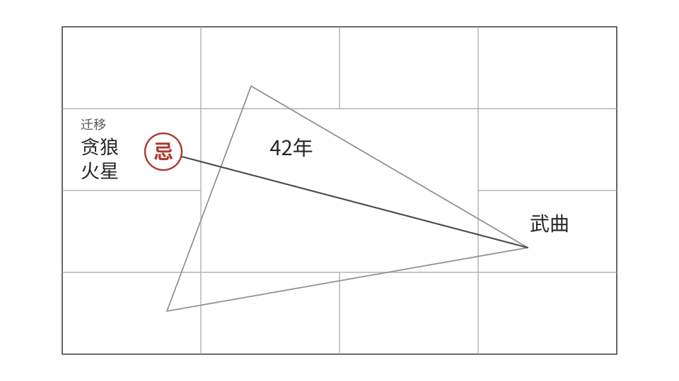 |
| **本例命宫、迁移坐什么星？化忌在哪一宫？** | 〔口述〕倪师先指出武曲星所在，再说迁移有贪狼、火星，并问有没有化忌，答有：「武曲星在这边看到没有」「贪狼火星迁移啊」「有没有这里有没有化忌」「有哈」。（[00:36:48–00:37:10](https://www.bilibili.com/video/BV1KJsLekEfA/?p=17&t=2208)，第 66252–66923 帧） 〔指代〕说「这里有没有化忌」的「这里」时，粉笔落在写着「贪狼 火星」的那格，正在右侧写并圈出「忌」字；黑板没标宫名，叠图显示这格是迁移（丙辰）。（[00:37:03](https://www.bilibili.com/video/BV1KJsLekEfA/?p=17&t=2223)，第 66702 帧） 〔叠图〕命宫壬戌：武曲庙、地空陷、红鸾陷、天姚庙、恩光庙、大耗平、月德，另有小耗、攀鞍、青龙、胎；大限2~11，小限4,16,28,40,52，流年6,18,30,42,54。（[00:36:48–00:36:54](https://www.bilibili.com/video/BV1KJsLekEfA/?p=17&t=2208)，第 66252–66443 帧） 〔叠图〕迁移丙辰：贪狼庙、化忌，火星陷、天喜陷、解神庙、寡宿陷，另有天煞、病符（印了两次）、帝旺；大限62~71，小限10,22,34,46,58，流年12,24,36,48,60。（[00:36:48–00:36:54](https://www.bilibili.com/video/BV1KJsLekEfA/?p=17&t=2208)，第 66252–66443 帧） 〔板书〕可辨：左格「贪狼」「火星」和圈起来的「忌」，第三行认不出；中间格「42年」；右格「武曲」；从圈「忌」处引出一条线伸向右侧，另画有一个大三角连线。（[00:37:09](https://www.bilibili.com/video/BV1KJsLekEfA/?p=17&t=2229)，第 66886 帧） |
| **化忌冲命主什么？机月同梁能躲开吗？** | 〔口述〕化忌冲命非常凶，要记住：「化忌对冲命了」「诸位记得哈」「这个非常的凶」「化忌只要冲命」。（[00:37:22–00:37:28](https://www.bilibili.com/video/BV1KJsLekEfA/?p=17&t=2242)，第 67284–67445 帧） 〔口述〕化忌冲命就是半空折翅；就算是机月同梁，也会被杀死或意外死亡：「就是半空折翅」「如果是机月同梁」「机月同梁也是会被杀死」「或者是意外死亡」。（[00:37:28–00:37:40](https://www.bilibili.com/video/BV1KJsLekEfA/?p=17&t=2248)，第 67446–67829 帧） 〔推断〕推断：倪师刚指出迁移有贪狼化忌，紧接着说「化忌对冲命了」，本例说的冲命应是迁移的化忌冲到命宫；为什么迁移会冲命宫，本块没有解释。（[00:36:54–00:37:28](https://www.bilibili.com/video/BV1KJsLekEfA/?p=17&t=2214)，第 66444–67445 帧） |
| **半空折翅的灾，限一定落在哪一段？** | 〔口述〕这张盘也有凶灾；半空折翅的限一定在中年：「像这个呢也是有凶灾」「半空折翅限一定在」「你不要管它半空折翅啊」「限一定在什么呀中年」。（[00:37:41–00:37:54](https://www.bilibili.com/video/BV1KJsLekEfA/?p=17&t=2261)，第 67830–68249 帧） 〔口述〕倪师在黑板上指出中年是哪一段：「所谓中年就是这一段时间」。（[00:37:55–00:37:59](https://www.bilibili.com/video/BV1KJsLekEfA/?p=17&t=2275)，第 68250–68399 帧） 〔板书〕可辨：中间格「42年」旁竖写「限中年」，再旁一列草书认不全；右列粉红字「22~31」「12~21」「2~11」，右下「命」；上方圈住的粉红数字认不出。（[00:37:56](https://www.bilibili.com/video/BV1KJsLekEfA/?p=17&t=2276)，第 68292 帧） |
| **插话：厨房放哪个方位不好？哪个方位最好？** | 〔口述〕讲到地理方位，西北角的厨房死夫：「如果运地理位置」「有东南西北的时候」「西北角的厨房死夫」。（[00:38:03–00:38:18](https://www.bilibili.com/video/BV1KJsLekEfA/?p=17&t=2283)，第 68496–68951 帧） 〔口述〕这对男人女人都不好，买房子厨房最好不要在西南或西北：「这个对男人女人来说都不好」「所以我们买个房子」「最好厨房不要在西南或西北」。（[00:38:18–00:38:25](https://www.bilibili.com/video/BV1KJsLekEfA/?p=17&t=2298)，第 68952–69155 帧） 〔口述〕厨房最好在房子的正北方或正西方：「厨房在什么位置最好呢」「在一个房子的正北方」「厨房在这里最好」「或者是正西方」「这两个位置摆厨房是最好」。（[00:38:25–00:38:36](https://www.bilibili.com/video/BV1KJsLekEfA/?p=17&t=2305)，第 69156–69509 帧） 〔指代〕说「厨房在这里最好」的「这里」时，粉笔点在左侧房屋示意图矩形左下边缘，用粉色画小圈标位置，那里没有字。（[00:38:29](https://www.bilibili.com/video/BV1KJsLekEfA/?p=17&t=2309)，第 69286 帧） 〔板书〕左侧画了房屋示意图，可辨：左上「地」、左下「死夫」；矩形里两个小框中的字、上方圈里的字认不出，其余认不出。（[00:38:19](https://www.bilibili.com/video/BV1KJsLekEfA/?p=17&t=2299)，第 68988 帧） |
| **批这张盘，第一步先锁定什么？** | 〔口述〕先不用讲别的，先看本宫落什么，限在中年，一定在这段时间：「你不用说去先去看他本宫落什么」「32-41有限在中年」「一定在这段时间」。（[00:38:51–00:39:00](https://www.bilibili.com/video/BV1KJsLekEfA/?p=17&t=2331)，第 69942–70229 帧） 〔口述〕看他41岁，先不要看里面细节，先认定限在中年，把它锁定在那一格：「你看他41岁」「首先先看你不要看他里面」「这是限在中年」「已经把他定到锁定在这边来」。（[00:39:23–00:39:29](https://www.bilibili.com/video/BV1KJsLekEfA/?p=17&t=2363)，第 70896–71075 帧） 〔指代〕说「锁定在这边来」的「这边」时，右手按在右侧格子里一列竖排草书字上（「中年」那一列右边），字被手挡住看不清，黑板上看不出宫名。（[00:39:27](https://www.bilibili.com/video/BV1KJsLekEfA/?p=17&t=2367)，第 71037 帧） 〔推断〕推断：本块两次讲到中年——先说半空折翅「限一定在什么呀中年」，再说此人「限在中年」，可见倪师是先用凶格把灾锁定在中年那个限，再去看41岁当年。（[00:37:45–00:39:29](https://www.bilibili.com/video/BV1KJsLekEfA/?p=17&t=2265)，第 67968–71075 帧） |
| **这个人在民国82年出了什么事？** | 〔口述〕民国82年，这位很有名的男子被枪击致命：「所以他在这个82年的时候（1993）」「这个这中南部很有名的一男子」「被枪击致命」。（[00:39:01–00:39:13](https://www.bilibili.com/video/BV1KJsLekEfA/?p=17&t=2341)，第 70230–70619 帧） 〔口述〕早上有人到他家，他下楼来就出事；当时他正要竞选：「然后早上到他家去他下楼来」「这个要竞选某一样某一样东西」。（[00:39:14–00:39:23](https://www.bilibili.com/video/BV1KJsLekEfA/?p=17&t=2354)，第 70620–70895 帧） 〔指代〕说「他在这个82年」时，第一个「这个」手指在中间格竖排「中」字下方，下一个字被手挡住；随后第二个「这个」手垂着，只是口头语。（[00:39:02](https://www.bilibili.com/video/BV1KJsLekEfA/?p=17&t=2342)，第 70269 帧） 〔推断〕推断：倪师讲完82年出事，接着说「你看他41岁」，本块是把82年这次出事对应到他41岁；材料里没有逐年算给学生看。（[00:39:01–00:39:24](https://www.bilibili.com/video/BV1KJsLekEfA/?p=17&t=2341)，第 70230–70943 帧） |
| **41岁尾为什么出事？太阳陷地怎么用象来读？** | 〔口述〕41岁尾那年，刚好走到太阳星，而且是陷地：「然后他41岁尾的时候」「刚好是不是太阳星在这边了」「陷地有没有」。（[00:39:29–00:39:34](https://www.bilibili.com/video/BV1KJsLekEfA/?p=17&t=2369)，第 71076–71237 帧） 〔口述〕倪师说讲过要用象来读：「我讲过用象来读」「用象来读八读八字」「象是什么」。（[00:39:34–00:39:39](https://www.bilibili.com/video/BV1KJsLekEfA/?p=17&t=2374)，第 71238–71381 帧） 〔口述〕太阳陷地的象是眼睛看不到天上的日月；看不到日月，一种是昏迷，一种是死掉，限里就发生这件事：「太阳星陷地眼睛看不到啊」「看不到日月的话」「一种是昏迷的状态」「还有一种就是死掉了」「眼睛看不到了」「限发生这个事情」。（[00:39:39–00:39:52](https://www.bilibili.com/video/BV1KJsLekEfA/?p=17&t=2379)，第 71382–71765 帧） |
| **这个八字怎么到倪师手上？为什么先讲限？** | 〔口述〕这个八字本来是请倪师批的，后来对方说不用批了，他还没开始动手：「而这个八字当初是本来来要我批」「结果后来说不用批了」「我还没开始动手」「实际这是命」。（[00:39:52–00:40:03](https://www.bilibili.com/video/BV1KJsLekEfA/?p=17&t=2392)，第 71766–72107 帧） 〔口述〕相差一个礼拜；倪师打出来一看，说这命解不掉：「差一个礼拜哦一个礼拜哦」「打出来一看哇」「这命解也解不掉」。（[00:40:11–00:40:27](https://www.bilibili.com/video/BV1KJsLekEfA/?p=17&t=2411)，第 72336–72815 帧） 〔口述〕以后有专门讨论夫妻、子女、事业的格，大家放心：「它专门讨论夫妻讨论子女讨论事业」「诸位都放心」。（[00:40:34–00:40:37](https://www.bilibili.com/video/BV1KJsLekEfA/?p=17&t=2434)，第 73044–73127 帧） 〔口述〕现在先把限搞清楚，否则批了半天，人已经死了：「这我们先把限要搞清楚」「不然限没搞清楚」「我叫你批个八字批了半天」「他死掉了」。（[00:40:37–00:40:49](https://www.bilibili.com/video/BV1KJsLekEfA/?p=17&t=2437)，第 73128–73475 帧） |

**总结区**

- 通用规则：凡女命中年丧偶有一定的相：中庭短（上下高、中间最短）；面大、骨粗、声沙，三样有一样就成格；鱼尾奸门有乱纹或黑点（[00:33:26–00:36:08](https://www.bilibili.com/video/BV1KJsLekEfA/?p=17&t=2006)，第 60192–65051 帧）；化忌只要冲命就是半空折翅，机月同梁也会被杀死或意外死亡，半空折翅的限一定在中年（[00:37:22–00:37:59](https://www.bilibili.com/video/BV1KJsLekEfA/?p=17&t=2242)，第 67284–68399 帧）；用象来读：太阳星陷地，象是眼睛看不到日月，一种是昏迷，一种是死掉（[00:39:34–00:39:52](https://www.bilibili.com/video/BV1KJsLekEfA/?p=17&t=2374)，第 71238–71765 帧）；先把限搞清楚，否则批了半天人已经死了；夫妻、子女、事业以后另有专门的格讨论（[00:40:34–00:40:49](https://www.bilibili.com/video/BV1KJsLekEfA/?p=17&t=2434)，第 73044–73475 帧）
- 只在本例：男命民国42年生，武曲在命宫（叠图壬戌），迁移（叠图丙辰）贪狼、火星并化忌，倪师说化忌对冲命，非常凶（[00:36:19–00:37:28](https://www.bilibili.com/video/BV1KJsLekEfA/?p=17&t=2179)，第 65382–67445 帧）；先把灾锁定在中年那个限，民国82年这位要竞选的男子早上下楼时被枪击致命（[00:38:51–00:39:29](https://www.bilibili.com/video/BV1KJsLekEfA/?p=17&t=2331)，第 69942–71075 帧）；41岁尾刚好走到太阳星陷地，倪师以看不到日月之象解释出事（[00:39:29–00:39:52](https://www.bilibili.com/video/BV1KJsLekEfA/?p=17&t=2369)，第 71076–71765 帧）；此盘原本请倪师批，后来说不用批了，倪师打出来一看说「这命解也解不掉」（[00:39:52–00:40:27](https://www.bilibili.com/video/BV1KJsLekEfA/?p=17&t=2392)，第 71766–72815 帧）
- 不是排盘规则，是处世方法：买房子厨房最好不要在西南或西北，正北方或正西方最好（[00:38:03–00:38:36](https://www.bilibili.com/video/BV1KJsLekEfA/?p=17&t=2283)，第 68496–69509 帧）

**待核**

1. 字幕「第一个相」，语音作「第二个项」，紧接下一句字幕才是「第二个相」，按下一句理解为第二个相（[00:34:55](https://www.bilibili.com/video/BV1KJsLekEfA/?p=17&t=2095)，第 62856 帧）
2. 字幕「面大骨粗声沙」，语音作「古竹生杀」；板书第三行「粗」前那个字认不出，☞指代说明里写作「面大 眉粗」，究竟是骨粗还是眉粗待核（[00:35:04](https://www.bilibili.com/video/BV1KJsLekEfA/?p=17&t=2104)，第 63144 帧、[00:35:13](https://www.bilibili.com/video/BV1KJsLekEfA/?p=17&t=2113)，第 63403 帧）
3. 「三个来都不要听的」意思不明，语音作「都不要听了」（[00:35:18](https://www.bilibili.com/video/BV1KJsLekEfA/?p=17&t=2118)，第 63546 帧）
4. 「奸门」倪师只说在眼角，没解释为什么叫奸门；前一句说「鱼尾纹的奸门」，后一句说「鱼尾奸门」（[00:35:36](https://www.bilibili.com/video/BV1KJsLekEfA/?p=17&t=2136)，第 64104 帧、[00:36:03](https://www.bilibili.com/video/BV1KJsLekEfA/?p=17&t=2163)，第 64902 帧）
5. 字幕「民国42年」，语音作「国四十年」；后面语音又作「四十年次」，字幕作「42年生」；板书写「42年」，与字幕一致（[00:36:23](https://www.bilibili.com/video/BV1KJsLekEfA/?p=17&t=2183)，第 65514 帧、[00:36:39](https://www.bilibili.com/video/BV1KJsLekEfA/?p=17&t=2199)，第 65982 帧）
6. 字幕「对了学会了谁讲的」与语音「好这种命啊画记」对不上，未采用（[00:37:10](https://www.bilibili.com/video/BV1KJsLekEfA/?p=17&t=2230)，第 66924 帧）
7. 「半空折翅」语音作「折识」，按字幕；倪师没解释这四字的意思（[00:37:28](https://www.bilibili.com/video/BV1KJsLekEfA/?p=17&t=2248)，第 67446 帧）
8. 「机月同梁」倪师用了但没解释是哪几颗星（[00:37:30](https://www.bilibili.com/video/BV1KJsLekEfA/?p=17&t=2250)，第 67518 帧）
9. 「如果运地理位置」语句不通，原意待核（[00:38:03](https://www.bilibili.com/video/BV1KJsLekEfA/?p=17&t=2283)，第 68496 帧）
10. 语音有「西南角的厨房死七」，字幕没有这句，疑为「死妻」，未写入正文；板书房屋图上方圈里两字认不出，☞说明疑似「X妻」（[00:38:10](https://www.bilibili.com/video/BV1KJsLekEfA/?p=17&t=2290)，第 68706 帧、[00:38:18](https://www.bilibili.com/video/BV1KJsLekEfA/?p=17&t=2298)，第 68956 帧）
11. 字幕「他是巳年巳（1953）」可信度 0.44，语音作「他是四年」，未采用（[00:38:37](https://www.bilibili.com/video/BV1KJsLekEfA/?p=17&t=2317)，第 69510 帧）
12. 字幕「39 40 41岁」可信度 0.4，语音作「三七三八三九四十四十一」，岁数对不上，未采用（[00:38:46](https://www.bilibili.com/video/BV1KJsLekEfA/?p=17&t=2326)，第 69792 帧）
13. 字幕「32-41有限在中年」可信度 0.43，语音作「三十二十四十一就是现在中立」（[00:38:54](https://www.bilibili.com/video/BV1KJsLekEfA/?p=17&t=2334)，第 70020 帧）
14. 字幕「中南部很有名的一男子」，语音作「东南部很有名的案子」（[00:39:08](https://www.bilibili.com/video/BV1KJsLekEfA/?p=17&t=2348)，第 70452 帧）
15. 字幕「就看到他被打脸了」，语音只有「这个」，两路对不上，未采用（[00:39:15](https://www.bilibili.com/video/BV1KJsLekEfA/?p=17&t=2355)，第 70674 帧）
16. 「天上的日月不念」里「不念」意思不明，语音同（[00:39:42](https://www.bilibili.com/video/BV1KJsLekEfA/?p=17&t=2382)，第 71466 帧）
17. 字幕混入「小限：5,17.2」，疑是叠图文字被识别进字幕（[00:39:52](https://www.bilibili.com/video/BV1KJsLekEfA/?p=17&t=2392)，第 71766 帧）
18. 「买买单了」，语音作「白的」，意思不明（[00:40:09](https://www.bilibili.com/video/BV1KJsLekEfA/?p=17&t=2409)，第 72270 帧）
19. 「差一个礼拜」差的是什么（离出事还是离批命）没讲清（[00:40:11](https://www.bilibili.com/video/BV1KJsLekEfA/?p=17&t=2411)，第 72336 帧）
20. 「有很多格会」疑为字幕识别有误，未改（[00:40:33](https://www.bilibili.com/video/BV1KJsLekEfA/?p=17&t=2433)，第 73014 帧）
21. 倪师在本例里把命盘称作「八字」（[00:39:36](https://www.bilibili.com/video/BV1KJsLekEfA/?p=17&t=2376)，第 71298 帧、[00:39:52](https://www.bilibili.com/video/BV1KJsLekEfA/?p=17&t=2392)，第 71766 帧）
22. 板书图[00:39:30](https://www.bilibili.com/video/BV1KJsLekEfA/?p=17&t=2370)，第 71124 帧右下角另有一格叠图（父母 癸亥：太阳陷、陀罗陷、铃星庙、天马平、八座庙等，小限一串里41加框，112~121），材料开头说本例只贴过命宫、迁移两格，▣行里也没有这格，未当依据；☞说明[00:39:27](https://www.bilibili.com/video/BV1KJsLekEfA/?p=17&t=2367)，第 71037 帧提到右上角叠图「32~41 子女 己未」，同样不在▣行里（[00:39:27](https://www.bilibili.com/video/BV1KJsLekEfA/?p=17&t=2367)，第 71037 帧、[00:39:30](https://www.bilibili.com/video/BV1KJsLekEfA/?p=17&t=2370)，第 71124 帧）
23. 叠图迁移丙辰「病符」印了两次（[00:36:48](https://www.bilibili.com/video/BV1KJsLekEfA/?p=17&t=2208)，第 66252 帧）
24. 板书认不全：[00:37:09](https://www.bilibili.com/video/BV1KJsLekEfA/?p=17&t=2229)，第 66886 帧左格第三行、[00:37:56](https://www.bilibili.com/video/BV1KJsLekEfA/?p=17&t=2276)，第 68292 帧中间格第二列草书和上方圈中粉红数字、[00:38:19](https://www.bilibili.com/video/BV1KJsLekEfA/?p=17&t=2299)，第 68988 帧房屋图框内与圈内字均认不出（[00:37:09](https://www.bilibili.com/video/BV1KJsLekEfA/?p=17&t=2229)，第 66886 帧、[00:37:56](https://www.bilibili.com/video/BV1KJsLekEfA/?p=17&t=2276)，第 68292 帧、[00:38:19](https://www.bilibili.com/video/BV1KJsLekEfA/?p=17&t=2299)，第 68988 帧）
25. 指代看不出或不确定、未采用：[00:34:00](https://www.bilibili.com/video/BV1KJsLekEfA/?p=17&t=2040)，第 61211 帧、[00:35:57](https://www.bilibili.com/video/BV1KJsLekEfA/?p=17&t=2157)，第 64734 帧、[00:37:25](https://www.bilibili.com/video/BV1KJsLekEfA/?p=17&t=2245)，第 67359 帧、[00:37:40](https://www.bilibili.com/video/BV1KJsLekEfA/?p=17&t=2260)，第 67819 帧、[00:38:18](https://www.bilibili.com/video/BV1KJsLekEfA/?p=17&t=2298)，第 68956 帧、[00:38:36](https://www.bilibili.com/video/BV1KJsLekEfA/?p=17&t=2316)，第 69496 帧、[00:39:31](https://www.bilibili.com/video/BV1KJsLekEfA/?p=17&t=2371)，第 71133 帧

## 例三（叠图命盘：命宫己未）

| 巳 | 午 | 未 | 申 |
|---|---|---|---|
| **夫妻 丁巳**（身宫） 巨门旺 禄存庙 | **兄弟 戊午** 廉贞平 天相庙 右弼旺科 擎羊陷 | **命宫 己未** 天梁旺 天钺旺 | **父母 庚申** 七杀庙 左辅平 天马旺 |
| **子女 丙辰** 贪狼庙禄 陀罗庙 | **例三 · 命宫己未** | 据视频叠图重排 | **福德 辛酉** 天同平 |
| **财帛 乙卯** 太阴陷权 文曲旺 | 后期贴图，不算倪师的话 |  | **田宅 壬戌** 武曲庙 地劫平 |
| **疾厄 甲寅** 紫微旺 天府庙 铃星庙 | **迁移 乙丑** 天机陷忌 天魁旺 | （子：没贴过） | **官禄 癸亥** 太阳陷 文昌利 |

按视频里这张盘逐格重画（我们自己画的图，不是视频截图）；数据见 [命盘-P17-例三.json](图/命盘-P17-例三.json)。

### 8　抱错的婴儿：二姓宜生与命解运解（[00:40:49–00:47:40](https://www.bilibili.com/video/BV1KJsLekEfA/?p=17&t=2449)，第 73476–85805 帧）

| 提示区 | 笔记区 |
|---|---|
| **新命例是哪年生的人？命宫对面有什么？** | 〔口述〕倪师换一张新盘，说「下面有个很好玩的八字的」，这个人是「47年」生的（字幕在此另加括注1958，语音只说四十七年）。（[00:40:49–00:41:11](https://www.bilibili.com/video/BV1KJsLekEfA/?p=17&t=2449)，第 73476–74135 帧） 〔板书〕黑板上只画了宫格的横竖线，格子里还没有字。（[00:41:05](https://www.bilibili.com/video/BV1KJsLekEfA/?p=17&t=2465)，第 73956 帧） 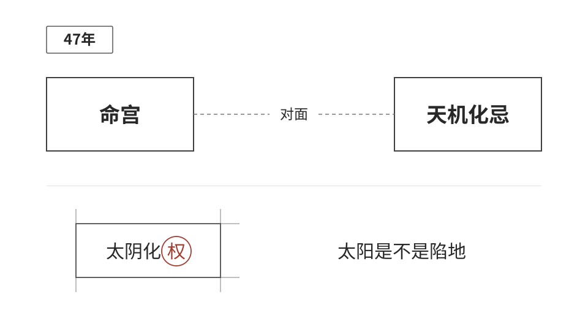 〔叠图〕命宫己未：天梁旺、天钺旺、天月、寡宿不、天德庙，另有青龙、攀鞍、衰；原图第74989帧可见大限 6~15。（[00:41:11–00:41:16](https://www.bilibili.com/video/BV1KJsLekEfA/?p=17&t=2471)，第 74136–74291 帧） 〔口述〕倪师要大家看命宫对面：「诸位看他是不是天机化忌在对面了」，并说「这八字很好玩」「笑翻了当时哈」。（[00:41:16–00:41:25](https://www.bilibili.com/video/BV1KJsLekEfA/?p=17&t=2476)，第 74292–74561 帧） 〔叠图〕迁移乙丑：天机陷、化忌，天魁旺，天刑陷、封诰、副截不、破碎陷，另有天煞、病符、贯索、养；原图第74664帧可见大限 66~75。（[00:41:16–00:41:21](https://www.bilibili.com/video/BV1KJsLekEfA/?p=17&t=2476)，第 74292–74453 帧） |
| **这张盘的太阴、太阳各是什么状态？** | 〔口述〕倪师接着点出「太阴化权」，又问「太阳是不是陷地」。（[00:41:25–00:41:34](https://www.bilibili.com/video/BV1KJsLekEfA/?p=17&t=2485)，第 74562–74831 帧） 〔叠图〕财帛乙卯：太阴陷、化权，文曲旺、天寿陷、天官旺、天福平、咸池平、月德，另有伏兵、小耗、沐浴；原图可见大限 86~95。（[00:41:23–00:41:25](https://www.bilibili.com/video/BV1KJsLekEfA/?p=17&t=2483)，第 74490–74561 帧） 〔叠图〕官禄癸亥：太阳陷、文昌利、天喜旺、天空平、孤辰陷、劫煞，另有飞廉、晦气、绝；原图第74989帧可见大限 46~55。（[00:41:31–00:41:34](https://www.bilibili.com/video/BV1KJsLekEfA/?p=17&t=2491)，第 74754–74831 帧） 〔板书〕左侧中间一格可辨「太阴」，旁边一个圈起来的字，似「权」；下面一格的字被字幕挡住，认不出。（[00:41:28](https://www.bilibili.com/video/BV1KJsLekEfA/?p=17&t=2488)，第 74664 帧） |
| **为什么把这张盘跟前一张摆在一起讲？** | 〔口述〕倪师问「为什么跟你摆在一起」，说「虽然只是命宫位置不一样」，又问「其实是不是同一格啊」。前一张盘是什么样，本块没有重讲。（[00:41:36–00:41:43](https://www.bilibili.com/video/BV1KJsLekEfA/?p=17&t=2496)，第 74886–75095 帧） 〔板书〕板面大半被讲者身体挡住，只在左下方可辨一字似「机」，其余认不出。（[00:41:39](https://www.bilibili.com/video/BV1KJsLekEfA/?p=17&t=2499)，第 74989 帧） |
| **巨门、禄存、七杀、天马分别落在哪里？** | 〔口述〕倪师边写边说「巨门星是不是也在这里」「禄存在这边是不是」，然后说「七杀天马在父母宫」。（[00:41:43–00:41:58](https://www.bilibili.com/video/BV1KJsLekEfA/?p=17&t=2503)，第 75096–75551 帧） 〔指代〕说「也在这里」时手指的是黑板左上格，他正在那里写「巨门」；说「禄存在这边」时，手在同一格「巨门」下方写「禄存」。板上没写宫名。（[00:41:43–00:41:50](https://www.bilibili.com/video/BV1KJsLekEfA/?p=17&t=2503)，第 75096–75311 帧） 〔叠图〕夫妻丁巳：巨门旺、禄存庙，并标身宫；另有红鸾旺、天姚平、天才庙、大耗陷、台辅、天巫、博士、临官。（[00:41:43–00:41:45](https://www.bilibili.com/video/BV1KJsLekEfA/?p=17&t=2503)，第 75096–75161 帧） 〔叠图〕父母庚申：七杀庙、左辅平、天马旺、八座庙、恩光平、天哭庙，另有小耗、岁驿、吊客、病；原图第75534帧可见大限 16~25。（[00:41:52–00:41:58](https://www.bilibili.com/video/BV1KJsLekEfA/?p=17&t=2512)，第 75372–75551 帧） 〔板书〕可辨：左上格「巨门」，下一行似「禄存」；上方中间格有「命」字，上面两行字似「天梁」「天钺」，不确定；右上格似「七杀」「天马」；盘中央写「47」，从命格拉出几条斜线。其余认不出。（[00:41:57](https://www.bilibili.com/video/BV1KJsLekEfA/?p=17&t=2517)，第 75534 帧） 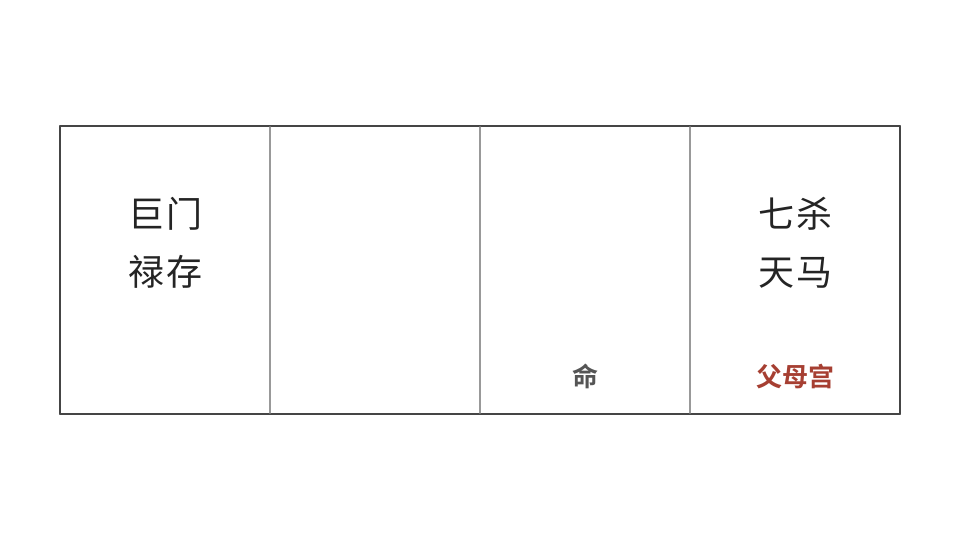 |
| **日月反背的小孩，过去的算命师怎么断？** | 〔口述〕倪师说这个人「命出来就日月反背」。（[00:42:02–00:42:04](https://www.bilibili.com/video/BV1KJsLekEfA/?p=17&t=2522)，第 75678–75743 帧） 〔口述〕过去的算命师几千年来都说这种小孩「尅父母啊」「要二姓宜生」，要过继给别人养，「不要在自己身边养」，「在自己身上养不活的」。（[00:42:04–00:42:17](https://www.bilibili.com/video/BV1KJsLekEfA/?p=17&t=2524)，第 75744–76121 帧） 〔口述〕理由是「为什么因为日月反背」，再加上「对面化忌又冲」。（[00:42:17–00:42:21](https://www.bilibili.com/video/BV1KJsLekEfA/?p=17&t=2537)，第 76122–76247 帧） 〔推断〕推断：倪师先点出太阴化权（叠图在财帛乙卯、陷）和太阳陷地（叠图在官禄癸亥），随后说日月反背，所以日月反背大概就是指这两颗星；倪师本块没有逐宫说明。「对面化忌」应该指上面讲的天机化忌在命宫对面。（[00:41:25–00:42:21](https://www.bilibili.com/video/BV1KJsLekEfA/?p=17&t=2485)，第 74562–76247 帧） |
| **这个人的实际经历怎么应验了二姓宜生？** | 〔口述〕倪师先说「可是人呢各安天命呐」，再讲这个人的经历。（[00:42:21–00:42:25](https://www.bilibili.com/video/BV1KJsLekEfA/?p=17&t=2541)，第 76248–76379 帧） 〔口述〕他出生那天「医院里面发生火灾」，婴儿弄乱了，「他爸妈抱错小孩」，「他跟父母亲离散」，倪师问「是不是二姓宜生」。（[00:42:32–00:42:45](https://www.bilibili.com/video/BV1KJsLekEfA/?p=17&t=2552)，第 76578–76955 帧） 〔口述〕倪师说他「命大了还活下来了」。（[00:42:45–00:42:47](https://www.bilibili.com/video/BV1KJsLekEfA/?p=17&t=2565)，第 76956–77015 帧） |
| **倪师见到此人时看出什么、怎么问的？** | 〔口述〕此人来到面前是「好好的人」，倪师却觉得「这个八字很特殊啊」，照八字本来应该夭折（字幕作「天折」）。（[00:42:47–00:42:54](https://www.bilibili.com/video/BV1KJsLekEfA/?p=17&t=2567)，第 77016–77231 帧） 〔口述〕倪师问他「你知不知道你父母亲的事情」，对方说知道；倪师说「这个不应该会生在父母亲身边的」，问是否同住，对方答「有啊我在一起住啊」，也没怎么样。（[00:43:02–00:43:18](https://www.bilibili.com/video/BV1KJsLekEfA/?p=17&t=2582)，第 77478–77957 帧） 〔口述〕倪师又看他「日角月角又平着」，拿自己比：「你看我日角月角是不是突啊」，他的是平的、没有凸出来。（[00:43:22–00:43:34](https://www.bilibili.com/video/BV1KJsLekEfA/?p=17&t=2602)，第 78066–78449 帧） |
| **此人后来为什么问自己是不是亲生的？** | 〔口述〕倪师问了半天他都没讲，事后他才问：「是不是我父母亲亲生的」。（[00:43:35–00:43:43](https://www.bilibili.com/video/BV1KJsLekEfA/?p=17&t=2615)，第 78450–78713 帧） 〔口述〕他的理由是「因为我的血型跟他俩不一样啊」，长相也不一样；长大懂事后去问，「爸爸说医院抱错了」，找不到、弄不清楚。（[00:44:17–00:44:37](https://www.bilibili.com/video/BV1KJsLekEfA/?p=17&t=2657)，第 79710–80321 帧） |
| **看出对方可能不是亲生的，能不能当场说？** | 〔口述〕倪师说自己当时「不敢讲了」，提醒大家问人家时「你不要马上当场讲出来哦」，「因为有的父母亲没有告诉他」「他是领养过来的」，父母把它当秘密。（[00:43:47–00:43:59](https://www.bilibili.com/video/BV1KJsLekEfA/?p=17&t=2627)，第 78822–79193 帧） 〔口述〕如果大嘴讲出来，对方回去跟父母查证、埋怨父母，倪师反问「你是不是害人」。（[00:43:59–00:44:09](https://www.bilibili.com/video/BV1KJsLekEfA/?p=17&t=2639)，第 79194–79475 帧） 〔口述〕所以他的做法是「所以我就用暗暗示的方法问」，「问没有我就不讲了」。（[00:44:09–00:44:12](https://www.bilibili.com/video/BV1KJsLekEfA/?p=17&t=2649)，第 79476–79577 帧） |
| **抱错了，倪师为什么反而说恭喜？** | 〔口述〕倪师对他说「我说先生恭喜你」「还好你 confuse」（字幕括注：混淆抱错），「否则限在中年一样完蛋一样买单」；如今「那现在他觉得很好」。（[00:44:37–00:44:46](https://www.bilibili.com/video/BV1KJsLekEfA/?p=17&t=2677)，第 80322–80603 帧） 〔口述〕后面又补一句：「本来限在中年你就不要批限了」「因为他二姓宜生」。（[00:45:36–00:45:39](https://www.bilibili.com/video/BV1KJsLekEfA/?p=17&t=2736)，第 82080–82187 帧） 〔口述〕过去算命算到这种八字，「大部分都给他过继出去」，「有这个原因在里面」。（[00:45:39–00:45:47](https://www.bilibili.com/video/BV1KJsLekEfA/?p=17&t=2739)，第 82188–82427 帧） |
| **化权在财帛宫，这种人做什么工作？** | 〔口述〕倪师说「你看他这个化权在财帛宫」。（[00:44:50–00:44:55](https://www.bilibili.com/video/BV1KJsLekEfA/?p=17&t=2690)，第 80718–80855 帧） 〔指代〕说「这个」时手指的是黑板左下格里圈起来的「权」字，旁边写着「太阴」。（[00:44:50–00:44:55](https://www.bilibili.com/video/BV1KJsLekEfA/?p=17&t=2690)，第 80718–80855 帧） 〔口述〕规则：财帛宫「不管是化权化科化禄」，「一般来说他都会在私人企业里面」，在私人公司、私人企业上班。（[00:44:55–00:45:06](https://www.bilibili.com/video/BV1KJsLekEfA/?p=17&t=2695)，第 80856–81185 帧） 〔口述〕本例「因为他的命里面只有权没有禄」，「所以他只能在私人企业里面上班」，「掌权做个主管」。（[00:45:06–00:45:13](https://www.bilibili.com/video/BV1KJsLekEfA/?p=17&t=2706)，第 81186–81413 帧） 〔板书〕可辨：左中格「太阴」加圈「权」，下面似「财帛」；右边一格两行似「私人」「企业」，不确定；左上格「巨门」、似「禄存」。其余认不出。（[00:45:07](https://www.bilibili.com/video/BV1KJsLekEfA/?p=17&t=2707)，第 81216 帧） 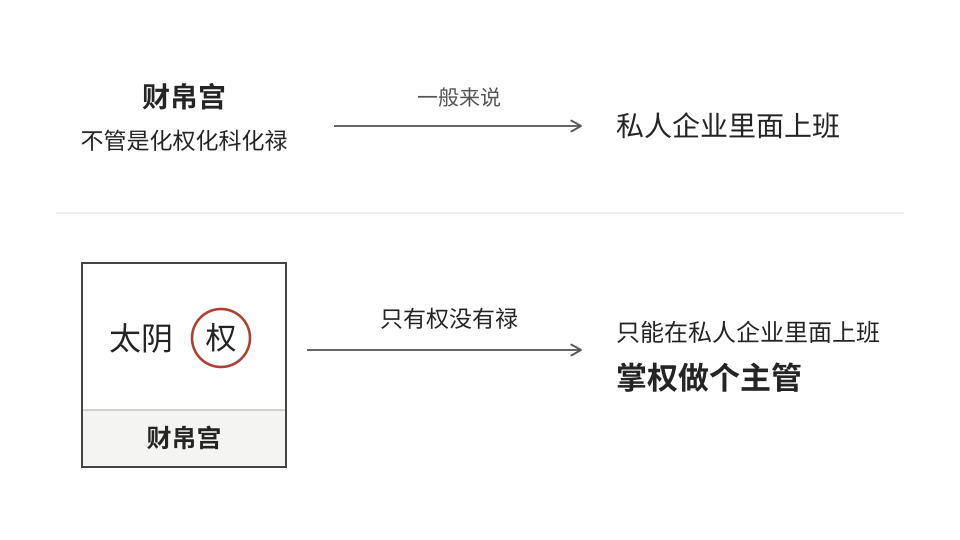 |
| **天钺坐命、天魁在对面，主什么？** | 〔口述〕「那这个天钺星落命的人呢」，「对面是天魁看到没有」，这叫「坐贵向贵」。（[00:45:13–00:45:20](https://www.bilibili.com/video/BV1KJsLekEfA/?p=17&t=2713)，第 81414–81629 帧） 〔口述〕「坐贵向贵这种人呢」「必有科甲」，读书读得很棒，「也就是说有专科技术专长」。（[00:45:19–00:45:29](https://www.bilibili.com/video/BV1KJsLekEfA/?p=17&t=2719)，第 81588–81881 帧） 〔口述〕靠专业知识专长在私人公司上班，「而且会掌权做主管」，倪师说「这就连贯起来了」，与前面化权在财帛的推论接上。（[00:45:29–00:45:35](https://www.bilibili.com/video/BV1KJsLekEfA/?p=17&t=2729)，第 81882–82079 帧） 〔叠图〕天钺旺在命宫己未；天魁旺在对面的迁移乙丑，与天机陷化忌同宫。（[00:45:13–00:45:15](https://www.bilibili.com/video/BV1KJsLekEfA/?p=17&t=2713)，第 81414–81473 帧） |
| **什么叫命解？为什么说它消极？** | 〔口述〕过继出去「属于命解」，就是「命的解法」，「都是比较消极的对不对」。（[00:45:47–00:45:57](https://www.bilibili.com/video/BV1KJsLekEfA/?p=17&t=2747)，第 82428–82727 帧） 〔板书〕黑板左边竖写可辨「命解」，下方括号里两字似「消极」，不确定。（[00:45:57](https://www.bilibili.com/video/BV1KJsLekEfA/?p=17&t=2757)，第 82716 帧） 〔口述〕举例：跟小姐说婚姻不太好、要晚点结婚，她问多晚，答「你45岁以后比较好」，倪师说「这个是命解」。（[00:45:59–00:46:07](https://www.bilibili.com/video/BV1KJsLekEfA/?p=17&t=2759)，第 82776–83015 帧） 〔口述〕「你话很好讲但人家做不到」，「所以算命的化解方法是消极的懂吗」；只好晚婚「那都是废话」「那不算也是这样子呀」。（[00:46:08–00:46:21](https://www.bilibili.com/video/BV1KJsLekEfA/?p=17&t=2768)，第 83064–83435 帧） |
| **运解怎么做？延年方怎么找？** | 〔口述〕「所以命解是消极的」，「我们要有积极的运解才行」；命解要叫人家过继，「如果是运解呢不需要」。（[00:46:21–00:46:33](https://www.bilibili.com/video/BV1KJsLekEfA/?p=17&t=2781)，第 83436–83813 帧） 〔口述〕做法：男孩子还没结婚前「给他睡东宫」，「化权的话大部分都是长子」；睡下去以后「然后把脚朝着延年方」，本例「像这延年方在南边南边」。（[00:46:33–00:46:44](https://www.bilibili.com/video/BV1KJsLekEfA/?p=17&t=2793)，第 83814–84143 帧） 〔口述〕怎么看延年方：看东南西北哪边有「解厄制化的星」「解灾的星」；「像南边的话都是吉星来会」，「廉贞天相啊都吉星比较多」。（[00:46:44–00:47:06](https://www.bilibili.com/video/BV1KJsLekEfA/?p=17&t=2804)，第 84144–84785 帧） 〔叠图〕兄弟戊午：廉贞平、天相庙、右弼旺化科、擎羊陷、三台旺、天厨、阴煞，另有力士、将星、白虎、帝旺。倪师口头没有说南边是哪一宫。（[00:46:58–00:46:59](https://www.bilibili.com/video/BV1KJsLekEfA/?p=17&t=2818)，第 84564–84599 帧） 〔板书〕黑板左边新写一列，上面几字似「延年方」，下面可辨「解」，再下一字似「厄」；其余被挡或认不出。（[00:46:58](https://www.bilibili.com/video/BV1KJsLekEfA/?p=17&t=2818)，第 84540 帧） |
| **房子斜向怎么定脚的方向？为何不能朝太阳落陷？** | 〔口述〕「如果是房子在斜向的话」，「你给他朝紫微天府」，因为「南北斗星君本来就是解厄制化」、是解灾的星，本例就朝东北角。（[00:47:06–00:47:19](https://www.bilibili.com/video/BV1KJsLekEfA/?p=17&t=2826)，第 84786–85175 帧） 〔叠图〕疾厄甲寅：紫微旺、天府庙、铃星庙、龙池平、天使平，另有大耗、指背、官符、长生。倪师口头没有说东北角是哪一宫。（[00:47:16–00:47:19](https://www.bilibili.com/video/BV1KJsLekEfA/?p=17&t=2836)，第 85098–85175 帧） 〔口述〕倪师自己的方法：客户房子正向，「我尽量改正的方向」；斜向就改斜的，「改到四个角上面」「看哪个角比较好」。（[00:47:19–00:47:30](https://www.bilibili.com/video/BV1KJsLekEfA/?p=17&t=2839)，第 85176–85517 帧） 〔口述〕「你怎么会叫他对着」「太阳星落陷的地方呢」，本来没事，结果「搞的少掉一只眼睛呐」，「一只眼睛看不到太阳落陷嘛」。（[00:47:30–00:47:40](https://www.bilibili.com/video/BV1KJsLekEfA/?p=17&t=2850)，第 85518–85805 帧） 〔板书〕板面与前一张大致相同，没有认出新写的字；下方中间有字被字幕挡住。（[00:47:15](https://www.bilibili.com/video/BV1KJsLekEfA/?p=17&t=2835)，第 85065 帧） |

**总结区**

- 通用规则：财帛宫不管化权、化科、化禄，一般都在私人企业、私人公司上班（[00:44:55–00:45:06](https://www.bilibili.com/video/BV1KJsLekEfA/?p=17&t=2695)，第 80856–81185 帧）；天钺坐命、对面天魁叫坐贵向贵，必有科甲，有专科技术专长（[00:45:13–00:45:29](https://www.bilibili.com/video/BV1KJsLekEfA/?p=17&t=2713)，第 81414–81881 帧）；过继、劝晚婚这类命解是消极的，要用积极的运解，例如睡东宫、脚朝有解厄制化之星的延年方（[00:45:47–00:47:06](https://www.bilibili.com/video/BV1KJsLekEfA/?p=17&t=2747)，第 82428–84785 帧）；房子斜向就朝紫微天府（南北斗星君解厄制化），不要让人脚对着太阳星落陷的地方（[00:47:06–00:47:40](https://www.bilibili.com/video/BV1KJsLekEfA/?p=17&t=2826)，第 84786–85805 帧）
- 只在本例：47年生，命宫己未，天机化忌在对面，日月反背，过去会断要二姓宜生（[00:40:49–00:42:21](https://www.bilibili.com/video/BV1KJsLekEfA/?p=17&t=2449)，第 73476–76247 帧）；出生当天医院火灾抱错，与亲生父母离散，应验二姓宜生；倪师说因此中年的限就不用批了（[00:42:32–00:42:45](https://www.bilibili.com/video/BV1KJsLekEfA/?p=17&t=2552)，第 76578–76955 帧、[00:44:37–00:44:42](https://www.bilibili.com/video/BV1KJsLekEfA/?p=17&t=2677)，第 80322–80465 帧、[00:45:36–00:45:39](https://www.bilibili.com/video/BV1KJsLekEfA/?p=17&t=2736)，第 82080–82187 帧）；太阴化权在财帛、只有权没有禄，所以在私人企业掌权做主管（[00:44:50–00:45:13](https://www.bilibili.com/video/BV1KJsLekEfA/?p=17&t=2690)，第 80718–81413 帧）；本例延年方在南边，斜向则朝东北角（[00:46:41–00:47:19](https://www.bilibili.com/video/BV1KJsLekEfA/?p=17&t=2801)，第 84042–85175 帧）
- 不是排盘规则，是处世方法：怀疑对方不是亲生的，不要当场讲出来，用暗示的方法问，问不出就不讲（[00:43:47–00:44:12](https://www.bilibili.com/video/BV1KJsLekEfA/?p=17&t=2627)，第 78822–79577 帧）；给人的化解建议要做得到，光说晚婚是话好讲人家做不到（[00:46:08–00:46:21](https://www.bilibili.com/video/BV1KJsLekEfA/?p=17&t=2768)，第 83064–83435 帧）

**待核**

1. [00:41:08](https://www.bilibili.com/video/BV1KJsLekEfA/?p=17&t=2468)，第 74046 帧：字幕「47年（1958）」的括注是字幕自带的，倪师语音只说四十七年。
2. [00:41:36–00:41:43](https://www.bilibili.com/video/BV1KJsLekEfA/?p=17&t=2496)，第 74886–75095 帧：「跟刚刚……同一格」指前一张命例，本块没有展开，要对照前文。
3. [00:42:08](https://www.bilibili.com/video/BV1KJsLekEfA/?p=17&t=2528)，第 75840 帧：字幕「尅父母」保留原字；[00:42:09](https://www.bilibili.com/video/BV1KJsLekEfA/?p=17&t=2529)，第 75882 帧「二姓宜生」语音作「恶性移生」，按字幕写。
4. [00:42:52](https://www.bilibili.com/video/BV1KJsLekEfA/?p=17&t=2572)，第 77166 帧：字幕「天折」、语音「夭折」，笔记按夭折转述。
5. [00:42:54–00:43:01](https://www.bilibili.com/video/BV1KJsLekEfA/?p=17&t=2574)，第 77232–77447 帧：字幕「那也基本上厚厚的嘴咬对对面」「然后在对面胡闹」与语音对不上，意思不明，未写入。
6. [00:43:22](https://www.bilibili.com/video/BV1KJsLekEfA/?p=17&t=2602)，第 78066 帧：「日角月角」语音作「日脚越脚」，倪师只说自己的凸、对方的平，没解释含义。
7. [00:44:39](https://www.bilibili.com/video/BV1KJsLekEfA/?p=17&t=2679)，第 80388 帧、[00:45:36](https://www.bilibili.com/video/BV1KJsLekEfA/?p=17&t=2736)，第 82080 帧：字幕「限在中年」语音都作「现在中年」，是「限」还是「现」待核。
8. [00:45:42](https://www.bilibili.com/video/BV1KJsLekEfA/?p=17&t=2742)，第 82266 帧：字幕「限在早那种冲命的」语音作「找那种聪明的」，两路对不上，未引原话。
9. [00:46:34](https://www.bilibili.com/video/BV1KJsLekEfA/?p=17&t=2794)，第 83844 帧：「东宫」倪师没有解释是哪个房间；[00:46:51](https://www.bilibili.com/video/BV1KJsLekEfA/?p=17&t=2811)，第 84354 帧「解厄制化」语音作「解恶字化」。
10. [00:45:17](https://www.bilibili.com/video/BV1KJsLekEfA/?p=17&t=2717)，第 81522 帧：字幕「天机天魁在这边有没有」，语音作「天际上天魁」，未单独引用。
11. [00:41:11](https://www.bilibili.com/video/BV1KJsLekEfA/?p=17&t=2471)，第 74136 帧、[00:45:13](https://www.bilibili.com/video/BV1KJsLekEfA/?p=17&t=2713)，第 81414 帧：迁移乙丑数字串有缺字「□」，岁数以原图[00:41:28](https://www.bilibili.com/video/BV1KJsLekEfA/?p=17&t=2488)，第 74664 帧为准；父母庚申数字串顺序乱，岁数以原图[00:41:57](https://www.bilibili.com/video/BV1KJsLekEfA/?p=17&t=2517)，第 75534 帧为准。
12. [00:46:41](https://www.bilibili.com/video/BV1KJsLekEfA/?p=17&t=2801)，第 84042 帧、[00:47:16](https://www.bilibili.com/video/BV1KJsLekEfA/?p=17&t=2836)，第 85098 帧：「南边」「东北角」对应哪一宫，倪师口头没说，只有叠图分别显示兄弟戊午、疾厄甲寅。
13. 板书：[00:40:50](https://www.bilibili.com/video/BV1KJsLekEfA/?p=17&t=2450)，第 73524 帧板面几乎全空；[00:41:39](https://www.bilibili.com/video/BV1KJsLekEfA/?p=17&t=2499)，第 74989 帧大半被挡；第75534、81216、82716、84540帧多数字只能认个大概（「天梁」「天钺」「私人企业」「消极」「延年方」均不确定）。
14. 指代：D122、D123、D126、D127、D129–D133、D140、D142、D143 为不确定或看不出，未作依据。

### 9　伤眼方位、例三婚姻与逐限运程（[00:47:40–00:54:13](https://www.bilibili.com/video/BV1KJsLekEfA/?p=17&t=2860)，第 85806–97597 帧）

| 提示区 | 笔记区 |
|---|---|
| **本块开头的伤眼话题怎么接上？倪师主张朝哪个方向？** | 〔推断〕推断：前文倪师在讲按客户房子正向、斜向调方位，并反问怎么能叫人对着太阳星落陷的地方、弄得少掉一只眼睛；本块第一句接着说明为什么伤的是眼睛。（[00:47:40–00:47:42](https://www.bilibili.com/video/BV1KJsLekEfA/?p=17&t=2860)，第 85806–85877 帧） 〔口述〕左眼对应太阳、右眼对应太阴；本来好好的，结果伤到一只眼睛，第二年客户来找你时眼睛少了一个：「左眼是太阳右眼是太阴呐」「本来好好的」……「眼睛少掉一个」「被你搞出来了呗」。（[00:47:40–00:47:49](https://www.bilibili.com/video/BV1KJsLekEfA/?p=17&t=2860)，第 85806–86093 帧） 〔口述〕倪师说应该让他朝东北，因为东北有南北斗星君，并强调很灵：「你给他朝东北嘛」……「东北有南北斗星君」「这个很灵哦」。（[00:47:49–00:47:55](https://www.bilibili.com/video/BV1KJsLekEfA/?p=17&t=2869)，第 86094–86279 帧） 〔叠图〕说「朝东北」时贴出疾厄甲寅：紫微旺、天府庙、铃星庙、天使平、龙池平；大限 76~85，小限 11、23、35、47、59、71；长生。倪师本块没有口头说东北与这一格的关系，这是剪辑所加。（[00:47:49–00:47:51](https://www.bilibili.com/video/BV1KJsLekEfA/?p=17&t=2869)，第 86094–86147 帧） |
| **那位脚朝西北的客户后来怎样了？** | 〔口述〕倪师讲一位介绍过很多客人来的客户，房子是斜的，睡觉脚朝西北，也就是脚朝着太阳星陷；他劝对方：「我说先生你不要脚朝西北」「脚朝西北眼睛会受伤啊」「那个不好」。（[00:47:56–00:48:06](https://www.bilibili.com/video/BV1KJsLekEfA/?p=17&t=2876)，第 86280–86603 帧） 〔口述〕客户没听，「隔了两个月以后」「带一票人来算」，左眼包起来了；倪师特别强调「那不会右眼包了左眼」。（[00:48:06–00:48:16](https://www.bilibili.com/video/BV1KJsLekEfA/?p=17&t=2886)，第 86604–86885 帧） 〔口述〕讲完应验的经过，倪师补了一句：「当然我们不会跟客户讲那么多」。（[00:48:16–00:48:17](https://www.bilibili.com/video/BV1KJsLekEfA/?p=17&t=2896)，第 86886–86921 帧） 〔口述〕换成太阴的情况：「如果是太阴的话」「脚朝到这边的话是右眼」。（[00:48:20–00:48:29](https://www.bilibili.com/video/BV1KJsLekEfA/?p=17&t=2900)，第 87012–87293 帧） 〔推断〕推断：按开头「左眼是太阳右眼是太阴」，脚朝太阳星陷伤左眼、太阴则伤右眼，所以故事里包的是左眼。为什么脚朝西北就等于对着太阳星陷，本块没有说。（[00:47:40–00:48:29](https://www.bilibili.com/video/BV1KJsLekEfA/?p=17&t=2860)，第 85806–87293 帧） |
| **例三子女宫贪狼化禄，说明什么？** | 〔口述〕回到这个八字，倪师指出子女宫有贪狼化禄，财禄星都落在子女宫：「这个子女宫看到没有」「贪狼化禄有没有」「他的财禄星都在子女宫上面」。（[00:48:29–00:48:40](https://www.bilibili.com/video/BV1KJsLekEfA/?p=17&t=2909)，第 87294–87629 帧） 〔口述〕贪狼代表男命的一个儿子，这个儿子化禄是财星，会做生意当老板：「所以贪狼也也代表男的一个儿子」「但这个儿子是化禄是财星」「做生意当老板」。（[00:48:41–00:48:49](https://www.bilibili.com/video/BV1KJsLekEfA/?p=17&t=2921)，第 87630–87893 帧） 〔叠图〕子女丙辰：贪狼庙、化禄，陀罗庙，旬空陷，天虚陷；大限 96~105，小限 1、13、25、37、49、61；冠带；官符、月煞、岁破。（[00:48:31–00:48:35](https://www.bilibili.com/video/BV1KJsLekEfA/?p=17&t=2911)，第 87354–87461 帧） 〔指代〕说「这个儿子是化禄」时，手掌按在黑板左列上起第二格、圈起来的「狼」「禄」下方。（[00:48:44](https://www.bilibili.com/video/BV1KJsLekEfA/?p=17&t=2924)，第 87736 帧） 〔板书〕可辨：左列上起第二格有两个圆圈，右圈是「禄」；左圈字潦草认不全；左列中格写有「大消」；中央有「47」；其余认不出。（[00:48:43](https://www.bilibili.com/video/BV1KJsLekEfA/?p=17&t=2923)，第 87712 帧） 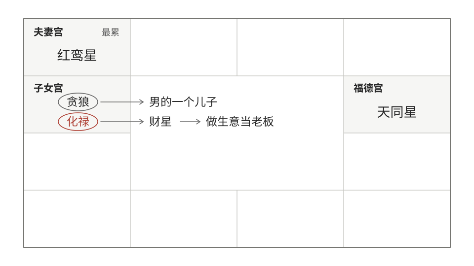 |
| **这张盘最累在哪一宫？福德宫、红鸾在哪？** | 〔口述〕倪师说这个八字最累在夫妻宫，很倒霉：「这个八字最累在什么」「在夫妻宫」「夫妻宫诸位看这个很倒霉的」。（[00:48:49–00:48:55](https://www.bilibili.com/video/BV1KJsLekEfA/?p=17&t=2929)，第 87894–88079 帧） 〔指代〕说「这个很倒霉」时，一手按在黑板左上格「门」字一带（部分被手和叠图挡住）。（[00:48:54](https://www.bilibili.com/video/BV1KJsLekEfA/?p=17&t=2934)，第 88029 帧） 〔叠图〕夫妻丁巳：巨门旺、禄存庙、红鸾旺、天姚平、天才庙、台辅、天巫、副旬庙、大耗陷、龙德；标「身宫」；大限 106~115，小限 2、14、26、38、50、62；临官；博士、亡神。（[00:48:51–00:48:53](https://www.bilibili.com/video/BV1KJsLekEfA/?p=17&t=2931)，第 87942–88001 帧） 〔口述〕接着点出福德宫是天同，红鸾又刚好落在夫妻宫：「第一个他福德宫是天同星」……「然后天喜红鸾星」「又刚好落在夫妻宫有没有红鸾星」。（[00:48:58–00:49:11](https://www.bilibili.com/video/BV1KJsLekEfA/?p=17&t=2938)，第 88158–88559 帧） 〔板书〕可辨：右列上起第二格新写的「天同」，其下两字像「福德」（后一字较潦草）；其余认不出。（[00:49:10](https://www.bilibili.com/video/BV1KJsLekEfA/?p=17&t=2950)，第 88500 帧） |
| **天梁坐命的人什么个性？化权落财帛又如何？** | 〔口述〕「天梁星坐命的人」「比较正派比较厚道个性是很强」。（[00:49:12–00:49:19](https://www.bilibili.com/video/BV1KJsLekEfA/?p=17&t=2952)，第 88584–88793 帧） 〔口述〕但这张盘的权在财帛不在命；权若在命，就变成个性很强；权在财帛，则做事业领导力很强：「但是他的这个权是在财帛」「而不是在命」……「这个权在财帛能做事业」……「可以领导力很强」。（[00:49:19–00:49:30](https://www.bilibili.com/video/BV1KJsLekEfA/?p=17&t=2959)，第 88794–89111 帧） 〔叠图〕命宫己未：天梁旺、天钺旺、寡宿不、天德庙、天月；大限 6~15，小限 4、16、28、40、52、64；衰；青龙、攀鞍。（[00:49:12–00:49:16](https://www.bilibili.com/video/BV1KJsLekEfA/?p=17&t=2952)，第 88584–88697 帧） 〔叠图〕财帛乙卯：太阴陷、化权，文曲旺，天官旺，天福平，天寿陷，咸池平；大限 86~95，小限 12、24、36、48、60、72；沐浴。（[00:49:19–00:49:22](https://www.bilibili.com/video/BV1KJsLekEfA/?p=17&t=2959)，第 88794–88871 帧） 〔指代〕说「他的这个权」时，手指按在黑板左下方格内一个被圈起的单字上（左边写着「大…」）；圈内是草书，看不清。（[00:49:20](https://www.bilibili.com/video/BV1KJsLekEfA/?p=17&t=2960)，第 88814 帧） |
| **娶到巨门星的太太，日子会怎样？** | 〔口述〕太太是巨门星，很累、很吵：「那娶个太太是巨门星这很累」「很呱噪每天要吵不停」「娶一个小小鸟回来」「在家里面一直在吵」。（[00:49:30–00:49:38](https://www.bilibili.com/video/BV1KJsLekEfA/?p=17&t=2970)，第 89112–89357 帧） 〔口述〕赚的钱全要交给太太，太太是禄存，不给就翻脸，这是巨门：「然后他赚的钱全部要给太太」「太太禄存你要统统给我哦」……「马上给他翻脸巨门」「这很辛苦」。（[00:49:38–00:49:50](https://www.bilibili.com/video/BV1KJsLekEfA/?p=17&t=2978)，第 89358–89717 帧） 〔指代〕说「巨门」「这很辛苦」前后，食指一直按在黑板左上角格内草书的「…门」字上，这字左半被叠图挡住；叠图当时显示巨门、禄存、红鸾、夫妻。（[00:49:49](https://www.bilibili.com/video/BV1KJsLekEfA/?p=17&t=2989)，第 89679 帧） |
| **红鸾在夫妻宫与坐命有何不同？怎么让夫妻好点？** | 〔口述〕偏偏红鸾在夫妻宫，意思是他自己爱、觉得这样很好：「那偏偏红鸾星在夫妻宫」「看到没有」「也就是说他自己爱」「他觉得这样很爽」。（[00:49:50–00:49:57](https://www.bilibili.com/video/BV1KJsLekEfA/?p=17&t=2990)，第 89718–89921 帧） 〔口述〕命坐红鸾的人会想办法离婚；红鸾在夫妻宫的人则认了：「那如果是命坐红鸾他就说」「他马上想办法跟她离婚」「那红鸾星在夫妻宫他认了」「这就是在劫难逃了」。（[00:50:02–00:50:10](https://www.bilibili.com/video/BV1KJsLekEfA/?p=17&t=3002)，第 90078–90323 帧） 〔口述〕这就是主动与被动之别；他天生就喜欢，就别去管：「所以主动被动的关系在这里」……「就是他天生就喜欢」「这个你就不要去管他」「这是算命」。（[00:50:10–00:50:23](https://www.bilibili.com/video/BV1KJsLekEfA/?p=17&t=3010)，第 90324–90719 帧） 〔指代〕说「他红鸾星在这里」时，右臂伸向左上格，手掌按在板面上；那块黑板被左上角叠图盖住，叠图显示红鸾、巨门、禄存、夫妻。（[00:50:12](https://www.bilibili.com/video/BV1KJsLekEfA/?p=17&t=3012)，第 90389 帧） 〔口述〕要让太太、夫妻好一点，只有住西北：「那如果我们要让他太太比较好点」「夫妻好点那就是住西北」「那是唯一的方法」。（[00:50:24–00:50:33](https://www.bilibili.com/video/BV1KJsLekEfA/?p=17&t=3024)，第 90720–91013 帧） |
| **16–25 岁七杀天马，求学阶段会怎样？** | 〔口述〕单从事业看，16–25 岁七杀、天马，他就离开父母：「光以事业来说的话」「你看他16-25七杀天马星有没有」「他就离开父母」。（[00:50:45–00:50:52](https://www.bilibili.com/video/BV1KJsLekEfA/?p=17&t=3045)，第 91374–91583 帧） 〔口述〕天马星动，读书时都到外地，不待本地，比如人在台北，一考考到台中、台南、高雄：「代表读书的时候他都会到外地」「不会待在本地」……「一考考到台中台南高雄啊」「跑了很远而且离开父母亲」。（[00:50:52–00:51:05](https://www.bilibili.com/video/BV1KJsLekEfA/?p=17&t=3052)，第 91584–91973 帧） 〔口述〕天马带七杀代表孤单、孤军奋战，16 岁以后高中、大学可能都在外地：「天马带七杀这种是代表」……「孤单嘛」「孤军奋战是不是」……「他可能都在外地求学」。（[00:51:05–00:51:14](https://www.bilibili.com/video/BV1KJsLekEfA/?p=17&t=3065)，第 91974–92225 帧） 〔叠图〕父母庚申：七杀庙、天马旺、左辅平、八座庙、恩光平、天哭庙、吊客、小耗、岁驿；大限 16~25，小限 5、17、29、41、53、65；病。（[00:50:48–00:50:51](https://www.bilibili.com/video/BV1KJsLekEfA/?p=17&t=3048)，第 91440–91541 帧） |
| **为什么说他 26 岁的婚姻在劫难逃？巨门太太什么样？** | 〔口述〕26–35 岁进入福德宫就会结婚；男命顺转，26 岁进福德宫这个大限，又逢巨门带红鸾走到夫妻宫：「26-35岁进入福德宫他就会结婚」……「男孩子的话顺转」……「26岁的时候就进入福德宫」「就逢到巨门星带红鸾走了夫妻宫」。（[00:51:14–00:51:29](https://www.bilibili.com/video/BV1KJsLekEfA/?p=17&t=3074)，第 92226–92699 帧） 〔口述〕「这就叫做大小二限逢红鸾星」「26-35 是不是走福德宫」……「逢红鸾天喜又入夫妻」「所以26岁的婚姻是在劫难逃」。（[00:51:30–00:51:41](https://www.bilibili.com/video/BV1KJsLekEfA/?p=17&t=3090)，第 92700–93059 帧） 〔叠图〕同时贴出夫妻丁巳、子女丙辰、福德辛酉三格；第 92652 帧画面里，夫妻宫小限中的「26」和福德宫大限「26~35」都加了框，子女宫小限的「1」也加了框。（[00:51:18–00:51:28](https://www.bilibili.com/video/BV1KJsLekEfA/?p=17&t=3078)，第 92364–92652 帧） 〔板书〕可辨：左上格新写并圈起的「26」；左列第二格下方另有一个圈起的数字，像「25」，不敢确定；其余认不出。（[00:51:28](https://www.bilibili.com/video/BV1KJsLekEfA/?p=17&t=3088)，第 92652 帧） 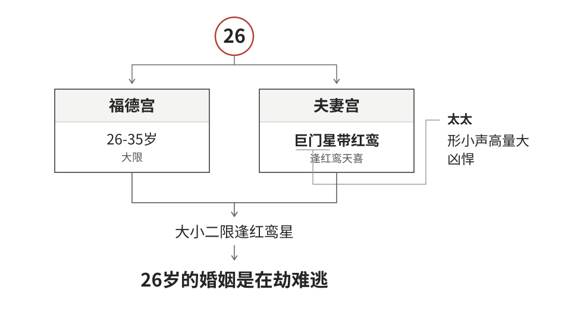 〔口述〕巨门代表太太个子小、嗓门大，凶悍：「代表太太形小声高量大」「所以女孩子有时候个子很小」「反正凶悍就是她了」……「真的是母老虎的时候」「个子哦又白又细」……「很凶很彪悍」。（[00:51:43–00:51:57](https://www.bilibili.com/video/BV1KJsLekEfA/?p=17&t=3103)，第 93090–93533 帧） |
| **26–35 岁这十年，事业是什么样？** | 〔口述〕这个大限本宫是天同，对面是财帛的化权，所以是替人工作、领固定薪水而掌权：「他对面本宫是天同」「对面是化权在财帛」……「领固定的薪水掌权」。（[00:51:57–00:52:07](https://www.bilibili.com/video/BV1KJsLekEfA/?p=17&t=3117)，第 93534–93833 帧） 〔叠图〕福德辛酉：天同平；大限 26~35，小限 6、18、30、42、54、66；死；将军、息神、病符。（[00:52:00–00:52:02](https://www.bilibili.com/video/BV1KJsLekEfA/?p=17&t=3120)，第 93624–93665 帧） 〔推断〕推断：这里说的「化权在财帛」，就是前面讲天梁坐命时那颗「权在财帛」（叠图财帛乙卯太阴陷化权）；前面说它主做事领导力强，这里落到「领固定薪水、掌权」。（[00:49:19–00:52:07](https://www.bilibili.com/video/BV1KJsLekEfA/?p=17&t=2959)，第 88794–93833 帧） |
| **36–45 岁武曲入田宅，财产和工作怎样？** | 〔口述〕36–45 岁科禄来会，武曲星在本宫，从 36 岁以后开始：「然后36-45岁以后」「科禄会有没有」「诸位看武曲星在本宫」「武曲星在本宫他是36岁以后开始的」。（[00:52:07–00:52:17](https://www.bilibili.com/video/BV1KJsLekEfA/?p=17&t=3127)，第 93834–94127 帧） 〔口述〕武曲是财星，进田宅，产业、房地产会慢慢多起来：「田宅宫财星武曲星是财星」「进来田宅的时候代表说」「产业会慢慢禄禄会慢慢增加起来」「房地产田宅会慢慢多起来」。（[00:52:17–00:52:27](https://www.bilibili.com/video/BV1KJsLekEfA/?p=17&t=3137)，第 94128–94427 帧） 〔口述〕对面逢科逢禄来会，靠专科技术专长；左边紫微、天府来会：「对面呢逢科逢禄来会有没有」……「然后左边呢紫微天府来会」。（[00:52:27–00:52:32](https://www.bilibili.com/video/BV1KJsLekEfA/?p=17&t=3147)，第 94428–94589 帧） 〔口述〕这十年一直待在公司、贡献很大，老板会分股份鼓励他、请他做股东，做满十年后会非常好：「对公司贡献很大」「老板会分股东啊」……「说你来做我们的股东了」「所以他这段时间做了十年之后」「会非常的好」。（[00:52:33–00:52:46](https://www.bilibili.com/video/BV1KJsLekEfA/?p=17&t=3153)，第 94590–95003 帧） 〔叠图〕田宅壬戌：武曲庙、地劫平、华盖平；大限 36~45，小限 7、19、31、43、55、67；墓。同时贴兄弟戊午（右弼旺化科、天相庙、廉贞平、擎羊陷、三台旺、天厨，大限 116~125）与子女丙辰（贪狼化禄）；稍后再加疾厄甲寅（紫微旺、天府庙）。（[00:52:09–00:52:31](https://www.bilibili.com/video/BV1KJsLekEfA/?p=17&t=3129)，第 93888–94535 帧） |
| **46–55 岁为什么事业不顺？** | 〔口述〕进入 46–55 岁，日月反背进来，流年在事业上就是披星戴月、事与愿违，中年事业非常不顺：「那进入46-55 以后哦」「这个日月反背代表」……「披星戴月然后事与愿违」……「事业非常的不顺」。（[00:52:46–00:53:01](https://www.bilibili.com/video/BV1KJsLekEfA/?p=17&t=3166)，第 95004–95447 帧） 〔叠图〕官禄癸亥：太阳陷、文昌利、天喜旺、天空平、孤辰陷；大限 46~55，小限 8、20、32、44、56、68；绝；飞廉、劫煞、晦气。同时贴财帛乙卯（太阴陷化权）。（[00:52:46–00:52:51](https://www.bilibili.com/video/BV1KJsLekEfA/?p=17&t=3166)，第 95004–95159 帧） 〔推断〕推断：说「日月反背」时剪辑同时贴出太阳陷（官禄癸亥）与太阴陷（财帛乙卯）两格；倪师本块没有解释「日月反背」是什么意思。（[00:52:49–00:52:51](https://www.bilibili.com/video/BV1KJsLekEfA/?p=17&t=3169)，第 95094–95159 帧） |
| **中年运好不好，面相上看哪里？三停怎么论？** | 〔口述〕看一个人中年运好不好要看中阁；最好的相是上、中、下三个部位：「那我们要看一个人」「中年运好不好看看」「看看中阁懂不懂」「最好的相上相是」「上中下三个位」「这个是下这是中这是上」。（[00:53:01–00:53:12](https://www.bilibili.com/video/BV1KJsLekEfA/?p=17&t=3181)，第 95448–95765 帧） 〔指代〕说「这个是下」时，倪师用食指按在自己鼻下、拇指抵着下巴，在自己脸上比划上中下三个位置，没有指黑板。（[00:53:08](https://www.bilibili.com/video/BV1KJsLekEfA/?p=17&t=3188)，第 95649 帧） 〔口述〕三停相等很难；上停好、下停不大的人早年好晚年不好；下巴大、上停短的人晚来好：「上中下三停是相等的」「很难了有的人是上停很好」「下停不很大」「就早年好晚年不好」「有的人是下巴很大对不对」……「上停比较短就晚来好」。（[00:53:12–00:53:26](https://www.bilibili.com/video/BV1KJsLekEfA/?p=17&t=3192)，第 95766–96185 帧） 〔口述〕举了一个人物的下巴为例：「你看那个林洋港的下巴就没有」，后半句听不清。（[00:53:26–00:53:28](https://www.bilibili.com/video/BV1KJsLekEfA/?p=17&t=3206)，第 96186–96245 帧） |
| **批流年时运势要怎么加减？后面课程怎么安排？** | 〔口述〕批流年照此类推；一个宫代表十年，也可以代表一年；流年的运一定要做加减：「所以批流年就以此类推下去」「那一个宫代表十年」「十年也可以代表一年」「那批流年流年的时候运要加减哦」。（[00:53:35–00:53:41](https://www.bilibili.com/video/BV1KJsLekEfA/?p=17&t=3215)，第 96456–96653 帧） 〔口述〕比如这个人一直住西北，好的地方就加重；不住西北，好的地方减半、坏的地方加重：「比如说这个人一直住西北」……「就是好的地方要加重」「如果不住西北」「好的地方要减半」「坏的地方要加重」「这就是加减」。（[00:53:43–00:53:54](https://www.bilibili.com/video/BV1KJsLekEfA/?p=17&t=3223)，第 96690–97037 帧） 〔推断〕推断：这里的「这个人一直住西北」接的是前面「夫妻好点那就是住西北」，指的应是例三这个人；倪师说这句时没有指黑板。（[00:50:25–00:53:44](https://www.bilibili.com/video/BV1KJsLekEfA/?p=17&t=3025)，第 90774–96749 帧） 〔口述〕后面会按不同状况举很多实例，有专门批夫妻的、批子女的：「后面我们会举很多例子」……「有的专门举例给你看批夫妻的」……「我们用实例来教导诸位如何批」。（[00:53:54–00:54:13](https://www.bilibili.com/video/BV1KJsLekEfA/?p=17&t=3234)，第 97038–97597 帧） |

**总结区**

- 通用规则：左眼是太阳、右眼是太阴：脚朝太阳星陷伤左眼，若是太阴则伤右眼（[00:47:40–00:48:29](https://www.bilibili.com/video/BV1KJsLekEfA/?p=17&t=2860)，第 85806–87293 帧）；命坐红鸾的人会主动想办法离婚；红鸾在夫妻宫的人则认了、是自己爱，这是主动与被动之别（[00:49:50–00:50:12](https://www.bilibili.com/video/BV1KJsLekEfA/?p=17&t=2990)，第 89718–90389 帧）；天梁坐命的人正派厚道、个性强；化权在命则个性很强，在财帛则做事领导力强（[00:49:12–00:49:30](https://www.bilibili.com/video/BV1KJsLekEfA/?p=17&t=2952)，第 88584–89111 帧）；批流年：一个宫代表十年也可代表一年，运一定要做加减，好的加重或减半、坏的加重（[00:53:35–00:53:54](https://www.bilibili.com/video/BV1KJsLekEfA/?p=17&t=3215)，第 96456–97037 帧）
- 只在本例：子女宫贪狼化禄，财禄星都在子女宫，主一个儿子做生意当老板（[00:48:29–00:48:49](https://www.bilibili.com/video/BV1KJsLekEfA/?p=17&t=2909)，第 87294–87893 帧）；最累在夫妻宫：太太巨门、禄存，吵不停、钱全交给她，而红鸾在夫妻宫是他自己爱；要夫妻好点唯一方法是住西北（[00:48:49–00:50:33](https://www.bilibili.com/video/BV1KJsLekEfA/?p=17&t=2929)，第 87894–91013 帧）；16–25 岁七杀天马离开父母、外地求学；26 岁大小二限逢红鸾，婚姻在劫难逃（[00:50:45–00:51:41](https://www.bilibili.com/video/BV1KJsLekEfA/?p=17&t=3045)，第 91374–93059 帧）；26–35 岁替人工作领薪掌权，36–45 岁武曲入田宅产业渐增、可成股东，46–55 岁日月反背事业不顺（[00:51:57–00:53:01](https://www.bilibili.com/video/BV1KJsLekEfA/?p=17&t=3117)，第 93534–95447 帧）
- 不是排盘规则，是处世方法：劝过客户、事后应验了，也不会跟客户讲那么多（[00:48:16–00:48:17](https://www.bilibili.com/video/BV1KJsLekEfA/?p=17&t=2896)，第 86886–86921 帧）；客户天生就喜欢的事，不要去管他，算命只是算命（[00:50:15–00:50:23](https://www.bilibili.com/video/BV1KJsLekEfA/?p=17&t=3015)，第 90456–90719 帧）

**待核**

1. [00:47:40](https://www.bilibili.com/video/BV1KJsLekEfA/?p=17&t=2860)，第 85828 帧板书：本块开头的板面只认得中间的「47」，其余草书认不出。
2. [00:47:51](https://www.bilibili.com/video/BV1KJsLekEfA/?p=17&t=2871)，第 86148 帧字幕「7公东北有南北斗星君」可信度 0.33，「7公」认不出；「南北斗星君」本块没有解释。
3. [00:48:17](https://www.bilibili.com/video/BV1KJsLekEfA/?p=17&t=2897)，第 86922 帧「我还教他算命没办法」两路都不通顺，原意待核。
4. [00:48:18](https://www.bilibili.com/video/BV1KJsLekEfA/?p=17&t=2898)，第 86964 帧「他刚好在这边太阳」、[00:48:21](https://www.bilibili.com/video/BV1KJsLekEfA/?p=17&t=2901)，第 87051 帧「脚朝到这边」两处「这边」指代为否或不确定，太阳、太阴各对应哪个方位看不出；脚朝西北为何等于对着太阳星陷，本块没有说。
5. [00:49:06](https://www.bilibili.com/video/BV1KJsLekEfA/?p=17&t=2946)，第 88380 帧口述「天喜红鸾星」落夫妻宫、[00:51:36](https://www.bilibili.com/video/BV1KJsLekEfA/?p=17&t=3096)，第 92898 帧又说「逢红鸾天喜又入夫妻」，但叠图夫妻丁巳只有红鸾旺，天喜旺在官禄癸亥（[00:52:46](https://www.bilibili.com/video/BV1KJsLekEfA/?p=17&t=3166)，第 95004 帧叠图）。
6. [00:50:02](https://www.bilibili.com/video/BV1KJsLekEfA/?p=17&t=3002)，第 90078 帧（约 00:50:03）材料里标作「命宫己未」的叠图，内容与夫妻丁巳一样（巨门、禄存、红鸾、身宫……），疑为转写或去重串格，需看原帧。
7. [00:51:16](https://www.bilibili.com/video/BV1KJsLekEfA/?p=17&t=3076)，第 92304 帧字幕「结婚那你成戌年」可信度 0.55，语音作「悟去年」，原话待核；[00:51:19](https://www.bilibili.com/video/BV1KJsLekEfA/?p=17&t=3079)，第 92394 帧指代标注又写作「戊年」。
8. [00:51:21–00:51:32](https://www.bilibili.com/video/BV1KJsLekEfA/?p=17&t=3081)，第 92448–92789 帧「男孩子的话顺转」「第一个流年进入大限」「大小二限」这几个说法本块没有解释。
9. [00:51:28](https://www.bilibili.com/video/BV1KJsLekEfA/?p=17&t=3088)，第 92652 帧板书左列第二格圈起的数字像「25」，不敢确定。
10. [00:51:43](https://www.bilibili.com/video/BV1KJsLekEfA/?p=17&t=3103)，第 93090 帧字幕「形小声高量大」可信度 0.49，语音作「形小身高亮大」，原话待核。
11. [00:52:30](https://www.bilibili.com/video/BV1KJsLekEfA/?p=17&t=3150)，第 94500 帧字幕「靠专科技术专长」可信度 0.43，语音只得「度站上」（前句语音「专柯制」），大体对得上但待核。
12. [00:52:17](https://www.bilibili.com/video/BV1KJsLekEfA/?p=17&t=3137)，第 94128 帧「到45岁进入田宅」与叠图田宅大限 36~45 的关系，口述表达不清，待核。
13. [00:52:49](https://www.bilibili.com/video/BV1KJsLekEfA/?p=17&t=3169)，第 95094 帧「日月反背」、[00:53:04](https://www.bilibili.com/video/BV1KJsLekEfA/?p=17&t=3184)，第 95526 帧「中阁」（语音作「中隔」）倪师用了但没有解释。
14. [00:53:16](https://www.bilibili.com/video/BV1KJsLekEfA/?p=17&t=3196)，第 95904 帧字幕「下停不很大」与语音「下庆很大」差一个「不」字，原意待核；[00:53:20](https://www.bilibili.com/video/BV1KJsLekEfA/?p=17&t=3200)，第 96018 帧「戽斗尽斗的」可信度 0.3，语音作「互抖互抖」。
15. [00:53:28](https://www.bilibili.com/video/BV1KJsLekEfA/?p=17&t=3208)，第 96246 帧「忧心紧张想把他打个下巴」两路不一致（语音「人紧张……」），讲林洋港下巴这段原意待核。
16. [00:53:35](https://www.bilibili.com/video/BV1KJsLekEfA/?p=17&t=3215)，第 96456 帧「所以批流年就以此类推下去」语音识别错乱，只依据字幕。
17. [00:49:20](https://www.bilibili.com/video/BV1KJsLekEfA/?p=17&t=2960)，第 88814 帧指代：手指按住的那个被圈单字是草书，看不清。
18. [00:49:44](https://www.bilibili.com/video/BV1KJsLekEfA/?p=17&t=2984)，第 89532 帧字幕「都得绐她」中「绐」应为「给」，笔记未引用这句。

