# P19 · 10 上：紫微在申 / 辰 / 子案例 / 女身男命 / 破军居子午 / 安床 / 杀破狼个性 / 晚婚 / 代表儿子的阳星 / 半子送终（00:00:00–00:56:31，共 101,750 帧）

> 2026-11-12 整理。依据 DeepSeek 逐帧记录与现成的五层材料（字幕、语音、叠图、板书、指代），由 Claude（Opus 5.5 子代理）分段起草，引文由程序逐段对过字幕。流程 2026-11-11 经站长认可。
> 依据标记：〔口述〕字幕与语音两路对得上的话，「」里是字幕原字 ·〔叠图〕后期贴的电子命盘，**不算倪师的话** ·〔板书〕粉笔字（看过那一帧原图才写）·〔指代〕「这里 / 这个」指哪（只收核过、确定的）·〔推断〕笔记作者自己的推断。每条后面的时间码可以点，跳到 B 站那一秒。

## 全集总结

**通用规则**

- 破军居子午叫英星入庙，给男人最好、发武官（军人警察法官外交官），女命则主孤单、孤僻（[00:00:24–00:01:09](https://www.bilibili.com/video/BV1KJsLekEfA/?p=19&t=24)，第 744–2075 帧）
- 破军孤僻、闭关自守，七杀性急刚烈，贪狼狠拗犟、易意气用事；这类杀星武将星一般给男人好、给女人嫌太过（[00:01:09–00:02:01](https://www.bilibili.com/video/BV1KJsLekEfA/?p=19&t=69)，第 2076–3635 帧）
- 红鸾在命宫，相书说女招贵夫；男命命宫有红鸾或天喜招美妻；红鸾天喜永远面对面；红鸾坐命逢第一次红鸾星就会动（[00:02:07–00:03:08](https://www.bilibili.com/video/BV1KJsLekEfA/?p=19&t=127)，第 3822–5669 帧、[00:06:07–00:06:10](https://www.bilibili.com/video/BV1KJsLekEfA/?p=19&t=367)，第 11034–11117 帧）
- 看小流年要先看十年大运，以十年大运为主、小流年为辅（[00:08:25–00:08:32](https://www.bilibili.com/video/BV1KJsLekEfA/?p=19&t=505)，第 15174–15365 帧）
- 两个坐山中间的分金线上不能摆床、不能盖房子；床或房子落在分金上主凶，西北角等其他都不必再看（[00:17:56–00:18:12](https://www.bilibili.com/video/BV1KJsLekEfA/?p=19&t=1076)，第 32298–32765 帧）
- 子女宫按星数看儿子：紫微天相两个、天机巨门没有、天同一个、破军两个、文昌一个、廉贞两个、七杀两个、贪狼一子；只要化忌一进来就没有了（[00:26:24–00:27:28](https://www.bilibili.com/video/BV1KJsLekEfA/?p=19&t=1584)，第 47526–49457 帧）
- 阳宅在命里约占三分之一，读命要把阳宅位置加减进去，看他如何行险，有的是好的行险（[00:28:35–00:28:41](https://www.bilibili.com/video/BV1KJsLekEfA/?p=19&t=1715)，第 51450–51647 帧、[00:32:21–00:32:26](https://www.bilibili.com/video/BV1KJsLekEfA/?p=19&t=1941)，第 58236–58403 帧）。
- 男人命晚婚的人，他就住西北角（[00:35:37–00:35:43](https://www.bilibili.com/video/BV1KJsLekEfA/?p=19&t=2137)，第 64122–64295 帧）
- 延年方取吉位：改阳宅时脚朝身体健康的方位，读书书桌朝化科的方位，书桌放哪个房间都无所谓；不可朝化忌（[00:39:27–00:40:04](https://www.bilibili.com/video/BV1KJsLekEfA/?p=19&t=2367)，第 71034–72125 帧）
- 一个凶宅三年成灾，凡是三之数都会成灾，大部分在第三年发生事情（[00:50:16–00:50:31](https://www.bilibili.com/video/BV1KJsLekEfA/?p=19&t=3016)，第 90480–90935 帧）

**只在本例**

- 倪师批她33岁丧夫、44岁再婚、51岁又失夫，说她的婚姻都是7年（[00:03:52–00:04:30](https://www.bilibili.com/video/BV1KJsLekEfA/?p=19&t=232)，第 6966–8117 帧）
- 例一子女宫天同化权、科权禄三会，儿子命上优秀，但儿女房间睡反，倪师称女身男态（[00:09:58–00:11:43](https://www.bilibili.com/video/BV1KJsLekEfA/?p=19&t=598)，第 17958–21119 帧）
- 化解：再结婚时主卧房住西北角，脚朝卯辰申酉这些吉星方向（[00:15:22–00:16:11](https://www.bilibili.com/video/BV1KJsLekEfA/?p=19&t=922)，第 27684–29159 帧）
- 这位民国51年男命身在财帛、财帛化忌，科权入命，个性强、会掌权（[00:24:23–00:25:06](https://www.bilibili.com/video/BV1KJsLekEfA/?p=19&t=1463)，第 43902–45185 帧）
- 红鸾在子女宫，34岁照样会生孩子但不结婚，先有子、40岁以后再结婚（[00:38:06–00:38:32](https://www.bilibili.com/video/BV1KJsLekEfA/?p=19&t=2286)，第 68592–69371 帧）
- 子女宫空、对面化忌所以无子，阳宅东南有房所以有女，整个格局叫「半子送终」（[00:49:24–00:49:54](https://www.bilibili.com/video/BV1KJsLekEfA/?p=19&t=2964)，第 88920–89825 帧）
- 女儿八字里7岁爸爸要走，与妈妈41岁先生要走两个大运合到，所以肯定是41岁；事情还没发生，还有7年（[00:52:25–00:52:59](https://www.bilibili.com/video/BV1KJsLekEfA/?p=19&t=3145)，第 94350–95393 帧）

**不是排盘规则，是处世方法**

- 看出问题要给人事上和地理上的建议（[00:11:29–00:11:33](https://www.bilibili.com/video/BV1KJsLekEfA/?p=19&t=689)，第 20670–20801 帧）
- 别对客户说「尅夫的样子」，要说「旺夫命」并给她鼓励（[00:14:54–00:15:22](https://www.bilibili.com/video/BV1KJsLekEfA/?p=19&t=894)，第 26820–27683 帧）
- 断事靠盘上的资料，不是通灵胡说（[00:22:39–00:22:45](https://www.bilibili.com/video/BV1KJsLekEfA/?p=19&t=1359)，第 40770–40961 帧）
- 算命是指点迷津，在一念之间，所以要早算，孩子的命有空就排出来（[00:23:55–00:24:23](https://www.bilibili.com/video/BV1KJsLekEfA/?p=19&t=1435)，第 43062–43901 帧）
- 千万不要做愚善的人，善良用错地方就是在帮助坏人，你就是坏人（[00:55:45–00:55:56](https://www.bilibili.com/video/BV1KJsLekEfA/?p=19&t=3345)，第 100374–100709 帧）

## 目录

**例一（女命，命宫丙午破军，紫微在申）：英星入庙、红鸾、婚变**

1. 例一破军坐午、红鸾坐命与婚变（00:00:00–00:06:49）

**例一续：相上33岁、诸事皆吉、太阴化禄、子女与人中、女身男态**

2. 例一续：相上33岁、诸事皆吉与子女（00:06:49–00:12:39）

**例一续：合伙官司、再婚又失、化解西北角与分金煞、承浆、事业**

3. 例一再婚又失夫，西北角化解与分金煞（00:12:40–00:17:42）
4. 分金煞凶宅、承浆与例一事业（00:17:43–00:22:45）

**例二（男命，命宫甲辰紫微天相）：身在财帛、子星、住西北大壮**

5. 例二身在财帛、科权入命与子女星数（00:22:45–00:28:34）
6. 例二住西北：大壮、化忌与一家补位（00:28:35–00:34:11）

**例二续：红鸾天喜与晚婚、疾厄、红鸾入子女、书桌朝向、官相与眉**

7. 红鸾天喜会期、晚婚西北角与先子后婚（00:34:11–00:39:26）
8. 书桌朝向与禄忌，官相与眉位（00:39:26–00:45:01）

**例三（女命，命宫甲午贪狼，紫微在子）：贪居子午、半子送终**

9. 贪居子午与半子送终：34岁问事业（00:45:01–00:50:58）
10. 断41岁最凶、女儿八字佐证、愚善（00:50:59–00:56:31）

## 例一（女命，命宫丙午破军，紫微在申）：英星入庙、红鸾、婚变

〔叠图〕这一例视频里只贴过 6 格：命宫 丙午：破军庙、禄存庙、咸池陷、天德旺、红鸾旺、解神庙；兄弟 乙巳：太阳旺、陀罗陷、地空庙、地劫不、恩光平、旬空庙、破碎陷；田宅 己酉：太阴旺禄、天钺庙、火星得、天哭不；迁移 壬子：廉贞平、天相庙、右弼庙、天喜旺；福德 戊申：紫微旺、天府得；交友 辛亥：巨门旺忌、天魁旺、天马平、天姚陷、天贵平、天福庙、天伤旺、孤辰陷。

### 1　例一破军坐午、红鸾坐命与婚变（[00:00:00–00:06:49](https://www.bilibili.com/video/BV1KJsLekEfA/?p=19&t=0)，第 0–12275 帧）

| 提示区 | 笔记区 |
|---|---|
| **「破军居子午」指什么，又叫什么格？** | 〔口述〕例一开头，倪师先点出本盘「这是紫微星在这个申宫」，接着说「算命有一句话」「叫做破军居子午」。（[00:00:13–00:00:24](https://www.bilibili.com/video/BV1KJsLekEfA/?p=19&t=13)，第 390–743 帧） 〔口述〕转述：破军居子午就是「这个破军星在午宫或者在子宫」「就是在这两个地方」，又名「……叫做英星入庙」，「英星入庙成格」。（[00:00:24–00:00:41](https://www.bilibili.com/video/BV1KJsLekEfA/?p=19&t=24)，第 744–1253 帧） 〔叠图〕命宫丙午：破军庙、禄存庙、红鸾旺、解神庙、咸池陷、阴煞、天德旺，标身宫；胎；博士、咸池、天德；大限2~11；小限2,14,26,38,50,62。同时贴出的「迁移壬子」一格内容与命宫丙午一样（大限62~71），是配合破军在午或在子的演示，不是本盘的迁移宫。（[00:00:44–00:00:46](https://www.bilibili.com/video/BV1KJsLekEfA/?p=19&t=44)，第 1332–1397 帧） 〔板书〕远景。可辨黑板左缘竖写「破军居」三字（较模糊），盘面其余字认不出。（[00:00:26](https://www.bilibili.com/video/BV1KJsLekEfA/?p=19&t=26)，第 804 帧） |
| **英星入庙对男命、女命各主什么？** | 〔口述〕英星入庙「那给男人最好」，男人的话「这个英星入庙发武官」，即「武官的军人警察法官外交官这种人」。（[00:00:41–00:00:52](https://www.bilibili.com/video/BV1KJsLekEfA/?p=19&t=41)，第 1254–1571 帧） 〔口述〕女人拿到破军在午宫或子宫的英星入庙，「主的是会比较孤单」「还有呢比较孤僻」「个性上来说会非常的孤僻」。（[00:00:52–00:01:09](https://www.bilibili.com/video/BV1KJsLekEfA/?p=19&t=52)，第 1572–2075 帧） 〔指代〕说「那女人呢拿到这个破军在午宫」时，右手食指点在黑板盘面中部、上排写有「午」那一格的下方。（[00:00:53](https://www.bilibili.com/video/BV1KJsLekEfA/?p=19&t=53)，第 1604 帧） 〔板书〕可辨：上排一格写「破军」「禄存」「2-11」「命宫」「午」，格右上写「红鸾」；盘面中间写「孤僻」。其余格子字迹部分认得，见后文各行。（[00:01:11](https://www.bilibili.com/video/BV1KJsLekEfA/?p=19&t=71)，第 2148 帧） 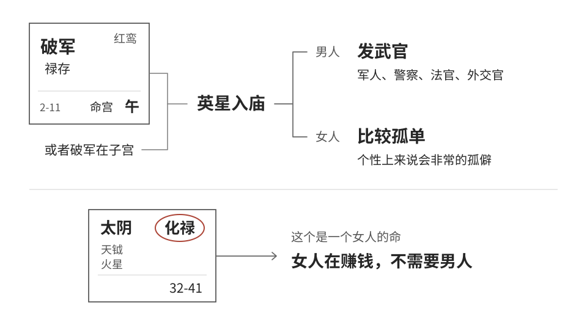 |
| **破军、七杀、贪狼三星的个性怎么分？** | 〔口述〕「这个破军七杀和贪狼」「三个人个性不太一样」。「破军星坐命的人个性呢比较孤僻」，然后「自守」——「并不是去杀了杀了人去自首」，「而是好像闭关自守一样」。（[00:01:09–00:01:25](https://www.bilibili.com/video/BV1KJsLekEfA/?p=19&t=69)，第 2076–2561 帧） 〔口述〕破军的自守是：「你跟他讲了半天他都听到了」「回家他还是他」，「明白吧这个破军就这样子」。（[00:01:26–00:01:31](https://www.bilibili.com/video/BV1KJsLekEfA/?p=19&t=86)，第 2598–2753 帧） 〔口述〕「那七杀星呢比较性子很急」「个性很刚烈」；「那贪狼星呢比较狠」「个性比较拗比较犟」，「贪狼星的人比较容易意气用事」「不顾一切这样」。（[00:01:31–00:01:47](https://www.bilibili.com/video/BV1KJsLekEfA/?p=19&t=91)，第 2754–3221 帧） 〔口述〕「那像这种这种杀星」「这种武将的星」「一般给男人比较好」「给女人的话比较嫌太过」。（[00:01:51–00:02:01](https://www.bilibili.com/video/BV1KJsLekEfA/?p=19&t=111)，第 3336–3635 帧） 〔板书〕盘面中部在「孤僻」右上方新写了「自守」二字。（[00:01:24](https://www.bilibili.com/video/BV1KJsLekEfA/?p=19&t=84)，第 2520 帧） |
| **红鸾在命宫，女命、男命各主什么？** | 〔口述〕「红鸾星在命宫」「女的命啊带红鸾」，「女在相书上面怎么写的」「它说女招贵夫」。（[00:02:07–00:02:22](https://www.bilibili.com/video/BV1KJsLekEfA/?p=19&t=127)，第 3822–4283 帧） 〔口述〕男命「有红鸾天喜星入命的人」，「男命的命官中有红鸾星或天喜星的」，「男人招美妻就是娶的太太都很漂亮」。（[00:02:22–00:02:37](https://www.bilibili.com/video/BV1KJsLekEfA/?p=19&t=142)，第 4284–4715 帧） 〔口述〕举例：发现儿子命里有红鸾，他追女朋友「她不漂亮的他不追」「他都要看漂亮的」，「这漂亮又不能当饭吃啊」；「这是喜神坐命的时候」「会有这种现象」。（[00:02:37–00:03:00](https://www.bilibili.com/video/BV1KJsLekEfA/?p=19&t=157)，第 4716–5423 帧） 〔叠图〕再贴命宫丙午，框出破军庙、禄存庙、红鸾旺三星（其余内容同前）。（[00:02:15–00:02:22](https://www.bilibili.com/video/BV1KJsLekEfA/?p=19&t=135)，第 4074–4283 帧） 〔板书〕命宫格上方的「红鸾」二字已被粉笔圈起。（[00:02:15](https://www.bilibili.com/video/BV1KJsLekEfA/?p=19&t=135)，第 4068 帧） 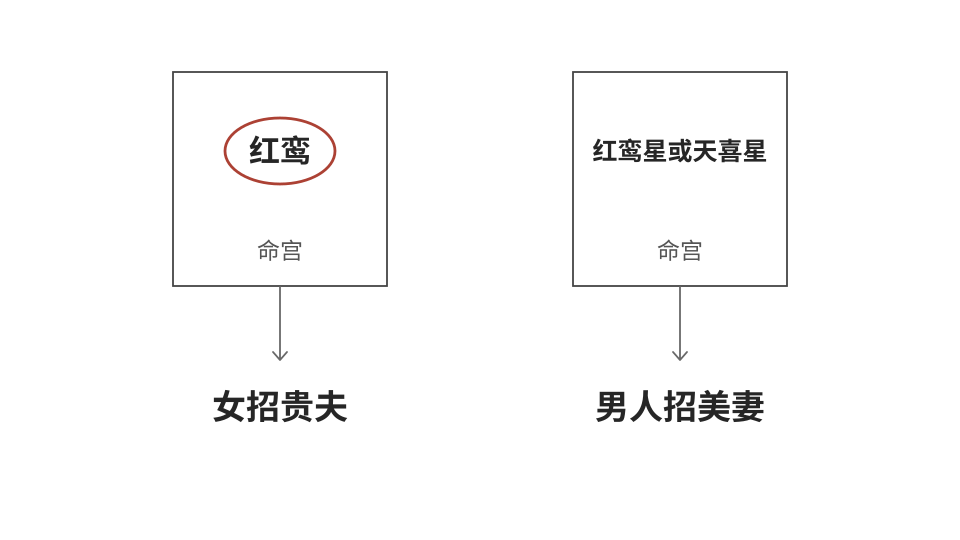 |
| **红鸾与天喜的位置是什么关系？** | 〔口述〕「那红鸾天喜星是永远是面对面的」「永远面对面」。（[00:03:00–00:03:08](https://www.bilibili.com/video/BV1KJsLekEfA/?p=19&t=180)，第 5424–5669 帧） 〔叠图〕同时贴命宫丙午与本盘真正的迁移壬子：廉贞平、天相庙、右弼庙、天喜旺、台辅；帝旺；飞廉、息神、贯索；大限62~71；小限8,20,32,44,56,68。（[00:03:00–00:03:05](https://www.bilibili.com/video/BV1KJsLekEfA/?p=19&t=180)，第 5424–5561 帧） 〔推断〕推断：叠图上红鸾旺在命宫丙午、天喜旺在迁移壬子，正是讲「永远面对面」时同时贴出的两格；倪师本句没有说出这两格的位置关系。（[00:03:00–00:03:08](https://www.bilibili.com/video/BV1KJsLekEfA/?p=19&t=180)，第 5424–5669 帧） 〔板书〕盘面下排可辨「天喜」，左旁一格可辨「天相」，其余认不出。（[00:03:56](https://www.bilibili.com/video/BV1KJsLekEfA/?p=19&t=236)，第 7080 帧） |
| **照相书看本例婚姻应很好，为何说要批神？** | 〔口述〕「这里有个问题来了」「为什么我要提这个给你」「所以批八字要批神啊」「也不能批形啊」。（[00:03:09–00:03:17](https://www.bilibili.com/video/BV1KJsLekEfA/?p=19&t=189)，第 5670–5927 帧） 〔口述〕「按照相书这样批起来」：「哎呀老师她红鸾星坐命」「这个女孩子太阳星又入庙」，太阳在巳宫（上午9到11点），福德宫紫微、天府，「南斗北斗星君都很好啊」「她婚姻应该很好啊对不对」。（[00:03:17–00:03:32](https://www.bilibili.com/video/BV1KJsLekEfA/?p=19&t=197)，第 5928–6389 帧） 〔指代〕说「她红鸾星坐命这个」时粉笔从命宫格右上圈住的「红鸾」移到该格「命」字上；说「太阳星在这个是巳宫」时粉笔点在盘面左上写「兄弟」的那一格。（[00:03:20–00:03:22](https://www.bilibili.com/video/BV1KJsLekEfA/?p=19&t=200)，第 6006–6082 帧） 〔叠图〕兄弟乙巳：太阳旺、陀罗陷、地劫不、地空庙、恩光平、天厨、旬空庙、破碎陷；绝；官符、指背、白虎；大限112~121；小限3,15,27,39,51,63。（[00:03:18–00:03:20](https://www.bilibili.com/video/BV1KJsLekEfA/?p=19&t=198)，第 5964–6011 帧） 〔叠图〕福德戊申：紫微旺、天府得、封诰；长生；青龙、亡神、病符；大限22~31；小限12,24,36,48,60,72。（[00:03:28–00:03:29](https://www.bilibili.com/video/BV1KJsLekEfA/?p=19&t=208)，第 6240–6293 帧） |
| **倪师实际怎么批：几岁丧夫、再婚、又失夫？** | 〔口述〕「你知道我怎么给她批的吗」，「女今年83年……」，「虚岁是什么是不是38……」。（[00:03:33–00:03:50](https://www.bilibili.com/video/BV1KJsLekEfA/?p=19&t=213)，第 6390–6923 帧） 〔口述〕「我问你啊33岁啊」「丧夫死掉先生」，原因「为什么我等下讲给你听」。（[00:03:52–00:04:03](https://www.bilibili.com/video/BV1KJsLekEfA/?p=19&t=232)，第 6966–7307 帧） 〔口述〕转述：44岁再婚，「然后再婚呢51岁了」，「51岁又失夫又失掉夫」「又先生又出事」。（[00:04:03–00:04:24](https://www.bilibili.com/video/BV1KJsLekEfA/?p=19&t=243)，第 7308–7931 帧） 〔板书〕盘面中间写了一个圈起的「38」。命宫格旁另有数字形似「83」，认不定。（[00:03:51](https://www.bilibili.com/video/BV1KJsLekEfA/?p=19&t=231)，第 6953 帧） 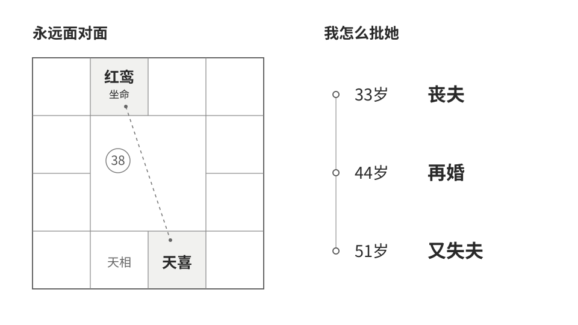 〔板书〕黑板右上竖写「33」「丧」「夫」，其右再竖写「44」「再」「婚」。（[00:04:11](https://www.bilibili.com/video/BV1KJsLekEfA/?p=19&t=251)，第 7547 帧） |
| **她的婚姻「都是7年」？叠图怎么标？** | 〔口述〕「她的婚姻啊很好玩都是7年」「这个八字都是7年」，「你知道为什么我这样子批」「有原因的哈」，「所以讲出来了就没什么」「可是不讲你说奇怪怎么会这样批」。（[00:04:24–00:04:37](https://www.bilibili.com/video/BV1KJsLekEfA/?p=19&t=264)，第 7932–8321 帧） 〔叠图〕交友辛亥：巨门旺、化忌，另有天魁、天马、天姚、天贵、天福、天伤、孤辰、蜚廉；临官；奏书、岁驿、丧门；大限52~61；小限9,21,33,45,57,69，其中33被框出，叠图该格标着「丧夫」。（[00:04:27–00:04:30](https://www.bilibili.com/video/BV1KJsLekEfA/?p=19&t=267)，第 8034–8117 帧） 〔叠图〕同时：兄弟乙巳格岁数标出39、51，叠图该格标着「又丧夫」；迁移壬子格44被框出，叠图该格标着「再婚」。这些都是剪辑加的提示字，不是星曜。（[00:04:27–00:04:30](https://www.bilibili.com/video/BV1KJsLekEfA/?p=19&t=267)，第 8034–8117 帧） 〔推断〕推断：本块后面说她第一次红鸾动在26岁，26到33、44到51各相隔7年，可能就是「都是7年」所指；倪师本块没有把这笔账算出来。（[00:04:24–00:06:29](https://www.bilibili.com/video/BV1KJsLekEfA/?p=19&t=264)，第 7932–11681 帧） |
| **她带来的阳宅是什么格局？** | 〔口述〕「所以你不能批她不能看形啊」，「第一个她来的时候」「她拿出来的阳宅」，画小一点，「诸位现在慢慢熟了东南西北」，「两个房间是这样子面对面的」。（[00:04:37–00:04:55](https://www.bilibili.com/video/BV1KJsLekEfA/?p=19&t=277)，第 8322–8879 帧） 〔口述〕「然后这里是厨房」「这里是厕所」「然后她的主卧房在这里」「这里还有个卧房」「这是客厅」，「这个房子这样子的你看很奇怪啊」。（[00:04:56–00:05:08](https://www.bilibili.com/video/BV1KJsLekEfA/?p=19&t=296)，第 8880–9263 帧） 〔指代〕说厨房的「这里」时粉笔在平面图左下；说厕所的「这里」移到平面图底部右侧；说主卧房「在这里」在右侧内框；说「这里还有个卧房」在左侧内框。（[00:04:56–00:05:02](https://www.bilibili.com/video/BV1KJsLekEfA/?p=19&t=296)，第 8890–9070 帧） 〔板书〕可辨：平面图上方写「S」、下方写「N」，外框里左右各一个小方框，底边右侧小框写「厕」；左下一字形似「历」，两个内框里的字和左右两侧的字母认不全。（[00:05:04](https://www.bilibili.com/video/BV1KJsLekEfA/?p=19&t=304)，第 9149 帧） |
| **她的面相、手与声音是什么样？** | 〔口述〕「然后人来的时候坐到我面前呢」，「面大骨粗啊」，「上下停长中停短」，「额头啊很宽鼻子下很大中间短短的」。（[00:05:08–00:05:34](https://www.bilibili.com/video/BV1KJsLekEfA/?p=19&t=308)，第 9264–10031 帧） 〔口述〕「手一上来哇那个手腕比我还粗」「挺大的骨粗」，「然后小姐你贵姓」「一开口声沙」「我想完了」。（[00:05:36–00:05:47](https://www.bilibili.com/video/BV1KJsLekEfA/?p=19&t=336)，第 10086–10415 帧） 〔板书〕可辨：「面大、骨粗，」后接一两字认不出；下面写「上下停长、中停短」。（[00:05:27](https://www.bilibili.com/video/BV1KJsLekEfA/?p=19&t=327)，第 9820 帧） |
| **32到41岁太阴化禄，倪师怎么解？** | 〔口述〕「我再一看怎么回事」「为什么会有这种现象」「我再一看看出来了」，「这个是一个女人的命」「32-41岁的时候太阴化禄」「是女人在赚钱不需要男人呐」。（[00:05:47–00:06:07](https://www.bilibili.com/video/BV1KJsLekEfA/?p=19&t=347)，第 10416–11033 帧） 〔叠图〕田宅己酉：太阴旺、化禄，天钺庙、火星得、天哭不；沐浴；将星、小耗、岁建；大限32~41；小限11,23,35,47,59,71。（[00:06:09–00:06:10](https://www.bilibili.com/video/BV1KJsLekEfA/?p=19&t=369)，第 11070–11117 帧） 〔板书〕黑板右侧一格可辨「太阴」、圈起的「化禄」，以及「天钺」「火星」「32-41」。（[00:01:11](https://www.bilibili.com/video/BV1KJsLekEfA/?p=19&t=71)，第 2148 帧） |
| **红鸾几岁才动？33岁那宫为何主丧夫？** | 〔口述〕「红鸾星坐命的人」「逢到第一次红鸾星就会动」；「所以她12-21 第一次红鸾星在」，「不可能的1314岁不会动」；「那第二次红鸾星是那个2526岁」「这里隔壁是不是26岁」。（[00:06:07–00:06:21](https://www.bilibili.com/video/BV1KJsLekEfA/?p=19&t=367)，第 11034–11459 帧） 〔口述〕「我这样子有没有问题吧」「不会太快吧」，「她26岁那年刚好是不是遇到红鸾星」，「所以她第一次红鸾星 26岁」。（[00:06:22–00:06:29](https://www.bilibili.com/video/BV1KJsLekEfA/?p=19&t=382)，第 11460–11681 帧） 〔叠图〕再贴命宫丙午（红鸾旺所在），小限2,14,26,38,50,62；同时贴田宅己酉。（[00:06:09–00:06:10](https://www.bilibili.com/video/BV1KJsLekEfA/?p=19&t=369)，第 11070–11117 帧） 〔口述〕数岁数数到33，「33岁的宫在这里」「化忌对冲什么太阳看到没有」「所以夫妻死别先生死在车祸上面」，「找我们算的时候38」。（[00:06:29–00:06:49](https://www.bilibili.com/video/BV1KJsLekEfA/?p=19&t=389)，第 11682–12275 帧） 〔推断〕推断：叠图交友辛亥巨门化忌、小限含33且标「丧夫」，兄弟乙巳为太阳旺，「化忌对冲……太阳」应指这两格；但两处指代都标不确定，倪师未说宫名。（[00:06:33–00:06:40](https://www.bilibili.com/video/BV1KJsLekEfA/?p=19&t=393)，第 11790–12029 帧） |

**总结区**

- 通用规则：破军居子午叫英星入庙，给男人最好、发武官（军人警察法官外交官），女命则主孤单、孤僻（[00:00:24–00:01:09](https://www.bilibili.com/video/BV1KJsLekEfA/?p=19&t=24)，第 744–2075 帧）；破军孤僻、闭关自守，七杀性急刚烈，贪狼狠拗犟、易意气用事；这类杀星武将星一般给男人好、给女人嫌太过（[00:01:09–00:02:01](https://www.bilibili.com/video/BV1KJsLekEfA/?p=19&t=69)，第 2076–3635 帧）；红鸾在命宫，相书说女招贵夫；男命命宫有红鸾或天喜招美妻；红鸾天喜永远面对面；红鸾坐命逢第一次红鸾星就会动（[00:02:07–00:03:08](https://www.bilibili.com/video/BV1KJsLekEfA/?p=19&t=127)，第 3822–5669 帧、[00:06:07–00:06:10](https://www.bilibili.com/video/BV1KJsLekEfA/?p=19&t=367)，第 11034–11117 帧）；批命要批神、不能批形，不能只照相书批（[00:03:09–00:03:18](https://www.bilibili.com/video/BV1KJsLekEfA/?p=19&t=189)，第 5670–5963 帧、[00:04:37–00:04:40](https://www.bilibili.com/video/BV1KJsLekEfA/?p=19&t=277)，第 8322–8417 帧）
- 只在本例：本例紫微在申、破军坐午宫命，照相书看红鸾坐命、太阳入庙、福德紫微天府，婚姻应很好（[00:00:13–00:00:24](https://www.bilibili.com/video/BV1KJsLekEfA/?p=19&t=13)，第 390–743 帧、[00:03:17–00:03:32](https://www.bilibili.com/video/BV1KJsLekEfA/?p=19&t=197)，第 5928–6389 帧）；倪师批她33岁丧夫、44岁再婚、51岁又失夫，说她的婚姻都是7年（[00:03:52–00:04:30](https://www.bilibili.com/video/BV1KJsLekEfA/?p=19&t=232)，第 6966–8117 帧）；她12到21那次红鸾在13、14岁不会动，26岁才遇红鸾；33岁那宫化忌对冲太阳，先生车祸死别（[00:06:10–00:06:45](https://www.bilibili.com/video/BV1KJsLekEfA/?p=19&t=370)，第 11118–12173 帧）；32到41岁太阴化禄，是女人在赚钱不需要男人（[00:05:58–00:06:07](https://www.bilibili.com/video/BV1KJsLekEfA/?p=19&t=358)，第 10758–11033 帧）
- 不是排盘规则，是处世方法：儿子命带红鸾只追漂亮的女孩，倪师提醒漂亮又不能当饭吃（[00:02:37–00:02:55](https://www.bilibili.com/video/BV1KJsLekEfA/?p=19&t=157)，第 4716–5267 帧）

**待核**

1. [00:00:00](https://www.bilibili.com/video/BV1KJsLekEfA/?p=19&t=0)，第 0 帧板书图是片头字卡（「天纪10上」「精准字幕+配图」「程心学一校天纪」），不是黑板；本集编号与「天纪10上」的对应待核（[00:00:00](https://www.bilibili.com/video/BV1KJsLekEfA/?p=19&t=0)，第 0 帧）
2. 第804、1320帧板书图是远景，黑板字大多认不出；且[00:00:26](https://www.bilibili.com/video/BV1KJsLekEfA/?p=19&t=26)，第 804 帧已见命宫丙午、迁移壬子叠图，比材料标的[00:00:45](https://www.bilibili.com/video/BV1KJsLekEfA/?p=19&t=45)，第 1350 帧早（[00:00:26](https://www.bilibili.com/video/BV1KJsLekEfA/?p=19&t=26)，第 804 帧）
3. [00:03:56](https://www.bilibili.com/video/BV1KJsLekEfA/?p=19&t=236)，第 7080 帧板书图已见交友辛亥标「丧夫」的叠图，比材料标的[00:04:30](https://www.bilibili.com/video/BV1KJsLekEfA/?p=19&t=270)，第 8100 帧早（[00:03:56](https://www.bilibili.com/video/BV1KJsLekEfA/?p=19&t=236)，第 7080 帧）
4. 字幕「我们叉名叫做英星入庙」的「叉」疑为「又」，语音作「右铭」（[00:00:34](https://www.bilibili.com/video/BV1KJsLekEfA/?p=19&t=34)，第 1020 帧）；「44岁叉再婚」的「叉」语音作「会」（[00:04:03](https://www.bilibili.com/video/BV1KJsLekEfA/?p=19&t=243)，第 7308 帧）
5. 字幕「自守」，语音作「自首」，按字幕和板书「自守」（[00:01:16](https://www.bilibili.com/video/BV1KJsLekEfA/?p=19&t=76)，第 2304 帧）
6. 字幕「命官」按上下文当「命宫」（第3894、4500帧）；「已宫」改作「巳宫」（[00:03:24](https://www.bilibili.com/video/BV1KJsLekEfA/?p=19&t=204)，第 6126 帧）
7. 「喜神坐命」的喜神指什么，本块没有解释（[00:02:55](https://www.bilibili.com/video/BV1KJsLekEfA/?p=19&t=175)，第 5268 帧）
8. 「所以批八字要批神」在紫微命例里说「八字」，用词待核（[00:03:13](https://www.bilibili.com/video/BV1KJsLekEfA/?p=19&t=193)，第 5796 帧）
9. 「福德宫是南北紫微星啊天府病符」语音作「南北指挥心」，原话听不清；「病符」是倪师说的还是字幕混入叠图字待核（[00:03:26](https://www.bilibili.com/video/BV1KJsLekEfA/?p=19&t=206)，第 6180 帧）
10. 字幕「我讲「才」就是岁……了哈」，语音作「我讲财就是税了」，意思不明（[00:04:13](https://www.bilibili.com/video/BV1KJsLekEfA/?p=19&t=253)，第 7614 帧）
11. 「这个八字都是7年」语音作「八十都是七年」，「八字」是否口误、「都是7年」所指未明说（[00:04:27](https://www.bilibili.com/video/BV1KJsLekEfA/?p=19&t=267)，第 8034 帧）
12. 「象读图哈读图」意思不明，语音作「独徒」（[00:05:56](https://www.bilibili.com/video/BV1KJsLekEfA/?p=19&t=356)，第 10686 帧）
13. 先说「第二次红鸾星是那个2526岁」，后说「所以她第一次红鸾星 26岁」，第一次/第二次说法前后不一；「1314岁」「2526岁」是字幕写法（[00:06:10–00:06:29](https://www.bilibili.com/video/BV1KJsLekEfA/?p=19&t=370)，第 11118–11681 帧）
14. 「30 31 3233岁」是在数岁数，字幕与语音对不上（[00:06:29](https://www.bilibili.com/video/BV1KJsLekEfA/?p=19&t=389)，第 11682 帧）
15. 指代：说「这里隔壁是不是26岁」时（[00:06:19](https://www.bilibili.com/video/BV1KJsLekEfA/?p=19&t=379)，第 11395 帧）和说「33岁的宫在这里」时（[00:06:34](https://www.bilibili.com/video/BV1KJsLekEfA/?p=19&t=394)，第 11820 帧）都标不确定，所指的宫格只能靠叠图推；[00:03:11](https://www.bilibili.com/video/BV1KJsLekEfA/?p=19&t=191)，第 5741 帧也不确定，未用
16. 「这是客厅」说的时候没有指代，客厅在平面图哪里看不出（[00:05:04](https://www.bilibili.com/video/BV1KJsLekEfA/?p=19&t=304)，第 9138 帧）
17. 板书平面图两个内框里的字、左下形似「历」的字、左右两侧的字母认不全（[00:05:04](https://www.bilibili.com/video/BV1KJsLekEfA/?p=19&t=304)，第 9149 帧）
18. 板书「面大、骨粗，」后面一两字认不出（[00:05:27](https://www.bilibili.com/video/BV1KJsLekEfA/?p=19&t=327)，第 9820 帧）
19. 板书命宫格旁形似「83」的数字、父母格旁粉红圈起的「25」何时写、所指何事本块没说（[00:03:51](https://www.bilibili.com/video/BV1KJsLekEfA/?p=19&t=231)，第 6953 帧）
20. 板书父母格「12-21」前两字形似「擎羊」，认不定（[00:01:24](https://www.bilibili.com/video/BV1KJsLekEfA/?p=19&t=84)，第 2520 帧）
21. 叠图交友辛亥各星的庙旺与星名对位看不清，只记巨门旺、化忌（[00:04:27](https://www.bilibili.com/video/BV1KJsLekEfA/?p=19&t=267)，第 8034 帧）

## 例一续：相上33岁、诸事皆吉、太阴化禄、子女与人中、女身男态

〔叠图〕这一例视频里只贴过 6 格：子女 癸卯：天同平权、天寿陷、天才旺、天虚庙、截空平；田宅 己酉：太阴旺禄、天钺庙、火星得、天哭不；福德 戊申：紫微旺、天府得；父母 丁未：天机陷科、擎羊庙、天刑陷、寡宿不；命宫 丙午：破军庙、禄存庙、红鸾旺、解神庙、咸池陷、天德旺；交友 辛亥：巨门旺忌、天魁旺、天马平、天姚陷、天贵平、天福庙、天伤旺、孤辰陷。

### 2　例一续：相上33岁、诸事皆吉与子女（[00:06:49–00:12:39](https://www.bilibili.com/video/BV1KJsLekEfA/?p=19&t=409)，第 12276–22799 帧）

| 提示区 | 笔记区 |
|---|---|
| **例一的33岁，在面相上从哪里看出来？** | 〔口述〕倪师说还有个相要告诉大家，让学生把前面讲过的那张人相图拿出来：「33岁在什么左眉角看到没有」。材料里没有这张图，只照口述记：33岁在左眉角。（[00:06:49–00:07:02](https://www.bilibili.com/video/BV1KJsLekEfA/?p=19&t=409)，第 12276–12683 帧） 〔口述〕这位女命来的时候倪师特别注意看她：「一看哎呀左眉角都是黑黑云黑点」「这边都是黑点」。（[00:07:02–00:07:09](https://www.bilibili.com/video/BV1KJsLekEfA/?p=19&t=422)，第 12684–12893 帧） 〔指代〕说「这边都是黑点」以及紧接着说「这个」时，手指的是倪师自己身上，一直按着自己额头和眉角一侧示意位置，没有指黑板。（[00:07:04–00:07:11](https://www.bilibili.com/video/BV1KJsLekEfA/?p=19&t=424)，第 12720–12941 帧） 〔口述〕黑点已经凹下去、固定了，就代表事情已经发生：「这个黑点呢已经凹下去了」「已经是固定死的」「变成好像那个鸟斑一样」「就代表已经发生」「刚好在33岁这一格」。（[00:07:12–00:07:21](https://www.bilibili.com/video/BV1KJsLekEfA/?p=19&t=432)，第 12966–13247 帧） |
| **眼尾、奸门、眉上还有什么迹象？命和相怎么参？** | 〔口述〕「那女孩子有很多迹象」「还有眼睛啊」。倪师为了讲左眼右眼先在黑板上画鼻子，再画眼睛：「两个眼睛眼尾是这样下来的」。（[00:07:21–00:07:36](https://www.bilibili.com/video/BV1KJsLekEfA/?p=19&t=441)，第 13248–13691 帧） 〔板书〕可辨：房屋图「N」字下方新画了一个三角形（倪师口述先画的鼻子），三角形左上、右上各有一道弧线（眼睛），其余是前文已写的板书。（[00:07:34](https://www.bilibili.com/video/BV1KJsLekEfA/?p=19&t=454)，第 13644 帧） 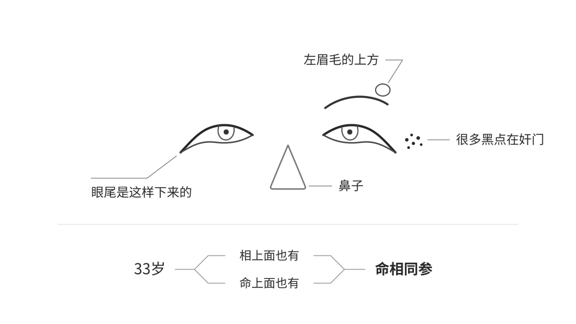 〔口述〕「然后还有很多黑点在奸门」，并说奸门就是夫妻宫（字幕作「失妻宫」）；然后讲「左眉毛的上方这一块呢」。（[00:07:36–00:07:43](https://www.bilibili.com/video/BV1KJsLekEfA/?p=19&t=456)，第 13692–13901 帧） 〔板书〕可辨：右侧那道弧线（眼）上方又多了一道弧线，末端带一个小圆圈，应是边讲眉毛边画的；画得很简略，认不出更多。（[00:07:43](https://www.bilibili.com/video/BV1KJsLekEfA/?p=19&t=463)，第 13896 帧） 〔口述〕「33岁在相上面也有」「命上面也有」「命相同参」；又说「所以这种八字如果给男人没事」「给女人就会有事」。（[00:07:43–00:07:54](https://www.bilibili.com/video/BV1KJsLekEfA/?p=19&t=463)，第 13902–14237 帧） |
| **她的22-31这个大限为什么说是吉星来会？** | 〔叠图〕福德戊申：天府得、紫微旺、封诰、亡神、病符、长生、青龙；大限数字串「2231」按图例为 22~31。（[00:07:55–00:07:57](https://www.bilibili.com/video/BV1KJsLekEfA/?p=19&t=475)，第 14268–14339 帧） 〔口述〕「你看看她22-31多好啊」「她左右逢源有没有」「南北斗星君来会」「因为22-31 通通是吉星来会」「所以诸事皆吉」。（[00:07:55–00:08:09](https://www.bilibili.com/video/BV1KJsLekEfA/?p=19&t=475)，第 14268–14675 帧） 〔推断〕推断：叠图同时贴出福德戊申（紫微旺、天府得，大限 22~31），与倪师说的22-31「南北斗星君来会」放在一起；倪师在本块没有明说是福德宫。（[00:07:55–00:08:03](https://www.bilibili.com/video/BV1KJsLekEfA/?p=19&t=475)，第 14268–14507 帧） |
| **算命书上写「诸事皆吉」应该怎么理解？** | 〔口述〕「算命书上写诸事皆吉」「诸位不要被他所所蒙蔽哦」「你不能被书所绑到」，意思是告诉你「22-31 发生所有的事情」「心想事成的意思」。（[00:08:09–00:08:20](https://www.bilibili.com/video/BV1KJsLekEfA/?p=19&t=489)，第 14676–15023 帧） 〔口述〕她这十年太好了，「太好了以后」「包括所有的事情通通来了」「懂不懂通通会发生的」「了解我意思要这样子看」。（[00:08:34–00:08:41](https://www.bilibili.com/video/BV1KJsLekEfA/?p=19&t=514)，第 15420–15635 帧） 〔口述〕「所以我们写诸事皆吉」「你要想没错」「她也要这样子写」，「可是应该说是在这个时间」「所有的心里想的事情」「她都会很顺心的能够达成」。（[00:08:41–00:08:49](https://www.bilibili.com/video/BV1KJsLekEfA/?p=19&t=521)，第 15636–15881 帧） 〔口述〕原因是「因为为什么贵星太多了」「都能够解厄制化」「出了什么问题都有人能给你」「帮你逢凶化吉」。（[00:08:49–00:08:56](https://www.bilibili.com/video/BV1KJsLekEfA/?p=19&t=529)，第 15882–16091 帧） |
| **红鸾逢吉限、逢化忌限有何不同？流年怎么看？** | 〔叠图〕命宫丙午：破军庙、禄存庙、红鸾旺、咸池陷、天德旺、解神庙、博士、胎、阴煞，并标身宫；数字串「211」按图例为大限 2~11，其余数字串拆法不明，不写。（[00:08:20–00:08:22](https://www.bilibili.com/video/BV1KJsLekEfA/?p=19&t=500)，第 15024–15083 帧） 〔口述〕「比如说红鸾星她就会结婚」；反过来「如果22-31本来化忌」「你逢了红鸾星也化忌」。（[00:08:20–00:08:25](https://www.bilibili.com/video/BV1KJsLekEfA/?p=19&t=500)，第 15024–15173 帧） 〔口述〕「因为我们看一小流年的时候」「要先要看十年大运」「以十年大运为主」「小流年为辅」。（[00:08:25–00:08:32](https://www.bilibili.com/video/BV1KJsLekEfA/?p=19&t=505)，第 15174–15365 帧） |
| **26岁结婚的先生什么样？33岁为何叫本命冲？** | 〔口述〕「那她26岁红鸾星理所当然一定会动」「那这种先生是武曲文曲来会」「文武双全的」。（[00:08:56–00:09:07](https://www.bilibili.com/video/BV1KJsLekEfA/?p=19&t=536)，第 16092–16433 帧） 〔板书〕可辨：黑板第二栏写着「武曲」，下一行第一个字是「文」，第二个字认不全。（[00:07:37](https://www.bilibili.com/video/BV1KJsLekEfA/?p=19&t=457)，第 13733 帧） 〔口述〕「可是大限 33」「你看她33化忌」「如果是本命冲」「所谓叫本命冲」「如果是她的命在这里的时候」「化忌对冲就沖她自己懂不懂」。（[00:09:07–00:09:20](https://www.bilibili.com/video/BV1KJsLekEfA/?p=19&t=547)，第 16434–16817 帧） 〔口述〕「这个冲她的太阳冲到先生」，即33岁这一冲冲的是她的太阳，应在先生身上。（[00:09:20–00:09:25](https://www.bilibili.com/video/BV1KJsLekEfA/?p=19&t=560)，第 16818–16967 帧） |
| **32-41这十年为什么不再动？太阴化禄代表什么？** | 〔口述〕「那到了第二个限」「32-41这十年中间的话」「33岁先生出事以后」，这十年中间「她都不会再动」。（[00:09:25–00:09:36](https://www.bilibili.com/video/BV1KJsLekEfA/?p=19&t=565)，第 16968–17297 帧） 〔口述〕「为什么因为太阴化禄」「太阴化禄代表这个妈妈在赚钱」「她一个人在持家」。（[00:09:36–00:09:46](https://www.bilibili.com/video/BV1KJsLekEfA/?p=19&t=576)，第 17298–17597 帧） 〔推断〕推断：稍后叠图贴出田宅己酉，太阴旺禄在这一格，大限数字串「3241」按图例为 32~41，正与倪师说的32-41「太阴化禄」相合；倪师在本块没有说出田宅宫这个宫名。（[00:09:36–00:10:07](https://www.bilibili.com/video/BV1KJsLekEfA/?p=19&t=576)，第 17298–18239 帧） |
| **她家儿女的房间怎么睡反了？** | 〔口述〕「结果很好玩的是怎么样」「她一男一女」「她让女儿睡在这边（东宫）」「儿子睡在这边（西厢）」「刚好反的」。括号里是字幕注字。（[00:09:46–00:09:54](https://www.bilibili.com/video/BV1KJsLekEfA/?p=19&t=586)，第 17598–17843 帧） 〔口述〕「女儿去睡东宫」「儿子去睡西边」。（[00:09:54–00:09:58](https://www.bilibili.com/video/BV1KJsLekEfA/?p=19&t=594)，第 17844–17957 帧） 〔板书〕可辨：左侧房屋图上方两个小方框里都多了红色笔迹，下方右框里是「厕」，底边下写「N」；方框里原有的字认不出。（[00:09:57](https://www.bilibili.com/video/BV1KJsLekEfA/?p=19&t=597)，第 17916 帧） |
| **她的子女宫三方四正会到什么？** | 〔叠图〕子女癸卯：天同平权、天才旺、天寿陷、截空平、天虚庙、大耗、灾煞、岁破、死；数字串「92101」按图例为大限 92~101。（[00:09:58–00:09:59](https://www.bilibili.com/video/BV1KJsLekEfA/?p=19&t=598)，第 17958–17999 帧） 〔口述〕「原来的儿子是天同化权」「看到没有」；「我们批批子女的时候诸位看」「也是要看三方四正哈」「我用另外一个颜色」。（[00:09:58–00:10:07](https://www.bilibili.com/video/BV1KJsLekEfA/?p=19&t=598)，第 17958–18239 帧） 〔叠图〕依次贴出：田宅己酉，太阴旺禄、天钺庙、火星得、天哭不；父母丁未，天机陷科、擎羊庙、天刑陷、寡宿不；交友辛亥，巨门旺忌、天马平、天魁旺、天福庙、天贵平、天姚陷、孤辰陷。（[00:10:05–00:10:21](https://www.bilibili.com/video/BV1KJsLekEfA/?p=19&t=605)，第 18150–18635 帧） 〔口述〕「到这边是不是三方四正」「她这个子女宫呢」「变成科权科权禄三会有没有」「还有忌会来进来」「科权禄三会到儿子宫」。（[00:10:11–00:10:21](https://www.bilibili.com/video/BV1KJsLekEfA/?p=19&t=611)，第 18348–18635 帧） 〔板书〕可辨：「红鸾」「天机」「科」（科字画圈）、「破军」「22-31」「太阴」「子女」「天梁」，几条彩色斜线互相交叉，其余认不出。（[00:10:10](https://www.bilibili.com/video/BV1KJsLekEfA/?p=19&t=610)，第 18324 帧） 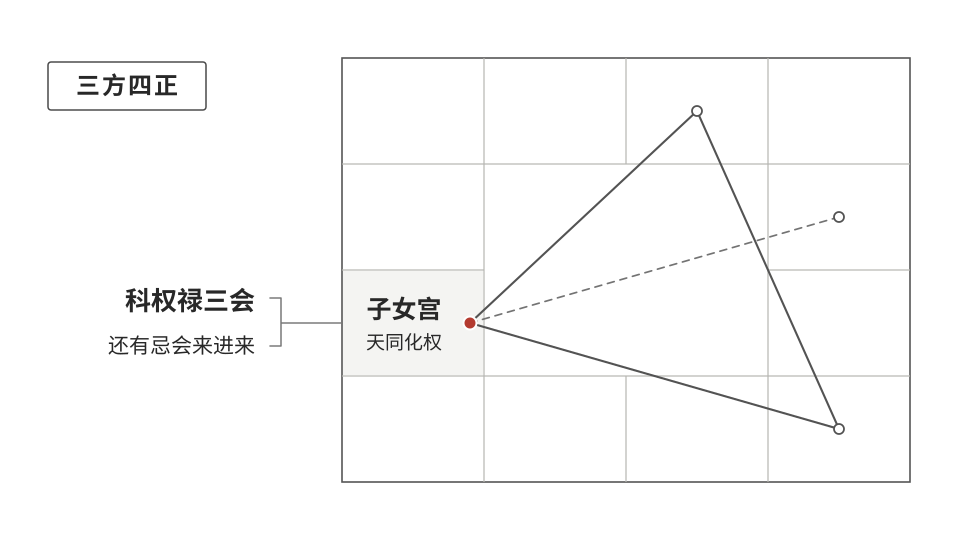 |
| **命、地理、后天训练，各占几分？** | 〔口述〕「这个儿子应该在命上面是非常优秀的」，但命只占一部分，「……只有1/3」。（[00:10:21–00:10:28](https://www.bilibili.com/video/BV1KJsLekEfA/?p=19&t=621)，第 18636–18845 帧） 〔口述〕「这个儿子呢化权带科带禄」「再住东宫的话」「就变成2/3了」「因为地理位置要再加上去」。（[00:10:28–00:10:37](https://www.bilibili.com/video/BV1KJsLekEfA/?p=19&t=628)，第 18846–19139 帧） 〔口述〕「再加上人为后天我们把他训练起来」，那就是百分百（字幕此处是一句英语，括注「百分百」），「会非常的完整」。（[00:10:38–00:10:44](https://www.bilibili.com/video/BV1KJsLekEfA/?p=19&t=638)，第 19140–19337 帧） |
| **女孩子看哪里知道有没有儿子？** | 〔口述〕「结果呢她呢她的命上的儿子很棒」；转而问「女孩子怎么样有儿子知不知道」。这里倪师另举一位当天下午来的太太，不是例一。（[00:10:44–00:10:49](https://www.bilibili.com/video/BV1KJsLekEfA/?p=19&t=644)，第 19338–19487 帧） 〔口述〕「像今天下午有个太太来找我」，八字还在批，「我就知道这个没有儿子」「她已经生了三个女儿了」，原因是「知不知道为什么人中平的」。（[00:10:49–00:11:01](https://www.bilibili.com/video/BV1KJsLekEfA/?p=19&t=649)，第 19488–19835 帧） 〔口述〕「你看那个太太讲话没有人中」「平第一个是平的」「不然就是缩进去看不到」「没有儿子」；「人太太那个女孩子人中越深的」「生儿子」。（[00:11:01–00:11:10](https://www.bilibili.com/video/BV1KJsLekEfA/?p=19&t=661)，第 19836–20129 帧） 〔口述〕「所以以前的婆婆是笨蛋」，娶媳妇时让人背对着看屁股没用，「对不对看人中」「女孩子人中宽厚最好越深」「那女孩子人中都没有了」「根本生不到」。（[00:11:11–00:11:28](https://www.bilibili.com/video/BV1KJsLekEfA/?p=19&t=671)，第 20130–20669 帧） 〔口述〕「当然这是人事上我们看到」「我们有人事上的建议对不对」「地理上建议可以让她生儿子」「这是看相」。（[00:11:29–00:11:35](https://www.bilibili.com/video/BV1KJsLekEfA/?p=19&t=689)，第 20670–20867 帧） |
| **例一儿女睡错房后怎样？倪师怎么解释？** | 〔口述〕回到例一：「结果她后天让她儿子女儿位置睡错了」「结果女儿变成儿子」「所以女身男态」「儿子变成女儿」「害羞躲在房间里面」「有时候跑出来穿裙子」。（[00:11:35–00:11:43](https://www.bilibili.com/video/BV1KJsLekEfA/?p=19&t=695)，第 20868–21119 帧） 〔口述〕这位女命跟倪师说：「我儿子常常抢要要穿」「抢他姐姐衣服穿了抢裙子穿了」，倪师接一句「住在西厢」。（[00:11:44–00:11:53](https://www.bilibili.com/video/BV1KJsLekEfA/?p=19&t=704)，第 21120–21413 帧） 〔口述〕倪师原话：「后面就会介绍到雷泽归妹卦」「归妹啊二男二女并行」「同性恋的原因就在这里」。照原话转述，不扩写。（[00:11:53–00:12:02](https://www.bilibili.com/video/BV1KJsLekEfA/?p=19&t=713)，第 21414–21671 帧） 〔口述〕「那西北角是厕所」「缺夫位失掉先生的位置」。（[00:12:02–00:12:07](https://www.bilibili.com/video/BV1KJsLekEfA/?p=19&t=722)，第 21672–21833 帧） |
| **为何同时辰生的人不一样？眉头该怎么放？** | 〔口述〕「这阳宅上面地理位置上」「天文上还有整个人相上面」「这几个资料都看到」，所以「同时间生人很多人」「长得不见得是一样」，「这里特别提出来」。（[00:12:07–00:12:18](https://www.bilibili.com/video/BV1KJsLekEfA/?p=19&t=727)，第 21834–22145 帧） 〔口述〕「所以诸位呢千万不要」「不管再什么样子」「如果遇到不如意的事情呢」「千万不要不要这样子」「很容易挤的中庭就很短了」，要尽量开。（[00:12:18–00:12:28](https://www.bilibili.com/video/BV1KJsLekEfA/?p=19&t=738)，第 22146–22451 帧） 〔口述〕举一位真实人物：「卢毓钧整个开到了」「所以一下就干到警政署署长哈」。（[00:12:28–00:12:31](https://www.bilibili.com/video/BV1KJsLekEfA/?p=19&t=748)，第 22452–22547 帧） 〔口述〕「都开的没事要抬眉」「尽量拉高」「不要不要这样子」。（[00:12:31–00:12:39](https://www.bilibili.com/video/BV1KJsLekEfA/?p=19&t=751)，第 22548–22799 帧） |

**总结区**

- 通用规则：看小流年要先看十年大运，以十年大运为主、小流年为辅（[00:08:25–00:08:32](https://www.bilibili.com/video/BV1KJsLekEfA/?p=19&t=505)，第 15174–15365 帧）；书上写「诸事皆吉」不是只有好事，是那段时间所有事情都会发生、心里想的都能顺心达成，因贵星多能解厄制化（[00:08:09–00:08:56](https://www.bilibili.com/video/BV1KJsLekEfA/?p=19&t=489)，第 14676–16091 帧）；批子女也要看子女宫的三方四正（[00:10:01–00:10:04](https://www.bilibili.com/video/BV1KJsLekEfA/?p=19&t=601)，第 18030–18149 帧）；女孩子人中宽厚越深越会生儿子，人中平或缩进去看不到的没有儿子（[00:10:56–00:11:28](https://www.bilibili.com/video/BV1KJsLekEfA/?p=19&t=656)，第 19692–20669 帧）
- 只在本例：例一33岁左眉角有凹下的黑点、奸门多黑点，命相同参；33岁化忌本命冲，冲她的太阳冲到先生（[00:06:59–00:09:25](https://www.bilibili.com/video/BV1KJsLekEfA/?p=19&t=419)，第 12576–16967 帧）；例一22-31吉星来会，26岁红鸾动而结婚，先生武曲文曲来会、文武双全（[00:07:55–00:09:07](https://www.bilibili.com/video/BV1KJsLekEfA/?p=19&t=475)，第 14268–16433 帧）；例一32-41太阴化禄，她一个人赚钱持家，这十年不再动（[00:09:25–00:09:46](https://www.bilibili.com/video/BV1KJsLekEfA/?p=19&t=565)，第 16968–17597 帧）；例一子女宫天同化权、科权禄三会，儿子命上优秀，但儿女房间睡反，倪师称女身男态（[00:09:58–00:11:43](https://www.bilibili.com/video/BV1KJsLekEfA/?p=19&t=598)，第 17958–21119 帧）
- 不是排盘规则，是处世方法：看出问题要给人事上和地理上的建议（[00:11:29–00:11:33](https://www.bilibili.com/video/BV1KJsLekEfA/?p=19&t=689)，第 20670–20801 帧）；遇到不如意的事不要那样（材料里没记动作），要尽量开、没事要抬眉、尽量拉高（[00:12:18–00:12:39](https://www.bilibili.com/video/BV1KJsLekEfA/?p=19&t=738)，第 22146–22799 帧）

**待核**

1. [00:06:49](https://www.bilibili.com/video/BV1KJsLekEfA/?p=19&t=409)，第 12295 帧板书图：讲者身体挡住大半板面，只看得到左侧房屋图和若干前文字，本块没有新字，未写入。
2. [00:07:10](https://www.bilibili.com/video/BV1KJsLekEfA/?p=19&t=430)，第 12918 帧字幕「学餅A88」是乱码，语音作「点这个」，略过。
3. [00:07:14](https://www.bilibili.com/video/BV1KJsLekEfA/?p=19&t=434)，第 13044 帧字幕「鸟斑」，语音作「乌斑」，哪个对待核。
4. 第13364、13644、13733、13896帧画面右下角另有一张面相贴图（标「33」），不是▣叠图行，未写入；☞D021记作「左下叠图」，与原图位置（右下）不符。
5. [00:07:38](https://www.bilibili.com/video/BV1KJsLekEfA/?p=19&t=458)，第 13746 帧字幕「失妻宫」，语音「夫妻公」，笔记按上下文改作「夫妻宫」。
6. [00:07:37](https://www.bilibili.com/video/BV1KJsLekEfA/?p=19&t=457)，第 13733 帧板书「武曲」下一行第二字认不全，与口述「文曲」是否一致待核。
7. [00:07:55](https://www.bilibili.com/video/BV1KJsLekEfA/?p=19&t=475)，第 14268 帧福德戊申数字串「122436」「486072」，[00:08:20](https://www.bilibili.com/video/BV1KJsLekEfA/?p=19&t=500)，第 15024 帧命宫丙午数字串「214」「26」「385062」拆法不明，未写入。
8. [00:08:32](https://www.bilibili.com/video/BV1KJsLekEfA/?p=19&t=512)，第 15366 帧字幕「因为她22生意太好了」，语音「22到31太好了」，两路对不上，未当原话引用。
9. [00:09:07](https://www.bilibili.com/video/BV1KJsLekEfA/?p=19&t=547)，第 16434 帧倪师说「大限 33」，33是岁数而非大限范围，这里的说法未解释。
10. 第16742、16799帧说「这里」「这个」时的指代是「是（不确定）」，未当依据；☞D024记那一刻画面出现「命宫 乙巳 2~11」，与▣行命宫丙午不符，待核。
11. [00:09:33](https://www.bilibili.com/video/BV1KJsLekEfA/?p=19&t=573)，第 17196 帧字幕「132-41」应为「32-41」。
12. 第17713、17738帧说「这边」的指代不确定，女儿、儿子各睡房屋图哪一格看不出；「（东宫）」「（西厢）」是字幕注字。
13. 第18314、18400、18634、18804帧指代均不确定或看不出，未当依据。
14. [00:10:24](https://www.bilibili.com/video/BV1KJsLekEfA/?p=19&t=624)，第 18732 帧字幕「命只有百一部分而只有1/3」语句不通，语音「摆一部分而已只有三分之一」，只引了「只有1/3」。
15. [00:10:40](https://www.bilibili.com/video/BV1KJsLekEfA/?p=19&t=640)，第 19224 帧字幕是一句英语（括注「百分百」），语音转写作「汉醉本身的」，两路对不上。
16. [00:11:56](https://www.bilibili.com/video/BV1KJsLekEfA/?p=19&t=716)，第 21498 帧字幕「二男二女并行」，语音「恶男恶女并行」，待核。
17. [00:12:13](https://www.bilibili.com/video/BV1KJsLekEfA/?p=19&t=733)，第 22008 帧字幕「这就是力什么」，应为「为什么」，引文已避开该字。
18. [00:12:23](https://www.bilibili.com/video/BV1KJsLekEfA/?p=19&t=743)，第 22314 帧「挤的中庭」语音作「一几个中体」，「中庭」指什么本块没解释。
19. 第22272、22698帧说「不要这样子」时做了什么动作，材料没有☞记录，未写。

## 例一续：合伙官司、再婚又失、化解西北角与分金煞、承浆、事业

| 巳 | 午 | 未 | 申 |
|---|---|---|---|
| **兄弟 乙巳** 太阳旺 陀罗陷 地空庙 地劫不 | **命宫 丙午**（身宫） 破军庙 禄存庙 | （未：没贴过） | **福德 戊申** 紫微旺 天府得 |
| **夫妻 甲辰** 武曲庙 文昌得 铃星陷 | **例一续：合伙官司、再婚又失、化解西北角与分金煞、承浆、事业 · 命宫丙午** | 据视频叠图重排 | **田宅 己酉** 太阴旺禄 天钺庙 火星得 |
| **子女 癸卯** 天同平权 | 后期贴图，不算倪师的话 |  | **官禄 庚戌** 贪狼庙 文曲陷 |
| （寅：没贴过） | （丑：没贴过） | **迁移 壬子** 廉贞平 天相庙 右弼庙 | **交友 辛亥** 巨门旺忌 天魁旺 天马平 |

按视频里这张盘逐格重画（我们自己画的图，不是视频截图）；同一个人的 3 段合成一张；数据见 [命盘-P19-例一.json](图/命盘-P19-例一.json)。

### 3　例一再婚又失夫，西北角化解与分金煞（[00:12:40–00:17:42](https://www.bilibili.com/video/BV1KJsLekEfA/?p=19&t=760)，第 22800–31889 帧）

| 提示区 | 笔记区 |
|---|---|
| **朋友宫巨门化忌的人，跟朋友合伙会怎样？** | 〔口述〕仍讲例一这位女命：「还有一个重点……像这个命的人……她朋友宫是化忌巨门星化忌……这种是标准的……如果跟朋友合伙的话……一定是官司收场」。（[00:12:43–00:12:54](https://www.bilibili.com/video/BV1KJsLekEfA/?p=19&t=763)，第 22890–23225 帧） 〔口述〕倪师说常跟客户、同学讲：「上帝有说好朋友就不会就不会……合伙都会赚钱是不是」，「我告诉你到法院打官司的……互相告的都是好朋友了」，「好朋友就是认识才会合伙嘛……才会是非纠纷很多」。（[00:12:54–00:13:09](https://www.bilibili.com/video/BV1KJsLekEfA/?p=19&t=774)，第 23226–23699 帧） 〔板书〕本块开头的板面，可辨：右侧「33 丧夫」「44 再婚」；中间一格「太阴」「天钺」「火星」「32-41」；上方「天府」「22-31」「福德」；左上「天机」旁圈着「科」。最右缘一列可辨「51」「又」「夫」，中间字和其余字迹（老师身体挡住的部分）认不出。（[00:12:42](https://www.bilibili.com/video/BV1KJsLekEfA/?p=19&t=762)，第 22872 帧） 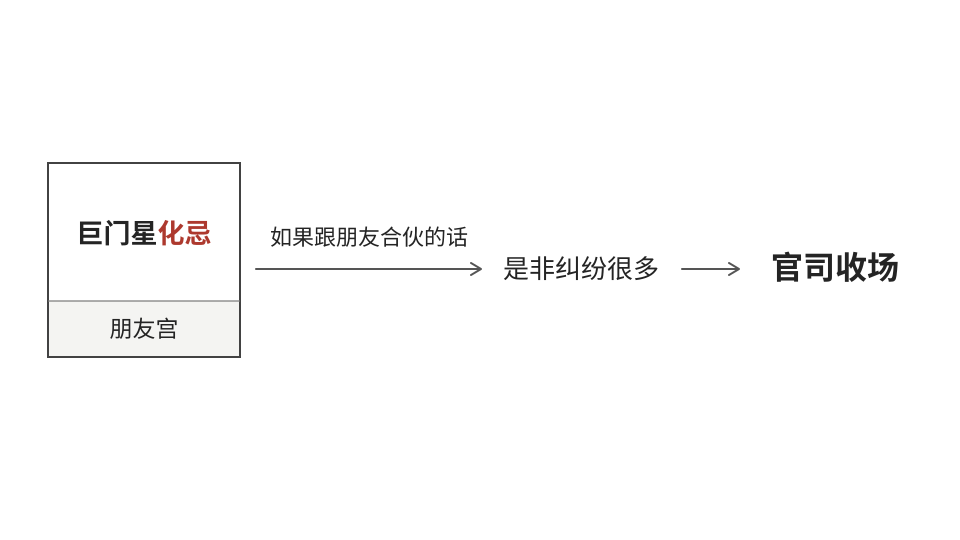 |
| **第二个大限 42-51，为什么 44 岁会再婚？** | 〔口述〕讲第二次大限 42-51：「为什么进入这个44岁会再婚」，「因为42-51进来是贪狼星进来」，「贪狼星是什么呀桃花星」，「桃花星她应该很好她又喜欢」。（[00:13:10–00:13:21](https://www.bilibili.com/video/BV1KJsLekEfA/?p=19&t=790)，第 23700–24047 帧） 〔口述〕再问天喜：「44 是不是刚好会到天喜星」，「有没有天喜星」，「那这个婚姻会不会进来」。（44 这处语音转写作 34，见待核。）（[00:13:27–00:13:34](https://www.bilibili.com/video/BV1KJsLekEfA/?p=19&t=807)，第 24222–24443 帧） 〔叠图〕官禄庚戌：贪狼庙、文曲陷、八座平、天月、天空陷、冠带、将军、攀鞍、晦气；板书图上此格标大限 42~51。（[00:13:10–00:13:12](https://www.bilibili.com/video/BV1KJsLekEfA/?p=19&t=790)，第 23700–23777 帧） 〔叠图〕迁移壬子：天相庙、廉贞平、天喜旺、右弼庙、台辅、帝旺、息神、贯索、飞廉；叠图该格标着「再婚」（剪辑提示字，不是星曜）。（[00:13:12–00:13:15](https://www.bilibili.com/video/BV1KJsLekEfA/?p=19&t=792)，第 23778–23855 帧） |
| **再婚的婚姻从迁移宫进来，说明人在哪里？** | 〔口述〕婚姻会不会进来：「会啊迁移宫哦」，「她在外地哦她在海外啊」。倪师问她人在哪，「她说我在加州啊」，「对对对你看这不是这不是命啊」，「她她她就是在外地知不知道」。（[00:13:34–00:13:46](https://www.bilibili.com/video/BV1KJsLekEfA/?p=19&t=814)，第 24444–24797 帧） 〔推断〕推断：叠图里天喜旺正落在迁移壬子，与倪师说「会啊迁移宫哦」「她在外地」相合；本块里倪师没有再多讲迁移宫与外地之间的道理。（[00:13:12–00:13:46](https://www.bilibili.com/video/BV1KJsLekEfA/?p=19&t=792)，第 23778–24797 帧） |
| **再婚之后，49-51 岁为什么又出事？** | 〔口述〕「然后她再结婚了」，「一结婚这个这个49 50 51岁」，「51岁这年的时候」，「化忌又来冲一次看到没有」。（[00:13:47–00:14:00](https://www.bilibili.com/video/BV1KJsLekEfA/?p=19&t=827)，第 24834–25211 帧） 〔指代〕说「一结婚这个这个49 50 51岁」时，右手指尖停在黑板右下格的板书「天喜」字上或紧挨着它。（[00:13:50](https://www.bilibili.com/video/BV1KJsLekEfA/?p=19&t=830)，第 24911 帧） 〔口述〕「刚刚好她是水二局」，「40-51 51岁刚好结尾」，「然后51岁小限 49 50 51岁」，「刚好又逢到太阳对面又是化忌一冲」。（[00:14:12–00:14:19](https://www.bilibili.com/video/BV1KJsLekEfA/?p=19&t=852)，第 25572–25799 帧） 〔叠图〕交友辛亥：巨门旺忌、天魁旺、天马平、天姚陷、天贵平、天福庙、天伤旺、孤辰陷、蜚廉、丧门、临官；板书图上此格标大限 52~61。兄弟乙巳：太阳旺、陀罗陷、地劫不、地空庙、恩光平、天厨、旬空庙、破碎陷、绝；该格标着「又丧夫」，小限里 51 加了框。（[00:13:56–00:14:02](https://www.bilibili.com/video/BV1KJsLekEfA/?p=19&t=836)，第 25080–25260 帧） 〔板书〕这一刻黑板大半被叠图和老师身体挡住，可辨旧字：右侧「太阴」「天钺」「火星」，左侧「夫妻」「天同」；刚写的约 2 秒那几笔认不出。（[00:14:02](https://www.bilibili.com/video/BV1KJsLekEfA/?p=19&t=842)，第 25272 帧） |
| **52-61 这个大限，为什么说她人财两失？** | 〔口述〕「因为他42-51 52-61岁在这里」，「52-61的时候是未来十年无大运」，「已经是果了看到没有」，「之前会发生事情」。（[00:14:00–00:14:12](https://www.bilibili.com/video/BV1KJsLekEfA/?p=19&t=840)，第 25212–25571 帧） 〔口述〕「换句话说不要看前面」，「光看52-61化忌不见太阳有没有」，「不见太阳她这个婚姻又没有」。（[00:14:20–00:14:28](https://www.bilibili.com/video/BV1KJsLekEfA/?p=19&t=860)，第 25800–26051 帧） 〔口述〕婚姻没有的状态下，「她又把她的毕生的积蓄……一直跟朋友合伙」，「都是在52-61岁所以她人财两失」，「人失掉先生」，「这个财失在朋友的合伙上面」，「这是很很很不好」。（[00:14:28–00:14:45](https://www.bilibili.com/video/BV1KJsLekEfA/?p=19&t=868)，第 26052–26567 帧） 〔推断〕推断：叠图把 52~61 标在交友辛亥（巨门旺忌），正好接上本块开头「朋友宫是化忌巨门星化忌……合伙……一定是官司收场」；倪师本块没有把两处明说成一件事。（[00:12:43–00:14:43](https://www.bilibili.com/video/BV1KJsLekEfA/?p=19&t=763)，第 22890–26495 帧） |
| **她 38 岁来算，之前和之后的事各能怎么说？** | 〔口述〕「那她来找我们只有38」，「那今天以前可以跟她讲怎么办」，「今天今天以前没有办法了」，「今天以前只能跟她批了」，「哎今天以后就可以跟她讲了」。（[00:14:45–00:14:53](https://www.bilibili.com/video/BV1KJsLekEfA/?p=19&t=885)，第 26568–26819 帧） 〔叠图〕命宫丙午：破军庙、禄存庙、红鸾旺、咸池陷、天德旺、解神庙、阴煞、博士、胎，标着身宫。（[00:14:45–00:14:47](https://www.bilibili.com/video/BV1KJsLekEfA/?p=19&t=885)，第 26568–26621 帧） |
| **要提醒她再婚有险，话该怎么说才不伤人？** | 〔口述〕倪师先演示不好的说法：「哎小姐你44岁可不可以结婚」「当然可以啊」「但是你要尅死第二夫」「为什么我为什么要尅」「你就是尅夫的样子嘛」，接着说「你不要跟她这样讲哦」。（[00:14:54–00:15:03](https://www.bilibili.com/video/BV1KJsLekEfA/?p=19&t=894)，第 26820–27095 帧） 〔口述〕他的说法：「我说小姐你是旺夫命」，「你是旺夫命你是很好的太太」，「可是上帝并没有说旺夫命的人太……先生一定会很长命嘛」，「两回事啊」。（[00:15:03–00:15:14](https://www.bilibili.com/video/BV1KJsLekEfA/?p=19&t=903)，第 27096–27437 帧） 〔口述〕「你不要跟她说哎你就是尅夫的样子」，「等下她把她的离婚章打到你头上」，「不好」，「那我们要给她鼓励啊」。（[00:15:14–00:15:22](https://www.bilibili.com/video/BV1KJsLekEfA/?p=19&t=914)，第 27438–27683 帧） |
| **这个灾怎么化解？再婚时主卧房要住哪？** | 〔口述〕「那这个灾很好化解」。到她再结婚时要跟她说：「哎你结再结婚的时候」「你要千千千记万记要记得我讲的话」「主卧房要住在西北角」「一定可以化解」。（[00:15:22–00:15:33](https://www.bilibili.com/video/BV1KJsLekEfA/?p=19&t=922)，第 27684–27995 帧） 〔指代〕说「这个灾」时，食指点在黑板右下格顶部、板书「巨门」右侧圈起的「忌」字上方，该格下方写着 52-61。（[00:15:23](https://www.bilibili.com/video/BV1KJsLekEfA/?p=19&t=923)，第 27692 帧） |
| **住西北角时，要看哪几个宫？为什么说全是吉星？** | 〔口述〕「那住在西北角的时候」，「诸位看到这个酉宫啊」，「这是酉宫」，「这是辰宫」，「像我们写的卯辰申酉」，「诸位看全部是吉星看到没有」，「是不是都是吉星」。（[00:15:33–00:15:57](https://www.bilibili.com/video/BV1KJsLekEfA/?p=19&t=933)，第 27996–28715 帧） 〔叠图〕田宅己酉：太阴旺禄、天钺庙、火星得、天哭不、沐浴、将星、小耗、岁建；福德戊申：紫微旺、天府得、封诰、长生、亡神、病符、青龙。（[00:15:39–00:15:44](https://www.bilibili.com/video/BV1KJsLekEfA/?p=19&t=939)，第 28176–28325 帧） 〔叠图〕夫妻甲辰：武曲庙、文昌得、铃星陷、三台庙、墓、伏兵、天煞、龙德；子女癸卯：天同平权、天寿陷、天才旺、天虚庙、截空平、死、大耗、岁破、灾煞。（[00:15:44–00:15:48](https://www.bilibili.com/video/BV1KJsLekEfA/?p=19&t=944)，第 28326–28469 帧） 〔板书〕黑板右侧宫格的旧板书可辨：「武曲」「文昌」、橙色「辰」、「夫妻」；「天同」旁圈着「权」、橙色「卯」、「子女」；下格「七杀」「财帛」，再右「天梁」。（[00:17:07](https://www.bilibili.com/video/BV1KJsLekEfA/?p=19&t=1027)，第 30816 帧） |
| **床脚朝哪个方向？拿罗经的两个动作是什么？** | 〔口述〕「我们给她佳到西北角以后」，「脚朝的方向就朝着这些方向」，「这个方向就是看罗经」，「你们接着拿着罗经」，「我们有24个坐山」，「朝着那个方向就好了」。（[00:15:57–00:16:11](https://www.bilibili.com/video/BV1KJsLekEfA/?p=19&t=957)，第 28716–29159 帧） 〔口述〕「所以我们拿罗经有两个动作」：「第一个是找到房屋的中心点」，「找到中心点以后」「把罗经摆下来」，「看乾卦的位置乾在哪里」，「找到乾的位置」「到了那个西北角的位置上」。（[00:16:12–00:16:21](https://www.bilibili.com/video/BV1KJsLekEfA/?p=19&t=972)，第 29160–29441 帧） 〔口述〕接着「站上去以后站在床的正中心」，「再看看这罗经朝哪里」。倪师只明说了「第一个」，第二个动作没有口头点名。（[00:16:21–00:16:25](https://www.bilibili.com/video/BV1KJsLekEfA/?p=19&t=981)，第 29442–29573 帧） |
| **什么叫分金煞？罗经上的线对着它会怎样？** | 〔口述〕「那我们有24个分金煞」，「这个分金煞诸位在罗盘上面」，「它这个罗经还切开来切开来这样切开来」，「这个中间都有宫」。（[00:16:25–00:16:45](https://www.bilibili.com/video/BV1KJsLekEfA/?p=19&t=985)，第 29574–30173 帧） 〔指代〕说「它这个罗经」时，粉笔落在黑板左侧新画的双圈（罗经示意图）顶部，正在画分隔线；圈内没有文字。（[00:16:39](https://www.bilibili.com/video/BV1KJsLekEfA/?p=19&t=999)，第 29971 帧） 〔指代〕说「这个中间都有宫」时，手指点在所画罗经外环右侧、被分隔线切开的一小格里；环内没有文字。（[00:16:42](https://www.bilibili.com/video/BV1KJsLekEfA/?p=19&t=1002)，第 30070 帧） 〔口述〕「所谓叫分金就是说」，「如果你的线是刚好对着这样子」，「比如说哈这是举例了」，「刚好你的线是对着这个分金煞上面」，「就是说坐向正在分金煞上」。（[00:16:45–00:17:10](https://www.bilibili.com/video/BV1KJsLekEfA/?p=19&t=1005)，第 30174–30905 帧） 〔板书〕黑板左侧画了一个双圈，外环用短线分成许多小格，一根细棒斜搭在圈上当作线；圈里没有字。（[00:16:57](https://www.bilibili.com/video/BV1KJsLekEfA/?p=19&t=1017)，第 30521 帧） 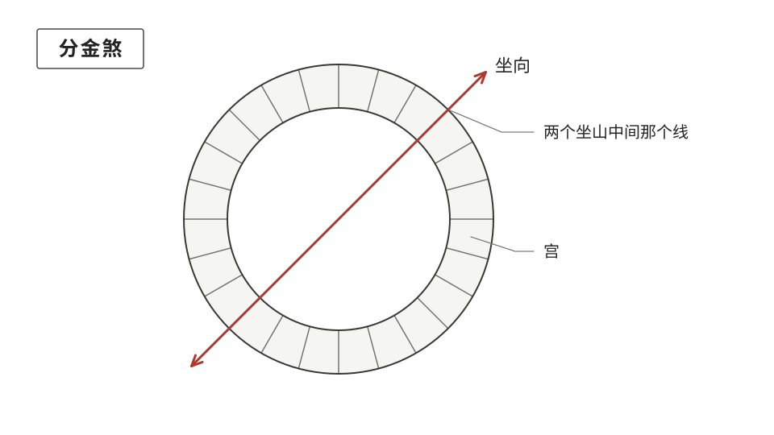 〔板书〕双圈上多了一条斜穿圆心、两端带箭头的橙色线；下方橙色粉笔字可辨「分」「金」，后一字被手臂挡住，前面一字认不出。（[00:17:07](https://www.bilibili.com/video/BV1KJsLekEfA/?p=19&t=1027)，第 30816 帧） |
| **24 个位置每格多少度？分金线上不能做什么？** | 〔口述〕「我们有一个罗盘」，「我们有24个位置对不对」，「24个位置平分360度」，「所以你拿360度来除以24的时候」，「个一个度是22.5度……」。照倪师口说记 22.5 度，不另行计算。（[00:17:10–00:17:22](https://www.bilibili.com/video/BV1KJsLekEfA/?p=19&t=1030)，第 30906–31283 帧） 〔口述〕「千万记得我们有24个位置」，「不能摆盖房子不能盖房子不能立基啊」，「房子不能盖在这个上面」，「这是所谓的分金」。（[00:17:25–00:17:37](https://www.bilibili.com/video/BV1KJsLekEfA/?p=19&t=1045)，第 31350–31733 帧） 〔口述〕「所以两个隔两个金位」，「两个坐山中间那个线不能摆」，「懂不懂我意思」。分金煞的话题到这里还没讲完。（[00:17:37–00:17:42](https://www.bilibili.com/video/BV1KJsLekEfA/?p=19&t=1057)，第 31734–31889 帧） |

**总结区**

- 通用规则：朋友宫巨门化忌是「标准的」，跟朋友合伙一定官司收场（[00:12:43–00:12:54](https://www.bilibili.com/video/BV1KJsLekEfA/?p=19&t=763)，第 22890–23225 帧）；拿罗经先找房屋中心点摆下罗经，找乾的位置即西北角（[00:16:12–00:16:21](https://www.bilibili.com/video/BV1KJsLekEfA/?p=19&t=972)，第 29160–29441 帧）；罗盘 24 个位置，两个坐山中间那条线（分金）上不能盖房子、不能立基、不能摆（[00:17:25–00:17:41](https://www.bilibili.com/video/BV1KJsLekEfA/?p=19&t=1045)，第 31350–31859 帧）
- 只在本例：42-51 大限贪狼桃花星进来，44 岁再婚，人在外地加州（[00:13:10–00:13:43](https://www.bilibili.com/video/BV1KJsLekEfA/?p=19&t=790)，第 23700–24713 帧）；49-51 岁化忌又来冲，52-61 化忌不见太阳，婚姻又没有，积蓄失在朋友合伙上，人财两失（[00:13:47–00:14:43](https://www.bilibili.com/video/BV1KJsLekEfA/?p=19&t=827)，第 24834–26495 帧）；化解：再结婚时主卧房住西北角，脚朝卯辰申酉这些吉星方向（[00:15:22–00:16:11](https://www.bilibili.com/video/BV1KJsLekEfA/?p=19&t=922)，第 27684–29159 帧）
- 不是排盘规则，是处世方法：互相告上法院的都是好朋友，越熟才会合伙，是非纠纷越多（[00:12:54–00:13:09](https://www.bilibili.com/video/BV1KJsLekEfA/?p=19&t=774)，第 23226–23699 帧）；客户来时已发生的事只能批，以后的事才能教她怎么办（[00:14:45–00:14:53](https://www.bilibili.com/video/BV1KJsLekEfA/?p=19&t=885)，第 26568–26819 帧）；别对客户说「尅夫的样子」，要说「旺夫命」并给她鼓励（[00:14:54–00:15:22](https://www.bilibili.com/video/BV1KJsLekEfA/?p=19&t=894)，第 26820–27683 帧）

**待核**

1. [00:12:42](https://www.bilibili.com/video/BV1KJsLekEfA/?p=19&t=762)，第 22884 帧字幕「登上」是乱码，略过。
2. [00:13:10](https://www.bilibili.com/video/BV1KJsLekEfA/?p=19&t=790)，第 23700 帧字幕「那第二次大限4242-51的时候」多出「42」，语音是「四十二到五十一」，按 42-51 理解。
3. [00:13:27](https://www.bilibili.com/video/BV1KJsLekEfA/?p=19&t=807)，第 24222 帧字幕「44 是不是刚好会到天喜星」，语音是「34」，两路对不上。
4. [00:13:30](https://www.bilibili.com/video/BV1KJsLekEfA/?p=19&t=810)，第 24312 帧字幕「不米」是乱码，略过。
5. [00:14:13](https://www.bilibili.com/video/BV1KJsLekEfA/?p=19&t=853)，第 25608 帧字幕与语音都是「40-51」，与前文反复说的「42-51」不一致，原话待核。
6. [00:14:12](https://www.bilibili.com/video/BV1KJsLekEfA/?p=19&t=852)，第 25572 帧「水二局」、[00:14:05](https://www.bilibili.com/video/BV1KJsLekEfA/?p=19&t=845)，第 25362 帧「无大运」「已经是果了」，倪师用了但本块没有解释。
7. [00:14:54](https://www.bilibili.com/video/BV1KJsLekEfA/?p=19&t=894)，第 26820 帧字幕「44岁」，语音是「四十岁」，两路不一致。
8. [00:15:16](https://www.bilibili.com/video/BV1KJsLekEfA/?p=19&t=916)，第 27504 帧「离婚章」语音只听到「就打到你头上」，词义不明。
9. [00:15:57](https://www.bilibili.com/video/BV1KJsLekEfA/?p=19&t=957)，第 28716 帧字幕「佳到西北角」，语音是「坐到」，引文照字幕原字保留，未改字。
10. [00:15:33–00:15:57](https://www.bilibili.com/video/BV1KJsLekEfA/?p=19&t=933)，第 27996–28715 帧：住西北角为什么要看酉宫、辰宫、卯辰申酉，以及这些宫与方位怎么对应，本块没有解释。
11. [00:16:12](https://www.bilibili.com/video/BV1KJsLekEfA/?p=19&t=972)，第 29160 帧「拿罗经有两个动作」，只明说了「第一个」，第二个动作是不是「站在床的正中心看罗经朝哪里」没有点明。
12. [00:16:25](https://www.bilibili.com/video/BV1KJsLekEfA/?p=19&t=985)，第 29574 帧「分金煞」语音作「分金上」，这个词本块没有讲完，下一块接着讲。
13. [00:17:20](https://www.bilibili.com/video/BV1KJsLekEfA/?p=19&t=1040)，第 31206 帧字幕「22.5度（15）」，括号里的「15」是字幕注字，倪师口说「22.5度」，照原话记录，未核算。
14. [00:17:32](https://www.bilibili.com/video/BV1KJsLekEfA/?p=19&t=1052)，第 31566 帧语音多出「床不能摆在这个上面」，字幕里没有这句。
15. 叠图提示字：派活提示说交友辛亥标着「丧夫」，但材料与[00:14:02](https://www.bilibili.com/video/BV1KJsLekEfA/?p=19&t=842)，第 25272 帧原图里交友辛亥只有星曜「丧门」，没有看到「丧夫」提示字（[00:13:56](https://www.bilibili.com/video/BV1KJsLekEfA/?p=19&t=836)，第 25080 帧）。
16. [00:12:42](https://www.bilibili.com/video/BV1KJsLekEfA/?p=19&t=762)，第 22872 帧板书：最右缘一列除「51」「又」「夫」外认不出，左半边被老师挡住的字认不出。
17. [00:14:02](https://www.bilibili.com/video/BV1KJsLekEfA/?p=19&t=842)，第 25272 帧板书：刚写的约 2 秒内容被叠图和身体挡住，认不出。
18. [00:17:07](https://www.bilibili.com/video/BV1KJsLekEfA/?p=19&t=1027)，第 30816 帧板书：「分」「金」之外的橙色字认不出。
19. [00:13:13](https://www.bilibili.com/video/BV1KJsLekEfA/?p=19&t=793)，第 23802 帧指代（手落在「44 再婚」一带）、[00:13:33](https://www.bilibili.com/video/BV1KJsLekEfA/?p=19&t=813)，第 24400 帧指代、[00:13:46](https://www.bilibili.com/video/BV1KJsLekEfA/?p=19&t=826)，第 24788 帧指代、[00:14:04](https://www.bilibili.com/video/BV1KJsLekEfA/?p=19&t=844)，第 25348 帧指代、[00:14:38](https://www.bilibili.com/video/BV1KJsLekEfA/?p=19&t=878)，第 26362 帧指代、[00:15:34](https://www.bilibili.com/video/BV1KJsLekEfA/?p=19&t=934)，第 28049 帧指代、[00:16:01](https://www.bilibili.com/video/BV1KJsLekEfA/?p=19&t=961)，第 28851 帧指代、[00:16:55](https://www.bilibili.com/video/BV1KJsLekEfA/?p=19&t=1015)，第 30476 帧指代：都不确定或看不出，没有用作依据。

### 4　分金煞凶宅、承浆与例一事业（[00:17:43–00:22:45](https://www.bilibili.com/video/BV1KJsLekEfA/?p=19&t=1063)，第 31890–40961 帧）

| 提示区 | 笔记区 |
|---|---|
| **罗盘测到红线总落在分金上，是什么情形？** | 〔推断〕推断：本块开头接着前文讲罗经与坐山（前文说两个坐山中间那条线不能摆），这里讲的是拿罗盘实测时，线正好落在分金上的情形。（[00:17:43](https://www.bilibili.com/video/BV1KJsLekEfA/?p=19&t=1063)，第 31890–31913 帧） 〔口述〕倪师说拿罗盘去测，红线怎么转都转不开，一直对着同一处，就是线落在分金上：「所以你拿罗盘去测……一直怎么转转都转不开」「刚好线在这个分金上面」。（[00:17:43–00:17:50](https://www.bilibili.com/video/BV1KJsLekEfA/?p=19&t=1063)，第 31890–32105 帧） 〔口述〕他边比划黑板边连说几遍：「像这个也叫分金」「刚好在这个线上面」「这个也叫分金」。说「这个」时手指黑板左侧，具体指哪一处看不清（见待核）。（[00:17:50–00:17:55](https://www.bilibili.com/video/BV1KJsLekEfA/?p=19&t=1070)，第 32106–32267 帧） 〔板书〕本块开头的板面是命盘格子，可辨「自宅」「父母」等字，左侧大半被倪师身体挡住，其余认不出。（[00:17:50](https://www.bilibili.com/video/BV1KJsLekEfA/?p=19&t=1070)，第 32124 帧） |
| **床或房子落在分金上，会怎样？** | 〔口述〕倪师说分金上「绝对不能坐在这个上面」；「如果你把床摆在分金上面」「或者房子坐在上面」，就不必再看别的：「不不不需要去看他什么西北角东宫」「那都不需要看了」。（[00:17:56–00:18:07](https://www.bilibili.com/video/BV1KJsLekEfA/?p=19&t=1076)，第 32298–32615 帧） 〔口述〕他自问自答分金为什么凶：「为什么分金上面主凶啊」「家里面会绝代不好」（「绝代」语音转写作觉得，见待核）。（[00:18:07–00:18:12](https://www.bilibili.com/video/BV1KJsLekEfA/?p=19&t=1087)，第 32616–32765 帧） 〔口述〕睡在分金上的人会从床上掉下来，早上醒来发现自己在床下面：「人睡在床上都会从床上掉下来」「分金上坐不了人的」「人坐上去很难过」「你就会想转个位置」。（[00:18:12–00:18:24](https://www.bilibili.com/video/BV1KJsLekEfA/?p=19&t=1092)，第 32766–33131 帧） |
| **怎么自己试出朝哪个方向坐最舒服？** | 〔口述〕倪师教大家试：坐在会转的圆椅上，每个方位面对着坐 5 分钟，有的方向气血浮躁，有的方向凉快舒服，就找到自己的位置。原话「你拿一个那个圆形的会转的椅子」「你面对面坐5分钟」「你就会找到你自己的位置」。（[00:18:24–00:18:39](https://www.bilibili.com/video/BV1KJsLekEfA/?p=19&t=1104)，第 33132–33575 帧） 〔口述〕他说在八字上也能看出这个位置：「那我们在八字上面」「就可以看到你的位置在哪里」「把你排到那个正科位」，朝着这些位置是舒服的（「正科位」本块未解释，见待核）。（[00:18:39–00:18:47](https://www.bilibili.com/video/BV1KJsLekEfA/?p=19&t=1119)，第 33576–33833 帧） |
| **倪师举的「杀人无形」凶宅是怎么摆的？** | 〔推断〕推断：这一段是倪师擦板后在黑板上画的一间凶宅，用来说明中央厕所、厨在乾、床在分金合起来的害处，并引出他怎么「破案」，是举来说明的反面例子，不是教人照做。（[00:18:47–00:19:36](https://www.bilibili.com/video/BV1KJsLekEfA/?p=19&t=1127)，第 33834–35309 帧） 〔口述〕第一步把厕所放在房子正中：「如果我们要陷害一个人」「房子的中央中央是厕所」「诸位知道中央厕所是主闷」「主心脏病是不是OK」。（[00:18:50–00:19:06](https://www.bilibili.com/video/BV1KJsLekEfA/?p=19&t=1130)，第 33906–34385 帧） 〔口述〕第二步把厨房放在乾位：「厨房在乾好狠呐」「这个厨房啊厨在乾位」「诸位厨的象是刀象」「先生杀先生」，又说先生不管睡哪个房间，「厨房是不是还是在西北角」。（[00:19:06–00:19:29](https://www.bilibili.com/video/BV1KJsLekEfA/?p=19&t=1146)，第 34386–35075 帧） 〔口述〕第三步把先生的床摆在分金上，结果是夜里做噩梦摔下床，吓到心脏病发作：「然后把他的床摆在分金上面」「突然从床上一摔下来」「一吓心脏病发作死掉」。（[00:19:29–00:19:36](https://www.bilibili.com/video/BV1KJsLekEfA/?p=19&t=1169)，第 35076–35309 帧） 〔板书〕黑板最左侧有红色粉笔竖写的字，可辨「在」「中」「央」，第一字像「厕」但不确定，其余被手和身体挡住，认不出。（[00:19:16](https://www.bilibili.com/video/BV1KJsLekEfA/?p=19&t=1156)，第 34704 帧） |
| **遇到这种凶宅命案，倪师怎么去「破案」？** | 〔口述〕倪师说这一整套前面讲过了，若由他去破案，就去看床是不是摆在分金上、是谁摆的：「所以整套的」「我讲过了」「所以如果我去破案」「去看看你是不是分金谁摆的」。（[00:19:37–00:19:46](https://www.bilibili.com/video/BV1KJsLekEfA/?p=19&t=1177)，第 35310–35597 帧） 〔口述〕再追问床为什么不靠墙，顺藤摸瓜找到当年的风水师：「把这床为什么不靠墙离开一点点」「太太就说当年有个风水师啊来看」「我们就可以找到」。（[00:19:46–00:19:55](https://www.bilibili.com/video/BV1KJsLekEfA/?p=19&t=1186)，第 35598–35867 帧） 〔口述〕他把这种做法叫「杀人无形」：「那这种这种杀人无形嘛怎么查啊」，意思是靠看分金这类细节才查得出来。（[00:19:55–00:19:59](https://www.bilibili.com/video/BV1KJsLekEfA/?p=19&t=1195)，第 35868–35975 帧） |
| **佛罗里达龙卷风 ABC 三户，说明了什么？** | 〔口述〕倪师先引一句「人呐积善之家必有余庆啊」，再讲佛罗里达的事：「那在佛罗里达就发生一件事情」「ABC三户」「龙卷风来了」。（[00:19:59–00:20:13](https://www.bilibili.com/video/BV1KJsLekEfA/?p=19&t=1199)，第 35976–36413 帧） 〔板书〕黑板左侧写着 A、B、C 三个字母，每个字母下面画一个圆圈，代表三户人家。（[00:20:11](https://www.bilibili.com/video/BV1KJsLekEfA/?p=19&t=1211)，第 36336 帧） 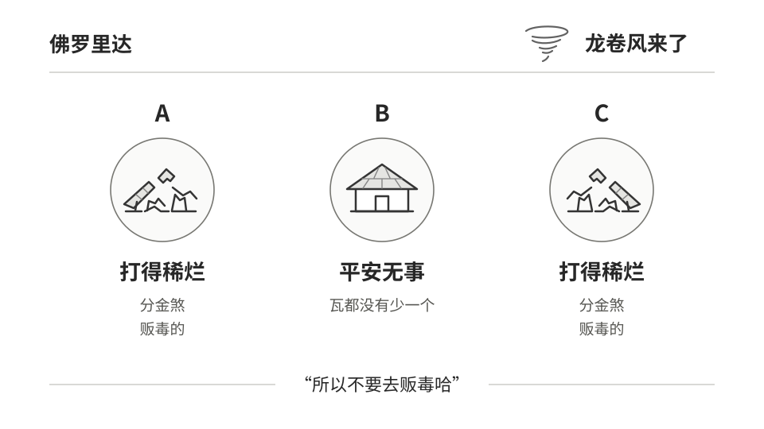 〔口述〕龙卷风把 A、C 两户打烂，B 户毫发无损：「砰砰把AC打掉B平安无事啊」「B啊那个瓦都没有少一个」「然后A户C户房子被龙卷风打得稀烂」。（[00:20:13–00:20:24](https://www.bilibili.com/video/BV1KJsLekEfA/?p=19&t=1213)，第 36414–36743 帧） 〔口述〕他弟弟拿罗经进去看，被打掉的两户是分金煞，警察说这两家是毒贩：「结果我弟弟拿着罗经」「进去一看这两个是分金煞」「这两家啊……贩毒的」「那住在分金煞被龙卷风打掉」。（[00:20:24–00:20:41](https://www.bilibili.com/video/BV1KJsLekEfA/?p=19&t=1224)，第 36744–37241 帧） 〔口述〕倪师归结为报应，并劝人不要贩毒：「因为报应的哈」「所以不要去贩毒哈」「我们这里没有啊不会贩毒」。（[00:20:41–00:20:46](https://www.bilibili.com/video/BV1KJsLekEfA/?p=19&t=1241)，第 37242–37409 帧） |
| **怎么一看就知道人吃坏东西或吸毒？** | 〔口述〕倪师说看吸毒不用验尿，看承浆就晓得：「不要验尿了验尿太慢了」「我们有个承浆有没有」「你吃坏肚子的吃到食物中毒或者吸毒」「承浆下来这边黑黑的青青的这里」。（[00:20:49–00:21:02](https://www.bilibili.com/video/BV1KJsLekEfA/?p=19&t=1249)，第 37488–37865 帧） 〔指代〕说「承浆下来这边黑黑的青青的这里」的「这里」时，倪师食指竖着点在自己下巴、嘴的下方。（[00:20:59](https://www.bilibili.com/video/BV1KJsLekEfA/?p=19&t=1259)，第 37784 帧） 〔口述〕他解释名字由来：「为什么叫承浆」「就承受了你的喝的浆雾嘛」「承浆有没有」「豆浆的浆了」。（[00:21:06–00:21:20](https://www.bilibili.com/video/BV1KJsLekEfA/?p=19&t=1266)，第 37998–38417 帧） 〔板书〕黑板左侧写着「承浆」二字（「浆」字上下分开写），上方 ABC 三圈处可辨 B、C 与圆圈，另加了一道弧线；其余认不出。（[00:21:15](https://www.bilibili.com/video/BV1KJsLekEfA/?p=19&t=1275)，第 38256 帧） 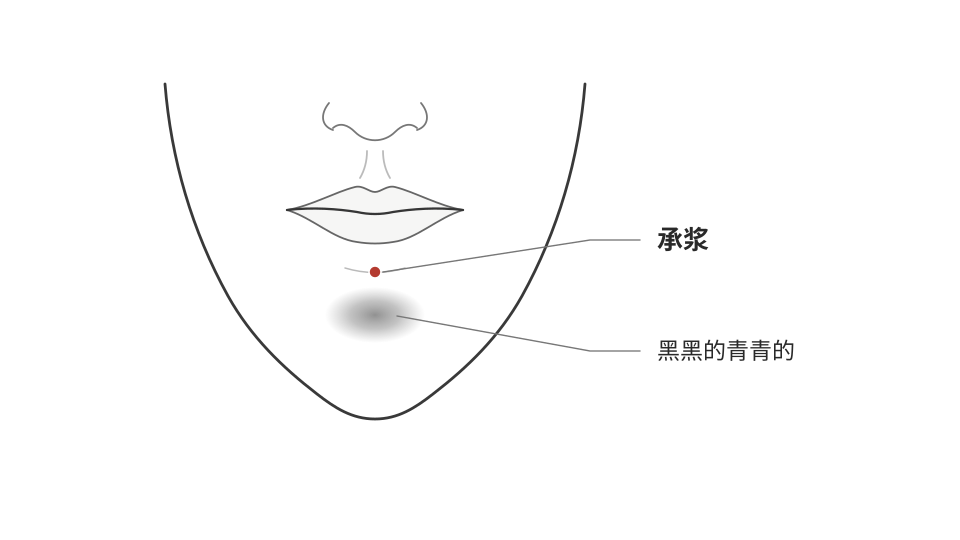 |
| **例一批事业：22-31 这十年为什么顺？** | 〔口述〕倪师回到 1957 年生的女命批事业：「那像这批事业的话」「像这个人如果我们批事业」「你看哦注意看 22-31」「他的南北斗星君来会贵人很多」「所以工作很顺利」。（[00:21:22–00:21:33](https://www.bilibili.com/video/BV1KJsLekEfA/?p=19&t=1282)，第 38466–38807 帧） 〔叠图〕叠图贴出福德戊申：紫微旺、天府得、长生、青龙、亡神、封诰、病符；大限 22~31。（[00:21:26–00:21:28](https://www.bilibili.com/video/BV1KJsLekEfA/?p=19&t=1286)，第 38580–38651 帧） |
| **32-41 化禄，为什么她一定会自己当老板？** | 〔口述〕倪师说 32 岁起这十年化禄，对面是化权：「32岁开始32-41十年化禄」「对面是化权」「所以这个小姐一定在32岁以后」「自己做事业当老板」。（[00:21:33–00:21:43](https://www.bilibili.com/video/BV1KJsLekEfA/?p=19&t=1293)，第 38808–39095 帧） 〔口述〕他强调大限能改变先天：「比如说她的先天的命上面」「她不会做生意当老板」「那是她先天的命啊」「可是她在32-41 她一定会去做」。（[00:21:44–00:21:55](https://www.bilibili.com/video/BV1KJsLekEfA/?p=19&t=1304)，第 39144–39455 帧） 〔叠图〕叠图同时贴出田宅己酉：太阴旺化禄、天钺庙、火星得、天哭、将星、小耗、岁建、沐浴，大限 32~41；子女癸卯：天同平化权、天寿陷、天才旺、天虚庙、截空平、大耗、岁破、死、灾煞。（[00:21:38–00:21:40](https://www.bilibili.com/video/BV1KJsLekEfA/?p=19&t=1298)，第 38940–39029 帧） 〔推断〕推断：口述「十年化禄」「对面是化权」与叠图田宅己酉（太阴化禄、大限 32~41）、子女癸卯（天同化权）对得上；倪师本块口头没有点出这两个宫名。（[00:21:33–00:21:40](https://www.bilibili.com/video/BV1KJsLekEfA/?p=19&t=1293)，第 38808–39029 帧） |
| **42-51 为何做得好，51 岁后为何一败涂地？** | 〔口述〕倪师说 42-51 做得很好，原因是贪狼星是横财星：「做的很好 42-51 做的很好」「为什么贪狼星是横财星呐」。（[00:21:55–00:21:59](https://www.bilibili.com/video/BV1KJsLekEfA/?p=19&t=1315)，第 39456–39575 帧） 〔叠图〕叠图贴出官禄庚戌：贪狼庙、文曲陷、天空陷、八座平、天月、将军、攀鞍、晦气、冠带，大限 42~51。（[00:21:55–00:21:56](https://www.bilibili.com/video/BV1KJsLekEfA/?p=19&t=1315)，第 39456–39509 帧） 〔口述〕51 岁丈夫去世，钱又被朋友倒光，此后一败涂地，所以财运只走 20 年：「然后等到51岁先生一死的话」「钱又朋友倒光光」「后面一败涂地呀」「所以她的财运只走20年」。（[00:21:59–00:22:06](https://www.bilibili.com/video/BV1KJsLekEfA/?p=19&t=1319)，第 39576–39785 帧） 〔叠图〕叠图贴出兄弟乙巳：太阳旺、地劫不、地空庙、陀罗陷、天厨、恩光平、旬空庙、破碎陷、官符、白虎、绝，叠图该格标着「又丧夫」；随后贴交友辛亥：巨门旺化忌、天马平、天魁旺、天姚陷、天伤旺、天福庙、天贵平、孤辰陷。（[00:21:59–00:22:02](https://www.bilibili.com/video/BV1KJsLekEfA/?p=19&t=1319)，第 39576–39665 帧） |
| **她 51 岁才来算命、讲中 33 岁，说明什么？** | 〔口述〕倪师说若她 51 岁才来算命，那是没福气；若早来，改一下这十年就不见了：「如果她51岁来找我们算命」「那这个没有没有福气嘛」「那现在找我们算命小姐」「改一下这十年就不见了」。（[00:22:08–00:22:21](https://www.bilibili.com/video/BV1KJsLekEfA/?p=19&t=1328)，第 39858–40235 帧） 〔口述〕他借此说所学的价值：「所以诸位你们学到的东西」「是钱不能解决的」「你永远没有办法证明我是错的」「要付出很大的代价」。（[00:22:21–00:22:32](https://www.bilibili.com/video/BV1KJsLekEfA/?p=19&t=1341)，第 40236–40565 帧） 〔口述〕讲到她 33 岁时母女都吓到：「我们讲到33岁这个时候」「把她吓的哦哇」「她妈妈和她两个脸色都变了」。33 岁具体是什么事本块没有说。（[00:22:32–00:22:38](https://www.bilibili.com/video/BV1KJsLekEfA/?p=19&t=1352)，第 40566–40769 帧） 〔口述〕倪师说断得准是靠盘上的资料，不是通灵：「讲穿了我就是根据这些资料」「我又不是什么通灵的胡说八道」「这上面都有这个资料」。（[00:22:39–00:22:45](https://www.bilibili.com/video/BV1KJsLekEfA/?p=19&t=1359)，第 40770–40961 帧） |

**总结区**

- 通用规则：两个坐山中间的分金线上不能摆床、不能盖房子；床或房子落在分金上主凶，西北角等其他都不必再看（[00:17:56–00:18:12](https://www.bilibili.com/video/BV1KJsLekEfA/?p=19&t=1076)，第 32298–32765 帧）；分金上坐不了人，睡在分金上的人会从床上掉下来、早上醒在床下（[00:18:12–00:18:24](https://www.bilibili.com/video/BV1KJsLekEfA/?p=19&t=1092)，第 32766–33131 帧）；承浆一带发黑发青，可看出吃坏肚子、食物中毒或吸毒（[00:20:49–00:21:02](https://www.bilibili.com/video/BV1KJsLekEfA/?p=19&t=1249)，第 37488–37865 帧）
- 只在本例：例一女命 22-31 南北斗星君来会，贵人多、工作顺利（[00:21:26–00:21:33](https://www.bilibili.com/video/BV1KJsLekEfA/?p=19&t=1286)，第 38580–38807 帧）；例一女命 32-41 十年化禄、对面化权，先天不会做生意，这十年一定自己当老板（[00:21:33–00:21:55](https://www.bilibili.com/video/BV1KJsLekEfA/?p=19&t=1293)，第 38808–39455 帧）；例一女命 42-51 贪狼横财做得好，51 岁丈夫去世、钱被朋友倒光，财运只走 20 年（[00:21:55–00:22:06](https://www.bilibili.com/video/BV1KJsLekEfA/?p=19&t=1315)，第 39456–39785 帧）；倪师讲到例一女命 33 岁的事，母女两人脸色都变了（[00:22:32–00:22:38](https://www.bilibili.com/video/BV1KJsLekEfA/?p=19&t=1352)，第 40566–40769 帧）
- 不是排盘规则，是处世方法：坐在转椅上每个方位面对 5 分钟，找出自己觉得凉快舒服的方向（[00:18:24–00:18:39](https://www.bilibili.com/video/BV1KJsLekEfA/?p=19&t=1104)，第 33132–33575 帧）；积善之家必有余庆，住分金煞的毒贩两户被龙卷风打掉，倪师归为报应，劝人不要贩毒（[00:19:59–00:20:46](https://www.bilibili.com/video/BV1KJsLekEfA/?p=19&t=1199)，第 35976–37409 帧）；断事靠盘上的资料，不是通灵胡说（[00:22:39–00:22:45](https://www.bilibili.com/video/BV1KJsLekEfA/?p=19&t=1359)，第 40770–40961 帧）

**待核**

1. 第 32079、32107、32231 帧：倪师说「这个也叫分金」等处时手指黑板左侧，指代标注为不确定或看不出，所指位置未用作依据。
2. [00:18:04](https://www.bilibili.com/video/BV1KJsLekEfA/?p=19&t=1084)，第 32520 帧：字幕「什么西北角东宫」，语音作「东方」，两路不一致，「东宫」是否为「东方」待核。
3. [00:18:09](https://www.bilibili.com/video/BV1KJsLekEfA/?p=19&t=1089)，第 32688 帧：字幕「家里面会绝代不好」，语音作「会觉得不好」，原话待核。
4. [00:18:41](https://www.bilibili.com/video/BV1KJsLekEfA/?p=19&t=1121)，第 33654 帧：「把你排到那个正科位」，「正科位」本块未解释，字形是否正确待核。
5. [00:18:32–00:18:37](https://www.bilibili.com/video/BV1KJsLekEfA/?p=19&t=1112)，第 33360–33533 帧：「面对这里」两处（[00:18:34](https://www.bilibili.com/video/BV1KJsLekEfA/?p=19&t=1114)，第 33432 帧指代标注为否），只当口头描述方向，不当指代。
6. [00:19:44](https://www.bilibili.com/video/BV1KJsLekEfA/?p=19&t=1184)，第 35532 帧：字幕「去看看你是不是分金谁摆的」，语音作「分晶这失败了」，两路对不上，原话待核。
7. [00:19:51](https://www.bilibili.com/video/BV1KJsLekEfA/?p=19&t=1191)，第 35742 帧：字幕「我说叫什么名字有没有懂不懂」识别可信度低（0.38），语音不同，原话待核。
8. [00:20:02](https://www.bilibili.com/video/BV1KJsLekEfA/?p=19&t=1202)，第 36084 帧：语音还多出「击饿之家必有余瘾」一句，字幕没有，未收入笔记。
9. [00:20:41](https://www.bilibili.com/video/BV1KJsLekEfA/?p=19&t=1241)，第 37242 帧：字幕「因为报应的哈」，语音作「没有报应」，两路不一致，待核。
10. [00:21:02](https://www.bilibili.com/video/BV1KJsLekEfA/?p=19&t=1262)，第 37866 帧：字幕「可可刀拉伸那个点有没有」意思不明，语音作「扣克刀拉是那个点」，原话待核。
11. [00:21:08](https://www.bilibili.com/video/BV1KJsLekEfA/?p=19&t=1268)，第 38058 帧：字幕「浆雾」，语音作「浆物」，哪个是原话待核。
12. [00:21:28](https://www.bilibili.com/video/BV1KJsLekEfA/?p=19&t=1288)，第 38652 帧：「南北斗星君来会」具体指哪几颗星，本块没有说明；叠图福德戊申同时有紫微、天府，未作对应。
13. [00:21:57](https://www.bilibili.com/video/BV1KJsLekEfA/?p=19&t=1317)，第 39510 帧：字幕「为什么贪狼星是横财星呐」，语音作「她当时一个横财心啊」，只有「横财」两路一致。
14. [00:22:18](https://www.bilibili.com/video/BV1KJsLekEfA/?p=19&t=1338)，第 40146 帧：「改一下这十年就不见了」的意思本块没有展开，是指改阳宅还是别的做法待核。
15. [00:22:33](https://www.bilibili.com/video/BV1KJsLekEfA/?p=19&t=1353)，第 40592 帧：说「我们讲到33岁这个时候」时手指的格子被手和水印挡住，指代不确定；33 岁的事本块未说。
16. [00:19:16](https://www.bilibili.com/video/BV1KJsLekEfA/?p=19&t=1156)，第 34704 帧：左侧红色竖写板书只认出「在」「中」「央」，第一字像「厕」不确定；[00:17:50](https://www.bilibili.com/video/BV1KJsLekEfA/?p=19&t=1070)，第 32124 帧板面只认出「自宅」「父母」。
17. 第 38580、38940、39456、39576、39642 帧：叠图各格的小限数字串未还原，只取大限；兄弟乙巳、交友辛亥两格的大限数字串还原不了，未写。
18. [00:18:04](https://www.bilibili.com/video/BV1KJsLekEfA/?p=19&t=1084)，第 32520 帧：「东宫」带括号的注字形式在别处出现过，此处字幕无括号，按原样收录，仍待核。

## 例二（男命，命宫甲辰紫微天相）：身在财帛、子星、住西北大壮

| 巳 | 午 | 未 | 申 |
|---|---|---|---|
| **父母 乙巳** 天梁陷禄 天钺旺 | **福德 丙午** 七杀旺 | （未：没贴过） | **官禄 戊申** 廉贞庙 天马旺 |
| **命宫 甲辰** 紫微陷权 天相旺 左辅庙科 | **例二 · 命宫甲辰** | 据视频叠图重排 | （酉：没贴过） |
| **兄弟（宫序推） 癸卯** 天机旺 巨门庙 天魁庙 | 后期贴图，不算倪师的话 |  | **迁移（宫序推） 庚戌** 破军旺 右弼庙 陀罗庙 |
| **夫妻 壬寅** 贪狼平 文曲平 | **子女 癸丑** 太阳陷 太阴庙 铃星陷 地空陷 | **财帛 壬子**（身宫） 武曲旺忌 天府庙 文昌旺 擎羊陷 | （亥：没贴过） |

按视频里这张盘逐格重画（我们自己画的图，不是视频截图）；同一个人的 2 段合成一张；标「宫序推」的格（申、卯、戌），视频里只以别的宫名演示贴过，宫名按宫序推出；数据见 [命盘-P19-例二.json](图/命盘-P19-例二.json)。

### 5　例二身在财帛、科权入命与子女星数（[00:22:45–00:28:34](https://www.bilibili.com/video/BV1KJsLekEfA/?p=19&t=1365)，第 40962–51449 帧）

| 提示区 | 笔记区 |
|---|---|
| **例二是哪张盘？开讲先拿出什么资料？** | 〔口述〕换一张新命盘，字幕擦板写「民国51年（1962）」；接着说「阳宅部分拿出来」，先把这个人的阳宅资料拿出来讲。（[00:22:49–00:22:58](https://www.bilibili.com/video/BV1KJsLekEfA/?p=19&t=1369)，第 41076–41345 帧） 〔板书〕本块开头的板面被倪师身体挡住大半，粉笔字认不出。（[00:22:50](https://www.bilibili.com/video/BV1KJsLekEfA/?p=19&t=1370)，第 41100 帧） 〔板书〕黑板最右一栏顶上写「陽宅」二字；左边是已画好的命盘格。（[00:22:57](https://www.bilibili.com/video/BV1KJsLekEfA/?p=19&t=1377)，第 41328 帧） 〔板书〕命盘中间空白处写「51. 男」；上排格可辨「16-25」「父母」「26-35」「福德」「36-45」「田宅」。（[00:23:54](https://www.bilibili.com/video/BV1KJsLekEfA/?p=19&t=1434)，第 43032 帧） |
| **他家阳宅怎么画？厨房、父母、厕所、他住哪？** | 〔口述〕在黑板上画他家阳宅：「东南西北」，「厨房在这里」，「父母在这里」。（[00:23:02–00:23:24](https://www.bilibili.com/video/BV1KJsLekEfA/?p=19&t=1382)，第 41460–42131 帧） 〔口述〕「打叉的地方是厕所」「这厕所不是很重要」；然后指出「他是他住在这个位置上」，说「这样就可以了」「这个资料就够了」「就够多了」。（[00:23:24–00:23:48](https://www.bilibili.com/video/BV1KJsLekEfA/?p=19&t=1404)，第 42132–42857 帧） 〔板书〕「陽宅」下方画一个大方框，上标「S」、左标「E」、右标「W」、下标「N」；框内右上有打叉的小格，旁边一格写「厨」，其下一格写「父母」（第一字潦草），再下又一个打叉小格；底排三格写「三子」「次子」「长子」。（[00:23:22](https://www.bilibili.com/video/BV1KJsLekEfA/?p=19&t=1402)，第 42072 帧） 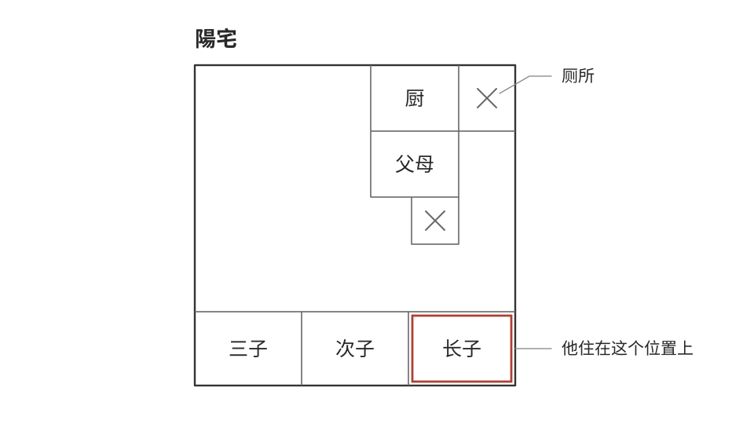 〔板书〕说「他住在这个位置上」之后，底排最右的「长子」那一格被橙色粉笔框了出来。（[00:23:32](https://www.bilibili.com/video/BV1KJsLekEfA/?p=19&t=1412)，第 42360 帧） 〔推断〕推断：按板上方位标（上 S、下 N、左 E、右 W），橙框的「长子」格位于靠 N、靠 W 的那一角；倪师在本块还没讲这个方位的意义。（[00:23:32](https://www.bilibili.com/video/BV1KJsLekEfA/?p=19&t=1412)，第 42360 帧） |
| **倪师说算命是「指点迷津」，迷津在哪里？** | 〔口述〕「诸位看这个命啊」「我们在帮人家算的时候要要记得哈」「我们这叫做指点迷津」。（[00:23:55–00:24:03](https://www.bilibili.com/video/BV1KJsLekEfA/?p=19&t=1435)，第 43062–43313 帧） 〔口述〕「算命这个迷津很多人误解掉了」「实际上就是我跟诸位强调」「一念之间」。（[00:24:03–00:24:11](https://www.bilibili.com/video/BV1KJsLekEfA/?p=19&t=1443)，第 43314–43559 帧） 〔板书〕命盘左边盘外空白处竖写「迷」「津」两字，上方还有一字只露出下半，认不全。（[00:24:10](https://www.bilibili.com/video/BV1KJsLekEfA/?p=19&t=1450)，第 43500 帧） |
| **为什么说算命要早算？** | 〔口述〕「一念之间所以我们算命要早算」。（[00:24:12–00:24:14](https://www.bilibili.com/video/BV1KJsLekEfA/?p=19&t=1452)，第 43560–43631 帧） 〔口述〕劝在座的：「所以诸位小孩子如果拿出来」「有空啊你把小孩拍照（排好？）」「跟你研究没有关系」——小孩的命有空就排出来。（[00:24:14–00:24:19](https://www.bilibili.com/video/BV1KJsLekEfA/?p=19&t=1454)，第 43632–43793 帧） 〔口述〕「要早算差很多」「差很多为什么」，接着就拿这张盘来说明。（[00:24:19–00:24:23](https://www.bilibili.com/video/BV1KJsLekEfA/?p=19&t=1459)，第 43794–43901 帧） |
| **身宫在财帛、在官禄，各代表走什么路？** | 〔叠图〕财帛 壬子（叠图宫名印成「王子」）：武曲旺、化忌，天府庙，文昌旺，擎羊陷，八座陷，封诰，力士、吊客、灾煞、胎；格里标「身宫」；大限 86~95。（[00:24:23–00:24:26](https://www.bilibili.com/video/BV1KJsLekEfA/?p=19&t=1463)，第 43902–43991 帧） 〔口述〕「你看这个人身在财帛」；「身宫就是后天的发展」；「身宫如果在财帛的时候」「代表说他会在私人企业」「或者是自己去做事业」。（[00:24:23–00:24:37](https://www.bilibili.com/video/BV1KJsLekEfA/?p=19&t=1463)，第 43902–44327 帧） 〔口述〕「可是他自己去做的时候」「化忌看到没有」——指出他财帛这格带化忌。（[00:24:37–00:24:40](https://www.bilibili.com/video/BV1KJsLekEfA/?p=19&t=1477)，第 44328–44417 帧） 〔口述〕对照讲：「有的人身宫在官禄宫」「他一定会去当官的」「都会当官」。（[00:24:40–00:24:46](https://www.bilibili.com/video/BV1KJsLekEfA/?p=19&t=1480)，第 44418–44591 帧） 〔叠图〕官禄 戊申：廉贞庙，天马旺，天虚庙，凤阁闲，年解闲，解神闲，大耗、岁破、岁驿、病；大限 46~55；这一版格里也标着「身宫」。（[00:24:40–00:24:42](https://www.bilibili.com/video/BV1KJsLekEfA/?p=19&t=1480)，第 44418–44471 帧） |
| **命宫科权入命，主读书和个性怎样？** | 〔叠图〕命宫 甲辰：紫微陷、化权，天相旺，左辅庙、化科，台辅，天哭平，旬空陷，丧门、冠带、奏书、月煞；大限 6~15。（[00:24:47–00:24:49](https://www.bilibili.com/video/BV1KJsLekEfA/?p=19&t=1487)，第 44622–44675 帧） 〔口述〕「那这个人的命」「本命很好科权会命」「科权入命有没有」；「命中带科的人」「先天他读书就读的很好」。（[00:24:46–00:24:54](https://www.bilibili.com/video/BV1KJsLekEfA/?p=19&t=1486)，第 44592–44831 帧） 〔口述〕「后天呢他又是化权有没有」「现在科权都有」「他的个性很强主见很强」「一般来说这种人呢」「都会这个掌权的掌权做主管」。（[00:24:54–00:25:06](https://www.bilibili.com/video/BV1KJsLekEfA/?p=19&t=1494)，第 44832–45185 帧） 〔口述〕「那由于科坐命的话」「他在他考试过程当中考试都没有问题」。（[00:25:06–00:25:10](https://www.bilibili.com/video/BV1KJsLekEfA/?p=19&t=1506)，第 45186–45323 帧） 〔板书〕命盘左列一格可辨「紫微」（后一字像「权」）、「天相」、「左辅」、「命」和「6-15」，旁边有红色圈；圈里的字认不出。（[00:23:54](https://www.bilibili.com/video/BV1KJsLekEfA/?p=19&t=1434)，第 43032 帧） |
| **财帛宫若是禄不是忌，倪师会怎么建议？** | 〔叠图〕这一版财帛 壬子把武曲改印成「武曲旺禄」，其余同前（天府庙、文昌旺、擎羊陷、身宫）；前后两版都是武曲旺忌，这一版是配合假设演示。（[00:25:12–00:25:19](https://www.bilibili.com/video/BV1KJsLekEfA/?p=19&t=1512)，第 45360–45570 帧） 〔口述〕假设：「但如果他这个财宗宫」「没有忌而是禄的话我们当然说」「哎你可以专心让他考个执照啊」「或者怎么样」。（[00:25:10–00:25:16](https://www.bilibili.com/video/BV1KJsLekEfA/?p=19&t=1510)，第 45324–45509 帧） 〔口述〕举例：「像医师律师会计师工程师建筑师」「很多都这种八字的人」。（[00:25:17–00:25:20](https://www.bilibili.com/video/BV1KJsLekEfA/?p=19&t=1517)，第 45510–45617 帧） |
| **16-25 父母宫化禄，说明什么？** | 〔叠图〕父母 乙巳：天梁陷、化禄，天钺旺，天巫，副旬庙，孤辰陷，临官、亡神、贯索、飞廉；大限 16~25。（[00:25:21–00:25:23](https://www.bilibili.com/video/BV1KJsLekEfA/?p=19&t=1521)，第 45654–45719 帧） 〔口述〕「可是结果他的禄啊」「在16-25父母亲化禄」「代表说第一个16-25」「他财星出的太早」。（[00:25:20–00:25:27](https://www.bilibili.com/video/BV1KJsLekEfA/?p=19&t=1520)，第 45618–45821 帧） 〔口述〕「代表父母亲祖上有祖业给他」「祖上有产业」。（[00:25:27–00:25:31](https://www.bilibili.com/video/BV1KJsLekEfA/?p=19&t=1527)，第 45822–45947 帧） 〔板书〕命盘上排一格可辨「天钺」「16-25」「父母」。（[00:23:54](https://www.bilibili.com/video/BV1KJsLekEfA/?p=19&t=1434)，第 43032 帧） |
| **后面化忌不带禄，该走公家还是私人企业？** | 〔口述〕「第二个他36（26）岁以后他本身就化忌」「他本身后面不带禄」。（[00:25:31–00:25:37](https://www.bilibili.com/video/BV1KJsLekEfA/?p=19&t=1531)，第 45948–46115 帧） 〔叠图〕福德 丙午：七杀旺，天才旺，天福平，龙池闲，喜神、官符、将星、帝旺；大限 26~35；叠图该格标着「对宫化忌对冲」。随后再贴财帛 壬子（武曲旺忌、身宫）与官禄 戊申（这一版没有身宫）。（[00:25:31–00:25:40](https://www.bilibili.com/video/BV1KJsLekEfA/?p=19&t=1531)，第 45948–46205 帧） 〔口述〕「那他如果走官走公家单位」「会不会比走私人单位来的好」；「像这种我们跟他说」「先生你去考公家单位」「不要不要留恋在私人企业里面做事情」。（[00:25:37–00:25:49](https://www.bilibili.com/video/BV1KJsLekEfA/?p=19&t=1537)，第 46116–46475 帧） 〔口述〕「吃他头路（台语当员工）的命」「肯定是这样子的」；「这个就是帮人家做领固定的薪水的命」。（[00:25:49–00:25:58](https://www.bilibili.com/video/BV1KJsLekEfA/?p=19&t=1549)，第 46476–46751 帧） 〔口述〕「那如果他去帮人家做领固定薪水」「走官会比财美」；「财就是指」「私人企业私人公司行号来做」。（[00:25:58–00:26:10](https://www.bilibili.com/video/BV1KJsLekEfA/?p=19&t=1558)，第 46752–47129 帧） |
| **子女宫怎么看儿子？紫微天相、天机巨门各几个？** | 〔口述〕「像这个子女宫我们一个个看」「子女宫太阳一个阳星呐」「哪几颗星代表的是儿子的星」。（[00:26:11–00:26:24](https://www.bilibili.com/video/BV1KJsLekEfA/?p=19&t=1571)，第 47130–47525 帧） 〔指代〕说「像这个子女宫」时，手指的是黑板右下写「太阴」的那一格（下半部，指尖处字被挡），黑板这格没写宫名。（[00:26:11](https://www.bilibili.com/video/BV1KJsLekEfA/?p=19&t=1571)，第 47136 帧） 〔口述〕「像紫微如果子女宫在这里」「紫微天相就代表儿子」「紫微天相两个就两个了」。（[00:26:24–00:26:32](https://www.bilibili.com/video/BV1KJsLekEfA/?p=19&t=1584)，第 47526–47765 帧） 〔叠图〕叠图一格格换来演示：先贴「子女 甲辰」（内容同命宫甲辰：紫微陷权、天相旺、左辅庙科），再贴「子女 癸卯」（天机旺、巨门庙、天魁庙、天空平、咸池平，大限 116~125）。是配合口述逐星演示，不是本盘的子女宫。（[00:26:24–00:26:36](https://www.bilibili.com/video/BV1KJsLekEfA/?p=19&t=1584)，第 47526–47885 帧） 〔口述〕「如果是天机巨门零零蛋」「子女宫是这两个就没有了」「兄弟有但是儿子没有」。（[00:26:32–00:26:40](https://www.bilibili.com/video/BV1KJsLekEfA/?p=19&t=1592)，第 47766–48029 帧） |
| **贪狼几个？阳星里有化忌会怎样？** | 〔口述〕「如果是贪狼一个」「贪狼在这边太阳一个」「你看那阳星都是这两个两个」。（[00:26:41–00:26:47](https://www.bilibili.com/video/BV1KJsLekEfA/?p=19&t=1601)，第 48030–48215 帧） 〔指代〕说「贪狼在这边」时，手指的是黑板巨门格下面那一格左上的「贪狼」（字迹潦草，下方有「曲」）。（[00:26:42](https://www.bilibili.com/video/BV1KJsLekEfA/?p=19&t=1602)，第 48088 帧） 〔口述〕「那你阳星一票里面有个化忌」「通通没有了」；「比如说武曲天相天府天」「或者武曲在这里」「你子女宫如果在这里化忌无子」。（[00:26:47–00:26:57](https://www.bilibili.com/video/BV1KJsLekEfA/?p=19&t=1607)，第 48216–48515 帧） 〔指代〕说「或者武曲在这里」时，手指的是黑板下方中间写有「天府」「武曲」的那一格。（[00:26:52](https://www.bilibili.com/video/BV1KJsLekEfA/?p=19&t=1612)，第 48388 帧） 〔口述〕「只要你这个忌一进来就没有了」「限星再多都没有」。（[00:26:57–00:27:02](https://www.bilibili.com/video/BV1KJsLekEfA/?p=19&t=1617)，第 48516–48665 帧） |
| **天同、破军、文昌、廉贞、七杀、贪狼各主几子？** | 〔口述〕「那比如说天同」「这个子女宫在这里」「天同的话一个」「破军星的话比较多两个」。（[00:27:02–00:27:09](https://www.bilibili.com/video/BV1KJsLekEfA/?p=19&t=1622)，第 48666–48899 帧） 〔口述〕「这个文昌星呢也是一」；「廉贞星呢两个廉贞破军呀这种星」；「七杀星呢也是两个主二子」。（[00:27:10–00:27:23](https://www.bilibili.com/video/BV1KJsLekEfA/?p=19&t=1630)，第 48900–49319 帧） 〔口述〕「只有这个贪狼星是一子」「一子」。（[00:27:24–00:27:28](https://www.bilibili.com/video/BV1KJsLekEfA/?p=19&t=1644)，第 49320–49457 帧） 〔指代〕说「这个文昌星」时手指的是黑板右列第二格的「昌」字（同格可见「地劫」「56-65」「交友」）；说「这个贪狼星」时手指的是左侧大盘最下面一格「文曲」二字右边。（[00:27:10–00:27:24](https://www.bilibili.com/video/BV1KJsLekEfA/?p=19&t=1630)，第 48928–49333 帧） 〔叠图〕叠图继续一格格换：子女 庚戌（破军旺、右弼庙、陀罗庙）、子女 戊申（内容同官禄戊申，廉贞庙）、子女 丙午（内容同福德丙午，七杀旺）、子女 壬寅（贪狼平、文曲平，大限 106~115）；都是配合口述的演示格。（[00:27:12–00:27:28](https://www.bilibili.com/video/BV1KJsLekEfA/?p=19&t=1632)，第 48984–49457 帧） |
| **本盘子女宫日月在丑，儿子怎样？** | 〔口述〕「像这个儿子的话」「他叫做日月在丑宫看到没有」「日月在丑宫会禄进来有没有」。（[00:27:32–00:27:39](https://www.bilibili.com/video/BV1KJsLekEfA/?p=19&t=1652)，第 49578–49775 帧） 〔口述〕「这是贵子儿子很棒」「儿子非常的优秀」。（[00:27:39–00:27:45](https://www.bilibili.com/video/BV1KJsLekEfA/?p=19&t=1659)，第 49776–49967 帧） 〔叠图〕子女 癸丑：太阳陷，太阴庙，红鸾陷，地空陷，天姚平，铃星陷，寡宿平，天煞、养、病符、青龙；大限 96~105。同时又贴出父母 乙巳。（[00:27:36–00:27:39](https://www.bilibili.com/video/BV1KJsLekEfA/?p=19&t=1656)，第 49698–49775 帧） 〔板书〕命盘下排一格可辨「太阴」「太阳」，格脚一字像「丑」；其余认不出。（[00:23:54](https://www.bilibili.com/video/BV1KJsLekEfA/?p=19&t=1434)，第 43032 帧） |
| **今年 33 岁化忌，为什么想结婚却不会成？** | 〔口述〕「这个八字我之所以要跟诸位」「提出来的目的是什么」「目的在夫妻」。（[00:27:45–00:27:56](https://www.bilibili.com/video/BV1KJsLekEfA/?p=19&t=1665)，第 49968–50303 帧） 〔口述〕「今年33岁」「今年化忌」；「化忌一进来的时候代表什么」「代表诸事不顺」。（[00:27:56–00:28:11](https://www.bilibili.com/video/BV1KJsLekEfA/?p=19&t=1676)，第 50304–50741 帧） 〔口述〕解释诸事不顺：「而是你心里想的东西」「都不会称心如意了」「表面上事情会顺了」「应该讲心里想的事情都不会顺利」。（[00:28:11–00:28:22](https://www.bilibili.com/video/BV1KJsLekEfA/?p=19&t=1691)，第 50742–51065 帧） 〔口述〕「那他在33岁这段时间」「26-35走福德」「福德也代表夫妻」「他就很想去结婚了」「对这是很好这是一个想法」「可是一遇到化忌的话不会成的」。（[00:28:22–00:28:34](https://www.bilibili.com/video/BV1KJsLekEfA/?p=19&t=1702)，第 51066–51449 帧） 〔叠图〕再贴福德 丙午（七杀旺，大限 26~35）与财帛 壬子（武曲旺忌、身宫）。（[00:28:23–00:28:25](https://www.bilibili.com/video/BV1KJsLekEfA/?p=19&t=1703)，第 51108–51161 帧） |

**总结区**

- 通用规则：身宫是后天的发展：身宫在财帛主在私人企业或自己做事业，身宫在官禄宫「一定会去当官的」（[00:24:23–00:24:46](https://www.bilibili.com/video/BV1KJsLekEfA/?p=19&t=1463)，第 43902–44591 帧）；命中带科先天读书好、考试没问题；化权个性强、主见强，会掌权做主管（[00:24:50–00:25:10](https://www.bilibili.com/video/BV1KJsLekEfA/?p=19&t=1490)，第 44718–45323 帧）；子女宫按星数看儿子：紫微天相两个、天机巨门没有、天同一个、破军两个、文昌一个、廉贞两个、七杀两个、贪狼一子；只要化忌一进来就没有了（[00:26:24–00:27:28](https://www.bilibili.com/video/BV1KJsLekEfA/?p=19&t=1584)，第 47526–49457 帧）；化忌进来代表诸事不顺，指的是心里想的事情都不会顺利（[00:28:05–00:28:22](https://www.bilibili.com/video/BV1KJsLekEfA/?p=19&t=1685)，第 50574–51065 帧）
- 只在本例：这位民国51年男命身在财帛、财帛化忌，科权入命，个性强、会掌权（[00:24:23–00:25:06](https://www.bilibili.com/video/BV1KJsLekEfA/?p=19&t=1463)，第 43902–45185 帧）；16-25 父母化禄，祖上有祖业、财星出得太早；之后化忌不带禄，倪师劝他考公家单位、领固定薪水（[00:25:20–00:26:10](https://www.bilibili.com/video/BV1KJsLekEfA/?p=19&t=1520)，第 45618–47129 帧）；子女宫日月在丑会禄，是贵子，儿子非常优秀（[00:27:32–00:27:45](https://www.bilibili.com/video/BV1KJsLekEfA/?p=19&t=1652)，第 49578–49967 帧）；今年 33 岁化忌，26-35 走福德，很想结婚，但遇化忌不会成（[00:27:56–00:28:34](https://www.bilibili.com/video/BV1KJsLekEfA/?p=19&t=1676)，第 50304–51449 帧）
- 不是排盘规则，是处世方法：算命是指点迷津，在一念之间，所以要早算，孩子的命有空就排出来（[00:23:55–00:24:23](https://www.bilibili.com/video/BV1KJsLekEfA/?p=19&t=1435)，第 43062–43901 帧）；对这类命直接跟客户说「先生你去考公家单位」，不要留恋私人企业（[00:25:43–00:25:49](https://www.bilibili.com/video/BV1KJsLekEfA/?p=19&t=1543)，第 46314–46475 帧）

**待核**

1. 第 40962、41076 帧「OK好再来」「民国51年（1962）」两句的语音一栏是识别出错、反复的「这些资料我们讲到」，只凭字幕，未作依据讲内容
2. [00:22:50](https://www.bilibili.com/video/BV1KJsLekEfA/?p=19&t=1370)，第 41100 帧板书被身体挡住，认不出
3. [00:23:22](https://www.bilibili.com/video/BV1KJsLekEfA/?p=19&t=1402)，第 42072 帧阳宅图里「父母」第一字写得潦草；「厨」字外有框，按「厨房在这里」认读
4. [00:23:48](https://www.bilibili.com/video/BV1KJsLekEfA/?p=19&t=1428)，第 42858 帧「为什么要拿这个」的「这个」指代不确定（双手拿着一张纸在看），未当依据
5. [00:23:54](https://www.bilibili.com/video/BV1KJsLekEfA/?p=19&t=1434)，第 43032 帧命格里「紫微」后一字像「权」，左辅旁红圈里的字认不出
6. [00:24:10](https://www.bilibili.com/video/BV1KJsLekEfA/?p=19&t=1450)，第 43500 帧「迷」「津」上方一字只露下半，认不全
7. [00:24:15](https://www.bilibili.com/video/BV1KJsLekEfA/?p=19&t=1455)，第 43674 帧字幕「有空啊你把小孩拍照（排好？）」括号带问号是字幕注字，语音为「有空就把小孩子排走」，原话待核
8. [00:24:23](https://www.bilibili.com/video/BV1KJsLekEfA/?p=19&t=1463)，第 43902 帧叠图宫名印成「财帛王子」，按同格内容认作「财帛壬子」
9. [00:24:40](https://www.bilibili.com/video/BV1KJsLekEfA/?p=19&t=1480)，第 44418 帧叠图官禄 戊申格也标着「身宫」，是配合「有的人身宫在官禄宫」的演示；[00:25:37](https://www.bilibili.com/video/BV1KJsLekEfA/?p=19&t=1537)，第 46116 帧再贴的官禄 戊申没有身宫
10. [00:24:47](https://www.bilibili.com/video/BV1KJsLekEfA/?p=19&t=1487)，第 44622 帧字幕「本命很好科权会命」，「会命」疑为「入命」，语音「柯权毁力」也不清
11. [00:25:10](https://www.bilibili.com/video/BV1KJsLekEfA/?p=19&t=1510)，第 45324 帧字幕「财宗宫」按语音「财博工」与上下文改作财帛宫
12. 第 45510、46380、46638 帧字幕混进「小限：……」数字串，引原话时已去掉
13. [00:25:31](https://www.bilibili.com/video/BV1KJsLekEfA/?p=19&t=1531)，第 45948 帧字幕「36（26）岁」括号里的 26 是字幕注字，语音是「三十六岁」，到底指几岁待核
14. [00:25:35](https://www.bilibili.com/video/BV1KJsLekEfA/?p=19&t=1535)，第 46056 帧板书在[00:25:31–00:25:34](https://www.bilibili.com/video/BV1KJsLekEfA/?p=19&t=1531)，第 45936–46031 帧新写的字认不出
15. 第 46476、46548 帧「吃他头路（台语当员工）」括号是字幕注字；[00:25:51](https://www.bilibili.com/video/BV1KJsLekEfA/?p=19&t=1551)，第 46548 帧字幕作「吃头禄的命」、语音作「吃投入」，原词待核
16. [00:26:01](https://www.bilibili.com/video/BV1KJsLekEfA/?p=19&t=1561)，第 46854 帧字幕「走官会比财美」，语音为「走官才没有」，意思待核
17. [00:26:24](https://www.bilibili.com/video/BV1KJsLekEfA/?p=19&t=1584)，第 47526 帧说「子女宫在这里」时手在紫微格与巨门格之间来回，指代不确定，叠图（子女 甲辰）与手的位置不一致
18. [00:26:39](https://www.bilibili.com/video/BV1KJsLekEfA/?p=19&t=1599)，第 47976 帧板书在[00:26:32–00:26:38](https://www.bilibili.com/video/BV1KJsLekEfA/?p=19&t=1592)，第 47772–47956 帧新写的笔画认不出（天机格附近有涂痕）
19. [00:26:14](https://www.bilibili.com/video/BV1KJsLekEfA/?p=19&t=1574)，第 47244 帧「子女宫太阳一个阳星呐」与[00:26:42](https://www.bilibili.com/video/BV1KJsLekEfA/?p=19&t=1602)，第 48084 帧「太阳一个」：太阳在这里算几个、和「阳星」怎么分，没有讲清
20. [00:26:59](https://www.bilibili.com/video/BV1KJsLekEfA/?p=19&t=1619)，第 48582 帧字幕「限星再多都没有」，语音前一句尾是「阳星」，疑为「阳星」
21. [00:27:28](https://www.bilibili.com/video/BV1KJsLekEfA/?p=19&t=1648)，第 49458 帧字幕「那这是武官武官星来代表子女」，语音「武冠心来代表执迷的」，所说何星待核
22. [00:27:36](https://www.bilibili.com/video/BV1KJsLekEfA/?p=19&t=1656)，第 49698 帧「日月在丑宫会禄进来」的禄从哪一宫来没有明说；同时叠图另贴父母 乙巳（天梁陷禄）
23. [00:27:56](https://www.bilibili.com/video/BV1KJsLekEfA/?p=19&t=1676)，第 50304 帧「今年33岁」的语音一栏是一串数字「25262728293333」，倪师可能在逐岁数
24. [00:28:23](https://www.bilibili.com/video/BV1KJsLekEfA/?p=19&t=1703)，第 51108 帧叠图财帛 壬子格多印「33」「□557」等数字串，还原不了，未写

### 6　例二住西北：大壮、化忌与一家补位（[00:28:35–00:34:11](https://www.bilibili.com/video/BV1KJsLekEfA/?p=19&t=1715)，第 51450–61541 帧）

| 提示区 | 笔记区 |
|---|---|
| **这张命里阳宅占多少？他住在哪个位置？** | 〔口述〕倪师接着例二转去看阳宅：「然后再看看阳宅命只有1/3吧」「阳宅又占了1/3」。语音转写作命坐三分之一，意思是阳宅也占三分之一。（[00:28:35–00:28:41](https://www.bilibili.com/video/BV1KJsLekEfA/?p=19&t=1715)，第 51450–51647 帧） 〔口述〕「他住在西北角」「西北角是什么」「夫位父的位置」「儿子住在爸爸的位置」「易经上面叫雷天大壮大壮卦」。即这个儿子住的是爸爸的位置，卦名雷天大壮。（[00:28:41–00:28:55](https://www.bilibili.com/video/BV1KJsLekEfA/?p=19&t=1721)，第 51648–52073 帧） 〔板书〕本块开头板面：命盘中间写「51. 男」；可辨橙色「26-35」「36-45」「46-55」「56-65」「66-75」，右列可辨「交友」「迁移」；其余格内字认不出。（[00:28:35](https://www.bilibili.com/video/BV1KJsLekEfA/?p=19&t=1715)，第 51450 帧） 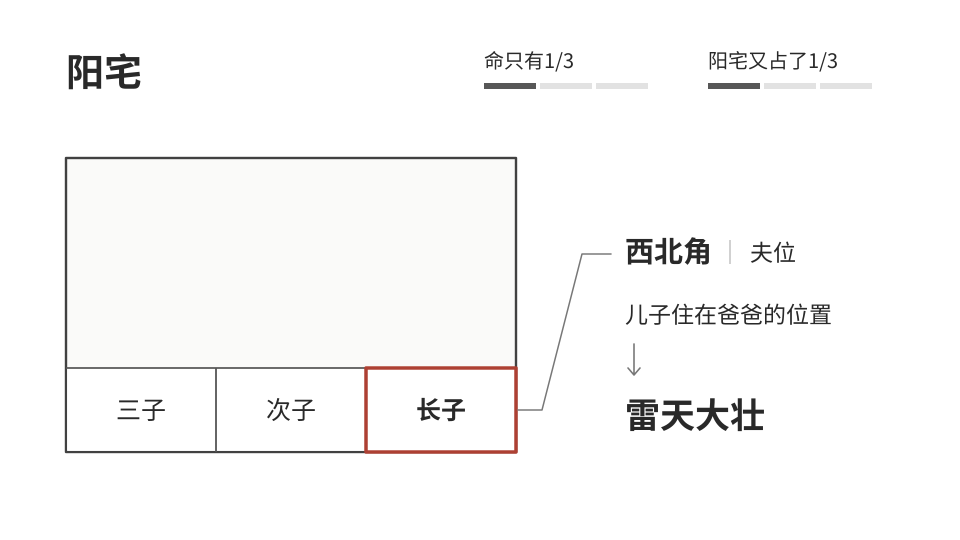 〔板书〕板面右侧新写的阳宅图：可辨标题「阳宅」，方位 S 在上、E 在左、W 在右、N 在下；方框下排三格「三子」「次子」「长子」，「长子」格外有橙色框线；右下有橙色粉笔字，其中一字像「夫」，其余认不出。（[00:28:48](https://www.bilibili.com/video/BV1KJsLekEfA/?p=19&t=1728)，第 51840 帧） 〔推断〕推断：照板上方位（上南下北、左东右西），西北落在方框右下角，正是写「长子」、带橙色框线的那格；后面倪师说「次子在正北方」，次子格也正在下排中间、N 字上方。故推断住西北的例二男命在这张图里是长子，但倪师本块没直说。（[00:28:48–00:31:45](https://www.bilibili.com/video/BV1KJsLekEfA/?p=19&t=1728)，第 51840–57179 帧） |
| **住大壮位的 30 岁儿子，心理上是几岁？喜欢什么样的？** | 〔口述〕「这个住到大壮的位置上的时候」「这个儿子啊比如说30岁」「可是他就有50岁的想法」。（[00:28:55–00:29:06](https://www.bilibili.com/video/BV1KJsLekEfA/?p=19&t=1735)，第 52074–52385 帧） 〔口述〕30 岁的儿子交二十五六岁的女朋友，「在表面上看到形的时候是很雷同」，男 30 女 26 看似年龄很好；但「这是形啊神不是这样子看的」。（[00:29:06–00:29:18](https://www.bilibili.com/video/BV1KJsLekEfA/?p=19&t=1746)，第 52386–52763 帧） 〔口述〕「他住在西北角的时候」「他在30岁看26岁小孩子」「跟我女儿一样这个好累啊她好幼稚」「我喜欢比我年龄大的」。（[00:29:18–00:29:28](https://www.bilibili.com/video/BV1KJsLekEfA/?p=19&t=1758)，第 52764–53051 帧） 〔口述〕「他生理上是30岁」……「心理上是50岁」「他会喜欢妈妈型的」。（[00:29:28–00:29:42](https://www.bilibili.com/video/BV1KJsLekEfA/?p=19&t=1768)，第 53052–53477 帧） |
| **贪狼在夫妻宫主什么？能不能一概而论？** | 〔口述〕「所以相书上面写的时候」「这个贪狼在夫妻宫」「主妻长太太年龄要比先生大很多」。（[00:29:42–00:29:56](https://www.bilibili.com/video/BV1KJsLekEfA/?p=19&t=1782)，第 53478–53885 帧） 〔指代〕说「这个贪狼在夫妻宫」时手指的是黑板命盘左列最下一格（巨门、天机、天魁那格的下一格）上部，格内字被手挡住，宫名在板上看不出。（[00:29:44](https://www.bilibili.com/video/BV1KJsLekEfA/?p=19&t=1784)，第 53548 帧） 〔叠图〕叠图贴出夫妻壬寅：贪狼平、文曲平、三台平、天寿旺、截空陷，另有小耗、岁建、指背、长生、阴煞；大限 106~115。（[00:29:57–00:29:58](https://www.bilibili.com/video/BV1KJsLekEfA/?p=19&t=1797)，第 53928–53969 帧） 〔口述〕倪师随即说明：「当然我提这个并不是说」……这只是一种状况，「但是你不能以偏概全说」「永远肯定是这样子」。（[00:29:56–00:30:04](https://www.bilibili.com/video/BV1KJsLekEfA/?p=19&t=1796)，第 53886–54143 帧） |
| **又住西北，他在婚姻上为什么两难？** | 〔口述〕「而他刚好又住西北有没有」「所以他一定会面临到两难」。（[00:30:04–00:30:10](https://www.bilibili.com/video/BV1KJsLekEfA/?p=19&t=1804)，第 54144–54317 帧） 〔口述〕什么叫两难：遇到一个年龄比他大很多的女孩子，想结婚又不行；同时又有个未婚的女孩子，「想结婚又不愿」「你懂不懂我意思又受到阻力」。（[00:30:10–00:30:26](https://www.bilibili.com/video/BV1KJsLekEfA/?p=19&t=1810)，第 54318–54803 帧） 〔口述〕「就困在这里受化忌」「这就是读图」。（[00:30:26–00:30:31](https://www.bilibili.com/video/BV1KJsLekEfA/?p=19&t=1826)，第 54804–54959 帧） 〔指代〕说「就困在这里」时手指的是黑板命盘右下一格，手边可见粉笔「…曲·忌」，前字被挡；板上没写宫名。（[00:30:26](https://www.bilibili.com/video/BV1KJsLekEfA/?p=19&t=1826)，第 54808 帧） 〔叠图〕叠图贴出财帛壬子：武曲旺、化忌，天府庙、文昌旺、擎羊陷、八座陷、封诰，另有力士、吊客、灾煞、胎；标「身宫」；大限 86~95，小限 9、21、33、45、57（原图里 33 加了框）。（[00:30:26–00:30:29](https://www.bilibili.com/video/BV1KJsLekEfA/?p=19&t=1826)，第 54804–54881 帧） |
| **七杀对面化忌来冲，26-35 这段会怎样？** | 〔口述〕「那读事业的时候」「你看他26-35 因为他26-35」「永远是在这个化忌」「感情的纠纷的话弄来弄去」「他就没有办法专心定下来」。（[00:30:33–00:30:40](https://www.bilibili.com/video/BV1KJsLekEfA/?p=19&t=1833)，第 54990–55229 帧） 〔口述〕「所以七杀在这边」「对面是化忌来冲的时候」「遇到这种流年都是事倍功半」「事倍功半不会有成」「这是命上面不会有成」。（[00:30:41–00:30:52](https://www.bilibili.com/video/BV1KJsLekEfA/?p=19&t=1841)，第 55230–55577 帧） 〔指代〕说「七杀在这边」时手掌按在黑板命盘右上一格，可见橙色「26-」和「礻」旁，其余被手挡；该格右半被叠图盖住，叠图那格是七杀、26~35、福德、丙午。（[00:30:41](https://www.bilibili.com/video/BV1KJsLekEfA/?p=19&t=1841)，第 55243 帧） 〔叠图〕叠图贴出福德丙午：七杀旺、天才旺、天福平、龙池闲，另有喜神、官符、将星、帝旺；大限 26~35，小限 3、15、27、39、51。第55110帧起与右下财帛壬子（武曲化忌）同时贴着，一上一下。（[00:30:33–00:30:37](https://www.bilibili.com/video/BV1KJsLekEfA/?p=19&t=1833)，第 55014–55110 帧） 〔板书〕中列可辨「天钺」「16-25」；「天相」「左辅」「6-15」「命」；「巨门」「天机」「天魁」。右列中格只见「51.」，右上被叠图挡住。各格首行和其余小字认不出。（[00:30:38](https://www.bilibili.com/video/BV1KJsLekEfA/?p=19&t=1838)，第 55164 帧） 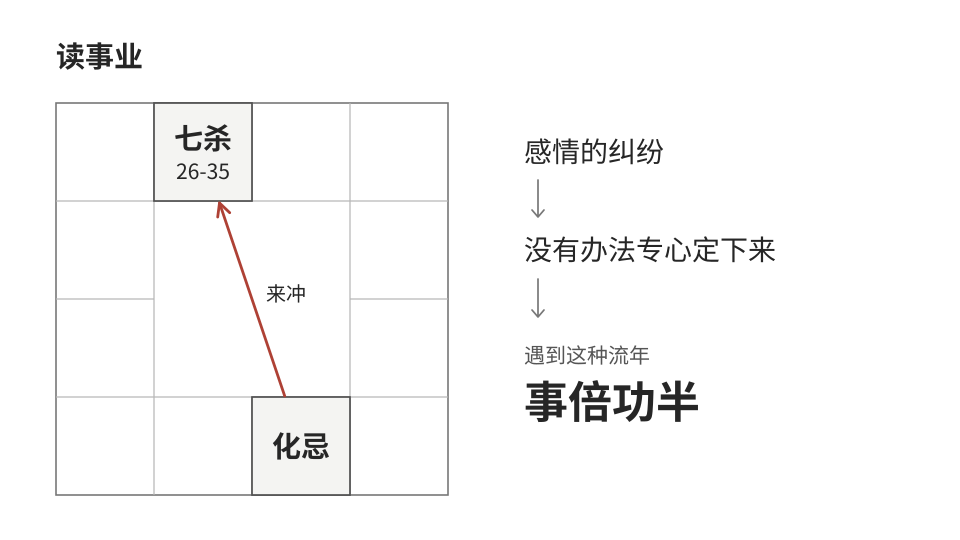 〔板书〕同一板面，镜头右移后露出右列：上格橙色「26-35」，下面一词像「福德」；中格「51. 男」。（[00:30:44](https://www.bilibili.com/video/BV1KJsLekEfA/?p=19&t=1844)，第 55332 帧） |
| **住西北角为什么反而会掌权？工作如何？** | 〔口述〕「住在西北角雷天大壮的时候」「会掌权做主管」，倪师说「加减哦」，要把阳宅加减给大家看。西北角是「天天的位置」，下一句字幕作「最高的不是权的位置」，语音转写作最高的位置是全的位置，两路对不上（见待核）。（[00:30:52–00:31:01](https://www.bilibili.com/video/BV1KJsLekEfA/?p=19&t=1852)，第 55578–55847 帧） 〔口述〕「那他命上有权运上又很好」「所以26-35 即使感情纠纷再再多」「可是他工作上面还是很称心如意哦」「变成这样子的你要加上去」「原来化忌是根本就不行的」「可是运上很好」。（[00:31:01–00:31:17](https://www.bilibili.com/video/BV1KJsLekEfA/?p=19&t=1861)，第 55848–56339 帧） 〔口述〕「这就是阳宅位置」「不太一样把它改过来了」：阳宅位置把原本化忌不行的结果改过来了。（[00:31:18–00:31:23](https://www.bilibili.com/video/BV1KJsLekEfA/?p=19&t=1878)，第 56340–56513 帧） 〔叠图〕叠图贴出命宫甲辰：紫微陷、化权，天相旺，左辅庙、化科，台辅、天哭平、旬空陷，另有丧门、冠带、奏书、月煞；大限 6~15。同时贴着福德丙午、财帛壬子。（[00:31:02–00:31:03](https://www.bilibili.com/video/BV1KJsLekEfA/?p=19&t=1862)，第 55860–55913 帧） 〔推断〕推断：倪师说的「命上有权」与叠图命宫「紫微陷 化权」相合，但他这句没点名是哪颗星化权。（[00:31:00–00:31:03](https://www.bilibili.com/video/BV1KJsLekEfA/?p=19&t=1860)，第 55806–55913 帧） |
| **父母左右得了他吗？一家人的卦怎么读？** | 〔口述〕「那他的父母亲有没有办法左右他呢」答「没有办法」，接着说「他爸妈是三女儿了谁理你啊」（这句意思待核）。（[00:31:23–00:31:31](https://www.bilibili.com/video/BV1KJsLekEfA/?p=19&t=1883)，第 56514–56753 帧） 〔口述〕「这个读卦的时候怎么读」：「爸爸是天泽履」「妈妈是地泽临」「儿子是雷天大壮」「二儿子是坎水」，「这个是读出来了」「个个就读出来位置有没有」。（[00:31:31–00:31:44](https://www.bilibili.com/video/BV1KJsLekEfA/?p=19&t=1891)，第 56754–57125 帧） |
| **次子住正北，为什么爱冒险？八字正格会怎样？** | 〔口述〕「像这个次子在正北方的位置」「这居正位没错」「但是坎为水是行险之道」「这个儿子一定很喜欢冒险」。（[00:31:44–00:31:51](https://www.bilibili.com/video/BV1KJsLekEfA/?p=19&t=1904)，第 57126–57341 帧） 〔口述〕「然后看八字的正格」，八字正格一看这儿子「恭恭正正正派的」，「就知道他喜欢从桥上跳下来」「脚上绑着绳子」「或者是坐飞行伞或者是怎样滑雪」。（[00:31:51–00:32:01](https://www.bilibili.com/video/BV1KJsLekEfA/?p=19&t=1911)，第 57342–57659 帧） |
| **同样住行险之位，八字不正的人会怎样？** | 〔口述〕「那如果是这个八字是鼠窃」「或者很凶小人的话」「他也住在行险的位置」「就是贩毒或者是盗窃窃盗有没有」；「然后你再一看地格都没有」「这窃贼对不对」。（[00:32:02–00:32:12](https://www.bilibili.com/video/BV1KJsLekEfA/?p=19&t=1922)，第 57660–57989 帧） 〔口述〕这种人来算命，眼睛在那里闪，「你要小心哦」，你算命桌上的东西「搞不好笔都给他偷走」。（[00:32:13–00:32:21](https://www.bilibili.com/video/BV1KJsLekEfA/?p=19&t=1933)，第 57990–58235 帧） 〔口述〕「所以说千万记得」我们要加减的时候（字幕原作「加減」），「看他如何行险」「有的是好的行险啊」「他喜欢冒险啊对不对」。（[00:32:21–00:32:29](https://www.bilibili.com/video/BV1KJsLekEfA/?p=19&t=1941)，第 58236–58475 帧） 〔口述〕举例：「他们家一家子都旱鸭子怕水」「他还一个人不但游泳还潜水」「把他爸爸妈妈吓死了」「找也找不到他在水里不出来」「而这种小孩行险」。（[00:32:29–00:32:38](https://www.bilibili.com/video/BV1KJsLekEfA/?p=19&t=1949)，第 58476–58751 帧） |
| **二儿子该住哪里？卦的道理什么时候讲？** | 〔口述〕「所以二儿子在北方还不如住在南方」「就叫水火既济」。（[00:32:38–00:32:43](https://www.bilibili.com/video/BV1KJsLekEfA/?p=19&t=1958)，第 58752–58901 帧） 〔口述〕「当然我们这是提到后提到未来去了」「因为后面我会介绍卦的时候」「我会跟诸位介绍」；「所以说图一拿来一家人给他读完了」。卦义倪师留到后面讲。（[00:32:43–00:32:52](https://www.bilibili.com/video/BV1KJsLekEfA/?p=19&t=1963)，第 58902–59165 帧） |
| **被化忌困住的这个儿子怎么化解？搬错会怎样？** | 〔口述〕「那这个儿子怎么办呢」「对啊忌在这边困扰了」「那如果要化解他的时候」「只有一条路」「叫他睡在客厅」「哎东宫太子啊」……「睡到东宫」。（[00:32:52–00:33:10](https://www.bilibili.com/video/BV1KJsLekEfA/?p=19&t=1972)，第 59166–59729 帧） 〔口述〕「然后他的他的爸爸妈妈呢」「退位下来住在西北角」「这房间空出来」。（[00:33:11–00:33:17](https://www.bilibili.com/video/BV1KJsLekEfA/?p=19&t=1991)，第 59730–59915 帧） 〔指代〕说「忌在这边困扰了」时右手伸到黑板命盘下排中间偏左的格，格内粉笔字模糊；画面右下叠图是财帛壬子（武曲、天府、忌等）。（[00:32:53](https://www.bilibili.com/video/BV1KJsLekEfA/?p=19&t=1973)，第 59215 帧） 〔板书〕阳宅图与第 51840 帧相比，方框内靠「E」一侧多了一个橙色圆圈；其余可辨「阳宅」「S」「N」及下排三格，右下橙色字仍认不出。圆圈代表什么倪师没说。（[00:33:17](https://www.bilibili.com/video/BV1KJsLekEfA/?p=19&t=1997)，第 59928 帧） 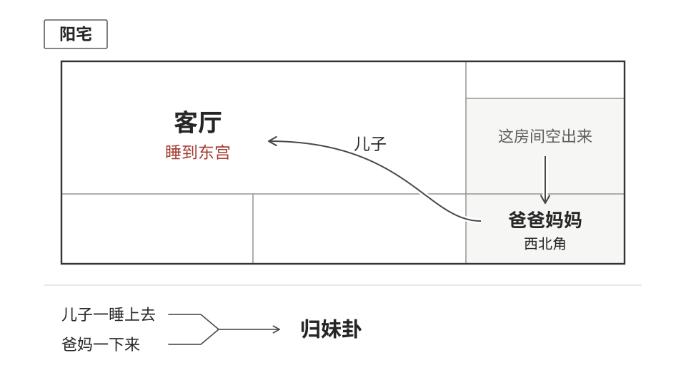 〔口述〕倪师原话：「如果搞不清楚的人」「儿子一睡上去（西厢）爸妈一下来完了」「本来儿子还算好对不对」「结果变成艾滋病了」「归妹卦」。「（西厢）」是字幕注字。（[00:33:17–00:33:29](https://www.bilibili.com/video/BV1KJsLekEfA/?p=19&t=1997)，第 59916–60299 帧） |
| **家里的长幼名位为什么会动？怎么补位？** | 〔口述〕「那我们阳宅在动的时候」「运一直在动啊」。（[00:33:30–00:33:32](https://www.bilibili.com/video/BV1KJsLekEfA/?p=19&t=2010)，第 60300–60377 帧） 〔口述〕「如果大儿子结婚」「不住在这个房子里面呢」「二儿子就已经变了叫做长子啊」；「你不要说你当了祖父」「还说我是二儿子」「那是当年你是二儿子啊懂不懂」。（[00:33:32–00:33:44](https://www.bilibili.com/video/BV1KJsLekEfA/?p=19&t=2012)，第 60378–60731 帧） 〔口述〕「你只要婚姻一动」「名名一动位就动了」「名随时在动的」「年龄越大名就在动」；当年是三儿子，现在是祖父了，「那这个位置千万不要移错」。（[00:33:44–00:33:58](https://www.bilibili.com/video/BV1KJsLekEfA/?p=19&t=2024)，第 60732–61151 帧） 〔指代〕说「那这个位置千万不要移错」时，食指一直指着阳宅图下排中间的「次子」格（指尖在该格左缘、靠近圆圈处）。（[00:33:56](https://www.bilibili.com/video/BV1KJsLekEfA/?p=19&t=2036)，第 61108 帧） 〔口述〕「所以一直在补位」：「大儿子结婚出去」「二儿子马上补位」「补位出去以后三儿子再补位上来」「就一年一个一年很快的」；「那有如果没有弄好的话」「就按照命走」。（[00:33:58–00:34:11](https://www.bilibili.com/video/BV1KJsLekEfA/?p=19&t=2038)，第 61152–61541 帧） |

**总结区**

- 通用规则：阳宅在命里约占三分之一，读命要把阳宅位置加减进去，看他如何行险，有的是好的行险（[00:28:35–00:28:41](https://www.bilibili.com/video/BV1KJsLekEfA/?p=19&t=1715)，第 51450–51647 帧、[00:32:21–00:32:26](https://www.bilibili.com/video/BV1KJsLekEfA/?p=19&t=1941)，第 58236–58403 帧）。；相书说贪狼在夫妻宫主妻长、太太比先生大很多，但这只是一个状况，不能以偏概全（[00:29:42–00:30:04](https://www.bilibili.com/video/BV1KJsLekEfA/?p=19&t=1782)，第 53478–54143 帧）。；七杀对面有化忌来冲，遇到这种流年都是事倍功半、不会有成（[00:30:41–00:30:52](https://www.bilibili.com/video/BV1KJsLekEfA/?p=19&t=1841)，第 55230–55577 帧）。；婚姻一动、年龄一大，名与位就跟着动，家中要一直补位，位置千万不要移错（[00:33:32–00:34:11](https://www.bilibili.com/video/BV1KJsLekEfA/?p=19&t=2012)，第 60378–61541 帧）。
- 只在本例：例二男命住西北角（父的位置、雷天大壮），30 岁有 50 岁的想法，喜欢年龄比他大的、妈妈型的（[00:28:41–00:29:42](https://www.bilibili.com/video/BV1KJsLekEfA/?p=19&t=1721)，第 51648–53477 帧）。；他 26-35 被对面化忌冲，感情两难、定不下来；但住西北掌权，工作仍称心如意（[00:30:04–00:31:17](https://www.bilibili.com/video/BV1KJsLekEfA/?p=19&t=1804)，第 54144–56339 帧）。；一家人的卦：爸爸天泽履、妈妈地泽临、儿子雷天大壮、二儿子坎水；次子住正北行险，不如住南方水火既济（[00:31:31–00:32:43](https://www.bilibili.com/video/BV1KJsLekEfA/?p=19&t=1891)，第 56754–58901 帧）。；化解只有一条路：他睡客厅（东宫），爸妈退下来住西北角；搬反了倪师说会「变成艾滋病了」（[00:32:52–00:33:29](https://www.bilibili.com/video/BV1KJsLekEfA/?p=19&t=1972)，第 59166–60299 帧）。
- 不是排盘规则，是处世方法：八字鼠窃、地格都没有的人来算命，要小心桌上的笔被偷走（[00:32:02–00:32:21](https://www.bilibili.com/video/BV1KJsLekEfA/?p=19&t=1922)，第 57660–58235 帧）。

**待核**

1. [00:28:45](https://www.bilibili.com/video/BV1KJsLekEfA/?p=19&t=1725)，第 51768 帧：字幕「夫位父的位置」，「夫位」与「父的位置」并出，是「夫位」还是「父位」待核；板书右下橙色字一个像「夫」，也认不准。
2. [00:28:48](https://www.bilibili.com/video/BV1KJsLekEfA/?p=19&t=1728)，第 51840 帧：板书阳宅图方框上排几格的字（像「厨」等）认不清；右下橙色粉笔字认不出。
3. [00:29:42](https://www.bilibili.com/video/BV1KJsLekEfA/?p=19&t=1782)，第 53478 帧：「相书」是哪本书，倪师没说；语音作「像书」。
4. [00:29:57](https://www.bilibili.com/video/BV1KJsLekEfA/?p=19&t=1797)，第 53928 帧：字幕「大很多就是犯罪的没有啊」，语音相同，意思不明。
5. [00:30:14](https://www.bilibili.com/video/BV1KJsLekEfA/?p=19&t=1814)，第 54432 帧：字幕「想结婚叉不行」的「叉」按语音改作「又」。
6. [00:30:33](https://www.bilibili.com/video/BV1KJsLekEfA/?p=19&t=1833)，第 54990 帧：倪师说「那读事业的时候」，但随后手按的是 26-35 那格，叠图标福德丙午；所读是事业还是福德待核。
7. [00:30:37](https://www.bilibili.com/video/BV1KJsLekEfA/?p=19&t=1837)，第 55134 帧：字幕「感情的纠纷的话弄来弄去」，语音作「情的就会弄到他中心」，两路有出入。
8. [00:30:57–00:31:01](https://www.bilibili.com/video/BV1KJsLekEfA/?p=19&t=1857)，第 55734–55847 帧：字幕「西北角是天天的位置」「最高的不是权的位置」，语音作「最高的位置是权的位置」，两路不一致；「天天」疑有重字。
9. [00:30:11](https://www.bilibili.com/video/BV1KJsLekEfA/?p=19&t=1811)，第 54354 帧、[00:30:57](https://www.bilibili.com/video/BV1KJsLekEfA/?p=19&t=1857)，第 55734 帧、[00:31:07](https://www.bilibili.com/video/BV1KJsLekEfA/?p=19&t=1867)，第 56034 帧：字幕混入「小限：……」数字串，已去掉。
10. [00:31:27–00:31:31](https://www.bilibili.com/video/BV1KJsLekEfA/?p=19&t=1887)，第 56610–56753 帧：「没有办法他是爸爸」「他爸妈是三女儿了谁理你啊」意思不明，语音作「没有办法他妈是……他爸妈是三女儿的」。
11. [00:31:37](https://www.bilibili.com/video/BV1KJsLekEfA/?p=19&t=1897)，第 56934 帧：字幕「二儿子是坎水」，语音「砍回水」，后句字幕作「坎为水」，本句可能漏字。
12. [00:31:51](https://www.bilibili.com/video/BV1KJsLekEfA/?p=19&t=1911)，第 57342 帧、[00:32:02](https://www.bilibili.com/video/BV1KJsLekEfA/?p=19&t=1922)，第 57660 帧、[00:32:10](https://www.bilibili.com/video/BV1KJsLekEfA/?p=19&t=1930)，第 57900 帧：「八字的正格」「鼠窃」「地格」倪师用了但没解释。
13. [00:32:13](https://www.bilibili.com/video/BV1KJsLekEfA/?p=19&t=1933)，第 57990 帧：字幕「占木鼠」，语音「脏头鼠」，听不清。
14. [00:32:41](https://www.bilibili.com/video/BV1KJsLekEfA/?p=19&t=1961)，第 58854 帧：「水火既济」语音作「水火寄一寄」，按字幕。
15. [00:33:00–00:33:10](https://www.bilibili.com/video/BV1KJsLekEfA/?p=19&t=1980)，第 59406–59729 帧：「叫他睡在客厅」与「东宫太子」「睡到东宫」的关系，倪师没细说。
16. [00:33:17](https://www.bilibili.com/video/BV1KJsLekEfA/?p=19&t=1997)，第 59928 帧：阳宅图新增的橙色圆圈代表什么（客厅、东宫或别的）倪师没说。
17. [00:33:19](https://www.bilibili.com/video/BV1KJsLekEfA/?p=19&t=1999)，第 59994 帧：「（西厢）」是字幕注字，「儿子一睡上去」具体睡到哪里倪师没明说；[00:33:27](https://www.bilibili.com/video/BV1KJsLekEfA/?p=19&t=2007)，第 60234 帧「归妹卦」没解释。
18. [00:33:45](https://www.bilibili.com/video/BV1KJsLekEfA/?p=19&t=2025)，第 60762 帧：「名名一动位就动了」的「名」，语音作「名一动位置动了」，是名分之名还是别的字待核。
19. [00:30:38](https://www.bilibili.com/video/BV1KJsLekEfA/?p=19&t=1838)，第 55164 帧、[00:30:44](https://www.bilibili.com/video/BV1KJsLekEfA/?p=19&t=1844)，第 55332 帧：板书各格首行和小字多认不出。
20. 指代 D092（[00:28:55](https://www.bilibili.com/video/BV1KJsLekEfA/?p=19&t=1735)，第 52078 帧）、D093（[00:28:58](https://www.bilibili.com/video/BV1KJsLekEfA/?p=19&t=1738)，第 52168 帧）、D096（[00:29:32](https://www.bilibili.com/video/BV1KJsLekEfA/?p=19&t=1772)，第 53188 帧）、D100（[00:30:37](https://www.bilibili.com/video/BV1KJsLekEfA/?p=19&t=1837)，第 55112 帧）、D104（[00:31:44](https://www.bilibili.com/video/BV1KJsLekEfA/?p=19&t=1904)，第 57126 帧）、D105（[00:31:48](https://www.bilibili.com/video/BV1KJsLekEfA/?p=19&t=1908)，第 57268 帧）、D109（[00:33:34](https://www.bilibili.com/video/BV1KJsLekEfA/?p=19&t=2014)，第 60428 帧）都是「是（不确定）」，未作依据。

## 例二续：红鸾天喜与晚婚、疾厄、红鸾入子女、书桌朝向、官相与眉

| 巳 | 午 | 未 | 申 |
|---|---|---|---|
| **父母 乙巳** 天梁陷禄 天钺旺 | **福德 丙午** 七杀旺 | **田宅 丁未** （无主星、辅星） | （申：没贴过） |
| **命宫 甲辰** 紫微陷权 天相旺 左辅庙科 | **例二续：红鸾天喜与晚婚、疾厄、红鸾入子女、书桌朝向、官相与眉 · 命宫甲辰** | 据视频叠图重排 | （酉：没贴过） |
| （卯：没贴过） | 后期贴图，不算倪师的话 |  | （戌：没贴过） |
| **夫妻 壬寅** 贪狼平 文曲平 | **子女 癸丑** 太阳陷 太阴庙 铃星陷 地空陷 | **财帛 壬子**（身宫） 武曲旺忌 天府庙 文昌旺 擎羊陷 | **疾厄 辛亥** 天同庙 禄存庙 火星平 |

同例二的命盘，见上图。

### 7　红鸾天喜会期、晚婚西北角与先子后婚（[00:34:11–00:39:26](https://www.bilibili.com/video/BV1KJsLekEfA/?p=19&t=2051)，第 61542–70985 帧）

| 提示区 | 笔记区 |
|---|---|
| **例二的天喜、红鸾各落在哪一宫？** | 〔口述〕倪师说按命加减时还要慢慢跟大家「来加减这个红鸾星的问题」，叫大家「看这个八字」「红鸾星在哪里」，接着问「他的天喜在这里是不是」「红鸾是不是在这里」。（[00:34:13–00:34:27](https://www.bilibili.com/video/BV1KJsLekEfA/?p=19&t=2053)，第 61608–62021 帧） 〔指代〕说「他的天喜在这里是不是」时手指的是右上叠图的天喜陷、田宅丁未、36~45一格；说「红鸾是不是在这里」时手按在命盘底排中间偏右那一格上沿，右下叠图同时框出红鸾陷、子女癸丑、96~105。（[00:34:21–00:34:25](https://www.bilibili.com/video/BV1KJsLekEfA/?p=19&t=2061)，第 61846–61966 帧） 〔叠图〕田宅丁未：天喜陷，另有小耗、攀鞍、月德、病符、衰；大限36~45；小限4,16,28,40,52（数字串按第62568帧原图核读）。（[00:34:20–00:34:24](https://www.bilibili.com/video/BV1KJsLekEfA/?p=19&t=2060)，第 61824–61949 帧） 〔叠图〕子女癸丑：太阳陷、太阴庙、铃星陷、地空陷、红鸾陷、天姚平、寡宿平，另有养、天煞、病符、青龙；大限96~105；小限10,22,34,46,58（数字串按第62568帧原图核读）。（[00:34:25–00:34:27](https://www.bilibili.com/video/BV1KJsLekEfA/?p=19&t=2065)，第 61950–62021 帧） 〔板书〕本块开头板面，可辨：右侧「阳宅」及方位图上方「S」、下方「N」，中间格「51.」，右列「56-65」「66-75」；其余被身体挡住或认不出。（[00:34:14](https://www.bilibili.com/video/BV1KJsLekEfA/?p=19&t=2054)，第 61632 帧） |
| **天喜红鸾几岁来会？26-35为何诸事不顺？** | 〔口述〕倪师说「我们把他天喜和红鸾星对会起来」「我们先看命」，命上是「36-45天喜红鸾星才会来会」。（[00:34:32–00:34:48](https://www.bilibili.com/video/BV1KJsLekEfA/?p=19&t=2072)，第 62178–62663 帧） 〔口述〕接着说前一个十年「26-35对面是化忌冲诸事不顺」「这是命啊」。（[00:34:48–00:34:54](https://www.bilibili.com/video/BV1KJsLekEfA/?p=19&t=2088)，第 62664–62837 帧） 〔叠图〕福德丙午：七杀旺、天才旺、天福平、龙池闲，另有喜神、将星、官符、帝旺；大限26~35；小限3,15,27,39,51。同时贴出财帛壬子：武曲旺忌、天府庙、文昌旺、擎羊陷、八座陷、封诰，另有力士、吊客、灾煞、胎；大限86~95。（[00:34:48–00:34:52](https://www.bilibili.com/video/BV1KJsLekEfA/?p=19&t=2088)，第 62664–62771 帧） 〔推断〕推断：叠图里26~35是福德丙午，丙午与壬子相对，壬子有武曲旺忌，和「对面是化忌冲」相合；36~45是田宅丁未（天喜），与子女癸丑（红鸾）相对，和「36-45天喜红鸾星才会来会」相合。倪师本块没有明说「对宫」二字。（[00:34:44–00:34:52](https://www.bilibili.com/video/BV1KJsLekEfA/?p=19&t=2084)，第 62526–62771 帧） 〔板书〕可辨：中间格「51. 男」，顶排一格「七杀」，另一格像「26-35」，其下两字像「福德」，中部一个大圆圈；这段新写的字认不出。（[00:34:45](https://www.bilibili.com/video/BV1KJsLekEfA/?p=19&t=2085)，第 62568 帧） 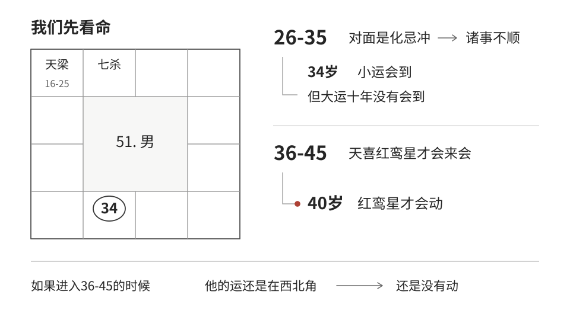 |
| **他今年34岁，光看命和运能结婚吗？** | 〔口述〕倪师说「那他今年34」，「如果光算命」「他也不可能」，「再加上运」「……占了这边1/3」「更不可能」。（[00:34:57–00:35:04](https://www.bilibili.com/video/BV1KJsLekEfA/?p=19&t=2097)，第 62910–63149 帧） 〔口述〕断他眼下的感情：「他只会跟结了婚离了婚的人」「或做妈妈型的人在一起」「而没有结果」。（[00:35:05–00:35:14](https://www.bilibili.com/video/BV1KJsLekEfA/?p=19&t=2105)，第 63150–63443 帧） |
| **晚婚的男人为什么住在西北角？** | 〔口述〕倪师说「那如果进入36-45的时候」「他的运还是在西北角」「还是没有动」，理由是「因为他的命是 36-45天喜红鸾星来会」。（[00:35:14–00:35:29](https://www.bilibili.com/video/BV1KJsLekEfA/?p=19&t=2114)，第 63444–63875 帧） 〔口述〕「所以他在之前」「他就会睡在西北角睡的很爽」「为什么他命该如此」「一个萝卜一个坑」。（[00:35:29–00:35:37](https://www.bilibili.com/video/BV1KJsLekEfA/?p=19&t=2129)，第 63876–64121 帧） 〔口述〕泛说一句：「所以男人命晚婚的人呐」「你不要去看他」「他就住西北角」「懂不懂我意思」，又重复「他就会住西北角」。（[00:35:37–00:35:47](https://www.bilibili.com/video/BV1KJsLekEfA/?p=19&t=2137)，第 64122–64439 帧） 〔板书〕板面与第62568帧所见相同：可辨「51. 男」「七杀」、像「26-35」「福德」的字和大圆圈；这两秒新写的字认不出。（[00:35:28](https://www.bilibili.com/video/BV1KJsLekEfA/?p=19&t=2128)，第 63864 帧） |
| **34岁小运已到，红鸾星为何还不动？** | 〔口述〕倪师设想学生问：「那进入这个大运的时候」「为什么……老师」「34岁不是红鸾星它不动啊」；答「那34岁没错啊他都没有会到36-45嘛」「你小运会到」「但大运十年没有会到」。（[00:35:48–00:36:05](https://www.bilibili.com/video/BV1KJsLekEfA/?p=19&t=2148)，第 64440–64973 帧） 〔口述〕「看到没有如果继续按动了」「按他动的话37 38」「40岁红鸾星才会动」「真正的动」。（[00:36:05–00:36:12](https://www.bilibili.com/video/BV1KJsLekEfA/?p=19&t=2165)，第 64974–65183 帧） 〔叠图〕第64710帧起子女癸丑小限串里的「34」加框；第64800帧原图上田宅丁未小限串里的「40」也加了框。（[00:35:57–00:36:00](https://www.bilibili.com/video/BV1KJsLekEfA/?p=19&t=2157)，第 64710–64800 帧） 〔板书〕可辨：底排中间格上沿画圈的「34」；左上格「天梁」、圈住的一字像「禄」、「天钺」、「16-25」；中间格「51. 男」。其余认不出。（[00:36:00](https://www.bilibili.com/video/BV1KJsLekEfA/?p=19&t=2160)，第 64800 帧） 〔推断〕推断：34在叠图子女癸丑（红鸾所在）的小限串里，40在田宅丁未（天喜所在、大限36~45）的小限串里，正好对应倪师说的「34岁……小运会到」与「40岁红鸾星才会动」；倪师没有逐字点明这层对应。（[00:35:56–00:36:10](https://www.bilibili.com/video/BV1KJsLekEfA/?p=19&t=2156)，第 64698–65117 帧） |
| **40岁红鸾动时仍住西北角，娶什么样的太太？** | 〔口述〕「那40岁在动的时候」「如果他继续在西北角不动」「他娶来的太太一定是有过婚姻的」「而且年龄比他长」「会有这种现象」。（[00:36:12–00:36:35](https://www.bilibili.com/video/BV1KJsLekEfA/?p=19&t=2172)，第 65184–65855 帧） 〔推断〕推断：这和本块前面说他现在「只会跟结了婚离了婚的人」「或做妈妈型的人在一起」口径一致，都落在对象有婚史上；「年龄比他长」一句两路识别相反，见待核。（[00:35:05–00:36:22](https://www.bilibili.com/video/BV1KJsLekEfA/?p=19&t=2105)，第 63150–65477 帧） |
| **疾厄怎么看？午宫七杀主什么？** | 〔口述〕倪师说「如果算疾厄会不会看」「我们随便挑一挑疾厄会不会看」，问「这个在子时是不是化忌」「是不是」。（[00:36:35–00:36:49](https://www.bilibili.com/video/BV1KJsLekEfA/?p=19&t=2195)，第 65856–66287 帧） 〔口述〕「最凶的在什么胆」，「七杀在这边七杀是个杀星」「杀星因为没有遇上吉星」「所以他午宫也是怎么样」「很不好」「午宫是什么心脏」。（[00:36:49–00:37:06](https://www.bilibili.com/video/BV1KJsLekEfA/?p=19&t=2209)，第 66288–66809 帧） 〔指代〕说「七杀在这边」时手指的是黑板顶排第二格粉笔字「七杀」处（板上可见「26-35」），叠图同时框出七杀旺、福德丙午；随后在该格写下「午」。（[00:36:52](https://www.bilibili.com/video/BV1KJsLekEfA/?p=19&t=2212)，第 66382 帧） 〔叠图〕再贴福德丙午，七杀旺加框，大限26~35，宫名福德加框。（[00:36:53–00:36:56](https://www.bilibili.com/video/BV1KJsLekEfA/?p=19&t=2213)，第 66396–66485 帧） 〔板书〕可辨：顶排第二格圈住的「七杀」、其下「午」、像「26-35」「福德」的字，格右上圆圈内一字像「心」；中部「51. 男」；中右一字像「胆」；底排右格「天府」「武曲」。其余认不出。（[00:37:01](https://www.bilibili.com/video/BV1KJsLekEfA/?p=19&t=2221)，第 66648 帧） 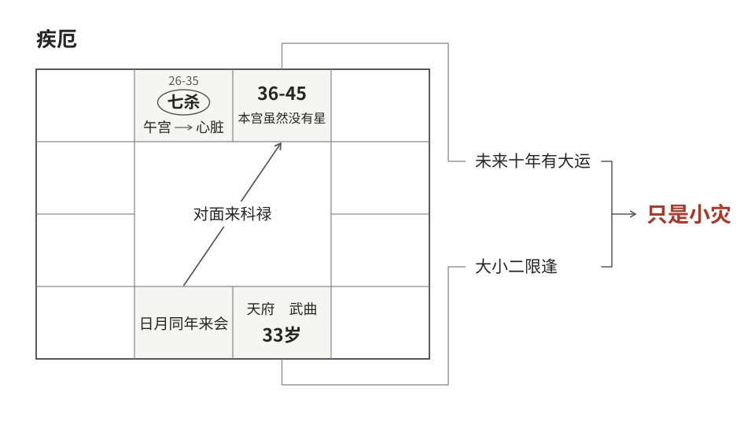 |
| **33岁大小二限逢，为什么只是小灾？** | 〔口述〕「疾厄那光算今年的灾」，「因为哈36-45本宫虽然没有星」「但对面来科禄这个日月同年来会」「所以因为未来十年有大运」。（[00:37:07–00:37:20](https://www.bilibili.com/video/BV1KJsLekEfA/?p=19&t=2227)，第 66810–67217 帧） 〔口述〕「所以33岁或者遇到这个宫」「遇到33岁这种大小二限逢」「只是小灾不会有大灾」。（[00:37:20–00:37:26](https://www.bilibili.com/video/BV1KJsLekEfA/?p=19&t=2240)，第 67218–67397 帧） 〔指代〕说「这个日月同年来会」时手按在底排中间格画圈「34」下方，叠图框出太阳太阴、子女癸丑；说「遇到33岁这种大小二限逢」时手停在底排右侧格，叠图为武曲天府、财帛壬子、小限33。（[00:37:15–00:37:23](https://www.bilibili.com/video/BV1KJsLekEfA/?p=19&t=2235)，第 67078–67318 帧） 〔叠图〕第67260帧起财帛壬子重贴：武曲旺忌、天府庙、文昌旺、擎羊陷、八座陷、封诰，另有力士、灾煞、吊客、胎，并标「身宫」；大限86~95；小限9,21,33,45,57，其中「33」加框。（[00:37:20–00:37:23](https://www.bilibili.com/video/BV1KJsLekEfA/?p=19&t=2240)，第 67218–67295 帧） 〔板书〕可辨：顶排第二格圈住的「七杀」、「午」、像「26-35」「福德」的字，旁边圆圈内「15」；中间格「51. 男」，大圆圈内一字像「命」；底排中间格圈「34」，底排右格「天府」「武曲」；中右一字像「胆」。其余认不出。（[00:37:25](https://www.bilibili.com/video/BV1KJsLekEfA/?p=19&t=2245)，第 67367 帧） |
| **灾落财帛是什么灾？怎样可以免掉？** | 〔口述〕「有的人的灾车祸的灾」「这是形上面外形上面的灾」；「像他这个灾身在财帛」「那一年的大运走到财帛」，是「他的身体他的感情上的灾而已」。（[00:37:28–00:37:41](https://www.bilibili.com/video/BV1KJsLekEfA/?p=19&t=2248)，第 67458–67835 帧） 〔口述〕「他只要不要去做生意当老板」「这个灾都不会有」，又重复「只要不要去做生意当老板」「这个灾都通通没有的」。（[00:37:42–00:37:50](https://www.bilibili.com/video/BV1KJsLekEfA/?p=19&t=2262)，第 67866–68105 帧） 〔口述〕「所以33岁这个灾变成感情上的灾而已」（字幕混入的小限数字串已去掉）。（[00:37:50–00:37:53](https://www.bilibili.com/video/BV1KJsLekEfA/?p=19&t=2270)，第 68106–68201 帧） 〔口述〕「所以如果他拿这个来」「一看这个流年」「我们就知道他一定」「为了这个事情来的」。（[00:37:53–00:38:06](https://www.bilibili.com/video/BV1KJsLekEfA/?p=19&t=2273)，第 68202–68591 帧） |
| **红鸾星落子女宫，婚与子谁先？** | 〔口述〕「还有个问题你们没有看到哦」「我上次跟诸位提醒过」「红鸾星在子女宫」；「一般来说我们红鸾星在夫妻宫」，本例「这个红鸾星跑到子女宫」。（[00:38:06–00:38:21](https://www.bilibili.com/video/BV1KJsLekEfA/?p=19&t=2286)，第 68592–69035 帧） 〔口述〕「再看他红鸾星本身36-45」「天喜红鸾星来会」，「那他34岁照样会生孩子」「但是不会结婚懂不懂我意思」「会先有子40岁以后再结婚」。（[00:38:21–00:38:32](https://www.bilibili.com/video/BV1KJsLekEfA/?p=19&t=2301)，第 69036–69371 帧） 〔叠图〕再贴田宅丁未，小限串里的「40」单独标出。（[00:38:29–00:38:32](https://www.bilibili.com/video/BV1KJsLekEfA/?p=19&t=2309)，第 69288–69371 帧） |
| **算命为什么只论果、不论因？** | 〔口述〕「算命不管原因只管结果」，「所以我们在算命的时候」「我们是论果」。（[00:38:32–00:38:39](https://www.bilibili.com/video/BV1KJsLekEfA/?p=19&t=2312)，第 69372–69593 帧） 〔口述〕举宗教家作对比：「你看那个宗教家拿出来的都是谈因」，比如「你现在杀人了」「因为前世他杀你」「所以你这世杀他你也不要难过」，可是「准备接受法律制裁好了」，「那个神赦免你的罪」「出去还是枪毙啊」。（[00:38:39–00:38:54](https://www.bilibili.com/video/BV1KJsLekEfA/?p=19&t=2319)，第 69594–70043 帧） 〔口述〕「这个这个宗教家」「我们不算啊我们是谈果」「所以我们只知只论果不论因」。（[00:38:54–00:39:01](https://www.bilibili.com/video/BV1KJsLekEfA/?p=19&t=2334)，第 70044–70241 帧） |
| **34岁小限进子女宫怎么断？先有子算不好吗？** | 〔口述〕「那我们看到这个」「在34岁那年的时候进入子女宫」「子女宫所以他会先得孩子」。（[00:39:01–00:39:08](https://www.bilibili.com/video/BV1KJsLekEfA/?p=19&t=2341)，第 70242–70457 帧） 〔口述〕泛说：「所以一般红鸾天喜入子女宫的时候」「大部分的都是这个先有孩子」。（[00:39:08–00:39:13](https://www.bilibili.com/video/BV1KJsLekEfA/?p=19&t=2348)，第 70458–70595 帧） 〔口述〕「先有孩子这个这个」「没什么吧很正常」「我只是讲我没有说他不好」「很好啊」，随后问大家有没有疑问。（[00:39:13–00:39:26](https://www.bilibili.com/video/BV1KJsLekEfA/?p=19&t=2353)，第 70596–70985 帧） |

**总结区**

- 通用规则：红鸾天喜入子女宫的时候，大部分是先有孩子（[00:39:08–00:39:13](https://www.bilibili.com/video/BV1KJsLekEfA/?p=19&t=2348)，第 70458–70595 帧）；男人命晚婚的人，他就住西北角（[00:35:37–00:35:43](https://www.bilibili.com/video/BV1KJsLekEfA/?p=19&t=2137)，第 64122–64295 帧）；算命不管原因只管结果，只论果不论因（[00:38:32–00:39:01](https://www.bilibili.com/video/BV1KJsLekEfA/?p=19&t=2312)，第 69372–70241 帧）；车祸一类是外形上的灾，与身体、感情上的灾不同（[00:37:28–00:37:41](https://www.bilibili.com/video/BV1KJsLekEfA/?p=19&t=2248)，第 67458–67835 帧）
- 只在本例：例二天喜在田宅丁未、红鸾在子女癸丑，36-45天喜红鸾才来会；26-35对面化忌冲诸事不顺；今年34光看命运都不可能结婚，只会跟离过婚或妈妈型的人在一起而没有结果（[00:34:20–00:35:14](https://www.bilibili.com/video/BV1KJsLekEfA/?p=19&t=2060)，第 61824–63443 帧）；34岁小运会到但大运十年没会到，40岁红鸾星才真正动；那时若仍住西北角，娶来的太太一定有过婚姻、年龄比他长（[00:35:56–00:36:35](https://www.bilibili.com/video/BV1KJsLekEfA/?p=19&t=2156)，第 64698–65855 帧）；33岁大小二限逢只是小灾，灾在财帛，变成身体、感情上的灾；只要不做生意当老板，这个灾都没有（[00:37:07–00:37:53](https://www.bilibili.com/video/BV1KJsLekEfA/?p=19&t=2227)，第 66810–68201 帧）；红鸾在子女宫，34岁照样会生孩子但不结婚，先有子、40岁以后再结婚（[00:38:06–00:38:32](https://www.bilibili.com/video/BV1KJsLekEfA/?p=19&t=2286)，第 68592–69371 帧）
- 不是排盘规则，是处世方法：讲先有孩子这类事，要说明这很正常、我没有说他不好（[00:39:13–00:39:20](https://www.bilibili.com/video/BV1KJsLekEfA/?p=19&t=2353)，第 70596–70829 帧）；客人拿来的流年一看，就知道他为什么事情而来（[00:37:53–00:38:06](https://www.bilibili.com/video/BV1KJsLekEfA/?p=19&t=2273)，第 68202–68591 帧）

**待核**

1. [00:34:57](https://www.bilibili.com/video/BV1KJsLekEfA/?p=19&t=2097)，第 62910 帧：「那他今年34」与上一块「今年33岁」对不上，照原话写，未改。
2. [00:34:40](https://www.bilibili.com/video/BV1KJsLekEfA/?p=19&t=2080)，第 62412 帧：「命上面说命的读图说」语音作「读徒说」，意思不明。
3. [00:35:02](https://www.bilibili.com/video/BV1KJsLekEfA/?p=19&t=2102)，第 63066 帧：「叉占了这边1/3」的「叉」像是「又」的识别错字；「这边」所指不确定（D116），没当依据。
4. [00:35:23](https://www.bilibili.com/video/BV1KJsLekEfA/?p=19&t=2123)，第 63714 帧：「他顺因为要怎么看啊」语音作「睡」，「顺」字待核。
5. [00:35:55](https://www.bilibili.com/video/BV1KJsLekEfA/?p=19&t=2155)，第 64650 帧：「为什么三老师你说老师」里的「三」语音没有，意思不明，引用时略去。
6. [00:35:58](https://www.bilibili.com/video/BV1KJsLekEfA/?p=19&t=2158)，第 64740 帧、[00:37:50](https://www.bilibili.com/video/BV1KJsLekEfA/?p=19&t=2270)，第 68106 帧：字幕混入「小限：……」数字串，引原话时已去掉。
7. [00:36:20](https://www.bilibili.com/video/BV1KJsLekEfA/?p=19&t=2180)，第 65400 帧：字幕「而且年龄比他长」，语音作「而且零零比他少」，「长」与「少」两路相反，待核。
8. [00:36:41](https://www.bilibili.com/video/BV1KJsLekEfA/?p=19&t=2201)，第 66042 帧：「这个在子时是不是化忌」，「子时」可能指子宫；叠图财帛壬子有武曲旺忌，但本块没说明「这个」指什么，指代 D118 为否。
9. [00:36:49](https://www.bilibili.com/video/BV1KJsLekEfA/?p=19&t=2209)，第 66288 帧：字幕「最凶的在什么胆」，语音作「什么七萨在这」，两路对不上；[00:37:01](https://www.bilibili.com/video/BV1KJsLekEfA/?p=19&t=2221)，第 66648 帧板书中右有一字像「胆」，也没把握。
10. [00:37:14](https://www.bilibili.com/video/BV1KJsLekEfA/?p=19&t=2234)，第 67020 帧：「但对面来科禄这个日月同年来会」，「科禄」「同年」本块没解释，语音作「刻入」「四月同年」；叠图子女癸丑的太阳、太阴未见化科、化禄标记。
11. [00:37:33](https://www.bilibili.com/video/BV1KJsLekEfA/?p=19&t=2253)，第 67602 帧：「像他这个灾身在财帛」语音作「生在」；「那一年的大运走到财帛」，而叠图财帛壬子的33在小限串里、大限是86~95，「大运」的说法待核。
12. [00:37:20](https://www.bilibili.com/video/BV1KJsLekEfA/?p=19&t=2240)，第 67218 帧：叠图财帛壬子[00:37:22](https://www.bilibili.com/video/BV1KJsLekEfA/?p=19&t=2242)，第 67260 帧起标「身宫」；[00:34:51](https://www.bilibili.com/video/BV1KJsLekEfA/?p=19&t=2091)，第 62730 帧那次贴出，叠图定稿里这格没有「身宫」（只这 1 秒，[00:34:52](https://www.bilibili.com/video/BV1KJsLekEfA/?p=19&t=2092)，第 62760 帧起又有），疑为转写漏字；与本集其他处官禄戊申也标身宫是否冲突，待核。
13. [00:37:25](https://www.bilibili.com/video/BV1KJsLekEfA/?p=19&t=2245)，第 67367 帧：板书顶排第二格旁圆圈内的「15」本块没讲是什么；叠图福德丙午小限串含15，两者关系待核。
14. [00:34:14](https://www.bilibili.com/video/BV1KJsLekEfA/?p=19&t=2054)，第 61632 帧、[00:34:45](https://www.bilibili.com/video/BV1KJsLekEfA/?p=19&t=2085)，第 62568 帧、[00:35:28](https://www.bilibili.com/video/BV1KJsLekEfA/?p=19&t=2128)，第 63864 帧：板书新写内容大多认不出；[00:37:25](https://www.bilibili.com/video/BV1KJsLekEfA/?p=19&t=2245)，第 67367 帧大圆圈内像「命」、[00:37:01](https://www.bilibili.com/video/BV1KJsLekEfA/?p=19&t=2221)，第 66648 帧圆圈内像「心」，都不确定。
15. [00:37:56](https://www.bilibili.com/video/BV1KJsLekEfA/?p=19&t=2276)，第 68280 帧：「为了这个事情来的」在[00:37:56](https://www.bilibili.com/video/BV1KJsLekEfA/?p=19&t=2276)，第 68280 帧、[00:37:58](https://www.bilibili.com/video/BV1KJsLekEfA/?p=19&t=2278)，第 68364 帧连出两次，当一句处理。
16. [00:38:10](https://www.bilibili.com/video/BV1KJsLekEfA/?p=19&t=2290)，第 68712 帧：「我上次跟诸位提醒过」指哪一次课，本块没交代。
17. [00:39:08](https://www.bilibili.com/video/BV1KJsLekEfA/?p=19&t=2348)，第 70458 帧：「红鸾天喜入子女宫」语音只作「红兰兴一入子女宫」，没有「天喜」；本例叠图的天喜在田宅丁未而不在子女宫。
18. [00:39:21](https://www.bilibili.com/video/BV1KJsLekEfA/?p=19&t=2361)，第 70830 帧：「有没有什么疑间」的「疑间」按上下文改作「疑问」。
19. [00:34:16](https://www.bilibili.com/video/BV1KJsLekEfA/?p=19&t=2056)，第 61704 帧等：指代 D112、D115、D116、D117、D121、D123、D124、D125、D127、D128、D133 为「是（不确定）」，D130 为「看不出」，均未当依据。
20. [00:35:19](https://www.bilibili.com/video/BV1KJsLekEfA/?p=19&t=2119)，第 63588 帧：「西北角」本块没交代具体所指（床位、房间还是方位图上的位置），黑板右侧有阳宅方位图，未补解释。

### 8　书桌朝向与禄忌，官相与眉位（[00:39:26–00:45:01](https://www.bilibili.com/video/BV1KJsLekEfA/?p=19&t=2366)，第 70986–81035 帧）

| 提示区 | 笔记区 |
|---|---|
| **延年方取什么位？能不能让人朝化忌？** | 〔口述〕倪师说延年方取的是吉位，举脚朝的方向为例，并问这个宫的方向吉不吉：「一般来说延年方就是取他的吉位」「比如说我们要脚朝的方向」「像这个宫的方向是不是很吉」。（[00:39:27–00:39:35](https://www.bilibili.com/video/BV1KJsLekEfA/?p=19&t=2367)，第 71034–71255 帧） 〔指代〕说「像这个宫的方向」时，手指的是黑板命盘最左一列中间那格，格内可见「天相」「左辅」等字，随后用红粉笔把这一格框起来。（[00:39:31](https://www.bilibili.com/video/BV1KJsLekEfA/?p=19&t=2371)，第 71136 帧） 〔板书〕本块开头的板面：命盘格里可辨「天梁」、红圈「禄」、「天钺」「16-25」「父母」；下一格可辨「天相」「左辅」「6-15」和形似「命」的字；再下一格可辨「巨门」「天机」。其余认不出。（[00:39:27](https://www.bilibili.com/video/BV1KJsLekEfA/?p=19&t=2367)，第 71028 帧） 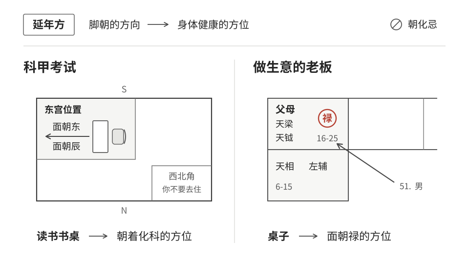 〔板书〕写完后可见：左列中间那格（「天相」「左辅」「6-15」「命」）外加了一道红框；中宫可辨「51.」「男」。（[00:39:33](https://www.bilibili.com/video/BV1KJsLekEfA/?p=19&t=2373)，第 71208 帧） 〔口述〕倪师反问：如果朝化忌，那就是害人：「你说老师我给他朝化忌」「你不是想害人」。（[00:39:36–00:39:41](https://www.bilibili.com/video/BV1KJsLekEfA/?p=19&t=2376)，第 71298–71435 帧） |
| **改阳宅时，脚和读书的书桌各朝哪个方位？** | 〔口述〕改阳宅时，住家脚朝的方向要朝身体健康的方位：「这个阳宅改的时候」「住住家脚的朝位的时候」「朝着身体健康的方位」。（[00:39:46–00:39:56](https://www.bilibili.com/video/BV1KJsLekEfA/?p=19&t=2386)，第 71592–71885 帧） 〔口述〕读书的书桌要朝化科的方位，书桌放在哪个房间都无所谓：「读书书桌的时候」「我们朝着化科的方位」「书桌在哪个房间都无所谓」。（[00:39:56–00:40:04](https://www.bilibili.com/video/BV1KJsLekEfA/?p=19&t=2396)，第 71886–72125 帧） 〔叠图〕命宫甲辰：紫微陷、化权，天相旺，左辅庙、化科，台辅，旬空陷，天哭平；大限 6~15；小限 1、13、25、37、49。（[00:39:57–00:39:59](https://www.bilibili.com/video/BV1KJsLekEfA/?p=19&t=2397)，第 71922–71987 帧） 〔推断〕推断：叠图里化科（左辅庙科）就落在命宫甲辰；倪师这几句只说朝化科的方位，没有明说是哪一宫。（[00:39:57–00:40:04](https://www.bilibili.com/video/BV1KJsLekEfA/?p=19&t=2397)，第 71922–72125 帧） |
| **要改这位先生的科甲考试运，该住哪、书桌朝哪？** | 〔口述〕倪师说要改这个人的考试运，先画出房子的东南西北：「我们来改这个人的科甲考试」「考试考试运道」「房子有东南西北」。（[00:40:07–00:40:16](https://www.bilibili.com/video/BV1KJsLekEfA/?p=19&t=2407)，第 72228–72485 帧） 〔口述〕叫这位先生别住西北角，去住东边，读书书桌面朝东：「西北角你不要去住」「你去住东宫位置正着」「然后读书书桌这人就面朝东」「我们平常跟他讲是朝东」。（[00:40:16–00:40:31](https://www.bilibili.com/video/BV1KJsLekEfA/?p=19&t=2416)，第 72486–72959 帧） 〔板书〕黑板左侧新画了一个方框，框上方写「S」；框左边有一个字母被挡住，形似「E」，认不全。（[00:40:16](https://www.bilibili.com/video/BV1KJsLekEfA/?p=19&t=2416)，第 72497 帧） 〔板书〕方框上方「S」、下方「N」，框内左上、右下各画一个小长方形，左上角附近有一个箭头和形似「田」的小符号，左侧字母形似「E」。符号代表什么，板上没写。（[00:40:30](https://www.bilibili.com/video/BV1KJsLekEfA/?p=19&t=2430)，第 72900 帧） |
| **专业上讲书桌朝向时用什么说法？** | 〔口述〕平常对客人说朝东，专业上讲的是面朝哪个宫，这里是面朝辰：「可是我们专业在看的时候」「是讲面朝什么辰有没有」「辰这是辰宫嘛」「有没有问题啊面朝辰」。（[00:40:32–00:40:42](https://www.bilibili.com/video/BV1KJsLekEfA/?p=19&t=2432)，第 72960–73265 帧） 〔板书〕方框左上角写了「辰」，旁边有箭头指向那个形似「田」的小符号；「S」「N」仍在。（[00:40:35](https://www.bilibili.com/video/BV1KJsLekEfA/?p=19&t=2435)，第 73055 帧） 〔口述〕倪师再次提醒不要朝化忌：「那你不会说」「哎老师我他要朝化忌很好」。（[00:40:42–00:40:46](https://www.bilibili.com/video/BV1KJsLekEfA/?p=19&t=2442)，第 73266–73397 帧） 〔推断〕推断：前面说书桌朝化科的方位，叠图命宫甲辰带左辅化科，这里又说面朝辰，两处应是同一个意思；倪师在本块没有把两句明说连起来。（[00:39:57–00:40:42](https://www.bilibili.com/video/BV1KJsLekEfA/?p=19&t=2397)，第 71922–73265 帧） |
| **做生意的老板，桌子该朝哪个方位？** | 〔口述〕老板的桌子要面朝禄，也就是财星的方位：「那如果是做生意的老板呢」「桌子啊面朝禄的方位」「财星这个是化禄」「贪狼星也是化禄」「禄存也是禄」「这是朝财星的方位」。（[00:40:47–00:41:02](https://www.bilibili.com/video/BV1KJsLekEfA/?p=19&t=2447)，第 73422–73865 帧） 〔指代〕说「这个就是化禄的方位」和「这个是化禄」时，手指的都是黑板上排最左格红圈的「禄」字下方，同格写有「父母」。（[00:40:50–00:40:53](https://www.bilibili.com/video/BV1KJsLekEfA/?p=19&t=2450)，第 73528–73618 帧） 〔叠图〕父母乙巳：天梁陷、化禄，天钺旺，天巫，孤辰陷；大限 16~25。（[00:40:49–00:40:51](https://www.bilibili.com/video/BV1KJsLekEfA/?p=19&t=2449)，第 73494–73541 帧） 〔叠图〕夫妻壬寅：贪狼平，文曲平，三台平，天寿旺，截空陷；大限 106~115。疾厄辛亥：天同庙，禄存庙，火星平，天使旺，天贵平；大限 76~85。（[00:40:55–00:40:59](https://www.bilibili.com/video/BV1KJsLekEfA/?p=19&t=2455)，第 73662–73793 帧） 〔板书〕可辨从中宫「51.」「男」附近向左上「父母」格画了一条带箭头的斜线，箭头尖在「16-25」一带；其余被身体挡住。（[00:40:55](https://www.bilibili.com/video/BV1KJsLekEfA/?p=19&t=2455)，第 73656 帧） |
| **禄和忌在一起的方向为什么不能朝？** | 〔口述〕禄和忌碰在一起时，不能朝那个方向：「如果禄和忌逢在一起的时候」「我们不能朝到禄和忌的方向」。（[00:41:02–00:41:10](https://www.bilibili.com/video/BV1KJsLekEfA/?p=19&t=2462)，第 73866–74105 帧） 〔口述〕倪师用账目举例：账上看是赚钱的，拿到的支票却跳票，要上法院把钱追回来，这就是禄忌在一起：「公司结余一看账拿出来」「哇都是赚钱的」「那么赚钱了都是跳票的懂不懂」「赚钱但是要到法院去拿」「想办法把钱追回来」「这是禄跟忌会在一起」。（[00:41:10–00:41:29](https://www.bilibili.com/video/BV1KJsLekEfA/?p=19&t=2470)，第 74106–74675 帧） |
| **科权会命、官做得大的人有什么相？相会变吗？** | 〔口述〕这种科权会命、官做得大的人有官相，坐到面前一看，两道眉毛是开的：「那如果像这种命的人」「科权会命的人」「官做的很大的人有官相」「坐到你面前来一看」「这个两个眉毛开的」。（[00:41:32–00:41:44](https://www.bilibili.com/video/BV1KJsLekEfA/?p=19&t=2492)，第 74766–75125 帧） 〔指代〕说「这个两个眉毛开的」时，倪师双手食指点在自己两道眉毛上方，指的是自己的眉毛。（[00:41:40](https://www.bilibili.com/video/BV1KJsLekEfA/?p=19&t=2500)，第 75028 帧） 〔叠图〕讲「这种命的人」时又贴出命宫甲辰：紫微陷、化权，左辅庙、化科，天相旺。（[00:41:32–00:41:34](https://www.bilibili.com/video/BV1KJsLekEfA/?p=19&t=2492)，第 74766–74843 帧） 〔推断〕推断：「科权会命」接在命宫甲辰叠图之后，这张叠图的命宫里化权、化科都有；倪师没有逐星说明。（[00:41:32–00:41:36](https://www.bilibili.com/video/BV1KJsLekEfA/?p=19&t=2492)，第 74766–74885 帧） 〔口述〕相会一直改变。倪师举两位政界人物为例（字幕作「卢毓钧」「李登挥」），说官做上去以后「他的印越来越大越来越大」，以前「还是很窄」，后来「越来越大越来越大越来越开」，叫学生看新闻时留意：「这个相是越来越一直改变」「发现他的相跟你不太一样」。（[00:41:45–00:42:12](https://www.bilibili.com/video/BV1KJsLekEfA/?p=19&t=2505)，第 75168–75983 帧） |
| **黑板上的官相头像画了什么？眉为什么越来越高？** | 〔口述〕倪师边画边讲：发际高，眼睛细长，眉毛居然那么高：「一个头这样子耳朵」「这是我们的发际在这里」「发际很高」「他眼睛在这里哈」「眼睛是细细长长的」「然后眉毛居然那么高」。（[00:42:12–00:42:29](https://www.bilibili.com/video/BV1KJsLekEfA/?p=19&t=2532)，第 75984–76493 帧） 〔指代〕说「发际在这里」时粉笔在黑板人头图的上部描画发际；说「他眼睛在这里哈」时粉笔在人头图中部画出一道横线，表示眼睛位置。（[00:42:15–00:42:19](https://www.bilibili.com/video/BV1KJsLekEfA/?p=19&t=2535)，第 76078–76187 帧） 〔板书〕黑板左侧画了一个人头线条图：圆形头顶轮廓、两侧耳朵，上面两道横线（眉），下面两个细长的椭圆（眼）；没有文字。另外命盘那格的「命」字外此时多了一个白圈。（[00:42:28](https://www.bilibili.com/video/BV1KJsLekEfA/?p=19&t=2548)，第 76464 帧） 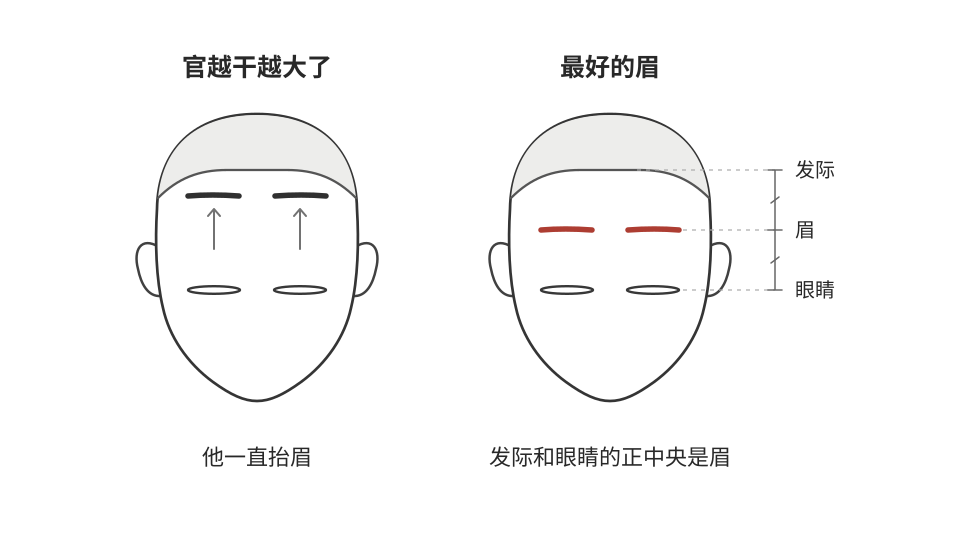 〔口述〕这种人当年不是这样，官越做越大，一直抬眉，眉就越来越高：「你说老师这不是奇怪吗」「怎么眉毛那么高」「又很难看他当年不是这样子的」「官越干越大了」「会越变成这样子了」「他一直抬眉眉毛一直抬」。（[00:42:29–00:42:41](https://www.bilibili.com/video/BV1KJsLekEfA/?p=19&t=2549)，第 76494–76841 帧） |
| **最好的眉应在什么位置？** | 〔口述〕最好的眉在额的正中间，也就是发际和眼睛的正中央：「所以最好的眉是在哪一个位置上」「在额的正中间」「发际和眼睛的正中央是眉」。（[00:42:41–00:42:57](https://www.bilibili.com/video/BV1KJsLekEfA/?p=19&t=2561)，第 76842–77315 帧） 〔板书〕人头图下方写了两个字，首字形似「眉」，第二字认不出（形似「位」，不能确定）。（[00:42:49](https://www.bilibili.com/video/BV1KJsLekEfA/?p=19&t=2569)，第 77076 帧） 〔指代〕说「在这个发际和眼睛的正中间呐」时，粉笔按在黑板人头图顶部的发际线上。（[00:43:02–00:43:05](https://www.bilibili.com/video/BV1KJsLekEfA/?p=19&t=2582)，第 77466–77567 帧） 〔板书〕人头图内左上多了一道弧线，从头顶一带往下到眉的高度；没有字说明这道线的意思。（[00:43:07](https://www.bilibili.com/video/BV1KJsLekEfA/?p=19&t=2587)，第 77616 帧） |
| **官印大、眉抬不上去的人，眉至少要高眼多少？** | 〔口述〕倪师叫学生当晚看晚间新闻，很多人都是眉毛抬得很高、官印很大：「今天晚上你看晚间新闻」「很多人都是这样子啊」「眉毛抬的很高」「官印非常的大」。（[00:43:13–00:43:25](https://www.bilibili.com/video/BV1KJsLekEfA/?p=19&t=2593)，第 77808–78167 帧） 〔口述〕有的人再怎么抬也抬不上去，那至少眉要高眼一寸：「再怎么拾眉也抬不上去」「那至少眉要高眼一寸」（「拾」疑为「抬」）。（[00:43:25–00:43:42](https://www.bilibili.com/video/BV1KJsLekEfA/?p=19&t=2605)，第 78168–78683 帧） 〔板书〕人头图下方新写两行：「眉高眼」「一寸」，字迹清楚；上方原来那两个字仍在。（[00:43:40](https://www.bilibili.com/video/BV1KJsLekEfA/?p=19&t=2620)，第 78624 帧） |
| **哪两种面相的人「想不开」？是什么表现？** | 〔口述〕第一种是眉毛和眼睛太近：「眉毛跟眼睛太近了都想不开」「有两种想不开」「一个眉毛与眼睛太近了」。（[00:43:42–00:43:47](https://www.bilibili.com/video/BV1KJsLekEfA/?p=19&t=2622)，第 78684–78839 帧） 〔口述〕第二种是从侧面看，左眼能看到右眼，山根太低、眼睛凸出：「还有一个你站他侧面」「他左眼可以看到右眼」「山根太低懂不懂」「眼睛凸出来」「这种也是想不开很累」「脑筋转不过来」。（[00:43:48–00:44:00](https://www.bilibili.com/video/BV1KJsLekEfA/?p=19&t=2628)，第 78840–79211 帧） 〔口述〕这种人怎么跟他讲，回去都不变，永远不满意眼前：「讲完他回去还是还是那样没有变」「话你都说了他没有收到」「永远不会对眼前事情很满意的」。（[00:44:03–00:44:15](https://www.bilibili.com/video/BV1KJsLekEfA/?p=19&t=2643)，第 79302–79679 帧） |
| **眉毛为什么一定要有？眉淡的人怎样？** | 〔口述〕倪师说自己不是胡说，叫学生回去看；又提到日本天皇「故意点两个眉毛在这边」：「我我我不是胡说八道啊」「你回去你去试看看」「这个好像日本那个天皇有没有」。（[00:44:16–00:44:30](https://www.bilibili.com/video/BV1KJsLekEfA/?p=19&t=2656)，第 79680–80129 帧） 〔指代〕说「故意点两个眉毛在这边」时，倪师右手食指点在自己额头眉头上方，示意点眉的位置。（[00:44:28](https://www.bilibili.com/video/BV1KJsLekEfA/?p=19&t=2668)，第 80053 帧） 〔口述〕眉毛一定要有，没有就是空壳子；眉毛淡的人喜欢作假，表面开阔、肚子里空：「但是一定要有眉毛啊」「眉毛没有了空壳子啊」「你看这个眉毛怎么那么淡」「就是喜欢作假虚伪作假」「表面上做的开阔」「怎么肚子里怎么都空的」。（[00:44:31–00:44:48](https://www.bilibili.com/video/BV1KJsLekEfA/?p=19&t=2671)，第 80130–80645 帧） 〔口述〕不能没有眉毛，被火烧掉是例外，眉毛一定会长出来：「不能没有眉毛」「当然那个是被火烧掉那例外」「他这个眉毛一定要有的」「一定会长出来」。（[00:44:48–00:44:56](https://www.bilibili.com/video/BV1KJsLekEfA/?p=19&t=2688)，第 80646–80909 帧） 〔指代〕说「他这个眉毛一定要有的」时，倪师举起右手用手指点自己的眉毛和额头。（[00:44:51](https://www.bilibili.com/video/BV1KJsLekEfA/?p=19&t=2691)，第 80758 帧） |

**总结区**

- 通用规则：延年方取吉位：改阳宅时脚朝身体健康的方位，读书书桌朝化科的方位，书桌放哪个房间都无所谓；不可朝化忌（[00:39:27–00:40:04](https://www.bilibili.com/video/BV1KJsLekEfA/?p=19&t=2367)，第 71034–72125 帧）；做生意的老板桌子面朝禄（财星）的方位；禄和忌在一起的方向不能朝，否则账上赚钱、支票却跳票（[00:40:47–00:41:29](https://www.bilibili.com/video/BV1KJsLekEfA/?p=19&t=2447)，第 73422–74675 帧）；科权会命、官做得大的人有官相，相会随官位改变，眉越抬越高（[00:41:32–00:42:41](https://www.bilibili.com/video/BV1KJsLekEfA/?p=19&t=2492)，第 74766–76841 帧）；眉在发际和眼睛的正中间，至少要高眼一寸；眉眼太近、侧面左眼看得到右眼（山根低、眼凸）都主想不开；眉毛一定要有，眉淡主作假（[00:42:41–00:44:56](https://www.bilibili.com/video/BV1KJsLekEfA/?p=19&t=2561)，第 76842–80909 帧）
- 只在本例：这位先生要改科甲考试运：不住西北角，去住东边，书桌面朝东，专业说法是面朝辰（[00:40:07–00:40:42](https://www.bilibili.com/video/BV1KJsLekEfA/?p=19&t=2407)，第 72228–73265 帧）；倪师指着黑板父母格的「禄」说这是化禄、是财星的方位（[00:40:47–00:41:02](https://www.bilibili.com/video/BV1KJsLekEfA/?p=19&t=2447)，第 73422–73865 帧）
- 不是排盘规则，是处世方法：想不开的人，话说了他也收不到，讲完回去还是那样（[00:44:03–00:44:15](https://www.bilibili.com/video/BV1KJsLekEfA/?p=19&t=2643)，第 79302–79679 帧）；讲面相要自己去验证：叫学生看晚间新闻、回去试看看（[00:43:13–00:43:18](https://www.bilibili.com/video/BV1KJsLekEfA/?p=19&t=2593)，第 77808–77945 帧；[00:44:16–00:44:20](https://www.bilibili.com/video/BV1KJsLekEfA/?p=19&t=2656)，第 79680–79811 帧）

**待核**

1. 「延年方」倪师用了但本块没有解释（[00:39:27](https://www.bilibili.com/video/BV1KJsLekEfA/?p=19&t=2367)，第 71034 帧）
2. 字幕「脚朝的方向」「住住家脚的朝位的时候」，语音作「脚潮」「搅了床位」，原话待核（[00:39:30](https://www.bilibili.com/video/BV1KJsLekEfA/?p=19&t=2370)，第 71100 帧、[00:39:51](https://www.bilibili.com/video/BV1KJsLekEfA/?p=19&t=2391)，第 71742 帧）
3. 叠图时间对不上：材料标命宫甲辰[00:39:58](https://www.bilibili.com/video/BV1KJsLekEfA/?p=19&t=2398)，第 71940 帧起、父母乙巳[00:39:44](https://www.bilibili.com/video/BV1KJsLekEfA/?p=19&t=2384)，第 71520 帧起，但[00:39:33](https://www.bilibili.com/video/BV1KJsLekEfA/?p=19&t=2373)，第 71208 帧截图已显示命宫甲辰叠图；[00:39:42](https://www.bilibili.com/video/BV1KJsLekEfA/?p=19&t=2382)，第 71488 帧指代说明又提到右下叠图为疾厄亥（[00:39:33](https://www.bilibili.com/video/BV1KJsLekEfA/?p=19&t=2373)，第 71208 帧、[00:39:42](https://www.bilibili.com/video/BV1KJsLekEfA/?p=19&t=2382)，第 71488 帧）
4. 「像这个方向也是吉有没有」手指落点看不出，指代未采用（[00:39:42](https://www.bilibili.com/video/BV1KJsLekEfA/?p=19&t=2382)，第 71488 帧）
5. 「你去住东宫位置正着」中「正着」意思不明，语音作「位子正的」（[00:40:21](https://www.bilibili.com/video/BV1KJsLekEfA/?p=19&t=2421)，第 72630 帧）
6. 房子图：上「S」下「N」、左侧字母形似「E」、左上箭头和形似「田」的小符号，倪师没有讲解代表什么（[00:40:30](https://www.bilibili.com/video/BV1KJsLekEfA/?p=19&t=2430)，第 72900 帧、[00:40:35](https://www.bilibili.com/video/BV1KJsLekEfA/?p=19&t=2435)，第 73055 帧）
7. 倪师说「贪狼星也是化禄」，但材料里夫妻壬寅的贪狼格没有化禄标记；「禄存也是禄」对应叠图疾厄辛亥，倪师没说是哪一宫（[00:40:55](https://www.bilibili.com/video/BV1KJsLekEfA/?p=19&t=2455)，第 73662 帧）
8. 字幕「就拿他的支票都是票票的」，语音作「跳票」，下一句字幕也是「跳票」，按跳票理解（[00:41:12](https://www.bilibili.com/video/BV1KJsLekEfA/?p=19&t=2472)，第 74184 帧）
9. 字幕「所以我们常常四诸位抬眉」句子不通，语音只有「台眉这个」（[00:41:44](https://www.bilibili.com/video/BV1KJsLekEfA/?p=19&t=2504)，第 75126 帧）
10. 「印」「官印」倪师用了但没有解释（[00:41:54](https://www.bilibili.com/video/BV1KJsLekEfA/?p=19&t=2514)，第 75426 帧、[00:43:24](https://www.bilibili.com/video/BV1KJsLekEfA/?p=19&t=2604)，第 78120 帧）
11. 字幕「当农委会局」，语音作「当农业会主委」，原话待核（[00:41:57](https://www.bilibili.com/video/BV1KJsLekEfA/?p=19&t=2517)，第 75534 帧）
12. 命盘格「命」字外的白圈在[00:42:28](https://www.bilibili.com/video/BV1KJsLekEfA/?p=19&t=2548)，第 76464 帧已出现，何时画的材料没标（[00:42:28](https://www.bilibili.com/video/BV1KJsLekEfA/?p=19&t=2548)，第 76464 帧）
13. 「一定要最好有的印太大了」句意不清；「再怎么拾眉也抬不上去」的「拾」疑为「抬」的识别错字（[00:43:25–00:43:32](https://www.bilibili.com/video/BV1KJsLekEfA/?p=19&t=2605)，第 78168–78365 帧）
14. 人头图下方两个字只认出首字形似「眉」，第二字认不出（[00:42:49](https://www.bilibili.com/video/BV1KJsLekEfA/?p=19&t=2569)，第 77076 帧）
15. 人头图内左上那道弧线代表什么，倪师没有说明（[00:43:07](https://www.bilibili.com/video/BV1KJsLekEfA/?p=19&t=2587)，第 77616 帧）
16. 字幕「眼睛凸出来」识别可信度只有 0.33，语音作「眼睛突出来了」（[00:43:54](https://www.bilibili.com/video/BV1KJsLekEfA/?p=19&t=2634)，第 79020 帧）
17. 字幕「你跟他怎么打他」疑为识别错误（[00:44:02](https://www.bilibili.com/video/BV1KJsLekEfA/?p=19&t=2642)，第 79266 帧）
18. 「这个两个眉毛开的」后一处「这个」、「你说老师这个很奇怪」「你看这个眉毛」三处指代不确定，未采用（[00:41:43](https://www.bilibili.com/video/BV1KJsLekEfA/?p=19&t=2503)，第 75118 帧、[00:42:56](https://www.bilibili.com/video/BV1KJsLekEfA/?p=19&t=2576)，第 77308 帧、[00:44:36](https://www.bilibili.com/video/BV1KJsLekEfA/?p=19&t=2676)，第 80289 帧）

## 例三（女命，命宫甲午贪狼，紫微在子）：贪居子午、半子送终

〔叠图〕这一例视频里只贴过 6 格：田宅 丁酉：太阳闲权、天梁闲、文昌平忌、禄存旺、凤阁庙、天官平、年解旺；命宫 甲午：贪狼旺、左辅旺、咸池陷、大耗旺；子女 辛卯：天姚庙、天寿陷、恩光庙；官禄 戊戌：七杀庙、擎羊庙、三台旺、天德庙、寡宿陷、解神庙；迁移 庚子：紫微平；夫妻 壬辰：廉贞旺、天府庙、八座旺、副截陷、副旬陷。

### 9　贪居子午与半子送终：34岁问事业（[00:45:01–00:50:58](https://www.bilibili.com/video/BV1KJsLekEfA/?p=19&t=2701)，第 81036–91769 帧）

| 提示区 | 笔记区 |
|---|---|
| **这张新盘从哪里引出来？是哪年生的人？** | 〔口述〕倪师问前面举例的八字有没有带来，说当时举例只是告诉大家紫微星的位置，「实际上中间有很多地方……要讲的都是我们的案例」。（[00:45:01–00:45:16](https://www.bilibili.com/video/BV1KJsLekEfA/?p=19&t=2701)，第 81036–81503 帧） 〔口述〕让学生看「第一章」，找出民国50年出生的那张（字幕数字重复，注着1961），并问「紫微星在子有没有」。（[00:45:16–00:45:59](https://www.bilibili.com/video/BV1KJsLekEfA/?p=19&t=2716)，第 81504–82781 帧） 〔叠图〕迁移庚子：紫微平；格里另有小耗、息神、病符、死；大限64~73，小限8,20,32,44,56；叠图该格标着「命之迁」。（[00:45:23–00:45:59](https://www.bilibili.com/video/BV1KJsLekEfA/?p=19&t=2723)，第 81714–82781 帧） 〔板书〕黑板刚擦过，大部分是空的，倪师写字的地方被身体挡住，认不出写了什么。（[00:45:39](https://www.bilibili.com/video/BV1KJsLekEfA/?p=19&t=2739)，第 82176 帧） |
| **这个人的命宫是什么星？「贪居子午」写在哪？** | 〔口述〕倪师一边讲一边写星，说「这个人的命宫贪狼在这里」，又说「命学上有一句话」：「贪居子午啊」。（[00:45:59–00:46:22](https://www.bilibili.com/video/BV1KJsLekEfA/?p=19&t=2759)，第 82782–83465 帧） 〔指代〕说「贪狼在这里」时，粉笔一直停在刚写好的「命」字那一格。（[00:46:04](https://www.bilibili.com/video/BV1KJsLekEfA/?p=19&t=2764)，第 82948 帧） 〔叠图〕命宫甲午：贪狼旺、左辅旺、天钺、天厨、咸池陷、大耗旺、月德，另有小耗、沐浴；大限4~13，小限2,14,26,38,50；叠图该格标着「火贵」。（[00:46:15–00:46:22](https://www.bilibili.com/video/BV1KJsLekEfA/?p=19&t=2775)，第 83250–83465 帧） 〔板书〕可辨：上方一个「命」字，下面竖写「贪居子午」。（[00:46:16](https://www.bilibili.com/video/BV1KJsLekEfA/?p=19&t=2776)，第 83290 帧） |
| **贪狼在子和在午有什么不同？** | 〔口述〕「这个在子和午不一样」，「一般来说在子的话桃花命」，「如果在午的话是火贵」，「这两个不太一样」。（[00:46:22–00:46:35](https://www.bilibili.com/video/BV1KJsLekEfA/?p=19&t=2782)，第 83466–83867 帧） 〔口述〕接着讲午是「最正热的时候」，并说「……贪狼是生杀之权威震边疆」。（[00:46:35–00:46:44](https://www.bilibili.com/video/BV1KJsLekEfA/?p=19&t=2795)，第 83868–84149 帧） 〔口述〕又说「贪狼星在子时出来的时候」「不太好」，贪狼如果在那里就叫做「贪在子」，「这不是很好」。（[00:46:45–00:46:58](https://www.bilibili.com/video/BV1KJsLekEfA/?p=19&t=2805)，第 84150–84551 帧） 〔板书〕「贪居子午」里的「子」「午」各画了圈；从「子」画箭头往上指向「桃花」，从「午」连线到圈起来的「火贵」。（[00:46:34](https://www.bilibili.com/video/BV1KJsLekEfA/?p=19&t=2794)，第 83820 帧） 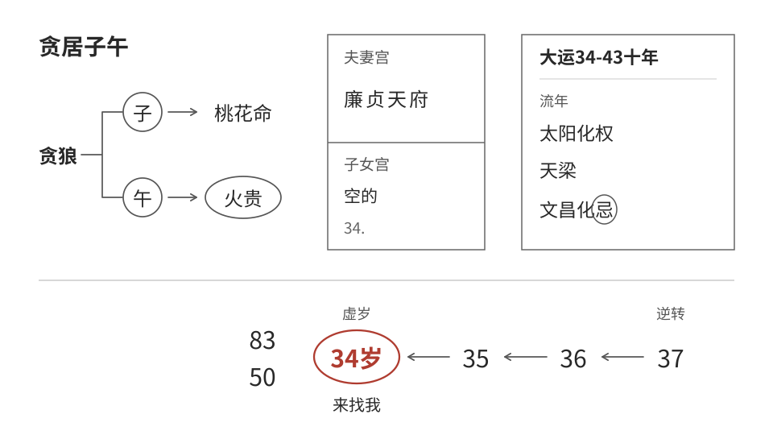 〔叠图〕另贴一格「命宫庚子」，星曜和命宫甲午一样，但标着「桃花命」。这是配合「在子的话桃花命」做的示意，不是本盘的命宫。（[00:46:35–00:46:40](https://www.bilibili.com/video/BV1KJsLekEfA/?p=19&t=2795)，第 83868–84029 帧） |
| **她今年几岁？这个岁数怎么来的？** | 〔口述〕「这个八字哦」，「今年他是50年出世的」，「今年83年虚岁我们算什么啊」，答「34岁」，并重复了一遍「34岁」。字幕括号里的「83-50+1」是字幕的注字，不是倪师说的。（[00:46:58–00:47:16](https://www.bilibili.com/video/BV1KJsLekEfA/?p=19&t=2818)，第 84552–85085 帧） 〔板书〕右侧一格写着「83」「50」，下面圈了「34」；板上画了一个三角形连着几格；下方一格圈着两个字，认不出。（[00:47:12](https://www.bilibili.com/video/BV1KJsLekEfA/?p=19&t=2832)，第 84960 帧） |
| **34–43这十年看哪一格？有哪些星？** | 〔口述〕「这里有几个地方要看」，「第一个诸位看34-43」，「她的流年是太阳化权天梁」，「还有文昌化忌有没有在这边」，「忌在这」。（[00:47:16–00:47:37](https://www.bilibili.com/video/BV1KJsLekEfA/?p=19&t=2836)，第 85086–85739 帧） 〔叠图〕田宅丁酉：太阳闲、带化权，天梁闲，文昌平、带化忌，禄存旺，另有凤阁庙、天官平、年解旺、博士、将星、白虎、帝旺；大限34~43。（[00:47:17–00:47:22](https://www.bilibili.com/video/BV1KJsLekEfA/?p=19&t=2837)，第 85134–85277 帧） 〔板书〕右上一格可辨「天」，下面有一个圈起来的「忌」，其余认不出。（[00:47:59](https://www.bilibili.com/video/BV1KJsLekEfA/?p=19&t=2879)，第 86376 帧） |
| **她的子女宫、夫妻宫各是什么样？** | 〔口述〕「本宫这是子女宫这边是空的」；接着说「这个是夫妻宫是廉贞天府」，又念了一遍「廉贞天府」。（[00:47:38–00:47:52](https://www.bilibili.com/video/BV1KJsLekEfA/?p=19&t=2858)，第 85740–86171 帧） 〔指代〕说「这边是空的」时，伸出食指指着左列中间那格，就是写着「34.」的空格。（[00:47:39](https://www.bilibili.com/video/BV1KJsLekEfA/?p=19&t=2859)，第 85798 帧） 〔板书〕左列中间一格写着「34.」，格里没有星。（[00:47:39](https://www.bilibili.com/video/BV1KJsLekEfA/?p=19&t=2859)，第 85772 帧） 〔叠图〕夫妻壬辰：廉贞旺、天府庙，另有八座旺、台辅、天月、副截陷、副旬陷、喜神、天煞、贯索、养；大限104~113。（[00:47:44–00:47:49](https://www.bilibili.com/video/BV1KJsLekEfA/?p=19&t=2864)，第 85920–86081 帧） 〔板书〕左上一格新写了三行字，可辨「天」，像「天府」，其余认不清。（[00:47:48](https://www.bilibili.com/video/BV1KJsLekEfA/?p=19&t=2868)，第 86069 帧） |
| **她34岁来找倪师，倪师怎么说「是不是命」？** | 〔口述〕「我们看她的大运34-43十年」。（[00:47:52–00:48:03](https://www.bilibili.com/video/BV1KJsLekEfA/?p=19&t=2872)，第 86172–86507 帧） 〔口述〕说「这个37岁女孩子是逆转」，然后倒着数「那今年37 36 35 34」，「刚好来34岁来找我」，「你说是不是命哦34岁」。（[00:48:03–00:48:23](https://www.bilibili.com/video/BV1KJsLekEfA/?p=19&t=2883)，第 86508–87101 帧） 〔板书〕上方一格圈着「37」。（[00:48:13](https://www.bilibili.com/video/BV1KJsLekEfA/?p=19&t=2893)，第 86808 帧） 〔叠图〕官禄戊戌：七杀庙、擎羊庙，另有三台旺、解神庙、寡宿陷、阴煞、天德庙、力士、攀鞍、天德、衰；大限44~53，小限10,22,34,46,58。（[00:48:10–00:48:14](https://www.bilibili.com/video/BV1KJsLekEfA/?p=19&t=2890)，第 86712–86837 帧） |
| **34岁那年本宫落在哪？她来最想问什么？** | 〔口述〕「诸位来看八字的时候」「当有人来问你的时候」，不管以后做不做专业的「或者是帮人家看」，「那很好玩啊」。（[00:48:23–00:48:33](https://www.bilibili.com/video/BV1KJsLekEfA/?p=19&t=2903)，第 87102–87401 帧） 〔口述〕「她34岁来找你」，「34岁那年她本宫就落在什么」，答事业宫（字幕连出三次），「她本宫落在事业宫」，「她来找你最大的目的是想什么」「想看事业」，「这是她的想法对不对」。（[00:48:33–00:48:51](https://www.bilibili.com/video/BV1KJsLekEfA/?p=19&t=2913)，第 87402–87935 帧） 〔推断〕推断：叠图官禄戊戌的小限里有34，和「34岁那年她本宫……落在事业宫」对得上；倪师没有明说这层关系。（[00:48:10–00:48:43](https://www.bilibili.com/video/BV1KJsLekEfA/?p=19&t=2890)，第 86712–87707 帧） 〔板书〕右侧田宅那一列下方新写了字，认不出。（[00:48:20](https://www.bilibili.com/video/BV1KJsLekEfA/?p=19&t=2900)，第 87012 帧） |
| **一看34–43的盘，倪师看出她还不知道的什么事？** | 〔口述〕「结果一来一看的时候」，「哇34-43太阳化忌完了」，「先生会出事啊」。（[00:48:51–00:48:58](https://www.bilibili.com/video/BV1KJsLekEfA/?p=19&t=2931)，第 87936–88145 帧） 〔口述〕「可她她还不知道为什么」，「还没有发生啊」，「她只是想来看事业如何」。（[00:48:58–00:49:05](https://www.bilibili.com/video/BV1KJsLekEfA/?p=19&t=2938)，第 88146–88379 帧） 〔推断〕推断：前面口述是「太阳化权」「文昌化忌」，叠图也是太阳带权、文昌带忌，这里却说「太阳化忌」，说法前后不一，放进待核。（[00:47:22–00:48:54](https://www.bilibili.com/video/BV1KJsLekEfA/?p=19&t=2842)，第 85278–88043 帧） |
| **她家阳宅怎么画？主卧和子女房在哪？** | 〔口述〕「阳宅拿出来」，「呀这下阳宅一拿出来精彩」，「主卧房在这里」，「这里是子女的房子」。（[00:49:06–00:49:23](https://www.bilibili.com/video/BV1KJsLekEfA/?p=19&t=2946)，第 88380–88919 帧） 〔指代〕画平面图时说主卧「放在这里」，粉笔停在平面图右上那个小隔间，后来在那里写了「卧」。（[00:49:13](https://www.bilibili.com/video/BV1KJsLekEfA/?p=19&t=2953)，第 88618 帧） 〔指代〕说「这里是子女的房子」时，粉笔停在平面图左上那个隔间。（[00:49:19](https://www.bilibili.com/video/BV1KJsLekEfA/?p=19&t=2959)，第 88798 帧） 〔板书〕左侧画了一个房屋平面图：上方「S」，左边「E」，右边「W」，下方一个字认不清；右上隔间写「卧」，右下隔间写「厨」，左上隔间的字像「3女」，认不清。（[00:49:21](https://www.bilibili.com/video/BV1KJsLekEfA/?p=19&t=2961)，第 88848 帧） 〔推断〕推断：按板上S在上、E在左、W在右，左上隔间是东南、右上是西南、右下是西北，和后面口述的「东南边有房间」「西北角是厨房」「西南角」对得上。（[00:49:21–00:50:42](https://www.bilibili.com/video/BV1KJsLekEfA/?p=19&t=2961)，第 88848–91277 帧） |
| **为什么说她「无子」却「有女」？** | 〔口述〕「第一个子女宫是空的对面化忌」，「所以她的本身她是无子」，「看到没有」。（[00:49:24–00:49:30](https://www.bilibili.com/video/BV1KJsLekEfA/?p=19&t=2964)，第 88920–89117 帧） 〔口述〕「阳宅上因为东南边有房间」，「一定会有女」，「阳宅上面看到有女」。（[00:49:30–00:49:37](https://www.bilibili.com/video/BV1KJsLekEfA/?p=19&t=2970)，第 89118–89333 帧） 〔叠图〕子女辛卯：没有主星，只有天姚庙、恩光庙、天寿陷，另有飞廉、灾煞、丧门、胎；大限94~103。同时贴着田宅丁酉。（[00:49:24–00:49:26](https://www.bilibili.com/video/BV1KJsLekEfA/?p=19&t=2964)，第 88920–88991 帧） 〔推断〕推断：叠图此时把子女辛卯和带文昌忌的田宅丁酉一起贴出，「对面化忌」可能就是指田宅那格的文昌化忌；倪师没有说对面是哪一宫。（[00:49:24–00:49:26](https://www.bilibili.com/video/BV1KJsLekEfA/?p=19&t=2964)，第 88920–88991 帧） 〔板书〕左侧一格圈着「有女」，旁边两字像「无子」，下面是「34.」。（[00:49:48](https://www.bilibili.com/video/BV1KJsLekEfA/?p=19&t=2988)，第 89640 帧） 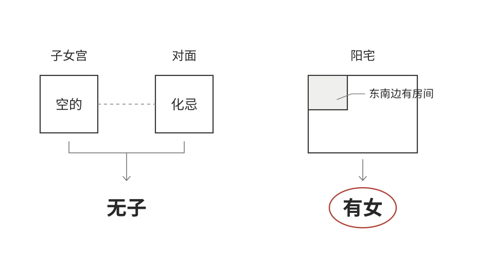 |
| **「半子送终」是怎么断出来的？** | 〔口述〕「34-43 太阳星忌看不到太阳」，「西北角是厨房」，「所以这个整个格局叫做什么」，「半子送终啊」，「儿子没了女儿啊」。（[00:49:37–00:49:54](https://www.bilibili.com/video/BV1KJsLekEfA/?p=19&t=2977)，第 89334–89825 帧） 〔口述〕「她现在就有个女儿」，「来的时候我是想着哇」「这个真是好福气啊」，「好家在对不对好家在」（括号注台语幸亏）。（[00:49:54–00:50:05](https://www.bilibili.com/video/BV1KJsLekEfA/?p=19&t=2994)，第 89826–90155 帧） 〔板书〕平面图上方竖写四个字，可辨「半」「送」，其余两字潦草，配合口述当是「半子送终」。（[00:49:48](https://www.bilibili.com/video/BV1KJsLekEfA/?p=19&t=2988)，第 89640 帧） |
| **先生哪年会有问题？凶宅几年成灾？** | 〔口述〕倪师跟太太说「你这个先生会这个」，「明年35岁会有问题」，问「你这房子住了多久」，答「我住了两年」。（[00:50:05–00:50:15](https://www.bilibili.com/video/BV1KJsLekEfA/?p=19&t=3005)，第 90156–90479 帧） 〔口述〕「好累一个凶宅三年成灾」，「凡是三之数都会成灾」，「有的时候三年」，「普遍来说大部分在第在第三年」，「第三年会发生事情」。（[00:50:16–00:50:31](https://www.bilibili.com/video/BV1KJsLekEfA/?p=19&t=3016)，第 90480–90935 帧） 〔叠图〕再次贴出田宅丁酉，星曜同前，大限34~43。（[00:50:00–00:50:05](https://www.bilibili.com/video/BV1KJsLekEfA/?p=19&t=3000)，第 90012–90155 帧） 〔板书〕画面上的黑板模糊、有重影，认不出字。（[00:50:16](https://www.bilibili.com/video/BV1KJsLekEfA/?p=19&t=3016)，第 90492 帧） |
| **当务之急是什么？她住西南角为何还要问事业？** | 〔口述〕「那这个化解她夫妻的灾」「变成最重要当当务之急」，「去化解夫妻的灾」。（[00:50:31–00:50:35](https://www.bilibili.com/video/BV1KJsLekEfA/?p=19&t=3031)，第 90936–91073 帧） 〔口述〕「那她会来问事业」，「当然会来问事业为什么」，因为她住在西南角（字幕作「佳」），「西南角是坤坤为地啊」，「她本身名字叫太太住住对位置了」。（[00:50:35–00:50:45](https://www.bilibili.com/video/BV1KJsLekEfA/?p=19&t=3035)，第 91074–91373 帧） 〔口述〕「所以她自己在位置上」，打比方「就好像你的名字叫苹果……你会长得很好」；「所以她并不会说甘于做个妈妈」，「她会要去做生意赚钱」，「她当然来问你事业」。（[00:50:45–00:50:58](https://www.bilibili.com/video/BV1KJsLekEfA/?p=19&t=3045)，第 91374–91769 帧） |

**总结区**

- 通用规则：贪居子午：贪狼在子一般是桃花命，在午是火贵，两者不一样（[00:46:11–00:46:35](https://www.bilibili.com/video/BV1KJsLekEfA/?p=19&t=2771)，第 83148–83867 帧）；一个凶宅三年成灾，凡是三之数都会成灾，大部分在第三年发生事情（[00:50:16–00:50:31](https://www.bilibili.com/video/BV1KJsLekEfA/?p=19&t=3016)，第 90480–90935 帧）
- 只在本例：民国50年生的女命，命宫甲午贪狼，83年虚岁34，正走34–43这十年（[00:46:58–00:48:03](https://www.bilibili.com/video/BV1KJsLekEfA/?p=19&t=2818)，第 84552–86507 帧）；34岁本宫落在事业宫，所以来问事业；但34–43「太阳化忌」，倪师断先生会出事、明年35岁有问题（[00:48:33–00:50:10](https://www.bilibili.com/video/BV1KJsLekEfA/?p=19&t=2913)，第 87402–90311 帧）；子女宫空、对面化忌所以无子，阳宅东南有房所以有女，整个格局叫「半子送终」（[00:49:24–00:49:54](https://www.bilibili.com/video/BV1KJsLekEfA/?p=19&t=2964)，第 88920–89825 帧）；她住西南角、坤为地，住对了位置，所以不甘于做妈妈，要做生意赚钱（[00:50:37–00:50:55](https://www.bilibili.com/video/BV1KJsLekEfA/?p=19&t=3037)，第 91110–91661 帧）
- 不是排盘规则，是处世方法：客人来问的是事业，倪师看出的当务之急却是化解她夫妻的灾（[00:50:31–00:50:36](https://www.bilibili.com/video/BV1KJsLekEfA/?p=19&t=3031)，第 90936–91109 帧）

**待核**

1. [00:45:16–00:45:23](https://www.bilibili.com/video/BV1KJsLekEfA/?p=19&t=2716)，第 81504–81713 帧：字幕「诸位看第一章」语音作「第一张」，可能指讲义第一张；「5050那个50年」「5年50年出世的」数字重复，按民国50年理解。
2. [00:45:39](https://www.bilibili.com/video/BV1KJsLekEfA/?p=19&t=2739)，第 82176 帧：板书图里黑板刚擦过，倪师写字的地方被身体挡住，认不出。
3. [00:46:33–00:46:35](https://www.bilibili.com/video/BV1KJsLekEfA/?p=19&t=2793)，第 83796–83867 帧：语音有「午是中午最……」，字幕这句只有「这两个不太一样」，「午是中午」没有字幕可对。
4. [00:46:41](https://www.bilibili.com/video/BV1KJsLekEfA/?p=19&t=2801)，第 84030 帧：字幕「出贪狼是生杀之权威震边疆」，语音作「贪狼是三杂之权威震边疆」，句首「出」字和断句待核。
5. [00:46:45–00:46:50](https://www.bilibili.com/video/BV1KJsLekEfA/?p=19&t=2805)，第 84150–84317 帧：「贪狼星在子时出来的时候不太好」里的「子时」是指时辰还是子宫，没有解释；此处两处「这个」指向看不出。
6. [00:46:52](https://www.bilibili.com/video/BV1KJsLekEfA/?p=19&t=2812)，第 84384 帧：字幕「就四做贪在子」，按语音改作「就叫做贪在子」。
7. [00:47:07](https://www.bilibili.com/video/BV1KJsLekEfA/?p=19&t=2827)，第 84816 帧：字幕括号「83-50+1」是字幕注字，不是倪师说的话。
8. [00:47:22](https://www.bilibili.com/video/BV1KJsLekEfA/?p=19&t=2842)，第 85278 帧：说「她的流年是太阳化权天梁」，但讲的是34–43这十年（后面说「大运34-43十年」），「流年」用词待核。
9. [00:47:38](https://www.bilibili.com/video/BV1KJsLekEfA/?p=19&t=2858)，第 85740 帧：「本宫这是子女宫」里的「本宫」指什么没有解释。
10. [00:47:39](https://www.bilibili.com/video/BV1KJsLekEfA/?p=19&t=2859)，第 85772 帧：板书图上已经出现子女辛卯的叠图，比材料记的[00:49:25](https://www.bilibili.com/video/BV1KJsLekEfA/?p=19&t=2965)，第 88950 帧早。
11. [00:48:03](https://www.bilibili.com/video/BV1KJsLekEfA/?p=19&t=2883)，第 86508 帧：「这个37岁女孩子是逆转」意思不明，语音作「三十七岁你来只是逆转」；板上圈的「37」也没有解释。
12. [00:48:37–00:48:38](https://www.bilibili.com/video/BV1KJsLekEfA/?p=19&t=2917)，第 87534–87551 帧：字幕「早亦隼」「早不」是乱码，已略过；[00:48:38–00:48:42](https://www.bilibili.com/video/BV1KJsLekEfA/?p=19&t=2918)，第 87552–87671 帧「事业宫」连出三次，当一句看。
13. [00:48:52](https://www.bilibili.com/video/BV1KJsLekEfA/?p=19&t=2932)，第 87978 帧：口述「34-43太阳化忌」，[00:49:37](https://www.bilibili.com/video/BV1KJsLekEfA/?p=19&t=2977)，第 89334 帧又说「太阳星忌」，但叠图田宅丁酉是太阳带权、文昌带忌；[00:50:16](https://www.bilibili.com/video/BV1KJsLekEfA/?p=19&t=3016)，第 90492 帧叠图上有一条红箭头从文昌的「忌」指向太阳，是否表示忌冲太阳待核。
14. [00:49:24](https://www.bilibili.com/video/BV1KJsLekEfA/?p=19&t=2964)，第 88920 帧：「子女宫是空的对面化忌」的「对面」是哪一宫没有说。
15. [00:49:34](https://www.bilibili.com/video/BV1KJsLekEfA/?p=19&t=2974)，第 89232 帧：字幕「限宅上会看到」，按上下文改作「阳宅」。
16. [00:49:45–00:49:50](https://www.bilibili.com/video/BV1KJsLekEfA/?p=19&t=2985)，第 89562–89729 帧：「半子送终」这个说法倪师没有解释；[00:49:37–00:49:42](https://www.bilibili.com/video/BV1KJsLekEfA/?p=19&t=2977)，第 89334–89465 帧「看不到太阳」和「西北角是厨房」的关系也没有讲明。
17. [00:50:16](https://www.bilibili.com/video/BV1KJsLekEfA/?p=19&t=3016)，第 90480 帧：「好累」意思不明。
18. [00:50:19–00:50:22](https://www.bilibili.com/video/BV1KJsLekEfA/?p=19&t=3019)，第 90582–90683 帧：语音有「有的时候三个月有的时候三年」，字幕只有「有的时候三年」。
19. [00:50:38](https://www.bilibili.com/video/BV1KJsLekEfA/?p=19&t=3038)，第 91146 帧：字幕「她佳在西南角」，按语音改作「住」。
20. [00:50:42–00:50:50](https://www.bilibili.com/video/BV1KJsLekEfA/?p=19&t=3042)，第 91278–91517 帧：「她本身名字叫太太」「会发她自己」（语音作「会扒」）「苹果就是在骊山」（语音作「位置在离灾」）都听不清，原话待核。
21. [00:50:35](https://www.bilibili.com/video/BV1KJsLekEfA/?p=19&t=3035)，第 91074 帧、[00:50:55](https://www.bilibili.com/video/BV1KJsLekEfA/?p=19&t=3055)，第 91662 帧：字幕「事业业」多一个「业」字。
22. [00:47:12](https://www.bilibili.com/video/BV1KJsLekEfA/?p=19&t=2832)，第 84960 帧：板书下方一格圈着的两个字认不出；[00:48:20](https://www.bilibili.com/video/BV1KJsLekEfA/?p=19&t=2900)，第 87012 帧右侧新写的字认不出；[00:49:21](https://www.bilibili.com/video/BV1KJsLekEfA/?p=19&t=2961)，第 88848 帧平面图下方的方位字和左上隔间像「3女」的字认不清；[00:49:48](https://www.bilibili.com/video/BV1KJsLekEfA/?p=19&t=2988)，第 89640 帧「无子」二字不太确定。

### 10　断41岁最凶、女儿八字佐证、愚善（[00:50:59–00:56:31](https://www.bilibili.com/video/BV1KJsLekEfA/?p=19&t=3059)，第 91770–101749 帧）

| 提示区 | 笔记区 |
|---|---|
| **她先生那边「否」要不要紧？什么才是凶限？** | 〔口述〕接着例三讲她先生：「那她先生是否啊……」「对不对否啊」，又说「那否也不打紧啊还是厨房呢」——先生那边「否」还不要紧，要紧的是厨房：「懂不懂厨房就毁了」「就完了这个是凶限」。（[00:50:59–00:51:12](https://www.bilibili.com/video/BV1KJsLekEfA/?p=19&t=3059)，第 91770–92165 帧） 〔板书〕本块开头的板面可辨：中格上方「贪狼」、其下「命」；右格「83」「50」，右上红圈里「37」；左侧小方框里有一字像「厨」。其余认不出。（[00:50:59](https://www.bilibili.com/video/BV1KJsLekEfA/?p=19&t=3059)，第 91770 帧） 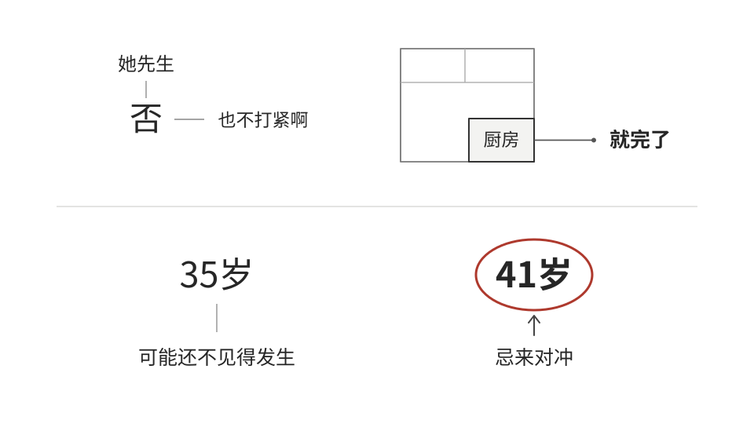 |
| **35岁和41岁比，哪一年最凶？为什么？** | 〔口述〕倪师拿两个岁数比：「如果以35岁的灾」「35岁和41岁比起来的时候」「41岁是最凶懂不懂我意思」，「35岁可能还不见得发生」「但是41岁上会最凶」。（[00:51:13–00:51:31](https://www.bilibili.com/video/BV1KJsLekEfA/?p=19&t=3073)，第 92196–92759 帧） 〔口述〕41岁最凶的原因：「最凶因为什么对冲忌」「忌来对冲」。（[00:51:32–00:51:35](https://www.bilibili.com/video/BV1KJsLekEfA/?p=19&t=3092)，第 92760–92867 帧） 〔叠图〕左下贴子女辛卯：天姚庙、恩光庙、天寿陷，大限94~103，小限可辨5、17、41等，41加了框；右上贴田宅丁酉：太阳闲、权，天梁闲，禄存旺，文昌平、忌，凤阁庙，天官平，年解旺，帝旺，大限34~43，小限11、23、35……59，35加了框。（[00:51:13–00:51:21](https://www.bilibili.com/video/BV1KJsLekEfA/?p=19&t=3073)，第 92196–92441 帧） 〔板书〕这段写了约4秒，中下方新写了一排圆圈和字，笔画认不全，不猜；上方「贪狼」、左侧小框「厨」仍在。（[00:51:20](https://www.bilibili.com/video/BV1KJsLekEfA/?p=19&t=3080)，第 92400 帧） 〔推断〕推断：叠图把35框在田宅丁酉的小限里、把41框在子女辛卯的小限里，正对应口述比较的两个岁数；倪师本块没有口头说出这两个宫名。（[00:51:13–00:51:21](https://www.bilibili.com/video/BV1KJsLekEfA/?p=19&t=3073)，第 92196–92441 帧） |
| **回头比较的「刚刚前面那个」忌对冲是什么？** | 〔口述〕倪师回头比较：「刚刚前面那个是不是忌对冲」「化忌巨门化忌对冲太阳」「33岁有没有」「那对冲也是很凶」「那刚刚是在33岁」。（[00:51:35–00:51:44](https://www.bilibili.com/video/BV1KJsLekEfA/?p=19&t=3095)，第 92868–93143 帧） 〔叠图〕画面改贴交友辛亥：巨门旺、化忌，天马平、天魁旺、天姚陷、天福庙、天贵平、孤辰陷等，叠图该格标着「丧夫」；兄弟乙巳：太阳旺，地空庙、地劫不、陀罗陷、旬空庙、破碎陷等，叠图该格标着「又丧夫」。（[00:51:37–00:51:38](https://www.bilibili.com/video/BV1KJsLekEfA/?p=19&t=3097)，第 92910–92969 帧） 〔推断〕推断：这两格的宫干支与本块例三的子女辛卯、田宅丁酉不同，又带「丧夫」「又丧夫」提示字，可见「刚刚前面那个」是另一张盘（按本集安排是例一，1957年生女命）；倪师拿它说明巨门化忌对冲太阳一样很凶。（[00:51:35–00:51:44](https://www.bilibili.com/video/BV1KJsLekEfA/?p=19&t=3095)，第 92868–93143 帧） |
| **本例太阳本宫有化忌，35和41岁哪个凶？** | 〔口述〕「本宫也有化忌」「因为太阳被冲到」，接着讲本例：「那她这个太阳本宫有化忌」「所以35岁也区」「是41岁也凶」——两个岁数都凶。（[00:51:44–00:51:52](https://www.bilibili.com/video/BV1KJsLekEfA/?p=19&t=3104)，第 93144–93383 帧） 〔指代〕说「她这个太阳本宫有化忌」时，手指的是黑板右侧格内星名下方带圈的「忌」字及其下红线处；板上没写宫名。（[00:51:48](https://www.bilibili.com/video/BV1KJsLekEfA/?p=19&t=3108)，第 93248 帧） 〔叠图〕此时右上叠图仍是田宅丁酉，该格太阳闲、权，文昌平、忌，大限34~43。（[00:51:47–00:51:49](https://www.bilibili.com/video/BV1KJsLekEfA/?p=19&t=3107)，第 93234–93293 帧） |
| **到底在哪一年出事，第一个看什么？** | 〔口述〕「那到底是哪一个的时候到底在」「这两个到底是在33岁出事发生事情」「还是41岁发生事情」，倪师说「第一个原因决定在阳宅上面」。（[00:51:52–00:52:01](https://www.bilibili.com/video/BV1KJsLekEfA/?p=19&t=3112)，第 93384–93647 帧） 〔推断〕推断：本块开头说厨房毁了就是凶限，这里又说第一个原因决定在阳宅，两处都落在阳宅上；倪师没有把这两句明说连起来。（[00:51:02–00:52:01](https://www.bilibili.com/video/BV1KJsLekEfA/?p=19&t=3062)，第 91878–93647 帧） |
| **先生八字找不到，怎么看他有没有灾？** | 〔口述〕第二个办法：「第二个从女儿的八字可以看到先生」，因为「她先生八字没有找不到」「没有办法查到」。（[00:52:01–00:52:12](https://www.bilibili.com/video/BV1KJsLekEfA/?p=19&t=3121)，第 93648–93965 帧） 〔口述〕「结果我把她女儿的八字一排出来一看」，就对太太说「我不要收你女儿的钱」「你把你女儿八字给我」「我只要看她爸爸有没有灾」。（[00:52:12–00:52:24](https://www.bilibili.com/video/BV1KJsLekEfA/?p=19&t=3132)，第 93966–94349 帧） |
| **女儿7岁与妈妈41岁怎样合到？现在发生了吗？** | 〔口述〕「女儿一岁」之后一句字幕乱码，接着「七岁爸爸大限」；「女儿来说七岁爸爸要走」「妈妈来说41岁先生要走」「两个大运是合到的懂不懂」。（[00:52:25–00:52:41](https://www.bilibili.com/video/BV1KJsLekEfA/?p=19&t=3145)，第 94350–94847 帧） 〔口述〕「这就是同时间生人」「他不一定会同时发生事情」；「如果我们光论命的话」「有可能有的人在35」「有的人在41了对不对」，「所以就会变成肯定是在什么41岁」。（[00:52:41–00:52:53](https://www.bilibili.com/video/BV1KJsLekEfA/?p=19&t=3161)，第 94848–95195 帧） 〔口述〕「那事情还没有发生」「因为还有还有7年的时间」「气色眼前看不到」。（[00:52:56–00:53:01](https://www.bilibili.com/video/BV1KJsLekEfA/?p=19&t=3176)，第 95292–95459 帧） 〔推断〕推断：光论她本人的命，35与41都有可能；加上女儿八字里爸爸7岁要走，与她41岁先生要走两个大运合到，倪师才断定是41岁。（[00:52:35–00:52:53](https://www.bilibili.com/video/BV1KJsLekEfA/?p=19&t=3155)，第 94662–95195 帧） |
| **越接近大限，女子的面相声音怎么变？** | 〔口述〕「我们看到女孩子声沙骨粗面大」「以前不是这样子哦」「越接近那个大限的时候」「越变成这样子」「然后大限发生以后」「就很快就变成这样子知道吧」。（[00:53:03–00:53:15](https://www.bilibili.com/video/BV1KJsLekEfA/?p=19&t=3183)，第 95496–95861 帧） 〔口述〕又补一句另一种可能：「那可能是伤心的哭了」「变成声音沙哑了也不一定」。（[00:53:15–00:53:18](https://www.bilibili.com/video/BV1KJsLekEfA/?p=19&t=3195)，第 95862–95963 帧） |
| **到殡仪馆也能看相？呼天抢地的是什么人？** | 〔口述〕「诸位哦你到那个殡仪馆上香」「所以我们到哪里都可以看相啊」。（[00:53:21–00:53:25](https://www.bilibili.com/video/BV1KJsLekEfA/?p=19&t=3201)，第 96030–96173 帧） 〔口述〕「你看那人哭的呼天抢地」「这个人废物没有用啊」，「有的人亲人死的呼天抢地啊」「小人呐」「小人都是呼天抢地的」。（[00:53:29–00:53:40](https://www.bilibili.com/video/BV1KJsLekEfA/?p=19&t=3209)，第 96270–96605 帧） 〔口述〕真有六亲过世，「亲人过世很难过是肯定的」「但是不会呼天抢地懂不懂我意思」。（[00:53:40–00:53:46](https://www.bilibili.com/video/BV1KJsLekEfA/?p=19&t=3220)，第 96606–96791 帧） |
| **什么叫「愚善」？** | 〔口述〕很多人想「哎呀我要把我孩子训练的很善良」，倪师说「没错从你开始跟孩子都变成愚善」「都笨的要死」。（[00:53:54–00:54:06](https://www.bilibili.com/video/BV1KJsLekEfA/?p=19&t=3234)，第 97032–97403 帧） 〔板书〕这段擦板后写了约8秒，但写完后的板书图画面模糊，板上的字一个也认不出。（[00:54:10](https://www.bilibili.com/video/BV1KJsLekEfA/?p=19&t=3250)，第 97500 帧） |
| **济弱扶倾和养虎为患只差在哪？** | 〔口述〕有人自认「我能力很强」「我专门是济弱扶倾」；倪师说「济弱扶倾跟养虎为患跟助纣为虐」「差一纸之隔」。（[00:54:08–00:54:23](https://www.bilibili.com/video/BV1KJsLekEfA/?p=19&t=3248)，第 97440–97901 帧） 〔口述〕「所有的小人」「他在外面看起来都是很可怜」「很要博得人家同情的」；他自己「十块钱吃卤肉饭」「我也可以过」「我为什么要去博人家同情」，「那个需要去博人家的心里面就有愧」。（[00:54:23–00:54:38](https://www.bilibili.com/video/BV1KJsLekEfA/?p=19&t=3263)，第 97902–98351 帧） 〔口述〕很多太太女孩子要济弱扶倾去帮人出头，「结果帮了半天你会发现他」「根本就是帮到个小人」，「尾巴大已经丢不掉了」，「把这小小人培养成个大小人」「然后害了好多人」。（[00:54:39–00:55:04](https://www.bilibili.com/video/BV1KJsLekEfA/?p=19&t=3279)，第 98388–99149 帧） |
| **丧礼上怎么从气色分出真悲伤和假哭？** | 〔口述〕「所以如果去参加那种丧礼的时候」「一看他们悲泣在心里面很难过」「看脸上的气色都知道」「印堂都自的嘛」；「那呼天抢地那个人啊额头红红的啊」。（[00:55:07–00:55:18](https://www.bilibili.com/video/BV1KJsLekEfA/?p=19&t=3307)，第 99234–99557 帧） 〔口述〕对呼天抢地的人「本来要给他1000块给一块钱」「这个不好嘛」「读图就知道」。（[00:55:18–00:55:28](https://www.bilibili.com/video/BV1KJsLekEfA/?p=19&t=3318)，第 99558–99857 帧） 〔口述〕「所以那个在里面呼天抢地的」「不是就是你花钱请来的」「哭的就是那个假的」；「所以那个我们这个看相很好玩」「那个人呐真的跑跑不掉」「那笑也是一样」「也可以看到」。（[00:55:28–00:55:45](https://www.bilibili.com/video/BV1KJsLekEfA/?p=19&t=3328)，第 99858–100373 帧） |
| **心地善良为什么也可能就是坏人？** | 〔口述〕「所以诸位千万不要去做愚善的人」「心里很善良没错」「谁说善良就是好人呐」「你善良用的地方不对」「你是在帮助坏人」「你就是坏人知不知道」。（[00:55:45–00:55:56](https://www.bilibili.com/video/BV1KJsLekEfA/?p=19&t=3345)，第 100374–100709 帧） 〔口述〕反过来说被帮的人：「他没有你帮助」「他怎么那么坏的」。（[00:55:57–00:55:59](https://www.bilibili.com/video/BV1KJsLekEfA/?p=19&t=3357)，第 100710–100787 帧） |
| **儿子在外吸毒，妈妈该怎么做？** | 〔口述〕「所以爸爸这边打儿子妈妈出来说」「你怎么可以这样对儿子」，「结果儿子是在外面吸毒」「妈妈还在纵容他」；「结果你容得了儿子的奸邪」「容不了你先生的刚直」「你是什么妈妈」。（[00:55:59–00:56:10](https://www.bilibili.com/video/BV1KJsLekEfA/?p=19&t=3359)，第 100788–101105 帧） 〔口述〕应该「跟你先生一起打他才对」「出去出去就不要了」「你看你把他舍掉」「你看他回不回头」，「今天以前就是你这个妈妈害他」「他才有胆量在家里面吸毒」。（[00:56:10–00:56:23](https://www.bilibili.com/video/BV1KJsLekEfA/?p=19&t=3370)，第 101106–101513 帧） 〔指代〕说「你这个妈妈害他」时，手指的是黑板中格「桃花」二字；板上没有写宫名。（[00:56:20](https://www.bilibili.com/video/BV1KJsLekEfA/?p=19&t=3380)，第 101402 帧） 〔口述〕收在「这就是愚善」「一大堆妈妈该该修理就是这样子」「笨的个要死」——本集在这句结束，话题没有讲完。（[00:56:23–00:56:31](https://www.bilibili.com/video/BV1KJsLekEfA/?p=19&t=3383)，第 101514–101749 帧） |

**总结区**

- 通用规则：要定出事是哪一年，第一个原因看阳宅，第二个可从家人（女儿）的八字看到先生（[00:51:59–00:52:04](https://www.bilibili.com/video/BV1KJsLekEfA/?p=19&t=3119)，第 93582–93749 帧）；同时间生人不一定同时发生事情；光论命只能说可能在35或41（[00:52:41–00:52:49](https://www.bilibili.com/video/BV1KJsLekEfA/?p=19&t=3161)，第 94848–95075 帧）；一般来说越接近大限，女子越变得声沙骨粗面大，大限发生后很快就变成这样（[00:53:02–00:53:15](https://www.bilibili.com/video/BV1KJsLekEfA/?p=19&t=3182)，第 95460–95861 帧）；到哪里都可以看相：亲人过世真难过不会呼天抢地，呼天抢地的多是小人或请来假哭的（[00:53:24–00:53:46](https://www.bilibili.com/video/BV1KJsLekEfA/?p=19&t=3204)，第 96120–96791 帧、[00:55:28–00:55:36](https://www.bilibili.com/video/BV1KJsLekEfA/?p=19&t=3328)，第 99858–100085 帧）
- 只在本例：厨房毁了就完了，是凶限（[00:51:02–00:51:12](https://www.bilibili.com/video/BV1KJsLekEfA/?p=19&t=3062)，第 91878–92165 帧）；35岁与41岁都凶，倪师断41岁最凶，因为忌来对冲；35岁可能还不见得发生（[00:51:13–00:51:52](https://www.bilibili.com/video/BV1KJsLekEfA/?p=19&t=3073)，第 92196–93383 帧）；女儿八字里7岁爸爸要走，与妈妈41岁先生要走两个大运合到，所以肯定是41岁；事情还没发生，还有7年（[00:52:25–00:52:59](https://www.bilibili.com/video/BV1KJsLekEfA/?p=19&t=3145)，第 94350–95393 帧）
- 不是排盘规则，是处世方法：只为看爸爸有没有灾才排女儿八字，所以不收女儿的钱（[00:52:14–00:52:24](https://www.bilibili.com/video/BV1KJsLekEfA/?p=19&t=3134)，第 94032–94349 帧）；济弱扶倾跟养虎为患、助纣为虐只差一纸之隔，小人在外面都装可怜博同情（[00:54:10–00:54:29](https://www.bilibili.com/video/BV1KJsLekEfA/?p=19&t=3250)，第 97518–98093 帧）；千万不要做愚善的人，善良用错地方就是在帮助坏人，你就是坏人（[00:55:45–00:55:56](https://www.bilibili.com/video/BV1KJsLekEfA/?p=19&t=3345)，第 100374–100709 帧）；儿子在外吸毒，妈妈要跟先生一起打、把他舍掉，纵容就是害他（[00:55:59–00:56:23](https://www.bilibili.com/video/BV1KJsLekEfA/?p=19&t=3359)，第 100788–101513 帧）

**待核**

1. [00:50:59](https://www.bilibili.com/video/BV1KJsLekEfA/?p=19&t=3059)，第 91770 帧：字幕括号注字「（天地香乾居坤位）」像有错字，板书图f091770画面上的烧录字幕看着是「天地否 乾居坤位」；本笔记略去未解释。
2. [00:50:59–00:51:04](https://www.bilibili.com/video/BV1KJsLekEfA/?p=19&t=3059)，第 91770–91949 帧：「否」语音作「痞」，指什么本块没解释。
3. [00:50:59](https://www.bilibili.com/video/BV1KJsLekEfA/?p=19&t=3059)，第 91770 帧：板书左侧小方框里像「厨」的字只是看着像，其余字认不出。
4. [00:51:13](https://www.bilibili.com/video/BV1KJsLekEfA/?p=19&t=3073)，第 92196 帧：语音此处混着一串数字「39373839404135岁」，按字幕「如果以35岁的灾」收。
5. [00:51:20](https://www.bilibili.com/video/BV1KJsLekEfA/?p=19&t=3080)，第 92400 帧：板书中下方新写的一排圆圈和字认不全，没有写。
6. [00:51:37](https://www.bilibili.com/video/BV1KJsLekEfA/?p=19&t=3097)，第 92910 帧：叠图交友辛亥小限数字串「33、455769、5261、921」还原不了，没有写。
7. [00:51:44–00:51:47](https://www.bilibili.com/video/BV1KJsLekEfA/?p=19&t=3104)，第 93144–93233 帧：「本宫也有化忌」「因为太阳被冲到」是接着说例一的33岁，还是已转到本例，听不出；此时叠图四格同时出现。
8. [00:51:47–00:51:49](https://www.bilibili.com/video/BV1KJsLekEfA/?p=19&t=3107)，第 93234–93293 帧：口述说「太阳本宫有化忌」，叠图田宅丁酉的「忌」字样标在文昌平之下、太阳是闲和权，口述与叠图字面不一致。
9. [00:51:49](https://www.bilibili.com/video/BV1KJsLekEfA/?p=19&t=3109)，第 93294 帧：字幕「所以35岁也区」，按语音「35岁也凶」当作「凶」理解，引文保留原字。
10. [00:51:55](https://www.bilibili.com/video/BV1KJsLekEfA/?p=19&t=3115)，第 93450 帧：字幕说「33岁」，前后讲的是35岁与41岁，照原字，待核；该句前后混进的两段「小限：……」数字串已去掉。
11. [00:52:27](https://www.bilibili.com/video/BV1KJsLekEfA/?p=19&t=3147)，第 94434 帧：「一打舞来」是字幕乱码，略过。
12. [00:52:30–00:52:35](https://www.bilibili.com/video/BV1KJsLekEfA/?p=19&t=3150)，第 94518–94661 帧：「然后再一看看七」「两个女儿跟妈妈的会的」语意不清，没有引用。
13. [00:52:39](https://www.bilibili.com/video/BV1KJsLekEfA/?p=19&t=3159)，第 94794 帧：「合到」语音作「河道」，倪师没解释「两个大运合到」怎么算。
14. [00:53:18](https://www.bilibili.com/video/BV1KJsLekEfA/?p=19&t=3198)，第 95964 帧、[00:55:25](https://www.bilibili.com/video/BV1KJsLekEfA/?p=19&t=3325)，第 99774 帧：「读图」语音作「独徒」「读徒」，指什么没解释。
15. [00:53:25](https://www.bilibili.com/video/BV1KJsLekEfA/?p=19&t=3205)，第 96174 帧：「听明怎么听呢」语音作「亲民怎么要听呢」，听不清，没有引用。
16. [00:54:01](https://www.bilibili.com/video/BV1KJsLekEfA/?p=19&t=3241)，第 97230 帧、[00:55:45](https://www.bilibili.com/video/BV1KJsLekEfA/?p=19&t=3345)，第 100374 帧：「愚善」语音作「余善」，按字幕。
17. [00:54:10](https://www.bilibili.com/video/BV1KJsLekEfA/?p=19&t=3250)，第 97500 帧：板书图画面模糊，一个字也认不出。
18. [00:55:13](https://www.bilibili.com/video/BV1KJsLekEfA/?p=19&t=3313)，第 99408 帧：「印堂都自的嘛」的「自」像识别错字，语音作「白的」。
19. [00:55:43](https://www.bilibili.com/video/BV1KJsLekEfA/?p=19&t=3343)，第 100314 帧：「流回午」是字幕乱码，略过。
20. [00:55:59](https://www.bilibili.com/video/BV1KJsLekEfA/?p=19&t=3359)，第 100798 帧：「爸爸这边」的指代判为不确定，没有当依据。
21. [00:56:20](https://www.bilibili.com/video/BV1KJsLekEfA/?p=19&t=3380)，第 101402 帧：说「你这个妈妈害他」时手指黑板「桃花」二字，这与话题的关系本块没讲。
22. [00:56:28](https://www.bilibili.com/video/BV1KJsLekEfA/?p=19&t=3388)，第 101664 帧：本集结束在「笨的个要死」，话题没讲完，未替它收尾。

