# P21 · 11 上：右弼坐父母宫 / 科忌屠夫 / 女命巨日偏房格 / 克妻命（00:00:00–00:49:54，共 89,833 帧）

> 2026-11-12 整理。依据 DeepSeek 逐帧记录与现成的五层材料（字幕、语音、叠图、板书、指代），由 Claude（Opus 5.5 子代理）分段起草，引文由程序逐段对过字幕。流程 2026-11-11 经站长认可。
> 依据标记：〔口述〕字幕与语音两路对得上的话，「」里是字幕原字 ·〔叠图〕后期贴的电子命盘，**不算倪师的话** ·〔板书〕粉笔字（看过那一帧原图才写）·〔指代〕「这里 / 这个」指哪（只收核过、确定的）·〔推断〕笔记作者自己的推断。每条后面的时间码可以点，跳到 B 站那一秒。

## 全集总结

**通用规则**

- 右弼或左辅单星入守一宫通常主孤单：在夫妻宫主二婚、兄弟宫得不到助力、子女宫无子女、父母宫父母亲要离散（[00:00:31–00:00:49](https://www.bilibili.com/video/BV1KJsLekEfA/?p=21&t=31)，第 930–1487 帧）
- 化科主才艺；化科与化忌同在时忌是杀星，才艺就在杀人，如菜场屠夫（[00:06:43–00:07:12](https://www.bilibili.com/video/BV1KJsLekEfA/?p=21&t=403)，第 12096–12983 帧）。
- 定本地看第一个大限的尾巴那年所在地（2-11 看 11 岁、4-13 看 13 岁、5-14 看 14 岁），方圆五十里以外属外地（[00:07:29–00:08:17](https://www.bilibili.com/video/BV1KJsLekEfA/?p=21&t=449)，第 13482–14921 帧）。
- 女人拿到巨日格主偏房，男人拿到巨日格大富大贵、能言善道（[00:12:41–00:13:13](https://www.bilibili.com/video/BV1KJsLekEfA/?p=21&t=761)，第 22854–23807 帧）
- 红鸾是吉星，对面没有杀星，红鸾就会动、会结婚；但算红鸾要过限（[00:19:40–00:20:53](https://www.bilibili.com/video/BV1KJsLekEfA/?p=21&t=1180)，第 35418–37595 帧）。
- 西北角是父亲的位置；有了孩子（不管男女）去住西北，象就出现，是妈妈也是爸爸，有再好的对象也不会再结婚（[00:24:55–00:25:06](https://www.bilibili.com/video/BV1KJsLekEfA/?p=21&t=1495)，第 44868–45191 帧、[00:27:49–00:28:02](https://www.bilibili.com/video/BV1KJsLekEfA/?p=21&t=1669)，第 50094–50465 帧）。
- 夫妻宫遇廉破这种杀星都主夫妻死别；廉贞贪狼或廉贞破军在夫妻宫，不管男命女命，倪师说非生离就是死别、至今没有例外（[00:29:45–00:29:54](https://www.bilibili.com/video/BV1KJsLekEfA/?p=21&t=1785)，第 53574–53831 帧、[00:33:01–00:33:15](https://www.bilibili.com/video/BV1KJsLekEfA/?p=21&t=1981)，第 59436–59879 帧）。
- 算命第一个都要看科权禄忌四化星，先不要看什么宫、什么星（[00:29:54–00:30:07](https://www.bilibili.com/video/BV1KJsLekEfA/?p=21&t=1794)，第 53832–54239 帧）。
- 其它星都可以解厄制化，唯有天府星不能，很多人流年逢天府星就死掉（[00:37:54–00:38:17](https://www.bilibili.com/video/BV1KJsLekEfA/?p=21&t=2274)，第 68238–68933 帧）
- 看到巨门，不论入庙落陷都代表是非多；落陷是在牢里面，入庙是是非纠纷（[00:45:47–00:46:07](https://www.bilibili.com/video/BV1KJsLekEfA/?p=21&t=2747)，第 82410–83039 帧）

**只在本例**

- 文曲文昌会财帛，做事业必是专业技术专长；迁移天相陷、擎羊陷，外地死路一条，批外地凶本地吉（[00:06:24–00:08:24](https://www.bilibili.com/video/BV1KJsLekEfA/?p=21&t=384)，第 11532–15143 帧）。
- 例二命宫丁巳太阳、迁移巨门，倪师称巨日格，本来是偏房命，又权禄相逢（[00:12:20–00:14:37](https://www.bilibili.com/video/BV1KJsLekEfA/?p=21&t=740)，第 22206–26333 帧）
- 红鸾在25–34，26岁逢天喜结婚，但要过福德化忌的限，婚姻势必只有两年，生了儿子以后离婚（[00:19:40–00:21:55](https://www.bilibili.com/video/BV1KJsLekEfA/?p=21&t=1180)，第 35418–39479 帧）。
- 47 岁来算：一辈子无法享夫福，一子送终；倪师说一子从 27 岁来（[00:23:23–00:23:50](https://www.bilibili.com/video/BV1KJsLekEfA/?p=21&t=1403)，第 42096–42923 帧）。
- 例三 28 岁第一次结婚、一年就离，34 岁红鸾又入子女宫而再婚，再婚的太太也是二婚；42 岁以前克妻、43 岁以后不克（[00:33:55–00:34:26](https://www.bilibili.com/video/BV1KJsLekEfA/?p=21&t=2035)，第 61074–61997 帧、[00:35:24–00:35:31](https://www.bilibili.com/video/BV1KJsLekEfA/?p=21&t=2124)，第 63732–63953 帧）。
- 30 岁来找，改东宫后 31 岁结婚，太太紫微破军化科、同行、想法相同；婚后须住西北，否则按命走 34 岁离婚（[00:41:02–00:41:57](https://www.bilibili.com/video/BV1KJsLekEfA/?p=21&t=2462)，第 73872–75539 帧）
- 此人今年 30 岁，23-32 是廉贞杀星、后面化忌，本该 29 岁就买单，天马对冲落陷的廉贞贪狼是凶事横祸（[00:44:30–00:45:07](https://www.bilibili.com/video/BV1KJsLekEfA/?p=21&t=2670)，第 80100–81233 帧）

**不是排盘规则，是处世方法**

- 算命不讨论人家的因，那等于挖人家隐私，只讨论结果（[00:03:11–00:03:17](https://www.bilibili.com/video/BV1KJsLekEfA/?p=21&t=191)，第 5736–5915 帧）
- 算命不能被命绑住，不能照外面书上写的直读（[00:09:52–00:10:00](https://www.bilibili.com/video/BV1KJsLekEfA/?p=21&t=592)，第 17760–18029 帧、[00:10:33–00:10:38](https://www.bilibili.com/video/BV1KJsLekEfA/?p=21&t=633)，第 19008–19169 帧）。
- 只叫人26岁别结婚、32岁再结是消极的算法，对方离婚后说你算得准于事无补，不是算命的本意（[00:21:11–00:21:47](https://www.bilibili.com/video/BV1KJsLekEfA/?p=21&t=1271)，第 38154–39227 帧）。
- 夫妻宫很差的要特别小心：先改阳宅，改不过来再用人间道；对方若愚顽，人间道没有用，唯一一条路是赶快脱离苦海（[00:33:16–00:33:45](https://www.bilibili.com/video/BV1KJsLekEfA/?p=21&t=1996)，第 59880–60779 帧）。
- 看出对方坐过牢，有人在时不要讲，等他单独来再讲，并告诉他听我的话就不会坐牢，他才会听（[00:46:45–00:46:58](https://www.bilibili.com/video/BV1KJsLekEfA/?p=21&t=2805)，第 84162–84545 帧）

## 目录

**例一（命宫癸酉廉贞破军）：右弼守父母、科权禄、曲昌入命**

1. 右弼守父母、科权禄与曲昌入命（00:00:00–00:06:24）

**例一续：科忌屠夫、迁移凶与本地、夫妻天钺、红鸾早婚**

2. 例一续：科忌屠夫、本地外地、天钺早婚（00:06:24–00:12:09）

**例二（命宫丁巳太阳，巨日格）：偏房、权禄、婚姻、阳宅与象**

3. 巨日格主偏房、权禄相逢与五形行业（00:12:09–00:17:41）
4. 巨日女命：儿子体型与红鸾过限离婚（00:17:41–00:23:16）
5. 47岁来算：西北角与再婚方位（00:23:16–00:28:42）

**补例一夫妻死别格；例三（命宫癸未天相）：因科而禄、婚姻、克妻**

6. 例一死别格补讲；例三因科而禄与克妻（00:28:42–00:36:00）

**例三续：陀罗单守大限、天府不能解厄、改运与婚后住西北**

7. 陀罗单守大限、天府难解厄与改运住西北（00:36:00–00:42:19）

**例三续：三停面相、批过去、巨门牢狱、印堂与目露凶光**

8. 三停面相、批过去、巨门与牢狱之相（00:42:19–00:49:54）

## 例一（命宫癸酉廉贞破军）：右弼守父母、科权禄、曲昌入命

| 巳 | 午 | 未 | 申 |
|---|---|---|---|
| **财帛 己巳** 紫微旺 七杀平 文昌庙 | **子女 庚午** 火星庙 地空庙 | **夫妻 辛未**（身宫） 天钺旺 | （申：没贴过） |
| **疾厄 戊辰** 天机利 天梁庙 左辅庙 地劫陷 | **例一 · 命宫癸酉** | 据视频叠图重排 | **命宫 癸酉** 廉贞平禄 破军陷权 文曲庙 |
| **迁移 丁卯** 天相陷 擎羊陷 | 后期贴图，不算倪师的话 |  | **父母 甲戌** 右弼庙 |
| **交友 丙寅** 太阳旺忌 巨门庙 禄存庙 | **官禄 丁丑** 武曲庙科 贪狼庙 天魁旺 陀罗庙 | （子：没贴过） | （亥：没贴过） |

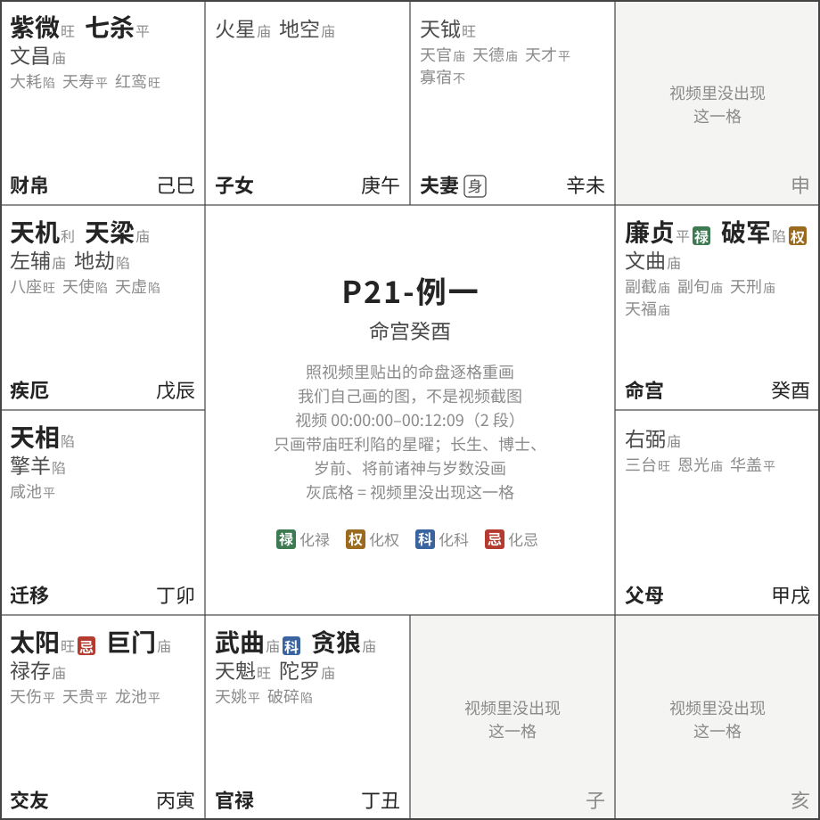

按视频里这张盘逐格重画（我们自己画的图，不是视频截图）；同一个人的 2 段合成一张；数据见 [命盘-P21-例一.json](图/命盘-P21-例一.json)。

### 1　右弼守父母、科权禄与曲昌入命（[00:00:00–00:06:24](https://www.bilibili.com/video/BV1KJsLekEfA/?p=21&t=0)，第 0–11531 帧）

| 提示区 | 笔记区 |
|---|---|
| **本集开头拿出来讲的是谁的八字？** | 〔口述〕倪师先问「就是紫微星在子的那张有没有」，又说「民国50年（1961）出生那张」「七年以后先生有限」。这张盘是谁的，材料没有交代。（[00:00:01–00:00:07](https://www.bilibili.com/video/BV1KJsLekEfA/?p=21&t=1)，第 54–233 帧） 〔口述〕接着说那位小姐「希望你看看你的小孩子的八字」，原因是「因为他先生八字没有」；「这小孩子八字一拿出来我一看」。（[00:00:08–00:00:15](https://www.bilibili.com/video/BV1KJsLekEfA/?p=21&t=8)，第 264–479 帧） 〔口述〕倪师说「你首先看她是甲戌年生」，并说那一年是狗年。（[00:00:16–00:00:22](https://www.bilibili.com/video/BV1KJsLekEfA/?p=21&t=16)，第 480–677 帧） 〔板书〕黑板中间一列可辨「83年」「甲戌年」；左列可辨「七杀」「文昌」「财帛」「天梁」「天机」「疾厄」「天相」「擎羊」「迁移」「巨门」，右列可辨「廉贞」「破军」「文曲」，其余认不出。（[00:00:25](https://www.bilibili.com/video/BV1KJsLekEfA/?p=21&t=25)，第 754 帧） |
| **七岁落在哪一宫？右弼、左辅单星入守主什么？** | 〔口述〕倪师从「那去年一岁在这里」数起，数到七岁问「七岁刚好落什么」，答「父母宫」。（[00:00:22–00:00:30](https://www.bilibili.com/video/BV1KJsLekEfA/?p=21&t=22)，第 678–929 帧） 〔口述〕右弼星或者左辅星单星入守一宫的时候，「通常主的是孤单」。（字幕「有弼星」按语音与上下文作右弼星。）（[00:00:31–00:00:37](https://www.bilibili.com/video/BV1KJsLekEfA/?p=21&t=31)，第 930–1115 帧） 〔叠图〕叠图父母甲戌：右弼庙、三台旺、华盖平、恩光庙、天月、将军、岁建、死；大限 114~123，小限数字串含 7、19、31、43、55。（[00:00:44–00:00:58](https://www.bilibili.com/video/BV1KJsLekEfA/?p=21&t=44)，第 1326–1745 帧） 〔板书〕黑板右列下方一格画着圆圈，圈里可辨「7」，旁边的字认不出。（[00:00:25](https://www.bilibili.com/video/BV1KJsLekEfA/?p=21&t=25)，第 754 帧） 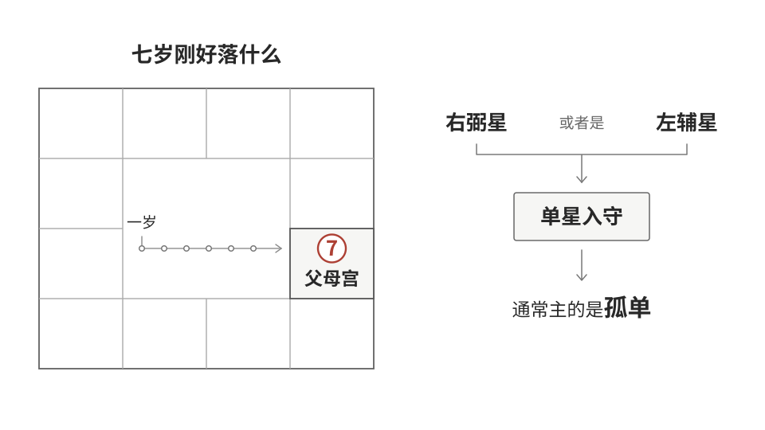 |
| **右弼左辅落夫妻、兄弟、子女、父母宫各主什么？** | 〔口述〕「比如说右弼星或左辅星在夫妻宫」，主二婚（字幕「主二婚宝二婚」，与语音对不齐，见待核）。（[00:00:37–00:00:42](https://www.bilibili.com/video/BV1KJsLekEfA/?p=21&t=37)，第 1116–1271 帧） 〔口述〕在兄弟宫「也得不到助力」；「在子女宫也是无子女」；「落在父母宫代表父母亲要离散」。（[00:00:42–00:00:49](https://www.bilibili.com/video/BV1KJsLekEfA/?p=21&t=42)，第 1272–1487 帧） 〔叠图〕叠图依次贴出兄弟壬申、夫妻辛未、子女庚午、父母甲戌四格，除宫名与大限数字外内容一模一样（右弼庙、三台旺、华盖平、恩光庙等），是配合口述逐宫演示，不是本盘四个宫都有右弼。（[00:00:42–00:00:49](https://www.bilibili.com/video/BV1KJsLekEfA/?p=21&t=42)，第 1272–1487 帧） |
| **她妈妈的八字说了什么？七年后谁有灾？** | 〔口述〕「结果她妈妈的八字」「七年以后先生会有灾」；又说「她是小孩子的八字七年后爸爸有灾」「这是女的了解我意思吧」。（[00:00:49–00:01:09](https://www.bilibili.com/video/BV1KJsLekEfA/?p=21&t=49)，第 1488–2099 帧） 〔叠图〕同时贴出子女辛卯（丧门、天姚庙、天寿陷、恩光庙、灾煞、胎、飞廉）与田宅丁酉（天梁闲、太阳闲权、文昌平忌、禄存旺、天官平、年解旺、凤阁庙、将星、帝旺、白虎、博士、蜚廉）。属于哪张盘材料没明说。（[00:00:49–00:00:54](https://www.bilibili.com/video/BV1KJsLekEfA/?p=21&t=49)，第 1488–1625 帧） 〔推断〕推断：倪师先数出七岁落父母宫，再讲右弼单守父母宫主父母离散，随后说小孩子的八字七年后爸爸有灾，三者前后衔接；他没有一次把这条推理讲完。（[00:00:22–00:00:58](https://www.bilibili.com/video/BV1KJsLekEfA/?p=21&t=22)，第 678–1745 帧） |
| **这种格局为什么要提出来讲？** | 〔口述〕这个八字「为什么要提出来讲」：「我们后面会介绍很多很多案例」「都是这种格局的人」「所谓格局都一样」。（[00:01:13–00:01:27](https://www.bilibili.com/video/BV1KJsLekEfA/?p=21&t=73)，第 2214–2627 帧） 〔口述〕逐一说「就是紫微七杀在这边」「天相在这边」「巨门太阳在这边」「武曲贪狼在这边」「太阴天同在这边」；「那这个星通通一样」「只是宫不一样」，命宫位置不同「但是格都是一样」，是「很常见的一种格」。（[00:01:27–00:01:49](https://www.bilibili.com/video/BV1KJsLekEfA/?p=21&t=87)，第 2628–3299 帧） 〔指代〕说「巨门太阳在这边」的「这边」时，手指的是黑板左列第四格「巨门」右侧，该行可见「化忌」。（[00:01:30–00:01:31](https://www.bilibili.com/video/BV1KJsLekEfA/?p=21&t=90)，第 2706–2747 帧） 〔指代〕说「武曲贪狼在这边」的「这边」时，手指的是黑板右列下格，按在「命宫」「武曲」字上，旁边有红圈。（[00:01:31–00:01:32](https://www.bilibili.com/video/BV1KJsLekEfA/?p=21&t=91)，第 2748–2783 帧） 〔板书〕黑板左列可辨「七杀」「文昌」「财帛」「天梁」「天机」「疾厄」「天相」「擎羊」「迁移」「巨门」，右上可辨「夫妻」；右半板面被倪师身体挡住，其余认不出。（[00:01:15](https://www.bilibili.com/video/BV1KJsLekEfA/?p=21&t=75)，第 2255 帧） |
| **廉贞破军这种杀星入命，「杀」有哪两种状况？** | 〔口述〕小孩子命里带来灾星时，「这种是廉贞破军是杀星」，杀有两种状况。第一种是早年「这武官星进来」，「代表父母亲要离异变成独立发展」。（[00:01:56–00:02:14](https://www.bilibili.com/video/BV1KJsLekEfA/?p=21&t=116)，第 3486–4043 帧） 〔口述〕第二种是「她本身的杀」：本身有灾星的小孩子，「如果小时候善知人意」、「小时候小孩子有大人的状态的话」，「本身就很危险」。（[00:02:14–00:02:30](https://www.bilibili.com/video/BV1KJsLekEfA/?p=21&t=134)，第 4044–4505 帧） 〔叠图〕叠图命宫癸酉：廉贞平禄、破军陷权、文曲庙、天刑庙、天福庙、副截庙、副旬庙、奏书、息神、病符、墓；大限 4~13，小限 8、20、32、44、56。（[00:02:24–00:02:30](https://www.bilibili.com/video/BV1KJsLekEfA/?p=21&t=144)，第 4344–4505 帧） 〔板书〕黑板右列一格可辨「廉贞」「破军」「文曲」「命」，廉贞、破军右侧各有红圈；格右写一个「＞」形记号，后接「杀」和圆圈里的「1」；下一格可辨「右弼」。其余认不出。（[00:02:04](https://www.bilibili.com/video/BV1KJsLekEfA/?p=21&t=124)，第 3744 帧） 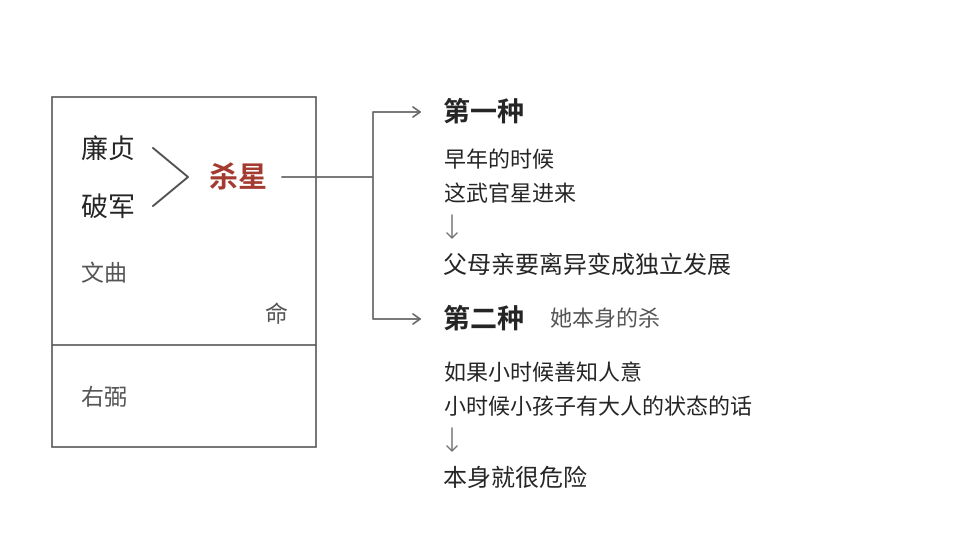 |
| **科权禄坐命的女人，与机月同梁的科权禄一样吗？** | 〔口述〕「你会临床上看到很多权禄还有科」「科权科权禄坐命的女人哈」；「和有的人是机月同梁」，比如「天机天梁太阳巨门科权禄」，「这都不太一样」。（[00:02:30–00:02:50](https://www.bilibili.com/video/BV1KJsLekEfA/?p=21&t=150)，第 4506–5111 帧） 〔叠图〕讲到天机天梁太阳巨门时贴出：交友丙寅（太阳旺忌、巨门庙、禄存庙、天贵平、天伤平、龙池平、阴煞）、疾厄戊辰（天机利、天梁庙、左辅庙、地劫陷、八座旺）、官禄丁丑（武曲庙科、贪狼庙、天魁旺、陀罗庙、天姚平）。（[00:02:45–00:02:47](https://www.bilibili.com/video/BV1KJsLekEfA/?p=21&t=165)，第 4962–5033 帧） 〔推断〕推断：按叠图，本盘禄、权在命宫癸酉（廉贞化禄、破军化权），科在官禄丁丑（武曲化科）；倪师此处没有逐颗对上，只说科权禄坐命。（[00:02:30–00:02:50](https://www.bilibili.com/video/BV1KJsLekEfA/?p=21&t=150)，第 4506–5111 帧） |
| **命带廉破这种武官星，个性怎样？算命能问原因吗？** | 〔口述〕「像这种她命宫有这种廉破」，「廉破紫微七杀武曲贪狼」「都是武官星」；命中有这种杀武官星，「那就代表个性都很刚很硬」。（[00:02:50–00:03:05](https://www.bilibili.com/video/BV1KJsLekEfA/?p=21&t=170)，第 5112–5555 帧） 〔口述〕至于是不是小时候父母亲出了事以后才变得独立，倪师说「我们算命不能讨论人家的因」「讨论人家因等于在挖人家隐私一样」「我们只讨论她的结果」：「她这个人非常的独立自主」。（[00:03:05–00:03:18](https://www.bilibili.com/video/BV1KJsLekEfA/?p=21&t=185)，第 5556–5963 帧） |
| **化科、化权、化禄在官禄宫，各走什么路？** | 〔口述〕化科在官禄宫的人官带也有，这种八字「我们算命就叫做财官双美」；官禄宫的官星「一定要科甲星」，「或者是化权的星在里面最好」。（[00:03:18–00:03:38](https://www.bilibili.com/video/BV1KJsLekEfA/?p=21&t=198)，第 5964–6557 帧） 〔口述〕「化科的星在官禄官」「就跑去当老师」「当教授去了」；化权的星在官禄宫「就跑回去当公务员」「当官做主管去了」；化禄的星在官禄宫，「当官里面就不太好」。（[00:03:38–00:03:50](https://www.bilibili.com/video/BV1KJsLekEfA/?p=21&t=218)，第 6558–6923 帧） 〔口述〕如果这个人掌财权，比如「财政部长」，财权很大，「可那不是他的」；「中央银行总裁那种财不是他的」。（[00:03:50–00:04:00](https://www.bilibili.com/video/BV1KJsLekEfA/?p=21&t=230)，第 6924–7229 帧） 〔叠图〕叠图并排贴出官禄丁丑两版：一版武曲旁标「权」，一版为武曲庙科，其余星相同（贪狼庙、天魁旺、陀罗庙等），配合化科、化权在官禄宫的说法演示。（[00:03:35–00:03:38](https://www.bilibili.com/video/BV1KJsLekEfA/?p=21&t=215)，第 6450–6557 帧） |
| **紫微七杀在财帛，为什么会自己做事业？** | 〔口述〕「那紫微七杀在财帛」，不然出去当银行总裁，「就说到底是你的管家」「还是我们人民的管家」。（[00:04:02–00:04:12](https://www.bilibili.com/video/BV1KJsLekEfA/?p=21&t=242)，第 7284–7589 帧） 〔口述〕紫微七杀在财帛，「这个是意思在私人企业业自己做事业」；问到私人企业去做行不行，答不可能：「人家化权化禄她不会屈居于人下了」「她会自己去做事业」「所以她是财官双美」。（[00:04:13–00:04:27](https://www.bilibili.com/video/BV1KJsLekEfA/?p=21&t=253)，第 7590–8039 帧） 〔指代〕说「紫微七杀在财帛呢这个」的「这个」时，手指的是黑板上写着「紫微 七杀 文昌 财帛」那一格，指尖在「财帛」两字正下方。（[00:04:13–00:04:15](https://www.bilibili.com/video/BV1KJsLekEfA/?p=21&t=253)，第 7590–7667 帧） 〔叠图〕叠图财帛己巳：紫微旺、七杀平、文昌庙、红鸾旺、天寿平、天厨、天巫、大耗陷、亡神、龙德、长生；大限 44~53，小限 12、24、36、48、60。（[00:04:02–00:05:04](https://www.bilibili.com/video/BV1KJsLekEfA/?p=21&t=242)，第 7284–9143 帧） |
| **曲昌入命的人主什么？男女有别吗？** | 〔口述〕「曲昌入命文曲文昌入命的人呢」，不管男女，「都是代表科甲文章这个盖世」，「就是文笔非常好」。（[00:04:28–00:04:49](https://www.bilibili.com/video/BV1KJsLekEfA/?p=21&t=268)，第 8064–8681 帧） 〔口述〕举例：「就像金庸写的这个」文章，「那梵高画的画贝多芬写的」「这都是曲昌入命」，「就是文才方面他会声名远播」「那男女都一样」。（[00:04:49–00:05:04](https://www.bilibili.com/video/BV1KJsLekEfA/?p=21&t=289)，第 8682–9143 帧） 〔板书〕黑板左侧新写可辨「曲昌入命」「科甲」「文章盖世」。（[00:04:52](https://www.bilibili.com/video/BV1KJsLekEfA/?p=21&t=292)，第 8784 帧） 〔叠图〕叠图同时贴出命宫癸酉（文曲庙，与廉贞破军同宫）与财帛己巳（文昌庙，与紫微七杀同宫）。（[00:05:03–00:05:04](https://www.bilibili.com/video/BV1KJsLekEfA/?p=21&t=303)，第 9096–9143 帧） |
| **曲昌入命唯一的例外是什么？愚与蠢怎么分？** | 〔口述〕「这个曲昌入命只有一个例外」：「如果这两颗星逢到太阴星的话」「文曲文昌逢到太阴星的话」「就不是所谓的文章盖世」，而是才艺盖世，「才华才艺啊」「才艺惊人」。（[00:05:04–00:05:24](https://www.bilibili.com/video/BV1KJsLekEfA/?p=21&t=304)，第 9144–9749 帧） 〔叠图〕讲例外时贴出财帛丁巳：太阴陷、文昌旺、天官旺、天寿陷、天福平、咸池平、月德、伏兵、小耗、沐浴；大限 86~95。干支和星都与前后的财帛己巳不同，按演示看。（[00:05:10](https://www.bilibili.com/video/BV1KJsLekEfA/?p=21&t=310)，第 9300–9329 帧） 〔口述〕举「比如说这个叶子楣」「这个很有名的电影明星呢」「桃花命」「但是眼睛似睁未睁」，像没睡饱，「那就是笨」。睡了半天打雷不醒、「闹钟要三个才醒过来」，「这种是愚顽啊」；醒过来「可是眼睛似睁未睁」，「这是蠢」。（[00:05:25–00:06:03](https://www.bilibili.com/video/BV1KJsLekEfA/?p=21&t=325)，第 9750–10919 帧） 〔口述〕「这两种人」「我们不必花时间去教他」，「因为他不知道他蠢」，「所以你讲了半天他收不到」；最后收回到「所以这个是一个唯一的一个例外」。（[00:06:04–00:06:24](https://www.bilibili.com/video/BV1KJsLekEfA/?p=21&t=364)，第 10920–11531 帧） 〔板书〕黑板中间新写可辨「愚」和画了圆圈的「顽」。（[00:05:58](https://www.bilibili.com/video/BV1KJsLekEfA/?p=21&t=358)，第 10768 帧） |

**总结区**

- 通用规则：右弼或左辅单星入守一宫通常主孤单：在夫妻宫主二婚、兄弟宫得不到助力、子女宫无子女、父母宫父母亲要离散（[00:00:31–00:00:49](https://www.bilibili.com/video/BV1KJsLekEfA/?p=21&t=31)，第 930–1487 帧）；官禄宫的官星一定要科甲星，或化权星在里面最好；化科在官禄多当老师教授，化权当公务员主管，化禄在官禄当官就不太好（[00:03:32–00:03:50](https://www.bilibili.com/video/BV1KJsLekEfA/?p=21&t=212)，第 6366–6923 帧）；曲昌入命的人不管男女，都代表科甲、文章盖世，文才方面声名远播（[00:04:28–00:05:04](https://www.bilibili.com/video/BV1KJsLekEfA/?p=21&t=268)，第 8064–9143 帧）；曲昌入命唯一的例外：文曲文昌逢到太阴星，不是文章盖世，而是才艺盖世（[00:05:04–00:05:24](https://www.bilibili.com/video/BV1KJsLekEfA/?p=21&t=304)，第 9144–9749 帧）
- 只在本例：这个甲戌年生的小孩七岁落父母宫，倪师说小孩子的八字七年后爸爸有灾（[00:00:22–00:00:58](https://www.bilibili.com/video/BV1KJsLekEfA/?p=21&t=22)，第 678–1745 帧）；她命宫廉破是杀星、武官星，个性很刚很硬，非常独立自主（[00:01:56–00:03:18](https://www.bilibili.com/video/BV1KJsLekEfA/?p=21&t=116)，第 3486–5963 帧）；紫微七杀在财帛，又有化权化禄，不会屈居人下而会自己做事业，是财官双美（[00:04:02–00:04:27](https://www.bilibili.com/video/BV1KJsLekEfA/?p=21&t=242)，第 7284–8039 帧）
- 不是排盘规则，是处世方法：算命不讨论人家的因，那等于挖人家隐私，只讨论结果（[00:03:11–00:03:17](https://www.bilibili.com/video/BV1KJsLekEfA/?p=21&t=191)，第 5736–5915 帧）；愚顽和蠢的两种人不必花时间去教，因为他不知道自己蠢，讲了半天他收不到（[00:06:04–00:06:22](https://www.bilibili.com/video/BV1KJsLekEfA/?p=21&t=364)，第 10920–11471 帧）

**待核**

1. [00:00:01–00:00:07](https://www.bilibili.com/video/BV1KJsLekEfA/?p=21&t=1)，第 54–233 帧：「紫微星在子的那张」「民国50年（1961）出生那张」是谁的盘没有交代；「七年以后先生有限」的「有限」所指未解释（语音同为「有限」）。
2. [00:00:20](https://www.bilibili.com/video/BV1KJsLekEfA/?p=21&t=20)，第 618 帧：字幕「含年是狗年」，语音为「今年是狗年」前后，「含年」未改，原话待核。
3. [00:00:24](https://www.bilibili.com/video/BV1KJsLekEfA/?p=21&t=24)，第 726 帧：字幕「12345§7七岁刚好落什么」可信度 0.44，按语音「二三四五六七」理解为从一数到七。
4. [00:00:31](https://www.bilibili.com/video/BV1KJsLekEfA/?p=21&t=31)，第 930 帧：字幕「有弼星」按语音「右臂心」与上下文改作右弼星；[00:00:33](https://www.bilibili.com/video/BV1KJsLekEfA/?p=21&t=33)，第 990 帧「单星入守官有人的宫的时候」后半句意思不清。
5. [00:00:39](https://www.bilibili.com/video/BV1KJsLekEfA/?p=21&t=39)，第 1194 帧：字幕「主二婚宝二婚」可信度 0.35，语音「二婚组二婚」，只取「二婚」。
6. [00:00:42](https://www.bilibili.com/video/BV1KJsLekEfA/?p=21&t=42)，第 1272 帧「兄弟官」改作兄弟宫；第 6048、6582 帧「官禄官」改作官禄宫；[00:03:47](https://www.bilibili.com/video/BV1KJsLekEfA/?p=21&t=227)，第 6822 帧字幕「化禄的星在官禄宫公务员的」与语音不齐。
7. [00:00:49](https://www.bilibili.com/video/BV1KJsLekEfA/?p=21&t=49)，第 1488 帧：叠图子女辛卯、田宅丁酉与四格右弼演示同时出现，倪师当时说「结果她妈妈的八字」，属于哪张盘材料没明说，未配给例一。
8. [00:00:52–00:00:58](https://www.bilibili.com/video/BV1KJsLekEfA/?p=21&t=52)，第 1566–1745 帧：先说「先生会有灾」，后说「爸爸有灾」，是否指同一人（小孩的父亲）倪师没有再说明。
9. [00:02:08](https://www.bilibili.com/video/BV1KJsLekEfA/?p=21&t=128)，第 3846 帧：字幕「武官星」，语音「五官星」；[00:02:53–00:02:56](https://www.bilibili.com/video/BV1KJsLekEfA/?p=21&t=173)，第 5190–5297 帧又说廉破、紫微七杀、武曲贪狼都是武官星，此词倪师没有解释。
10. [00:02:42](https://www.bilibili.com/video/BV1KJsLekEfA/?p=21&t=162)，第 4866 帧：倪师说「机月同梁」，接着举的是「天机天梁太阳巨门科权禄」，两者对应关系没有解释。
11. [00:03:21](https://www.bilibili.com/video/BV1KJsLekEfA/?p=21&t=201)，第 6048 帧：字幕「官带也有」意思不清，语音「关带也有」。
12. [00:03:35](https://www.bilibili.com/video/BV1KJsLekEfA/?p=21&t=215)，第 6450 帧：叠图官禄丁丑两版，一版标权、一版标科，为后期演示，不代表本盘官禄宫有化权。
13. [00:04:02](https://www.bilibili.com/video/BV1KJsLekEfA/?p=21&t=242)，第 7284 帧：叠图财帛己巳首次出现时「□鸾旺」缺字，[00:05:03](https://www.bilibili.com/video/BV1KJsLekEfA/?p=21&t=303)，第 9096 帧再出现时为红鸾旺。
14. [00:05:08](https://www.bilibili.com/video/BV1KJsLekEfA/?p=21&t=308)，第 9246 帧：叠图财帛丁巳（太阴陷、文昌旺）与前后财帛己巳（紫微旺、七杀平、文昌庙）干支和星都不同，按「如果这两颗星逢到太阴星」的演示处理，不是本盘财帛宫。
15. [00:05:17](https://www.bilibili.com/video/BV1KJsLekEfA/?p=21&t=317)，第 9522 帧：字幕「而是文才艺盖世」，语音「是才艺盖世」，两路不一，转述按才艺盖世。
16. [00:05:50](https://www.bilibili.com/video/BV1KJsLekEfA/?p=21&t=350)，第 10500 帧：字幕「这种是愚顽啊」，语音「鱼丸」，按字幕。
17. 板书：[00:01:15](https://www.bilibili.com/video/BV1KJsLekEfA/?p=21&t=75)，第 2255 帧右半板面被身体挡住；[00:02:04](https://www.bilibili.com/video/BV1KJsLekEfA/?p=21&t=124)，第 3744 帧「命」格下方圆圈内与「杀」下方的字认不出，「父母」两字字形不清未收；[00:05:25](https://www.bilibili.com/video/BV1KJsLekEfA/?p=21&t=325)，第 9768 帧本段新写的字在画面左下被叠图和边缘挡住，认不出。
18. 指代：第 2651、2679、2695、2812、3000、3026、3357、5294、11482 帧的「这边 / 这里 / 这个」都标为不确定，第 2046、2209、2881、9132 帧不确定或看不出，均未当依据。

## 例一续：科忌屠夫、迁移凶与本地、夫妻天钺、红鸾早婚

| 巳 | 午 | 未 | 申 |
|---|---|---|---|
| **财帛 己巳** 紫微旺 七杀平 文昌庙 | **子女 庚午** 火星庙 地空庙 | **夫妻 辛未**（身宫） 天钺旺 | （申：没贴过） |
| （辰：没贴过） | **例一续：科忌屠夫、迁移凶与本地、夫妻天钺、红鸾早婚 · 命宫癸酉** | 据视频叠图重排 | **命宫 癸酉** 廉贞平禄 破军陷权 文曲庙 |
| **迁移 丁卯** 天相陷 擎羊陷 | 后期贴图，不算倪师的话 |  | **父母 甲戌** 右弼庙 |
| **交友 丙寅** 太阳旺忌 巨门庙 禄存庙 | **官禄 丁丑** 武曲庙科 贪狼庙 天魁旺 陀罗庙 | （子：没贴过） | （亥：没贴过） |

同例一的命盘，见上图。

### 2　例一续：科忌屠夫、本地外地、天钺早婚（[00:06:24–00:12:09](https://www.bilibili.com/video/BV1KJsLekEfA/?p=21&t=384)，第 11532–21893 帧）

| 提示区 | 笔记区 |
|---|---|
| **文曲文昌会到财帛宫，做事业主什么？** | 〔口述〕倪师说文曲、文昌会到财帛宫，「如果她做事业的话」一定是专业技术专长；又说「很多人呀医师律师会计师工程师建筑师呀」「都有这种类似的人」。（[00:06:24–00:06:37](https://www.bilibili.com/video/BV1KJsLekEfA/?p=21&t=384)，第 11532–11921 帧） 〔叠图〕例一盘：命宫癸酉，廉贞平化禄、破军陷化权、文曲庙，大限 4~13；财帛己巳，紫微旺、七杀平、文昌庙，大限 44~53。（[00:06:26–00:06:30](https://www.bilibili.com/video/BV1KJsLekEfA/?p=21&t=386)，第 11580–11700 帧） 〔板书〕本块开头的板面可辨：「身宫」「夫妻」「兄弟」「甲戌」「右弼」，右侧一格里有两个红圈字，其余认不出。（[00:06:28](https://www.bilibili.com/video/BV1KJsLekEfA/?p=21&t=388)，第 11652 帧） |
| **化科跟化忌在一起，才艺会变成什么？** | 〔口述〕倪师要学生「要会推理」：化科就是才艺好；如果「这个人化科跟化忌在一起怎么办」，「有啊这忌是杀星啊」「他的才艺就在杀人嘛那屠夫嘛」。（[00:06:37–00:06:53](https://www.bilibili.com/video/BV1KJsLekEfA/?p=21&t=397)，第 11922–12395 帧） 〔口述〕举菜场屠夫为例：杀鸡杀猪杀得好，「他都知道哪边有关节哪边去肉」，「也是一门才艺」；并说「你不要老是在那死板板的在那边」。（[00:06:53–00:07:12](https://www.bilibili.com/video/BV1KJsLekEfA/?p=21&t=413)，第 12396–12983 帧） 〔叠图〕此时叠图把财帛己巳格标成文昌庙化忌、紫微旺化科，配合「化科跟化忌在一起」的假设，是演示用，不是例一本来的四化（前一张同格叠图并无科、忌）。（[00:06:47–00:06:49](https://www.bilibili.com/video/BV1KJsLekEfA/?p=21&t=407)，第 12216–12275 帧） 〔板书〕写完后的板面可辨：「财帛」「甲戌」「太阴」「天同」，这段新写的字认不出。（[00:06:54](https://www.bilibili.com/video/BV1KJsLekEfA/?p=21&t=414)，第 12420 帧） |
| **迁移天相陷、擎羊陷，出外地怎样？** | 〔口述〕倪师说给她批时，「你看她迁移天相星落陷」「还擎羊星落陷」，「这个人出去外地的话」「这是死路一条」，所以批「外地凶本地吉」。（[00:07:12–00:07:27](https://www.bilibili.com/video/BV1KJsLekEfA/?p=21&t=432)，第 12984–13427 帧） 〔叠图〕迁移丁卯：天相陷、擎羊陷、咸池平、月德，大限 64~73。（[00:07:31](https://www.bilibili.com/video/BV1KJsLekEfA/?p=21&t=451)，第 13530 帧） 〔口述〕后面再强调：「到外地摆明是死路一条」，「你给她算命给她说外地大利」「你不是想害人」。（[00:08:19–00:08:24](https://www.bilibili.com/video/BV1KJsLekEfA/?p=21&t=499)，第 14970–15143 帧） |
| **本地、外地以哪一年为准？多远算外地？** | 〔口述〕倪师问「外地本地以哪个为主」，答「4-13岁我们以第一个限为主」「第一个限在13岁」，13 岁以前她待的地方叫本地。（[00:07:29–00:07:45](https://www.bilibili.com/video/BV1KJsLekEfA/?p=21&t=449)，第 13482–13961 帧） 〔口述〕另举一个命（不是例一）：「生在意大利」「读书在加拿大」「长在美国」，到底算哪里？「不要管他」，以第一个限的尾巴为准。（[00:07:45–00:07:58](https://www.bilibili.com/video/BV1KJsLekEfA/?p=21&t=465)，第 13962–14351 帧） 〔口述〕「有的人是2-11岁那就以11岁」，有的人 4-13，「有的人5-14岁就以那个14为主」；「这个八字就以13为主」，「13岁那年在哪里」「那个地方就是本地」，其他都属外地；「方圆五十里」「五十里以外的就属于外地」。（[00:07:58–00:08:18](https://www.bilibili.com/video/BV1KJsLekEfA/?p=21&t=478)，第 14352–14969 帧） 〔指代〕说「就以那个14为主这个」时，手指的是黑板右中格两个红圈字附近（圈内字看不清），该格叠图为命宫癸酉、大限 4~13。（[00:08:03–00:08:06](https://www.bilibili.com/video/BV1KJsLekEfA/?p=21&t=483)，第 14496–14591 帧） 〔板书〕写完后的板面可辨：上中格「24-33」「身宫」「夫妻」，下方「太阴」「天同」，其余认不出。（[00:07:40](https://www.bilibili.com/video/BV1KJsLekEfA/?p=21&t=460)，第 13812 帧） 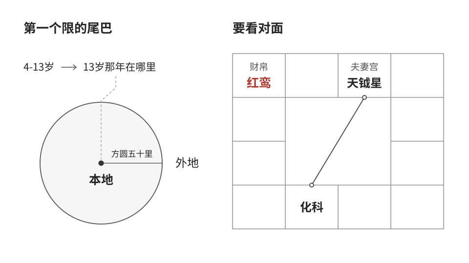 |
| **子女宫有杀星进来主什么？** | 〔口述〕倪师说「还有子女宫是杀星进来的时候无子」。（[00:08:24–00:08:29](https://www.bilibili.com/video/BV1KJsLekEfA/?p=21&t=504)，第 15144–15275 帧） 〔叠图〕子女庚午：地空庙、火星庙、白虎，大限 34~43；叠图该格标着「杀星」（剪辑提示字，不是星曜）。（[00:08:24–00:08:28](https://www.bilibili.com/video/BV1KJsLekEfA/?p=21&t=504)，第 15144–15251 帧） 〔推断〕推断：本例子女庚午与命宫癸酉、夫妻辛未的宫序相接，这一格应是例一自己的子女宫；倪师此处只说规则，没有对本例下「无子」的结论。（[00:08:24–00:08:32](https://www.bilibili.com/video/BV1KJsLekEfA/?p=21&t=504)，第 15144–15389 帧） |
| **夫妻宫天钺、对面化科，先生是什么样的人？** | 〔指代〕说「像这个夫妻宫」时，手指的是黑板上中格的「夫妻」二字，同格写着 24-33、身宫。（[00:08:28–00:08:32](https://www.bilibili.com/video/BV1KJsLekEfA/?p=21&t=508)，第 15252–15389 帧） 〔口述〕倪师说「天钺星对面是化科」，「天魁星在这里看到没有」，「她的先生怎么样」「跟她同行会不会看」；「天钺星是科甲星」「化科对冲夫妻有没有」，看本宫要看对面，「所以她先生也是专科技术专长」。（[00:08:29–00:08:55](https://www.bilibili.com/video/BV1KJsLekEfA/?p=21&t=509)，第 15276–16067 帧） 〔指代〕说「天魁星在这里」时，手指的是黑板左下格、贴近左下角叠图右缘处，所指字被手和叠图挡住；叠图那格是官禄丁丑的天魁。（[00:08:36–00:08:39](https://www.bilibili.com/video/BV1KJsLekEfA/?p=21&t=516)，第 15486–15575 帧） 〔叠图〕夫妻辛未：天钺旺、天官庙、天才平、寡宿、天德庙，标「身宫」，大限 24~33；官禄丁丑：武曲庙化科、贪狼庙、天魁旺、陀罗庙、天姚平，大限 84~93。（[00:08:29–00:08:36](https://www.bilibili.com/video/BV1KJsLekEfA/?p=21&t=509)，第 15276–15485 帧） 〔口述〕由此说「所以很多人医师跟医师结婚」「律师跟律师结婚」「法官跟法官结婚」「有没有就是这样子来的」。（[00:08:55–00:09:14](https://www.bilibili.com/video/BV1KJsLekEfA/?p=21&t=535)，第 16068–16637 帧） |
| **这段板书写了什么？红鸾在本例哪一宫？** | 〔板书〕左下格可辨「武曲」，其后红圈里的字认不出；另可辨「24-33」「甲戌」。（[00:08:34](https://www.bilibili.com/video/BV1KJsLekEfA/?p=21&t=514)，第 15420 帧） 〔板书〕右上格可辨「14-23」「兄弟」，右中格「4-」后接圈起的「13」，其余认不出。（[00:08:52](https://www.bilibili.com/video/BV1KJsLekEfA/?p=21&t=532)，第 15972 帧） 〔口述〕倪师说「我们再来看红鸾天喜」，随即在黑板上标出位置（字幕这句识别为「天喜星在这里」，见待核）。（[00:09:18–00:09:32](https://www.bilibili.com/video/BV1KJsLekEfA/?p=21&t=558)，第 16746–17177 帧） 〔指代〕说「红鸾星在这里」时右手正在上方格内写「红鸾」，同格可见紫微、七杀、文昌、财帛；叠图也标红鸾在财帛己巳。（[00:09:21–00:09:28](https://www.bilibili.com/video/BV1KJsLekEfA/?p=21&t=561)，第 16836–17051 帧） 〔叠图〕财帛己巳格再贴出，这次框出红鸾旺（同格有紫微旺、七杀平、文昌庙），大限 44~53。（[00:09:22–00:09:28](https://www.bilibili.com/video/BV1KJsLekEfA/?p=21&t=562)，第 16860–17040 帧） 〔板书〕写完后的板面可辨：上格「红鸾」「七杀」「文昌」「财帛」；另有「天梁」「天机」「疾厄」、「天相」「擎羊」、「巨门」「太阳」「禄存」等字，其余认不出。（[00:09:22](https://www.bilibili.com/video/BV1KJsLekEfA/?p=21&t=562)，第 16884 帧） |
| **24–33 这十年天钺，考试、做官会怎样？** | 〔口述〕批婚姻时倪师先强调：「光是这样子一个排列」「一个布局出来」「很多人八字是这种格的」，「我待会会陆续介绍给你」。（[00:09:33–00:09:51](https://www.bilibili.com/video/BV1KJsLekEfA/?p=21&t=573)，第 17208–17759 帧） 〔口述〕「我们在24-33的时候看她的命啊」「千万不要被命所绑到了」「算命不能被命绑到」；「你24-33 她的流年是天钺星」。（[00:09:52–00:10:03](https://www.bilibili.com/video/BV1KJsLekEfA/?p=21&t=592)，第 17760–18101 帧） 〔口述〕她 24 岁大学毕业以后，「她对面是化科出科甲」，这段时间参加专业技术的「什么高考特考」，「她一定会上的」「金榜题名了对不对」；「然后上了以后如果去当官」「天钺星就会受到重用」「重用到第二个十年」。（[00:10:03–00:10:18](https://www.bilibili.com/video/BV1KJsLekEfA/?p=21&t=603)，第 18102–18557 帧） 〔板书〕黑板上的「24-33」已加方框，另可辨「14-23」「兄弟」「右弼」。（[00:09:58](https://www.bilibili.com/video/BV1KJsLekEfA/?p=21&t=598)，第 17940 帧） 〔板书〕方框「24-33」「身宫」「夫妻」可辨，此前约 18 秒新写的内容看不出。（[00:10:29](https://www.bilibili.com/video/BV1KJsLekEfA/?p=21&t=629)，第 18872 帧） |
| **34–43 岁走火星那十年，事业会怎样？** | 〔口述〕「34岁以后到43岁」「因为火星嘛」「所以处的不和」「所以很火大」「我老子不干」「我自己出来做啊」「都会有这种现象」。（[00:10:18–00:10:26](https://www.bilibili.com/video/BV1KJsLekEfA/?p=21&t=618)，第 18558–18791 帧） 〔叠图〕子女庚午格再贴出：地空庙、火星庙、白虎，大限 34~43，这次没有「杀星」提示字。（[00:10:18–00:10:20](https://www.bilibili.com/video/BV1KJsLekEfA/?p=21&t=618)，第 18558–18605 帧） 〔推断〕推断：倪师所说「第二个十年」34~43 正是叠图子女庚午格的大限，火星在这一格；他据此说出来自己做。（[00:10:17–00:10:24](https://www.bilibili.com/video/BV1KJsLekEfA/?p=21&t=617)，第 18528–18737 帧） |
| **她什么时候结婚？为何不能照书说 44 岁后？** | 〔口述〕「因为通通是吉星来会没有杀星」「在这段时间婚姻就会成哦」；「你不能跟外面书上写的」，「哎呀她红鸾星在这里出来」「你44岁以后结婚」「结果人家20岁结婚你怎么办」。（[00:10:24–00:10:44](https://www.bilibili.com/video/BV1KJsLekEfA/?p=21&t=624)，第 18738–19325 帧） 〔指代〕说「她红鸾星在这里出来」时，手指的是左上叠图下缘，叠图上是红鸾、44~53、财帛巳。（[00:10:39–00:10:40](https://www.bilibili.com/video/BV1KJsLekEfA/?p=21&t=639)，第 19170–19211 帧） 〔口述〕「所以说因为她的24-33十年都是吉」；「24岁在这边」「第一个就红鸾星就会进来」「所以这个会比较早婚」。（[00:10:47–00:11:02](https://www.bilibili.com/video/BV1KJsLekEfA/?p=21&t=647)，第 19428–19877 帧） 〔指代〕说「24岁在这边」时，指尖点在左上叠图右缘，叠图显示红鸾、小限 24、44~53、财帛己巳。（[00:10:54–00:10:55](https://www.bilibili.com/video/BV1KJsLekEfA/?p=21&t=654)，第 19632–19667 帧） 〔推断〕推断：红鸾所在财帛己巳的大限是 44~53，照书直读会说 44 岁后才结婚；倪师改看小限 24 岁红鸾进来，加上 24~33 全吉，断她早婚。（[00:10:39–00:11:02](https://www.bilibili.com/video/BV1KJsLekEfA/?p=21&t=639)，第 19170–19877 帧） |
| **早婚的原因：父母宫右弼说明什么？** | 〔口述〕「早婚的原因是什么」「你们可能读不出来」：「早婚的原因是父母亲是右弼」，「因为她早年失掉父亲」「七岁的时候失掉父亲」「所以她希望早婚」「有个男人来照顾她」。（[00:11:02–00:11:15](https://www.bilibili.com/video/BV1KJsLekEfA/?p=21&t=662)，第 19878–20261 帧） 〔口述〕「这种先天上的心理补偿」「就会有这种现象」；「所以说这一个右弼星进来的时候」「我们就可以肯定到」。（[00:11:15–00:11:31](https://www.bilibili.com/video/BV1KJsLekEfA/?p=21&t=675)，第 20262–20747 帧） 〔叠图〕父母甲戌：右弼庙、三台旺、华盖平、恩光庙、天月；格内数字串还原不了，不录。（[00:11:15](https://www.bilibili.com/video/BV1KJsLekEfA/?p=21&t=675)，第 20250 帧） |
| **化忌在朋友宫、太阳化忌，表里各批出什么？** | 〔口述〕「然后诸位再注意看化忌在哪里」「第一个是在朋友宫」；表面上批，「她跟朋友合伙做生意」「到头来朋友变仇人对不对」。（[00:11:31–00:11:41](https://www.bilibili.com/video/BV1KJsLekEfA/?p=21&t=691)，第 20748–21047 帧） 〔叠图〕交友丙寅：太阳旺化忌、巨门庙、禄存庙、天伤平、天贵平、龙池平。（[00:11:34–00:11:41](https://www.bilibili.com/video/BV1KJsLekEfA/?p=21&t=694)，第 20820–21047 帧） 〔口述〕「里面批到深入的时候」「是不是太阳化忌」，「一个女人的一个小孩子的太阳是谁」——「爸爸所以跟爸爸会相隔」；「再一看父母亲右弼有没有」「都是灾星」，「那我们就知道她的父母亲会离散」。（[00:11:43–00:11:56](https://www.bilibili.com/video/BV1KJsLekEfA/?p=21&t=703)，第 21108–21509 帧） 〔口述〕「离散有两种」「一种是生离」「一种是死别对不对」，「可是她妈妈上面显出来是死别」；「这是光是在命上面来推理」，「所以小孩子的八字我们一定要看」。（[00:11:57–00:12:09](https://www.bilibili.com/video/BV1KJsLekEfA/?p=21&t=717)，第 21510–21893 帧） |

**总结区**

- 通用规则：化科主才艺；化科与化忌同在时忌是杀星，才艺就在杀人，如菜场屠夫（[00:06:43–00:07:12](https://www.bilibili.com/video/BV1KJsLekEfA/?p=21&t=403)，第 12096–12983 帧）。；定本地看第一个大限的尾巴那年所在地（2-11 看 11 岁、4-13 看 13 岁、5-14 看 14 岁），方圆五十里以外属外地（[00:07:29–00:08:17](https://www.bilibili.com/video/BV1KJsLekEfA/?p=21&t=449)，第 13482–14921 帧）。；子女宫有杀星进来主无子（[00:08:24–00:08:29](https://www.bilibili.com/video/BV1KJsLekEfA/?p=21&t=504)，第 15144–15275 帧）。；看本宫要看对面；天钺是科甲星，化科对冲夫妻，配偶多是同行（[00:08:47–00:09:14](https://www.bilibili.com/video/BV1KJsLekEfA/?p=21&t=527)，第 15816–16637 帧）。
- 只在本例：文曲文昌会财帛，做事业必是专业技术专长；迁移天相陷、擎羊陷，外地死路一条，批外地凶本地吉（[00:06:24–00:08:24](https://www.bilibili.com/video/BV1KJsLekEfA/?p=21&t=384)，第 11532–15143 帧）。；24–33 天钺、对面化科：先生也是专科技术专长，24 岁后考试必上、做官受重用；34–43 火星，处不和而自己出来做（[00:08:29–00:10:26](https://www.bilibili.com/video/BV1KJsLekEfA/?p=21&t=509)，第 15276–18791 帧）。；24 岁小限红鸾进来、24–33 全吉，故早婚；父母宫右弼、7 岁失父，心理补偿而希望早婚（[00:10:24–00:11:31](https://www.bilibili.com/video/BV1KJsLekEfA/?p=21&t=624)，第 18738–20747 帧）。；化忌在朋友宫主合伙朋友变仇人；太阳化忌主与父亲相隔，父母离散（[00:11:31–00:12:02](https://www.bilibili.com/video/BV1KJsLekEfA/?p=21&t=691)，第 20748–21677 帧）。
- 不是排盘规则，是处世方法：要会推理，不要死板板地套（[00:06:37–00:06:59](https://www.bilibili.com/video/BV1KJsLekEfA/?p=21&t=397)，第 11922–12581 帧）。；外地凶的命还说外地大利，等于害人（[00:08:19–00:08:24](https://www.bilibili.com/video/BV1KJsLekEfA/?p=21&t=499)，第 14970–15143 帧）。；算命不能被命绑住，不能照外面书上写的直读（[00:09:52–00:10:00](https://www.bilibili.com/video/BV1KJsLekEfA/?p=21&t=592)，第 17760–18029 帧、[00:10:33–00:10:38](https://www.bilibili.com/video/BV1KJsLekEfA/?p=21&t=633)，第 19008–19169 帧）。；小孩子的八字一定要看（[00:12:07–00:12:09](https://www.bilibili.com/video/BV1KJsLekEfA/?p=21&t=727)，第 21828–21893 帧）。

**待核**

1. [00:06:27](https://www.bilibili.com/video/BV1KJsLekEfA/?p=21&t=387)，第 11622 帧：字幕「专业技术太长」，语音与[00:06:28](https://www.bilibili.com/video/BV1KJsLekEfA/?p=21&t=388)，第 11652 帧画面字幕均为「专长」，按「专长」理解，未引字幕原字。
2. [00:06:29](https://www.bilibili.com/video/BV1KJsLekEfA/?p=21&t=389)，第 11670 帧：字幕「理论上看这种八字」，语音「经常看这种八字」，两路不一致，未引。
3. [00:06:24](https://www.bilibili.com/video/BV1KJsLekEfA/?p=21&t=384)，第 11532 帧、[00:07:20](https://www.bilibili.com/video/BV1KJsLekEfA/?p=21&t=440)，第 13219 帧：指代 D027、D029 为不确定，未作依据。
4. [00:07:53](https://www.bilibili.com/video/BV1KJsLekEfA/?p=21&t=473)，第 14208 帧：字幕「她是如果是她是木三局」，语音只听到「如果他是金氏」，紧接一句是「她是金四局的话」，「木三局」是否口误或识别错待核。
5. [00:08:11](https://www.bilibili.com/video/BV1KJsLekEfA/?p=21&t=491)，第 14748 帧：字幕「其官的都属于外地」，语音「他的都属于外地」，按「其他的」理解。
6. [00:08:33](https://www.bilibili.com/video/BV1KJsLekEfA/?p=21&t=513)，第 15390 帧：「天钺星对面是化科」的「对面」，本块未明说指哪一宫；叠图同时贴出官禄丁丑武曲庙化科，对应关系是推断。
7. [00:08:51](https://www.bilibili.com/video/BV1KJsLekEfA/?p=21&t=531)，第 15936 帧：字幕「我们看本宫看官要看对面」，[00:08:52](https://www.bilibili.com/video/BV1KJsLekEfA/?p=21&t=532)，第 15972 帧画面字幕为「看本宫 看宫 要看对面」，「官」改为「宫」。
8. [00:09:21](https://www.bilibili.com/video/BV1KJsLekEfA/?p=21&t=561)，第 16836 帧：字幕识别为「天喜星在这里」，但指代 D036 与[00:09:22](https://www.bilibili.com/video/BV1KJsLekEfA/?p=21&t=562)，第 16884 帧画面字幕都是「红鸾星 在这里」，当时手正在写「红鸾」；天喜星在哪一宫本块未能确认（[00:09:28](https://www.bilibili.com/video/BV1KJsLekEfA/?p=21&t=568)，第 17067 帧 D038 看不出）。
9. [00:10:01](https://www.bilibili.com/video/BV1KJsLekEfA/?p=21&t=601)，第 18030 帧：「她的流年是天钺星」，24-33 是十年大限，倪师用「流年」一词，未解释。
10. [00:10:04](https://www.bilibili.com/video/BV1KJsLekEfA/?p=21&t=604)，第 18132 帧：字幕「大学华业」，按「大学毕业」理解（语音为「毕业」）。
11. [00:10:08](https://www.bilibili.com/video/BV1KJsLekEfA/?p=21&t=608)，第 18264 帧：字幕前混入叠图数字串「小限：41628.40.52」已去掉；「带」「单」两字语音里没有，未引。
12. [00:10:44](https://www.bilibili.com/video/BV1KJsLekEfA/?p=21&t=644)，第 19326 帧：「这个早限就出来了」，语音为「找性就出来」，「早限」意思待核。
13. [00:10:53](https://www.bilibili.com/video/BV1KJsLekEfA/?p=21&t=653)，第 19590 帧：叠图财帛己巳格数字串被拆乱（「24、4453、□64860、小限12」），只按指代 D043 取「小限 24」「44~53」。
14. [00:11:14](https://www.bilibili.com/video/BV1KJsLekEfA/?p=21&t=674)，第 20226 帧：父母甲戌格数字串「114123、19314355、7」还原不了，未录；倪师说的「七岁」失父是否对应此格小限待核。
15. [00:11:52](https://www.bilibili.com/video/BV1KJsLekEfA/?p=21&t=712)，第 21384 帧：「都是灾星」指右弼、太阳化忌还是两者，本块未解释。
16. [00:12:00](https://www.bilibili.com/video/BV1KJsLekEfA/?p=21&t=720)，第 21618 帧：前面说早年失掉父亲，这里字幕与语音都是「她妈妈上面显出来是死别」，是否口误待核。
17. [00:12:00](https://www.bilibili.com/video/BV1KJsLekEfA/?p=21&t=720)，第 21618 帧：叠图贴出「子女辛卯」「田宅丁酉」两格，宫名与例一（命宫癸酉、子女庚午）对不上，可能是演示或下一命例，未写进笔记。
18. 第 11652、12420、15420、16884、17940、18872 帧：板书多数字被挡或潦草，只录可辨的字。

## 例二（命宫丁巳太阳，巨日格）：偏房、权禄、婚姻、阳宅与象

| 巳 | 午 | 未 | 申 |
|---|---|---|---|
| **命宫 丁巳** 太阳旺 禄存庙 铃星得 | **父母 戊午** 破军庙 擎羊陷 地劫庙 | **福德 己未**（身宫） 天机陷忌 天钺旺 | **田宅 庚申** 紫微旺 天府得 |
| **兄弟 丙辰** 武曲庙 陀罗庙 地空陷 | **例二 · 命宫丁巳** | 据视频叠图重排 | **官禄 辛酉** 太阴旺权 火星得 |
| **夫妻 乙卯** 天同平 文昌利 | 后期贴图，不算倪师的话 |  | **交友 壬戌** 贪狼庙禄 |
| **子女 甲寅** 七杀庙 左辅庙 天马旺 | **财帛 乙丑** 天梁旺 天魁旺 | **疾厄 甲子** 廉贞平 天相庙 右弼庙科 | **迁移 癸亥** 巨门旺 文曲旺 |

按视频里这张盘逐格重画（我们自己画的图，不是视频截图）；数据见 [命盘-P21-例二.json](图/命盘-P21-例二.json)。

### 3　巨日格主偏房、权禄相逢与五形行业（[00:12:09–00:17:41](https://www.bilibili.com/video/BV1KJsLekEfA/?p=21&t=729)，第 21894–31835 帧）

| 提示区 | 笔记区 |
|---|---|
| **例二换了哪张盘？倪师把它叫什么格？** | 〔口述〕倪师换讲一张新盘：「这是她的命格」「这是她的现在所住的阳宅」，提到「阳宅的部分」，但本块正文没有接着讲阳宅。（[00:12:15–00:12:25](https://www.bilibili.com/video/BV1KJsLekEfA/?p=21&t=735)，第 22050–22373 帧） 〔口述〕倪师给这个格起名：「这个八字就叫做什么巨日会命」「巨门太阳会命」「叫做巨日格」。（[00:12:25–00:12:37](https://www.bilibili.com/video/BV1KJsLekEfA/?p=21&t=745)，第 22374–22715 帧） 〔叠图〕命宫丁巳：太阳旺、禄存庙、铃星得、天才庙、破碎陷、劫煞、月德，大限 5~14，小限 6,18,30,42,54,66，临官；迁移癸亥：巨门旺、文曲旺、天姚陷，大限 65~74，小限 12,24,36,48,60,72，绝。（[00:12:27–00:12:32](https://www.bilibili.com/video/BV1KJsLekEfA/?p=21&t=747)，第 22410–22560 帧） 〔推断〕推断：叠图上太阳在命宫丁巳、巨门在对面的迁移癸亥，和倪师说的「巨门太阳会命」对得上；「会命」具体怎么算，本块没有讲。（[00:12:20–00:12:37](https://www.bilibili.com/video/BV1KJsLekEfA/?p=21&t=740)，第 22206–22715 帧） 〔板书〕可辨：黑板中间竖写「巨日格」三字，其余格里的字大多认不出。（[00:12:38](https://www.bilibili.com/video/BV1KJsLekEfA/?p=21&t=758)，第 22752 帧） 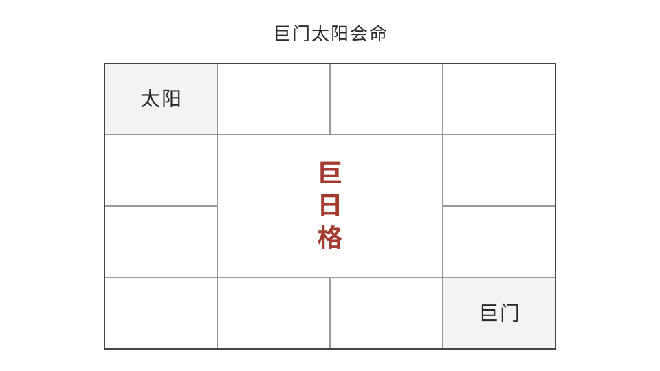 |
| **女人、男人拿到巨日格，各主什么？** | 〔口述〕倪师说「女人拿到巨日格呢」「主偏房」，「男人拿到巨日格呢」「大富大贵」，「这不一样啊」。（[00:12:41–00:12:55](https://www.bilibili.com/video/BV1KJsLekEfA/?p=21&t=761)，第 22854–23261 帧） 〔口述〕原因是「因为女人拿到这个巨门呢」「太太吵了嘛受不了」，「后来做做做偏房了」。（[00:13:00–00:13:07](https://www.bilibili.com/video/BV1KJsLekEfA/?p=21&t=780)，第 23412–23639 帧） 〔口述〕男人拿到巨日格则好，「很会讲话啊能言善道」「名嘴啊」。（[00:13:08–00:13:13](https://www.bilibili.com/video/BV1KJsLekEfA/?p=21&t=788)，第 23640–23807 帧） 〔板书〕可辨：中间「巨日格」左边新写了两个字，像「偏房」，再往上一个字认不出；黑板左边新画的方框图里的字认不出。（[00:12:49](https://www.bilibili.com/video/BV1KJsLekEfA/?p=21&t=769)，第 23088 帧） |
| **同样能说，为什么说女人做偏房是自己害自己？** | 〔口述〕倪师说「所以女人讲话人家觉得啰嗦」「唠叨啰嗦」，「男人讲话是名嘴」，「这不太公平」「我替女人抱不平了」。（[00:13:17–00:13:24](https://www.bilibili.com/video/BV1KJsLekEfA/?p=21&t=797)，第 23916–24131 帧） 〔口述〕但他又说「不过事实上都这样子」「我看到女孩子都这样」，做偏房「都是自己被自己害到自己」。（[00:13:24–00:13:33](https://www.bilibili.com/video/BV1KJsLekEfA/?p=21&t=804)，第 24132–24401 帧） |
| **命坐禄的人，钱财上怎么样？** | 〔口述〕倪师说「像这种巨日格的人呢」「命坐禄的人」「一辈子用不了用不完的钱」。（[00:13:33–00:13:37](https://www.bilibili.com/video/BV1KJsLekEfA/?p=21&t=813)，第 24402–24539 帧） 〔口述〕又重复：「命带禄的人」「一辈子用不完的钱」「她生下来就要有钱」。（[00:13:40–00:13:48](https://www.bilibili.com/video/BV1KJsLekEfA/?p=21&t=820)，第 24612–24863 帧） 〔推断〕推断：叠图命宫丁巳格里有禄存庙，倪师稍后也说「我们的禄存也是禄」，所以这里的「命坐禄」应指命宫有禄存；本段没有明说。（[00:12:20–00:14:18](https://www.bilibili.com/video/BV1KJsLekEfA/?p=21&t=740)，第 22206–25763 帧） |
| **命宫往旁边挪一格，格局还一样吗？** | 〔口述〕倪师假设「所以如果你的命官在旁边」，并说「上一章就是这样子有没有」「我刚不叫你比较上一章」。（[00:13:48–00:13:56](https://www.bilibili.com/video/BV1KJsLekEfA/?p=21&t=828)，第 24864–25103 帧） 〔口述〕接着说「她的命官是不是在这里」「同样的格」「我们这个落到兄弟宫去了有没有」，结论是「所以同样的排起来都是」「你宫一变就不一样」。（[00:13:56–00:14:06](https://www.bilibili.com/video/BV1KJsLekEfA/?p=21&t=836)，第 25104–25403 帧） 〔叠图〕临时贴出「兄弟丁巳」（内容与命宫丁巳相同）和「命宫戊午」：破军庙、擎羊陷、地劫庙、旬空庙、天厨、天哭陷、天虚平、阴煞，大限 5~14，冠带。（[00:13:48–00:13:50](https://www.bilibili.com/video/BV1KJsLekEfA/?p=21&t=828)，第 24864–24917 帧） 〔叠图〕随后又贴「命宫甲午」：贪狼旺、左辅旺、天钺、咸池陷、大耗旺、天厨、月德，大限 4~13，沐浴。（[00:13:56–00:13:57](https://www.bilibili.com/video/BV1KJsLekEfA/?p=21&t=836)，第 25104–25139 帧） 〔推断〕推断：这几格配合「如果你的命官在旁边」「上一章」演示命宫挪一格就不同，不是例二本盘；命宫甲午具体是哪张盘，口述没说清。（[00:13:48–00:14:06](https://www.bilibili.com/video/BV1KJsLekEfA/?p=21&t=828)，第 24864–25403 帧） |
| **巨日格再加权禄相逢，主什么？** | 〔口述〕倪师说「这个八字巨日格」「本来就是那个这种偏房命的」，「再加上事业上是化权和禄存」。（[00:14:09–00:14:16](https://www.bilibili.com/video/BV1KJsLekEfA/?p=21&t=849)，第 25482–25709 帧） 〔口述〕他强调「我们的禄存也是禄」「懂不懂我化禄也是禄」「禄存也是禄」。（[00:14:17–00:14:21](https://www.bilibili.com/video/BV1KJsLekEfA/?p=21&t=857)，第 25710–25847 帧） 〔口述〕「而且权禄相逢」「权禄相逢的人呢」「做到一定会自己做事业当老板」「自己自行经商当老板」，「这是先天上的格就是这样子的」。（[00:14:23–00:14:37](https://www.bilibili.com/video/BV1KJsLekEfA/?p=21&t=863)，第 25896–26333 帧） 〔口述〕他又说「那你不管她权是不是在官禄宫」「或在哪里都不重要了」。（[00:14:37–00:14:42](https://www.bilibili.com/video/BV1KJsLekEfA/?p=21&t=877)，第 26334–26489 帧） 〔叠图〕官禄辛酉：太阴旺化权、火星得、天喜庙、封诰、咸池平、天德不，大限 85~94，小限 2,14,26,38,50,62，养。（[00:14:14–00:14:16](https://www.bilibili.com/video/BV1KJsLekEfA/?p=21&t=854)，第 25632–25709 帧） |
| **命宫在巳，为什么说是燥热的命？** | 〔口述〕倪师说「诸位呢命宫在巳宫」，巳是早上 9 到 11 点、很热，太阳又在这里，所以是「很燥热的命」。（[00:14:50–00:15:02](https://www.bilibili.com/video/BV1KJsLekEfA/?p=21&t=890)，第 26700–27071 帧） 〔指代〕说「这个是很热的命」的「这个」时，手掌按在黑板上方「太阳 禄存」那一格上，露出画圈的命、巳和 9-11。（[00:14:58](https://www.bilibili.com/video/BV1KJsLekEfA/?p=21&t=898)，第 26956 帧） 〔板书〕可辨：「太阳」格里「禄存」被圈起，旁有「-14」，圈着的「命」「巳」，「9-11」，另一个圈着的字像「火」；下面格可辨「武曲」「15-24」「兄弟」，再下「天同」「文昌」「25-34」「红鸾」。左边方框图里的字认不出。（[00:14:59](https://www.bilibili.com/video/BV1KJsLekEfA/?p=21&t=899)，第 26992 帧） 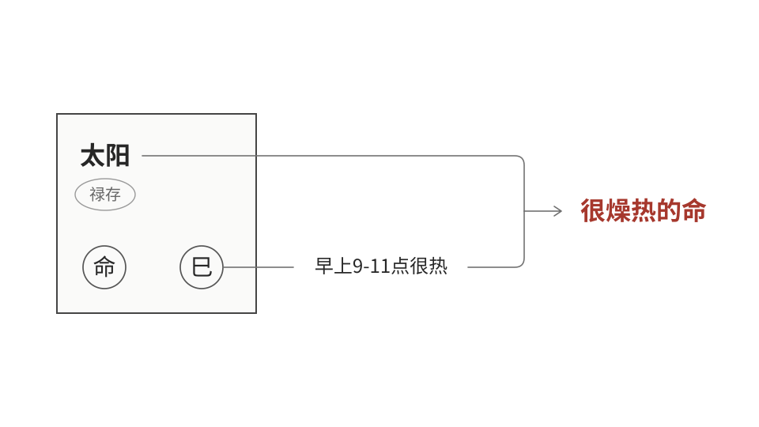 |
| **木形人长什么样？属猴又像猴算什么？** | 〔口述〕倪师说「诸位啊我们用木火土金水来分」，木形人「瘦干干的」「那越干越好」。（[00:15:02–00:15:14](https://www.bilibili.com/video/BV1KJsLekEfA/?p=21&t=902)，第 27072–27443 帧） 〔口述〕「那十二生肖里面最干的就是猴子」，木形人又属猴、长得又像猴子，「那是成格啦」。（[00:15:14–00:15:23](https://www.bilibili.com/video/BV1KJsLekEfA/?p=21&t=914)，第 27444–27719 帧） 〔口述〕举人为例：「我们至永庆就是这样子」（语音作王永庆，见待核）；「我们李登辉也是木形人」「瘦瘦干干高高高」。（[00:15:25–00:15:37](https://www.bilibili.com/video/BV1KJsLekEfA/?p=21&t=925)，第 27762–28121 帧） 〔口述〕木形人「比较黑」，「你的皮肤比较黑一点」。（[00:15:37–00:15:41](https://www.bilibili.com/video/BV1KJsLekEfA/?p=21&t=937)，第 28134–28247 帧） |
| **火形人什么样？男女各发什么行业？** | 〔口述〕火形人「比较尖翘」「头发尖尖的」，头发带点黄，脸上「皮包骨很亮」；举例「王升就那个样子」。（[00:15:41–00:15:51](https://www.bilibili.com/video/BV1KJsLekEfA/?p=21&t=941)，第 28248–28547 帧） 〔口述〕这种火形的人，「男人是发武将」；「女人呢」「发餐饮业火的东西」「餐厅饭店食品类吃的」。（[00:15:51–00:16:01](https://www.bilibili.com/video/BV1KJsLekEfA/?p=21&t=951)，第 28548–28859 帧） 〔口述〕「反正东西经过加热以后再卖出去」「都属于火」；倪师说已介绍过木火土金水五种，「这是火火局的人」。（[00:16:02–00:16:12](https://www.bilibili.com/video/BV1KJsLekEfA/?p=21&t=962)，第 28860–29165 帧） |
| **她的大限往哪个方向走？木方向对应什么行业？** | 〔口述〕倪师说「然后你看她的流年」「是不是一直往这边走」「请问这个方向是属于木的方向对不对」。（[00:16:12–00:16:21](https://www.bilibili.com/video/BV1KJsLekEfA/?p=21&t=972)，第 29166–29459 帧） 〔口述〕他说「我们是木火金水」「旁边四个角是土嘛」「这个是不是有火」，「一直一直往土的往木的方向走」。（[00:16:22–00:16:28](https://www.bilibili.com/video/BV1KJsLekEfA/?p=21&t=982)，第 29460–29663 帧） 〔叠图〕与命宫丁巳（大限 5~14）并贴：兄弟丙辰（武曲庙、陀罗庙、地空陷，大限 15~24）、夫妻乙卯（天同平、文昌利、红鸾庙，大限 25~34）、子女甲寅（七杀庙、天马旺、左辅庙，大限 35~44）。（[00:16:14–00:16:25](https://www.bilibili.com/video/BV1KJsLekEfA/?p=21&t=974)，第 29220–29550 帧） 〔推断〕推断：叠图大限从巳依次到辰、卯、寅，倪师说的「往这边走」「木的方向」应指这条顺序；他说这几句时手指落点都拿不准，所以只按叠图推断。（[00:16:09–00:16:28](https://www.bilibili.com/video/BV1KJsLekEfA/?p=21&t=969)，第 29070–29663 帧） 〔口述〕「木的话像服装杂志啊建筑啊建材」「这种是属于木方面的东西」。（[00:16:28–00:16:34](https://www.bilibili.com/video/BV1KJsLekEfA/?p=21&t=988)，第 29664–29837 帧） |
| **她当老板，会做哪两类行业？** | 〔口述〕倪师说这只是事业上面，「她的事业出来的时候」「权禄重逢一定会自己做事业当老板」。（[00:16:34–00:16:40](https://www.bilibili.com/video/BV1KJsLekEfA/?p=21&t=994)，第 29838–30029 帧） 〔口述〕「那做事业当老板的话」「会两种一种是火方面」「还有一种木方面的」。（[00:16:41–00:16:44](https://www.bilibili.com/video/BV1KJsLekEfA/?p=21&t=1001)，第 30030–30143 帧） 〔推断〕推断：火方面应接前面讲的命宫在巳燥热、「火局」，木方面应接大限往木的方向走；倪师在这里没有逐一说明对应关系。（[00:14:50–00:16:44](https://www.bilibili.com/video/BV1KJsLekEfA/?p=21&t=890)，第 26700–30143 帧） |
| **交友宫化禄，对她做事业意味着什么？** | 〔口述〕倪师说「她朋友化禄看到没有」「这个人有化禄都是财星」。（[00:16:46–00:16:50](https://www.bilibili.com/video/BV1KJsLekEfA/?p=21&t=1006)，第 30198–30311 帧） 〔指代〕说「这个」时食指点在黑板右中格圈住的「化禄」下面、「75-84 交友」字上。（[00:16:47](https://www.bilibili.com/video/BV1KJsLekEfA/?p=21&t=1007)，第 30227 帧） 〔叠图〕交友壬戌：贪狼庙化禄、凤阁庙、天伤平、寡宿陷、年解庙、天月，大限 75~84，小限 1,13,25,37,49,61，胎。（[00:16:50–00:16:51](https://www.bilibili.com/video/BV1KJsLekEfA/?p=21&t=1010)，第 30312–30353 帧） 〔口述〕所以「她不但可以自己做」「跟人家合伙还很好」，命里是这样的人，「她就会找到这样子的人来合伙」「然后赚到钱知不知道」。（[00:16:50–00:16:58](https://www.bilibili.com/video/BV1KJsLekEfA/?p=21&t=1010)，第 30312–30557 帧） |
| **小人星落在朋友宫，是好是坏？** | 〔口述〕倪师先说「如果你的朋友宫是小人」「你就要注意了」。（[00:16:58–00:17:02](https://www.bilibili.com/video/BV1KJsLekEfA/?p=21&t=1018)，第 30558–30689 帧） 〔口述〕又说「一般来说」「你的小人星落在你的朋友宫」「那就是你就是正人君子了」，「为什么因为你的朋友恨你嘛」。（[00:17:03–00:17:10](https://www.bilibili.com/video/BV1KJsLekEfA/?p=21&t=1023)，第 30690–30917 帧） 〔口述〕反过来，「怎么好人坏人为什么都说你好啊」「你是什么咖啊」「对不对你一天到晚在做人嘛」。（[00:17:10–00:17:19](https://www.bilibili.com/video/BV1KJsLekEfA/?p=21&t=1030)，第 30918–31199 帧） |
| **兄弟朋友大吉、父母宫破军在午，六亲怎么看？** | 〔口述〕倪师说「这个她的兄弟朋友都是大吉」「六亲方面对她帮助很大啊」。（[00:17:22–00:17:27](https://www.bilibili.com/video/BV1KJsLekEfA/?p=21&t=1042)，第 31266–31439 帧） 〔口述〕「那父母宫是破军没错」，「如果破军在入陷落暗的话」「破军主散」。（[00:17:28–00:17:32](https://www.bilibili.com/video/BV1KJsLekEfA/?p=21&t=1048)，第 31440–31583 帧） 〔口述〕「可是破军星是在午时看到没有」「午时是英星入庙加吉」，「所以她太阳身」「能够承受她父亲的祖业下来」；母亲与儿子在下一块接着讲。（[00:17:32–00:17:41](https://www.bilibili.com/video/BV1KJsLekEfA/?p=21&t=1052)，第 31584–31835 帧） 〔叠图〕父母戊午：破军庙、擎羊陷、地劫庙、旬空庙、天厨、天哭陷、天虚平、解神庙、阴煞，大限 115~124，冠带。（[00:17:22–00:17:41](https://www.bilibili.com/video/BV1KJsLekEfA/?p=21&t=1042)，第 31266–31835 帧） |

**总结区**

- 通用规则：女人拿到巨日格主偏房，男人拿到巨日格大富大贵、能言善道（[00:12:41–00:13:13](https://www.bilibili.com/video/BV1KJsLekEfA/?p=21&t=761)，第 22854–23807 帧）；命坐禄（命带禄）的人一辈子用不完的钱，生下来就要有钱（[00:13:35–00:13:48](https://www.bilibili.com/video/BV1KJsLekEfA/?p=21&t=815)，第 24456–24863 帧）；权禄相逢的人一定会自己做事业当老板，权在不在官禄宫都不重要（[00:14:23–00:14:42](https://www.bilibili.com/video/BV1KJsLekEfA/?p=21&t=863)，第 25896–26489 帧）；同样的排法，命宫一换宫格局就不一样（[00:13:48–00:14:06](https://www.bilibili.com/video/BV1KJsLekEfA/?p=21&t=828)，第 24864–25403 帧）
- 只在本例：例二命宫丁巳太阳、迁移巨门，倪师称巨日格，本来是偏房命，又权禄相逢（[00:12:20–00:14:37](https://www.bilibili.com/video/BV1KJsLekEfA/?p=21&t=740)，第 22206–26333 帧）；命宫在巳、太阳在巳，是很燥热的命；大限往木的方向走，当老板会做火或木两类行业（[00:14:50–00:16:44](https://www.bilibili.com/video/BV1KJsLekEfA/?p=21&t=890)，第 26700–30143 帧）；交友宫化禄，她会找到合伙人一起赚钱；兄弟朋友大吉，六亲帮助很大（[00:16:46–00:17:27](https://www.bilibili.com/video/BV1KJsLekEfA/?p=21&t=1006)，第 30198–31439 帧）；父母宫破军在午，倪师说她能承受父亲的祖业（[00:17:28–00:17:41](https://www.bilibili.com/video/BV1KJsLekEfA/?p=21&t=1048)，第 31440–31835 帧）
- 不是排盘规则，是处世方法：小人星落朋友宫的人反而是正人君子；好人坏人都说你好，是一天到晚在做人（[00:17:03–00:17:19](https://www.bilibili.com/video/BV1KJsLekEfA/?p=21&t=1023)，第 30690–31199 帧）；倪师说女人讲话被嫌啰嗦，做偏房是自己害自己（[00:13:17–00:13:33](https://www.bilibili.com/video/BV1KJsLekEfA/?p=21&t=797)，第 23916–24401 帧）

**待核**

1. 第 24864、25104 帧字幕「命官」按上下文应为「命宫」，引文保留字幕原字。
2. [00:13:50](https://www.bilibili.com/video/BV1KJsLekEfA/?p=21&t=830)，第 24918 帧字幕「猪羊变色了差差一点」，语音作「养变瘦了才差一点」，两路对不上，未引；[00:13:52](https://www.bilibili.com/video/BV1KJsLekEfA/?p=21&t=832)，第 24960 帧「还赶快推过去一点好了」意思不明。
3. [00:13:29](https://www.bilibili.com/video/BV1KJsLekEfA/?p=21&t=809)，第 24276 帧字幕「她之所以沩偏房」，「沩」应为「为」，未引。
4. 第 26808、26922 帧字幕「已是早上9-11点很热」「太阳叉居在这里」，「已」应为「巳」、「叉」应为「又」，笔记里按改正后转述。
5. [00:15:25](https://www.bilibili.com/video/BV1KJsLekEfA/?p=21&t=925)，第 27762 帧字幕「至永庆」、语音「王永庆」；[00:15:34](https://www.bilibili.com/video/BV1KJsLekEfA/?p=21&t=934)，第 28038 帧字幕「李登辉」、语音「李总统」；[00:15:49](https://www.bilibili.com/video/BV1KJsLekEfA/?p=21&t=949)，第 28488 帧字幕「王升」、语音「王三」，人名待核。
6. [00:15:46](https://www.bilibili.com/video/BV1KJsLekEfA/?p=21&t=946)，第 28404 帧字幕「脸上没有肉」，语音作「脸上面有肉」，两路对不上，只引了「皮包骨很亮」。
7. 第 28122、28284 帧字幕是乱码（「怔址山土章郁」「羅余分珠羽」），已略过。
8. [00:16:12](https://www.bilibili.com/video/BV1KJsLekEfA/?p=21&t=972)，第 29166 帧语音多出「五岁到十四岁十五到二十四二十五到三」，字幕没有，未当原话引。
9. 指代 D048、D049、D050、D054、D055、D056、D057、D058、D060 都是「是（不确定）」，未当依据；「往这边走」「这个方向」手指落点拿不准（[00:13:42–00:17:20](https://www.bilibili.com/video/BV1KJsLekEfA/?p=21&t=822)，第 24683–31227 帧）。
10. [00:14:14](https://www.bilibili.com/video/BV1KJsLekEfA/?p=21&t=854)，第 25632 帧「再加上事业上是化权和禄存」：叠图禄存在命宫丁巳、化权在官禄辛酉太阴，倪师说法与叠图位置的关系待核；[00:14:18](https://www.bilibili.com/video/BV1KJsLekEfA/?p=21&t=858)，第 25764 帧「我化禄也是禄」本段没指出化禄在哪一宫。
11. [00:17:29](https://www.bilibili.com/video/BV1KJsLekEfA/?p=21&t=1049)，第 31482 帧「入陷落暗」语音作「路线落岸」，疑为「入陷落陷」；[00:17:35](https://www.bilibili.com/video/BV1KJsLekEfA/?p=21&t=1055)，第 31650 帧「午时是英星入庙加吉」语音作「阴心入庙加急」，「英星」指什么待核；[00:17:37](https://www.bilibili.com/video/BV1KJsLekEfA/?p=21&t=1057)，第 31710 帧「太阳身」语音作「太阳神能」，意思待核。
12. [00:17:22](https://www.bilibili.com/video/BV1KJsLekEfA/?p=21&t=1042)，第 31266 帧语音作「大吉六星」，字幕只有「大吉」。
13. 叠图父母戊午[00:17:30](https://www.bilibili.com/video/BV1KJsLekEfA/?p=21&t=1050)，第 31500 帧那一次转写作破军陷、擎羊缺字，前后几次都是破军庙、擎羊陷；抽[00:17:30](https://www.bilibili.com/video/BV1KJsLekEfA/?p=21&t=1050)，第 31510 帧看，那时叠图还在滑入画面，疑为转写误读（[00:17:30](https://www.bilibili.com/video/BV1KJsLekEfA/?p=21&t=1050)，第 31500 帧）。
14. 叠图命宫戊午、命宫甲午是哪张盘的格，口述只说「上一章」，待核（第 24864、25104 帧）。
15. 「巨日会命」「权禄相逢 / 权禄重逢」「小人星」倪师用了没解释，小人星具体指哪些星本块未讲（第 22374、25896、30714 帧）。
16. [00:12:09](https://www.bilibili.com/video/BV1KJsLekEfA/?p=21&t=729)，第 21894 帧板书图画面全黑，认不出；[00:14:36](https://www.bilibili.com/video/BV1KJsLekEfA/?p=21&t=876)，第 26280 帧板书图被身体挡住、字模糊，新写的字认不出；[00:12:38](https://www.bilibili.com/video/BV1KJsLekEfA/?p=21&t=758)，第 22752 帧、[00:12:49](https://www.bilibili.com/video/BV1KJsLekEfA/?p=21&t=769)，第 23088 帧、[00:14:59](https://www.bilibili.com/video/BV1KJsLekEfA/?p=21&t=899)，第 26992 帧板书图黑板左边方框图里的字认不出。

### 4　巨日女命：儿子体型与红鸾过限离婚（[00:17:41–00:23:16](https://www.bilibili.com/video/BV1KJsLekEfA/?p=21&t=1061)，第 31836–41897 帧）

| 提示区 | 笔记区 |
|---|---|
| **太阴化权，母亲对她怎样？什么叫权禄重逢？** | 〔口述〕接着前面父母宫的话题讲母亲：「那太阴星又化权妈妈又对她很好」；又说妈妈又给她权（字幕作「妈妈叉给她杈」），所以她权禄重逢（字幕作「杈禄重逢」），「生来就是这样子」。（[00:17:41–00:17:47](https://www.bilibili.com/video/BV1KJsLekEfA/?p=21&t=1061)，第 31836–32039 帧） 〔叠图〕官禄辛酉：太阴旺、化权，同格有天喜庙、火星得、封诰、咸池平、天德；命宫丁巳：太阳旺、禄存庙、铃星得、天才庙、破碎陷；父母戊午：破军庙、擎羊陷、地劫庙。（[00:17:41–00:17:44](https://www.bilibili.com/video/BV1KJsLekEfA/?p=21&t=1061)，第 31836–31925 帧） 〔推断〕推断：叠图命宫丁巳有禄存、官禄辛酉有太阴化权，「权禄重逢」可能就指这两颗；倪师本句没有点明是哪两颗星。（[00:17:45–00:17:46](https://www.bilibili.com/video/BV1KJsLekEfA/?p=21&t=1065)，第 31956–31991 帧） 〔板书〕本块开头板面可辨：中央「巨日格」，右侧格「太阴」，下排「疾厄」；上方被叠图遮住，其余认不出。（[00:17:42](https://www.bilibili.com/video/BV1KJsLekEfA/?p=21&t=1062)，第 31860 帧） |
| **七杀、天马主她的儿子怎样？** | 〔口述〕讲儿子：「那这个儿子七杀星」「七杀星代表一个儿子」，「但是这个儿子将来天马星会远离她」「离她很远」。（[00:17:48–00:17:55](https://www.bilibili.com/video/BV1KJsLekEfA/?p=21&t=1068)，第 32040–32261 帧） 〔口述〕自问为什么离她很远：「我们讲过七杀朝斗紫府坐桓的话」，所以她儿子将来是武贵，「军人警察法官外交官都是这种人」。（[00:17:55–00:18:06](https://www.bilibili.com/video/BV1KJsLekEfA/?p=21&t=1075)，第 32262–32585 帧） 〔口述〕「所以她会有儿子」，「这个儿子将来跟她聚少散多」「一定是这种象」。（[00:18:06–00:18:15](https://www.bilibili.com/video/BV1KJsLekEfA/?p=21&t=1086)，第 32586–32855 帧） |
| **巨日同宫与对宫，女命体型长相有何不同？** | 〔口述〕「那女孩子太阳巨门太阳的人呢」「有两种」：「巨门太阳如果是同官的时候」「人会长得比较娇小玲珑」，「对宫的时候比较长绒肥胖」（同官即同宫）。（[00:18:15–00:18:27](https://www.bilibili.com/video/BV1KJsLekEfA/?p=21&t=1095)，第 32856–33215 帧） 〔口述〕引相书再说一遍：「就是官分开来的时候比较壮大」；两颗集中在一起、「或者巨门太阳都在这里的时候」，「女孩子长得很漂亮」。（[00:18:32–00:18:42](https://www.bilibili.com/video/BV1KJsLekEfA/?p=21&t=1112)，第 33366–33665 帧） 〔叠图〕本例命宫丁巳：太阳旺、禄存庙；迁移癸亥：巨门旺、文曲旺、天姚陷。（[00:18:10–00:18:15](https://www.bilibili.com/video/BV1KJsLekEfA/?p=21&t=1090)，第 32718–32855 帧） 〔推断〕推断：按叠图，本例太阳在命宫丁巳、巨门在迁移癸亥，属倪师说的分开在对宫那一种；随后他说「像这个就比较肥胖了」，但「这个」手指何处没有定住。（[00:18:42–00:18:44](https://www.bilibili.com/video/BV1KJsLekEfA/?p=21&t=1122)，第 33666–33731 帧） |
| **看眼睛，怎样算聪明、怎样算笨？** | 〔口述〕「笑起来眼睛都看不到」「那眼睛看不到聪明了」；「眼睛最好的越细越长」「越看不到越厉害」。（[00:18:44–00:18:55](https://www.bilibili.com/video/BV1KJsLekEfA/?p=21&t=1124)，第 33732–34061 帧） 〔口述〕反过来，「那个人笑起来笑得眼睛还是很大」，「都是不太好这个人笨呢」。（[00:18:55–00:19:02](https://www.bilibili.com/video/BV1KJsLekEfA/?p=21&t=1135)，第 34062–34265 帧） |
| **女命拿到太阳，夫妻宫天同文昌，先生会怎样？** | 〔口述〕「现在我为什么要跟诸位提出来」，「第一个诸位看她的夫妻宫」，「这个夫妻宫是天同带天马」，紧接着又说「这个天同跟文昌啊」「跟文昌星」。（[00:19:04–00:19:14](https://www.bilibili.com/video/BV1KJsLekEfA/?p=21&t=1144)，第 34332–34643 帧） 〔指代〕说「这个夫妻宫」时手指点在黑板左列「红鸾 25-34」那一格下沿；说「这个天同跟文昌」时指尖点在同格「文昌」字旁，上方就是「天同」。（[00:19:09–00:19:11](https://www.bilibili.com/video/BV1KJsLekEfA/?p=21&t=1149)，第 34475–34547 帧） 〔叠图〕夫妻乙卯：天同平、文昌利、红鸾庙、天官旺、天福平，大限 25~34；格中没有天马。（[00:19:15–00:19:18](https://www.bilibili.com/video/BV1KJsLekEfA/?p=21&t=1155)，第 34662–34745 帧） 〔口述〕「一个女人的命居然拿到太阳啊」「那她先生是不是比她差」，「在命上面你看她先生太差了」「那就会变成半吊子」。（[00:19:15–00:19:25](https://www.bilibili.com/video/BV1KJsLekEfA/?p=21&t=1155)，第 34662–34973 帧） 〔口述〕条件很好的男人看到她不会喜欢她，「不需要你女孩子那么会赚钱」「我自己可以发财」；「那条件不好的嘛」「需要仰爱她的都会进来」。（[00:19:25–00:19:40](https://www.bilibili.com/video/BV1KJsLekEfA/?p=21&t=1165)，第 34974–35417 帧） |
| **红鸾、天喜各在哪？红鸾为什么会动？** | 〔口述〕「那红鸾星在25-34」「她红鸾星会动」「因为是吉星懂不懂我意思」「对面又没有杀星」。（[00:19:40–00:19:47](https://www.bilibili.com/video/BV1KJsLekEfA/?p=21&t=1180)，第 35418–35621 帧） 〔口述〕「然后太阴星进来哈」，「太阴星这边是天喜」；「红鸾星在这边」「对面一定是什么」「天喜一定在这边」。（[00:19:47–00:19:56](https://www.bilibili.com/video/BV1KJsLekEfA/?p=21&t=1187)，第 35622–35891 帧） 〔叠图〕官禄辛酉：太阴旺权、天喜庙，叠图该格标着「结婚」，格内另框「26」；夫妻乙卯格内另框「32」（第35892帧截图上看得见）。（[00:19:51–00:19:52](https://www.bilibili.com/video/BV1KJsLekEfA/?p=21&t=1191)，第 35748–35771 帧） 〔板书〕可辨：黑板右侧圆圈内「天喜」，左列格内「红鸾」，中央「巨日格」；其余认不出。（[00:20:10](https://www.bilibili.com/video/BV1KJsLekEfA/?p=21&t=1210)，第 36300 帧） 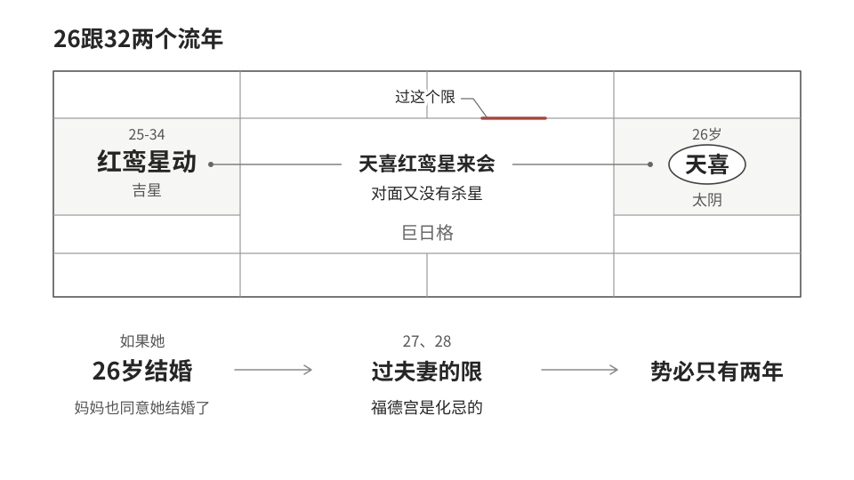 〔推断〕推断：倪师说红鸾对面一定是天喜，叠图正好把红鸾贴在夫妻乙卯、天喜贴在官禄辛酉，两者对应；倪师口头没说宫名。（[00:19:51–00:19:56](https://www.bilibili.com/video/BV1KJsLekEfA/?p=21&t=1191)，第 35748–35891 帧） |
| **婚姻受谁左右？26 与 32 两个流年何别？** | 〔口述〕「那有一个解释呢」「第一个就是她的婚姻呢」「受到她妈妈的左有」（即左右），「然后妈妈也同意她结婚了」。（[00:19:56–00:20:06](https://www.bilibili.com/video/BV1KJsLekEfA/?p=21&t=1196)，第 35892–36191 帧） 〔口述〕「我们看看流年」，「37年（1948） 是子年属老鼠的」，「属老鼠在这边……」；「诸位看26跟32两个流年」「这两个在命上面是完全不一样的」。（[00:20:07–00:20:27](https://www.bilibili.com/video/BV1KJsLekEfA/?p=21&t=1207)，第 36222–36833 帧） 〔口述〕「25岁开始走红鸾星的运道」「那第一个限就是26岁」「她26岁那一年逢到天喜星」「对面是红鸾星动」「那天喜红鸾星来会」「她从26岁就会结婚」「因为没有杀星知不知道」。（[00:20:30–00:20:41](https://www.bilibili.com/video/BV1KJsLekEfA/?p=21&t=1230)，第 36912–37253 帧） 〔推断〕推断：叠图把「26」框在官禄辛酉（天喜）格、「32」框在夫妻乙卯（红鸾）格，和倪师说26岁逢天喜、对面红鸾的讲法对得上。（[00:20:21–00:20:40](https://www.bilibili.com/video/BV1KJsLekEfA/?p=21&t=1221)，第 36636–37211 帧） 〔板书〕可辨：「巨日格」「太阴」，右侧一个圆圈里的字被挡住；这段新写的内容被身体挡住，认不出。（[00:20:25](https://www.bilibili.com/video/BV1KJsLekEfA/?p=21&t=1225)，第 36756 帧） |
| **什么叫过限？为何26岁结婚势必只有两年？** | 〔口述〕「可是一结婚的时候」，「有个算红鸾星的时候要过限」「过限什么叫过限呢」，「因为她福德宫是化忌的」。（[00:20:44–00:20:56](https://www.bilibili.com/video/BV1KJsLekEfA/?p=21&t=1244)，第 37326–37691 帧） 〔口述〕「女人的福德」「世的福禄」「也代可以代表夫妻」；「25 26岁在这边」「26岁一结婚的时候」先要过这个限，「过夫妻的限就是化忌」，「所以如果她 26岁结婚的话」「势必只有两年」。（[00:20:56–00:21:11](https://www.bilibili.com/video/BV1KJsLekEfA/?p=21&t=1256)，第 37692–38153 帧） 〔指代〕说「过这个限」时，手指按在黑板上排中间格下沿的横线上，指的是格线（限）；格里的粉笔字看不清。（[00:21:03](https://www.bilibili.com/video/BV1KJsLekEfA/?p=21&t=1263)，第 37916 帧） 〔叠图〕福德己未：天机陷、化忌、天钺旺、天寿旺、副旬陷、大耗平，标「身宫」；格内另框「28」（第37800帧截图上看得见）。（[00:20:53–00:20:56](https://www.bilibili.com/video/BV1KJsLekEfA/?p=21&t=1253)，第 37596–37691 帧） 〔板书〕可辨：右列「田宅」「太阴」「事业」「贪狼」，「化禄」外画圆圈，下方「巨门」，下格「疾厄」，中央「巨日格」；这段新写的字认不出。（[00:21:00](https://www.bilibili.com/video/BV1KJsLekEfA/?p=21&t=1260)，第 37800 帧） |
| **只叫人26岁别结婚，为何是消极的算命？** | 〔口述〕「我们现在先不要管阳宅哈」；过去算命的说「哎呀小姐你26岁不要结婚」「32岁再结婚比较好」，「了解吧这是算命的方法」。（[00:21:11–00:21:24](https://www.bilibili.com/video/BV1KJsLekEfA/?p=21&t=1271)，第 38154–38531 帧） 〔口述〕「那算命算命的方法消极的」；对方会说「不行我要结婚」「我不能因为你一个算命的讲」「不结婚就不结婚OK」。（[00:21:24–00:21:29](https://www.bilibili.com/video/BV1KJsLekEfA/?p=21&t=1284)，第 38532–38687 帧） 〔口述〕「好那你跟她打赌啊」「你结婚两年以后离婚」，「她也真的两年以后离婚来找你」「你看倪先生你算的很准」「我都离婚了」。（[00:21:29–00:21:36](https://www.bilibili.com/video/BV1KJsLekEfA/?p=21&t=1289)，第 38688–38885 帧） 〔口述〕倪师反问：「对事情有没有帮助」，「不是我们的本意嘛」「所以算命如果是这样就没有意思了」，「那现在人家外面都是这样子」。（[00:21:36–00:21:47](https://www.bilibili.com/video/BV1KJsLekEfA/?p=21&t=1296)，第 38886–39227 帧） |
| **她为何更惨？27岁的本宫与生子后离婚** | 〔口述〕「因为她26岁一结婚」，27岁的时候她本宫是南北斗星君（字幕作「4+27岁」），「对面是什么」「子女有没有」，「她会生了儿子以后离婚」。（[00:21:49–00:21:55](https://www.bilibili.com/video/BV1KJsLekEfA/?p=21&t=1309)，第 39270–39479 帧） 〔口述〕「如果如果晚一点还好嘛」，离了婚以后再生，「结果生了孩子还再离婚这比较麻烦了」。（[00:21:57–00:22:06](https://www.bilibili.com/video/BV1KJsLekEfA/?p=21&t=1317)，第 39534–39803 帧） 〔叠图〕田宅庚申：紫微旺、天府得、天贵陷，叠图该格标着「生儿子」；子女甲寅：七杀庙、天马旺、左辅庙、孤辰平、八座庙；福德己未叠图该格标着「离婚」。（[00:21:54–00:21:55](https://www.bilibili.com/video/BV1KJsLekEfA/?p=21&t=1314)，第 39432–39479 帧） 〔推断〕推断：倪师说27岁本宫是「南北斗星君」，同时贴出的田宅庚申格有紫微、天府并标「生儿子」，可能就是所指；倪师口头没有说宫名。（[00:21:50–00:21:55](https://www.bilibili.com/video/BV1KJsLekEfA/?p=21&t=1310)，第 39306–39479 帧） |
| **什么叫「雌雄同体」？** | 〔口述〕「那这个女孩子太强了」「不容易遇到好的」「那遇到好的又看不上她」。（[00:22:06–00:22:11](https://www.bilibili.com/video/BV1KJsLekEfA/?p=21&t=1326)，第 39804–39959 帧） 〔口述〕「如果她是同宫在一起的话」「就会喜欢她」，「分开来的是不是」「这种就叫做男命女」「男人命女人身啊」，「我就给她一种特别的名词」「叫雌雄同体」。（[00:22:12–00:22:25](https://www.bilibili.com/video/BV1KJsLekEfA/?p=21&t=1332)，第 39960–40355 帧） 〔口述〕「你不需要男人嘛」「男人看到你也不会喜欢」「就变成这样子」「可是做事业很强」「非常的厉害」。（[00:22:25–00:22:34](https://www.bilibili.com/video/BV1KJsLekEfA/?p=21&t=1345)，第 40356–40631 帧） 〔推断〕推断：接前面巨日同宫、对宫两种讲法，这里的「同宫」「分开」应指巨门太阳；说「分开来的」时叠图正贴着命宫丁巳、迁移癸亥两格。（[00:22:14–00:22:17](https://www.bilibili.com/video/BV1KJsLekEfA/?p=21&t=1334)，第 40026–40139 帧） |
| **27至30岁，她的运势怎么一步步走？** | 〔口述〕「那由于婚姻不好呢」，「因为离婚了」；本来不用工作，「她家境环境很好妈妈也同意了」「很愉快啊」。（[00:22:34–00:22:42](https://www.bilibili.com/video/BV1KJsLekEfA/?p=21&t=1354)，第 40632–40883 帧） 〔口述〕「27岁有田宅了」「结婚了还有房子都分到」「这很好了」，「结果28岁一离婚」「她发现她一无所有」「从此她不相信男人」。（[00:22:42–00:22:49](https://www.bilibili.com/video/BV1KJsLekEfA/?p=21&t=1362)，第 40884–41093 帧） 〔口述〕「开始29岁很辛苦的」「拼命在里面辛苦成家」「然后学习到很多经验」「对面化科学到有专业技术专长」；「29岁正好在南方午宫上面」「进入她的大运」「所以她一定会走火方面去做事情」。（[00:22:49–00:23:03](https://www.bilibili.com/video/BV1KJsLekEfA/?p=21&t=1369)，第 41094–41495 帧） 〔叠图〕父母戊午：破军庙、擎羊陷、地劫庙、天哭陷，格内另有「29」；说「对面化科」时贴出疾厄甲子：天相庙、右弼庙科、廉贞平、三台平。（[00:22:38–00:22:56](https://www.bilibili.com/video/BV1KJsLekEfA/?p=21&t=1358)，第 40752–41297 帧） 〔口述〕「然后30岁开始发」「30岁开始她进入她自己的流年」；「所以这个小姐如果是25岁来找我们算」「跟30岁来找我们算」「结果不一样」。（[00:23:03–00:23:16](https://www.bilibili.com/video/BV1KJsLekEfA/?p=21&t=1383)，第 41496–41897 帧） |

**总结区**

- 通用规则：巨门太阳同宫，女命长得娇小玲珑、漂亮；分在对宫，比较壮大肥胖（[00:18:15–00:18:42](https://www.bilibili.com/video/BV1KJsLekEfA/?p=21&t=1095)，第 32856–33665 帧）。；眼睛越细越长、笑起来越看不到越聪明；笑起来眼睛还很大的不太好（[00:18:44–00:19:02](https://www.bilibili.com/video/BV1KJsLekEfA/?p=21&t=1124)，第 33732–34265 帧）。；红鸾是吉星，对面没有杀星，红鸾就会动、会结婚；但算红鸾要过限（[00:19:40–00:20:53](https://www.bilibili.com/video/BV1KJsLekEfA/?p=21&t=1180)，第 35418–37595 帧）。；女人的福德宫也可以代表夫妻（[00:20:56–00:20:59](https://www.bilibili.com/video/BV1KJsLekEfA/?p=21&t=1256)，第 37692–37799 帧）。
- 只在本例：子女宫七杀主有一个儿子，天马主儿子远离、聚少散多，将来是武贵（[00:17:48–00:18:15](https://www.bilibili.com/video/BV1KJsLekEfA/?p=21&t=1068)，第 32040–32855 帧）。；女命拿到太阳，先生比她差，条件好的男人不喜欢她，倪师称这种为雌雄同体，做事业很强（[00:19:15–00:22:34](https://www.bilibili.com/video/BV1KJsLekEfA/?p=21&t=1155)，第 34662–40631 帧）。；红鸾在25–34，26岁逢天喜结婚，但要过福德化忌的限，婚姻势必只有两年，生了儿子以后离婚（[00:19:40–00:21:55](https://www.bilibili.com/video/BV1KJsLekEfA/?p=21&t=1180)，第 35418–39479 帧）。；27岁有田宅，28岁离婚一无所有，29岁进入午宫大运辛苦学专长，30岁开始发（[00:22:42–00:23:09](https://www.bilibili.com/video/BV1KJsLekEfA/?p=21&t=1362)，第 40884–41675 帧）。
- 不是排盘规则，是处世方法：只叫人26岁别结婚、32岁再结是消极的算法，对方离婚后说你算得准于事无补，不是算命的本意（[00:21:11–00:21:47](https://www.bilibili.com/video/BV1KJsLekEfA/?p=21&t=1271)，第 38154–39227 帧）。；同一个人25岁来算和30岁来算，结果不一样（[00:23:09–00:23:16](https://www.bilibili.com/video/BV1KJsLekEfA/?p=21&t=1389)，第 41676–41897 帧）。

**待核**

1. [00:17:44–00:17:46](https://www.bilibili.com/video/BV1KJsLekEfA/?p=21&t=1064)，第 31926–31991 帧：字幕「妈妈叉给她杈」「所以她杈禄重逢」，语音作「又给他全」「他全入从亡」，按上文「化权」改读为「权」「权禄重逢」，原话待核。
2. [00:17:57](https://www.bilibili.com/video/BV1KJsLekEfA/?p=21&t=1077)，第 32310 帧：「七杀朝斗紫府坐桓」，语音作「坐环」，「桓」疑为「垣」；倪师只说「我们讲过」，本块没解释此盘为何合这一格。
3. [00:17:48–00:18:08](https://www.bilibili.com/video/BV1KJsLekEfA/?p=21&t=1068)，第 32040–32654 帧：说「这个儿子」时手伸向黑板左下格（D061、D062、D063），指代都是「不确定」；☞ 注里说当时叠图已显示子女甲寅七杀左辅天马，但材料 ▣ 行到[00:21:54](https://www.bilibili.com/video/BV1KJsLekEfA/?p=21&t=1314)，第 39432 帧才列出子女甲寅。
4. 第32976、33366帧：字幕「同官」「官分开来」，按上下文改为「同宫」「宫分开来」。
5. [00:18:25](https://www.bilibili.com/video/BV1KJsLekEfA/?p=21&t=1105)，第 33156 帧：「长绒肥胖」，语音作「长荣肥胖」，词义待核；[00:18:28](https://www.bilibili.com/video/BV1KJsLekEfA/?p=21&t=1108)，第 33258 帧「相书」指哪本书没说。
6. 第33541、33654帧：说「都在这里」「像这个就比较肥胖了」时的指代（D065、D066）都是「不确定」，D065 格内字与叠图不一致。
7. [00:19:02](https://www.bilibili.com/video/BV1KJsLekEfA/?p=21&t=1142)，第 34280 帧：「那这个八字」指代（D069）不确定，所说「八字」是什么没讲清。
8. [00:19:10](https://www.bilibili.com/video/BV1KJsLekEfA/?p=21&t=1150)，第 34500 帧：字幕与语音都作「夫妻宫是天同带天马」，但下一句改说「天同跟文昌」，叠图夫妻乙卯也没有天马，疑为口误。
9. [00:19:37](https://www.bilibili.com/video/BV1KJsLekEfA/?p=21&t=1177)，第 35322 帧：「仰爱她的」，语音作「仰赖」，待核。
10. 第35720、35758帧：说「太阴星这边是天喜」「红鸾星在这边」的指代（D073、D074）不确定。
11. [00:19:56](https://www.bilibili.com/video/BV1KJsLekEfA/?p=21&t=1196)，第 35892 帧：板书图里右侧圆圈字只露出一部分，[00:20:10](https://www.bilibili.com/video/BV1KJsLekEfA/?p=21&t=1210)，第 36300 帧才看清是「天喜」；叠图上「26」「32」「28」三个框中数字是看截图认的，材料 ▣ 行只部分列出。
12. [00:20:00](https://www.bilibili.com/video/BV1KJsLekEfA/?p=21&t=1200)，第 36000 帧：字幕「左有」，语音作「左右」，按上下文改为「左右」。
13. [00:20:08–00:20:21](https://www.bilibili.com/video/BV1KJsLekEfA/?p=21&t=1208)，第 36258–36635 帧：「37年（1948）」「（成宫）」「37（岁）」中的括号字是字幕注字，不是倪师的话；「属老鼠在这边」指哪（D076）看不出；「25（成宫）26」整句可信度低。
14. [00:20:41](https://www.bilibili.com/video/BV1KJsLekEfA/?p=21&t=1241)，第 37254 帧：字幕「t没有杀星」，t 字为识别噪声。
15. [00:20:46](https://www.bilibili.com/video/BV1KJsLekEfA/?p=21&t=1246)，第 37398 帧：「过限」倪师自问「什么叫过限」，本块只答到「过夫妻的限就是化忌」，没有完整定义。
16. [00:20:57–00:20:59](https://www.bilibili.com/video/BV1KJsLekEfA/?p=21&t=1257)，第 37710–37799 帧：字幕「世的福禄」「也代可以代表夫妻」，语音作「一世的福禄」「也可以代表夫妻」，待核。
17. [00:21:01](https://www.bilibili.com/video/BV1KJsLekEfA/?p=21&t=1261)，第 37836 帧：「25 26岁在这边」指代（D077）不确定；[00:21:02](https://www.bilibili.com/video/BV1KJsLekEfA/?p=21&t=1262)，第 37872 帧「2728 第一个先要过这个限」中「2728」是什么没讲清。
18. [00:21:00](https://www.bilibili.com/video/BV1KJsLekEfA/?p=21&t=1260)，第 37800 帧：板书「化禄」上方一圈字疑为「化权」，认不全；本段新写的字认不出。
19. [00:21:36](https://www.bilibili.com/video/BV1KJsLekEfA/?p=21&t=1296)，第 38886 帧：字幕「我请问你于事有有」，语音作「于是有」，原话待核。
20. [00:21:47](https://www.bilibili.com/video/BV1KJsLekEfA/?p=21&t=1307)，第 39228 帧：字幕「沩什么」改为「为什么」。
21. [00:21:50](https://www.bilibili.com/video/BV1KJsLekEfA/?p=21&t=1310)，第 39306 帧：字幕「4+27岁」，语音作「27岁」；「南北斗星君」「本宫」倪师没解释。
22. [00:21:54](https://www.bilibili.com/video/BV1KJsLekEfA/?p=21&t=1314)，第 39432 帧：叠图田宅庚申数字串「27、315、395163、95104」中「27」是否为框标岁数，未看原图核实。
23. 第39730、39778帧：「这个比较麻烦」「那这个女孩子」的指代（D079、D080）不确定。
24. [00:22:36](https://www.bilibili.com/video/BV1KJsLekEfA/?p=21&t=1356)，第 40686 帧：字幕「你看读图啊」，语音作「独徒」，意思待核。
25. [00:22:39](https://www.bilibili.com/video/BV1KJsLekEfA/?p=21&t=1359)，第 40776 帧：字幕「（本来刚开始不用工作啊」开头有半个括号，可信度 0.33。
26. [00:22:54](https://www.bilibili.com/video/BV1KJsLekEfA/?p=21&t=1374)，第 41220 帧：「对面化科」中的「对面」倪师没说是哪宫；叠图此时贴出疾厄甲子右弼庙科，是否所指待核。
27. [00:22:56–00:23:03](https://www.bilibili.com/video/BV1KJsLekEfA/?p=21&t=1376)，第 41298–41495 帧：「南方午宫」「走火方面去做事情」倪师没解释为何午宫对应火。
28. [00:23:09](https://www.bilibili.com/video/BV1KJsLekEfA/?p=21&t=1389)，第 41676 帧：叠图交友壬戌（贪狼庙、带「禄」，数字串含「25」）与倪师说的「25岁来找我们算」是否有关，看不出。

### 5　47岁来算：西北角与再婚方位（[00:23:16–00:28:42](https://www.bilibili.com/video/BV1KJsLekEfA/?p=21&t=1396)，第 41898–51683 帧）

| 提示区 | 笔记区 |
|---|---|
| **她 47 岁来算，第一条断语是什么？** | 〔口述〕接着上一块「如果是25岁来找我们算」「跟30岁来找我们算」「结果不一样」，倪师说她来找的时候「今年是什么47」，「那47来算的话」「那就更简单了」。（[00:23:16–00:23:26](https://www.bilibili.com/video/BV1KJsLekEfA/?p=21&t=1396)，第 41898–42191 帧） 〔口述〕第一条断语：「第一个无法享夫福」「一辈子没有办法享到夫福」，接着对她说「你跟结了婚的男人在一起好了」。（[00:23:26–00:23:35](https://www.bilibili.com/video/BV1KJsLekEfA/?p=21&t=1406)，第 42192–42455 帧） 〔板书〕黑板中间「巨日格」左边有一个圆圈，里面写「47」，可辨；同一画面还可辨「命宫」的「宫」字、「女」「37卯」，其余认不出。（[00:24:29](https://www.bilibili.com/video/BV1KJsLekEfA/?p=21&t=1469)，第 44076 帧） 〔叠图〕叠图疾厄甲子：廉贞平、天相庙、右弼庙（标科）、三台平、恩光平、天使陷、截空陷、墓、奏书、将星、岁建；该格框出小限「47」，大限 55~64。（[00:23:47–00:23:50](https://www.bilibili.com/video/BV1KJsLekEfA/?p=21&t=1427)，第 42828–42923 帧） |
| **第二条断语「一子送终」从哪里来？** | 〔口述〕第二条：「第二个一子送终」「一个儿子给她送终嘛」，并说「这两句话是相同的嘛」。（[00:23:36–00:23:42](https://www.bilibili.com/video/BV1KJsLekEfA/?p=21&t=1416)，第 42492–42677 帧） 〔口述〕补一句：「如果是没有儿子」「是女儿的话就变成半子送终了」；又说「一子就是从27岁来的嘛」。（[00:23:42–00:23:50](https://www.bilibili.com/video/BV1KJsLekEfA/?p=21&t=1422)，第 42678–42923 帧） 〔板书〕这次写字后，下排中间格新出现一行字，可辨「一」「子」，其余认不出。（[00:23:41](https://www.bilibili.com/video/BV1KJsLekEfA/?p=21&t=1421)，第 42636 帧） 〔叠图〕叠图田宅庚申：数字串里有「27」，叠图该格标着「生儿子」。（[00:23:47–00:23:50](https://www.bilibili.com/video/BV1KJsLekEfA/?p=21&t=1427)，第 42828–42923 帧） 〔推断〕推断：倪师说「一子就是从27岁来的」时，叠图正贴出田宅庚申，该格有 27 并标着「生儿子」；倪师口头没有点这一格的宫名。（[00:23:47–00:23:50](https://www.bilibili.com/video/BV1KJsLekEfA/?p=21&t=1427)，第 42828–42923 帧） |
| **田宅宫吉星来会，主什么？** | 〔口述〕「那这个人的田宅是南北斗星君」「像田宅宫的意思」「这样吉星来会的话就」「越置越旺」。（[00:23:50–00:23:56](https://www.bilibili.com/video/BV1KJsLekEfA/?p=21&t=1430)，第 42924–43091 帧） 〔口述〕所以她除了祖业可能落到她身上以外，本身也爱置产：「所以她除了有祖业」「有可能到她身上以外」「她本身还有兴趣置产」（这三句字幕可信度低，见待核）。（[00:23:56–00:24:02](https://www.bilibili.com/video/BV1KJsLekEfA/?p=21&t=1436)，第 43092–43277 帧） 〔叠图〕叠图田宅庚申：紫微旺、天府得、天贵陷、大耗、指背、白虎、蜚廉、长生。（[00:23:52](https://www.bilibili.com/video/BV1KJsLekEfA/?p=21&t=1432)，第 42984–42989 帧） |
| **25–34 这十年为什么顺？哪一岁最顺？** | 〔口述〕「所以你看她25-34十年中间」「她这个就已经开始很顺了」，「然后25-34-最顺是30岁」。（[00:24:03–00:24:08](https://www.bilibili.com/video/BV1KJsLekEfA/?p=21&t=1443)，第 43302–43469 帧） 〔口述〕「32 33 你看全部是吉星」「看到没有」「赚很多钱啊」「事业很旺」。语音这里念作三十、三十一、三十二、三十三，字幕只录到 32、33（见待核）。（[00:24:09–00:24:15](https://www.bilibili.com/video/BV1KJsLekEfA/?p=21&t=1449)，第 43470–43667 帧） 〔叠图〕叠图夫妻乙卯：天同平、文昌利、红鸾庙、天官旺、天福平、息神、衰、贯索、青龙；大限 25~34，小限数字有 32。（[00:24:07–00:24:08](https://www.bilibili.com/video/BV1KJsLekEfA/?p=21&t=1447)，第 43416–43469 帧） 〔叠图〕叠图同时贴出四格：命宫丁巳（太阳旺、禄存庙、铃星得、天才庙，小限 30）、兄弟丙辰（武曲庙、陀罗庙、地空陷，大限 15~24，小限 31）、夫妻乙卯（小限 32）、子女甲寅（七杀庙、左辅庙、天马旺，大限 35~44，小限 33）。（[00:24:09–00:24:11](https://www.bilibili.com/video/BV1KJsLekEfA/?p=21&t=1449)，第 43470–43535 帧） 〔推断〕推断：叠图把小限 30、31、32、33 所在的四格一起贴出，倪师说「全部是吉星」应是指这几年所落各格；他没有逐格点名。（[00:24:09–00:24:11](https://www.bilibili.com/video/BV1KJsLekEfA/?p=21&t=1449)，第 43470–43535 帧） |
| **32 岁红鸾进命，为什么还要看条件？** | 〔口述〕讲到「然后进入35-44的时候」又转回：「你看哦还有个问题」「32岁那年呢」「她的命上有红鸾星进来」「可是她26岁结婚28岁离婚」。（[00:24:15–00:24:31](https://www.bilibili.com/video/BV1KJsLekEfA/?p=21&t=1455)，第 43668–44135 帧） 〔口述〕「32岁进来红鸾星的时候」「进来红鸾星有一个条件」「除非她在东南角」。（[00:24:31–00:24:40](https://www.bilibili.com/video/BV1KJsLekEfA/?p=21&t=1471)，第 44136–44423 帧） 〔叠图〕叠图官禄辛酉：太阴旺（化权）、天喜庙、咸池平、火星得、天德、封诰、养、病符，小限数字有 26，叠图该格标着「结婚」。（[00:24:28–00:24:31](https://www.bilibili.com/video/BV1KJsLekEfA/?p=21&t=1468)，第 44064–44135 帧） 〔叠图〕叠图福德己未：天机陷（化忌）、天钺旺、天刑陷、天寿旺、大耗平、天煞、沐浴，并注身宫；小限数字有 28，叠图该格标着「离婚」。（[00:24:28–00:24:31](https://www.bilibili.com/video/BV1KJsLekEfA/?p=21&t=1468)，第 44064–44135 帧） 〔板书〕画面左缘可见一个画了圈的「鸾」字，可辨；其余这次新写的认不出。（[00:24:29](https://www.bilibili.com/video/BV1KJsLekEfA/?p=21&t=1469)，第 44076 帧） |
| **她住西北角，为什么 32 岁红鸾也不必算？** | 〔口述〕「结果呢她阳宅一拿出来住西北角」，而且「离了婚以后她才住西北角」「她是离了婚以后去住西北角」。（[00:24:40–00:24:55](https://www.bilibili.com/video/BV1KJsLekEfA/?p=21&t=1480)，第 44424–44867 帧） 〔口述〕「这个西北角是父亲的位置」，「母代父职」「完了终身不嫁」。（[00:24:55–00:25:06](https://www.bilibili.com/video/BV1KJsLekEfA/?p=21&t=1495)，第 44868–45191 帧） 〔口述〕结论：「所以32岁红鸾星也不必算了」「懂不懂我意思也不用算了」。（[00:25:06–00:25:10](https://www.bilibili.com/video/BV1KJsLekEfA/?p=21&t=1506)，第 45192–45329 帧） 〔板书〕黑板左上画了一张房屋平面图（分几间房），外侧可辨「北」字，旁边新写一字认不出；房间里的字认不出。（[00:25:06](https://www.bilibili.com/video/BV1KJsLekEfA/?p=21&t=1506)，第 45180 帧） |
| **问她住了几年、为什么住，倪师怎么看？** | 〔口述〕转述问答：「我问她小姐」「你这房子住了几年」，她答「哦我住十几年了」；倪师「我就哇很危险对不对」。（[00:25:11–00:25:21](https://www.bilibili.com/video/BV1KJsLekEfA/?p=21&t=1511)，第 45330–45641 帧） 〔口述〕问她为什么住，她说「因为这个房子离夜市很近啊」「我觉得去这边住很好」「我晚上可以去玩」；倪师：「这就是命啊」。（[00:25:21–00:25:29](https://www.bilibili.com/video/BV1KJsLekEfA/?p=21&t=1521)，第 45642–45875 帧） 〔口述〕「所以客户跟你一般人讲的」为什么住这里，「都是形懂不懂我意思」；听完原因后「你就会发现命也她的命这样」「她就是住在那位置上」「然后把她塑造成这样子」。（[00:25:29–00:25:41](https://www.bilibili.com/video/BV1KJsLekEfA/?p=21&t=1529)，第 45876–46235 帧） |
| **怎么断定她是离婚后才住进来？地天泰怎么成？** | 〔口述〕「然后她到今她儿子住在南边」「所以她儿子并不在这个房子里面」。（[00:25:41–00:25:46](https://www.bilibili.com/video/BV1KJsLekEfA/?p=21&t=1541)，第 46236–46397 帧） 〔指代〕说「并不在这个房子里面」的「这个」时，手指的是板左上方的房屋平面图（手掌按在图上，房间里的字被挡住）。（[00:25:45–00:25:46](https://www.bilibili.com/video/BV1KJsLekEfA/?p=21&t=1545)，第 46356–46397 帧） 〔口述〕「所以她肯定她是离了婚以后」「再进来住的」，「然后住西北角啊地天泰」。（[00:25:48–00:25:55](https://www.bilibili.com/video/BV1KJsLekEfA/?p=21&t=1548)，第 46458–46673 帧） |
| **没生孩子会怎样？「象」什么时候出现？** | 〔口述〕「如果她是27岁那年没有会到子女宫」「当年如果没有生到孩子的话」「她离了婚没有孩子的话」「就不是地天泰哦」「因为没有人叫她妈妈」。（[00:25:55–00:26:06](https://www.bilibili.com/video/BV1KJsLekEfA/?p=21&t=1555)，第 46674–46997 帧） 〔口述〕「一叫她妈妈象出现了」「象只有一次」；「象一出现的话」「你就要住就要成为妈妈」「你要住西北或西南」「西南西北都可以住啊」。（[00:26:06–00:26:17](https://www.bilibili.com/video/BV1KJsLekEfA/?p=21&t=1566)，第 46998–47327 帧） 〔口述〕又说「所以是上帝是女人」「那上帝对女人特别好」，女人「功高至伟」「她很有大的功劳」，「这个就比较好一点」「这个是先天」。（[00:26:14–00:26:30](https://www.bilibili.com/video/BV1KJsLekEfA/?p=21&t=1574)，第 47232–47717 帧） 〔叠图〕叠图子女甲寅：七杀庙、左辅庙、天马旺、八座庙、天巫、孤辰平、小耗、丧门、岁驿、病，大限 35~44；同时又贴出田宅庚申。（[00:25:55–00:25:58](https://www.bilibili.com/video/BV1KJsLekEfA/?p=21&t=1555)，第 46674–46763 帧） |
| **流年一路孤单，带着孩子还要不要再婚？** | 〔口述〕「那你看她的流年一直走下去」「通通是孤单的」「有没有问题这个」「没有问题哦」。（[00:26:30–00:26:45](https://www.bilibili.com/video/BV1KJsLekEfA/?p=21&t=1590)，第 47718–48161 帧） 〔口述〕「你说什么」「如果带着小孩子啊」「你看你要不要再婚」「这是运帮她改的哦」。（[00:26:45–00:26:53](https://www.bilibili.com/video/BV1KJsLekEfA/?p=21&t=1605)，第 48162–48407 帧） 〔叠图〕叠图贴出四格：子女甲寅、疾厄甲子、财帛乙丑（天梁旺、天魁旺、天空平、台辅、将军、攀鞍、晦气、死，大限 45~54）、迁移癸亥（巨门旺、文曲旺、天姚陷、亡神、病符、绝、飞廉，大限 65~74）。（[00:26:33–00:26:37](https://www.bilibili.com/video/BV1KJsLekEfA/?p=21&t=1593)，第 47790–47939 帧） |
| **什么叫天文地理同参？不看阳宅会错在哪？** | 〔口述〕「像我们我刚刚讲的就是天文地理同参」，「就告诉她47岁以前发生了哪些事情」「懂不懂」「要加减嘛」。（[00:26:53–00:27:01](https://www.bilibili.com/video/BV1KJsLekEfA/?p=21&t=1613)，第 48408–48659 帧） 〔口述〕「如果她没有画阳宅给你」「你会误批误算她32岁会再婚」；「可是阳宅一给你的时候」「你肯定她不会再婚了」。（[00:27:02–00:27:12](https://www.bilibili.com/video/BV1KJsLekEfA/?p=21&t=1622)，第 48660–48977 帧） 〔口述〕「所以我的意思就是告诉你」「天文地理要同看」「不然同时间生人都一样了」。（[00:27:12–00:27:21](https://www.bilibili.com/video/BV1KJsLekEfA/?p=21&t=1632)，第 48978–49235 帧） 〔板书〕远景画面，可辨「过限」「兄弟」和圆圈里的「47」；这次新写的字认不出。（[00:26:59](https://www.bilibili.com/video/BV1KJsLekEfA/?p=21&t=1619)，第 48576 帧） |
| **要再婚该住哪个方位？带不带孩子有何不同？** | 〔口述〕先问客户要什么：「你的问题没有问完嘛」「看你想要什么嘛」「你告诉我你想要什么」；「如果你要再婚」「你要带个儿子」「还有你一个人再婚」，两种情况不一样。（[00:27:21–00:27:34](https://www.bilibili.com/video/BV1KJsLekEfA/?p=21&t=1641)，第 49236–49631 帧） 〔口述〕「你如果说没有孩子」「你一个人去再婚」「你要住东南」；「如果有小孩子要再婚的话」「那那个东南角不好住西南」「那让回到妈妈的位置」。（[00:27:34–00:27:49](https://www.bilibili.com/video/BV1KJsLekEfA/?p=21&t=1654)，第 49632–50093 帧） 〔口述〕「可是你如果有了孩子」「不管是男的女的」「你一去住西北的话」「象就出现了」，「你是妈妈也是爸爸」「那你就不需要爸爸了」「有再好的对象也不会再结婚」。（[00:27:49–00:28:02](https://www.bilibili.com/video/BV1KJsLekEfA/?p=21&t=1669)，第 50094–50465 帧） 〔口述〕哪天想通要再婚，「跑到西南去住就可以结婚了」；「那你如果儿子不在这个房屋檐里面呢」「儿子没有跟你住在一起」「去住东南懂不懂」，但「儿子只要进入房子里面一叫你」象就出现了。（[00:28:02–00:28:17](https://www.bilibili.com/video/BV1KJsLekEfA/?p=21&t=1682)，第 50466–50939 帧） 〔板书〕远景画面，这次新写的字认不出。（[00:27:52](https://www.bilibili.com/video/BV1KJsLekEfA/?p=21&t=1672)，第 50184 帧） |
| **象有多厉害？倪师过年前做什么？** | 〔口述〕「所以象很厉害」「象可以预知很多事情」。（[00:28:18–00:28:22](https://www.bilibili.com/video/BV1KJsLekEfA/?p=21&t=1698)，第 50940–51089 帧） 〔口述〕「所以每每年有的人过年前的时候哈」「一过年他就到医院然后到法院走一走」「让官象出现知不知道」。（[00:28:23–00:28:29](https://www.bilibili.com/video/BV1KJsLekEfA/?p=21&t=1703)，第 51090–51299 帧） 〔口述〕「所以我们肯定拍完录影带」「我要去走一趟」「比较安全一点」「让它象出现」「然后家里面做个头七对吧」，不然「不知道什么结果」。（[00:28:30–00:28:42](https://www.bilibili.com/video/BV1KJsLekEfA/?p=21&t=1710)，第 51300–51683 帧） |

**总结区**

- 通用规则：田宅宫有吉星来会，就越置越旺（[00:23:50–00:23:56](https://www.bilibili.com/video/BV1KJsLekEfA/?p=21&t=1430)，第 42924–43091 帧）。；西北角是父亲的位置；有了孩子（不管男女）去住西北，象就出现，是妈妈也是爸爸，有再好的对象也不会再结婚（[00:24:55–00:25:06](https://www.bilibili.com/video/BV1KJsLekEfA/?p=21&t=1495)，第 44868–45191 帧、[00:27:49–00:28:02](https://www.bilibili.com/video/BV1KJsLekEfA/?p=21&t=1669)，第 50094–50465 帧）。；再婚看方位：没孩子一个人再婚住东南；带孩子再婚住西南；儿子不同住也可住东南，但儿子一进门叫妈妈象就出现（[00:27:28–00:28:17](https://www.bilibili.com/video/BV1KJsLekEfA/?p=21&t=1648)，第 49440–50939 帧）。；天文地理要同看，不看阳宅会误批，不然同时间生人都一样了（[00:26:53–00:27:21](https://www.bilibili.com/video/BV1KJsLekEfA/?p=21&t=1613)，第 48408–49235 帧）。
- 只在本例：47 岁来算：一辈子无法享夫福，一子送终；倪师说一子从 27 岁来（[00:23:23–00:23:50](https://www.bilibili.com/video/BV1KJsLekEfA/?p=21&t=1403)，第 42096–42923 帧）。；25–34 这十年很顺，30 岁最顺，32、33 全是吉星，赚很多钱、事业很旺（[00:24:03–00:24:15](https://www.bilibili.com/video/BV1KJsLekEfA/?p=21&t=1443)，第 43302–43667 帧）。；26 岁结婚 28 岁离婚，32 岁红鸾进命，但她离婚后住西北角十几年、母代父职，所以 32 岁红鸾不必算（[00:24:19–00:25:10](https://www.bilibili.com/video/BV1KJsLekEfA/?p=21&t=1459)，第 43776–45329 帧）。；儿子住南边、不在这房子里，倪师断她离婚后才住进来；流年一路走下去都是孤单的（[00:25:41–00:26:37](https://www.bilibili.com/video/BV1KJsLekEfA/?p=21&t=1541)，第 46236–47939 帧）。
- 不是排盘规则，是处世方法：客户讲为什么住这里都是形，听完原因就会发现她的命就是这样（[00:25:29–00:25:41](https://www.bilibili.com/video/BV1KJsLekEfA/?p=21&t=1529)，第 45876–46235 帧）。；先告诉客户 47 岁以前发生了哪些事，再加减（[00:26:53–00:27:01](https://www.bilibili.com/video/BV1KJsLekEfA/?p=21&t=1613)，第 48408–48659 帧）。；问题要问完：先问客户想要什么，再按带不带孩子再婚给方位（[00:27:21–00:27:34](https://www.bilibili.com/video/BV1KJsLekEfA/?p=21&t=1641)，第 49236–49631 帧）。；有的人过年前到医院、法院走一走让象出现；倪师说拍完录影带自己也要去走一趟，比较安全，家里再做个头七（[00:28:23–00:28:42](https://www.bilibili.com/video/BV1KJsLekEfA/?p=21&t=1703)，第 51090–51683 帧）。

**待核**

1. 「这两句话是相同的嘛」指哪两句，倪师没说明（[00:23:40](https://www.bilibili.com/video/BV1KJsLekEfA/?p=21&t=1420)，第 42600 帧）。
2. 「南北斗星君」语音为「南北斗星区」，所指没有解释（[00:23:50](https://www.bilibili.com/video/BV1KJsLekEfA/?p=21&t=1430)，第 42924 帧）。
3. 字幕「留曼昭钟田導」是乱码，已略过（[00:23:52](https://www.bilibili.com/video/BV1KJsLekEfA/?p=21&t=1432)，第 42984 帧）。
4. 「所以她除了有祖业」「有可能到她身上以外」「她本身还有兴趣置产」三句字幕可信度 0.3–0.43，语音作「主业」「刑居自财」，两路对得不好（[00:23:56–00:24:02](https://www.bilibili.com/video/BV1KJsLekEfA/?p=21&t=1436)，第 43092–43277 帧）。
5. 「反正还有时间」语音为「事业」，两路对不上，未收（[00:24:02](https://www.bilibili.com/video/BV1KJsLekEfA/?p=21&t=1442)，第 43278 帧）。
6. 叠图夫妻乙卯第一次出现时作「天官王」，之后作「天官旺」，笔记按「旺」写（[00:24:07](https://www.bilibili.com/video/BV1KJsLekEfA/?p=21&t=1447)，第 43416 帧）。
7. 「应该结婚这这个」「刚结婚就要去住西北角」与前后「离了婚以后才住西北角」的关系不清（[00:24:49–00:24:53](https://www.bilibili.com/video/BV1KJsLekEfA/?p=21&t=1489)，第 44682–44819 帧）。
8. 「完了毁了毁了」语音只有「来回」，两路对不上，未收（[00:25:14](https://www.bilibili.com/video/BV1KJsLekEfA/?p=21&t=1514)，第 45432 帧）。
9. 「都是形」语音为「都是行」，「形」字待核，且没有解释（[00:25:32](https://www.bilibili.com/video/BV1KJsLekEfA/?p=21&t=1532)，第 45966 帧）。
10. 「怀孕生的对吧」语音为「怀孕生对」，所指不清，未收（[00:25:46](https://www.bilibili.com/video/BV1KJsLekEfA/?p=21&t=1546)，第 46398 帧）。
11. 「地天泰」（语音「地天态」）没有解释（[00:25:51](https://www.bilibili.com/video/BV1KJsLekEfA/?p=21&t=1551)，第 46554 帧）。
12. 「没有会到子女宫」语音为「没有婚到子女宫」（[00:25:55](https://www.bilibili.com/video/BV1KJsLekEfA/?p=21&t=1555)，第 46674 帧）。
13. 「佳西北也可以是用你的名字啊」语音为「西南也可以用你的名字住西北也可以是用你的名字」，意思不清；「困沩女人功高功高至伟」中「困沩」应为「因为」（[00:26:17–00:26:25](https://www.bilibili.com/video/BV1KJsLekEfA/?p=21&t=1577)，第 47328–47555 帧）。
14. 叠图疾厄甲子第一次贴出时标「科」，第二次贴出的转写里没有「科」（第 42828、47790 帧）。
15. 「雌雄同体」语音为「持续上带」（[00:27:55](https://www.bilibili.com/video/BV1KJsLekEfA/?p=21&t=1675)，第 50256 帧）。
16. 语音在「象可以预知很多事情」后多出「也可以化解很多事情」，字幕没有，未收（[00:28:19](https://www.bilibili.com/video/BV1KJsLekEfA/?p=21&t=1699)，第 50970 帧）。
17. 「让官象出现」语音为「让他像出现」，「官象」待核（[00:28:27](https://www.bilibili.com/video/BV1KJsLekEfA/?p=21&t=1707)，第 51228 帧）。
18. 「做个头七」没有解释（[00:28:35](https://www.bilibili.com/video/BV1KJsLekEfA/?p=21&t=1715)，第 51462 帧）。
19. 字幕「象」语音全作「像」，笔记按字幕写「象」（[00:26:06–00:28:35](https://www.bilibili.com/video/BV1KJsLekEfA/?p=21&t=1566)，第 46998–51461 帧）。
20. 板书认不出：[00:23:22](https://www.bilibili.com/video/BV1KJsLekEfA/?p=21&t=1402)，第 42072 帧这次新写的字在画面外；[00:23:33](https://www.bilibili.com/video/BV1KJsLekEfA/?p=21&t=1413)，第 42396 帧左下新写的字；[00:23:41](https://www.bilibili.com/video/BV1KJsLekEfA/?p=21&t=1421)，第 42636 帧下排一行只认得「一」「子」；[00:25:06](https://www.bilibili.com/video/BV1KJsLekEfA/?p=21&t=1506)，第 45180 帧「北」旁的新字；第 48576、50184 帧是远景（[00:23:22–00:27:52](https://www.bilibili.com/video/BV1KJsLekEfA/?p=21&t=1402)，第 42072–50184 帧）。
21. 指代 D083、D084、D088、D091 为「是（不确定）」，D087 看不出，均未用（第 43366、44894、45712、45780、50637 帧）。
22. [00:24:09](https://www.bilibili.com/video/BV1KJsLekEfA/?p=21&t=1449)，第 43470 帧：字幕「32 33 你看全部是吉星」，语音念作三十三十一三十二三十三，字幕少了 30、31 两岁。

## 补例一夫妻死别格；例三（命宫癸未天相）：因科而禄、婚姻、克妻

| 巳 | 午 | 未 | 申 |
|---|---|---|---|
| **夫妻 辛巳** 廉贞陷 贪狼陷 | **兄弟 壬午** 巨门旺 文昌陷 | **命宫 癸未** 天相得 火星利 地空平 | （申：没贴过） |
| **子女 庚辰** 太阴陷忌 擎羊庙 | **补例一夫妻死别格；例三 · 命宫癸未** | 据视频叠图重排 | （酉：没贴过） |
| **财帛 己卯**（身宫） 天府得 禄存庙 地劫平 | 后期贴图，不算倪师的话 |  | **田宅 丙戌** 太阳不 |
| （寅：没贴过） | **迁移 己丑** 紫微庙科 破军旺 左辅庙 右弼庙 | （子：没贴过） | **官禄 丁亥** 天马平 |

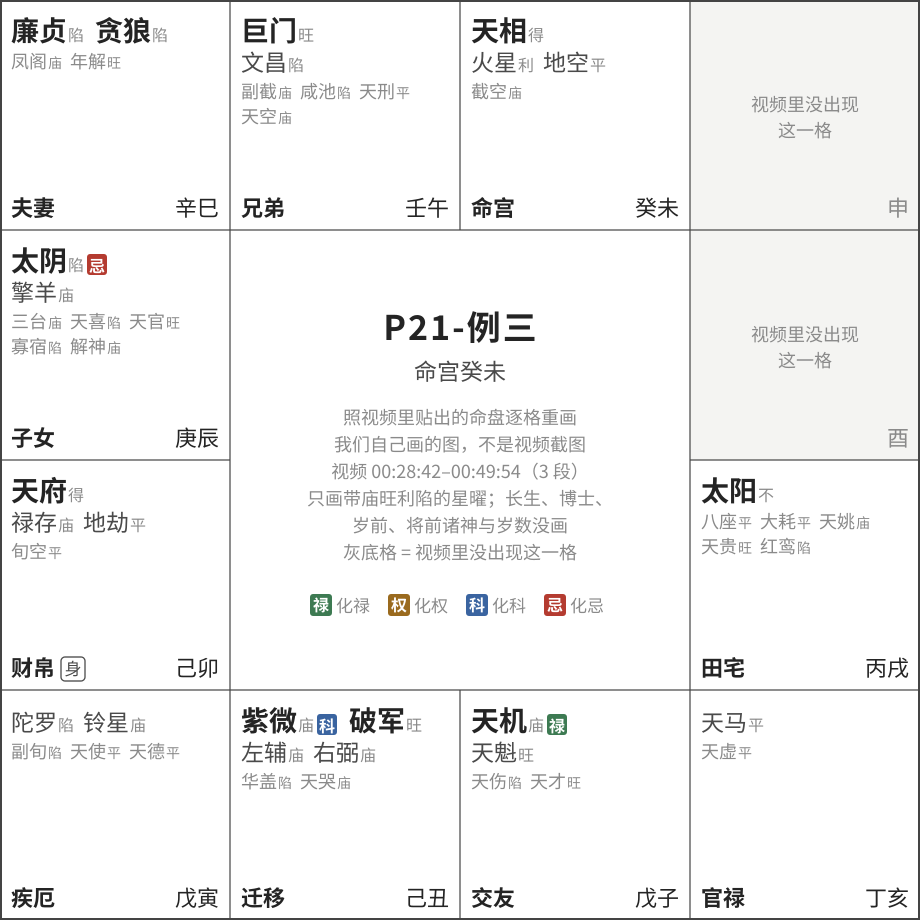

按视频里这张盘逐格重画（我们自己画的图，不是视频截图）；同一个人的 3 段合成一张；数据见 [命盘-P21-例三.json](图/命盘-P21-例三.json)。

### 6　例一死别格补讲；例三因科而禄与克妻（[00:28:42–00:36:00](https://www.bilibili.com/video/BV1KJsLekEfA/?p=21&t=1722)，第 51684–64811 帧）

| 提示区 | 笔记区 |
|---|---|
| **例一补讲：命宫若换到天府那格，夫妻宫变成什么？** | 〔口述〕倪师拿着讲义回头补讲前面那个案例，说「你们要回头看」「我刚刚这边忘了」「我要稍微再提醒一遍」，并点明「这也是关系到夫妻的事情」。（[00:28:46–00:29:01](https://www.bilibili.com/video/BV1KJsLekEfA/?p=21&t=1726)，第 51804–52235 帧） 〔口述〕他先说原盘「福德宫在右下角」「天府星是不是」，再假设「如果是命宫在这里呢」：「夫妻宫就变成什么」「廉破看到没有」「变成她的命宫是天府」「对面是紫微七条」「然后夫妻宫是廉破」。（[00:29:03–00:29:21](https://www.bilibili.com/video/BV1KJsLekEfA/?p=21&t=1743)，第 52314–52841 帧） 〔指代〕说「如果是命宫在这里呢」「命宫在这里的时候」时，手指的是黑板下排中间上方写着巨门的那一格；此时叠图显示「命宫 乙亥」。（[00:29:07–00:29:10](https://www.bilibili.com/video/BV1KJsLekEfA/?p=21&t=1747)，第 52434–52517 帧） 〔叠图〕叠图贴出命宫乙亥（天府得、天喜旺、天空平、孤辰陷、台辅）、夫妻癸酉（廉贞平化禄、破军陷化权、文曲庙、天刑庙、天福庙），随后加贴财帛己巳（紫微旺、七杀平、文昌庙、红鸾旺）。按派活说明，这是演示命宫换位的假设，不是新命例。（[00:29:12–00:29:19](https://www.bilibili.com/video/BV1KJsLekEfA/?p=21&t=1752)，第 52572–52787 帧） 〔推断〕推断：倪师说的「她的命宫是天府」「对面是紫微七条」「夫妻宫是廉破」，与叠图命宫乙亥有天府、财帛己巳有紫微七杀、夫妻癸酉有廉贞破军三格一一对得上。（[00:29:17–00:29:21](https://www.bilibili.com/video/BV1KJsLekEfA/?p=21&t=1757)，第 52716–52841 帧） |
| **什么叫「夫妻死别的格」？倪师批过的结果如何？** | 〔口述〕把命宫换过来以后，夫妻宫是廉破的这种八字，倪师说「就叫做夫妻死别的格」。（[00:29:22–00:29:28](https://www.bilibili.com/video/BV1KJsLekEfA/?p=21&t=1762)，第 52884–53051 帧） 〔口述〕他说自己「那我本人批过不止30个」，现在还有一两个在手上，「我让他赶快去化解掉」。（[00:29:28–00:29:36](https://www.bilibili.com/video/BV1KJsLekEfA/?p=21&t=1768)，第 53052–53297 帧） 〔口述〕之前来找他批的「都是已经死的才来找我的」：「有的太太是开刀死的」，有的「跳碧潭河死掉的」，「反正都死掉了」。（[00:29:36–00:29:45](https://www.bilibili.com/video/BV1KJsLekEfA/?p=21&t=1776)，第 53298–53573 帧） 〔口述〕归结为规则：「所以那个夫妻宫如果遇到廉破」「这种杀星进来的话都是主夫妻死别」。（[00:29:45–00:29:54](https://www.bilibili.com/video/BV1KJsLekEfA/?p=21&t=1785)，第 53574–53831 帧） |
| **例三：看命第一步看什么？什么叫「因科而禄」？** | 〔口述〕换新命盘，倪师说「诸位注意看」「你先不要看他什么宫」「你不要看他什么星什么星」，「我们一般算命」「第一个都要看科权禄忌四化星」。（[00:29:54–00:30:07](https://www.bilibili.com/video/BV1KJsLekEfA/?p=21&t=1794)，第 53832–54239 帧） 〔口述〕接着说「那这个命什么都没有」「就是个什么科有没有」，帮他算命时「这种八字呢」「叫做因科而禄」，即「靠专科技术专长」「专业知识来赚钱」，是「自由业的人」。（[00:30:08–00:30:22](https://www.bilibili.com/video/BV1KJsLekEfA/?p=21&t=1808)，第 54240–54671 帧） 〔叠图〕例三叠图：命宫癸未（天相得、火星利、地空平、截空庙，大限3~12）；官禄丁亥（天马平、天虚平，大限83~92）；财帛己卯（天府得、禄存庙、地劫平、旬空平，标「身宫」，大限43~52）；迁移己丑（紫微庙化科、破军旺、左辅庙、右弼庙、天哭庙、华盖陷，大限63~72）。（[00:30:03–00:30:07](https://www.bilibili.com/video/BV1KJsLekEfA/?p=21&t=1803)，第 54114–54239 帧） 〔推断〕推断：倪师稍后说「如果他只是迁移宫化科」，叠图化科也在迁移己丑的紫微上；「什么科有没有」说的「科」应即这颗化科，但他在这里没有点名哪一宫。（[00:30:09–00:30:52](https://www.bilibili.com/video/BV1KJsLekEfA/?p=21&t=1809)，第 54270–55589 帧） 〔板书〕写完板书后的画面大半被叠图盖住。可辨：下排「天机·化禄」，右侧「武曲」「七杀」，左下「疾厄」；这几秒新写的字认不出。（[00:30:18](https://www.bilibili.com/video/BV1KJsLekEfA/?p=21&t=1818)，第 54552 帧） |
| **身在财帛、身在官禄，各主去做什么？** | 〔指代〕说「那他在这里」时，右臂伸向黑板左侧中间那一格，指尖被叠图盖住；叠图显示的是财帛己卯（天府、禄存、地劫、旬空、身宫）。（[00:30:22–00:30:24](https://www.bilibili.com/video/BV1KJsLekEfA/?p=21&t=1822)，第 54672–54737 帧） 〔口述〕「这里第一个重点呢」「注意看身在财帛」，「身在财帛他势必一定会到」「私人企业去做事情」，「私人的公司很好」。（[00:30:24–00:30:38](https://www.bilibili.com/video/BV1KJsLekEfA/?p=21&t=1824)，第 54738–55157 帧） 〔口述〕对照来讲：「有的人身在官禄宫」「他势必会去当官」；「这个人势必会去做从商」「这个是身在财帛的意思」。（[00:30:38–00:30:45](https://www.bilibili.com/video/BV1KJsLekEfA/?p=21&t=1838)，第 55158–55373 帧） 〔叠图〕叠图财帛己卯格右侧印着「身宫」，与倪师说的「身在财帛」相合。（[00:30:22–00:30:24](https://www.bilibili.com/video/BV1KJsLekEfA/?p=21&t=1822)，第 54672–54737 帧） |
| **身在迁移与只是迁移化科，到外地后有何不同？** | 〔口述〕「有的人身在迁移」，他「势必会到外地去」。（[00:30:45–00:30:49](https://www.bilibili.com/video/BV1KJsLekEfA/?p=21&t=1845)，第 55374–55499 帧） 〔口述〕「那这个如果他只是迁移宫化科」「他这个没有身宫没有在迁移」，代表他到外地会读书、「会拿到学位」，「但是工作会回到本地来」。（[00:30:50–00:30:59](https://www.bilibili.com/video/BV1KJsLekEfA/?p=21&t=1850)，第 55500–55799 帧） 〔指代〕说「他这个没有」时，食指点在黑板底排中间那格首行红圈「科」字旁；黑板上宫名看不清，叠图上写的是迁移。（[00:30:53–00:30:55](https://www.bilibili.com/video/BV1KJsLekEfA/?p=21&t=1853)，第 55590–55655 帧） 〔口述〕「有的人身宫在迁移宫」，「他出去外地读书」「一去就有去无回了」。（[00:31:00–00:31:06](https://www.bilibili.com/video/BV1KJsLekEfA/?p=21&t=1860)，第 55800–55985 帧） 〔口述〕他举例：以后到美国去，「把很多大陆留学生拿出来看」「我想大家都是这样子的」，「台湾还比较少」「大陆肯定是这样子」，随后拿「肯定」开了一句玩笑。（[00:31:06–00:31:24](https://www.bilibili.com/video/BV1KJsLekEfA/?p=21&t=1866)，第 55986–56525 帧） |
| **例三的子女宫一看就知道什么？** | 〔口述〕「你看这个子女宫」「看就知道了无子」，「这个再批有儿子我就把你」……「你可以回家了」，「这个真的不用学」「这就没有办法了哈」。（[00:31:25–00:31:35](https://www.bilibili.com/video/BV1KJsLekEfA/?p=21&t=1885)，第 56556–56861 帧） 〔叠图〕叠图子女庚辰：太阴陷化忌、擎羊庙、天喜陷、三台庙、天官旺、解神庙、寡宿陷，大限33~42。（[00:31:25–00:31:27](https://www.bilibili.com/video/BV1KJsLekEfA/?p=21&t=1885)，第 56556–56621 帧） 〔板书〕可辨：左列「太阴·化忌」（化忌加圈）、「33-42」，下一格「天府」「禄存」「身」，再下「53-62」「疾厄」；九宫格左侧空白处新写的红字认不出。（[00:31:30](https://www.bilibili.com/video/BV1KJsLekEfA/?p=21&t=1890)，第 56724 帧） 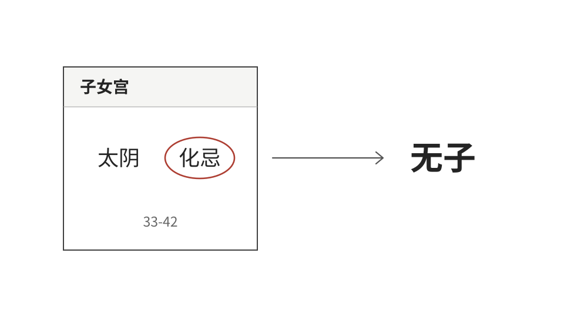 |
| **疾厄宫有陀罗主什么？哪两颗星主开刀见血光？** | 〔指代〕字幕「像这个疾厄宫」出现时，手指按在黑板「陀罗擎羊」那一行、紧挨下方「53-62」，这一格板上底部写着「疾厄」。（[00:31:33–00:31:36](https://www.bilibili.com/video/BV1KJsLekEfA/?p=21&t=1893)，第 56802–56909 帧） 〔口述〕「疾厄宫本身呢」「就是陀罗星杀星进来的时候」「这个人势必死在身体的疾病上面」「一定是血光啊」。（[00:31:44–00:31:53](https://www.bilibili.com/video/BV1KJsLekEfA/?p=21&t=1904)，第 57126–57407 帧） 〔口述〕「算命上面来说」「有两颗星会开刀的」「一个是陀罗一个擎羊」，「两颗星会见血光的」「见血光势必会见血光的」。（[00:31:53–00:32:04](https://www.bilibili.com/video/BV1KJsLekEfA/?p=21&t=1913)，第 57408–57749 帧） 〔板书〕可辨：「陀罗」「53-62」「疾厄」及上方「太阴·化忌」「33-42」；这几秒新写的字认不出。（[00:31:40](https://www.bilibili.com/video/BV1KJsLekEfA/?p=21&t=1900)，第 57012 帧） |
| **例三巳年生，红鸾、天喜各在哪里？几岁会动？** | 〔口述〕「那这个八字好玩在哪里」，倪师看讲义说「他是巳年」，属蛇，「25岁在这边」，接着数「2627 28岁」。（[00:32:05–00:32:22](https://www.bilibili.com/video/BV1KJsLekEfA/?p=21&t=1925)，第 57750–58289 帧） 〔指代〕说「25岁在这边」时，粉笔在黑板上排中间写着「命」的那格旁边写下 25。（[00:32:14–00:32:18](https://www.bilibili.com/video/BV1KJsLekEfA/?p=21&t=1934)，第 58038–58145 帧） 〔板书〕可辨：上排中间格「命」字右边新写一个画圈的「25」，带箭头；其余认不出。（[00:32:18](https://www.bilibili.com/video/BV1KJsLekEfA/?p=21&t=1938)，第 58152 帧） 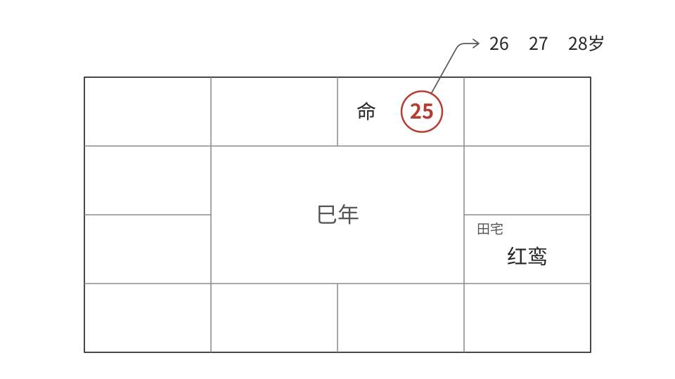 〔叠图〕叠图田宅丙戌：太阳不、红鸾陷、天姚庙、八座平、天贵旺、台辅，小限4,16,28,40,52,64，大限93~102；同时子女庚辰的天喜被框出。（[00:32:23–00:32:28](https://www.bilibili.com/video/BV1KJsLekEfA/?p=21&t=1943)，第 58290–58463 帧） 〔指代〕说「这个红鸾星啊」时，粉笔点在黑板右中格刚写的「红鸾」上，该格板上写有「田宅」。（[00:32:28–00:32:33](https://www.bilibili.com/video/BV1KJsLekEfA/?p=21&t=1948)，第 58464–58607 帧） |
| **红鸾天喜在命宫、夫妻宫、子女宫，婚姻怎样？** | 〔口述〕「正常我们交会的时候」，红鸾天喜星在命宫「或者在夫妻宫都很好」。（[00:32:35–00:32:41](https://www.bilibili.com/video/BV1KJsLekEfA/?p=21&t=1955)，第 58656–58835 帧） 〔叠图〕配合这句，叠图临时贴出「命宫丙午」（红鸾旺、破军庙、禄存庙，标身宫）和「夫妻乙卯」（红鸾庙、天同平、文昌利），是演示，不是例三自己的宫。（[00:32:38–00:32:41](https://www.bilibili.com/video/BV1KJsLekEfA/?p=21&t=1958)，第 58752–58835 帧） 〔口述〕本例「交会在什么子女宫」：「27 28岁那年红鸾星进来」「他对面是子女宫」，「即使是化忌」「他都势必要结婚」。（[00:32:42–00:32:56](https://www.bilibili.com/video/BV1KJsLekEfA/?p=21&t=1962)，第 58866–59309 帧） 〔叠图〕叠图田宅丙戌格加印一个「28」，并标着「结婚」。（[00:32:42–00:32:45](https://www.bilibili.com/video/BV1KJsLekEfA/?p=21&t=1962)，第 58860–58973 帧） |
| **夫妻宫是廉贞贪狼或廉贞破军，结果如何？** | 〔口述〕「可是一结婚了以后」「那个夫妻宫实在太差了」，「不管男命不管女命」，「夫妻宫是这两颗星啊」「廉贞贪狼或者廉贞破军啊」。（[00:32:57–00:33:08](https://www.bilibili.com/video/BV1KJsLekEfA/?p=21&t=1977)，第 59310–59657 帧） 〔口述〕他重复「廉贞贪狼或廉贞破军」，说「我看非生离就是死别啊」「到看到现在都没有例外」。（[00:33:09–00:33:15](https://www.bilibili.com/video/BV1KJsLekEfA/?p=21&t=1989)，第 59682–59879 帧） 〔叠图〕叠图夫妻辛巳：廉贞陷、贪狼陷、凤阁庙、年解旺，大限23~32，格内标着「生离死别」；随后并排贴一版「夫妻辛巳′」，星曜换成廉贞陷、破军陷，配合口述演示两种组合。（[00:32:57–00:33:08](https://www.bilibili.com/video/BV1KJsLekEfA/?p=21&t=1977)，第 59310–59657 帧） |
| **命里有这种夫妻宫，该怎么办？对方愚顽又如何？** | 〔口述〕「那你如果你的命是这样子的话」「你要特别小心的很惨」，「那要赶快去改阳宅」，「如果改上去改不过来的话」「就来用人间道去改」。（[00:33:16–00:33:27](https://www.bilibili.com/video/BV1KJsLekEfA/?p=21&t=1996)，第 59880–60233 帧） 〔口述〕「那如果对方呢」「是比较愚劣的人」「愚顽的人或者是蠢」，「人间道就不要用了」「没有用」；「那你想办法唯一—条路」「赶快脱离苦海」。（[00:33:28–00:33:45](https://www.bilibili.com/video/BV1KJsLekEfA/?p=21&t=2008)，第 60240–60779 帧） 〔板书〕可辨：上排「命」格旁画圈的「25」、中间「54」、下排「天机·化禄」；这一两秒新写的字认不出。（[00:33:18](https://www.bilibili.com/video/BV1KJsLekEfA/?p=21&t=1998)，第 59952 帧） |
| **朋友宫化禄主什么？** | 〔指代〕说「异曲同工之妙的是这个地方」时，手指点在黑板下排中格「天机·化禄」下面第二行，该格下方写有「交友」。（[00:33:46–00:33:47](https://www.bilibili.com/video/BV1KJsLekEfA/?p=21&t=2026)，第 60780–60839 帧） 〔口述〕「朋友宫化禄」「合伙一定大利」，「这种人很会顺责」「很会做人的人」。（[00:33:48–00:33:55](https://www.bilibili.com/video/BV1KJsLekEfA/?p=21&t=2028)，第 60840–61073 帧） 〔板书〕可辨：下排「天机·化禄」「交友」，右侧「武曲」「七杀」「田宅」；这几秒新写的字认不出。（[00:34:09](https://www.bilibili.com/video/BV1KJsLekEfA/?p=21&t=2049)，第 61488 帧） |
| **例三几岁结婚、几岁离婚、几岁再婚？** | 〔口述〕「那这个第一个婚姻28岁」「一年就离婚了」，「离了婚以后」「这29岁就会离婚」。（[00:33:55–00:34:04](https://www.bilibili.com/video/BV1KJsLekEfA/?p=21&t=2035)，第 61074–61325 帧） 〔口述〕接着数「31 32 33 34岁」，「34岁那年呢怎么样」「红鸾星又进来了」，「刚好入这个红鸾星入子女宫」「还是会再结婚」。（[00:34:04–00:34:19](https://www.bilibili.com/video/BV1KJsLekEfA/?p=21&t=2044)，第 61326–61799 帧） 〔指代〕说「刚好入这个红鸾星入子女宫」时，手指点在黑板左中格「天喜」的「喜」字下方、「33-42」右边；叠图也框出子女庚辰的天喜。（[00:34:13–00:34:17](https://www.bilibili.com/video/BV1KJsLekEfA/?p=21&t=2053)，第 61614–61727 帧） 〔叠图〕叠图田宅丙戌格加印「28」并标着「结婚」；子女庚辰格加印「34」并标着「再婚」。（[00:33:55–00:34:07](https://www.bilibili.com/video/BV1KJsLekEfA/?p=21&t=2035)，第 61074–61421 帧） 〔板书〕可辨：左中格「太阴·化忌」，旁边新写的「天喜」，下有「33-42」；化忌附近新添的红笔字认不出。（[00:34:16](https://www.bilibili.com/video/BV1KJsLekEfA/?p=21&t=2056)，第 61692 帧） 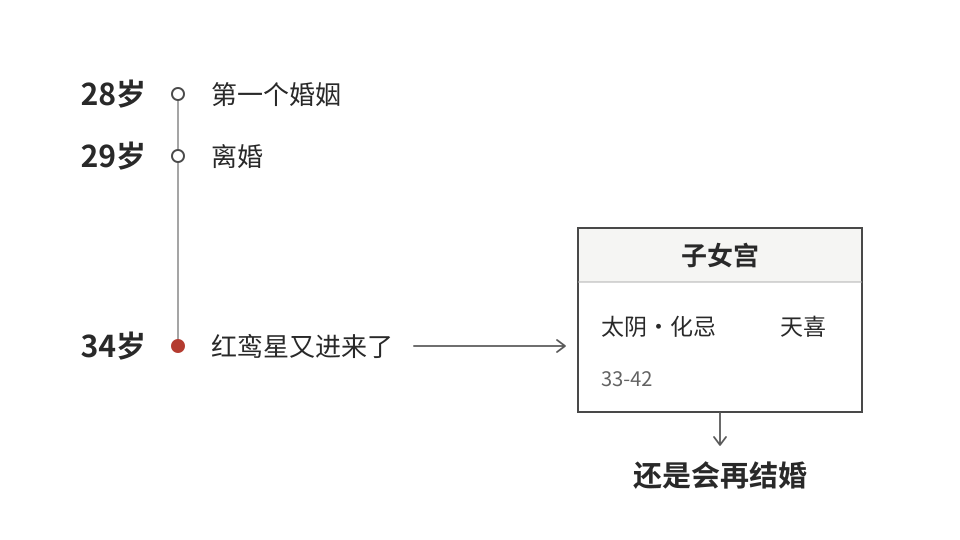 |
| **男命太阴化忌，婚姻上主什么？** | 〔口述〕「所以你逢了化忌」，影响「只是在结婚的对象」，「太太也是怎么样二婚的」。（[00:34:20–00:34:26](https://www.bilibili.com/video/BV1KJsLekEfA/?p=21&t=2060)，第 61800–61997 帧） 〔口述〕「所以如果一个男人的命啊」，有太阴星化忌：「一个是婆媳不和」，「娶回来媳妇跟妈妈一定处不过来」；还有「太太会是本身有二婚的」，「太阴星化忌」「都是这样子解释」。（[00:34:26–00:34:50](https://www.bilibili.com/video/BV1KJsLekEfA/?p=21&t=2066)，第 61998–62723 帧） 〔推断〕推断：本例叠图的太阴化忌在子女庚辰，与倪师说34岁红鸾天喜入子女宫再婚是同一格，所以他接着讲化忌只落在结婚对象上。倪师没有把两者的关系说透。（[00:34:12–00:34:26](https://www.bilibili.com/video/BV1KJsLekEfA/?p=21&t=2052)，第 61578–61997 帧） |
| **旧时算命先生说「尅妻命」，错在哪里？** | 〔口述〕过去的算命仙拿到这种八字，做妈妈的或做丈母娘的「为了挑个好女婿啊就去合婚」，算命先生就说「你这个女儿不要嫁给他」「这叫做尅妻命」「那谁嫁给他谁倒霉」。（[00:34:50–00:35:24](https://www.bilibili.com/video/BV1KJsLekEfA/?p=21&t=2090)，第 62724–63731 帧） 〔口述〕「那这个人什么时候结婚比较好」：「43岁以后他不尅妻了」「42岁以前通通尅妻」，「你看都是灾星嘛」。（[00:35:24–00:35:33](https://www.bilibili.com/video/BV1KJsLekEfA/?p=21&t=2124)，第 63732–63995 帧） 〔叠图〕叠图财帛己卯格（大限43~52）标着「43岁以后」。（[00:35:24–00:35:26](https://www.bilibili.com/video/BV1KJsLekEfA/?p=21&t=2124)，第 63732–63785 帧） 〔口述〕「按照命的形上批并没有错哦」，「错在哪里他把尅误解了」：「不是说能把她克生命克死」「不是这个意思啊」，「这个尅是感情好」，「他太重感情了」，「可是妻不贤两个还是散掉」「没有办法」。（[00:35:33–00:36:00](https://www.bilibili.com/video/BV1KJsLekEfA/?p=21&t=2133)，第 63996–64811 帧） |

**总结区**

- 通用规则：夫妻宫遇廉破这种杀星都主夫妻死别；廉贞贪狼或廉贞破军在夫妻宫，不管男命女命，倪师说非生离就是死别、至今没有例外（[00:29:45–00:29:54](https://www.bilibili.com/video/BV1KJsLekEfA/?p=21&t=1785)，第 53574–53831 帧、[00:33:01–00:33:15](https://www.bilibili.com/video/BV1KJsLekEfA/?p=21&t=1981)，第 59436–59879 帧）。；算命第一个都要看科权禄忌四化星，先不要看什么宫、什么星（[00:29:54–00:30:07](https://www.bilibili.com/video/BV1KJsLekEfA/?p=21&t=1794)，第 53832–54239 帧）。；身在财帛势必到私人企业做事，身在官禄势必去当官，身在迁移势必到外地；只是迁移化科而身宫不在迁移，到外地读书拿学位、工作回本地（[00:30:24–00:31:06](https://www.bilibili.com/video/BV1KJsLekEfA/?p=21&t=1824)，第 54738–55985 帧）。；陀罗、擎羊两颗星会开刀、会见血光；疾厄宫有陀罗这类杀星进来，势必死在身体的疾病上（[00:31:44–00:32:04](https://www.bilibili.com/video/BV1KJsLekEfA/?p=21&t=1904)，第 57126–57749 帧）。
- 只在本例：例一若命宫换到天府那一格，夫妻宫就是廉破，叫夫妻死别的格（[00:29:06–00:29:28](https://www.bilibili.com/video/BV1KJsLekEfA/?p=21&t=1746)，第 52404–53051 帧）。；例三因科而禄，靠专科技术、专业知识赚钱，身在财帛，宜到私人公司做事（[00:30:13–00:30:38](https://www.bilibili.com/video/BV1KJsLekEfA/?p=21&t=1813)，第 54402–55157 帧）。；例三子女宫一看就知道无子（[00:31:25–00:31:33](https://www.bilibili.com/video/BV1KJsLekEfA/?p=21&t=1885)，第 56556–56801 帧）。；例三 28 岁第一次结婚、一年就离，34 岁红鸾又入子女宫而再婚，再婚的太太也是二婚；42 岁以前克妻、43 岁以后不克（[00:33:55–00:34:26](https://www.bilibili.com/video/BV1KJsLekEfA/?p=21&t=2035)，第 61074–61997 帧、[00:35:24–00:35:31](https://www.bilibili.com/video/BV1KJsLekEfA/?p=21&t=2124)，第 63732–63953 帧）。
- 不是排盘规则，是处世方法：命带夫妻死别格的，倪师让对方赶快去化解（[00:29:31–00:29:36](https://www.bilibili.com/video/BV1KJsLekEfA/?p=21&t=1771)，第 53142–53297 帧）。；夫妻宫很差的要特别小心：先改阳宅，改不过来再用人间道；对方若愚顽，人间道没有用，唯一一条路是赶快脱离苦海（[00:33:16–00:33:45](https://www.bilibili.com/video/BV1KJsLekEfA/?p=21&t=1996)，第 59880–60779 帧）。；「尅妻」不是把人克死，而是太重感情、妻不贤仍然散掉；批命时别像旧时算命先生那样误解（[00:35:33–00:36:00](https://www.bilibili.com/video/BV1KJsLekEfA/?p=21&t=2133)，第 63996–64811 帧）。

**待核**

1. 「对面是紫微七条」，语音为「指挥其煞」，按上下文理解为紫微七杀；叠图把紫微七杀那一格标为「财帛己巳」，与倪师说的「对面」宫名关系本块没讲清（[00:29:18](https://www.bilibili.com/video/BV1KJsLekEfA/?p=21&t=1758)，第 52758 帧）。
2. 「福德宫在右下角」「天府星是不是」：本块叠图没贴福德宫，黑板上也看不出宫名，所指是原盘哪一格待核（[00:29:02](https://www.bilibili.com/video/BV1KJsLekEfA/?p=21&t=1742)，第 52272 帧）。
3. 「跳碧潭河死掉的」，语音为「挑避坛盒」，地名两路对不上（[00:29:40](https://www.bilibili.com/video/BV1KJsLekEfA/?p=21&t=1780)，第 53424 帧）。
4. 「那这个命什么都没有」「就是个什么科有没有」：意思是此命四化只见一个科，还是别的意思，原话不清（[00:30:08](https://www.bilibili.com/video/BV1KJsLekEfA/?p=21&t=1808)，第 54240 帧）。
5. [00:30:18](https://www.bilibili.com/video/BV1KJsLekEfA/?p=21&t=1818)，第 54552 帧板书图大半被叠图挡住，[00:30:12–00:30:17](https://www.bilibili.com/video/BV1KJsLekEfA/?p=21&t=1812)，第 54372–54539 帧新写的字（可能与「因科而禄」有关）认不出（[00:30:18](https://www.bilibili.com/video/BV1KJsLekEfA/?p=21&t=1818)，第 54552 帧）。
6. 叠图约[00:30:43](https://www.bilibili.com/video/BV1KJsLekEfA/?p=21&t=1843)，第 55290 帧起迁移己丑格也印了「身宫」，与财帛己卯的「身宫」重复；倪师同时在讲「身在财帛」「身宫没有在迁移」，疑为演示「身在迁移」临时加的（[00:30:44](https://www.bilibili.com/video/BV1KJsLekEfA/?p=21&t=1844)，第 55320 帧）。
7. 「肯定是三人仨对不对」「三人仨是众嘛」，语音为「三人杀」，倪师拆「肯定」的说法听不清（[00:31:19](https://www.bilibili.com/video/BV1KJsLekEfA/?p=21&t=1879)，第 56382 帧）。
8. 子女宫「看就知道了无子」，依据哪几颗星本块没讲；说「你看这个子女宫」时手按在两格交界，指上格还是下格看不出（[00:31:25](https://www.bilibili.com/video/BV1KJsLekEfA/?p=21&t=1885)，第 56563 帧）。
9. 「像辰宫胃」字幕可信度 0.38，语音为「成功会这个」，两路对不上；「还有什么肺」语音为「什么肺肌」（[00:31:37](https://www.bilibili.com/video/BV1KJsLekEfA/?p=21&t=1897)，第 56910 帧）。
10. 第 56724、57012 帧黑板左侧和陀罗格附近新写的红字认不出（[00:31:30](https://www.bilibili.com/video/BV1KJsLekEfA/?p=21&t=1890)，第 56724 帧）。
11. 「已年的话属蛇」中「已」按上下文改为「巳」；字幕里的「（未宫）」是字幕加的，板上没写（[00:32:14](https://www.bilibili.com/video/BV1KJsLekEfA/?p=21&t=1934)，第 58038 帧）。
12. 「红鸾天喜星在命官」，「命官」按上下文改为命宫（[00:32:36](https://www.bilibili.com/video/BV1KJsLekEfA/?p=21&t=1956)，第 58704 帧）。
13. 「交会」（语音「教会」）倪师用了没有解释（[00:32:35](https://www.bilibili.com/video/BV1KJsLekEfA/?p=21&t=1955)，第 58656 帧）。
14. 「廉贞七杀很好」字幕可信度 1.0，但语音为「连争贪」，两路对不上，未收入笔记（[00:33:08](https://www.bilibili.com/video/BV1KJsLekEfA/?p=21&t=1988)，第 59658 帧）。
15. 「人间道」倪师用了没有解释（[00:33:25](https://www.bilibili.com/video/BV1KJsLekEfA/?p=21&t=2005)，第 60168 帧）。
16. 「这种人很会顺责」，语音为「胜责」，词义待核（[00:33:51](https://www.bilibili.com/video/BV1KJsLekEfA/?p=21&t=2031)，第 60942 帧）。
17. 「28岁……一年就离婚了」与「这29岁就会离婚」：29 岁对应哪一格，板上没写，本块也没有对应的叠图（[00:34:01](https://www.bilibili.com/video/BV1KJsLekEfA/?p=21&t=2041)，第 61230 帧）。
18. 字幕说「刚好入这个红鸾星入子女宫」，但手指点的是「天喜」，叠图框的也是子女庚辰的天喜；前面又说红鸾在田宅那格，红鸾与天喜疑为口误（[00:34:14](https://www.bilibili.com/video/BV1KJsLekEfA/?p=21&t=2054)，第 61638 帧）。
19. 「这个算命先生跟文母娘讲」，「文母娘」按上下文改为丈母娘；字幕「尅」「克」混用，按同一字处理（[00:35:15](https://www.bilibili.com/video/BV1KJsLekEfA/?p=21&t=2115)，第 63456 帧）。
20. 「你看都是灾星嘛」指哪几颗星没讲；「43岁以后」叠图标在财帛己卯（大限43~52），倪师没说与财帛的关系（[00:35:31](https://www.bilibili.com/video/BV1KJsLekEfA/?p=21&t=2131)，第 63954 帧）。
21. 「按照命的形上批」，「形上」词义待核（[00:35:33](https://www.bilibili.com/video/BV1KJsLekEfA/?p=21&t=2133)，第 63996 帧）。
22. 本块开头板书图只认得出右侧「武曲」「15-24」「兄弟」「天同」「文昌」「25-34」，其余认不出（[00:28:42](https://www.bilibili.com/video/BV1KJsLekEfA/?p=21&t=1722)，第 51684 帧）。

## 例三续：陀罗单守大限、天府不能解厄、改运与婚后住西北

〔叠图〕这一例视频里只贴过 7 格：迁移 己丑：紫微庙科、破军旺、左辅庙、右弼庙、华盖陷、天哭庙；命宫 癸未：天相得、火星利、地空平、截空庙；子女 庚辰：太阴陷忌、擎羊庙、天喜陷、三台庙、天官旺、解神庙、寡宿陷；交友 戊子：天机庙禄、天魁旺、天伤陷、天才旺；财帛 己卯：天府得、禄存庙、地劫平、旬空平；疾厄 戊寅：陀罗陷、铃星庙、副旬陷、天使平、天德平；夫妻 辛巳：廉贞陷、贪狼陷、凤阁庙、年解旺。

### 7　陀罗单守大限、天府难解厄与改运住西北（[00:36:00–00:42:19](https://www.bilibili.com/video/BV1KJsLekEfA/?p=21&t=2160)，第 64812–76187 帧）

| 提示区 | 笔记区 |
|---|---|
| **天相入命、财帛有禄存，为什么说这人很好？** | 〔口述〕倪师先说命宫：「像天相入命的人很好啊」「那化科可以读书的」「怎么会不好呢」。再说「那那个财帛宫是禄存星」「又非常善于理财」，打趣说「对不对到哪里去找铁公鸡啊」。（[00:36:00–00:36:12](https://www.bilibili.com/video/BV1KJsLekEfA/?p=21&t=2160)，第 64812–65171 帧） 〔叠图〕命宫癸未：天相得、火星利、地空平、截空庙、蜚廉；病符、月煞、丧门；帝旺；大限 3~12；小限 1,13,25 37,49,61。同时贴出迁移己丑：紫微庙化科、破军旺、左辅庙、右弼庙、天哭庙、华盖陷；青龙、华盖、白虎；胎；大限 63~72；小限 7,19,31 43,55,67。（[00:36:00–00:36:02](https://www.bilibili.com/video/BV1KJsLekEfA/?p=21&t=2160)，第 64812–64877 帧） 〔叠图〕财帛己卯：禄存庙、天府得、地劫平、旬空平；博士、吊客、灾煞；墓；大限 43~52；小限 9,21,33 45,57,69。（[00:36:05–00:36:07](https://www.bilibili.com/video/BV1KJsLekEfA/?p=21&t=2165)，第 64968–65027 帧） 〔板书〕本块开头的板面，可辨：上方中间格「命」字与圈起的「25」，右上格「武曲」「七杀」，中下格「天机」，左侧竖写「天喜」，左格有「54」；其余认不出。（[00:36:01](https://www.bilibili.com/video/BV1KJsLekEfA/?p=21&t=2161)，第 64848 帧） 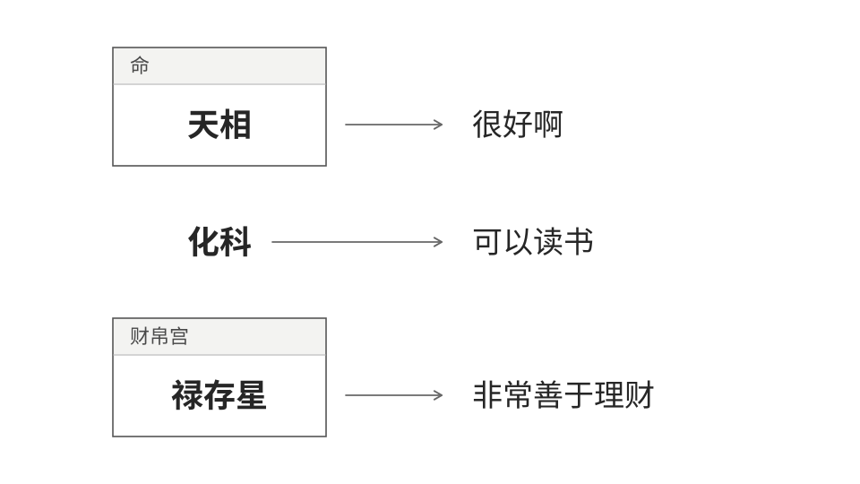 |
| **杀星单星独守命宫，为什么这种人可怜？** | 〔口述〕转说「那这种人也很可怜为什么」「因为陀罗星进来」「杀星进来的时候」「大限就进来了」。（[00:36:16–00:36:25](https://www.bilibili.com/video/BV1KJsLekEfA/?p=21&t=2176)，第 65286–65561 帧） 〔口述〕讲规则：命格上「单星独守」羊陀火铃空劫，「单星独守那个大运的时候」「十年大运的时候」，又说「你不要管未来十年」「那只是一种算大算死限的方法」。（[00:36:25–00:36:36](https://www.bilibili.com/video/BV1KJsLekEfA/?p=21&t=2185)，第 65562–65909 帧） 〔口述〕「你一颗星独在那边」「守在命里面的时候」「那颗星就很凶了」「我讲过杀星」「一定要有吉星来化解才行」。（[00:36:37–00:36:45](https://www.bilibili.com/video/BV1KJsLekEfA/?p=21&t=2197)，第 65910–66161 帧） 〔口述〕接着说「这个本宫没有吉星」「对面你不用看它了」「本宫都没有吉星」。（[00:36:45–00:36:49](https://www.bilibili.com/video/BV1KJsLekEfA/?p=21&t=2205)，第 66162–66281 帧） 〔指代〕说「这个本宫没有吉星」前的「这个」时，手臂伸向黑板左下格；指尖处粉笔字被手挡住、看不清。（[00:36:45](https://www.bilibili.com/video/BV1KJsLekEfA/?p=21&t=2205)，第 66152 帧） |
| **本例陀罗在哪宫？各步大限影响什么？** | 〔口述〕「53-62 就有大限看到没有」「那陀罗星在疾厄宫」「那这个疾厄宫呢」「把它当成星看」「53-62十年值守的太岁是什么疾厄」，「所以53-62 影响到他最大的就是疾厄」。（[00:36:49–00:37:11](https://www.bilibili.com/video/BV1KJsLekEfA/?p=21&t=2209)，第 66282–66947 帧） 〔指代〕说「那这个疾厄宫呢」的「这个」时，手指按在黑板左下格粉笔字「疾厄」附近。（[00:36:55](https://www.bilibili.com/video/BV1KJsLekEfA/?p=21&t=2215)，第 66476 帧） 〔口述〕又讲另一步大限（字幕没出年龄，语音听作三三，见待核）：「红鸾婚姻太阴妈妈有没有」「太太影响他最大」。随后「那43-52 财帛事业会最好」「影响到最是最大的是事业」「53-62 影响到疾厄」。（[00:37:11–00:37:23](https://www.bilibili.com/video/BV1KJsLekEfA/?p=21&t=2231)，第 66948–67301 帧） 〔叠图〕子女庚辰：太阴陷化忌、擎羊庙、天喜陷、天官旺、三台庙、寡宿陷、解神庙；天煞、官符、病符；死；大限 33~42；小限 10,22,34 46,58,70。（[00:37:06–00:37:11](https://www.bilibili.com/video/BV1KJsLekEfA/?p=21&t=2226)，第 66786–66947 帧） 〔推断〕推断：语音「三三」与叠图子女庚辰的大限 33~42 对得上，格内有太阴陷化忌，与倪师说的「太阴妈妈」「太太」相应；但字幕未出这步年龄，倪师也没说这是哪一宫。（[00:37:06–00:37:14](https://www.bilibili.com/video/BV1KJsLekEfA/?p=21&t=2226)，第 66786–67043 帧） |
| **陀罗进疾厄就是大限？56 岁为何要注意？** | 〔口述〕「会不会看这个大大限」「这个陀罗星进来就是大限了」。（[00:37:23–00:37:27](https://www.bilibili.com/video/BV1KJsLekEfA/?p=21&t=2243)，第 67302–67427 帧） 〔指代〕说「会不会看这个大大限」的「这个」时，手指指向左下格粉笔字「~62」与其下方「疾厄」之间；说「这个陀罗星」时手指仍在同一格，下方板面写着「疾厄」。（[00:37:23–00:37:24](https://www.bilibili.com/video/BV1KJsLekEfA/?p=21&t=2243)，第 67319–67348 帧） 〔口述〕再看流年：一路数「他49 50 51 52 53 54 55 56」，「56岁是不是刚好落同宫」「所以56岁是什么」「大小二限逢」。（[00:37:27–00:37:39](https://www.bilibili.com/video/BV1KJsLekEfA/?p=21&t=2247)，第 67428–67775 帧） 〔叠图〕疾厄戊寅：陀罗陷、铃星庙、天使平、天德平、副旬陷；力士、劫煞、天德；绝；大限 53~62；小限 8,20,32 44,56,68。（[00:38:00–00:38:02](https://www.bilibili.com/video/BV1KJsLekEfA/?p=21&t=2280)，第 68424–68471 帧） 〔推断〕推断：叠图疾厄戊寅的小限里有 56，大限又是 53~62，所以 56 岁大限、小限同落这一宫，正是倪师说的「大小二限逢」。（[00:37:32–00:38:02](https://www.bilibili.com/video/BV1KJsLekEfA/?p=21&t=2252)，第 67572–68471 帧） |
| **陀罗之外，还要会看哪些杀星的限？** | 〔口述〕说算寿限有很多种方法，「这是一种格懂不懂我意思」；又说你现在陀罗会了，「那那擎羊你就不会了」「空天空地劫你就不会了」「不行还有火星铃星」「这是一种限」。（[00:37:39–00:37:54](https://www.bilibili.com/video/BV1KJsLekEfA/?p=21&t=2259)，第 67776–68237 帧） |
| **所有吉星里，为什么天府星不能解厄制化？** | 〔口述〕「然后所有的星」「像其它的星都可以解厄制化」「唯有唯有一颗星」「诸位要注意」「这个天府星很很特异哈」，「就天府星不能解厄制化」。（[00:37:54–00:38:09](https://www.bilibili.com/video/BV1KJsLekEfA/?p=21&t=2274)，第 68238–68699 帧） 〔口述〕「所以很多人的流年」「逢到天府星就被就死掉了」「所以天府星这个不能解厄制化」。（[00:38:10–00:38:17](https://www.bilibili.com/video/BV1KJsLekEfA/?p=21&t=2290)，第 68700–68933 帧） 〔口述〕放到八字上看，天府「它是一个库星府库嘛」「就是会聚财会聚财」。（[00:38:17–00:38:27](https://www.bilibili.com/video/BV1KJsLekEfA/?p=21&t=2297)，第 68934–69233 帧） |
| **本例禄存天府在财帛，挡得住陀罗吗？** | 〔口述〕「但这个人本来就禄存在财帛」「很赚钱又是聚财你看看」「但是这个不能解厄制化」「所以即使天府星落在这里面」「这个陀罗还照杀还是照杀」，甚至「反而一定会杀」。（[00:38:27–00:38:38](https://www.bilibili.com/video/BV1KJsLekEfA/?p=21&t=2307)，第 69234–69563 帧） 〔指代〕说「天府星落在这里面」的「这里」和紧接的「这个陀罗」时，手向左下方伸，指着左下角那一格；黑板被叠图盖住，叠图在该处显示天府、陀罗和疾厄戊寅（陀罗加红框）。（[00:38:34–00:38:35](https://www.bilibili.com/video/BV1KJsLekEfA/?p=21&t=2314)，第 69441–69452 帧） |
| **什么叫「吉处藏凶」？老人常体检为何反害？** | 〔口述〕「你知道为什么」「吉处藏凶」。「所以我常常看到吉处藏凶的时候」「往往他发生的凶事」「致命的大限」「都是他参加很好的宴会」「或者去郊游啊旅行啊」「或者是很好的事情去的」。（[00:38:38–00:38:54](https://www.bilibili.com/video/BV1KJsLekEfA/?p=21&t=2318)，第 69564–70025 帧） 〔口述〕「那还有的人天府星落陷呢」「年龄大的人也死掉为什么」，举例：八九十岁本来没病，子女孝顺要爸爸常去医院体检，「结果不去检还好」「一检查感染到很多病」。（[00:38:54–00:39:11](https://www.bilibili.com/video/BV1KJsLekEfA/?p=21&t=2334)，第 70026–70547 帧） 〔口述〕解释「因为年龄大的人年老气衰」「抵抗力没有嘛」「医院病毒最多的就在那边」，检查完回家不舒服，什么杆菌都感染来，「结果你的孝顺」「想办法让他死的快」「这都不好的」。（[00:39:11–00:39:32](https://www.bilibili.com/video/BV1KJsLekEfA/?p=21&t=2351)，第 70548–71183 帧） |
| **批这种八字，重点看什么？已发生的怎么办？** | 〔口述〕「所以一般来说」「我们批这种八字的时候」「我们要看他的重点」「最重要是什么」「婚姻跟疾厄」「其它的其它都没有什么」。（[00:39:32–00:39:40](https://www.bilibili.com/video/BV1KJsLekEfA/?p=21&t=2372)，第 71184–71429 帧） 〔口述〕「那如果要改他」，「像他来找我们是30岁」，25 到 28 岁「那之前的事情是不是已经发生了」「来不及了对不对」「然后之后的事情可以告诉他」「我教你们看之后的事情」。（[00:39:41–00:39:55](https://www.bilibili.com/video/BV1KJsLekEfA/?p=21&t=2381)，第 71430–71879 帧） 〔口述〕「第一个他没有子女」，所以「需要改变他的婚姻不是很难的事情」。（[00:39:56–00:40:00](https://www.bilibili.com/video/BV1KJsLekEfA/?p=21&t=2396)，第 71880–72017 帧） 〔叠图〕子女庚辰格叠图标着「无子女」，星曜同前。（[00:39:56](https://www.bilibili.com/video/BV1KJsLekEfA/?p=21&t=2396)，第 71880–71909 帧） |
| **30 岁来找时，今年明年的流年怎么看？** | 〔口述〕「如果我们今年30岁帮他改」「他明年31岁本身是化科」；「今年他来找我们」「30岁在这里」，问「他今年值令太岁星是什么」「值令的流年是什么朋友」。（[00:40:00–00:40:15](https://www.bilibili.com/video/BV1KJsLekEfA/?p=21&t=2400)，第 72018–72467 帧） 〔指代〕说「30岁在这里」的「这里」时，粉笔点着板中部横线上方刚写的「30」，下面那格写着天机。（[00:40:09](https://www.bilibili.com/video/BV1KJsLekEfA/?p=21&t=2409)，第 72278 帧） 〔口述〕「所以他第一个问题就会问你」：「你看我今年跟朋友合伙好不好」「好赚钱」「那我今年要参加考试好不好」，答「不好明年最好」，再问学生「这会看吗」。（[00:40:15–00:40:32](https://www.bilibili.com/video/BV1KJsLekEfA/?p=21&t=2415)，第 72468–72977 帧） 〔叠图〕交友戊子：天机庙化禄、天魁旺、天才旺、天伤陷、龙德；小耗、息神；养；格内标「30」；小限 6,18 42,54,66。迁移己丑格内标「31」。（[00:40:27–00:40:30](https://www.bilibili.com/video/BV1KJsLekEfA/?p=21&t=2427)，第 72828–72911 帧） |
| **再婚还是凶？「ab两种」指什么？** | 〔口述〕客人问「那我的婚姻现在不好了」「那我要什么时候再结婚比较好」；答「先生你如果你按照你的命算」「你还会再结婚」「结婚还是凶」。（[00:40:32–00:40:42](https://www.bilibili.com/video/BV1KJsLekEfA/?p=21&t=2432)，第 72978–73277 帧） 〔叠图〕夫妻辛巳：廉贞陷、贪狼陷、凤阁庙、年解旺；伏兵、岁建、指背；病；大限 23~32；小限 11,23,35 47,59,71；叠图该格标着「生离死别」。随后子女庚辰格叠图标着「再婚」。（[00:40:32–00:40:39](https://www.bilibili.com/video/BV1KJsLekEfA/?p=21&t=2432)，第 72978–73199 帧） 〔口述〕「这里有ab两种」：很多人「被我改了a的」「b就没有改」，「就是婚前的时候他听我的」「结果他没有本来是一直没有婚姻」「结果我们帮他改了以后他结婚了」，「一结婚喜事一冲头都忘掉了」「他忘掉婚后要去住西北」，「结果我帮了帮了他忙」「还害了他」。（[00:40:42–00:41:02](https://www.bilibili.com/video/BV1KJsLekEfA/?p=21&t=2442)，第 73278–73871 帧） 〔推断〕推断：从「改了a的」「b就没有改」紧接「婚前……听我的」与「忘掉婚后要去住西北」看，a 像是婚前照做的那部分，b 是婚后住西北；倪师没明说。（[00:40:47–00:40:59](https://www.bilibili.com/video/BV1KJsLekEfA/?p=21&t=2447)，第 73416–73787 帧） 〔板书〕此处新写的粉笔字在画面左侧，认不出；板面中间可辨「54」。（[00:40:54](https://www.bilibili.com/video/BV1KJsLekEfA/?p=21&t=2454)，第 73644 帧） |
| **改东宫后 31 岁结婚，太太是什么样的人？** | 〔口述〕「如果这个男孩子来」「进来的时候30岁」「我们改东宫会进入31岁」，「为什么因为他呢」「他前面还是有婚姻」「就是婚姻的问题感情很重」。（[00:41:02–00:41:11](https://www.bilibili.com/video/BV1KJsLekEfA/?p=21&t=2462)，第 73872–74135 帧） 〔指代〕说「如果这个男孩子来」的「这个」时，食指点在板上「30」下方那格的「天机」二字上。（[00:41:02](https://www.bilibili.com/video/BV1KJsLekEfA/?p=21&t=2462)，第 73873 帧） 〔口述〕「那这个人天相星入命的男孩子」「一定长得瘦瘦高高」，对面又化科、文采并茂、人又长得很帅，「好了女朋友很多」「然后结婚随时可以」。（[00:41:11–00:41:18](https://www.bilibili.com/video/BV1KJsLekEfA/?p=21&t=2471)，第 74136–74369 帧） 〔口述〕「那我们如果把他今年30岁」「改东宫的时候进入一改」「他刚好一年」「刚好31岁结婚」「就不按照命走了」「按照运走」。（[00:41:19–00:41:26](https://www.bilibili.com/video/BV1KJsLekEfA/?p=21&t=2479)，第 74370–74603 帧） 〔口述〕「31岁结婚的话」「太太进来是紫微破军化科」，跟他说「你太太会跟你同行的」「想法都相同」，也是瘦瘦高高的，「也是专科技术专长」「然后将来在事业上帮助很大」。（[00:41:26–00:41:42](https://www.bilibili.com/video/BV1KJsLekEfA/?p=21&t=2486)，第 74604–75065 帧） 〔叠图〕迁移己丑（紫微庙化科、破军旺、左辅庙、右弼庙，格内标「31」）叠图该格标着「结婚」。（[00:41:23–00:41:24](https://www.bilibili.com/video/BV1KJsLekEfA/?p=21&t=2483)，第 74490–74531 帧） 〔板书〕可辨：上方中间格圈起的「25」与「命」，中下格「天机」，右上「武曲」「七杀」；这次新写的字认不出。（[00:41:21](https://www.bilibili.com/video/BV1KJsLekEfA/?p=21&t=2481)，第 74448 帧） 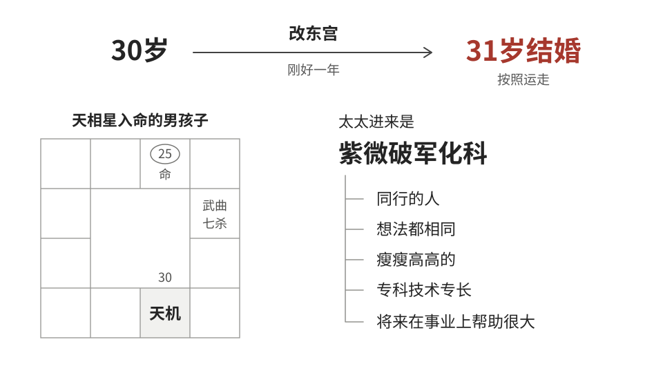 |
| **婚后不住西北会怎样？为什么要一再提醒？** | 〔口述〕「可是先生你一定要记得啊」「我帮你改了你31岁会结婚」「可是你婚后一定要去住西北」「如果没有住西北的话」「就按照命走了」。（[00:41:42–00:41:50](https://www.bilibili.com/video/BV1KJsLekEfA/?p=21&t=2502)，第 75066–75329 帧） 〔口述〕按命走，数到 32、33、34 岁，结果 34 岁又离婚掉了；「很多人就这样子啊」「婚前的时候注意到了」「婚后就忘掉了」「所以你要一再提醒他」「一再提醒他才可以」。（[00:41:51–00:42:13](https://www.bilibili.com/video/BV1KJsLekEfA/?p=21&t=2511)，第 75330–76013 帧） 〔叠图〕子女庚辰格叠图标着「离婚」，格内另标「34」。（[00:41:52–00:41:54](https://www.bilibili.com/video/BV1KJsLekEfA/?p=21&t=2512)，第 75360–75449 帧） 〔板书〕左侧红圈里有字，认不出；可辨「天机」「武曲」「七杀」等旧板书，其余认不出。（[00:41:48](https://www.bilibili.com/video/BV1KJsLekEfA/?p=21&t=2508)，第 75263 帧） |

**总结区**

- 通用规则：杀星单星独守命宫时那颗星很凶，一定要有吉星来化解；本宫没有吉星，对面不用看（[00:36:37–00:36:49](https://www.bilibili.com/video/BV1KJsLekEfA/?p=21&t=2197)，第 65910–66281 帧）；其它星都可以解厄制化，唯有天府星不能，很多人流年逢天府星就死掉（[00:37:54–00:38:17](https://www.bilibili.com/video/BV1KJsLekEfA/?p=21&t=2274)，第 68238–68933 帧）；吉处藏凶：致命大限的凶事往往发生在参加宴会、郊游旅行等好事上（[00:38:38–00:38:54](https://www.bilibili.com/video/BV1KJsLekEfA/?p=21&t=2318)，第 69564–70025 帧）；算寿限有很多种方法，陀罗之外还要会看擎羊、天空地劫、火星铃星（[00:37:39–00:37:54](https://www.bilibili.com/video/BV1KJsLekEfA/?p=21&t=2259)，第 67776–68237 帧）
- 只在本例：陀罗在疾厄宫，53–62 大限影响最大是疾厄，56 岁大小二限逢；43–52 财帛事业最好（[00:36:49–00:37:39](https://www.bilibili.com/video/BV1KJsLekEfA/?p=21&t=2209)，第 66282–67775 帧）；禄存天府在财帛，很赚钱又聚财，但挡不住陀罗，「反而一定会杀」（[00:38:27–00:38:38](https://www.bilibili.com/video/BV1KJsLekEfA/?p=21&t=2307)，第 69234–69563 帧）；批这种八字重点看婚姻跟疾厄；他没有子女，改婚姻不难（[00:39:32–00:40:00](https://www.bilibili.com/video/BV1KJsLekEfA/?p=21&t=2372)，第 71184–72017 帧）；30 岁来找，改东宫后 31 岁结婚，太太紫微破军化科、同行、想法相同；婚后须住西北，否则按命走 34 岁离婚（[00:41:02–00:41:57](https://www.bilibili.com/video/BV1KJsLekEfA/?p=21&t=2462)，第 73872–75539 帧）
- 不是排盘规则，是处世方法：客人来时之前的事已来不及，只告诉他之后的事（[00:39:41–00:39:55](https://www.bilibili.com/video/BV1KJsLekEfA/?p=21&t=2381)，第 71430–71879 帧）；改了以后客人婚前照做、婚后容易忘，要一再提醒他（[00:41:42–00:42:13](https://www.bilibili.com/video/BV1KJsLekEfA/?p=21&t=2502)，第 75066–76013 帧）；老人常去医院体检反易感染，孝顺反而害了他（[00:39:00–00:39:32](https://www.bilibili.com/video/BV1KJsLekEfA/?p=21&t=2340)，第 70224–71183 帧）

**待核**

1. [00:36:08](https://www.bilibili.com/video/BV1KJsLekEfA/?p=21&t=2168)，第 65052 帧：「鼻孔都看不到」所指不明，可能是接「铁公鸡」的玩笑，待核。
2. [00:36:33](https://www.bilibili.com/video/BV1KJsLekEfA/?p=21&t=2193)，第 65796 帧：「你不要管未来十年」与「那只是一种算大算死限的方法」（[00:36:34](https://www.bilibili.com/video/BV1KJsLekEfA/?p=21&t=2194)，第 65826 帧）含义倪师没有展开，「算大算死限」照字幕原字。
3. [00:36:05](https://www.bilibili.com/video/BV1KJsLekEfA/?p=21&t=2165)，第 64968 帧：叠图财帛己卯与迁移己丑两格都印着「身宫」；[00:40:27](https://www.bilibili.com/video/BV1KJsLekEfA/?p=21&t=2427)，第 72828 帧起迁移己丑不再印「身宫」，待核。
4. [00:37:11](https://www.bilibili.com/video/BV1KJsLekEfA/?p=21&t=2231)，第 66948 帧：这步大限的年龄字幕没出，语音听作「三三」；倪师说「红鸾婚姻」，但本块叠图子女庚辰格里没有红鸾，红鸾在哪格本块看不出。
5. [00:36:49](https://www.bilibili.com/video/BV1KJsLekEfA/?p=21&t=2209)，第 66282 帧：字幕「53-62」，语音为「三六社」，以字幕和叠图大限 53~62 为准。
6. [00:38:33](https://www.bilibili.com/video/BV1KJsLekEfA/?p=21&t=2313)，第 69396 帧：叠图上天府在财帛己卯，倪师说「天府星落在这里面」时手指的左下格叠图显示疾厄戊寅附近，究竟指哪格待核；指代 D141（[00:38:27](https://www.bilibili.com/video/BV1KJsLekEfA/?p=21&t=2307)，第 69237 帧）不确定，未用。
7. [00:40:10](https://www.bilibili.com/video/BV1KJsLekEfA/?p=21&t=2410)，第 72318 帧：字幕开头多一个「黑」字，是识别噪字；[00:40:17](https://www.bilibili.com/video/BV1KJsLekEfA/?p=21&t=2417)，第 72510 帧字幕「哎倪倪先生」与语音「你现在你看」对不上。
8. [00:40:42](https://www.bilibili.com/video/BV1KJsLekEfA/?p=21&t=2442)，第 73278 帧：「ab两种」倪师没有正面解释，笔记里对 a、b 的理解是推断。
9. [00:41:04](https://www.bilibili.com/video/BV1KJsLekEfA/?p=21&t=2464)，第 73944 帧、[00:41:20](https://www.bilibili.com/video/BV1KJsLekEfA/?p=21&t=2480)，第 74412 帧：「改东宫」倪师没有解释，照原字写；「进入一改」语义不明。
10. [00:41:13](https://www.bilibili.com/video/BV1KJsLekEfA/?p=21&t=2473)，第 74214 帧、[00:41:52](https://www.bilibili.com/video/BV1KJsLekEfA/?p=21&t=2512)，第 75360 帧：字幕里的「叉」按上下文应为「又」（「对面又化科文采又并茂」「34岁变成又离婚掉了」），已按「又」转述。
11. [00:41:52](https://www.bilibili.com/video/BV1KJsLekEfA/?p=21&t=2512)，第 75360 帧：子女庚辰格叠图另标「34」，含义叠图没说明。
12. 板书：第73644、73993、74256、74448、75000、75263帧这几次新写的粉笔字都认不出；[00:41:06](https://www.bilibili.com/video/BV1KJsLekEfA/?p=21&t=2466)，第 73993 帧手挡住板面。
13. 指代：D138（[00:38:01](https://www.bilibili.com/video/BV1KJsLekEfA/?p=21&t=2281)，第 68441 帧）、D149（[00:41:10](https://www.bilibili.com/video/BV1KJsLekEfA/?p=21&t=2470)，第 74120 帧）、D150（[00:41:31](https://www.bilibili.com/video/BV1KJsLekEfA/?p=21&t=2491)，第 74732 帧）均为不确定，未用作依据。

## 例三续：三停面相、批过去、巨门牢狱、印堂与目露凶光

| 巳 | 午 | 未 | 申 |
|---|---|---|---|
| **夫妻 辛巳** 廉贞陷 贪狼陷 | **兄弟 壬午** 巨门旺 文昌陷 | （未：没贴过） | （申：没贴过） |
| **子女 庚辰** 太阴陷忌 擎羊庙 | **例三续：三停面相、批过去、巨门牢狱、印堂与目露凶光 · 命宫癸未（宫序推）** | 据视频叠图重排 | （酉：没贴过） |
| **财帛 己卯**（身宫） 天府得 禄存庙 地劫平 | 后期贴图，不算倪师的话 |  | （戌：没贴过） |
| **疾厄 戊寅** 陀罗陷 铃星庙 | **迁移（宫序推） 己丑** 紫微庙科 破军旺 左辅庙 右弼庙 | **交友 戊子** 天机庙禄 天魁旺 | **官禄 丁亥** 天马平 |

同例三的命盘，见上图。

### 8　三停面相、批过去、巨门与牢狱之相（[00:42:19–00:49:54](https://www.bilibili.com/video/BV1KJsLekEfA/?p=21&t=2539)，第 76188–89832 帧）

| 提示区 | 笔记区 |
|---|---|
| **从相上看，脸怎么分上停、中停、下停？** | 〔口述〕倪师转到「相上面来看的时候」，在黑板上画人脸讲三停：「上停上额头眉毛鼻子」「从这一段开始」「这个我们人的脸哈」「这眼睛」；接着「从鼻从鼻子这一段」「鼻子到这边」「如果上停」「这段叫上」「这个中这个上」。（[00:42:19–00:42:51](https://www.bilibili.com/video/BV1KJsLekEfA/?p=21&t=2539)，第 76188–77135 帧） 〔板书〕黑板右侧画了一张人脸：圆形轮廓、两道横线画的眉眼、三角形的鼻子，脸里没有字；脸上方另有几笔粉笔字迹，认不出。（[00:42:32](https://www.bilibili.com/video/BV1KJsLekEfA/?p=21&t=2552)，第 76580 帧） 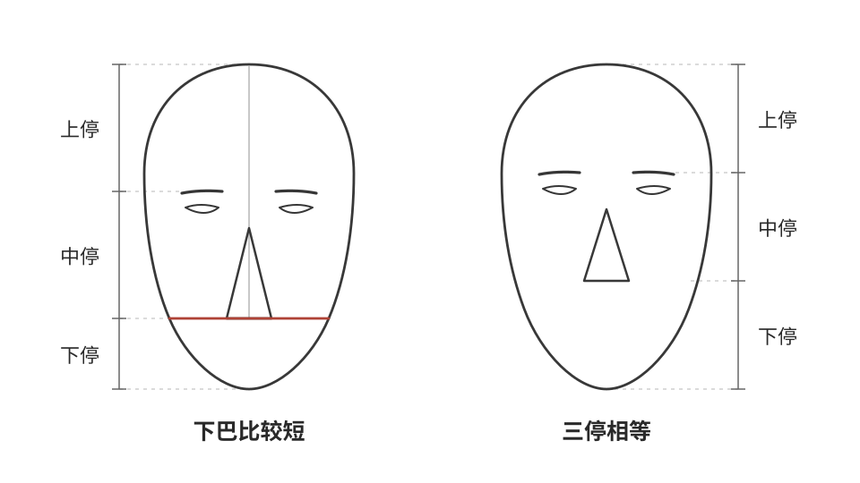 〔板书〕人脸中间加了一条竖线，额头处可辨「上」，鼻子处可辨「中」（与鼻子三角叠在一起，字形不完整），鼻子下方画了一条红色横线；其余认不出。（[00:42:52](https://www.bilibili.com/video/BV1KJsLekEfA/?p=21&t=2572)，第 77182 帧） 〔指代〕说「鼻子到这边」时手按在板上人脸图鼻子下端、红色横线附近，该处只有画线没有字。（[00:42:39](https://www.bilibili.com/video/BV1KJsLekEfA/?p=21&t=2559)，第 76786 帧） 〔口述〕倪师说这张脸「上停那个中停比较长」「下巴比较短」，又说「我用红的画这个」「这是正常」，「最好的相是三停相等」「三停啊相等指上上的相」。（[00:42:51–00:43:03](https://www.bilibili.com/video/BV1KJsLekEfA/?p=21&t=2571)，第 77136–77501 帧） |
| **下停太短主什么？应在哪个十年？** | 〔口述〕「如果下停太短」「这个人的下巴呢」「怎么搞呢这边很长」「哎下巴只变一点点」「下停太短了」「晚年不好」。（[00:43:03–00:43:14](https://www.bilibili.com/video/BV1KJsLekEfA/?p=21&t=2583)，第 77502–77837 帧） 〔板书〕人脸红色横线下方可辨「下」字。（[00:43:04](https://www.bilibili.com/video/BV1KJsLekEfA/?p=21&t=2584)，第 77540 帧） 〔指代〕说「这边很长」时手掌平按在人脸图右下侧、红色横线以下的下巴、腮部区域，该处没有字。（[00:43:07](https://www.bilibili.com/video/BV1KJsLekEfA/?p=21&t=2587)，第 77618 帧） 〔口述〕倪师把晚年落到具体年岁：「限在就在这个时候」「53-62 懂不懂」「就是晚年」「这个寿命会比较短」「算寿短的命」。说「这个寿命会比较短」时手掌按在人脸图下巴、腮部区域（指代确定，第78083帧）。（[00:43:14–00:43:27](https://www.bilibili.com/video/BV1KJsLekEfA/?p=21&t=2594)，第 77838–78239 帧） 〔推断〕推断：第 78660 帧叠图贴出的疾厄戊寅格，数字串里有「5362」，按图例可还原为 53~62，与口述「53-62」对得上；但倪师本块没有说 53-62 是哪一宫。（[00:43:42](https://www.bilibili.com/video/BV1KJsLekEfA/?p=21&t=2622)，第 78660 帧） |
| **相上看完再看命格，疾厄宫与廉贞横祸怎么说？** | 〔口述〕「在相上面再看他命格上一看」「疾厄宫的时候我们就知道」「他一定是健康」「健康有问题」。（[00:43:29–00:43:36](https://www.bilibili.com/video/BV1KJsLekEfA/?p=21&t=2609)，第 78270–78503 帧） 〔口述〕有的人「是车祸死掉」，「像那廉贞破军」「刚刚讲的廉贞破军在这里」「像这种廉贞贪狼都是横祸灾星」。（[00:43:36–00:43:45](https://www.bilibili.com/video/BV1KJsLekEfA/?p=21&t=2616)，第 78504–78773 帧） 〔叠图〕配合「刚刚讲的廉贞破军在这里」，叠图贴出命宫癸酉（第1块例一那张盘的命宫）：廉贞（平）带「禄」、破军（陷）带「权」，另有文曲庙、天刑庙、天福庙；同时贴出疾厄戊寅：铃星庙、陀罗陷、天使平、天德平等。（[00:43:40–00:43:42](https://www.bilibili.com/video/BV1KJsLekEfA/?p=21&t=2620)，第 78624–78677 帧） 〔叠图〕说「廉贞贪狼都是横祸灾星」时叠图贴出夫妻辛巳：廉贞陷、贪狼陷、凤阁庙、年解旺；叠图该格标着「生离死别」。（[00:43:42–00:43:45](https://www.bilibili.com/video/BV1KJsLekEfA/?p=21&t=2622)，第 78678–78773 帧） 〔口述〕说到这个人本身：「那他本身呢他自己是这种」「身体的病灾而亡啊」「因为病灾而亡」。（[00:43:45–00:44:03](https://www.bilibili.com/video/BV1KJsLekEfA/?p=21&t=2625)，第 78774–79307 帧） |
| **客户要你批过去，该怎么批？** | 〔口述〕「如果要批过去」「诸位我教你怎么批」：客户常要你批过去，「批过去不难」，过去的东西很多，「你只要批个重点就好了」「一个最严重的事情」。（[00:44:12–00:44:26](https://www.bilibili.com/video/BV1KJsLekEfA/?p=21&t=2652)，第 79578–80003 帧） |
| **本例 23-32 是什么大限？为何说没有大运？** | 〔口述〕「我们先不要管他未来如何」「他今年30岁哈」，「据然还坐在你面前有没有」。（[00:44:28–00:44:39](https://www.bilibili.com/video/BV1KJsLekEfA/?p=21&t=2668)，第 80046–80381 帧） 〔口述〕「23-32是廉贞杀星」「这后面是化忌」「对23-32来说」「未来十年没有大运哦」「大限就在前十年对不对」。（[00:44:39–00:44:49](https://www.bilibili.com/video/BV1KJsLekEfA/?p=21&t=2679)，第 80382–80699 帧） 〔叠图〕叠图贴出夫妻辛巳格（廉贞陷、贪狼陷，大限 23~32），以及子女庚辰格：太阴陷带「忌」、擎羊庙、天喜陷、三台庙、天官旺、解神庙、寡宿陷，大限 33~42。（[00:44:39–00:44:42](https://www.bilibili.com/video/BV1KJsLekEfA/?p=21&t=2679)，第 80382–80477 帧） 〔推断〕推断：说「这后面是化忌」时叠图正好贴出子女庚辰格的太阴化忌，倪师所说的化忌可能就是这一格；口述没有点名宫位。（[00:44:41–00:44:42](https://www.bilibili.com/video/BV1KJsLekEfA/?p=21&t=2681)，第 80436–80477 帧） |
| **为何说他 29 岁就该买单？人还在面前怎么讲？** | 〔口述〕「哎结果他现在30岁」「应该是29岁就买单的对不对」「29岁那年是不是对」；又说「对冲有没有最凶」「那以灾星来看的话」「是天马星在对面是廉贞贪狼的话」「落陷的像这种的话一定是凶事横祸」。（[00:44:50–00:45:07](https://www.bilibili.com/video/BV1KJsLekEfA/?p=21&t=2690)，第 80700–81233 帧） 〔叠图〕叠图贴出官禄丁亥：天马平、长生，数字里有「29」；叠图该格标着「买单」和「廉贪落陷对冲」。同时交友戊子格（天机庙带「禄」、天魁旺）里另有一个「30」。（[00:44:50–00:44:54](https://www.bilibili.com/video/BV1KJsLekEfA/?p=21&t=2690)，第 80700–80849 帧） 〔口述〕「哎他怎么还坐在你面前呢」「那你就告诉他」「你不要说他死了」「他人还坐在你面前」「不能睁眼说瞎话」。（[00:45:11–00:45:22](https://www.bilibili.com/video/BV1KJsLekEfA/?p=21&t=2711)，第 81348–81677 帧） 〔口述〕要这样说：「先生您去年有大意外」「大横祸」，「你讲完了他一听就吓一跳了啊」，「这是一个一个重点」。（[00:45:22–00:45:35](https://www.bilibili.com/video/BV1KJsLekEfA/?p=21&t=2722)，第 81678–82079 帧） |
| **13-22 读书时逢巨门，主什么？** | 〔口述〕「还有13-22这段时间中间」「巨门星进来的时候」「在读书这段时间中间呢」「逢到巨门」，「文昌星也有但是逢到巨门」「不管巨门星是入庙还是落陷」「都代表是非很多」。（[00:45:38–00:45:51](https://www.bilibili.com/video/BV1KJsLekEfA/?p=21&t=2738)，第 82146–82541 帧） 〔叠图〕叠图贴出兄弟壬午：巨门旺、文昌陷、天刑平、天空庙、咸池陷、天厨、天月、封诰，数字串含「1322」即 13~22。（[00:45:38–00:45:41](https://www.bilibili.com/video/BV1KJsLekEfA/?p=21&t=2738)，第 82146–82241 帧） 〔口述〕「所以他在读国中高中的这段时间」「交友一定不慎常常进出警察局」「如果落陷的话就是常常进出牢狱」。（[00:45:51–00:46:00](https://www.bilibili.com/video/BV1KJsLekEfA/?p=21&t=2751)，第 82542–82811 帧） 〔口述〕归结为看法：「所以我们算命看到巨门的时候」「落陷是在牢里面」「入庙的话是是非纠纷」。（[00:46:02–00:46:07](https://www.bilibili.com/video/BV1KJsLekEfA/?p=21&t=2762)，第 82860–83039 帧） |
| **43-52 逢巨门、命宫化科的人当老师会怎样？** | 〔口述〕「你如果巨门是晚来43-52是巨门」「然后你的命宫又是化科」，「像这种化科的那你当老师老师的话哈」「那你会干到校长」。（[00:46:10–00:46:18](https://www.bilibili.com/video/BV1KJsLekEfA/?p=21&t=2770)，第 83106–83369 帧） 〔叠图〕配合这段假设，叠图贴出命宫己丑：紫微庙带「科」、破军旺、左辅庙、右弼庙，数字「312」即 3~12；财帛己卯格内容与兄弟壬午相同（巨门旺、文昌陷等），数字串含「4352」即 43~52。这是演示假设用的格，不是例三本来的宫。（[00:46:11–00:46:13](https://www.bilibili.com/video/BV1KJsLekEfA/?p=21&t=2771)，第 83130–83201 帧） 〔口述〕「如果是巨门星入庙对不对」「那你如果是当老师的话」；若「在这段时间巨门星落陷」，「老师也会坐牢嘛」「对呀很多校长收回扣不是坐牢去了」，并说「这就是我们的八字上面的加减」。（[00:46:19–00:46:36](https://www.bilibili.com/video/BV1KJsLekEfA/?p=21&t=2779)，第 83370–83891 帧） |
| **一看出对方坐过牢，该怎么开口？** | 〔口述〕「这个人一来你一看」「哎你坐过牢你怎么知道」；但「那是有人在的时候不要讲哈」，要「他一个人到你面前来哎你坐过牢」，「那他一定会吓一跳啊」。（[00:46:38–00:46:52](https://www.bilibili.com/video/BV1KJsLekEfA/?p=21&t=2798)，第 83958–84389 帧） 〔口述〕「他说那我怎么办」「你听我的话就不会坐牢」「这样这样他才会听啊」。（[00:46:53–00:46:58](https://www.bilibili.com/video/BV1KJsLekEfA/?p=21&t=2813)，第 84390–84545 帧） |
| **坐过牢的人，印堂上有什么记号？** | 〔口述〕「坐过牢的人呢」「第一个印堂啊有黑点这个黑点」，第二个是目带凶光。（[00:47:00–00:47:22](https://www.bilibili.com/video/BV1KJsLekEfA/?p=21&t=2820)，第 84624–85277 帧） 〔板书〕黑板右侧可辨圆圈编号「①」「②」，②后可辨「目」字，下方可辨一个「凶」字；其余被讲者身体挡住，认不出。（[00:47:19](https://www.bilibili.com/video/BV1KJsLekEfA/?p=21&t=2839)，第 85175 帧） 〔指代〕说「印堂这边」「这个中间这一块东西」时，右手按在自己额头眉间的印堂处。（[00:47:24](https://www.bilibili.com/video/BV1KJsLekEfA/?p=21&t=2844)，第 85328–85342 帧） 〔口述〕印堂「上面这一块东西发红赤的时候」「代表正犯到官符正在进行中」；印堂整个暗黑「好像早上起来没有洗过脸的时候」「是坐在牢中」（字幕作「那如果整个印暗黑黑的」）。（[00:47:27–00:47:39](https://www.bilibili.com/video/BV1KJsLekEfA/?p=21&t=2847)，第 85434–85781 帧） 〔口述〕「从牢出来了以后呢」「这个那个晦暗的气色会没有」「但是黑点还在那个地方」。说「这个那个晦暗的气色」时右手平放在自己额头上（指代确定，第85835帧）。（[00:47:39–00:47:47](https://www.bilibili.com/video/BV1KJsLekEfA/?p=21&t=2859)，第 85782–86027 帧） |
| **黑板上两个「凶」字怎么分？兇光是什么样？** | 〔口述〕「然后目露凶光这个凶光不是这个兇」「这个兇目露这个兇光的人呢」「如果是女人女」「这个凶和这个兇不一样哦」。（[00:47:47–00:48:01](https://www.bilibili.com/video/BV1KJsLekEfA/?p=21&t=2867)，第 86028–86459 帧） 〔指代〕说「这个凶光」时食指指着右侧板面「②目带 凶光」里「凶光」二字下方。（[00:47:48](https://www.bilibili.com/video/BV1KJsLekEfA/?p=21&t=2868)，第 86061 帧） 〔指代〕说「这个兇 目露这个兇光的人呢」时手举到板面顶端，贴在右栏顶部圈起的「兇」字旁。（[00:47:55](https://www.bilibili.com/video/BV1KJsLekEfA/?p=21&t=2875)，第 86251 帧） 〔口述〕「这个兇光呢就」「好像每个都欠我五百万一样」「男女都不好」；「女人有这种目露兇光的」「背后指指点点就像小孩子讲人家」「背后讲人家坏话的人」；「男人也不好目露兇光也不好」。（[00:48:02–00:48:15](https://www.bilibili.com/video/BV1KJsLekEfA/?p=21&t=2882)，第 86460–86873 帧） |
| **坐过牢的人目光什么样？为什么会这样？** | 〔口述〕「那这个凶不是跟这个兇不一样」「这个凶是目自啊珠小」「就眼睛看到的时候曝光懂不懂」「眼睛张开来很大」；他说来看我相如何，「还把眼睛睁得特别大」「就告诉你我坐过牢」。（[00:48:15–00:48:29](https://www.bilibili.com/video/BV1KJsLekEfA/?p=21&t=2895)，第 86874–87281 帧） 〔口述〕「眼睛瞪得很大珠子很小眼珠子很大」「这种都是坐过牢狱之灾」。（[00:48:29–00:48:33](https://www.bilibili.com/video/BV1KJsLekEfA/?p=21&t=2909)，第 87282–87407 帧） 〔口述〕原因：「因为他坐在牢里面」「旁边都是坏人啊」「他会求自保对不对」「他就必须要很凶啊日久就成习惯了」「然后出来以后他还以为还在牢里面」「还在防人」，「那个相就还在那边」。（[00:48:33–00:48:47](https://www.bilibili.com/video/BV1KJsLekEfA/?p=21&t=2913)，第 87408–87833 帧） 〔推断〕推断：黑板列表「②目带 凶光」写的是「凶」，配坐过牢、眼睛瞪大的目光；圈起的「兇」配「每个都欠我五百万」、背后讲人坏话的目光。字幕两字前后用法不一致，此配法以板书和指代为准，仍待核。（[00:47:47–00:48:33](https://www.bilibili.com/video/BV1KJsLekEfA/?p=21&t=2867)，第 86028–87407 帧） |
| **妈妈带儿子来的例子，怎么说他才会听？** | 〔口述〕「上次我就碰到一个啊」，「一个妈妈带一个儿子来」「我一看哎你刚出来啊」「你不听我话还要再进去哦」「他都把他吓死了」「他说我不要再进去那怎么办」「很简单听你妈妈就不会进去」「他妈妈就讲你看吧」「就是你不听我的才进去」。（[00:48:47–00:49:06](https://www.bilibili.com/video/BV1KJsLekEfA/?p=21&t=2927)，第 87834–88385 帧） 〔口述〕「你这样连起来有没有」「你们也会读图嘛很简单嘛」「谁哪个妈妈愿意儿子去坐牢的」；妈妈家开杂货店，要儿子帮忙送货，「他就是不要他就不听嘛」「去交朋友交了一大堆」「赌啊酒色财气啊」「然后后来还是坐牢了」「这是牢狱之灾」。（[00:49:06–00:49:32](https://www.bilibili.com/video/BV1KJsLekEfA/?p=21&t=2946)，第 88386–89177 帧） 〔叠图〕说到「赌啊酒色财气啊」时叠图再次贴出兄弟壬午格（巨门旺、文昌陷等）。（[00:49:21–00:49:23](https://www.bilibili.com/video/BV1KJsLekEfA/?p=21&t=2961)，第 88854–88901 帧） |
| **印堂红赤和山根红赤，为什么不能看错？** | 〔口述〕「那你们不要看错了」「人家这边还是红赤的」「你就说你在坐牢」「人家站在外面啊对不对」「你红赤的代表官司正在进行中」。说「这边」时右手贴在自己额头眉心上方（指代确定，第89234帧）。（[00:49:32–00:49:41](https://www.bilibili.com/video/BV1KJsLekEfA/?p=21&t=2972)，第 89178–89435 帧） 〔口述〕「那如果到山根这边红赤的话」「痔疮不要乱讲哈」「哎你把痔疮给他讲成这个牢狱之」，随后说「这个官司哦不好」，全集到此结束，话题没讲完。（[00:49:41–00:49:54](https://www.bilibili.com/video/BV1KJsLekEfA/?p=21&t=2981)，第 89436–89832 帧） 〔指代〕说「山根这边」时右手食指按在自己两眼之间的鼻梁处。（[00:49:42](https://www.bilibili.com/video/BV1KJsLekEfA/?p=21&t=2982)，第 89470 帧） |

**总结区**

- 通用规则：最好的相是三停相等；下停太短，晚年不好（[00:42:54–00:43:14](https://www.bilibili.com/video/BV1KJsLekEfA/?p=21&t=2574)，第 77238–77837 帧）；批过去不难，只要批一个最严重的事情（[00:44:12–00:44:26](https://www.bilibili.com/video/BV1KJsLekEfA/?p=21&t=2652)，第 79578–80003 帧）；看到巨门，不论入庙落陷都代表是非多；落陷是在牢里面，入庙是是非纠纷（[00:45:47–00:46:07](https://www.bilibili.com/video/BV1KJsLekEfA/?p=21&t=2747)，第 82410–83039 帧）；坐过牢的人印堂有黑点、目带凶光；印堂红赤代表官符正在进行中，整个印堂暗黑是坐在牢中，出狱后晦暗消失但黑点还在（[00:47:00–00:47:47](https://www.bilibili.com/video/BV1KJsLekEfA/?p=21&t=2820)，第 84624–86027 帧）
- 只在本例：倪师画的这张脸上停、中停较长，下巴较短，下停太短应在 53-62，寿命会比较短（[00:42:51–00:43:27](https://www.bilibili.com/video/BV1KJsLekEfA/?p=21&t=2571)，第 77136–78239 帧）；此人今年 30 岁，23-32 是廉贞杀星、后面化忌，本该 29 岁就买单，天马对冲落陷的廉贞贪狼是凶事横祸（[00:44:30–00:45:07](https://www.bilibili.com/video/BV1KJsLekEfA/?p=21&t=2670)，第 80100–81233 帧）；此人 13-22 读书时逢巨门，读国中高中时交友不慎、常常进出警察局（[00:45:38–00:45:56](https://www.bilibili.com/video/BV1KJsLekEfA/?p=21&t=2738)，第 82146–82697 帧）
- 不是排盘规则，是处世方法：客人明明还坐在面前，不能说他死了，要说先生您去年有大意外、大横祸（[00:45:11–00:45:25](https://www.bilibili.com/video/BV1KJsLekEfA/?p=21&t=2711)，第 81348–81779 帧）；看出对方坐过牢，有人在时不要讲，等他单独来再讲，并告诉他听我的话就不会坐牢，他才会听（[00:46:45–00:46:58](https://www.bilibili.com/video/BV1KJsLekEfA/?p=21&t=2805)，第 84162–84545 帧）；山根红赤不要乱讲，别把痔疮讲成牢狱（[00:49:41–00:49:47](https://www.bilibili.com/video/BV1KJsLekEfA/?p=21&t=2981)，第 89436–89633 帧）

**待核**

1. [00:43:14](https://www.bilibili.com/video/BV1KJsLekEfA/?p=21&t=2594)，第 77838 帧字幕「限在就在这个时候」，语音为「就在这个时候他的线呢」，「限在」疑为「现在」或「大限」，原话待核。
2. [00:42:32](https://www.bilibili.com/video/BV1KJsLekEfA/?p=21&t=2552)，第 76580 帧板书人脸上方有几笔粉笔字迹，认不出，也不确定是不是本块所写。
3. [00:42:52](https://www.bilibili.com/video/BV1KJsLekEfA/?p=21&t=2572)，第 77182 帧板书额头「上」、鼻处「中」与竖线、鼻子三角叠在一起，只是大致可辨。
4. [00:43:27](https://www.bilibili.com/video/BV1KJsLekEfA/?p=21&t=2607)，第 78238 帧板书人脸下方画了一个红圈，圈内是红色斜线涂画，没有可读的字；它代表什么，口述没说。
5. [00:44:47](https://www.bilibili.com/video/BV1KJsLekEfA/?p=21&t=2687)，第 80628 帧板书大半被三格叠图和讲者身体挡住，本次新写的字认不出。
6. [00:47:52](https://www.bilibili.com/video/BV1KJsLekEfA/?p=21&t=2872)，第 86184 帧写板书时讲者头部挡住所写位置，新写的字认不出；圈起的「兇」字只能依据[00:47:55](https://www.bilibili.com/video/BV1KJsLekEfA/?p=21&t=2875)，第 86251 帧的指代。
7. [00:47:47–00:48:33](https://www.bilibili.com/video/BV1KJsLekEfA/?p=21&t=2867)，第 86028–87407 帧字幕「凶」「兇」两字前后用法不一致（如[00:47:47](https://www.bilibili.com/video/BV1KJsLekEfA/?p=21&t=2867)，第 86028 帧「目露凶光这个凶光不是这个兇」与[00:47:58](https://www.bilibili.com/video/BV1KJsLekEfA/?p=21&t=2878)，第 86364 帧「这个凶和这个兇不一样」），哪个字配哪种目光，板书图本身没能拍清，待核。
8. [00:48:29](https://www.bilibili.com/video/BV1KJsLekEfA/?p=21&t=2909)，第 87282 帧「眼睛瞪得很大珠子很小眼珠子很大」前后自相矛盾，语音为「很大猪子很小眼猪子很大」，原话待核。
9. [00:48:17](https://www.bilibili.com/video/BV1KJsLekEfA/?p=21&t=2897)，第 86928 帧「这个凶是目自啊珠小」，语音为「木白猪小」，「目自」意思不明，待核。
10. [00:47:34](https://www.bilibili.com/video/BV1KJsLekEfA/?p=21&t=2854)，第 85620 帧字幕「印暗黑黑的」，按语音「印堂黑黑的」理解为印堂；引文保留字幕原字。
11. [00:46:22](https://www.bilibili.com/video/BV1KJsLekEfA/?p=21&t=2782)，第 83472 帧字幕「宣门在这段时间巨门星落陷」，「宣门」语音里没有，疑为字幕识别错误，待核。
12. [00:46:30](https://www.bilibili.com/video/BV1KJsLekEfA/?p=21&t=2790)，第 83724 帧「八字上面的加减」，语音为「佳节」，「加减」按上下文理解，待核；在讲紫微时说「八字」，倪师未解释。
13. [00:47:30](https://www.bilibili.com/video/BV1KJsLekEfA/?p=21&t=2850)，第 85506 帧「官符」倪师用了没解释；[00:48:50](https://www.bilibili.com/video/BV1KJsLekEfA/?p=21&t=2930)，第 87924 帧「这个愚教于众啊」意思倪师未解释。
14. [00:44:41](https://www.bilibili.com/video/BV1KJsLekEfA/?p=21&t=2681)，第 80436 帧「这后面是化忌」没点明是哪一宫的化忌，叠图同时贴出子女庚辰太阴陷带忌，待核。
15. [00:44:50](https://www.bilibili.com/video/BV1KJsLekEfA/?p=21&t=2690)，第 80700 帧官禄丁亥格数字串「29、415365、517、8392」顺序乱，只取得出「29」，其余未还原。
16. [00:43:40](https://www.bilibili.com/video/BV1KJsLekEfA/?p=21&t=2620)，第 78624 帧叠图命宫癸酉是第1块例一的盘，只为配合「刚刚讲的廉贞破军在这里」，不是例三本来的命宫；[00:46:10](https://www.bilibili.com/video/BV1KJsLekEfA/?p=21&t=2770)，第 83106 帧命宫己丑、财帛己卯是演示假设。
17. [00:43:41](https://www.bilibili.com/video/BV1KJsLekEfA/?p=21&t=2621)，第 78654 帧「廉贞破军在这里」、[00:44:05](https://www.bilibili.com/video/BV1KJsLekEfA/?p=21&t=2645)，第 79378 帧「这里面」、[00:47:49](https://www.bilibili.com/video/BV1KJsLekEfA/?p=21&t=2869)，第 86095 帧「这个」，指代看不出指哪里。
18. [00:45:26](https://www.bilibili.com/video/BV1KJsLekEfA/?p=21&t=2726)，第 81780 帧「你讲完了他一听就吓一跳了啊」字幕可信度低（0.41），语音为「话呢他一踢队吓一跳」，原话待核。
19. [00:49:17](https://www.bilibili.com/video/BV1KJsLekEfA/?p=21&t=2957)，第 88722 帧「帮忙我送煤送什么的」，语音为「送别送什么东西」，「送煤」待核。
20. [00:49:43](https://www.bilibili.com/video/BV1KJsLekEfA/?p=21&t=2983)，第 89502 帧山根红赤与「痔疮」的关系倪师没讲完，全集在[00:49:47](https://www.bilibili.com/video/BV1KJsLekEfA/?p=21&t=2987)，第 89634 帧「这个官司哦不好」处结束。

