# P23 · 12 上：化忌冲命 / 六亲不靠 / 兄弟夭折相 / 过忌结婚 / 多婚（00:00:00–00:43:21，共 78,050 帧）

> 2026-11-12 整理。依据 DeepSeek 逐帧记录与现成的五层材料（字幕、语音、叠图、板书、指代），由 Claude（Opus 5.5 子代理）分段起草，引文由程序逐段对过字幕。流程 2026-11-11 经站长认可。
> 依据标记：〔口述〕字幕与语音两路对得上的话，「」里是字幕原字 ·〔叠图〕后期贴的电子命盘，**不算倪师的话** ·〔板书〕粉笔字（看过那一帧原图才写）·〔指代〕「这里 / 这个」指哪（只收核过、确定的）·〔推断〕笔记作者自己的推断。每条后面的时间码可以点，跳到 B 站那一秒。

## 全集总结

**通用规则**

- 化忌对冲命而命宫没有吉星，叫半空折翅，以 40 岁为界、应在 40 岁之前（[00:00:26–00:00:45](https://www.bilibili.com/video/BV1KJsLekEfA/?p=23&t=26)，第 792–1379 帧）
- 父母宫有破军或廉贞破军、有杀星，代表父母亲会离散（[00:01:41–00:01:48](https://www.bilibili.com/video/BV1KJsLekEfA/?p=23&t=101)，第 3048–3257 帧）
- 巨日格的人命一定主偏房，一定会进入偏房的大运（[00:04:08–00:04:25](https://www.bilibili.com/video/BV1KJsLekEfA/?p=23&t=248)，第 7464–7979 帧）
- 35 到 40 岁这六年走眼运：善眼柔和，凶眼主恶死、横死在非命（[00:10:49–00:12:18](https://www.bilibili.com/video/BV1KJsLekEfA/?p=23&t=649)，第 19470–22151 帧）
- 兄弟宫化忌代表兄弟夭折；天刑代表是非官司刑克（[00:15:24–00:15:38](https://www.bilibili.com/video/BV1KJsLekEfA/?p=23&t=924)，第 27720–28145 帧）
- 红鸾、天喜一定在对宫，排的不是对宫就是排错了（[00:19:11–00:19:16](https://www.bilibili.com/video/BV1KJsLekEfA/?p=23&t=1151)，第 34536–34697 帧）
- 批女命福德宫很重要，福德宫不好第二次婚姻都很难（[00:19:47–00:19:59](https://www.bilibili.com/video/BV1KJsLekEfA/?p=23&t=1187)，第 35616–35981 帧）
- 迁移宫化禄的八字叫「外地大利」，是到外地去经商的一种人（[00:28:20–00:28:33](https://www.bilibili.com/video/BV1KJsLekEfA/?p=23&t=1700)，第 51012–51395 帧）
- 化忌的十年里红鸾星就没有了，婚姻难动（[00:31:21–00:31:24](https://www.bilibili.com/video/BV1KJsLekEfA/?p=23&t=1881)，第 56430–56531 帧）
- 化忌就是反背，主做事情事倍功半，还有官司纠纷（[00:41:16–00:41:26](https://www.bilibili.com/video/BV1KJsLekEfA/?p=23&t=2476)，第 74298–74585 帧）。

**只在本例**

- 本例酉年生女命，巨日格、太阳陷坐命亥、对宫巨门化忌，倪师称反背，又属鸡更麻烦（[00:00:51–00:01:31](https://www.bilibili.com/video/BV1KJsLekEfA/?p=23&t=51)，第 1536–2741 帧）
- 天喜逢破军，第一次婚姻不成；26 岁廉贞禄存会结婚，27 岁结婚才一年就完蛋（[00:08:16–00:08:45](https://www.bilibili.com/video/BV1KJsLekEfA/?p=23&t=496)，第 14880–15779 帧）
- 来找时 38 岁，明年 39 逢巨门化忌、对面太阳落陷，是杀限（[00:10:13–00:10:32](https://www.bilibili.com/video/BV1KJsLekEfA/?p=23&t=613)，第 18408–18971 帧）
- 兄弟宫化忌、父母宫吉星落陷、对面廉贞破军，这个八字六亲不靠，要辛苦独立成家（[00:14:13–00:14:36](https://www.bilibili.com/video/BV1KJsLekEfA/?p=23&t=853)，第 25590–26285 帧）
- 大限 55-64 与小限 56 都到疾厄宫廉破，倪师断死在 56 岁（[00:23:59–00:25:02](https://www.bilibili.com/video/BV1KJsLekEfA/?p=23&t=1439)，第 43176–45083 帧）
- 27岁来找：舍掉第一次婚姻，不住西北角改住东南角，32岁让红鸾星动（[00:34:11–00:35:29](https://www.bilibili.com/video/BV1KJsLekEfA/?p=23&t=2051)，第 61542–63875 帧）
- 36 岁再婚，35-44 大限与流年大小二限逢化忌，第二个老婆走了；第一个太太在 25-34 大限，没逢到（[00:39:17–00:40:08](https://www.bilibili.com/video/BV1KJsLekEfA/?p=23&t=2357)，第 70722–72251 帧）。

**不是排盘规则，是处世方法**

- 客人多在结婚、离婚、象已出现后才来找，机会只有一次，那时再帮她改很难（[00:07:45–00:08:00](https://www.bilibili.com/video/BV1KJsLekEfA/?p=23&t=465)，第 13956–14429 帧）
- 遇到流年不好，不论当官或做事，读书最好，君子进德修业，读书才是后来真正的进步（[00:18:01–00:18:44](https://www.bilibili.com/video/BV1KJsLekEfA/?p=23&t=1081)，第 32436–33737 帧）
- 一个人的想法会改变做法，做法影响到命，改位置是改一念（[00:23:44–00:23:59](https://www.bilibili.com/video/BV1KJsLekEfA/?p=23&t=1424)，第 42744–43175 帧）
- 对方已经在骗还一再给机会，叫愚善；遇到这种情形要当机立断舍掉（[00:34:28–00:34:58](https://www.bilibili.com/video/BV1KJsLekEfA/?p=23&t=2068)，第 62052–62963 帧）
- 靠才艺只能博一时欢心，维持长久要看肚子里有没有学问（[00:38:33–00:38:42](https://www.bilibili.com/video/BV1KJsLekEfA/?p=23&t=2313)，第 69414–69677 帧）。

## 目录

**例一（女命，命宫辛亥太阳陷）：化忌冲命、父母离散、日月角与眉**

1. 化忌冲命半空折翅，父母离散与眉相（00:00:00–00:03:56）

**例一续：偏房格、大限、早婚离婚、39岁杀限眼运、阳宅、同居**

2. 巨日偏房格：三限运程与早婚离婚（00:03:57–00:08:49）
3. 例一离婚原因、杀限眼运与交友贪狼（00:08:49–00:13:49）

**例二（命宫戊申巨门太阳）：六亲不靠、兄弟夭折相、先母后父**

4. 例二女命：六亲不靠、眉相与先母后父（00:13:49–00:18:54）

**例二续：红鸾与过忌、38岁死别与阳宅、大限疾厄与化解卦**

5. 过忌成婚、死别阳宅与大限疾厄（00:18:54–00:26:07）

**例三（女命，命宫己亥天梁）：过忌之婚、外地经商、破祖业、改宅**

6. 例三女命：红鸾化忌、外地大利与西北角（00:26:07–00:30:57）
7. 例三：过忌之婚、破祖业相与搬家择夫（00:30:57–00:36:04）

**例四（男命，命宫丙戌破军）：福德天喜多婚、刑克二妻、外刚内柔**

8. 例四男命：福德天喜多婚、刑克二妻（00:36:04–00:43:21）

## 例一（女命，命宫辛亥太阳陷）：化忌冲命、父母离散、日月角与眉

〔叠图〕这一例视频里只贴过 5 格：迁移 乙巳：巨门旺忌、右弼平、陀罗陷、旬空庙、破碎陷；命宫 辛亥：太阳陷、天魁旺、天马平、火星利、天福庙、孤辰陷；财帛 丁未：天梁旺、擎羊庙、地劫平、寡宿不；父母 壬子：破军庙、文曲得、天喜旺、三台平、天寿平、解神庙；官禄 癸卯：太阴陷禄、地空平、截空平、天虚庙。

### 1　化忌冲命半空折翅，父母离散与眉相（[00:00:00–00:03:56](https://www.bilibili.com/video/BV1KJsLekEfA/?p=23&t=0)，第 0–7109 帧）

| 提示区 | 笔记区 |
|---|---|
| **倪师为什么要特别提出这个八字？** | 〔口述〕倪师开场说提这个八字是有原因的：「我跟诸位提这个……提出来的时候诸位要……一定有一定有原因的」「为什么要提这个八字出来」。（[00:00:01–00:00:07](https://www.bilibili.com/video/BV1KJsLekEfA/?p=23&t=1)，第 48–221 帧） 〔口述〕他提醒家里人：看到自己的兄弟姐妹，尤其女孩子，或者小孩子、自己生的女孩，八字排出来是这样，都要开始注意：「诸位如果你看到你自己的弟姐妹」「姐妹尤其女孩子拿到」「或者是小孩子」「八字一排出来是这样子」「都要都要开始都要注意」。（[00:00:10–00:00:22](https://www.bilibili.com/video/BV1KJsLekEfA/?p=23&t=10)，第 312–665 帧） |
| **化忌对冲命、命宫又无吉星，叫什么？以几岁为界？** | 〔口述〕倪师先复习前面讲过的：「化忌在对冲命的时候」「而命宫也没有吉星的时候」，接着说「化忌只要对冲命」「这个我们就叫做已经叫做半空折翅」。（[00:00:26–00:00:33](https://www.bilibili.com/video/BV1KJsLekEfA/?p=23&t=26)，第 792–1013 帧） 〔口述〕半空折翅以 40 岁为界、应在 40 岁之前：「所谓半空折翅」「在40岁为一个界限」「一定在40岁之前」「这都是属于半空折翅」。（[00:00:33–00:00:45](https://www.bilibili.com/video/BV1KJsLekEfA/?p=23&t=33)，第 1014–1379 帧） 〔叠图〕命宫辛亥：太阳陷、天魁旺、火星利、天马平、天福庙，大限 4~13，小限 9、21、33、45、57、69；对宫迁移乙巳：巨门旺忌、陀罗陷、右弼平，大限 64~73。叠图命宫格标着「化忌对冲命」。（[00:00:27–00:00:29](https://www.bilibili.com/video/BV1KJsLekEfA/?p=23&t=27)，第 830–881 帧） 〔板书〕黑板左上格可辨「巨门·化忌」，「化忌」用红笔圈起；黑板最左侧红字可辨「40」，其余红字认不出。（[00:00:46](https://www.bilibili.com/video/BV1KJsLekEfA/?p=23&t=46)，第 1404 帧） 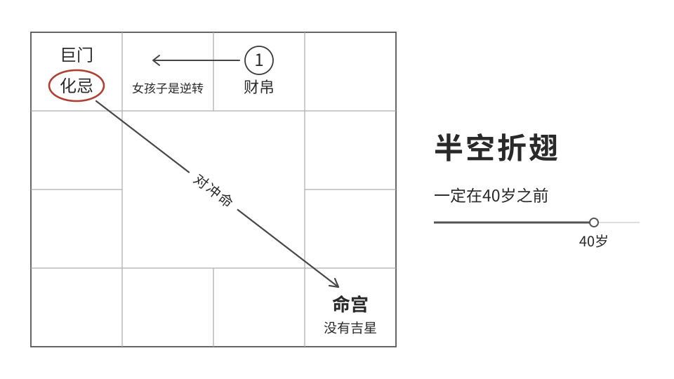 |
| **巨日格女命为什么要特别注意？什么叫反背？** | 〔口述〕倪师一再强调女孩子巨日格、巨门太阳坐命要特别注意：「那这个女孩子拿到这种命啊」「我们女孩子巨日格」「我一再跟诸位讲」「巨内太阳女孩子坐命的人哈」「要特别要注意」（「巨内」即巨门）。（[00:00:51–00:00:59](https://www.bilibili.com/video/BV1KJsLekEfA/?p=23&t=51)，第 1536–1799 帧） 〔口述〕本例叫反背，因为太阳星落陷：「像她这个是反背的」「所谓是反背」「太阳星陷地在这个地方」，并说「命宫刚好在这里」。（[00:01:00–00:01:08](https://www.bilibili.com/video/BV1KJsLekEfA/?p=23&t=60)，第 1800–2045 帧） 〔指代〕说「太阳星陷地在这个地方」时，手指的是黑板右下格粉红色「太阳」字一带，同格下方写着「4-13」「命」。（[00:01:02–00:01:03](https://www.bilibili.com/video/BV1KJsLekEfA/?p=23&t=62)，第 1860–1901 帧） 〔指代〕说「命宫刚好在这里」时，倪师用粉笔在右下格「4-13」下方的「命」字上画圈，指的就是这个命宫格。（[00:01:04–00:01:08](https://www.bilibili.com/video/BV1KJsLekEfA/?p=23&t=64)，第 1944–2045 帧） |
| **本例小限一岁从哪一格起？女孩子怎么走？** | 〔口述〕倪师说「所以像这个人呢」「她的小限在这边一岁……」「一岁开始女孩子是逆转」，即小限一岁起于他所指的那一格，女孩子逆着走。（[00:01:08–00:01:15](https://www.bilibili.com/video/BV1KJsLekEfA/?p=23&t=68)，第 2046–2261 帧） 〔指代〕说「她的小限在这边」时，粉笔点在黑板上排中间那格的上部空白处，该格下方写着「财帛」。（[00:01:09–00:01:12](https://www.bilibili.com/video/BV1KJsLekEfA/?p=23&t=69)，第 2082–2189 帧） 〔板书〕写着「财帛」那格上方写了圈起来的「1」；第2492帧图里可见圈旁多了一个向左的箭头。（[00:01:12](https://www.bilibili.com/video/BV1KJsLekEfA/?p=23&t=72)，第 2177 帧） 〔叠图〕财帛丁未：天梁旺、擎羊庙、地劫平、寡宿不，小限 1、13、25、37、49、61，大限 84~93。（[00:01:12–00:01:15](https://www.bilibili.com/video/BV1KJsLekEfA/?p=23&t=72)，第 2160–2261 帧） 〔推断〕推断：板书圈起的「1」与叠图财帛丁未小限首岁 1 对得上，字幕注字「（未宫）」也指这一格；但倪师口述只说「这边」，没说出宫名。（[00:01:09–00:01:12](https://www.bilibili.com/video/BV1KJsLekEfA/?p=23&t=69)，第 2082–2189 帧） |
| **酉年生（属鸡）又是巨日格，为什么更麻烦？** | 〔口述〕倪师点明本例是属鸡、酉年生人：「她是属鸡的」「西年的西年生的酉年生人」（「西年」即酉年）。（[00:01:17–00:01:23](https://www.bilibili.com/video/BV1KJsLekEfA/?p=23&t=77)，第 2322–2501 帧） 〔板书〕黑板左侧写「酉年」两字，外面加了框。（[00:01:23](https://www.bilibili.com/video/BV1KJsLekEfA/?p=23&t=83)，第 2492 帧） 〔口述〕巨日格再加属鸡更麻烦，因为鸡多是非口舌：「那你如果是巨日格又属鸡的更麻烦了」「因为鸡本来就是多是非口舌的」「你看那个吵架最会吵的都是属鸡的」。（[00:01:23–00:01:34](https://www.bilibili.com/video/BV1KJsLekEfA/?p=23&t=83)，第 2502–2837 帧） |
| **本例第三岁小限会遇到什么？** | 〔口述〕倪师从一岁数到三岁：「那一岁两岁三岁小的时候」「第三岁的时候」「第一个化忌就来冲」「化忌来冲太阳星落陷」。（[00:01:34–00:01:40](https://www.bilibili.com/video/BV1KJsLekEfA/?p=23&t=94)，第 2838–3005 帧） 〔指代〕语音说「这个」时，粉笔停在黑板右下方最底一格的字上，旁边可见「火星」两字，左侧的字被挡住看不全。（[00:01:38–00:01:40](https://www.bilibili.com/video/BV1KJsLekEfA/?p=23&t=98)，第 2958–3005 帧） 〔叠图〕迁移乙巳格（巨门旺忌）的小限岁数为 3、15、27、39、51、63；此时叠图同时贴着命宫辛亥（太阳陷）。（[00:01:36–00:01:37](https://www.bilibili.com/video/BV1KJsLekEfA/?p=23&t=96)，第 2892–2915 帧） 〔推断〕推断：叠图迁移乙巳的小限岁数含 3，该格正是巨门化忌，与倪师说「第三岁的时候第一个化忌就来冲」对得上；倪师本句没有说出宫名。（[00:01:36–00:01:40](https://www.bilibili.com/video/BV1KJsLekEfA/?p=23&t=96)，第 2892–3005 帧） |
| **父母宫有破军或廉贞破军，主什么？** | 〔口述〕倪师说父母宫有破军或廉贞破军、有杀星在父母宫，代表父母亲会离散：「父母宫有破军或者是廉贞破军」「有杀星在父恩」「代表父母亲会离散离散」（「父恩」即父母）。（[00:01:41–00:01:48](https://www.bilibili.com/video/BV1KJsLekEfA/?p=23&t=101)，第 3048–3257 帧） 〔叠图〕父母壬子：破军庙、文曲得、三台平、天喜旺、天寿平、解神庙，大限 14~23。叠图该格标着「离散」。（[00:01:50–00:01:51](https://www.bilibili.com/video/BV1KJsLekEfA/?p=23&t=110)，第 3306–3359 帧） 〔叠图〕这时叠图同时贴出两版父母壬子：一版廉贞平、破军陷、文曲庙、天刑庙；一版破军庙、文曲得。是配合「父母宫有破军或者是廉贞破军」作演示，不是两个父母宫。（[00:01:44–00:01:45](https://www.bilibili.com/video/BV1KJsLekEfA/?p=23&t=104)，第 3120–3155 帧） |
| **父母离散时，从哪里看出她由母亲抚养？** | 〔口述〕倪师接着看太阳陷、太阴化禄：「那离散的时候一看到她」「她这个太太阳星陷地」「这个太阴星化禄」。（[00:01:49–00:01:53](https://www.bilibili.com/video/BV1KJsLekEfA/?p=23&t=109)，第 3270–3419 帧） 〔口述〕由此断她从小由母亲抚养：「代表她从小是由母亲来抚养她的」「看到了吗妈妈在抚养她」「母亲在抚养她的」。（[00:01:54–00:02:04](https://www.bilibili.com/video/BV1KJsLekEfA/?p=23&t=114)，第 3420–3737 帧） 〔叠图〕官禄癸卯：太阴陷禄、地空平、截空平、天虚庙，标「身宫」。叠图该格标着「母亲扶养」。（[00:01:52–00:01:53](https://www.bilibili.com/video/BV1KJsLekEfA/?p=23&t=112)，第 3360–3419 帧） 〔板书〕黑板左列一格可辨「太阴·化禄」；其上一格可辨「贪狼」「54-63」「交友」，再上一格可辨「巨门·化忌」「64-73」「迁移」。（[00:03:46](https://www.bilibili.com/video/BV1KJsLekEfA/?p=23&t=226)，第 6792 帧） 〔推断〕推断：这句字幕作「太阴星化禄」，语音作「太阳星化露」，两路不一致；叠图的化禄标在官禄癸卯的太阴，板书也写「太阴·化禄」，故按太阴化禄记。（[00:01:52–00:01:53](https://www.bilibili.com/video/BV1KJsLekEfA/?p=23&t=112)，第 3360–3419 帧） |
| **看相第一种：日角陷、月角陷各主什么？** | 〔口述〕转到看相，倪师说相上有两种状况：「我们呢看相」「相上面有两种状况」「第一个日角陷」「日角线陷主丧父」「那月角……呢主丧母」。（[00:02:04–00:02:26](https://www.bilibili.com/video/BV1KJsLekEfA/?p=23&t=124)，第 3738–4409 帧） 〔口述〕日月角也会挺起来：「如果你看日月角」「都很挺起来的时候」「有时候一个人的官运很好的时候」「日月角它会挺起来」。（[00:02:28–00:02:33](https://www.bilibili.com/video/BV1KJsLekEfA/?p=23&t=148)，第 4452–4619 帧） 〔板书〕黑板最右侧竖写，可辨「相」「日」，左边有圈起的「②」，其余认不出。（[00:02:16](https://www.bilibili.com/video/BV1KJsLekEfA/?p=23&t=136)，第 4104 帧） 〔板书〕右侧竖写在「日」旁多了一行，可辨像「月」字，其余认不出。（[00:02:25](https://www.bilibili.com/video/BV1KJsLekEfA/?p=23&t=145)，第 4368 帧） |
| **第二个地方看眉毛：左右眉各主谁？高者先丧？** | 〔口述〕倪师说日月角挺起来之后看眉毛：「挺起来之后是看眉毛」「如果我们左左眉呢和有眉」「左眉呢主父案」「右眉呢主母亲」「高者先丧」（「有眉」即右眉、「父案」即父亲）。（[00:02:34–00:02:53](https://www.bilibili.com/video/BV1KJsLekEfA/?p=23&t=154)，第 4620–5207 帧） 〔板书〕圈起的「②」下面竖写两行，可辨「左眉主父」「右眉主母」。（[00:02:47](https://www.bilibili.com/video/BV1KJsLekEfA/?p=23&t=167)，第 5028 帧） 〔口述〕解释高者先丧：一个人站在那里，两眼一样高，眉一高一低，高的眉那边先走：「什么叫做高者先丧哈」「有一个人站在那边」「你看他的时候」「哎奇怪这个眉毛比较高」「两个眼睛是一样的」……「就是高的眉先走懂不懂」。（[00:02:53–00:03:16](https://www.bilibili.com/video/BV1KJsLekEfA/?p=23&t=173)，第 5208–5909 帧） |
| **黑板上怎么画眉演示「高者先丧」？** | 〔指代〕说「这个眉毛比较高」时，倪师边说边在黑板左侧空白处画出左边那条较高的眉线，「这个」就是正在画的眉线。（[00:03:01–00:03:04](https://www.bilibili.com/video/BV1KJsLekEfA/?p=23&t=181)，第 5454–5531 帧） 〔指代〕说「高眉这边是妈妈」时，粉笔在左边较高眉线上方写「母」；说「这边是父来」时，移到右边较低眉线上方写「父」。（[00:03:07–00:03:09](https://www.bilibili.com/video/BV1KJsLekEfA/?p=23&t=187)，第 5628–5699 帧） 〔口述〕高的一边先不在：「所以这个眉毛比较高的话」「代表妈妈先不在」，另一边「这个眉毛比较高的话」「代表父来先不在」（「父来」即父亲）。（[00:03:17–00:03:23](https://www.bilibili.com/video/BV1KJsLekEfA/?p=23&t=197)，第 5910–6107 帧） 〔指代〕说「所以这个眉毛比较高的话」时，手指直指左侧较高的眉线，指尖落在圈起来的「母」字正下方。（[00:03:17–00:03:18](https://www.bilibili.com/video/BV1KJsLekEfA/?p=23&t=197)，第 5910–5945 帧） 〔板书〕黑板左侧画了眉形横线，可辨圈起的「母」在较高的眉线上方，右边较低处写「父」。（[00:03:17](https://www.bilibili.com/video/BV1KJsLekEfA/?p=23&t=197)，第 5933 帧） 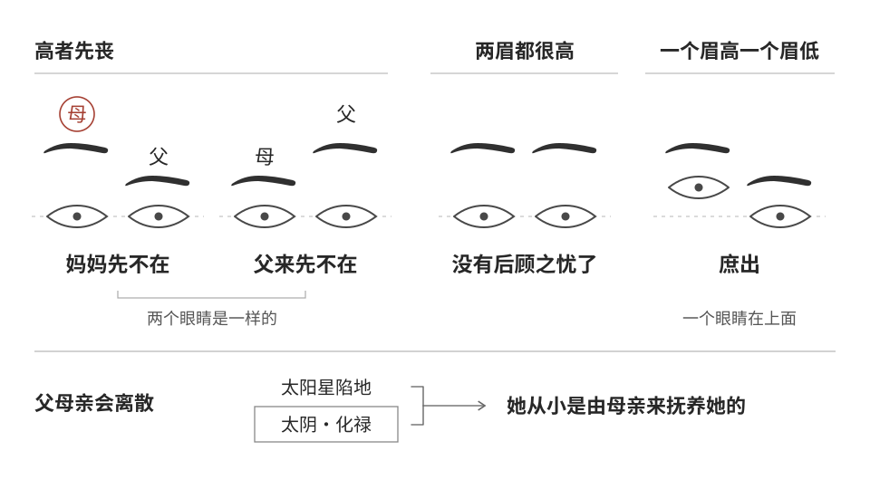 |
| **两眉都高、眉高低加两眼不等，各说明什么？** | 〔口述〕两眉都很高就没有后顾之忧了：「那两眉都很高的时候」「没有后顾之忧了」，并举很多当官的人两个眉抬起来、人都没有了为例。（[00:03:23–00:03:33](https://www.bilibili.com/video/BV1KJsLekEfA/?p=23&t=203)，第 6108–6395 帧） 〔口述〕一个眉高一个眉低、两眼又不相等是庶出：「你一个如果一个眉高一个眉低」……「她一个眼睛在上面」「而不相等」「这种是庶出」。（[00:03:36–00:03:48](https://www.bilibili.com/video/BV1KJsLekEfA/?p=23&t=216)，第 6486–6851 帧） 〔口述〕面相再加上看父母就很清楚，八字上也看得到，这是第一个要注意的：「那加上再看父母亲就看得很清楚」「还有八字上面看这个的时候」「也可以看得到」「这就是第一个我们要注意的」。（[00:03:48–00:03:56](https://www.bilibili.com/video/BV1KJsLekEfA/?p=23&t=228)，第 6852–7109 帧） 〔板书〕黑板左侧上方画眉，有圈起的「母」和「父」；左下画了两个眼形椭圆，高低差在图里看不准。（[00:03:46](https://www.bilibili.com/video/BV1KJsLekEfA/?p=23&t=226)，第 6792 帧） |

**总结区**

- 通用规则：化忌对冲命而命宫没有吉星，叫半空折翅，以 40 岁为界、应在 40 岁之前（[00:00:26–00:00:45](https://www.bilibili.com/video/BV1KJsLekEfA/?p=23&t=26)，第 792–1379 帧）；父母宫有破军或廉贞破军、有杀星，代表父母亲会离散（[00:01:41–00:01:48](https://www.bilibili.com/video/BV1KJsLekEfA/?p=23&t=101)，第 3048–3257 帧）；看相：日角陷主丧父、月角陷主丧母；左眉主父、右眉主母，高者先丧（[00:02:11–00:02:53](https://www.bilibili.com/video/BV1KJsLekEfA/?p=23&t=131)，第 3936–5207 帧）；一个眉高一个眉低、两眼又不相等，是庶出（[00:03:36–00:03:48](https://www.bilibili.com/video/BV1KJsLekEfA/?p=23&t=216)，第 6486–6851 帧）
- 只在本例：本例酉年生女命，巨日格、太阳陷坐命亥、对宫巨门化忌，倪师称反背，又属鸡更麻烦（[00:00:51–00:01:31](https://www.bilibili.com/video/BV1KJsLekEfA/?p=23&t=51)，第 1536–2741 帧）；小限一岁在财帛那格、女命逆转，第三岁第一个化忌就来冲（[00:01:08–00:01:40](https://www.bilibili.com/video/BV1KJsLekEfA/?p=23&t=68)，第 2046–3005 帧）；父母宫破军主父母离散，看太阴化禄断她从小由母亲抚养（[00:01:40–00:02:04](https://www.bilibili.com/video/BV1KJsLekEfA/?p=23&t=100)，第 3006–3737 帧）
- 不是排盘规则，是处世方法：看到自家兄弟姐妹、小孩或自己生的女孩八字排出是这种格，就要开始注意（[00:00:10–00:00:22](https://www.bilibili.com/video/BV1KJsLekEfA/?p=23&t=10)，第 312–665 帧）

**待核**

1. [00:00:10](https://www.bilibili.com/video/BV1KJsLekEfA/?p=23&t=10)，第 312 帧：字幕「你自己的弟姐妹」，语音作「兄弟姐妹」，字幕疑漏「兄」字。
2. [00:00:30–00:00:45](https://www.bilibili.com/video/BV1KJsLekEfA/?p=23&t=30)，第 924–1379 帧：「半空折翅」语音识别为「半空则次」；这个词本块只给了 40 岁为界的说法，没讲来历。
3. [00:00:53](https://www.bilibili.com/video/BV1KJsLekEfA/?p=23&t=53)，第 1608 帧：「巨日格」本块没有定义，只说「巨门太阳女孩子坐命」。
4. [00:00:56](https://www.bilibili.com/video/BV1KJsLekEfA/?p=23&t=56)，第 1692 帧：字幕「巨内」按上下文改为巨门。
5. [00:01:03](https://www.bilibili.com/video/BV1KJsLekEfA/?p=23&t=63)，第 1902 帧：字幕「在这个亥时的时候」，语音「汉石」；从指代与叠图看讲的是命宫在亥，原话是「亥时」还是「亥宫」待核。
6. [00:01:09](https://www.bilibili.com/video/BV1KJsLekEfA/?p=23&t=69)，第 2082 帧：字幕括号「（未宫）」语音里没有，是字幕注字，未当倪师的话。
7. [00:01:15–00:01:16](https://www.bilibili.com/video/BV1KJsLekEfA/?p=23&t=75)，第 2262–2291 帧：「兄弟」「什么在这里」只有半句，意思不明，未写入。
8. [00:01:16](https://www.bilibili.com/video/BV1KJsLekEfA/?p=23&t=76)，第 2292 帧：字幕「因为她是西年（成官起子）」，语音只有「因为他是有年」，括号注字未采用；第2292、2424帧字幕「西年」按上下文改为酉年。
9. [00:01:44](https://www.bilibili.com/video/BV1KJsLekEfA/?p=23&t=104)，第 3120 帧：字幕「父恩」按语音改为父母；「杀星」具体指哪颗星本块没说明。
10. [00:01:44](https://www.bilibili.com/video/BV1KJsLekEfA/?p=23&t=104)，第 3120 帧：叠图同时贴两版父母壬子（廉贞平破军陷／破军庙），按派活说明视为演示；单独出现时（第2958、3306帧）是破军庙那版。
11. [00:01:50–00:01:51](https://www.bilibili.com/video/BV1KJsLekEfA/?p=23&t=110)，第 3306–3359 帧：两处「这个」手指位置不确定（被手、字幕、叠图挡住），未当依据。
12. [00:01:52](https://www.bilibili.com/video/BV1KJsLekEfA/?p=23&t=112)，第 3360 帧：字幕「太阴星化禄」，语音「太阳星化露」，两路不一致。
13. [00:02:01](https://www.bilibili.com/video/BV1KJsLekEfA/?p=23&t=121)，第 3648 帧：单独成句「反州」略过。
14. [00:02:17](https://www.bilibili.com/video/BV1KJsLekEfA/?p=23&t=137)，第 4134 帧：「日角线陷」的「线」字字幕、语音都有，意思不明。
15. [00:02:23](https://www.bilibili.com/video/BV1KJsLekEfA/?p=23&t=143)，第 4290 帧：字幕「月角（陷）」括号字是注字，语音没有。
16. [00:02:27–00:02:33](https://www.bilibili.com/video/BV1KJsLekEfA/?p=23&t=147)，第 4410–4619 帧：「第二个地方在哪里看」之后先讲日月角挺起、再讲看眉毛，第二个地方究竟指哪个口述不清。
17. 第4722、4884、5676、6018帧：「有眉」改右眉，「父案」「父来」改父亲。
18. [00:03:01](https://www.bilibili.com/video/BV1KJsLekEfA/?p=23&t=181)，第 5454 帧：字幕注「（右眉）」；第5910、5982帧材料里的「（行眉）」「（龙眉）」像是识别乱码，板书图[00:03:17](https://www.bilibili.com/video/BV1KJsLekEfA/?p=23&t=197)，第 5933 帧画面字幕显示为「（右眉）」。
19. [00:03:07–00:03:09](https://www.bilibili.com/video/BV1KJsLekEfA/?p=23&t=187)，第 5628–5699 帧：黑板上「母」写在画面左侧高眉、「父」写在右侧低眉，与「左眉主父、右眉主母」是按看者还是被看者的左右，倪师没说明。
20. [00:03:11](https://www.bilibili.com/video/BV1KJsLekEfA/?p=23&t=191)，第 5748 帧：「爸爸先爸爸在妈妈」语义不清。
21. [00:03:30](https://www.bilibili.com/video/BV1KJsLekEfA/?p=23&t=210)，第 6306 帧：材料字幕栏为「两个眉拾起来」，板书图[00:03:31](https://www.bilibili.com/video/BV1KJsLekEfA/?p=23&t=211)，第 6333 帧画面字幕显示「抬起来」，按抬改；「人都都都没有了」指什么没明说。
22. [00:03:37](https://www.bilibili.com/video/BV1KJsLekEfA/?p=23&t=217)，第 6534 帧：字幕「叉不相等」改为又；[00:03:41](https://www.bilibili.com/video/BV1KJsLekEfA/?p=23&t=221)，第 6630 帧字幕「这里」，语音「照理」。
23. [00:03:47](https://www.bilibili.com/video/BV1KJsLekEfA/?p=23&t=227)，第 6822 帧：字幕「庶出」，语音作「素素」，两路对不上；庶出本块未解释。
24. [00:03:51](https://www.bilibili.com/video/BV1KJsLekEfA/?p=23&t=231)，第 6936 帧：「八字上面看这个」的「这个」指向不确定，所指不明。
25. [00:00:46](https://www.bilibili.com/video/BV1KJsLekEfA/?p=23&t=46)，第 1404 帧板书：左侧红字只认得「40」，其余认不出。
26. [00:01:40](https://www.bilibili.com/video/BV1KJsLekEfA/?p=23&t=100)，第 3000 帧板书：这段新写的内容认不出，画面左下只可辨「化科」二字，前面的字出画面。
27. 第4104、4368帧板书：右侧竖写只认得「相」「日」及疑似「月」，其余认不出。
28. [00:03:31](https://www.bilibili.com/video/BV1KJsLekEfA/?p=23&t=211)，第 6333 帧板书：只认得圈起的「母」、「父」和几条眉形线，这段新写的内容认不出。
29. 第4104、5028帧：画面左下另贴有面部十二宫图，标「日角陷 丧父 月角陷 丧母」「眉高者先丧」，不是 ▣ 命盘叠图，也不是板书，未作依据。

## 例一续：偏房格、大限、早婚离婚、39岁杀限眼运、阳宅、同居

| 巳 | 午 | 未 | 申 |
|---|---|---|---|
| **迁移 乙巳** 巨门旺忌 右弼平 陀罗陷 | **疾厄 丙午** 廉贞平 天相庙 禄存庙 铃星庙 | （未：没贴过） | **子女 戊申** 七杀庙 |
| **交友 甲辰** 贪狼庙 | **例一续：偏房格、大限、早婚离婚、39岁杀限眼运、阳宅、同居 · 命宫辛亥** | 据视频叠图重排 | **夫妻 己酉** 天同平权 左辅陷 天钺庙 |
| **官禄 癸卯**（身宫） 太阴陷禄 地空平 | 后期贴图，不算倪师的话 |  | **兄弟 庚戌** 武曲庙 |
| **田宅 壬寅** 紫微旺 天府庙 文昌陷 | **福德 癸丑** 天机陷科 | **父母 壬子** 破军庙 文曲得 | **命宫 辛亥** 太阳陷 天魁旺 天马平 火星利 |

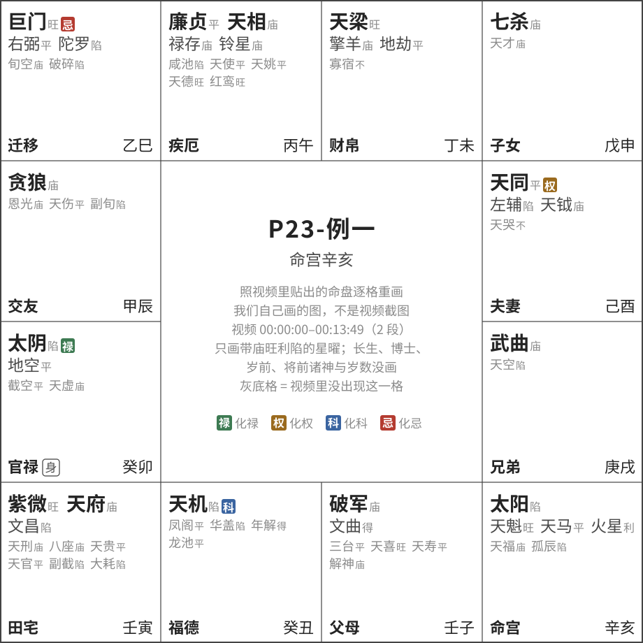

按视频里这张盘逐格重画（我们自己画的图，不是视频截图）；同一个人的 2 段合成一张；数据见 [命盘-P23-例一.json](图/命盘-P23-例一.json)。

### 2　巨日偏房格：三限运程与早婚离婚（[00:03:57–00:08:49](https://www.bilibili.com/video/BV1KJsLekEfA/?p=23&t=237)，第 7110–15875 帧）

| 提示区 | 笔记区 |
|---|---|
| **巨日格的女命，为什么说一定主偏房？** | 〔口述〕转述：倪师讲这种八字格的第二个解释——这个人是女孩子命，「但是拿到男人的八字」，所以一辈子要像男人一样去辛劳（字幕作「辛旁」，按语音改）。（[00:04:01–00:04:08](https://www.bilibili.com/video/BV1KJsLekEfA/?p=23&t=241)，第 7230–7463 帧） 〔口述〕接着下断语：「所以巨日格的人」「她的命一定主偏房」，「你先不用看她」，她这个命「本来就是属于什么偏房格」，「一定会……偏房的大运」。（[00:04:08–00:04:25](https://www.bilibili.com/video/BV1KJsLekEfA/?p=23&t=248)，第 7464–7979 帧） 〔板书〕黑板右侧一竖栏可辨粉笔字「偏房格」，是倪师边说边写上去的。（[00:04:20](https://www.bilibili.com/video/BV1KJsLekEfA/?p=23&t=260)，第 7824 帧） 〔叠图〕这时画面左上角叠图为迁移乙巳：巨门旺、化忌，同格有右弼平、陀罗陷、天厨、旬空庙、破碎陷；右下角叠图为命宫辛亥：太阳陷、天魁旺、火星利、天马平，叠图该格标着「化忌对冲命」。（[00:04:19–00:04:21](https://www.bilibili.com/video/BV1KJsLekEfA/?p=23&t=259)，第 7782–7859 帧） 〔板书〕本块开头的板面（老师身体挡住右半边）可辨：「天同」「天钺」「夫妻」「武曲」「兄弟」「太阳不」「火星」「4-13」，其余认不出。（[00:04:00](https://www.bilibili.com/video/BV1KJsLekEfA/?p=23&t=240)，第 7212 帧） |
| **14-23 走破军，早年过得怎样？** | 〔口述〕转述：「虽然这个八字早年要丧父」，14-23 岁进入破军星。「破军星代表什么」——「就是一个人开始很辛苦的」，「就已经开始要出来做事啊」。（[00:04:26–00:04:35](https://www.bilibili.com/video/BV1KJsLekEfA/?p=23&t=266)，第 7980–8279 帧） 〔口述〕因为很早工作，「所以这个人读书一定读的不多」，「就开始工作」；跟母亲两人相依为命（字幕作「相依力命」，按语音改）。（[00:04:37–00:04:46](https://www.bilibili.com/video/BV1KJsLekEfA/?p=23&t=277)，第 8328–8597 帧） 〔叠图〕叠图父母壬子，大限 14~23：破军庙、文曲得、天喜旺、三台平、天寿平、解神庙；叠图该格标着「读书不多」「辛苦工作」。（[00:04:52–00:04:54](https://www.bilibili.com/video/BV1KJsLekEfA/?p=23&t=292)，第 8778–8825 帧） |
| **24-33 化科，读书和工作怎么走？** | 〔口述〕转述：24-33 这段时间化科，「化科代表读书」，「读书的时间就在这段时间最好」；而 14-23 这段时间没有化科，「因为对面是化禄禄存的」。（[00:04:46–00:04:55](https://www.bilibili.com/video/BV1KJsLekEfA/?p=23&t=286)，第 8598–8873 帧） 〔指代〕说「所以这个科就变成什么」时，手指点在黑板左下格的「机·化科」上，同一格下方写着「24-33」。（[00:04:57](https://www.bilibili.com/video/BV1KJsLekEfA/?p=23&t=297)，第 8921 帧） 〔口述〕转述：这个科后来变成比如「空中大学」，或到社会上以后「学习到专长」「学习到一些很专业的东西」；所以「33岁以前她还是在帮人家做」「领固定的薪水」。（[00:04:57–00:05:13](https://www.bilibili.com/video/BV1KJsLekEfA/?p=23&t=297)，第 8916–9413 帧） |
| **34-43 岁为什么能自己当老板？** | 〔口述〕转述：进入 34-43 岁以后，「南北斗星君来会」，「这个通通吉星来会」，代表 34 岁以后她会自己做事业当老板，「然后她的这个事业会非常的顺」。（[00:05:13–00:05:22](https://www.bilibili.com/video/BV1KJsLekEfA/?p=23&t=313)，第 9414–9689 帧） 〔叠图〕叠图田宅壬寅，大限 34~43：紫微旺、天府庙、文昌陷、八座庙、台辅、天官平、天贵平；叠图该格标着「做事业当老板」。（[00:05:15–00:05:16](https://www.bilibili.com/video/BV1KJsLekEfA/?p=23&t=315)，第 9456–9485 帧） |
| **事业宫看当官还是从商？连续30年靠什么？** | 〔口述〕转述：她这里就进入事业宫；倪师说「如果太阴星没有化没有化禄」「在身宫在事业宫的」，「事业讲官讲的是官禄」，「有化禄的话会从商」，并提醒「事业宫你不要把她当官当成从商」。语音在两句之间另有半句，大意是没有化禄就会当官，字幕没有这半句（见待核）。（[00:05:23–00:05:38](https://www.bilibili.com/video/BV1KJsLekEfA/?p=23&t=323)，第 9690–10157 帧） 〔叠图〕叠图官禄癸卯：太阴陷、地空平、截空平、天虚庙，叠图该格有红底白字标签「当官」。（[00:05:23–00:05:25](https://www.bilibili.com/video/BV1KJsLekEfA/?p=23&t=323)，第 9690–9773 帧） 〔口述〕转述：「那她连续30年」，「这个贪狼也是横财」，「这30年如果从商了」「运道会很好」，这是她的事业做生意。（[00:05:38–00:05:45](https://www.bilibili.com/video/BV1KJsLekEfA/?p=23&t=338)，第 10158–10367 帧） 〔指代〕说「这个贪狼」时食指正点在黑板左侧中格的草书「贪狼」上；该处叠图显示交友甲辰 54~63 贪狼庙，叠图该格标着「横财」。（[00:05:39](https://www.bilibili.com/video/BV1KJsLekEfA/?p=23&t=339)，第 10187 帧） 〔推断〕推断：「连续30年」倪师没说是哪 30 年。叠图田宅 34~43、官禄 44~53（据指代标注所记）、交友 54~63 三个大限相连正好 30 年，可能指 34–63 岁，材料未明说。（[00:05:15–00:05:40](https://www.bilibili.com/video/BV1KJsLekEfA/?p=23&t=315)，第 9456–10217 帧） |
| **这张盘的子女怎么看？** | 〔口述〕转述：「那这种子女很简单」，「她是七杀代表一个儿子」，「她一个儿子在旁边在侧」。（[00:05:48–00:05:54](https://www.bilibili.com/video/BV1KJsLekEfA/?p=23&t=348)，第 10464–10649 帧） 〔叠图〕叠图子女戊申：七杀庙、天巫、天才庙；叠图该格标着「一个儿子」。（[00:05:48–00:05:50](https://www.bilibili.com/video/BV1KJsLekEfA/?p=23&t=348)，第 10464–10511 帧） |
| **红鸾、天喜在哪？第一次婚姻为何结得早？** | 〔口述〕转述：先看第一个限，「我们看她红鸾天喜星在哪里」，「天喜在这里」，「红鸾星在这里」。（[00:05:57–00:06:11](https://www.bilibili.com/video/BV1KJsLekEfA/?p=23&t=357)，第 10734–11141 帧） 〔指代〕说「天喜在这里」时持粉笔在黑板下排中格上沿写出「天」字（随后补成「天喜」）；说「红鸾在这里」时在黑板顶部偏左书写，左上叠图框出红鸾（疾厄丙午）。（[00:06:01–00:06:04](https://www.bilibili.com/video/BV1KJsLekEfA/?p=23&t=361)，第 10853–10922 帧） 〔叠图〕叠图父母壬子（14~23）天喜旺，与破军庙同格；叠图疾厄丙午红鸾旺，同格有廉贞平、天相庙、禄存庙、天姚平、咸池陷。（[00:06:01–00:06:04](https://www.bilibili.com/video/BV1KJsLekEfA/?p=23&t=361)，第 10848–10931 帧） 〔板书〕可辨：方框里的「酉年」、上方的「财帛」、右侧竖栏的「偏房格」；顶部偏左刚写的字与下排中格的字认不出。（[00:06:06](https://www.bilibili.com/video/BV1KJsLekEfA/?p=23&t=366)，第 11004 帧） 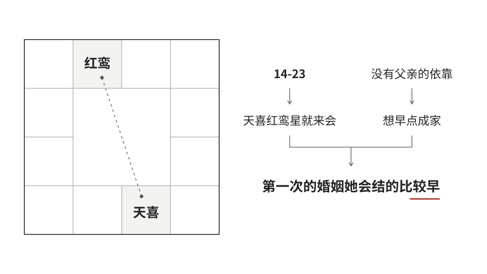 〔口述〕转述：婚姻 14-23 早年天喜红鸾星就来会，「所以第一次的婚姻她会结的比较早」；为什么——因为「没有父亲的依靠的话」，没有安全感，想「早点成家」。（[00:06:13–00:06:33](https://www.bilibili.com/video/BV1KJsLekEfA/?p=23&t=373)，第 11208–11807 帧） |
| **20岁天喜会到，这段婚姻为什么不好？** | 〔口述〕转述：倪师边数流年边讲（数字两路对不齐，略），「如果14-23中间红鸾星一定会动的话」；「20岁那年有天喜星会到」，「……因为太阳星还是不亮」。（[00:06:37–00:06:58](https://www.bilibili.com/video/BV1KJsLekEfA/?p=23&t=397)，第 11922–12557 帧） 〔指代〕说「23就在这边」时食指点在黑板右侧中间那格（可见「天同」「天钺」粉笔字）；叠图为夫妻己酉：天同平权、天钺庙、左辅陷、天哭，岁数框出 23。（[00:06:44–00:06:47](https://www.bilibili.com/video/BV1KJsLekEfA/?p=23&t=404)，第 12126–12221 帧） 〔口述〕转述：「我们要看会不会结婚了」，「一定要看隔年隔年」。她 14-23 有天喜红鸾星来会，「可是她是20岁会结婚」，在婚姻来说「并不是很好」。（[00:06:59–00:07:14](https://www.bilibili.com/video/BV1KJsLekEfA/?p=23&t=419)，第 12594–13037 帧） 〔口述〕转述：有一种状况会结婚——「必须如果父母亲在」，父母推她一把（字幕此处是一个英文词，括注「推进」），「她她会去结婚」，但「……这个婚姻一定会有问题」，「不可以」。（[00:07:14–00:07:22](https://www.bilibili.com/video/BV1KJsLekEfA/?p=23&t=434)，第 13038–13289 帧） 〔叠图〕此时叠图命宫辛亥太阳陷，叠图该格另标着「太阳不亮」。（[00:07:16–00:07:17](https://www.bilibili.com/video/BV1KJsLekEfA/?p=23&t=436)，第 13080–13121 帧） |
| **给她算婚姻的限，几岁结婚才好？** | 〔口述〕转述：「所以我们平常给她算婚姻」「算限的时候怎么算呢」——第一个是进入 34-43 以后，「34岁吉星通通来会的时候再去结婚」。（[00:07:23–00:07:31](https://www.bilibili.com/video/BV1KJsLekEfA/?p=23&t=443)，第 13290–13541 帧） 〔口述〕转述：24-33 中间在福德，「女孩子的福德代表婚姻」，「在33岁以前的时候都是是非多」，「你们看这都是是非星对不对」；巨门星（字幕作「巨内」）加重，不要结婚比较好。（[00:07:31–00:07:40](https://www.bilibili.com/video/BV1KJsLekEfA/?p=23&t=451)，第 13542–13823 帧） 〔叠图〕叠图福德癸丑，大限 24~33：天机陷科、华盖陷、官符、凤阁平、龙池平；同屏迁移乙巳巨门旺忌。（[00:07:38–00:07:40](https://www.bilibili.com/video/BV1KJsLekEfA/?p=23&t=458)，第 13764–13823 帧） 〔口述〕转述：所以她在 33 岁以后结，「34岁以后结婚的话」「她才会好哦」。（[00:07:40–00:07:45](https://www.bilibili.com/video/BV1KJsLekEfA/?p=23&t=460)，第 13824–13955 帧） |
| **客人什么时候来找？那时还改得了吗？** | 〔口述〕转述：「机会只有一次哦」，「她不会说结婚之前来找你」，很多人常常是发生问题「才来找我们的」，象已经出现了，「就是说她已经结了婚离过婚了」。（[00:07:45–00:07:57](https://www.bilibili.com/video/BV1KJsLekEfA/?p=23&t=465)，第 13956–14333 帧） 〔口述〕转述：这个时候要再帮她去改，「很难呐很难」，「因为她本来就是偏房命」。（[00:07:57–00:08:02](https://www.bilibili.com/video/BV1KJsLekEfA/?p=23&t=477)，第 14334–14477 帧） 〔口述〕对照：「如果她的命本来就是正房」，「正房离了婚以后我们再嫁」「还是会正房」。（[00:08:02–00:08:06](https://www.bilibili.com/video/BV1KJsLekEfA/?p=23&t=482)，第 14478–14603 帧） |
| **偏房命第一次婚姻为什么不成？** | 〔口述〕转述：这种属于偏房命，「偏房命的话」「第一次机会会有」「会有结婚」，「结了会离掉」。（[00:08:06–00:08:15](https://www.bilibili.com/video/BV1KJsLekEfA/?p=23&t=486)，第 14604–14879 帧） 〔口述〕转述：第一次你看她 14-23「天喜星来会」，「但是因为天喜星逢破军」，「所以这个婚姻呢不会成」，「有对象但是不成啊」。（[00:08:16–00:08:23](https://www.bilibili.com/video/BV1KJsLekEfA/?p=23&t=496)，第 14880–15113 帧） 〔口述〕转述：吉星来会，「一定要有好的星的」，「你看破军星呐」「在里面不会成了」。（[00:08:23–00:08:28](https://www.bilibili.com/video/BV1KJsLekEfA/?p=23&t=503)，第 15114–15257 帧） 〔推断〕推断：倪师说的「天喜星逢破军」，与叠图父母壬子（14~23）里天喜旺、破军庙同在一格相合；倪师本人没有指着叠图说这句。（[00:08:18–00:08:21](https://www.bilibili.com/video/BV1KJsLekEfA/?p=23&t=498)，第 14964–15053 帧） |
| **26岁为什么会结婚？27岁怎么了？** | 〔口述〕转述：所以第一次婚姻，「26岁廉贞天禄存」，「代表说各方面的机会都来」，「她26岁会结婚」，「那这个26岁结婚很很快速啊」。（[00:08:28–00:08:37](https://www.bilibili.com/video/BV1KJsLekEfA/?p=23&t=508)，第 15264–15515 帧） 〔叠图〕叠图疾厄丙午：廉贞平、天相庙、禄存庙、红鸾旺；叠图该格标着「会结婚」。（[00:08:28–00:08:29](https://www.bilibili.com/video/BV1KJsLekEfA/?p=23&t=508)，第 15264–15281 帧） 〔口述〕转述：「一结婚她如果生小孩」，「要子女子女非常的好」；但「一结婚以后哈」，「27岁就完蛋」，「她结婚才一年」「真的是一年」。（[00:08:37–00:08:45](https://www.bilibili.com/video/BV1KJsLekEfA/?p=23&t=517)，第 15516–15779 帧） 〔叠图〕叠图迁移乙巳（巨门旺忌、陀罗陷、官符）此时标着「离婚」。（[00:08:43–00:08:47](https://www.bilibili.com/video/BV1KJsLekEfA/?p=23&t=523)，第 15700–15815 帧） 〔推断〕推断：板书图里的叠图可见疾厄丙午岁数「2,14,26 38,50,62」（第 11004 帧）、迁移乙巳岁数「3,15,27 39,51,63」（第 7824 帧），26 与 27 恰落在这两格；本块末只抛出「那完蛋的原因是什么」「所以这是注定是偏房命」，原因留到下一块。（[00:08:29–00:08:49](https://www.bilibili.com/video/BV1KJsLekEfA/?p=23&t=509)，第 15282–15875 帧） |

**总结区**

- 通用规则：巨日格的人命一定主偏房，一定会进入偏房的大运（[00:04:08–00:04:25](https://www.bilibili.com/video/BV1KJsLekEfA/?p=23&t=248)，第 7464–7979 帧）；化科代表读书；女孩子的福德代表婚姻（[00:04:48–00:04:49](https://www.bilibili.com/video/BV1KJsLekEfA/?p=23&t=288)，第 8652–8681 帧、[00:07:33–00:07:34](https://www.bilibili.com/video/BV1KJsLekEfA/?p=23&t=453)，第 13608–13649 帧）；看会不会结婚，一定要看隔年（[00:06:59–00:07:04](https://www.bilibili.com/video/BV1KJsLekEfA/?p=23&t=419)，第 12594–12737 帧）；本来是正房的，离婚再嫁还是正房；偏房命第一次会结婚，结了会离掉（[00:08:02–00:08:15](https://www.bilibili.com/video/BV1KJsLekEfA/?p=23&t=482)，第 14478–14879 帧）
- 只在本例：早年丧父，14-23 破军，很早出来工作、读书不多，与母亲相依为命（[00:04:26–00:04:46](https://www.bilibili.com/video/BV1KJsLekEfA/?p=23&t=266)，第 7980–8597 帧）；24-33 化科在福德，33 岁前帮人做、领薪水；34 岁后吉星来会，自己当老板、事业很顺（[00:04:46–00:05:22](https://www.bilibili.com/video/BV1KJsLekEfA/?p=23&t=286)，第 8598–9689 帧）；子女宫七杀，一个儿子在身边（[00:05:48–00:05:54](https://www.bilibili.com/video/BV1KJsLekEfA/?p=23&t=348)，第 10464–10649 帧）；天喜逢破军，第一次婚姻不成；26 岁廉贞禄存会结婚，27 岁结婚才一年就完蛋（[00:08:16–00:08:45](https://www.bilibili.com/video/BV1KJsLekEfA/?p=23&t=496)，第 14880–15779 帧）
- 不是排盘规则，是处世方法：客人多在结婚、离婚、象已出现后才来找，机会只有一次，那时再帮她改很难（[00:07:45–00:08:00](https://www.bilibili.com/video/BV1KJsLekEfA/?p=23&t=465)，第 13956–14429 帧）

**待核**

1. [00:03:57](https://www.bilibili.com/video/BV1KJsLekEfA/?p=23&t=237)，第 7110 帧「第二个这种八字的格的」：第一个是什么在前一块，本块不补。
2. [00:04:06](https://www.bilibili.com/video/BV1KJsLekEfA/?p=23&t=246)，第 7380 帧字幕「辛旁」，按语音改为「辛劳」。
3. 第 7860、9690、13398 帧字幕「进人」，按上下文改为「进入」（引文中已用「……」略去）。
4. [00:04:44](https://www.bilibili.com/video/BV1KJsLekEfA/?p=23&t=284)，第 8532 帧字幕「相依力命」，按语音改为「相依为命」。
5. [00:04:54](https://www.bilibili.com/video/BV1KJsLekEfA/?p=23&t=294)，第 8826 帧「因为对面是化禄禄存的」：是哪一宫的对面，倪师没讲。
6. [00:05:15](https://www.bilibili.com/video/BV1KJsLekEfA/?p=23&t=315)，第 9456 帧「南北斗星君来会」：没解释是哪些星；第 9485、9635 帧两处指代都是不确定，未用。
7. [00:05:25–00:05:38](https://www.bilibili.com/video/BV1KJsLekEfA/?p=23&t=325)，第 9774–10157 帧：字幕缺语音里「没有化禄的话他会当官」半句；「在身宫」未解释；叠图官禄癸卯太阴陷未见化禄，却标着「当官」，与「你不要把她当官当成从商」的关系材料没讲清。
8. [00:05:18](https://www.bilibili.com/video/BV1KJsLekEfA/?p=23&t=318)，第 9546 帧字幕「做事业业当老板」多一个「业」。
9. [00:05:38](https://www.bilibili.com/video/BV1KJsLekEfA/?p=23&t=338)，第 10158 帧「那她连续30年」：指哪 30 年未明说。
10. [00:05:39](https://www.bilibili.com/video/BV1KJsLekEfA/?p=23&t=339)，第 10188 帧字幕「这个贪狼也是横财」，语音作「这个太阳也是很财」，两路不一致；按指代（[00:05:39](https://www.bilibili.com/video/BV1KJsLekEfA/?p=23&t=339)，第 10187 帧确定指黑板「贪狼」）取贪狼。
11. [00:05:57](https://www.bilibili.com/video/BV1KJsLekEfA/?p=23&t=357)，第 10734 帧「第一个限」前有单字「大」，「第一个限」具体指哪个大限没讲清。
12. [00:06:16](https://www.bilibili.com/video/BV1KJsLekEfA/?p=23&t=376)，第 11298 帧字幕「旱年」，按上下文改为「早年」。
13. [00:06:37–00:06:47](https://www.bilibili.com/video/BV1KJsLekEfA/?p=23&t=397)，第 11922–12221 帧倪师数「25 24 23 22岁」「25 2423 23就在这边」「20 她在她」，字幕与语音数字对不齐，未引。
14. [00:06:58](https://www.bilibili.com/video/BV1KJsLekEfA/?p=23&t=418)，第 12558 帧「中隔年的两个年的」听不清；「隔年」的看法倪师没解释。
15. 第 12492、13206 帧字幕「個是」，按语音为「但是」。
16. 婚姻几句的关系未讲清：[00:07:08](https://www.bilibili.com/video/BV1KJsLekEfA/?p=23&t=428)，第 12852 帧「可是她是20岁会结婚」、[00:08:20](https://www.bilibili.com/video/BV1KJsLekEfA/?p=23&t=500)，第 15006 帧「所以这个婚姻呢不会成」、[00:08:21](https://www.bilibili.com/video/BV1KJsLekEfA/?p=23&t=501)，第 15054 帧「有对象但是不成啊」、[00:08:33](https://www.bilibili.com/video/BV1KJsLekEfA/?p=23&t=513)，第 15390 帧「她26岁会结婚」、[00:08:42](https://www.bilibili.com/video/BV1KJsLekEfA/?p=23&t=522)，第 15666 帧「27岁就完蛋」，照原话分写，不作调和。
17. [00:07:16](https://www.bilibili.com/video/BV1KJsLekEfA/?p=23&t=436)，第 13080 帧「必须如果父母亲在」给她推进才结婚，与[00:04:26](https://www.bilibili.com/video/BV1KJsLekEfA/?p=23&t=266)，第 7980 帧「早年要丧父」如何对应，材料未讲。
18. [00:07:38](https://www.bilibili.com/video/BV1KJsLekEfA/?p=23&t=458)，第 13764 帧字幕「巨内星加重不要结婚比较好」，语音作「眉心不要结婚比较」，两路对不上；「巨内」按上下文改为「巨门」，「加重」含义待核。
19. 第 14154、14220 帧字幕「间题」，改为「问题」；「象已经出现了」的「象」倪师未解释。
20. [00:08:23–00:08:24](https://www.bilibili.com/video/BV1KJsLekEfA/?p=23&t=503)，第 15114–15149 帧两句带乱码前缀，去掉前缀后为「元吉星来会啊」「寸吉星来会園」，语音只有「来会」，原话待核。
21. [00:04:00](https://www.bilibili.com/video/BV1KJsLekEfA/?p=23&t=240)，第 7212 帧板书被老师身体挡住右半，左侧「阳」「巨」等零散字认不全；[00:06:06](https://www.bilibili.com/video/BV1KJsLekEfA/?p=23&t=366)，第 11004 帧顶部偏左刚写的字认不出，下排中格疑似「天喜」，不确定。
22. [00:07:16](https://www.bilibili.com/video/BV1KJsLekEfA/?p=23&t=436)，第 13080 帧叠图命宫辛亥同时有「太阳陷」与剪辑提示字「太阳不亮」，后者是剪辑加的字，不是星曜。

### 3　例一离婚原因、杀限眼运与交友贪狼（[00:08:49–00:13:49](https://www.bilibili.com/video/BV1KJsLekEfA/?p=23&t=529)，第 15876–24881 帧）

| 提示区 | 笔记区 |
|---|---|
| **她 27 岁离婚，原因出在哪一格？** | 〔口述〕倪师接着讲离婚的原因：「她结了婚以后」「第二年她陀罗星进来」，并说「陀罗我这里写陀罗就告诉你」。（[00:08:49–00:08:53](https://www.bilibili.com/video/BV1KJsLekEfA/?p=23&t=529)，第 15876–16019 帧） 〔指代〕说「我这里写陀罗」时手指的是左上格，指尖落在叠图右边缘；叠图这一格是迁移乙巳，显示巨门（化忌）、右弼、陀罗，64~73。（[00:08:52](https://www.bilibili.com/video/BV1KJsLekEfA/?p=23&t=532)，第 15968 帧） 〔口述〕倪师说巨门（字幕作「巨内」）代表「是非官司」，「她在27岁的时候逢到官符」，「受到别人的拖累」「受到官司是非纠纷」，「然后先生呢不谅解她」「跟她离散」。（[00:08:54–00:09:09](https://www.bilibili.com/video/BV1KJsLekEfA/?p=23&t=534)，第 16020–16481 帧） 〔叠图〕迁移乙巳：巨门旺、化忌，右弼平，陀罗陷，天厨，旬空庙，破碎陷，官符，指背，白虎，长生；岁数串含 3、15、27 与 39、51、63，另印 64~73。叠图该格先后标着「离婚」，以及「逢到官符」「受到拖累」「婚姻离散」。（[00:08:49–00:08:54](https://www.bilibili.com/video/BV1KJsLekEfA/?p=23&t=529)，第 15876–16049 帧） 〔板书〕可辨：上排中格「天相」、中间方框里「酉年」、右上「财帛」、左中格「贪狼」「54-63」「交友」，其余认不出（第 16128–16175 帧写的是哪几个字看不出）。（[00:09:00](https://www.bilibili.com/video/BV1KJsLekEfA/?p=23&t=540)，第 16212 帧） 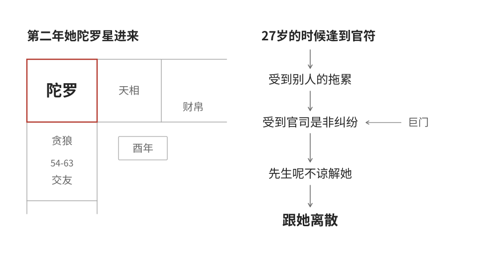 |
| **太阳落陷坐命的人是什么个性？** | 〔口述〕倪师说「像太阳星落陷坐命的这种」，「她的个性我常常形容说」「这指着晚上的月亮说这是太阳啊」「真的不理解你怎么会把月亮看成太阳」。（[00:09:11–00:09:21](https://www.bilibili.com/video/BV1KJsLekEfA/?p=23&t=551)，第 16554–16835 帧） 〔口述〕接着说她脾气「很刚强很固执」，「又带火星又很拗」。（[00:09:21–00:09:25](https://www.bilibili.com/video/BV1KJsLekEfA/?p=23&t=561)，第 16836–16961 帧） 〔叠图〕命宫辛亥：太阳陷、火星利、天魁旺、天马平、孤辰陷、蜚廉、奏书、岁驿、丧门、病；叠图该格标着「化忌对冲命」，箭头从迁移格指向命宫。（[00:08:51–00:08:53](https://www.bilibili.com/video/BV1KJsLekEfA/?p=23&t=531)，第 15954–16019 帧） |
| **先生劝她不要做，她不听，结果如何？** | 〔口述〕倪师说「她一定会离婚的原困」（原因），「诸位可以推前面」：「她先生很好」，先生叫她不要做，「她不信邪她硬要去做」「然后结结果离了散掉了」。（[00:09:25–00:09:35](https://www.bilibili.com/video/BV1KJsLekEfA/?p=23&t=565)，第 16962–17273 帧） 〔口述〕做了以后「有官司是非受人家拖累的话」，「如果她听先生的话还好」，「可是她散了还不死不承认呐」，最后反而害了自己。（[00:09:35–00:09:44](https://www.bilibili.com/video/BV1KJsLekEfA/?p=23&t=575)，第 17274–17525 帧） |
| **迷途知返要配哪个卦？** | 〔口述〕倪师说「我们要迷途知返」，「今天会介绍一个卦」，「复卦地雷复」。本块只点到卦名，没有展开讲。（[00:09:44–00:09:48](https://www.bilibili.com/video/BV1KJsLekEfA/?p=23&t=584)，第 17526–17657 帧） 〔口述〕随后一句字幕作「我要迷途不知返」，语音栏写作挂迷途不知反，意思与前句的关系本块没讲清。（[00:09:48–00:09:50](https://www.bilibili.com/video/BV1KJsLekEfA/?p=23&t=588)，第 17658–17723 帧） |
| **偏房命是怎么造成的？** | 〔口述〕倪师说「所以很多命是偏房的人」，是自己把自己害成偏房（字幕作「書成」，语音作害成）。（[00:09:50–00:09:54](https://www.bilibili.com/video/BV1KJsLekEfA/?p=23&t=590)，第 17724–17837 帧） 〔口述〕「根据我的经验」，「她的个性使然」「然后造成她自己变成偏房」；「那她又偏不要偏不要」「就偏会进去偏房」「因为偏不要就是她的个性嘛」。（[00:09:54–00:10:06](https://www.bilibili.com/video/BV1KJsLekEfA/?p=23&t=594)，第 17838–18185 帧） |
| **她来找时几岁？为什么 39 岁是杀限？** | 〔口述〕倪师说她来找时「今年38 38岁在这里」，「明年39」；「这个八字40岁之前有大限」，39 岁逢巨门化忌（字幕作「巨内」），「对面是太阳有没有」「这是太阳星落陷」「这是一个杀限」。（[00:10:13–00:10:32](https://www.bilibili.com/video/BV1KJsLekEfA/?p=23&t=613)，第 18408–18971 帧） 〔指代〕说「38岁在这里」时手指的是上排中格，指尖在粉笔字「红鸾」下方；叠图这一格是疾厄丙午，显示廉贞、天相、禄存、红鸾，38。（[00:10:19](https://www.bilibili.com/video/BV1KJsLekEfA/?p=23&t=619)，第 18579 帧） 〔指代〕说「明年39这个」时手指的是左上格右下部；叠图这一格是迁移乙巳，显示巨门忌、陀罗、39、64~73。（[00:10:21](https://www.bilibili.com/video/BV1KJsLekEfA/?p=23&t=621)，第 18653 帧） 〔口述〕倪师说「太阳星陷地」「就是代表眼睛闭起来看不到了」，「那她是在这一年的时候来找我们算的」。（[00:10:35–00:10:42](https://www.bilibili.com/video/BV1KJsLekEfA/?p=23&t=635)，第 19068–19265 帧） 〔叠图〕疾厄丙午：廉贞平、天相庙、禄存庙、红鸾旺、天德旺、咸池陷、天使平、博士、沐浴；岁数串含 38、50、62，另印 74~83。（[00:10:17–00:10:20](https://www.bilibili.com/video/BV1KJsLekEfA/?p=23&t=617)，第 18510–18623 帧） |
| **35 到 40 岁走什么运？善眼、凶眼各主什么？** | 〔口述〕倪师叫学生「把那个人相拿出来看」：「我们走眼睛的运道的时候」，「35-40岁这这六年呢」「走的是眼运」。（[00:10:49–00:11:04](https://www.bilibili.com/video/BV1KJsLekEfA/?p=23&t=649)，第 19470–19937 帧） 〔口述〕善眼一定是柔和的，「这属于善眼」；「有一种呢是兇眼」，「眼睛看起来很兇」，出来之后「好像人人都欠她 500万一样」，「很兇的眼睛主恶恶死」。（[00:11:06–00:11:34](https://www.bilibili.com/video/BV1KJsLekEfA/?p=23&t=666)，第 19986–20837 帧） 〔板书〕可辨：「眼」、「35-40」，下面两字像「眼运」（第二字也可能是「道」），其余认不出。（[00:11:26](https://www.bilibili.com/video/BV1KJsLekEfA/?p=23&t=686)，第 20591 帧） 〔板书〕可辨：方框里第一个字是「善」，上方圈里和方框里其余的字认不出。（[00:11:33](https://www.bilibili.com/video/BV1KJsLekEfA/?p=23&t=693)，第 20808 帧） |
| **眼睛有善，39 岁的灾能不能避？** | 〔口述〕倪师说「这个时候39岁要看眼睛」，「一看她眼睛很善很柔和」，「代表说她这个灾」「会因为她一念之慈退让的结果」避开。（[00:11:34–00:11:46](https://www.bilibili.com/video/BV1KJsLekEfA/?p=23&t=694)，第 20844–21203 帧） 〔口述〕倪师举假设例：不然 39 岁遇到这个，可能一场车祸都会致命；不退让「跟人家干起来结果被他杀掉」，撞车对象可能是通缉犯，你叫警察他就开枪。她肯让，「有善的话这个灾可以避」。（[00:11:46–00:12:07](https://www.bilibili.com/video/BV1KJsLekEfA/?p=23&t=706)，第 21204–21815 帧） 〔口述〕反过来，眼睛有凶，「看起来很兇光」「眼睛是闪烁」「好像要杀人一样」，「这种人恶死就死横死在非命」。（[00:12:07–00:12:18](https://www.bilibili.com/video/BV1KJsLekEfA/?p=23&t=727)，第 21816–22151 帧） 〔口述〕「我一看她眼睛里没有兇」，就知道这个人「很可能是这个官司是非而已」。（[00:12:18–00:12:26](https://www.bilibili.com/video/BV1KJsLekEfA/?p=23&t=738)，第 22152–22385 帧） 〔叠图〕迁移乙巳格这时标着「巨门官司是非」。（[00:12:21–00:12:24](https://www.bilibili.com/video/BV1KJsLekEfA/?p=23&t=741)，第 22248–22343 帧） |
| **住西南角，怎样改了她的个性？** | 〔口述〕「那再看她的阳宅」，「她刚好住西南角」；倪师说她今天眼睛会变成这样，也是因为阳宅把她养成坤为地（字幕作「坤力地」「坤沩地」），「至柔至阴的一个德性」「地的厚德」「所以才把她的个性改变掉」。（[00:12:26–00:12:41](https://www.bilibili.com/video/BV1KJsLekEfA/?p=23&t=746)，第 22386–22835 帧） 〔口述〕「否则她这种个性啊」，你若娶到这样的太太或生个这样的女儿，「你就准备抄家」，不把家拆了、不把做爸爸的气死就很难。（[00:12:41–00:12:56](https://www.bilibili.com/video/BV1KJsLekEfA/?p=23&t=761)，第 22836–23291 帧） 〔口述〕「所以地厚地的厚德帮她改变」，「我一看她住西南角」心里就安了；再一看她眼睛「没有没有那种兇光」，「就知道不会有事情的」。（[00:12:56–00:13:06](https://www.bilibili.com/video/BV1KJsLekEfA/?p=23&t=776)，第 23292–23609 帧） |
| **眼睛该长什么样？事情没发生怎么办？** | 〔口述〕倪师说「眼睛呢要柔」，「要有威不要有兇」，「那个兇不好」。（[00:13:07–00:13:12](https://www.bilibili.com/video/BV1KJsLekEfA/?p=23&t=787)，第 23610–23789 帧） 〔口述〕「所以这是我跟诸位提出来」，「这个事情还没有发生」，「我们静观其变」。（[00:13:13–00:13:21](https://www.bilibili.com/video/BV1KJsLekEfA/?p=23&t=793)，第 23790–24053 帧） |
| **交友宫贪狼为什么也是偏房的迹象？** | 〔口述〕倪师说「还有一个偏房的地方可以看到」：「这个朋友宫贪狼星」，「这贪狼是桃花星落在朋友宫」，「所以这个人有两种解释」。（[00:13:21–00:13:31](https://www.bilibili.com/video/BV1KJsLekEfA/?p=23&t=801)，第 24054–24353 帧） 〔指代〕说「这个朋友宫贪狼星」时手指的是黑板左侧中格「贪狼／54-63」处，该格写着交友；叠图同格为贪狼庙、54~63、交友甲辰。（[00:13:26](https://www.bilibili.com/video/BV1KJsLekEfA/?p=23&t=806)，第 24206 帧） 〔叠图〕交友甲辰：贪狼庙、恩光庙、天伤平、阴煞、天煞、龙德、伏兵、养；印 54~63。（[00:13:25–00:13:27](https://www.bilibili.com/video/BV1KJsLekEfA/?p=23&t=805)，第 24150–24239 帧） 〔口述〕「第一个她跟人家合伙做生意的时候」合伙的朋友很多，「那合伙的男性居多」；然后跟人家同居，「所以她的合伙人就是她的同居人」，也就是「没有名分的先生」。（[00:13:31–00:13:49](https://www.bilibili.com/video/BV1KJsLekEfA/?p=23&t=811)，第 24354–24881 帧） |

**总结区**

- 通用规则：太阳星落陷坐命的人，像把月亮看成太阳，脾气刚强固执（[00:09:11–00:09:25](https://www.bilibili.com/video/BV1KJsLekEfA/?p=23&t=551)，第 16554–16961 帧）；太阳星陷地，代表眼睛闭起来看不到了（[00:10:35–00:10:39](https://www.bilibili.com/video/BV1KJsLekEfA/?p=23&t=635)，第 19068–19175 帧）；35 到 40 岁这六年走眼运：善眼柔和，凶眼主恶死、横死在非命（[00:10:49–00:12:18](https://www.bilibili.com/video/BV1KJsLekEfA/?p=23&t=649)，第 19470–22151 帧）；眼睛要柔，要有威不要有凶（[00:13:07–00:13:12](https://www.bilibili.com/video/BV1KJsLekEfA/?p=23&t=787)，第 23610–23789 帧）
- 只在本例：27 岁迁移巨门化忌、陀罗、逢官符，受拖累、官司是非，先生不谅解而离散（[00:08:49–00:09:09](https://www.bilibili.com/video/BV1KJsLekEfA/?p=23&t=529)，第 15876–16481 帧）；来找时 38 岁，明年 39 逢巨门化忌、对面太阳落陷，是杀限（[00:10:13–00:10:32](https://www.bilibili.com/video/BV1KJsLekEfA/?p=23&t=613)，第 18408–18971 帧）；住西南角，坤为地的厚德改了她的个性，眼无凶光，判断只是官司是非、不会有事（[00:12:18–00:13:06](https://www.bilibili.com/video/BV1KJsLekEfA/?p=23&t=738)，第 22152–23609 帧）；交友宫贪狼桃花，合伙人就是同居人，没有名分的先生（[00:13:21–00:13:49](https://www.bilibili.com/video/BV1KJsLekEfA/?p=23&t=801)，第 24054–24881 帧）
- 不是排盘规则，是处世方法：要迷途知返，配复卦地雷复（[00:09:44–00:09:48](https://www.bilibili.com/video/BV1KJsLekEfA/?p=23&t=584)，第 17526–17657 帧）；很多偏房是个性使然、自己把自己害成偏房（[00:09:50–00:10:06](https://www.bilibili.com/video/BV1KJsLekEfA/?p=23&t=590)，第 17724–18185 帧）；眼善、一念之慈肯退让，灾可以避开（[00:11:34–00:12:07](https://www.bilibili.com/video/BV1KJsLekEfA/?p=23&t=694)，第 20844–21815 帧）；事情还没发生，静观其变（[00:13:13–00:13:21](https://www.bilibili.com/video/BV1KJsLekEfA/?p=23&t=793)，第 23790–24053 帧）

**待核**

1. [00:08:54](https://www.bilibili.com/video/BV1KJsLekEfA/?p=23&t=534)，第 16020 帧字幕「这个巨中化息」、[00:08:55](https://www.bilibili.com/video/BV1KJsLekEfA/?p=23&t=535)，第 16050 帧与[00:10:26](https://www.bilibili.com/video/BV1KJsLekEfA/?p=23&t=626)，第 18792 帧「巨内」，按语音与上下文改为「巨门化忌」「巨门」。
2. [00:09:25](https://www.bilibili.com/video/BV1KJsLekEfA/?p=23&t=565)，第 16962 帧与[00:11:54](https://www.bilibili.com/video/BV1KJsLekEfA/?p=23&t=714)，第 21426 帧字幕「原困」改为「原因」。
3. [00:09:29](https://www.bilibili.com/video/BV1KJsLekEfA/?p=23&t=569)，第 17076 帧字幕「叫她不要相信」，语音作「叫他不要想你」，两路对不上，先生叫她不要做什么没写进笔记。
4. [00:09:42](https://www.bilibili.com/video/BV1KJsLekEfA/?p=23&t=582)，第 17460 帧字幕「搞到最后告到自己」，语音作「结果害到自己」，笔记按语音转述为害了自己。
5. [00:09:48](https://www.bilibili.com/video/BV1KJsLekEfA/?p=23&t=588)，第 17658 帧「我要迷途不知返」与前句「要迷途知返」意思相反，是否口误或另有所指，待核。
6. [00:09:52](https://www.bilibili.com/video/BV1KJsLekEfA/?p=23&t=592)，第 17778 帧字幕「書成偏房」，语音作「害成」，按上下文改为「害成」。
7. [00:10:06](https://www.bilibili.com/video/BV1KJsLekEfA/?p=23&t=606)，第 18186 帧「这第一次红鸾星」只有半句，下文转去讲来找时的年龄，这句未写进笔记。
8. [00:10:26](https://www.bilibili.com/video/BV1KJsLekEfA/?p=23&t=626)，第 18792 帧倪师说「大限就39岁」，叠图迁移格 39 在岁数串（39、51、63）里，另印 64~73；口述「大限」与叠图数字的对应关系本块没讲清。
9. [00:10:32](https://www.bilibili.com/video/BV1KJsLekEfA/?p=23&t=632)，第 18972 帧语音多出「在寿命上面来说的话」，字幕只有「在限上面来说的话」，两路不一致。
10. [00:11:11](https://www.bilibili.com/video/BV1KJsLekEfA/?p=23&t=671)，第 20142 帧字幕「善眼呢一定是主要柔和」，语音无「主要」，笔记只转述为柔和。
11. [00:11:34](https://www.bilibili.com/video/BV1KJsLekEfA/?p=23&t=694)，第 20838 帧「古明天的」两路对不上，略过。
12. [00:11:42](https://www.bilibili.com/video/BV1KJsLekEfA/?p=23&t=702)，第 21072 帧字幕「一念之慈」，语音作「一面之词」，按上下文取「一念之慈」，待核。
13. [00:12:04](https://www.bilibili.com/video/BV1KJsLekEfA/?p=23&t=724)，第 21732 帧字幕「眼腈」改为「眼睛」。
14. [00:12:27](https://www.bilibili.com/video/BV1KJsLekEfA/?p=23&t=747)，第 22422 帧「她刚好住西南角反过来」中「反过来」所指不明。
15. [00:12:31–00:12:36](https://www.bilibili.com/video/BV1KJsLekEfA/?p=23&t=751)，第 22542–22691 帧字幕「坤力地」「坤沩地是世阆呢」，语音作「坤为帝」「世间」，按上下文改为「坤为地」，「沩」改「为」；「世阆」原意待核。
16. [00:12:58–00:13:00](https://www.bilibili.com/video/BV1KJsLekEfA/?p=23&t=778)，第 23358–23423 帧字幕「我一看她住西南角」「我心里就安掉啊」，语音作「出心来」「要暗掉了」，两路对不上，笔记转述为心里就安了。
17. [00:13:00](https://www.bilibili.com/video/BV1KJsLekEfA/?p=23&t=780)，第 23424 帧字幕「再一看她眼睛没有善」，语音作「没有散」，下一句是「没有没有那种兇光」，按上下文应是眼睛没有凶光，未引原句。
18. [00:13:30](https://www.bilibili.com/video/BV1KJsLekEfA/?p=23&t=810)，第 24318 帧倪师说「有两种解释」，本块只听到「第一个」合伙，随即合并为合伙人就是同居人，第二种解释是否单独讲过待核。
19. 板书：[00:09:00](https://www.bilibili.com/video/BV1KJsLekEfA/?p=23&t=540)，第 16212 帧这次写的是哪几个字看不出；[00:11:26](https://www.bilibili.com/video/BV1KJsLekEfA/?p=23&t=686)，第 20591 帧「眼运」第二字也像「道」；[00:11:33](https://www.bilibili.com/video/BV1KJsLekEfA/?p=23&t=693)，第 20808 帧圈内和方框里除「善」外认不出。
20. 指代：第 16527、17316、22217、23240、24095、24310 帧标注为不确定，未当依据。
21. 叠图：命宫辛亥格「天福庙」在[00:08:54](https://www.bilibili.com/video/BV1KJsLekEfA/?p=23&t=534)，第 16020 帧作「天□庙」、[00:10:23](https://www.bilibili.com/video/BV1KJsLekEfA/?p=23&t=623)，第 18714 帧作「天畐庙」，转写不一致，笔记未写此星。

## 例二（命宫戊申巨门太阳）：六亲不靠、兄弟夭折相、先母后父

| 巳 | 午 | 未 | 申 |
|---|---|---|---|
| （巳：没贴过） | **夫妻 丙午** 天同陷 太阴不 文昌陷 火星庙 | **兄弟 丁未** 武曲庙忌 贪狼庙 地空平 | **命宫 戊申** 太阳得 巨门庙 文曲得 |
| **财帛 甲辰**（身宫） （无主星、辅星） | **例二 · 命宫戊申** | 据视频叠图重排 | **父母 己酉** 天相陷 |
| **疾厄 癸卯** 廉贞平 破军陷 天魁庙 地劫平 | 后期贴图，不算倪师的话 |  | （戌：没贴过） |
| **迁移 壬寅** 左辅庙科 天马旺 铃星庙 | （丑：没贴过） | **官禄 壬子** 右弼庙 擎羊陷 | （亥：没贴过） |

按视频里这张盘逐格重画（我们自己画的图，不是视频截图）；同一个人的 2 段合成一张；数据见 [命盘-P23-例二.json](图/命盘-P23-例二.json)。

### 4　例二女命：六亲不靠、眉相与先母后父（[00:13:49–00:18:54](https://www.bilibili.com/video/BV1KJsLekEfA/?p=23&t=829)，第 24882–34043 帧）

| 提示区 | 笔记区 |
|---|---|
| **批八字时为什么先把科权禄忌圈起来？** | 〔口述〕倪师让大家看这一格，说批八字时要先把四化圈出来：「我们批八字的时候……科权禄忌……所以我们要把她的这个……这个科权禄忌呢……给她圈起来」。（[00:13:53–00:14:05](https://www.bilibili.com/video/BV1KJsLekEfA/?p=23&t=833)，第 25014–25379 帧） 〔口述〕圈完后指着盘说「少一个化禄在这边」；材料没说是哪张盘、哪一格。（[00:14:06–00:14:11](https://www.bilibili.com/video/BV1KJsLekEfA/?p=23&t=846)，第 25380–25535 帧） 〔板书〕这时的板面模糊，可辨：「15-24」，另有几处红圈，其余认不出。（[00:14:01](https://www.bilibili.com/video/BV1KJsLekEfA/?p=23&t=841)，第 25232 帧） 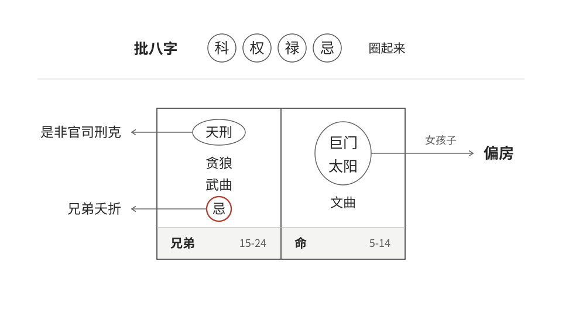 〔推断〕推断：这几句时叠图还没换成新盘，按画面切换和下一句「像这个命的人」归到例二；但圈的是哪几格、「这边」是哪宫，材料没明说，不配宫位。（[00:13:49–00:14:12](https://www.bilibili.com/video/BV1KJsLekEfA/?p=23&t=829)，第 24882–25589 帧） |
| **为什么说这个命六亲不靠？** | 〔口述〕「像这个命的人」「诸位看看六亲」「看兄弟和父母」，指出「兄弟宫化忌父母宫是吉星落陷」，又说「对面是廉贞破军有没有」。（[00:14:13–00:14:22](https://www.bilibili.com/video/BV1KJsLekEfA/?p=23&t=853)，第 25590–25865 帧） 〔叠图〕兄弟丁未：武曲庙且化忌、贪狼庙、地空平、天刑陷、副旬陷；父母己酉：天相陷、咸池平、天厨。（[00:14:18–00:14:20](https://www.bilibili.com/video/BV1KJsLekEfA/?p=23&t=858)，第 25746–25811 帧） 〔叠图〕疾厄癸卯：廉贞平、破军陷、天魁庙、地劫平、三台陷、天使平。（[00:14:20–00:14:22](https://www.bilibili.com/video/BV1KJsLekEfA/?p=23&t=860)，第 25812–25865 帧） 〔口述〕「这种八字就叫做六亲不靠」：有的人兄弟很强、有的人父母很旺，她却「靠不了六亲」，「这个灾星都在六来旁边」（六来即六亲），「所以她要辛苦要独立成家」。（[00:14:22–00:14:36](https://www.bilibili.com/video/BV1KJsLekEfA/?p=23&t=862)，第 25866–26285 帧） 〔推断〕推断：说「对面是廉贞破军」时叠图正贴出疾厄癸卯的廉贞、破军，后面（第 31062–31277 帧）倪师又说父母宫「是廉破」，故「对面」应指父母宫的对面；此处倪师没明说。（[00:14:20–00:17:22](https://www.bilibili.com/video/BV1KJsLekEfA/?p=23&t=860)，第 25812–31277 帧） |
| **巨门太阳的女命，倪师怎么批？** | 〔叠图〕命宫戊申：太阳得、巨门庙、文曲得、天寿旺、天贵陷、龙池平、长生，大限 5~14；叠图该格标着「女命偏房」（板书图第 26640 帧上该提示框写作「巨门太阳 女命偏房」）。（[00:14:36–00:14:37](https://www.bilibili.com/video/BV1KJsLekEfA/?p=23&t=876)，第 26286–26321 帧） 〔口述〕「那这种命的女孩子呢」「也是巨内太阳看到没有」（字幕「巨内」即巨门，语音作巨门）。（[00:14:36–00:14:39](https://www.bilibili.com/video/BV1KJsLekEfA/?p=23&t=876)，第 26286–26387 帧） 〔口述〕当规则讲：「诸位呢只要看到这种……就可以把她批沩偏房了」（字幕「沩」即为）。（[00:14:42–00:14:46](https://www.bilibili.com/video/BV1KJsLekEfA/?p=23&t=882)，第 26472–26585 帧） 〔口述〕自问自答：「你说老师怎么老是喜欢主主偏房」，「那正房都不用批了嘛」；语音这句还多半句，作很好的不用批了。（[00:14:46–00:14:51](https://www.bilibili.com/video/BV1KJsLekEfA/?p=23&t=886)，第 26586–26759 帧） 〔板书〕可辨：「5-14」、红圈「命」、「天相」「父母」、「15-2…」「兄弟」；右侧有两个淡红粉笔字，像「偏房」，笔画太淡认不准，其余认不出。（[00:14:48](https://www.bilibili.com/video/BV1KJsLekEfA/?p=23&t=888)，第 26640 帧） |
| **命里只有一个化科进来，适合做什么？** | 〔口述〕「那告诉诸位这个重点是第一个」：「命里面她什么都没有」「三方四正只有一个化科进来」「是不是有化科」。（[00:14:52–00:15:00](https://www.bilibili.com/video/BV1KJsLekEfA/?p=23&t=892)，第 26760–27023 帧） 〔叠图〕迁移壬寅：左辅庙且化科、天马旺、铃星庙、天哭平、截空陷。（[00:14:58–00:14:59](https://www.bilibili.com/video/BV1KJsLekEfA/?p=23&t=898)，第 26952–26993 帧） 〔推断〕推断：讲「只有一个化科进来」时叠图贴出迁移壬寅的左辅化科，所说的化科可能就是这颗；倪师没指名，指代题第 27400 帧也不确定。（[00:14:56–00:15:13](https://www.bilibili.com/video/BV1KJsLekEfA/?p=23&t=896)，第 26904–27407 帧） 〔口述〕「像这种人」「她有几种自由业」：「所以医师律师会计师工程师建筑师」「还有呢老师」「老师也是化科」；「所以这个一定是有专业技术专长」「才艺出众的一种人」。（[00:15:03–00:15:23](https://www.bilibili.com/video/BV1KJsLekEfA/?p=23&t=903)，第 27114–27719 帧） |
| **兄弟宫化忌又入天刑，代表什么？** | 〔口述〕「那像这种兄弟官有化忌的话」（官即宫）「入驻天刑」，「天刑呢代表是非官司刑克」「有两个解释」。（[00:15:24–00:15:33](https://www.bilibili.com/video/BV1KJsLekEfA/?p=23&t=924)，第 27720–28007 帧） 〔指代〕说「我这里还有个特别的东西天刑」时，手持粉笔在板顶写／点「天刑」，位置在写有「15-24 兄弟」那一格的顶部。（[00:15:27–00:15:29](https://www.bilibili.com/video/BV1KJsLekEfA/?p=23&t=927)，第 27810–27881 帧） 〔叠图〕再贴兄弟丁未：武曲庙化忌、贪狼庙、地空平、天刑陷，武曲贪狼与天刑各加了框。（[00:15:24–00:15:26](https://www.bilibili.com/video/BV1KJsLekEfA/?p=23&t=924)，第 27720–27785 帧） 〔口述〕第一个解释：「第一个兄弟宫化忌就代表天折」「兄弟天折哎兄弟天折」（天折即夭折，语音作夭折）。（[00:15:33–00:15:38](https://www.bilibili.com/video/BV1KJsLekEfA/?p=23&t=933)，第 28008–28145 帧） 〔板书〕可辨：兄弟格「贪狼」「武曲」、红圈「忌」、「15-24」「兄弟」，格顶圆框「天刑」；中格红圈「巨门」「太阳」，下有「文曲」「5-14」、红圈「命」；「15-24」旁新写的字认不出。（[00:15:39](https://www.bilibili.com/video/BV1KJsLekEfA/?p=23&t=939)，第 28195 帧） |
| **左眉、右眉各代表六亲里的谁？** | 〔口述〕「我们从眉毛里面可以看出来」：「左边的眉毛」「代表兄弟」，「右边的眉毛呢」「代表姐妹」。（[00:15:38–00:15:52](https://www.bilibili.com/video/BV1KJsLekEfA/?p=23&t=938)，第 28146–28583 帧） 〔板书〕右列可辨「兄弟」「左眉」；命格「5-14」旁可辨「姊妹」两字。（[00:15:52](https://www.bilibili.com/video/BV1KJsLekEfA/?p=23&t=952)，第 28562 帧） 〔口述〕后面又重说一遍：「反之到姐妹这边来」「就变成姐妹」，右眉代表姐妹（字幕作「有眉」，语音作右眉），「左眉代表兄弟」。（[00:17:00–00:17:06](https://www.bilibili.com/video/BV1KJsLekEfA/?p=23&t=1020)，第 30612–30797 帧） |
| **眉中有痣叫什么？对兄弟主什么？** | 〔口述〕「眉毛中间有痣」「在相上面叫做草里藏珠」，并反复念「草里藏珠」。（[00:15:52–00:16:07](https://www.bilibili.com/video/BV1KJsLekEfA/?p=23&t=952)，第 28584–29021 帧） 〔板书〕右列竖写可辨「草」「藏」「珠」，第二字写法像繁体「裡」，合起来是「草里藏珠」。（[00:16:06](https://www.bilibili.com/video/BV1KJsLekEfA/?p=23&t=966)，第 29004 帧） 〔口述〕「草里藏珠是弟大贵贵格」，语音作兄弟大贵贵格，即主兄弟大贵。（[00:16:17–00:16:21](https://www.bilibili.com/video/BV1KJsLekEfA/?p=23&t=977)，第 29328–29459 帧） |
| **痣露在眉外、断眉，兄弟会怎样？** | 〔口述〕「有一种呢」「有珠子啊」「结果痣漏到外面」「看的很清楚」，「这个珠子不再藏在草里面」「不在眉里面了」，「这是主兄弟天折」（天折即夭折）。（[00:16:22–00:16:31](https://www.bilibili.com/video/BV1KJsLekEfA/?p=23&t=982)，第 29460–29735 帧） 〔口述〕「还有呢眉毛断住断掉了」「比如说眉毛这样长长」「哎长那边断掉了」「有没有断眉」，「这兄弟有夭折」。（[00:16:31–00:16:42](https://www.bilibili.com/video/BV1KJsLekEfA/?p=23&t=991)，第 29736–30083 帧） 〔板书〕右列下方可辨竖写「断眉」。（[00:16:52](https://www.bilibili.com/video/BV1KJsLekEfA/?p=23&t=1012)，第 30368 帧） |
| **乱眉对兄弟主什么？** | 〔口述〕「那个乱眉」「眉毛呢长得乱七八糟」「长得长得像这样扭来扭去的」「长得那样弟有刑克」「有牢狱之灾」。（[00:16:42–00:16:53](https://www.bilibili.com/video/BV1KJsLekEfA/?p=23&t=1002)，第 30084–30395 帧） 〔口述〕「她她兄弟很担心烦恼」「他一天到晚打官司」「坐牢怎么办」「那那就会有这种现象出现」。（[00:16:54–00:17:00](https://www.bilibili.com/video/BV1KJsLekEfA/?p=23&t=1014)，第 30438–30611 帧） 〔板书〕可辨：右列「兄弟」「左眉」，下方竖写「乱眉」「断眉」「草裡藏」；「左眉」下有一团涂画，认不出。（[00:16:52](https://www.bilibili.com/video/BV1KJsLekEfA/?p=23&t=1012)，第 30368 帧） 〔推断〕推断：前面说天刑「代表是非官司刑克」「有两个解释」只讲了第一个（夭折），这里乱眉讲刑克、官司、坐牢，可能对应第二个解释；倪师没明说。（[00:15:29–00:17:00](https://www.bilibili.com/video/BV1KJsLekEfA/?p=23&t=929)，第 27882–30611 帧） |
| **父母宫逢廉破、命跟太阳近，说明什么？** | 〔口述〕「像这个这个爪字哦」（语音作这个八字），「父母宫……是廉破也代表父母亲要离散」。（[00:17:15–00:17:22](https://www.bilibili.com/video/BV1KJsLekEfA/?p=23&t=1035)，第 31062–31277 帧） 〔叠图〕再贴父母己酉（天相陷）与疾厄癸卯（廉贞平、破军陷）。（[00:17:18–00:17:22](https://www.bilibili.com/video/BV1KJsLekEfA/?p=23&t=1038)，第 31164–31277 帧） 〔叠图〕再贴命宫戊申（太阳得、巨门庙）。（[00:17:24](https://www.bilibili.com/video/BV1KJsLekEfA/?p=23&t=1044)，第 31320–31337 帧） 〔口述〕「诸位看命是太阳」「看见呀这个女孩子跟太阳」，「她的命跟太阳走得近」，「第一个脸孔会比较像爸爸」。（[00:17:22–00:17:30](https://www.bilibili.com/video/BV1KJsLekEfA/?p=23&t=1042)，第 31278–31505 帧） |
| **为什么断她先母后父？** | 〔口述〕「第二个呢」「跟太阴星走的比较远」（语音作太阳星）「中午出月亮」，「所以会先不见妈妈」「再不见爸爸」「一定是先母后父」。（[00:17:30–00:17:37](https://www.bilibili.com/video/BV1KJsLekEfA/?p=23&t=1050)，第 31506–31733 帧） 〔叠图〕夫妻丙午：太阴不、天同陷、文昌陷、火星庙、天福平。（[00:17:32–00:17:35](https://www.bilibili.com/video/BV1KJsLekEfA/?p=23&t=1052)，第 31584–31661 帧） 〔推断〕推断：说「中午出月亮」时叠图贴出丙午格里的太阴（不），「中午」可能就指这一午格；倪师没明说。（[00:17:32–00:17:35](https://www.bilibili.com/video/BV1KJsLekEfA/?p=23&t=1052)，第 31566–31661 帧） 〔口述〕「来跟着父亲来的」，并和前一个命例对比：「像刚刚那个是跟着母亲这个跟着父案」（父案即父亲，语音作「父亲」）。（[00:17:37–00:17:41](https://www.bilibili.com/video/BV1KJsLekEfA/?p=23&t=1057)，第 31734–31841 帧） |
| **官禄宫进擎羊，工作上宜走哪条路？** | 〔口述〕「那像这个官禄宫」「是个擎羊星灾星进来」，「所以这个人从公务人员不会」「但从教职很妤教」（妤即好）「就是教学教职」。（[00:17:50–00:17:59](https://www.bilibili.com/video/BV1KJsLekEfA/?p=23&t=1070)，第 32112–32399 帧） 〔推断〕推断：倪师把擎羊称作「灾星」，与前面「这个灾星都在六来旁边」同一用词；本块没有贴官禄宫叠图，擎羊在哪一格只凭口述。（[00:14:31–00:17:53](https://www.bilibili.com/video/BV1KJsLekEfA/?p=23&t=871)，第 26136–32213 帧） |
| **流年不好时，倪师说的天道是什么？** | 〔口述〕「我们研究命的时候特别要注意」「有个天道就是说」（语音作迁道）「遇到流年不好的时候」「如果你在当官或者在做事情」「遇到流年不好怎么办」「没有关系」「读书最好」。（[00:18:01–00:18:13](https://www.bilibili.com/video/BV1KJsLekEfA/?p=23&t=1081)，第 32436–32801 帧） 〔口述〕「君子进德修业」，「所以你以为读书没有进步」「你错了」「读书才才是后来的真正的进步」。（[00:18:36–00:18:44](https://www.bilibili.com/video/BV1KJsLekEfA/?p=23&t=1116)，第 33486–33737 帧） |
| **李叉叉的例子说明哪两个优点？** | 〔口述〕「我们李叉叉就是在42岁」「发现当官官运不好了嘛」，就去读书，「就读到47 才拿到博士啊」「今天才会干总统哦」。（[00:18:13–00:18:23](https://www.bilibili.com/video/BV1KJsLekEfA/?p=23&t=1093)，第 32802–33113 帧） 〔口述〕「所以他有两个大优点」：「第一个始终如一」，从「小公务员」一路干上来，「他从来没有换过」「所以今天会干到总统」。（[00:18:23–00:18:31](https://www.bilibili.com/video/BV1KJsLekEfA/?p=23&t=1103)，第 33114–33341 帧） 〔口述〕「哎第二个优点他想通了」「流年不好我去读书」；「他当年没有那个动作」「今天不要干总统了」。（[00:18:33–00:18:46](https://www.bilibili.com/video/BV1KJsLekEfA/?p=23&t=1113)，第 33390–33803 帧） 〔口述〕收尾一句：「不然你名字取得再好也没有用啊」。（[00:18:50–00:18:54](https://www.bilibili.com/video/BV1KJsLekEfA/?p=23&t=1130)，第 33906–34043 帧） |

**总结区**

- 通用规则：只要看到巨门太阳这种命的女孩子，就可以批为偏房（[00:14:36–00:14:46](https://www.bilibili.com/video/BV1KJsLekEfA/?p=23&t=876)，第 26286–26585 帧）；命里什么都没有、三方四正只有一个化科进来的人，多做医师律师会计师工程师建筑师老师这类有专业技术专长的自由业（[00:14:52–00:15:23](https://www.bilibili.com/video/BV1KJsLekEfA/?p=23&t=892)，第 26760–27719 帧）；兄弟宫化忌代表兄弟夭折；天刑代表是非官司刑克（[00:15:24–00:15:38](https://www.bilibili.com/video/BV1KJsLekEfA/?p=23&t=924)，第 27720–28145 帧）；左眉代表兄弟、右眉代表姐妹；眉中有痣叫草里藏珠，主兄弟大贵；痣露在外或断眉主兄弟夭折；乱眉主兄弟刑克、牢狱之灾（[00:15:38–00:17:06](https://www.bilibili.com/video/BV1KJsLekEfA/?p=23&t=938)，第 28146–30797 帧）
- 只在本例：兄弟宫化忌、父母宫吉星落陷、对面廉贞破军，这个八字六亲不靠，要辛苦独立成家（[00:14:13–00:14:36](https://www.bilibili.com/video/BV1KJsLekEfA/?p=23&t=853)，第 25590–26285 帧）；命跟太阳走得近、跟太阴远，脸像爸爸，先不见妈妈再不见爸爸，先母后父、跟着父亲（[00:17:22–00:17:41](https://www.bilibili.com/video/BV1KJsLekEfA/?p=23&t=1042)，第 31278–31841 帧）；官禄宫有擎羊灾星进来，不宜公务人员，适合教学教职（[00:17:50–00:17:59](https://www.bilibili.com/video/BV1KJsLekEfA/?p=23&t=1070)，第 32112–32399 帧）
- 不是排盘规则，是处世方法：遇到流年不好，不论当官或做事，读书最好，君子进德修业，读书才是后来真正的进步（[00:18:01–00:18:44](https://www.bilibili.com/video/BV1KJsLekEfA/?p=23&t=1081)，第 32436–33737 帧）；李叉叉的两个优点：始终如一不换工作，流年不好就去读书；不然名字取得再好也没有用（[00:18:13–00:18:54](https://www.bilibili.com/video/BV1KJsLekEfA/?p=23&t=1093)，第 32802–34043 帧）

**待核**

1. [00:13:49–00:14:12](https://www.bilibili.com/video/BV1KJsLekEfA/?p=23&t=829)，第 24882–25589 帧圈科权禄忌那 8 句叠图还没换盘，圈的是哪张盘、哪几格材料没明说；「少一个化禄在这边」的「这边」指代题两处都是不确定（[00:14:07](https://www.bilibili.com/video/BV1KJsLekEfA/?p=23&t=847)，第 25413 帧）
2. 板书图[00:13:52](https://www.bilibili.com/video/BV1KJsLekEfA/?p=23&t=832)，第 24972 帧讲者挡住大半、板面模糊，认不出字；[00:14:01](https://www.bilibili.com/video/BV1KJsLekEfA/?p=23&t=841)，第 25232 帧只认得「15-24」（[00:13:52](https://www.bilibili.com/video/BV1KJsLekEfA/?p=23&t=832)，第 24972 帧）
3. 板书图[00:14:48](https://www.bilibili.com/video/BV1KJsLekEfA/?p=23&t=888)，第 26640 帧右侧两个淡红粉笔字像「偏房」，笔画太淡认不准（[00:14:48](https://www.bilibili.com/video/BV1KJsLekEfA/?p=23&t=888)，第 26640 帧）
4. 板书图[00:15:39](https://www.bilibili.com/video/BV1KJsLekEfA/?p=23&t=939)，第 28195 帧兄弟格「15-24」旁新写的字认不出（[00:15:39](https://www.bilibili.com/video/BV1KJsLekEfA/?p=23&t=939)，第 28195 帧）
5. 板书图[00:16:27](https://www.bilibili.com/video/BV1KJsLekEfA/?p=23&t=987)，第 29616 帧讲者挡住，新写的字认不出（[00:16:27](https://www.bilibili.com/video/BV1KJsLekEfA/?p=23&t=987)，第 29616 帧）
6. 板书图[00:16:52](https://www.bilibili.com/video/BV1KJsLekEfA/?p=23&t=1012)，第 30368 帧「左眉」下一团涂画认不出，可能是画的眉形，不猜（[00:16:52](https://www.bilibili.com/video/BV1KJsLekEfA/?p=23&t=1012)，第 30368 帧）
7. 错字改正：「巨内」改为巨门（[00:14:37](https://www.bilibili.com/video/BV1KJsLekEfA/?p=23&t=877)，第 26322 帧）
8. 错字改正：「沩」改为为（[00:14:43](https://www.bilibili.com/video/BV1KJsLekEfA/?p=23&t=883)，第 26514 帧）
9. 错字改正：「六来」改为六亲（第 25950、26136 帧）
10. 错字改正：「兄弟官」改为兄弟宫（[00:15:24](https://www.bilibili.com/video/BV1KJsLekEfA/?p=23&t=924)，第 27720 帧）
11. 错字改正：「天折」改为夭折（第 28008、28086、29688 帧）
12. 错字改正：「爪字」按语音改为八字（[00:17:15](https://www.bilibili.com/video/BV1KJsLekEfA/?p=23&t=1035)，第 31062 帧）
13. 错字改正：「父案」改为父亲（[00:17:39](https://www.bilibili.com/video/BV1KJsLekEfA/?p=23&t=1059)，第 31776 帧）
14. 错字改正：「很妤教」的「妤」改为好（[00:17:55](https://www.bilibili.com/video/BV1KJsLekEfA/?p=23&t=1075)，第 32274 帧）
15. 「也是巨门太阳看到没有」的「也是」与哪一例相比，本块没说（[00:14:37](https://www.bilibili.com/video/BV1KJsLekEfA/?p=23&t=877)，第 26322 帧）
16. 「有两个解释」只明讲了第一个（兄弟夭折），第二个是什么没明说（[00:15:33](https://www.bilibili.com/video/BV1KJsLekEfA/?p=23&t=933)，第 27990 帧）
17. 「那佛家那个他们修道的」「叫这个这个是紫竹林啊」字幕与语音对不上（语音作「这个是子你看超里长」），佛家、紫竹林与草里藏珠的关系待核（[00:16:09–00:16:16](https://www.bilibili.com/video/BV1KJsLekEfA/?p=23&t=969)，第 29070–29285 帧）
18. 「草里藏珠是弟大贵贵格」字幕缺「兄」字，语音作「兄弟大贵贵格」（[00:16:17](https://www.bilibili.com/video/BV1KJsLekEfA/?p=23&t=977)，第 29328 帧）
19. 「结果痣漏到外面」的「漏」疑为「露」，字幕前还有残字「（ -」（[00:16:24](https://www.bilibili.com/video/BV1KJsLekEfA/?p=23&t=984)，第 29532 帧）
20. 「长得那样弟有刑克」字幕缺字，语音上一句末有「兄」字，应是兄弟有刑克（[00:16:51](https://www.bilibili.com/video/BV1KJsLekEfA/?p=23&t=1011)，第 30330 帧）
21. 「有在有眉上面就代表姐妹」字幕作「有眉」，语音作「在右眉」（[00:17:03](https://www.bilibili.com/video/BV1KJsLekEfA/?p=23&t=1023)，第 30714 帧）
22. 「跟太阴星走的比较远」语音作「太阳星」，两路对不上（[00:17:30](https://www.bilibili.com/video/BV1KJsLekEfA/?p=23&t=1050)，第 31524 帧）
23. 「父母宫（对宫）是廉破」括号是字幕注字，父母宫叠图是天相陷，廉破在对面疾厄癸卯，「对面」所指待核（[00:17:18](https://www.bilibili.com/video/BV1KJsLekEfA/?p=23&t=1038)，第 31164 帧）
24. 「中午出月亮」是否指夫妻丙午格的太阴，倪师没明说（[00:17:32](https://www.bilibili.com/video/BV1KJsLekEfA/?p=23&t=1052)，第 31566 帧）
25. 官禄宫擎羊本块没有叠图，宫位干支无从核对（[00:17:51](https://www.bilibili.com/video/BV1KJsLekEfA/?p=23&t=1071)，第 32154 帧）
26. 「天道」语音作「迁道」，两路对不上（[00:18:02](https://www.bilibili.com/video/BV1KJsLekEfA/?p=23&t=1082)，第 32484 帧）
27. 「我去读书读到42岁去」与下一句「就读到47 才拿到博士」矛盾，语音作「读书读到四十七才拿到博士」，年龄待核（[00:18:17](https://www.bilibili.com/video/BV1KJsLekEfA/?p=23&t=1097)，第 32916 帧）
28. 乱码句「篆系燎里酸味」「狂樂宙享」「上面型业」「發萃可能她兄弟很难》」已略过（第 29022、29034、29682、30396 帧）

## 例二续：红鸾与过忌、38岁死别与阳宅、大限疾厄与化解卦

| 巳 | 午 | 未 | 申 |
|---|---|---|---|
| **子女 乙巳** 天府得 天钺旺 | **夫妻 丙午** 天同陷 太阴不 文昌陷 火星庙 | **兄弟 丁未** 武曲庙忌 贪狼庙 地空平 | **命宫 戊申** 太阳得 巨门庙 文曲得 |
| （辰：没贴过） | **例二续：红鸾与过忌、38岁死别与阳宅、大限疾厄与化解卦 · 命宫戊申** | 据视频叠图重排 | **父母 己酉** 天相陷 |
| **疾厄 癸卯** 廉贞平 破军陷 天魁庙 地劫平 | 后期贴图，不算倪师的话 |  | **福德 庚戌** 天机利 天梁庙禄 陀罗庙 |
| （寅：没贴过） | （丑：没贴过） | （子：没贴过） | **田宅 辛亥** 紫微旺权 七杀平 禄存庙 |

同例二的命盘，见上图。

### 5　过忌成婚、死别阳宅与大限疾厄（[00:18:54–00:26:07](https://www.bilibili.com/video/BV1KJsLekEfA/?p=23&t=1134)，第 34044–47015 帧）

| 提示区 | 笔记区 |
|---|---|
| **本例天喜、红鸾在哪一宫？为何一定在对宫？** | 〔口述〕倪师回到本盘，先找红鸾天喜：「这个红鸾天喜星在这边」「天喜星在这里」「红鸾星就在这里」。（[00:19:02–00:19:11](https://www.bilibili.com/video/BV1KJsLekEfA/?p=23&t=1142)，第 34278–34535 帧） 〔口述〕倪师强调两星的位置关系：「这红鸾天喜星一定是对面哈」「一定在对宫啊」「你如果排的不是对宫」「是你排错了啊」。（[00:19:11–00:19:16](https://www.bilibili.com/video/BV1KJsLekEfA/?p=23&t=1151)，第 34536–34697 帧） 〔叠图〕叠图子女乙巳：天喜庙、天府得、天空庙、天钺旺、孤辰陷，另有劫煞、晦气、飞廉、临官；大限 35~44，小限 6,18,30,42,54,66。（[00:19:02–00:19:08](https://www.bilibili.com/video/BV1KJsLekEfA/?p=23&t=1142)，第 34278–34445 帧） 〔叠图〕叠图田宅辛亥：紫微旺化权、七杀平、禄存庙、红鸾庙、天姚陷、八座庙、大耗陷，另有博士、亡神、龙德、绝；大限 95~104，小限 12,24,36,48,60,72。（[00:19:09–00:19:12](https://www.bilibili.com/video/BV1KJsLekEfA/?p=23&t=1149)，第 34480–34589 帧） 〔板书〕本块开头的板面：可辨中央「41、女，」「辰年生」，上排一格有「15-24」，左侧一格有「疾厄」「55-64」，右上格有「巨门」，其余认不出。（[00:19:03](https://www.bilibili.com/video/BV1KJsLekEfA/?p=23&t=1143)，第 34308 帧） 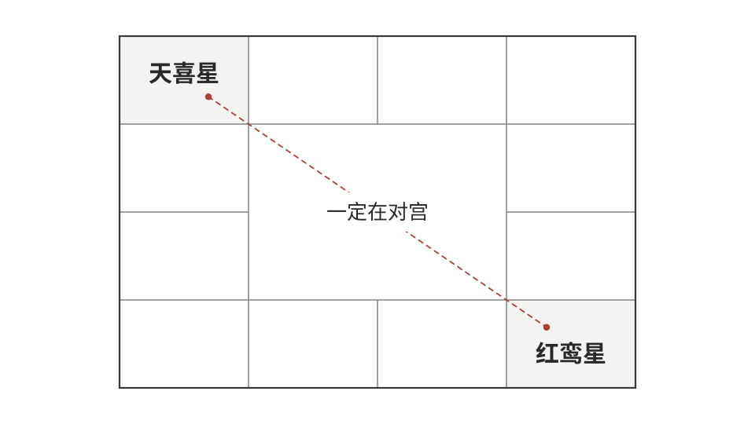 |
| **她第一次、第二次婚姻各在几岁？流年怎么数？** | 〔口述〕看第一次婚姻的流年：「那第一个她的流年呢」「诸位看25在这边」「女孩子是逆转」「30岁会有婚姻」。（[00:19:18–00:19:32](https://www.bilibili.com/video/BV1KJsLekEfA/?p=23&t=1158)，第 34746–35183 帧） 〔叠图〕叠图子女乙巳格出现小限「30」，该格标着「有婚姻」。（[00:19:23–00:19:29](https://www.bilibili.com/video/BV1KJsLekEfA/?p=23&t=1163)，第 34914–35075 帧） 〔叠图〕叠图福德庚戌标 25、父母己酉标 26、命宫戊申标 27，三格依次排开。（[00:19:59–00:20:04](https://www.bilibili.com/video/BV1KJsLekEfA/?p=23&t=1199)，第 35982–36143 帧） 〔口述〕35-44 这个大限再遇红鸾天喜，是第二次婚姻：「她说她35-44 天喜天喜红鸾星还有来会啊」「这是第二次而不是第一次啊」「第二次婚姻喽」。（[00:19:34–00:19:44](https://www.bilibili.com/video/BV1KJsLekEfA/?p=23&t=1174)，第 35244–35549 帧） |
| **批女命为什么福德宫很重要？** | 〔口述〕「所以说我们批女孩子的命啊」「福德宫很重要」；她的福德宫很好。福德宫不好，「第二次婚姻都很难」；福德宫很好，「第一次会结婚」。（[00:19:47–00:19:59](https://www.bilibili.com/video/BV1KJsLekEfA/?p=23&t=1187)，第 35616–35981 帧） 〔叠图〕叠图福德庚戌：天机利、天梁庙化禄、陀罗庙、天官平、台辅、天月、天虚陷，另有力士、岁破、月煞、胎；大限 105~114。（[00:19:59–00:20:04](https://www.bilibili.com/video/BV1KJsLekEfA/?p=23&t=1199)，第 35982–36143 帧） |
| **吉星来会时，没有「过忌」婚事会怎样？** | 〔口述〕「那我们在流年吉星来会的时候」「30岁进来的时候天喜红鸾星就会动」。（[00:19:59–00:20:06](https://www.bilibili.com/video/BV1KJsLekEfA/?p=23&t=1199)，第 35982–36209 帧） 〔口述〕如果在化忌之前，「比如说25 26 27」「27岁她又会到太阳啊」，「你没有过忌的话」「婚事不成哦」「不会不容易成功啊」。（[00:20:07–00:20:17](https://www.bilibili.com/video/BV1KJsLekEfA/?p=23&t=1207)，第 36210–36533 帧） 〔叠图〕叠图兄弟丁未：武曲庙化忌、贪狼庙、地空平、天刑陷、副旬陷，另有将军、天煞、贯索、沐浴；大限 15~24，小限 4,16,28,40,52,64。（[00:20:23–00:20:25](https://www.bilibili.com/video/BV1KJsLekEfA/?p=23&t=1223)，第 36708–36773 帧） 〔推断〕推断：板书图第36432帧上叠图把兄弟丁未的「28」框出，并从化忌画箭头指向它；倪师口头没有说「过忌」就是过 28 岁这一格。（[00:20:14](https://www.bilibili.com/video/BV1KJsLekEfA/?p=23&t=1214)，第 36432 帧） 〔板书〕这段新写的板书被讲者身体挡住，认不出。（[00:20:14](https://www.bilibili.com/video/BV1KJsLekEfA/?p=23&t=1214)，第 36432 帧） |
| **没过忌就订婚，会出什么事？** | 〔口述〕倪师说「待会我举个例给你」「她很好玩的」：那个人还没过忌（字幕作「过息」）也去结婚，「订婚以后她才发觉她的那个未婚」「她的未婚夫是已婚的」「还没有离婚呢」。（[00:20:17–00:20:28](https://www.bilibili.com/video/BV1KJsLekEfA/?p=23&t=1217)，第 36534–36845 帧） 〔口述〕「就会就会发生一些事情来让她想结」，「对你是想法很好啊」「想法跟事实不见得是一样的哦」「会造成这样子」。（[00:20:30–00:20:37](https://www.bilibili.com/video/BV1KJsLekEfA/?p=23&t=1230)，第 36906–37115 帧） |
| **她 30 岁结婚说明什么？为何说本命主偏房？** | 〔口述〕「她30岁会结婚」「所以一定是过忌」「过了忌以后」「第一个红鸾天喜星就会结婚」。（[00:20:37–00:20:42](https://www.bilibili.com/video/BV1KJsLekEfA/?p=23&t=1237)，第 37116–37271 帧） 〔口述〕「可是一结婚以后」「她这个命本宫是她的命征」「本来就是主偏房命」「我感觉很奇怪哦」。（[00:20:42–00:20:48](https://www.bilibili.com/video/BV1KJsLekEfA/?p=23&t=1242)，第 37272–37451 帧） 〔指代〕说「她这个命本宫」的「这个」时，手指的是黑板中央「41、女、」一行的「女」字。（[00:20:43](https://www.bilibili.com/video/BV1KJsLekEfA/?p=23&t=1243)，第 37310 帧） 〔叠图〕叠图命宫戊申：巨门庙、太阳得、文曲得、天贵陷、龙池平、天寿旺，另有官符、小耗、指背、长生；该格标着「女命偏房」「巨门太阳」。（[00:20:45–00:20:46](https://www.bilibili.com/video/BV1KJsLekEfA/?p=23&t=1245)，第 37362–37409 帧） 〔口述〕算命「特别要注意这个格」「其他都很简单」，「男女是同格啊」，「就好像我们中医在看病一样」「男女的病都是一样的」，女孩子只多了个妇科，「其他都正常就好了嘛」。（[00:20:48–00:21:05](https://www.bilibili.com/video/BV1KJsLekEfA/?p=23&t=1248)，第 37452–37955 帧） |
| **38 岁那年发生了什么？** | 〔口述〕「那你她进入38岁那年」「这年来找我们的」「这在38岁的时候先生死掉啊」「过世啊死掉了」「夫妻是死别」。（[00:21:05–00:21:25](https://www.bilibili.com/video/BV1KJsLekEfA/?p=23&t=1265)，第 37956–38573 帧） 〔口述〕「这个好玩的在哪里呢」「死别之后呢」，「这是38岁呢」「夫妻死别」「而死别以后呢」。（[00:21:25–00:21:38](https://www.bilibili.com/video/BV1KJsLekEfA/?p=23&t=1285)，第 38574–38951 帧） 〔叠图〕叠图父母己酉：天相陷、天厨、咸池平、月德，另有青龙、小耗、养；大限 115~124，此时框出「38」。（[00:21:05–00:21:10](https://www.bilibili.com/video/BV1KJsLekEfA/?p=23&t=1265)，第 37956–38129 帧） 〔板书〕黑板最左侧新写：可辨「38」，旁边两字形似「死别」但认不准，下方画了一个方框，其余认不出。（[00:21:38](https://www.bilibili.com/video/BV1KJsLekEfA/?p=23&t=1298)，第 38952 帧） |
| **死别前后，她的房子各怎么住？** | 〔口述〕死别以后「她觉得看这个房子是伤心地」，倪师问「死别前她怎么住的」。（[00:21:38–00:21:45](https://www.bilibili.com/video/BV1KJsLekEfA/?p=23&t=1298)，第 38952–39167 帧） 〔口述〕「死别前的时候」「夫妻的主卧房在这里（西南）」「西北角是厨房」；括号「（西南）」是字幕注字，不是倪师说的。（[00:21:48–00:21:52](https://www.bilibili.com/video/BV1KJsLekEfA/?p=23&t=1308)，第 39246–39365 帧） 〔口述〕「我是说之前之后你都画给我」「死别以后的房子呢」「东南西北」「嘿嘿她就变成这里是主卧房」「这里是厨房（西南）」。（[00:21:52–00:22:01](https://www.bilibili.com/video/BV1KJsLekEfA/?p=23&t=1312)，第 39366–39653 帧） 〔指代〕说「在还没有出事之前住这里哦」的「这里」时，手指按在房屋方框内下方的小方框（框内字形似「K」，上方另一小框为「主」）。（[00:22:08](https://www.bilibili.com/video/BV1KJsLekEfA/?p=23&t=1328)，第 39844 帧） 〔板书〕板上画了一个房子方框，框内右侧上下各一个小方框，框边有几个潦草的方位记号；小框里的字和各边方位都认不出。（[00:22:02](https://www.bilibili.com/video/BV1KJsLekEfA/?p=23&t=1322)，第 39660 帧） |
| **女命太阳代表谁？她 38 岁失去了谁？** | 〔口述〕去世以后「她心里很难过啊」，「先生意外死亡」，「像这种廉贞破军」「都是水里面做坟墓啊」。（[00:22:09–00:22:15](https://www.bilibili.com/video/BV1KJsLekEfA/?p=23&t=1329)，第 39894–40067 帧） 〔口述〕「所以我常常讲」「一个女孩子的命里面」「太阳代表三个人」：「代表爸爸」「代表儿子」「代表丈夫」。（[00:22:15–00:22:21](https://www.bilibili.com/video/BV1KJsLekEfA/?p=23&t=1335)，第 40068–40247 帧） 〔口述〕「所以她38岁她找爸爸不在」「在这个38岁的时候」「这里的父母宫也等于是进入夫妻」，材料没有展开。（[00:22:21–00:22:27](https://www.bilibili.com/video/BV1KJsLekEfA/?p=23&t=1341)，第 40248–40427 帧） 〔叠图〕叠图父母己酉小限一栏标「38」（2,14,26,38,50,62），大限 115~124。（[00:22:21–00:22:23](https://www.bilibili.com/video/BV1KJsLekEfA/?p=23&t=1341)，第 40248–40319 帧） 〔指代〕说「这个」时手指板面最右一列中部格子，那里的粉笔字被手和叠图挡住；叠图显示父母己酉、38。（[00:22:23](https://www.bilibili.com/video/BV1KJsLekEfA/?p=23&t=1343)，第 40318 帧） |
| **同时生的人有的没事，差在哪里？阳宅几年成灾？** | 〔口述〕「有的跟她同时间生人」「有的不会有事啊」，「为什么决定在阳宅上面」。（[00:22:27–00:22:34](https://www.bilibili.com/video/BV1KJsLekEfA/?p=23&t=1347)，第 40428–40637 帧） 〔口述〕「所以一个阳宅住进去的时候」「快三年三六的数」「慢到第六年一定会成灾」「灾就呈现马上就出现了」「第三年开始」。（[00:22:34–00:22:48](https://www.bilibili.com/video/BV1KJsLekEfA/?p=23&t=1354)，第 40638–41063 帧） 〔口述〕「所以她住这个房子」「到第三年先生就走了」「三年过去没事」「第六年就是第二个灾」「所以这个宅很凶」。（[00:22:48–00:22:58](https://www.bilibili.com/video/BV1KJsLekEfA/?p=23&t=1368)，第 41064–41369 帧） 〔指代〕说「她住这个房子」时手掌按在一个房屋方框上（方框上方标 S、下方标 N）；说「这个宅很凶」时手指那个方框内下方形似「K」的小方框。（[00:22:49–00:22:57](https://www.bilibili.com/video/BV1KJsLekEfA/?p=23&t=1369)，第 41080–41324 帧） |
| **搬家后，42 岁的红鸾天喜为何不再结婚？** | 〔口述〕先生死后她伤心，就去找房子；倪师问「这个为什么之前不找了」「要之后要找」。（[00:22:59–00:23:04](https://www.bilibili.com/video/BV1KJsLekEfA/?p=23&t=1379)，第 41370–41543 帧） 〔口述〕「所以她之后再住这个房子的时候」「本来她的命上面35-44过去了以后」「你看哦37 38岁出事」，数到「42岁是不是还有天喜红鸾星来会」。（[00:23:04–00:23:16](https://www.bilibili.com/video/BV1KJsLekEfA/?p=23&t=1384)，第 41544–41903 帧） 〔口述〕「可是她就住在这个位置上了之后」「就就不会了懂不懂」「就不会结婚的了」。（[00:23:16–00:23:23](https://www.bilibili.com/video/BV1KJsLekEfA/?p=23&t=1396)，第 41904–42095 帧） 〔叠图〕叠图子女乙巳框出小限「42」和大限「35~44」，同格有天喜庙；之前一张叠图福德庚戌标 37、父母己酉标 38。（[00:23:12–00:23:16](https://www.bilibili.com/video/BV1KJsLekEfA/?p=23&t=1392)，第 41784–41903 帧） 〔指代〕说「之后再住这个房子」时手掌按在左侧房屋方框右下部；说「这个位置上」时手指同一方框内下方的小方框（字形似「国」，看不清）。（[00:23:05–00:23:17](https://www.bilibili.com/video/BV1KJsLekEfA/?p=23&t=1385)，第 41578–41921 帧） |
| **偏房命的人怎样把自己变成偏房？** | 〔口述〕「所以说这个命是偏房的人」，除了前面讲的行为个性，「这个她的个性就很好」「没有像刚刚那么拗」，「然后害自己变偏房」。（[00:23:23–00:23:33](https://www.bilibili.com/video/BV1KJsLekEfA/?p=23&t=1403)，第 42096–42401 帧） 〔口述〕因为「在这个位置上的话」「思想会超越过年龄很多」「然后变成责任感很重」，她认为婚姻不重要，「我要母兼父职嘛」「我就带孩子就好了」。（[00:23:33–00:23:42](https://www.bilibili.com/video/BV1KJsLekEfA/?p=23&t=1413)，第 42402–42671 帧） 〔指代〕说「她在这个位置上」的「这个」时，食指点在左侧房屋方框内下方的小方框（字形似「国」，看不清）。（[00:23:34](https://www.bilibili.com/video/BV1KJsLekEfA/?p=23&t=1414)，第 42421 帧） 〔口述〕「所以一个人的想法会改变她的做法」「做法影响到命」，告诉我们「改位置的时候是改一念的」「一念之间呐」。（[00:23:44–00:23:59](https://www.bilibili.com/video/BV1KJsLekEfA/?p=23&t=1424)，第 42744–43175 帧） 〔叠图〕叠图命宫戊申再次出现，该格标着「女命偏房」「巨门太阳」。（[00:23:23–00:23:25](https://www.bilibili.com/video/BV1KJsLekEfA/?p=23&t=1403)，第 42096–42167 帧） |
| **55-64 大限在疾厄，56 岁会怎样？** | 〔口述〕「还有诸位看她大限」，「5564这十年呢」「廉贞破军这已经灾星了」；「十年在疾厄宫上面」，这十年「值年的星就是讲的是疾厄」「她的身体一定很差很差」。（[00:23:59–00:24:36](https://www.bilibili.com/video/BV1KJsLekEfA/?p=23&t=1439)，第 43176–44309 帧） 〔口述〕「那在进入小限56岁」「同时会到疾厄宫等于身体上面」，大限 55-64 也在疾厄，「疾厄来说的大小二限逢」。（[00:24:39–00:24:52](https://www.bilibili.com/video/BV1KJsLekEfA/?p=23&t=1479)，第 44382–44789 帧） 〔口述〕「那廉破的话」「这里是死啊」「这种是水里面做坟墓」「就是死在死掉了」「死掉在56岁」。（[00:24:53–00:25:02](https://www.bilibili.com/video/BV1KJsLekEfA/?p=23&t=1493)，第 44790–45083 帧） 〔叠图〕叠图疾厄癸卯：廉贞平、破军陷、天魁庙、地劫平、三台陷、天使平、副截平，另有病符、息神、衰；大限 55~64，框出小限「56」。（[00:24:06–00:24:09](https://www.bilibili.com/video/BV1KJsLekEfA/?p=23&t=1446)，第 43392–43475 帧） 〔板书〕左侧疾厄格：可辨圈起的「55-64」，旁边另有一个橙色圈，圈内字认不出；格右侧竖写的字被手挡住一部分。（[00:24:28](https://www.bilibili.com/video/BV1KJsLekEfA/?p=23&t=1468)，第 44069 帧） 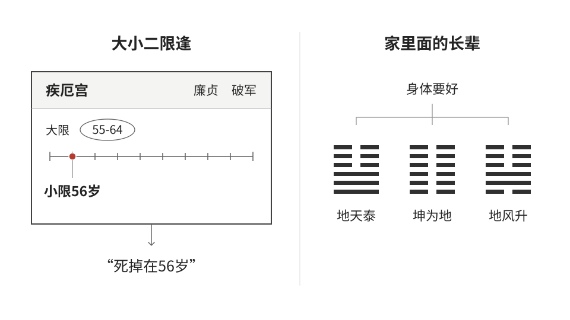 〔板书〕同一格此时可辨竖写的「疾厄」与圈起的「55-64」，旁边橙色圈内的字仍认不出。（[00:24:54](https://www.bilibili.com/video/BV1KJsLekEfA/?p=23&t=1494)，第 44820 帧） |
| **长辈要身体好住哪三卦？改宅为何要小心？** | 〔口述〕「如果你的妈妈家里面的长辈」要身体好，「有三个卦可以让她身体要好」：泰卦（字幕注「地天泰」）、坤为地（字幕作「坤沩地」）、「地风升」。（[00:25:03–00:25:19](https://www.bilibili.com/video/BV1KJsLekEfA/?p=23&t=1503)，第 45114–45599 帧） 〔口述〕母亲「住在泰卦上面」「或者是地风升」，「也就是正西北」「正西南还是有正东南」「妈妈住在这三个位置上」；三个方位与三卦怎么对应没有讲。（[00:25:20–00:25:32](https://www.bilibili.com/video/BV1KJsLekEfA/?p=23&t=1520)，第 45600–45977 帧） 〔口述〕「你说妈妈你住南边好了」「地火明夷卦」，「本来还没有死」，「你一住进去死的更快」，「这是我们化解的方式」。（[00:25:32–00:25:47](https://www.bilibili.com/video/BV1KJsLekEfA/?p=23&t=1532)，第 45978–46427 帧） 〔口述〕「千万我们在改宅的时候特别注意哦」「改阳宅的时候特别要小心点」；「当然这个升卦」「还没有介绍」，但诸位已了解大概怎么布列。（[00:25:48–00:26:07](https://www.bilibili.com/video/BV1KJsLekEfA/?p=23&t=1548)，第 46452–47015 帧） 〔板书〕中间一格新写：可辨「泰」「地」两字，后面一个字字形近「升」。（[00:25:19](https://www.bilibili.com/video/BV1KJsLekEfA/?p=23&t=1519)，第 45588 帧） 〔指代〕说「这个升卦」时，手指的是板上「泰」「地」后面那个手写字（字形近「升」）。（[00:26:01](https://www.bilibili.com/video/BV1KJsLekEfA/?p=23&t=1561)，第 46836–46859 帧） |

**总结区**

- 通用规则：红鸾、天喜一定在对宫，排的不是对宫就是排错了（[00:19:11–00:19:16](https://www.bilibili.com/video/BV1KJsLekEfA/?p=23&t=1151)，第 34536–34697 帧）；批女命福德宫很重要，福德宫不好第二次婚姻都很难（[00:19:47–00:19:59](https://www.bilibili.com/video/BV1KJsLekEfA/?p=23&t=1187)，第 35616–35981 帧）；女孩子命里太阳代表爸爸、儿子、丈夫三个人（[00:22:15–00:22:21](https://www.bilibili.com/video/BV1KJsLekEfA/?p=23&t=1335)，第 40068–40247 帧）；一个阳宅住进去快三年、慢到第六年一定成灾（[00:22:34–00:22:48](https://www.bilibili.com/video/BV1KJsLekEfA/?p=23&t=1354)，第 40638–41063 帧）
- 只在本例：她 30 岁流年红鸾天喜动、过忌后第一次结婚，35-44 再来会是第二次婚姻（[00:19:18–00:20:42](https://www.bilibili.com/video/BV1KJsLekEfA/?p=23&t=1158)，第 34746–37271 帧）；她命宫本来主偏房命（[00:20:42–00:20:48](https://www.bilibili.com/video/BV1KJsLekEfA/?p=23&t=1242)，第 37272–37451 帧）；38 岁先生意外死亡，住进那房子第三年先生就走（[00:21:05–00:22:52](https://www.bilibili.com/video/BV1KJsLekEfA/?p=23&t=1265)，第 37956–41183 帧）；大限 55-64 与小限 56 都到疾厄宫廉破，倪师断死在 56 岁（[00:23:59–00:25:02](https://www.bilibili.com/video/BV1KJsLekEfA/?p=23&t=1439)，第 43176–45083 帧）
- 不是排盘规则，是处世方法：一个人的想法会改变做法，做法影响到命，改位置是改一念（[00:23:44–00:23:59](https://www.bilibili.com/video/BV1KJsLekEfA/?p=23&t=1424)，第 42744–43175 帧）；长辈要身体好，可住泰卦、坤为地、地风升三个位置（[00:25:03–00:25:32](https://www.bilibili.com/video/BV1KJsLekEfA/?p=23&t=1503)，第 45114–45977 帧）；改阳宅要特别小心，让长辈住南边地火明夷会死得更快（[00:25:32–00:25:53](https://www.bilibili.com/video/BV1KJsLekEfA/?p=23&t=1532)，第 45978–46613 帧）

**待核**

1. [00:19:08](https://www.bilibili.com/video/BV1KJsLekEfA/?p=23&t=1148)，第 34446 帧字幕「天喜星在这里、 心」可信度 0.3，「心」字来历不明，语音只有「就在」。
2. [00:19:34](https://www.bilibili.com/video/BV1KJsLekEfA/?p=23&t=1174)，第 35244 帧字幕「35-44」，语音作「35到40」。
3. [00:19:45](https://www.bilibili.com/video/BV1KJsLekEfA/?p=23&t=1185)，第 35550–35567 帧两句乱码已略过。
4. [00:19:49–00:19:58](https://www.bilibili.com/video/BV1KJsLekEfA/?p=23&t=1189)，第 35682–35957 帧字幕「福德官」、语音「福德功」，已改为「福德宫」。
5. [00:20:12](https://www.bilibili.com/video/BV1KJsLekEfA/?p=23&t=1212)，第 36366 帧「过忌」倪师没有解释；是否指叠图兄弟丁未（武曲化忌、小限 28）那一格，材料没有明说。
6. [00:20:14](https://www.bilibili.com/video/BV1KJsLekEfA/?p=23&t=1214)，第 36432 帧板书被讲者身体挡住，新写的字认不出。
7. [00:20:20](https://www.bilibili.com/video/BV1KJsLekEfA/?p=23&t=1220)，第 36612 帧字幕「过息」、语音「过记」，已按上下文改为「过忌」。
8. [00:20:21](https://www.bilibili.com/video/BV1KJsLekEfA/?p=23&t=1221)，第 36654 帧字幕「她也去结婚了」，语音作「去结婚去订婚」，到底是结婚还是订婚待核。
9. [00:20:43](https://www.bilibili.com/video/BV1KJsLekEfA/?p=23&t=1243)，第 37308 帧「命征」语音作「命证」，词义倪师没有解释。
10. [00:21:38](https://www.bilibili.com/video/BV1KJsLekEfA/?p=23&t=1298)，第 38952 帧板书「38」旁两字形似「死别」，认不准。
11. [00:21:45](https://www.bilibili.com/video/BV1KJsLekEfA/?p=23&t=1305)，第 39168 帧字幕「所以天道天机道」意思不明。
12. [00:21:49](https://www.bilibili.com/video/BV1KJsLekEfA/?p=23&t=1309)，第 39270 帧与[00:22:01](https://www.bilibili.com/video/BV1KJsLekEfA/?p=23&t=1321)，第 39636 帧字幕都带括号注「（西南）」；[00:21:50](https://www.bilibili.com/video/BV1KJsLekEfA/?p=23&t=1310)，第 39306 帧字幕「西北角是厨房」语音作「西部小时厨房」；[00:21:57](https://www.bilibili.com/video/BV1KJsLekEfA/?p=23&t=1317)，第 39516 帧语音有「西北这里是主卧房」而字幕没有「西北」；板书方位记号认不出，死别前后主卧房、厨房的方位待核。
13. [00:22:08](https://www.bilibili.com/video/BV1KJsLekEfA/?p=23&t=1328)，第 39844 帧、[00:22:49](https://www.bilibili.com/video/BV1KJsLekEfA/?p=23&t=1369)，第 41080 帧指代说手指「右侧房屋方框」，[00:23:05](https://www.bilibili.com/video/BV1KJsLekEfA/?p=23&t=1385)，第 41578 帧、[00:23:17](https://www.bilibili.com/video/BV1KJsLekEfA/?p=23&t=1397)，第 41921 帧说「左侧房屋方框」；板书图第39660、41916帧只见左边一个方框，[00:24:54](https://www.bilibili.com/video/BV1KJsLekEfA/?p=23&t=1494)，第 44820 帧画面中央另见一个方框（上标 S、下标 N、内有「主」字小框），哪个是死别前、哪个是死别后待核。
14. [00:22:12](https://www.bilibili.com/video/BV1KJsLekEfA/?p=23&t=1332)，第 39972 帧字幕「像这种廉贞破军」语音作「三只栋连针破均」；这里的廉贞破军指哪一宫没有讲。
15. [00:22:21](https://www.bilibili.com/video/BV1KJsLekEfA/?p=23&t=1341)，第 40248 帧字幕「她找爸爸不在」语音作「早爸爸不在」。
16. [00:22:25](https://www.bilibili.com/video/BV1KJsLekEfA/?p=23&t=1345)，第 40356 帧「这里的父母宫也等于是进入夫妻」材料没有展开。
17. [00:22:37](https://www.bilibili.com/video/BV1KJsLekEfA/?p=23&t=1357)，第 40722 帧字幕「快三年三六的数三」可信度 0.44。
18. [00:22:54](https://www.bilibili.com/video/BV1KJsLekEfA/?p=23&t=1374)，第 41220 帧字幕「第二个灾」语音作「第二个宅」。
19. [00:23:07](https://www.bilibili.com/video/BV1KJsLekEfA/?p=23&t=1387)，第 41634 帧说「35-44过去了以后」，后面又数到 42 岁仍有天喜红鸾来会，前后怎么衔接待核。
20. [00:23:28](https://www.bilibili.com/video/BV1KJsLekEfA/?p=23&t=1408)，第 42246 帧「没有像刚刚那么拗」，「刚刚」指哪个人没有说明。
21. [00:23:51](https://www.bilibili.com/video/BV1KJsLekEfA/?p=23&t=1431)，第 42930 帧字幕「改一念」语音作「改一面」。
22. [00:24:09](https://www.bilibili.com/video/BV1KJsLekEfA/?p=23&t=1449)，第 43476 帧字幕「廉贞破军这已经灾星了」语音作「正贡政已经摘新了」。
23. [00:24:28](https://www.bilibili.com/video/BV1KJsLekEfA/?p=23&t=1468)，第 44058 帧「值年的值日星」倪师没有解释。
24. [00:24:28](https://www.bilibili.com/video/BV1KJsLekEfA/?p=23&t=1468)，第 44069 帧板书疾厄格旁橙色圈内的字认不出。
25. [00:24:53](https://www.bilibili.com/video/BV1KJsLekEfA/?p=23&t=1493)，第 44814 帧字幕「这里是死啊」语音作「一定是死啊」。
26. [00:24:54](https://www.bilibili.com/video/BV1KJsLekEfA/?p=23&t=1494)，第 44820 帧板书图上叠图格另见提示字「大小二限逢」，材料▣行没有列出。
27. [00:25:15](https://www.bilibili.com/video/BV1KJsLekEfA/?p=23&t=1515)，第 45468 帧字幕「坤沩地」已改为「坤为地」。
28. [00:25:25](https://www.bilibili.com/video/BV1KJsLekEfA/?p=23&t=1525)，第 45756 帧「正西北」「正西南还是有正东南」与泰卦、坤为地、地风升怎么一一对应没有讲。
29. [00:25:58](https://www.bilibili.com/video/BV1KJsLekEfA/?p=23&t=1558)，第 46758 帧字幕「疑间」已改为「疑问」。
30. [00:26:04](https://www.bilibili.com/video/BV1KJsLekEfA/?p=23&t=1564)，第 46938 帧字幕「布列」语音作「助力」。

## 例三（女命，命宫己亥天梁）：过忌之婚、外地经商、破祖业、改宅

| 巳 | 午 | 未 | 申 |
|---|---|---|---|
| **迁移 癸巳** 天同庙禄 禄存庙 地空庙 地劫不 | （午：没贴过） | （未：没贴过） | **子女 丙申** 贪狼平 天马旺 |
| **交友 壬辰** 破军旺 文昌得科 陀罗庙 | **例三 · 命宫己亥** | 据视频叠图重排 | **夫妻 丁酉** 天机旺权 巨门庙 天钺庙 铃星得 |
| **官禄 辛卯** （无主星、辅星） | 后期贴图，不算倪师的话 |  | **兄弟 戊戌** 紫微得 天相得 文曲陷 |
| **田宅 庚寅** 廉贞庙忌 | **福德 辛丑** （无主星、辅星） | **父母 庚子** 七杀旺 | **命宫 己亥**（身宫） 天梁陷 天魁旺 |

按视频里这张盘逐格重画（我们自己画的图，不是视频截图）；数据见 [命盘-P23-例三.json](图/命盘-P23-例三.json)。

### 6　例三女命：红鸾化忌、外地大利与西北角（[00:26:07–00:30:57](https://www.bilibili.com/video/BV1KJsLekEfA/?p=23&t=1567)，第 47016–55733 帧）

| 提示区 | 笔记区 |
|---|---|
| **例三这张盘是哪年生、属什么？25、27岁落在哪？** | 〔口述〕倪师换一张新命盘：「诸位看这个命」「民国55年（1966）」，又说「81年算刚好流年27岁」。括号里的「（1966）」是字幕注字，语音栏没有，不是倪师说出口的话。（[00:26:07–00:26:14](https://www.bilibili.com/video/BV1KJsLekEfA/?p=23&t=1567)，第 47016–47231 帧） 〔口述〕倪师说「像这个是午年属马的」「午年生马年刚好在这里」，接着在黑板上数「25岁在这里26 27」。（[00:26:18–00:26:27](https://www.bilibili.com/video/BV1KJsLekEfA/?p=23&t=1578)，第 47346–47615 帧） 〔指代〕说「25岁在这里」时，手指的是黑板命盘左列第二宫外侧刚写好、圈起来的字（圈里的字看不清）；说「27岁流年是不是在这个宫」时，手指的是黑板命盘左下宫，该宫底部写着「田宅」。（[00:26:23–00:26:28](https://www.bilibili.com/video/BV1KJsLekEfA/?p=23&t=1583)，第 47502–47649 帧） 〔口述〕倪师自问「现在算这个流年有没有问题」，答没有问题（字幕作「没有间题」），随即说「27岁啊化忌」。前后两句意思看似相反，语音栏这句也对不上，见待核。（[00:26:30–00:26:36](https://www.bilibili.com/video/BV1KJsLekEfA/?p=23&t=1590)，第 47700–47903 帧） 〔板书〕黑板命盘中央可辨：「55年」「女」，一个圆圈里写「午」，另一个圆圈里写「27」（下面一字认不出）；中央有一方框，周围可辨字母「S」「W」，左侧一字疑为「E」。（[00:26:57](https://www.bilibili.com/video/BV1KJsLekEfA/?p=23&t=1617)，第 48516 帧） 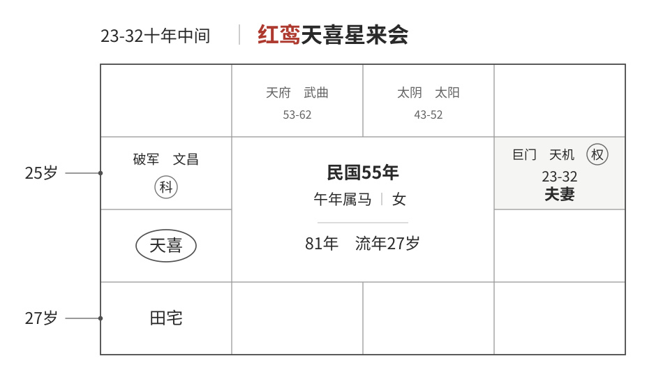 |
| **她 23–32 这十年受哪颗星影响最大？** | 〔口述〕倪师让大家看「2332十年中间」，说「她的命里面就是红鸾天喜星」「诸位看这很清楚」「红鸾天喜星来会」。（[00:26:36–00:26:48](https://www.bilibili.com/video/BV1KJsLekEfA/?p=23&t=1596)，第 47904–48263 帧） 〔口述〕倪师再说一次「23-32十年中间呢」「除了化权除了事业以外」「她的红鸾星影响到她很大」「影响很大」。（[00:26:50–00:27:02](https://www.bilibili.com/video/BV1KJsLekEfA/?p=23&t=1610)，第 48324–48671 帧） 〔叠图〕夫妻 丁酉：天机旺 化权、巨门庙、天钺庙、铃星得、红鸾旺；小限 8, 20, 32, 44, 56, 68；大限 23~32。（[00:29:05–00:29:07](https://www.bilibili.com/video/BV1KJsLekEfA/?p=23&t=1745)，第 52362–52427 帧） 〔板书〕黑板右列第二宫可辨「巨门」「天机」，旁边圈出「权」，下面写「夫妻」；该宫右侧外面有一个粉红色圈，字形像「红鸾」，认不准。左列另有一个粉红色圈，里面是「天喜」。（[00:26:57](https://www.bilibili.com/video/BV1KJsLekEfA/?p=23&t=1617)，第 48516 帧） 〔板书〕黑板上排可辨：「天府」「武曲」「53-62」，宫名像「疾厄」；「太阴」「太阳」「43-52」，宫名像「财帛」；左列有「破军」「文昌」并圈出「科」，旁有「73-82」。其余认不出。（[00:26:57](https://www.bilibili.com/video/BV1KJsLekEfA/?p=23&t=1617)，第 48516 帧） |
| **客人通常什么时候来算命？一进门看出了什么？** | 〔口述〕倪师说这个女孩子「结果她刚好今年」「今年来找你」。（[00:27:02–00:27:04](https://www.bilibili.com/video/BV1KJsLekEfA/?p=23&t=1622)，第 48672–48743 帧） 〔口述〕倪师讲算命的经验：「常常会发现到一件事情」，客人「一拿出来都是流年」「不好的时候开始算」；「那流年化权呐」「升官发财都不会来找我们算的」，「那个化忌的就来了」。（[00:27:04–00:27:18](https://www.bilibili.com/video/BV1KJsLekEfA/?p=23&t=1624)，第 48744–49157 帧） 〔口述〕倪师说一进来就看到化忌：「化忌啊在印堂上面也是红红的很多」「就是口舌是非很多」。（[00:27:18–00:27:27](https://www.bilibili.com/video/BV1KJsLekEfA/?p=23&t=1638)，第 49158–49427 帧） 〔口述〕倪师说「再一看是廉贞化忌」「晓得是她逢了桃花星化忌」，在这里把廉贞叫作桃花星。（[00:27:27–00:27:31](https://www.bilibili.com/video/BV1KJsLekEfA/?p=23&t=1647)，第 49428–49547 帧） 〔叠图〕田宅 庚寅：廉贞庙 化忌、旬空陷、天月、蜚廉；小限 3, 15, 27, 39, 51, 63；大限 93~102。（[00:29:34–00:29:35](https://www.bilibili.com/video/BV1KJsLekEfA/?p=23&t=1774)，第 53220–53255 帧） |
| **她这次婚事怎么了？为什么说过忌的婚才吉？** | 〔口述〕倪师说「结果呢她就是去结婚」「结果订婚了」，订婚以后才发现先生原来的婚姻还没解决，「还不能去结」。（[00:27:31–00:27:39](https://www.bilibili.com/video/BV1KJsLekEfA/?p=23&t=1651)，第 49548–49793 帧） 〔口述〕婚事「就停在那边」，倪师说「这是化忌」。（[00:27:39–00:27:46](https://www.bilibili.com/video/BV1KJsLekEfA/?p=23&t=1659)，第 49794–49997 帧） 〔口述〕倪师说给她算命时「一再跟她讲过忌」，「过忌的婚呢」「才是吉的」。「过忌」具体指什么，本块没有解释。（[00:27:46–00:27:57](https://www.bilibili.com/video/BV1KJsLekEfA/?p=23&t=1666)，第 49998–50333 帧） |
| **父母宫有七杀这类武官星，代表什么？** | 〔口述〕倪师说「像这个八字父母宫」，「我们在批父母的时候」「跟批命是一样」。（[00:27:57–00:28:03](https://www.bilibili.com/video/BV1KJsLekEfA/?p=23&t=1677)，第 50334–50513 帧） 〔口述〕举例「比如说七杀紫微七杀」，「这武官星在父母宫」「是代表爸爸是从武职的」。（[00:28:03–00:28:10](https://www.bilibili.com/video/BV1KJsLekEfA/?p=23&t=1683)，第 50514–50705 帧） 〔口述〕倪师类推：「你的命是武官代表你从武职」，「你的父母亲从武职」，即「父母亲是武官的」。语音栏这里还多一句兄弟宫武官代表兄弟从武职，字幕没有。（[00:28:10–00:28:20](https://www.bilibili.com/video/BV1KJsLekEfA/?p=23&t=1690)，第 50706–51011 帧） 〔板书〕黑板命盘下排可辨一个圆圈圈住的「七杀」（「杀」字写法像繁体）。黑板上这一宫的宫名看不清。（[00:29:17](https://www.bilibili.com/video/BV1KJsLekEfA/?p=23&t=1757)，第 52720 帧） 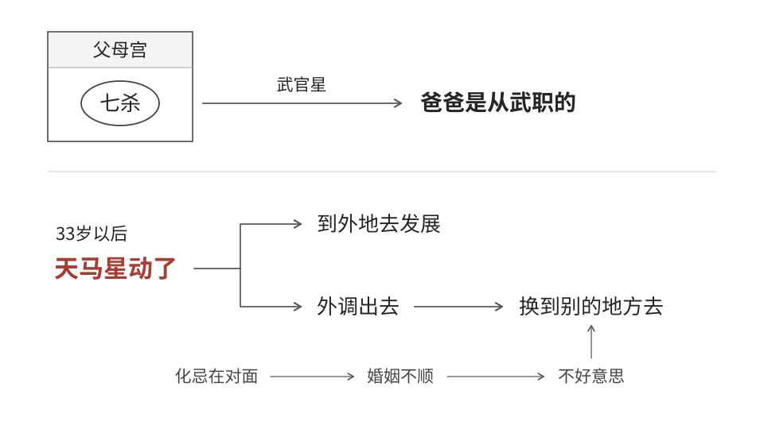 |
| **迁移宫化禄的人，适合做什么？** | 〔口述〕倪师说「那像这种命的人」「我们在批的时候」「第一个重点」：「你看迁移宫是化禄」。（[00:28:20–00:28:24](https://www.bilibili.com/video/BV1KJsLekEfA/?p=23&t=1700)，第 51012–51131 帧） 〔口述〕「所以这种八字就叫做外地怎么样」——「大利到外地去经商的一种人」「到外地经商」。（[00:28:24–00:28:33](https://www.bilibili.com/video/BV1KJsLekEfA/?p=23&t=1704)，第 51132–51395 帧） 〔叠图〕迁移 癸巳：天同庙 化禄、禄存庙、天官旺、天寿平、天才庙、地空庙、地劫不、副截庙、破碎陷；小限 12, 24, 36, 48, 60, 72；大限 63~72。叠图该格标着「外地大利」。（[00:28:22–00:28:24](https://www.bilibili.com/video/BV1KJsLekEfA/?p=23&t=1702)，第 51084–51131 帧） 〔口述〕倪师接着问「那什么时候回去」，说「等下给你」，本块里没有再讲到。（[00:28:33–00:28:34](https://www.bilibili.com/video/BV1KJsLekEfA/?p=23&t=1713)，第 51396–51443 帧） 〔板书〕可辨：黑板左边外侧一个圆圈里写「25」，下面画向下箭头。这次新写的字（第51035–51251帧）在左上边缘，只看到半截，认不出。（[00:28:28](https://www.bilibili.com/video/BV1KJsLekEfA/?p=23&t=1708)，第 51252 帧） |
| **官禄宫是空的，说明什么？** | 〔口述〕倪师说官禄宫是空的（字幕作「那这个官禄官是空的」），「所以她的命里面怎么样」「没有官带」「所以官带不进来」「不会当官」。（[00:28:37–00:28:47](https://www.bilibili.com/video/BV1KJsLekEfA/?p=23&t=1717)，第 51528–51815 帧） 〔叠图〕官禄 辛卯：天喜旺、八座平、副旬平、咸池平、天德平；小限 2, 14, 26, 38, 50, 62；大限 83~92。叠图该格标着「无官带」。（[00:28:34–00:28:37](https://www.bilibili.com/video/BV1KJsLekEfA/?p=23&t=1714)，第 51444–51527 帧） 〔板书〕这次新写的字（第51506–51635帧）认不出；画面里看得到的仍是前面已有的「天府」「武曲」「53-62」「太阴」「太阳」「巨门」「天机」等。（[00:28:43](https://www.bilibili.com/video/BV1KJsLekEfA/?p=23&t=1723)，第 51696 帧） |
| **她早年读书考试怎么样？凭哪几颗星？** | 〔口述〕倪师说「那这个女孩子呢」「早年的时候命里面有天魁星」「天魁星的小的时候科甲很」（语音作科甲很旺）「读书读得很好」。（[00:28:47–00:28:54](https://www.bilibili.com/video/BV1KJsLekEfA/?p=23&t=1727)，第 51816–52049 帧） 〔口述〕倪师说「1322文曲星进来」「对面是化科」。（[00:28:55–00:28:57](https://www.bilibili.com/video/BV1KJsLekEfA/?p=23&t=1735)，第 52050–52139 帧） 〔口述〕「代表说她的科甲升迁」「考高中考大学都不会有问题」「这是读书星出的是时候」。（[00:28:58–00:29:05](https://www.bilibili.com/video/BV1KJsLekEfA/?p=23&t=1738)，第 52140–52361 帧） 〔叠图〕兄弟 戊戌：紫微得、天相得、文曲陷、龙池陷、解神庙、华盖平；小限 7, 19, 31, 43, 55, 67；大限 13~22。同时贴出交友 壬辰：破军旺、文昌得 化科、陀罗庙、天姚陷、凤阁陷、天伤平、截空陷、寡宿陷、年解庙；小限 1, 13, 25, 37, 49, 61；大限 73~82。（[00:28:55–00:28:57](https://www.bilibili.com/video/BV1KJsLekEfA/?p=23&t=1735)，第 52050–52139 帧） 〔推断〕推断：倪师说「1322文曲星进来」时贴的是大限13~22的兄弟戊戌格（有文曲），说「对面是化科」时同时贴出交友壬辰格（文昌化科），「化科」应指这一格的文昌化科；倪师口头没有点宫名。（[00:28:55–00:28:57](https://www.bilibili.com/video/BV1KJsLekEfA/?p=23&t=1735)，第 52050–52139 帧） |
| **23–32 岁她在事业上怎么走？** | 〔口述〕倪师说「2332 因为她命中没有官带」，「所以说她 23-32」「她会到私人公司去做事情」「然后掌权去做主管」「受到人家重用啊」。（[00:29:05–00:29:13](https://www.bilibili.com/video/BV1KJsLekEfA/?p=23&t=1745)，第 52362–52619 帧） 〔推断〕推断：「掌权」这句讲的是大限23~32，此时叠图贴出的夫妻丁酉格（大限23~32）有天机化权；前面倪师也说过这十年「除了化权除了事业以外」，但没有明说掌权就是因这个化权。（[00:29:05–00:29:13](https://www.bilibili.com/video/BV1KJsLekEfA/?p=23&t=1745)，第 52362–52619 帧） |
| **33 岁以后天马一动，她会怎样？为什么换地方？** | 〔口述〕倪师说「然后到33岁以后开始呢」「天马星动了」：「天马星动的一种是到外地去」「到外地去发展」，「一个是外调出去」「她不待在这个公司」「换到别的地方去」。（[00:29:14–00:29:30](https://www.bilibili.com/video/BV1KJsLekEfA/?p=23&t=1754)，第 52620–53105 帧） 〔叠图〕子女 丙申：贪狼平、天马旺、孤辰平、封诰、阴煞；小限 9, 21, 33, 45, 57, 69；大限 33~42。（[00:29:14–00:29:16](https://www.bilibili.com/video/BV1KJsLekEfA/?p=23&t=1754)，第 52620–52697 帧） 〔板书〕黑板右上一格可辨一个椭圆圈住的「-42」，前面的数字看似「3」；格上方一字可辨「狼」，其余认不出。（[00:29:17](https://www.bilibili.com/video/BV1KJsLekEfA/?p=23&t=1757)，第 52720 帧） 〔口述〕换地方的原因是「婚姻不顺啊」，倪师说「她她无脸无无没有脸呐」「不好意思啊」，「化忌在对面」。（[00:29:30–00:29:35](https://www.bilibili.com/video/BV1KJsLekEfA/?p=23&t=1770)，第 53106–53255 帧） 〔推断〕推断：说「化忌在对面」时，叠图同时贴着子女丙申格和田宅庚寅格（廉贞化忌），所说的化忌应是田宅格的廉贞化忌；倪师口头没有点宫名。（[00:29:34–00:29:35](https://www.bilibili.com/video/BV1KJsLekEfA/?p=23&t=1774)，第 53220–53255 帧） |
| **武官星逢天马好不好？到外地会怎样？** | 〔口述〕倪师说「所以说我们在批这个大运的时候」「要特别注意」：「33-42 本来她十年是天」「贪狼逢天马」，「像这种武官星逢了天马是很贵」，「非常好你别跟她就说不好」「在事业上很好啊」。（[00:29:35–00:29:48](https://www.bilibili.com/video/BV1KJsLekEfA/?p=23&t=1775)，第 53256–53669 帧） 〔口述〕「这种天马星逢了武官星要逢调」，「有调动有换动都会升迁」——倪师说这是「第一个」。（[00:29:49–00:29:53](https://www.bilibili.com/video/BV1KJsLekEfA/?p=23&t=1789)，第 53670–53795 帧） 〔口述〕「第二个天马星动的时候」，如果她到外地去，「她一离开国内到外地去」「就一定会自己做事业当老板」「而在本地不会」。（[00:29:53–00:30:00](https://www.bilibili.com/video/BV1KJsLekEfA/?p=23&t=1793)，第 53796–54011 帧） 〔推断〕推断：倪师先说「贪狼逢天马」，紧接着说「像这种武官星逢了天马」，在这里是把贪狼当作武官星来讲；本块没有专门解释。（[00:29:40–00:29:44](https://www.bilibili.com/video/BV1KJsLekEfA/?p=23&t=1780)，第 53406–53525 帧） |
| **谈到感情，贪狼又变成什么？婚事成不成？** | 〔口述〕倪师说「但是如果谈到感情方面就是说很很复杂了」。（[00:30:00–00:30:03](https://www.bilibili.com/video/BV1KJsLekEfA/?p=23&t=1800)，第 54012–54107 帧） 〔口述〕「这个贪狼就变成桃花星了」，结果对面是化忌（字幕作「化息」，语音作化剂），「婚事都不会成」。（[00:30:04–00:30:09](https://www.bilibili.com/video/BV1KJsLekEfA/?p=23&t=1804)，第 54144–54299 帧） |
| **她住西北角，跟婚事不成有什么关系？** | 〔口述〕倪师说「那这是算命」，「我们知道她婚姻不成了」，再看她的运，「一看她住西北角」，就知道她为什么不成。（[00:30:10–00:30:17](https://www.bilibili.com/video/BV1KJsLekEfA/?p=23&t=1810)，第 54300–54521 帧） 〔口述〕「第一次不成是糊里糊涂的找她她」，「她这个住西北角的人就会遇到这种事情」，「懂不懂她就喜欢结过婚的男人」。（[00:30:17–00:30:26](https://www.bilibili.com/video/BV1KJsLekEfA/?p=23&t=1817)，第 54522–54785 帧） 〔口述〕倪师描述经过：「这个男人跟她说他没有结过婚」「她也相信了她也喜欢」，「她喜欢的都是结过婚」，在一起时不知道，「等她订了婚才知道这个先生结」「结过婚婚姻还没有离」。（[00:30:26–00:30:40](https://www.bilibili.com/video/BV1KJsLekEfA/?p=23&t=1826)，第 54786–55223 帧） 〔口述〕倪师总结「所以就是这种眼睛就看不清楚」。（[00:30:42–00:30:45](https://www.bilibili.com/video/BV1KJsLekEfA/?p=23&t=1842)，第 55266–55373 帧） |
| **33–42 岁她的红鸾为什么还是不动？** | 〔口述〕倪师说「然后到33-42」「她的红鸾星一直不会动啊」，原因是「为什么因她一直住西北角啊」。（[00:30:45–00:30:51](https://www.bilibili.com/video/BV1KJsLekEfA/?p=23&t=1845)，第 55374–55541 帧） 〔口述〕如果没有改（字幕作「如果没有改的谲」，应为「话」），「她就是喜欢这样子」，「都不会有成就」。（[00:30:51–00:30:57](https://www.bilibili.com/video/BV1KJsLekEfA/?p=23&t=1851)，第 55542–55733 帧） |

**总结区**

- 通用规则：批父母宫跟批命一样：武官星（如七杀）在父母宫，代表父亲从武职（[00:27:57–00:28:20](https://www.bilibili.com/video/BV1KJsLekEfA/?p=23&t=1677)，第 50334–51011 帧）；迁移宫化禄的八字叫「外地大利」，是到外地去经商的一种人（[00:28:20–00:28:33](https://www.bilibili.com/video/BV1KJsLekEfA/?p=23&t=1700)，第 51012–51395 帧）；武官星逢天马很贵，有调动、换动都会升迁；天马动时离开本地到外地，会自己做事业当老板（[00:29:40–00:30:00](https://www.bilibili.com/video/BV1KJsLekEfA/?p=23&t=1780)，第 53406–54011 帧）；过忌的婚才是吉的（[00:27:46–00:27:57](https://www.bilibili.com/video/BV1KJsLekEfA/?p=23&t=1666)，第 49998–50333 帧）
- 只在本例：这位民国55年午年生的女命，23–32岁受红鸾天喜影响很大，订婚后才发现对方婚姻还没解决，婚事停住，倪师说这是化忌（[00:26:07–00:27:46](https://www.bilibili.com/video/BV1KJsLekEfA/?p=23&t=1567)，第 47016–49997 帧）；她官禄宫是空的、没有官带，不会当官，23–32岁到私人公司掌权做主管；早年有天魁、文曲进来对面化科，读书考试没问题（[00:28:37–00:29:13](https://www.bilibili.com/video/BV1KJsLekEfA/?p=23&t=1717)，第 51528–52619 帧）；33岁以后天马动，因婚姻不顺换到别的地方；感情上贪狼变桃花、对面化忌，婚事不成（[00:29:14–00:30:09](https://www.bilibili.com/video/BV1KJsLekEfA/?p=23&t=1754)，第 52620–54299 帧）；她一直住西北角，喜欢结过婚的男人，33–42岁红鸾一直不动，不改就都不会有成就（[00:30:10–00:30:57](https://www.bilibili.com/video/BV1KJsLekEfA/?p=23&t=1810)，第 54300–55733 帧）
- 不是排盘规则，是处世方法：来算命的人多半是流年化忌、不好的时候才来，流年化权升官发财的不会来找我们算（[00:27:04–00:27:18](https://www.bilibili.com/video/BV1KJsLekEfA/?p=23&t=1624)，第 48744–49157 帧）；武官星逢天马在事业上很好，别跟客人说不好（[00:29:41–00:29:48](https://www.bilibili.com/video/BV1KJsLekEfA/?p=23&t=1781)，第 53436–53669 帧）

**待核**

1. [00:26:32](https://www.bilibili.com/video/BV1KJsLekEfA/?p=23&t=1592)，第 47766 帧：字幕「没有间题」按上下文改作「没有问题」。
2. [00:26:34](https://www.bilibili.com/video/BV1KJsLekEfA/?p=23&t=1594)，第 47820 帧：字幕「27岁啊化忌」，语音作「在安化季周围」，两路对不上；而且紧接上一句「没有问题」，意思看似相反，原话待核。
3. [00:26:57](https://www.bilibili.com/video/BV1KJsLekEfA/?p=23&t=1617)，第 48516 帧：板书图右下角已贴出夫妻丁酉叠图（23~32），可是材料的叠图行和派活提示都说[00:28:23](https://www.bilibili.com/video/BV1KJsLekEfA/?p=23&t=1703)，第 51090 帧以前没有叠图；[00:26:21–00:26:28](https://www.bilibili.com/video/BV1KJsLekEfA/?p=23&t=1581)，第 47457–47649 帧的指代标注里也写着叠图显示「25、壬辰、交友」「27、庚寅、田宅」。叠图最早出现的时间待核。
4. [00:26:57](https://www.bilibili.com/video/BV1KJsLekEfA/?p=23&t=1617)，第 48516 帧：黑板右列第二宫右侧外的粉红色圈字，字形像「红鸾」，认不准。
5. [00:27:36](https://www.bilibili.com/video/BV1KJsLekEfA/?p=23&t=1656)，第 49692 帧：字幕「订婚以后发现先生婚姻还没解決」的「決」是繁体字，笔记里改为转述。
6. [00:27:47–00:27:57](https://www.bilibili.com/video/BV1KJsLekEfA/?p=23&t=1667)，第 50034–50333 帧：「过忌」「过忌的婚」具体指什么，本块没有解释。
7. [00:28:03–00:28:07](https://www.bilibili.com/video/BV1KJsLekEfA/?p=23&t=1683)，第 50514–50633 帧：字幕「比如说七杀紫微七杀」「这武官星在父母宫」，语音作「七杀只为七杀这种你关心的父母功」，两路只部分对得上；本块没有父母宫的叠图，只有不确定的指代标注说七杀那一宫是父母庚子，没有采用。
8. [00:28:10](https://www.bilibili.com/video/BV1KJsLekEfA/?p=23&t=1690)，第 50706 帧：语音栏多出「你的兄弟五官代表兄弟从五直」，字幕没有。
9. [00:28:33–00:28:34](https://www.bilibili.com/video/BV1KJsLekEfA/?p=23&t=1713)，第 51396–51443 帧：「那什么时候回去」「等下给你」，本块没有兑现，要看后文。
10. [00:28:37](https://www.bilibili.com/video/BV1KJsLekEfA/?p=23&t=1717)，第 51528 帧：字幕「那这个官禄官是空的」，按上下文改作「官禄宫」。
11. [00:28:49](https://www.bilibili.com/video/BV1KJsLekEfA/?p=23&t=1729)，第 51870 帧：倪师说「命里面有天魁星」，本块贴出的叠图格里都没有天魁；这张盘的命宫叠图要到[00:32:28](https://www.bilibili.com/video/BV1KJsLekEfA/?p=23&t=1948)，第 58440 帧前后才贴，待对照。
12. [00:28:51](https://www.bilibili.com/video/BV1KJsLekEfA/?p=23&t=1731)，第 51930 帧：字幕「天魁星的小的时候科甲很」句尾缺字，语音作「科甲很旺」。
13. [00:29:03](https://www.bilibili.com/video/BV1KJsLekEfA/?p=23&t=1743)，第 52290 帧：字幕「这是读书星出的是时候」，语音作「读书新出的事实后」，句意待核。
14. [00:29:38](https://www.bilibili.com/video/BV1KJsLekEfA/?p=23&t=1778)，第 53346 帧：字幕「33-42 本来她十年是天」，语音作「到44本来他实验是」，两路对不上。
15. [00:29:49](https://www.bilibili.com/video/BV1KJsLekEfA/?p=23&t=1789)，第 53670 帧：字幕「要逢调」，语音作「缝掉」，意思不清楚，待核。
16. [00:30:06](https://www.bilibili.com/video/BV1KJsLekEfA/?p=23&t=1806)，第 54186 帧：字幕「结果对面是化息」，语音「化剂」，按上下文改作「化忌」。
17. [00:30:17](https://www.bilibili.com/video/BV1KJsLekEfA/?p=23&t=1817)，第 54522 帧：字幕「第一次不成是糊里糊涂的找她她」，语音后半作「他住西」，两路对不上。
18. [00:30:51](https://www.bilibili.com/video/BV1KJsLekEfA/?p=23&t=1851)，第 55542 帧：字幕「如果没有改的谲」，按上下文改作「如果没有改的话」。
19. [00:26:07](https://www.bilibili.com/video/BV1KJsLekEfA/?p=23&t=1567)，第 47016 帧：本块开头的板书图镜头太远，粉笔字认不出。
20. [00:28:43](https://www.bilibili.com/video/BV1KJsLekEfA/?p=23&t=1723)，第 51696 帧、[00:28:58](https://www.bilibili.com/video/BV1KJsLekEfA/?p=23&t=1738)，第 52152 帧：这两次新写的板书认不出。
21. 第48282、50336、53284、54134帧：「这个」的指代标注为「是（不确定）」，没有当依据。

### 7　例三：过忌之婚、破祖业相与搬家择夫（[00:30:57–00:36:04](https://www.bilibili.com/video/BV1KJsLekEfA/?p=23&t=1857)，第 55734–64937 帧）

| 提示区 | 笔记区 |
|---|---|
| **红鸾星过了32岁没让它动，会怎样？** | 〔口述〕接着讲例三这张盘，倪师说红鸾星过了32岁，若没让它动，就不会再动了：「所以说红鸾星如果过了32岁」「我们没有让她红鸾星动的话」「她红鸾星就不会动了」「看到没有红鸾星坐在这里」。（[00:30:57–00:31:07](https://www.bilibili.com/video/BV1KJsLekEfA/?p=23&t=1857)，第 55734–56021 帧） 〔叠图〕夫妻丁酉：天机旺且化权、巨门庙、天钺庙、红鸾旺、铃星得，大限 23~32。（[00:31:00](https://www.bilibili.com/video/BV1KJsLekEfA/?p=23&t=1860)，第 55806 帧） 〔板书〕本块开头板面可辨：「巨门」「天机」，旁边圆圈里一个「权」；圆圈里的「27」；一个方框四边标着「S」「W」「E」；左上有「…-52」字样；其余认不出。（[00:30:57](https://www.bilibili.com/video/BV1KJsLekEfA/?p=23&t=1857)，第 55734 帧） 〔口述〕顺带预告下一个命例：好命的人「红鸾星到这里还动」，「下面那一个就是啊」，那人娶了三个老婆（本块只记这一句）。（[00:31:07–00:31:15](https://www.bilibili.com/video/BV1KJsLekEfA/?p=23&t=1867)，第 56022–56279 帧） 〔指代〕说「红鸾星到这里还动」时，手指的是黑板左上「…-52」那一格（前面的字被手挡住）。（[00:31:08](https://www.bilibili.com/video/BV1KJsLekEfA/?p=23&t=1868)，第 56062 帧） |
| **过了32岁逢化忌十年，她的婚姻和事业如何？** | 〔口述〕倪师说这样的女孩子比较辛苦：「过了32 33那个化忌」「不可能有红鸾星」，「你十年化忌嘛对不对」「化忌就红鸾星就没有了」，「所以婚姻非常不好」，却是「事业很好的一个人」。（[00:31:17–00:31:30](https://www.bilibili.com/video/BV1KJsLekEfA/?p=23&t=1877)，第 56322–56717 帧） 〔指代〕说「那像这个红鸾星」时，手指的是黑板上手写的「夫妻」二字和「权」圈下方的小框。（[00:31:16](https://www.bilibili.com/video/BV1KJsLekEfA/?p=23&t=1876)，第 56295 帧） 〔叠图〕子女丙申（大限 33~42）：贪狼平、天马旺、孤辰平、阴煞；田宅庚寅：廉贞庙且化忌、旬空陷，大限 93~102。（[00:30:57](https://www.bilibili.com/video/BV1KJsLekEfA/?p=23&t=1857)，第 55734 帧） |
| **少接近男人、寡居太久，面相会怎么变？** | 〔口述〕这个女孩子「因为她这个比较少接近男人」，「所以说从相上面也可以看到」：「因为一个人寡居太久哈」「这个人人就变了」。（[00:31:30–00:31:44](https://www.bilibili.com/video/BV1KJsLekEfA/?p=23&t=1890)，第 56718–57149 帧） 〔口述〕例外是修佛法、有心灵依靠：「当然除非有修佛啊」「有心灵上的依靠」「不然的话人真的会变」。（[00:31:45–00:31:50](https://www.bilibili.com/video/BV1KJsLekEfA/?p=23&t=1905)，第 57150–57329 帧） 〔口述〕变在相上：「这眼睛的杀气会比较重兇光啊」「兇光会比较重」，「然后也变成脸脸会越来越大」，「这个相就会有改变」。（[00:31:51–00:32:04](https://www.bilibili.com/video/BV1KJsLekEfA/?p=23&t=1911)，第 57330–57731 帧） |
| **兄弟紫微天相、眉细长，她该怎么做事业？** | 〔口述〕倪师要大家看「像她的兄弟」，兄弟宫是紫微天相，「代表兄弟得力」。（[00:32:04–00:32:14](https://www.bilibili.com/video/BV1KJsLekEfA/?p=23&t=1924)，第 57732–58025 帧） 〔口述〕再看面相：「再注意看她的眉毛」「眉毛细细长长的」，主「兄弟姐妹大利合伙」「大利做事业」。（[00:32:14–00:32:19](https://www.bilibili.com/video/BV1KJsLekEfA/?p=23&t=1934)，第 58026–58199 帧） 〔口述〕若她不想出外：「她说倪先生我我不想到外地去做生意」「我待在本本地的话」，接着说「兄弟姐妹合伙」（这句语音两路对不上，见待核）。（[00:32:20–00:32:25](https://www.bilibili.com/video/BV1KJsLekEfA/?p=23&t=1940)，第 58200–58367 帧） 〔口述〕她不走父母的路：「那她这个人不会从父母亲的职业」「因为她是文对不对文」「她的父母亲是武」「不会承祖业」。（[00:32:25–00:32:38](https://www.bilibili.com/video/BV1KJsLekEfA/?p=23&t=1945)，第 58368–58769 帧） 〔叠图〕命宫己亥：天梁陷、天魁旺、三台平、天巫，标身宫；父母庚子：七杀旺、天刑平、台辅、天厨。（[00:32:28](https://www.bilibili.com/video/BV1KJsLekEfA/?p=23&t=1948)，第 58440 帧） |
| **田宅宫化忌，相书上怎么断？** | 〔口述〕倪师特别提出重点：「这个重点要注意了」「像田宅宫化忌在这里」。（[00:32:40–00:32:44](https://www.bilibili.com/video/BV1KJsLekEfA/?p=23&t=1960)，第 58806–58931 帧） 〔指代〕说「化忌在这里」时，粉笔点的是黑板左下格里画圈的「忌」字，该格下方写着「田宅」。（[00:32:43](https://www.bilibili.com/video/BV1KJsLekEfA/?p=23&t=1963)，第 58892 帧） 〔口述〕「这种田宅宫化忌」「一般来说」「我们相书上面看的时候都是这样写」「主破祖业」，「就是会把父母亲的财产耗出去」。（[00:32:46–00:33:04](https://www.bilibili.com/video/BV1KJsLekEfA/?p=23&t=1966)，第 58992–59543 帧） 〔板书〕可辨：左上「外」「地的」（中间一字认不出）、圆圈里的「25」和向下箭头、竖写的「業」（上面两字潦草认不出）；右侧格里「禄存」、红圈「天喜」、右下圆圈「忌」；其余认不出。（[00:33:01](https://www.bilibili.com/video/BV1KJsLekEfA/?p=23&t=1981)，第 59438 帧） 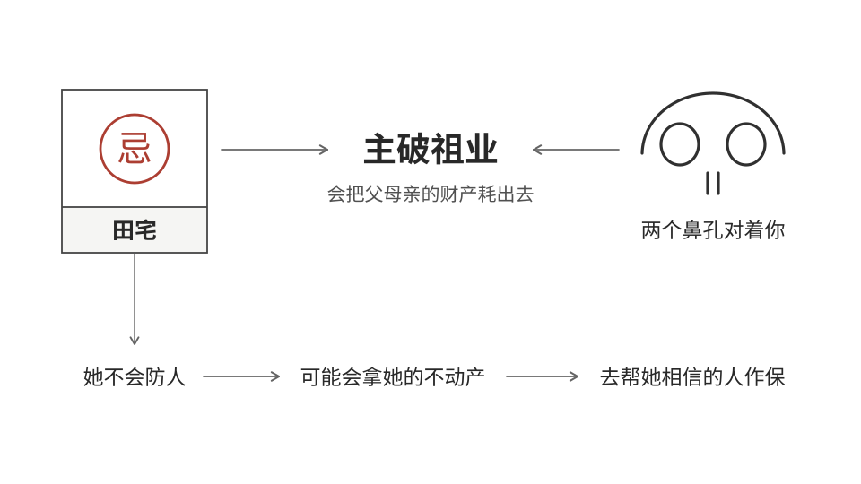 |
| **这个化忌落到人事上，她会做出什么事？** | 〔口述〕「你说那那那那这个是化忌」，「如果以人间道来说的话」「她不会防人」，「所以她可能会拿她的不动产」「去帮她相信的人作保」，然后就出事。（[00:33:05–00:33:18](https://www.bilibili.com/video/BV1KJsLekEfA/?p=23&t=1985)，第 59574–59963 帧） 〔口述〕「那她嘴上说我不会」，「别人她就会」；「因为她不认为她会」「因她不戒嘛」「不知道戒」。（[00:33:38–00:33:47](https://www.bilibili.com/video/BV1KJsLekEfA/?p=23&t=2018)，第 60558–60827 帧） 〔板书〕右上方圆圈里新写了一个字，被手挡住大半，认不出；其余可辨「巨门」「天机」「权」「夫妻」「12-22」和圆圈「27」。（[00:33:45](https://www.bilibili.com/video/BV1KJsLekEfA/?p=23&t=2025)，第 60779 帧） |
| **破祖业的人，面相上怎么看？** | 〔口述〕「那我们在相上面可以看到」「这个人破祖业的相可以看到」：「鼻孔很大」，「老远就看到两个鼻孔这样子的」，「鼻子这样两个鼻孔要破祖业」。（[00:33:18–00:33:33](https://www.bilibili.com/video/BV1KJsLekEfA/?p=23&t=1998)，第 59964–60401 帧） 〔口述〕人坐着，「她坐在你面前」「两个鼻孔对着你」，「这就是破祖业……」。（[00:33:33–00:33:38](https://www.bilibili.com/video/BV1KJsLekEfA/?p=23&t=2013)，第 60402–60557 帧） 〔板书〕黑板中上方新画了一个图：一道弧线下有两个圆圈，再下面两短竖，没有写字。（[00:33:30](https://www.bilibili.com/video/BV1KJsLekEfA/?p=23&t=2010)，第 60314 帧） 〔推断〕推断：这个图是边说「两个鼻孔」边画的，像是鼻子与两个鼻孔的示意；倪师没有口头说明图的意思。（[00:33:30](https://www.bilibili.com/video/BV1KJsLekEfA/?p=23&t=2010)，第 60314 帧） 〔口述〕「所以鼻孔很大」；父母「有财产很多」，「那你生个小孩一看」「怎么鼻孔对着你」，「这个财财产最好不要挂他的名字」「换人比较好」「要防一下」「不然会耗出去」；相书说「破到祖先的产业大部分都是这种格的人」。（[00:33:47–00:34:11](https://www.bilibili.com/video/BV1KJsLekEfA/?p=23&t=2027)，第 60828–61541 帧） |
| **32岁前后来找，是她的命还是她的运？** | 〔口述〕转到化解：「那我们在还有一个地方要帮她改的」；「如果32岁以前不让她结婚的话」「她就结不了婚了」。（[00:34:11–00:34:19](https://www.bilibili.com/video/BV1KJsLekEfA/?p=23&t=2051)，第 61542–61775 帧） 〔口述〕「所以她33岁以后来找我们的话」「是她的命哦」，「32岁以前来找我们是她的运哦」；「所以她27岁来找我们」「太好了知不知道」。（[00:34:19–00:34:28](https://www.bilibili.com/video/BV1KJsLekEfA/?p=23&t=2059)，第 61776–62051 帧） 〔板书〕黑板中部有一个圆圈，里面写「27」，下方还有一字（像「大」，不确定）。（[00:30:57](https://www.bilibili.com/video/BV1KJsLekEfA/?p=23&t=1857)，第 55734 帧） 〔推断〕推断：板上圆圈「27」与「她27岁来找我们」数字相同，可能就是标她来找的岁数；倪师本块没有明说。（[00:34:25–00:34:26](https://www.bilibili.com/video/BV1KJsLekEfA/?p=23&t=2065)，第 61962–61997 帧） |
| **第一次婚姻为什么要当机立断舍掉？** | 〔口述〕「第一次婚姻要舍掉」；倪师学有人劝她「你稍微再等一下没有关系」「给那个男的一个机会」。（[00:34:28–00:34:36](https://www.bilibili.com/video/BV1KJsLekEfA/?p=23&t=2068)，第 62052–62303 帧） 〔口述〕这「叫做愚善」：「人家刚开始在骗你的」，「你后面还给他机会啊」；「对不对已经骗你了」「你还是给他机会」。（[00:34:36–00:34:46](https://www.bilibili.com/video/BV1KJsLekEfA/?p=23&t=2076)，第 62304–62603 帧） 〔口述〕倪师说很多太太都这样，「蠢的个要死」，旁人来问还跟着「两个一起蠢」，「两只虫嘛就是蠢」。（[00:34:46–00:34:55](https://www.bilibili.com/video/BV1KJsLekEfA/?p=23&t=2086)，第 62604–62873 帧） 〔口述〕「所以说遇到这种情形」「马上要当当机立断舍掉」。（[00:34:55–00:34:58](https://www.bilibili.com/video/BV1KJsLekEfA/?p=23&t=2095)，第 62874–62963 帧） |
| **舍掉婚姻以后，要搬去哪个方位？** | 〔口述〕「舍掉以后西南角」「西北角不要住了」；「她之所以会遇到这种情形」「跟她运有关系住西北角」，要「马上跳到东南角去」（西南、西北的出入见待核）。（[00:34:58–00:35:06](https://www.bilibili.com/video/BV1KJsLekEfA/?p=23&t=2098)，第 62964–63197 帧） 〔叠图〕兄弟戊戌（大限 13~22）：紫微得、天相得、文曲陷；叠图该格标着「改住东南角」。（[00:35:19–00:35:22](https://www.bilibili.com/video/BV1KJsLekEfA/?p=23&t=2119)，第 63580–63677 帧） 〔叠图〕命宫己亥格后来也标着「改住东南角」，同格印的岁数里有 30。（[00:35:49](https://www.bilibili.com/video/BV1KJsLekEfA/?p=23&t=2149)，第 64475–64487 帧） |
| **哪一年改、哪一年让红鸾星动最好？** | 〔口述〕「如果你这一年改这年」「这年（27）改的时候」，「第二年（28） 没有什么」「没有没有星」。括号里的数字是字幕注字。（[00:35:06–00:35:16](https://www.bilibili.com/video/BV1KJsLekEfA/?p=23&t=2106)，第 63198–63491 帧） 〔叠图〕福德辛丑（大限 103~112）：天贵旺、大耗平，印的岁数里有 28；叠图该格标着「无吉星」。（[00:35:11](https://www.bilibili.com/video/BV1KJsLekEfA/?p=23&t=2111)，第 63335–63353 帧） 〔口述〕「如果我们31岁就改」，「32岁那年让她红鸾星动是不是很好」，「32岁如果她能够结婚的话」。（[00:35:19–00:35:29](https://www.bilibili.com/video/BV1KJsLekEfA/?p=23&t=2119)，第 63588–63875 帧） 〔叠图〕夫妻丁酉格（红鸾旺）旁随后标出「红鸾星动」。（[00:35:30–00:35:31](https://www.bilibili.com/video/BV1KJsLekEfA/?p=23&t=2130)，第 63905–63947 帧） |
| **该让她嫁哪种先生？嫁错会怎样？** | 〔口述〕「先生是巨内化权侧会禄存化禄」（巨内即巨门），「这就是从商了」「先生会做生意的」，「因为我们知道这个八字会做生意」。（[00:35:29–00:35:37](https://www.bilibili.com/video/BV1KJsLekEfA/?p=23&t=2129)，第 63876–64115 帧） 〔叠图〕夫妻丁酉：天机旺且化权、巨门庙；迁移癸巳：天同庙且化禄、禄存庙、地空庙、天官旺。（[00:35:30–00:35:31](https://www.bilibili.com/video/BV1KJsLekEfA/?p=23&t=2130)，第 63905–63947 帧） 〔口述〕「我们让她嫁个做生意的人」，刚好门当户对；「你如果让她嫁给这个紫微天相文曲星」就「变成从官的」。（[00:35:37–00:35:46](https://www.bilibili.com/video/BV1KJsLekEfA/?p=23&t=2137)，第 64116–64397 帧） 〔叠图〕兄弟戊戌（紫微得、天相得、文曲陷）格标着「先生从官」；随后子女丙申（天马旺、大限 33~42）也贴出。（[00:35:49–00:35:51](https://www.bilibili.com/video/BV1KJsLekEfA/?p=23&t=2149)，第 64488–64535 帧） 〔口述〕「如果我们让她嫁个这种先生的话」，「33-42变成夫妻聚少散多」「天马星就变了」，「所以让她从同行最好」。（[00:35:49–00:36:04](https://www.bilibili.com/video/BV1KJsLekEfA/?p=23&t=2149)，第 64488–64937 帧） |

**总结区**

- 通用规则：化忌的十年里红鸾星就没有了，婚姻难动（[00:31:21–00:31:24](https://www.bilibili.com/video/BV1KJsLekEfA/?p=23&t=1881)，第 56430–56531 帧）；一个人寡居太久，除非修佛法、有心灵依靠，否则人会变，眼睛凶光重、脸越来越大（[00:31:39–00:32:04](https://www.bilibili.com/video/BV1KJsLekEfA/?p=23&t=1899)，第 56976–57731 帧）；田宅宫化忌，相书一般写主破祖业，即把父母的财产耗出去（[00:32:40–00:33:04](https://www.bilibili.com/video/BV1KJsLekEfA/?p=23&t=1960)，第 58806–59543 帧）；鼻孔大、两个鼻孔对着人，是破祖业之相；相书说破到祖产的大部分是这种格的人（[00:33:18–00:34:11](https://www.bilibili.com/video/BV1KJsLekEfA/?p=23&t=1998)，第 59964–61541 帧）
- 只在本例：红鸾在夫妻宫（大限 23~32），过32岁不动、33-42逢化忌，婚姻非常不好而事业很好（[00:30:57–00:31:30](https://www.bilibili.com/video/BV1KJsLekEfA/?p=23&t=1857)，第 55734–56717 帧）；兄弟紫微天相、眉细长，兄弟得力、宜兄弟姐妹合伙做事业；她是文、父母是武，不从父母职业、不承祖业（[00:32:04–00:32:38](https://www.bilibili.com/video/BV1KJsLekEfA/?p=23&t=1924)，第 57732–58769 帧）；27岁来找：舍掉第一次婚姻，不住西北角改住东南角，32岁让红鸾星动（[00:34:11–00:35:29](https://www.bilibili.com/video/BV1KJsLekEfA/?p=23&t=2051)，第 61542–63875 帧）；先生巨门化权会禄存化禄主从商，宜嫁做生意的；嫁紫微天相文曲会从官、33-42聚少散多，从同行最好（[00:35:29–00:36:04](https://www.bilibili.com/video/BV1KJsLekEfA/?p=23&t=2129)，第 63876–64937 帧）
- 不是排盘规则，是处世方法：父母财产多而孩子鼻孔朝人，财产最好不挂他名字、换人、要防一下（[00:33:47–00:33:59](https://www.bilibili.com/video/BV1KJsLekEfA/?p=23&t=2027)，第 60828–61199 帧）；对方已经在骗还一再给机会，叫愚善；遇到这种情形要当机立断舍掉（[00:34:28–00:34:58](https://www.bilibili.com/video/BV1KJsLekEfA/?p=23&t=2068)，第 62052–62963 帧）；不会防人的人，可能拿不动产替相信的人作保而出事（[00:33:09–00:33:18](https://www.bilibili.com/video/BV1KJsLekEfA/?p=23&t=1989)，第 59682–59963 帧）

**待核**

1. 「辛普」字幕错字，语音作「辛苦」，按辛苦理解（[00:31:17](https://www.bilibili.com/video/BV1KJsLekEfA/?p=23&t=1877)，第 56322 帧）
2. 「过了32 33那个化忌」语音作「十二三十六化妓」，两路不全对；这颗化忌是哪颗、在哪宫本块没说清，该段叠图只见田宅庚寅廉贞化忌（[00:31:18](https://www.bilibili.com/video/BV1KJsLekEfA/?p=23&t=1878)，第 56358 帧）
3. 预告下一例的「娶了3个老婆真厉書」，「厉書」按语音改为厉害（[00:31:13](https://www.bilibili.com/video/BV1KJsLekEfA/?p=23&t=1873)，第 56202 帧）
4. 「兄弟是紫微天相是青星」中「青星」语音作「之极星」，两路对不上，未引（[00:32:09](https://www.bilibili.com/video/BV1KJsLekEfA/?p=23&t=1929)，第 57888 帧）
5. 「兄弟姐妹合伙」语音作「也没合伙」，待在本地时兄弟姐妹能否合伙两路对不上（[00:32:24](https://www.bilibili.com/video/BV1KJsLekEfA/?p=23&t=1944)，第 58326 帧）
6. 「因为她是文……她的父母亲是武」文、武具体指什么，本块没有解释（[00:32:28](https://www.bilibili.com/video/BV1KJsLekEfA/?p=23&t=1948)，第 58440 帧）
7. 「人间道」倪师用了但没解释（[00:33:09](https://www.bilibili.com/video/BV1KJsLekEfA/?p=23&t=1989)，第 59682 帧）
8. 「不戒」「不知道戒」语音作「借」，是戒备的戒还是借，待核（[00:33:43](https://www.bilibili.com/video/BV1KJsLekEfA/?p=23&t=2023)，第 60702 帧）
9. 「这就是破祖业就是我了」后半句语意不清，语音相同（[00:33:36](https://www.bilibili.com/video/BV1KJsLekEfA/?p=23&t=2016)，第 60492 帧）
10. 「如果你是父母来」语音作「父母亲」，未引（[00:33:48](https://www.bilibili.com/video/BV1KJsLekEfA/?p=23&t=2028)，第 60864 帧）
11. 「愚善」字幕可信度 0.37，语音作「余善」（[00:34:36](https://www.bilibili.com/video/BV1KJsLekEfA/?p=23&t=2076)，第 62304 帧）
12. 「十之元九」语音作「十只八九」，应为十之八九，未引（[00:34:46](https://www.bilibili.com/video/BV1KJsLekEfA/?p=23&t=2086)，第 62604 帧）
13. 「舍掉以后西南角」与前后一直说住西北角不一致，是口误还是识别错看不出（[00:34:58](https://www.bilibili.com/video/BV1KJsLekEfA/?p=23&t=2098)，第 62964 帧）
14. 「巨内」改为巨门；「侧会」语音作「测会」，词义本块没解释；口述巨门化权，但叠图化权在天机（天机旺权），巨门庙未标化权，两者对不上（[00:35:29](https://www.bilibili.com/video/BV1KJsLekEfA/?p=23&t=2129)，第 63876 帧）
15. 「刚好内当户对」语音作「门当户对」，按门当户对改正（[00:35:39](https://www.bilibili.com/video/BV1KJsLekEfA/?p=23&t=2139)，第 64170 帧）
16. 「你让她31岁一结婚」「3030岁改」，语音作「三十岁一结婚」「十一岁三十岁改」，几岁结婚、几岁改两路对不上，笔记未收（[00:35:46–00:35:49](https://www.bilibili.com/video/BV1KJsLekEfA/?p=23&t=2146)，第 64398–64487 帧）
17. 单字句「身」略过；同句语音报了一串岁数（二十五至三十一岁），未收（[00:35:16](https://www.bilibili.com/video/BV1KJsLekEfA/?p=23&t=2116)，第 63492 帧）
18. 板书：[00:33:01](https://www.bilibili.com/video/BV1KJsLekEfA/?p=23&t=1981)，第 59438 帧竖写「業」上面两字、左上「外」「地的」中间一字认不出；[00:33:45](https://www.bilibili.com/video/BV1KJsLekEfA/?p=23&t=2025)，第 60779 帧右上圆圈里新写的字被手挡住认不出；[00:30:57](https://www.bilibili.com/video/BV1KJsLekEfA/?p=23&t=1857)，第 55734 帧圆圈「27」下的字像「大」不确定
19. 叠图里「改住东南角」「先生从官」「红鸾星动」「无吉星」是剪辑加的提示字，不是星曜（[00:35:10–00:35:56](https://www.bilibili.com/video/BV1KJsLekEfA/?p=23&t=2110)，第 63312–64680 帧）

## 例四（男命，命宫丙戌破军）：福德天喜多婚、刑克二妻、外刚内柔

| 巳 | 午 | 未 | 申 |
|---|---|---|---|
| （巳：没贴过） | **财帛 壬午** 七杀旺 | **子女 癸未** （无主星、辅星） | **夫妻 甲申** 廉贞庙 天钺庙 |
| **迁移 庚辰** 紫微得科 天相得 文曲得 擎羊庙 | **例四 · 命宫丙戌** | 据视频叠图重排 | **兄弟 乙酉** （无主星、辅星） |
| **交友 己卯** 天机旺禄 巨门庙 禄存庙 火星利 | 后期贴图，不算倪师的话 |  | **命宫 丙戌**（身宫） 破军旺 文昌陷 铃星庙 |
| **官禄 戊寅** 贪狼平 右弼旺 陀罗陷 | **田宅 己丑** 太阳不 太阴庙忌 | **福德 戊子** 武曲旺 天府庙 左辅旺 天魁旺 | **父母 丁亥** 天同庙 天马平 地空陷 |

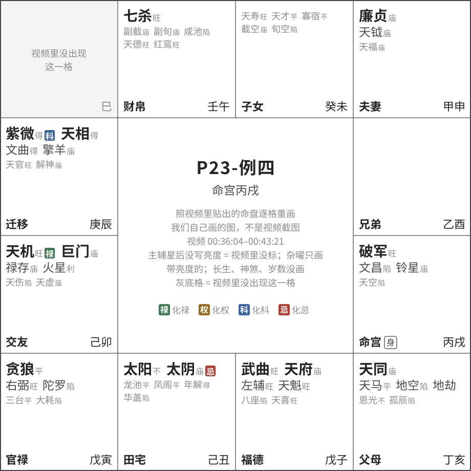

按视频里这张盘逐格重画（我们自己画的图，不是视频截图）；星名后没写亮度的，视频里本来就没标亮度；数据见 [命盘-P23-例四.json](图/命盘-P23-例四.json)。

### 8　例四男命：福德天喜多婚、刑克二妻（[00:36:04–00:43:21](https://www.bilibili.com/video/BV1KJsLekEfA/?p=23&t=2164)，第 64938–78049 帧）

| 提示区 | 笔记区 |
|---|---|
| **例四这张盘是什么人？怎么起的？** | 〔口述〕倪师换讲一张新盘：「诸位看这个」「酉年他属鸡的」，又说「这是顺转男的顺转」，即这是男命，按顺转排。（[00:36:04–00:36:22](https://www.bilibili.com/video/BV1KJsLekEfA/?p=23&t=2164)，第 64938–65465 帧） 〔口述〕一边在黑板上写数字一边说「4925通通在这边（未宫）」；括号里的「未宫」是字幕注字，语音栏用汉字数字记作四十九二十五通通在这边。（[00:36:11–00:36:16](https://www.bilibili.com/video/BV1KJsLekEfA/?p=23&t=2171)，第 65148–65291 帧） 〔叠图〕子女癸未：天寿旺、天才平、截空庙、旬空陷、寡宿不，另有吊客、月煞、病符、沐浴；大限 35~44，格中框出 25、37、49 三个数。（[00:36:11–00:36:16](https://www.bilibili.com/video/BV1KJsLekEfA/?p=23&t=2171)，第 65148–65291 帧） 〔板书〕可辨：左侧一格「巨门」「天机禄」「交友」，上排一格「45-54」，右侧一格「15-24」；其余草书认不出。（[00:36:17](https://www.bilibili.com/video/BV1KJsLekEfA/?p=23&t=2177)，第 65336 帧） 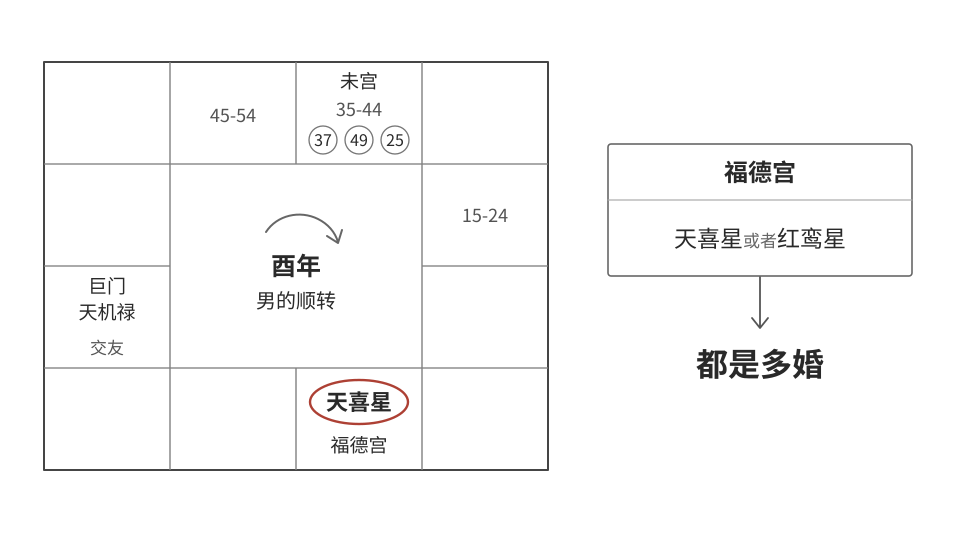 |
| **福德宫有天喜、红鸾主什么？老公这样要不要改？** | 〔口述〕这张盘「这里有个特征」「天喜星在福德宫」；并讲成规则：「一个人的福德啊」「有天喜星或者红鸾星呐」「都是多婚」。又说「这是多婚的命」「啊天喜在福德」「这就是主的一定主的是多婚啊」。（[00:36:23–00:36:50](https://www.bilibili.com/video/BV1KJsLekEfA/?p=23&t=2183)，第 65508–66323 帧） 〔叠图〕福德戊子：天喜旺、天府庙、武曲旺、左辅旺、天魁旺、八座陷，另有小耗、息神、贯索、墓；大限 105~114。（[00:37:15–00:37:16](https://www.bilibili.com/video/BV1KJsLekEfA/?p=23&t=2235)，第 67062–67097 帧） 〔板书〕可辨：下排一格里有一个用橙色圈住的草书字，疑为「天喜」，格底疑为「福德」，有橙线连过去；右上有圆圈「37」「49」「25」，旁写「35-44」；其余认不出。（[00:36:30](https://www.bilibili.com/video/BV1KJsLekEfA/?p=23&t=2190)，第 65712 帧） 〔口述〕「所以所以福德宫代表一世的福禄」。劝女方：「如果你发现你老公的福德宫」「全部是桃花星」「你也不必去改了」，「你不改他他还是这样」「很难比较难改」。（[00:36:50–00:37:04](https://www.bilibili.com/video/BV1KJsLekEfA/?p=23&t=2210)，第 66324–66731 帧） |
| **红鸾天喜一进来就结婚：第一次是几岁？** | 〔指代〕说「那这个福德」时，手指点在黑板下排一个红圈圈住的草书「天喜」上。（[00:37:03](https://www.bilibili.com/video/BV1KJsLekEfA/?p=23&t=2223)，第 66710 帧） 〔口述〕「那这个福德宫在天喜星你看哦」「第一次2525在这」，接着说「24 我为什么画三个」「就是三个流年」。（[00:37:04–00:37:09](https://www.bilibili.com/video/BV1KJsLekEfA/?p=23&t=2224)，第 66732–66899 帧） 〔口述〕「24岁的时候」「他的红鸾星就进来」，「你不需要看他十年」；福德宫「一进来的时候」「逢到红鸾星天喜星他就去结婚了」，并赞「这很很厉害的有一套哦」。（[00:37:10–00:37:21](https://www.bilibili.com/video/BV1KJsLekEfA/?p=23&t=2230)，第 66900–67241 帧） 〔叠图〕财帛壬午：七杀旺、红鸾旺、咸池陷、天德旺、台辅、天厨、大耗，另有冠带；大限 45~54，小限数中有 12、24。（[00:37:10–00:37:15](https://www.bilibili.com/video/BV1KJsLekEfA/?p=23&t=2230)，第 66900–67061 帧） |
| **破军文昌加化科，为什么外刚内柔？** | 〔叠图〕命宫丙戌：破军旺、文昌陷、铃星庙、天空陷，标身宫；迁移庚辰：紫微得科、天相得、擎羊庙、文曲得、天官旺。（[00:37:29–00:37:36](https://www.bilibili.com/video/BV1KJsLekEfA/?p=23&t=2249)，第 67488–67697 帧） 〔口述〕「我们去探讨人间道」，为「什么他会这样子」：「你看这个人就是化科」「那破军星文昌进来之后」「这种这种武官星里面化科」「代表武官星代表外刚啊」。（[00:37:26–00:37:42](https://www.bilibili.com/video/BV1KJsLekEfA/?p=23&t=2246)，第 67386–67877 帧） 〔口述〕外刚是「就是外面看起来很刚强」，可是「里面肚子里是很很胆小」「胆小如鼠啊」，「就是外刚肉柔的人」（肉柔即内柔）。（[00:37:45–00:37:57](https://www.bilibili.com/video/BV1KJsLekEfA/?p=23&t=2265)，第 67974–68327 帧） 〔指代〕说「外刚从这里可以看到」时，手指按在几条橙色连线的交汇处，即「15-24 兄弟」下方那格（内有「擎…昌…-14」样字）的左边线上；接着说「化化科而已」。（[00:38:13–00:38:15](https://www.bilibili.com/video/BV1KJsLekEfA/?p=23&t=2293)，第 68800–68873 帧） 〔口述〕对比：「很多人大部分人都是外柔肉刚」，例如女孩子「娇娇小小的长得好漂亮」，「很凶悍的」，「那这种女孩子就是外柔」「外柔肉刚」；而「那这个刚好外刚内柔」。（[00:37:57–00:38:12](https://www.bilibili.com/video/BV1KJsLekEfA/?p=23&t=2277)，第 68328–68789 帧） |
| **有才艺的男人为何讨女孩欢心却难长久？** | 〔口述〕「所以这个人呢」柔的性「比较容易博女孩子的欢心」；「然后他是文昌文曲又化科有没有」，才艺很好，「比如画画弹琴啊这个作曲呀」「那女孩子就很喜欢」。（[00:38:15–00:38:30](https://www.bilibili.com/video/BV1KJsLekEfA/?p=23&t=2295)，第 68874–69323 帧） 〔口述〕「可是不能维持长久」：「因为你喜欢只是你有才艺啊看到了」，「维持长久还真的肚子里有没有」「有没有什么学问对不对」「也不能维持长久」。（[00:38:33–00:38:42](https://www.bilibili.com/video/BV1KJsLekEfA/?p=23&t=2313)，第 69414–69677 帧） 〔推断〕推断：倪师说的「文昌文曲又化科」，在叠图上对应命宫的文昌陷与迁移宫的文曲得、紫微得科；口述没有逐一点名这些宫。（[00:37:29–00:38:23](https://www.bilibili.com/video/BV1KJsLekEfA/?p=23&t=2249)，第 67488–69095 帧） |
| **第一次婚姻为何 24 岁结、31 岁离？** | 〔口述〕「所以他第一次24岁就结婚了」，再数到「31岁就怎么样」，为什么「会多常常会结婚」，「还有这个太阴化忌也有关系」。（[00:38:42–00:38:55](https://www.bilibili.com/video/BV1KJsLekEfA/?p=23&t=2322)，第 69678–70073 帧） 〔口述〕「男人的命太阴是指什么」——「太太妈妈都是结果一化忌」，「每逢到转到这个宫的时候」「就要毁一次啊」「那就是命」。（[00:38:57–00:39:09](https://www.bilibili.com/video/BV1KJsLekEfA/?p=23&t=2337)，第 70134–70487 帧） 〔口述〕总结第一段婚姻：「24结婚第一个31岁婚姻就离婚」。（[00:39:12–00:39:17](https://www.bilibili.com/video/BV1KJsLekEfA/?p=23&t=2352)，第 70566–70721 帧） 〔叠图〕财帛壬午格标着「第一次结婚」；田宅己丑：太阴庙忌、太阳不、凤阁平、龙池平、华盖陷、年解得，该格标着「离婚」，并框出 31。（[00:38:42–00:39:12](https://www.bilibili.com/video/BV1KJsLekEfA/?p=23&t=2322)，第 69678–70565 帧） 〔板书〕可辨：「45-54」「35-44」，圆圈「49」，左下格有一个圈；其余认不出。（[00:38:56](https://www.bilibili.com/video/BV1KJsLekEfA/?p=23&t=2336)，第 70104 帧） 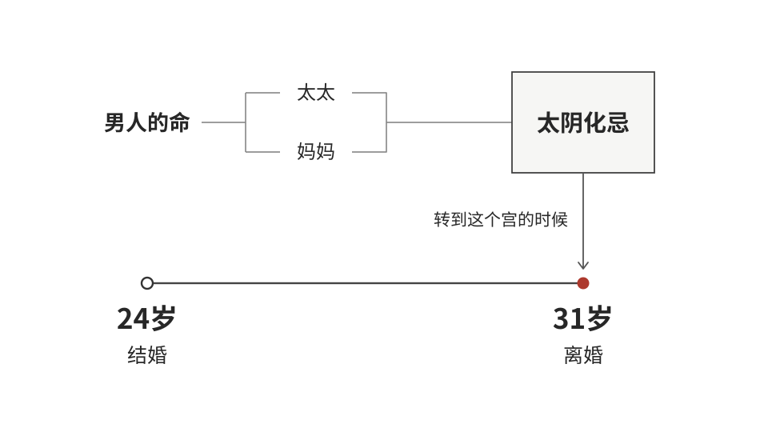 |
| **36 岁再婚，第二个老婆为什么会走？** | 〔口述〕「离婚以后 32」，「36岁红鸾星又进来了」「是不是他又去结婚」；讲给当事人听时，「他说哎你怎么知道啊」「他就是这样子啊」。（[00:39:17–00:39:27](https://www.bilibili.com/video/BV1KJsLekEfA/?p=23&t=2357)，第 70722–71039 帧） 〔口述〕「那36 再结婚」，「第二个老婆是这个买单了」（语音此处多出半句，作第二个老婆她是死掉）。（[00:39:28–00:39:38](https://www.bilibili.com/video/BV1KJsLekEfA/?p=23&t=2368)，第 71040–71345 帧） 〔口述〕自问「那你怎么老师这个」「什么买单」，答「大小二限逢」：「看35-44是不是空的」「逢流年逢到化忌」「这个是死就大小二限逢」「妻的大小二限逢」。（[00:39:38–00:39:51](https://www.bilibili.com/video/BV1KJsLekEfA/?p=23&t=2378)，第 71346–71741 帧） 〔叠图〕田宅己丑格标着「丧妻」，数中有 43；子女癸未格标着「43岁大小二限逢」「无吉星化忌对冲」。（[00:39:28–00:39:38](https://www.bilibili.com/video/BV1KJsLekEfA/?p=23&t=2368)，第 71040–71345 帧） |
| **为什么第一个太太没事、第二个出事？** | 〔口述〕「所以第一个太太25-34没有关系啊」：「会到31岁」「（31） 并不在这十年（35-44）」「而在这十年（2534）」，「所以第一次大限没逢到」。括号内是字幕注字。（[00:39:51–00:40:01](https://www.bilibili.com/video/BV1KJsLekEfA/?p=23&t=2391)，第 71742–72059 帧） 〔口述〕「第二次是大限逢到」「小限叉逢到」（叉即又），「完了太太要走人」。（[00:40:03–00:40:08](https://www.bilibili.com/video/BV1KJsLekEfA/?p=23&t=2403)，第 72090–72251 帧） 〔推断〕推断：叠图标的「43岁大小二限逢」，43 落在口述说的 35-44 这十年里；但倪师口述没有说出 43 岁这个数。（[00:39:32–00:40:08](https://www.bilibili.com/video/BV1KJsLekEfA/?p=23&t=2372)，第 71166–72251 帧） |
| **刑克二妻后，第三次婚姻为何不杀？** | 〔口述〕「丧妻这这种八字在我们过去的命上面来说」「刑克二妻懂不懂」「要刑克两个妻子」「要嫁给他第三个的比较幸福」。（[00:40:08–00:40:16](https://www.bilibili.com/video/BV1KJsLekEfA/?p=23&t=2408)，第 72252–72497 帧） 〔口述〕「所以又循环回来」「那4948 又红鸾星天喜星来会了」，进入 45-54 红鸾星的十年大运（字幕「进人」即进入），「再逢到这就不杀了」。（[00:40:16–00:40:28](https://www.bilibili.com/video/BV1KJsLekEfA/?p=23&t=2416)，第 72498–72845 帧） 〔口述〕「你知道为什么不杀」：「因为太太跟他可能跟他小十几二十岁」「小得很多」。（[00:40:29–00:40:35](https://www.bilibili.com/video/BV1KJsLekEfA/?p=23&t=2429)，第 72894–73055 帧） 〔叠图〕财帛壬午格标着「第三次婚姻」「红鸾十年大运」「逢到化忌不杀」，星曜仍是七杀旺、红鸾旺等。（[00:40:18–00:40:23](https://www.bilibili.com/video/BV1KJsLekEfA/?p=23&t=2418)，第 72564–72695 帧） |
| **福德有红鸾天喜，到老谁陪他？** | 〔口述〕「所以他这个人到老」，「福德就是说他到老的时候」「他先走太太在那边的」「一辈子就有太太陪他的」。（[00:40:35–00:40:41](https://www.bilibili.com/video/BV1KJsLekEfA/?p=23&t=2435)，第 73056–73253 帧） 〔口述〕对比别人：「有的人没有啊」，「太太走了就一个人在那边」「子女给他送终」。（[00:40:41–00:40:48](https://www.bilibili.com/video/BV1KJsLekEfA/?p=23&t=2441)，第 73254–73463 帧） 〔口述〕「所以他早年的婚娶的年龄跟他差不多」「到晚年的婚娶她年龄」「太太比他差多了」，「这就是福德官有红鸾天喜星的」（官即宫）。（[00:40:48–00:40:56](https://www.bilibili.com/video/BV1KJsLekEfA/?p=23&t=2448)，第 73464–73709 帧） 〔口述〕随后笑说：「如果没有你把佗加自己加」「加一加进去就好了」「这个把它改一下」「偷偷删減一下」——是玩笑话，不是排盘规则。（[00:40:57–00:41:05](https://www.bilibili.com/video/BV1KJsLekEfA/?p=23&t=2457)，第 73710–73955 帧） |
| **35-44 这十年事业为什么凶？** | 〔口述〕「这是婚姻」，「而大限来说的话」「你看他的流年并不见得好啊」「你看他35-44 多凶啊」。（[00:41:05–00:41:14](https://www.bilibili.com/video/BV1KJsLekEfA/?p=23&t=2465)，第 73956–74225 帧） 〔口述〕「关于事业上面来说就」「对面是化忌有没有」，「化忌来说除了太太死的话」「做事情事倍功半」，「因为化忌就是反背」「还有官司纠纷呢」。（[00:41:14–00:41:26](https://www.bilibili.com/video/BV1KJsLekEfA/?p=23&t=2474)，第 74226–74585 帧） 〔叠图〕子女癸未格标着「化忌对冲」「无吉星」；同时贴出田宅己丑（太阴庙忌）。（[00:41:09–00:41:11](https://www.bilibili.com/video/BV1KJsLekEfA/?p=23&t=2469)，第 74070–74135 帧） |
| **45-54 为何好起来？化科坐命主什么？** | 〔口述〕「那他从45-54岁以后开始好起来了」，「为什么化科」「这个是回到本命富了」（富即宫）「又回到财帛」。（[00:41:26–00:41:34](https://www.bilibili.com/video/BV1KJsLekEfA/?p=23&t=2486)，第 74586–74825 帧） 〔指代〕说「这个是回到本命宫了」时手平伸指向左下方的格子；说「这个化科」时指向左边中间一格写着数字的地方。两处的字都被叠图或手盖住，认不全。（[00:41:31–00:41:33](https://www.bilibili.com/video/BV1KJsLekEfA/?p=23&t=2491)，第 74746–74815 帧） 〔口述〕「这个化科坐命的人才艺就会彰显」「才艺就会很明显」，「比如说专业方面的」「还有律师医师会计师也是这种命的」「还有画画文笔方面也会很好」。（[00:41:34–00:41:44](https://www.bilibili.com/video/BV1KJsLekEfA/?p=23&t=2494)，第 74826–75143 帧） 〔口述〕「这时候开始就很顺了」「非常的顺」「一直会到老」，「这就是很特殊的一个一个例子」。（[00:41:44–00:41:54](https://www.bilibili.com/video/BV1KJsLekEfA/?p=23&t=2504)，第 75144–75449 帧） 〔叠图〕这时同时贴出财帛壬午（大限 45~54）、迁移庚辰（紫微得科）与命宫丙戌。（[00:41:26–00:41:33](https://www.bilibili.com/video/BV1KJsLekEfA/?p=23&t=2486)，第 74586–74795 帧） |
| **夫妻宫廉贞天钺，他的老婆什么样？** | 〔口述〕「然后你再注意看他的夫妻」「廉贞天钺」「这个桃花星坐夫妻宫」，「这个男这个男人还更妙呢」「这个不是漂亮的我不追」「他老婆都很漂亮啊」「你看这有一套」。（[00:41:55–00:42:11](https://www.bilibili.com/video/BV1KJsLekEfA/?p=23&t=2515)，第 75450–75959 帧） 〔指代〕说「廉贞天钺这个」时右手按在黑板上方中间那格上部的星名处，字被手挡住；该格下面黑板写着「夫妻」，能看清。（[00:41:59](https://www.bilibili.com/video/BV1KJsLekEfA/?p=23&t=2519)，第 75595 帧） 〔叠图〕夫妻甲申：廉贞庙、天钺庙、天福庙，另有喜神、亡神、病符、长生。（[00:41:55–00:41:58](https://www.bilibili.com/video/BV1KJsLekEfA/?p=23&t=2515)，第 75450–75557 帧） |
| **漂亮女孩为何常嫁丑先生？好命坏命谁说了算？** | 〔口述〕「那破军星坐命的男人呢」「不见得长得漂亮」，「所以你常常看到有的女孩子很漂亮啊」「嫁的先生很丑」。（[00:42:12–00:42:18](https://www.bilibili.com/video/BV1KJsLekEfA/?p=23&t=2532)，第 75960–76163 帧） 〔口述〕第一个原因：漂亮女孩「她常常被人家追」，心想「如果我先生长得很帅也是这样的」，所以「她要嫁宁可嫁个先生比较安分」「比较老实的」，「是她认为的哦」；倪师补一句「她认力安分老实不一定都是」（认力即认为），外表不好的人一样有桃花。（[00:42:21–00:42:42](https://www.bilibili.com/video/BV1KJsLekEfA/?p=23&t=2541)，第 76248–76889 帧） 〔口述〕「那第二个」：「她觉得对这种人有安金感」「负责任安全感」（安金即安全），「她就找这样的人」，「所以这个男人反而变成好命」。（[00:42:46–00:42:59](https://www.bilibili.com/video/BV1KJsLekEfA/?p=23&t=2566)，第 76986–77381 帧） 〔口述〕「那你说是好命和坏命」：「女人说这种人怎么可以」「男人说啊太好了对不对」，「这个很难讲哈」「这是看个人的认定」。（[00:42:59–00:43:12](https://www.bilibili.com/video/BV1KJsLekEfA/?p=23&t=2579)，第 77382–77771 帧） 〔口述〕收尾问学生「有没有疑间」（疑间即疑问），又说「像这个批疾厄的话」「肝病会不会批」「以此类推的哈」；批的是哪张盘、什么材料没有交代。（[00:43:12–00:43:21](https://www.bilibili.com/video/BV1KJsLekEfA/?p=23&t=2592)，第 77772–78049 帧） |

**总结区**

- 通用规则：一个人的福德宫有天喜星或红鸾星，都主多婚（[00:36:31–00:36:50](https://www.bilibili.com/video/BV1KJsLekEfA/?p=23&t=2191)，第 65754–66323 帧）。；男人的命太阴指太太、妈妈，太阴化忌每逢转到这个宫就要毁一次（[00:38:57–00:39:09](https://www.bilibili.com/video/BV1KJsLekEfA/?p=23&t=2337)，第 70134–70487 帧）。；化忌就是反背，主做事情事倍功半，还有官司纠纷（[00:41:16–00:41:26](https://www.bilibili.com/video/BV1KJsLekEfA/?p=23&t=2476)，第 74298–74585 帧）。；化科坐命的人才艺会彰显，律师、医师、会计师、画画文笔方面也会很好（[00:41:34–00:41:44](https://www.bilibili.com/video/BV1KJsLekEfA/?p=23&t=2494)，第 74826–75143 帧）。
- 只在本例：此男命 24 岁红鸾天喜进来第一次结婚，31 岁离婚，与太阴化忌有关（[00:38:42–00:39:17](https://www.bilibili.com/video/BV1KJsLekEfA/?p=23&t=2322)，第 69678–70721 帧）。；36 岁再婚，35-44 大限与流年大小二限逢化忌，第二个老婆走了；第一个太太在 25-34 大限，没逢到（[00:39:17–00:40:08](https://www.bilibili.com/video/BV1KJsLekEfA/?p=23&t=2357)，第 70722–72251 帧）。；刑克二妻，进入 45-54 红鸾大运的第三次婚姻不杀，太太小十几二十岁，到老有太太陪（[00:40:08–00:40:56](https://www.bilibili.com/video/BV1KJsLekEfA/?p=23&t=2408)，第 72252–73709 帧）。；35-44 事业事倍功半，45-54 化科回到本命宫、财帛后一直顺到老（[00:41:05–00:41:54](https://www.bilibili.com/video/BV1KJsLekEfA/?p=23&t=2465)，第 73956–75449 帧）。
- 不是排盘规则，是处世方法：发现老公福德宫全是桃花星，也不必去改，不改他还是这样、也很难改（[00:36:53–00:37:04](https://www.bilibili.com/video/BV1KJsLekEfA/?p=23&t=2213)，第 66396–66731 帧）。；靠才艺只能博一时欢心，维持长久要看肚子里有没有学问（[00:38:33–00:38:42](https://www.bilibili.com/video/BV1KJsLekEfA/?p=23&t=2313)，第 69414–69677 帧）。；是好命还是坏命，要看个人的认定（[00:42:59–00:43:12](https://www.bilibili.com/video/BV1KJsLekEfA/?p=23&t=2579)，第 77382–77771 帧）。

**待核**

1. [00:36:04](https://www.bilibili.com/video/BV1KJsLekEfA/?p=23&t=2164)，第 64938 帧板书图：画面淡入发白，板上字全认不出。
2. 第 65336、65712、66060、70104 帧板书：大部分草书认不出，如右下格「擎…」、下排各格星名、中部橙色字，均未写入。
3. [00:37:06](https://www.bilibili.com/video/BV1KJsLekEfA/?p=23&t=2226)，第 66786 帧字幕「第一次2525在这」，语音作「二十五二十五」，下一句却说「24」，数字对不上；[00:37:07](https://www.bilibili.com/video/BV1KJsLekEfA/?p=23&t=2227)，第 66834 帧「24 我为什么画三个」画的是哪三个数没说清，板书右上三个圆圈「37」「49」「25」与叠图子女癸未格框出的 25、37、49 相同，是否即此待核。
4. [00:36:59](https://www.bilibili.com/video/BV1KJsLekEfA/?p=23&t=2219)，第 66588 帧字幕「你不改他他还是这样」，语音作「不改他他就叫你改了」，两路不一致。
5. [00:37:36](https://www.bilibili.com/video/BV1KJsLekEfA/?p=23&t=2256)，第 67698 帧字幕「武官星」，语音作「五官星」；哪些星算武官星本块没有解释。[00:37:42](https://www.bilibili.com/video/BV1KJsLekEfA/?p=23&t=2262)，第 67878 帧「这刚啊实柔」语义不明，略过。
6. 第 68232、68328、68676 帧字幕「肉柔」「肉刚」，按语音改作内柔、内刚。
7. [00:38:03](https://www.bilibili.com/video/BV1KJsLekEfA/?p=23&t=2283)，第 68514 帧字幕「拿拿菜刀就是她」，语音作「再老有他很」，两路对不上，未引用。
8. [00:38:23](https://www.bilibili.com/video/BV1KJsLekEfA/?p=23&t=2303)，第 69096 帧字幕「艺又很好」，语音作「才艺又很好」，按语音理解为才艺很好。
9. [00:38:48–00:38:51](https://www.bilibili.com/video/BV1KJsLekEfA/?p=23&t=2328)，第 69864–69953 帧字幕开头「2:」「2」是乱码已去掉；「大阴」按语音与下文改作太阴。[00:38:55](https://www.bilibili.com/video/BV1KJsLekEfA/?p=23&t=2335)，第 70074 帧「这什么不好化忌非太阴化忌」句意不顺。
10. [00:39:09–00:39:12](https://www.bilibili.com/video/BV1KJsLekEfA/?p=23&t=2349)，第 70488–70565 帧「这个很好啊」「对他来说很好啊」指什么很好，没说清。
11. [00:39:32](https://www.bilibili.com/video/BV1KJsLekEfA/?p=23&t=2372)，第 71166 帧字幕「第二个老婆是这个买单了」，语音前半作「第二个老婆她是死掉」；叠图标「43岁大小二限逢」「丧妻」，但口述只说 35-44、没说 43 岁，两者如何对应待核。
12. [00:39:42](https://www.bilibili.com/video/BV1KJsLekEfA/?p=23&t=2382)，第 71460 帧「看35-44是不是空的」，这里的「空的」指什么没有解释。
13. [00:40:04](https://www.bilibili.com/video/BV1KJsLekEfA/?p=23&t=2404)，第 72144 帧「小限叉逢到」改作又逢到。[00:40:23](https://www.bilibili.com/video/BV1KJsLekEfA/?p=23&t=2423)，第 72696 帧「进人」改作进入，语音作「45到50」。[00:40:18](https://www.bilibili.com/video/BV1KJsLekEfA/?p=23&t=2418)，第 72564 帧「4948」是什么数没有解释。
14. [00:40:08](https://www.bilibili.com/video/BV1KJsLekEfA/?p=23&t=2408)，第 72252 帧倪师用「八字」一词说这张命盘，未解释。
15. [00:40:54](https://www.bilibili.com/video/BV1KJsLekEfA/?p=23&t=2454)，第 73620 帧「福德官」改作福德宫；[00:40:57](https://www.bilibili.com/video/BV1KJsLekEfA/?p=23&t=2457)，第 73710 帧「佗」字疑为它。
16. [00:41:15](https://www.bilibili.com/video/BV1KJsLekEfA/?p=23&t=2475)，第 74262 帧「对面是化忌」，对面指哪一宫没说明；叠图子女癸未格标「化忌对冲」。[00:41:19](https://www.bilibili.com/video/BV1KJsLekEfA/?p=23&t=2479)，第 74394 帧「刚好事情的发生还希望」语义不明，未引用。
17. [00:41:31](https://www.bilibili.com/video/BV1KJsLekEfA/?p=23&t=2491)，第 74754 帧「本命富」改作本命宫；「回到本命宫」「又回到财帛」具体指什么走到哪里，没有说明。
18. 第 76248、76710 帧「因力」「认力」改作因为、认为；[00:42:47](https://www.bilibili.com/video/BV1KJsLekEfA/?p=23&t=2567)，第 77022 帧「安金感」改作安全感；[00:43:12](https://www.bilibili.com/video/BV1KJsLekEfA/?p=23&t=2592)，第 77772 帧「疑间」改作疑问。
19. [00:42:43](https://www.bilibili.com/video/BV1KJsLekEfA/?p=23&t=2563)，第 76890 帧字幕「鱼尾纹都往上翘了」，语音作「因为我能往上翘了」，对不上，未引用。
20. [00:43:12–00:43:21](https://www.bilibili.com/video/BV1KJsLekEfA/?p=23&t=2592)，第 77772–78049 帧收尾问「批疾厄」「肝病会不会批」，是哪张盘、什么材料没有交代。
21. 指代 D150、D153、D161–D164、D167、D168、D173 为不确定，D154、D176 看不出，均未作依据。

