# P25 · 13 上：杀破狼 / 科权禄三会 / 小六壬 / 太阴陷化忌 / 红鸾天喜化忌（00:00:00–00:43:53，共 78,996 帧）

> 2026-11-12 整理。依据 DeepSeek 逐帧记录与现成的五层材料（字幕、语音、叠图、板书、指代），由 Claude（Opus 5.5 子代理）分段起草，引文由程序逐段对过字幕。流程 2026-11-11 经站长认可。
> 依据标记：〔口述〕字幕与语音两路对得上的话，「」里是字幕原字 ·〔叠图〕后期贴的电子命盘，**不算倪师的话** ·〔板书〕粉笔字（看过那一帧原图才写）·〔指代〕「这里 / 这个」指哪（只收核过、确定的）·〔推断〕笔记作者自己的推断。每条后面的时间码可以点，跳到 B 站那一秒。

## 全集总结

**通用规则**

- 巨门星主是非口舌官司，天刑也主打官司（[00:00:16–00:00:22](https://www.bilibili.com/video/BV1KJsLekEfA/?p=25&t=16)，第 492–665 帧）
- 事情发生以后才去算叫「事人」；君子「事天」，天是天象，事情发生前有预兆可看（[00:01:54–00:02:18](https://www.bilibili.com/video/BV1KJsLekEfA/?p=25&t=114)，第 3432–4163 帧）
- 阳宅上名=位是家和、位=名是万事兴：是什么名字就住什么位置，住谁的位置就用谁的名字做事当老板（[00:03:56–00:04:22](https://www.bilibili.com/video/BV1KJsLekEfA/?p=25&t=236)，第 7104–7871 帧）
- 算命大原则：不管流年怎样，遇到坏的流年就进德修业；进德修业后遇到好的流年就利建侯，出来广结善缘、建立社会背景（[00:07:10–00:07:28](https://www.bilibili.com/video/BV1KJsLekEfA/?p=25&t=430)，第 12900–13451 帧）
- 羊陀火铃空劫六杀星，一星独守时是凶灾，险处理不当第二个险马上跟来，就是祸不单行（[00:09:02–00:09:48](https://www.bilibili.com/video/BV1KJsLekEfA/?p=25&t=542)，第 16272–17651 帧）
- 只要科权禄三会，禄、科、权落在财帛、官禄、迁移哪一宫都没关系，是一方之主的天子命（[00:10:39–00:10:59](https://www.bilibili.com/video/BV1KJsLekEfA/?p=25&t=639)，第 19170–19793 帧）
- 同一个八字换成男命，十年大限反过来排，小流年还是一样（[00:14:39–00:14:57](https://www.bilibili.com/video/BV1KJsLekEfA/?p=25&t=879)，第 26370–26933 帧）
- 府相会命（有天相、天府来会）的人适合做佐才、当助理领薪水，会到私人企业、公司行号做事（[00:26:19–00:26:39](https://www.bilibili.com/video/BV1KJsLekEfA/?p=25&t=1579)，第 47370–47981 帧）
- 红鸾星遇到化忌，要过了忌才结婚（[00:35:52–00:36:07](https://www.bilibili.com/video/BV1KJsLekEfA/?p=25&t=2152)，第 64578–65033 帧）
- 主卧房在东南角，先生是天风姤，先生在外会有桃花；住在这样的阳宅上就是鼓励他犯桃花（[00:38:53–00:39:35](https://www.bilibili.com/video/BV1KJsLekEfA/?p=25&t=2333)，第 69990–71261 帧）

**只在本例**

- 七杀铃星坐命，个性刚强，33-42 那一宫巨门、天刑、化忌，有官司是非牢狱之灾（[00:00:13–00:00:56](https://www.bilibili.com/video/BV1KJsLekEfA/?p=25&t=13)，第 408–1697 帧）
- 这位男命刑判到 42 岁为止，43–52 进入贪狼文昌，因有前科记录，这十年辛苦孤单（[00:05:16–00:05:51](https://www.bilibili.com/video/BV1KJsLekEfA/?p=25&t=316)，第 9486–10553 帧）
- 43岁开始化科、入本命宫、对面化权，走马上任当校长（[00:12:57–00:13:33](https://www.bilibili.com/video/BV1KJsLekEfA/?p=25&t=777)，第 23322–24413 帧）
- 作男命：33-42 化忌不得重用、火大不干；43-52 化禄自己当老板做自由业；53-62 钱给朋友倒光光（[00:15:21–00:16:11](https://www.bilibili.com/video/BV1KJsLekEfA/?p=25&t=921)，第 27654–29159 帧）
- 他53岁出事脑中风，从此不能讲话，54-63十年大运是疾厄宫，由太太照顾（[00:27:24–00:28:22](https://www.bilibili.com/video/BV1KJsLekEfA/?p=25&t=1644)，第 49344–51065 帧）
- 例四女命紫微贪狼化权坐命，倪师比作最强的慈禧太后；先生天府星厚道，30 岁化忌时她不肯离婚，先生跑掉，夫妻有名无实、没有孩子（[00:31:57–00:33:43](https://www.bilibili.com/video/BV1KJsLekEfA/?p=25&t=1917)，第 57528–60695 帧）
- 化忌对冲夫妻，30岁天喜红鸾来会而结婚，姻缘受妈妈影响最大，38岁婚姻就毁了（[00:38:43–00:40:20](https://www.bilibili.com/video/BV1KJsLekEfA/?p=25&t=2323)，第 69708–72605 帧）

**不是排盘规则，是处世方法**

- 真理要正反两面看都对；人要表里一致、里外都一样（[00:04:24–00:04:44](https://www.bilibili.com/video/BV1KJsLekEfA/?p=25&t=264)，第 7944–8543 帧）
- 流年不好时去读书自修，被关在学校读书一样是关的象，读书可以解灾（[00:06:35–00:07:09](https://www.bilibili.com/video/BV1KJsLekEfA/?p=25&t=395)，第 11850–12899 帧）
- 这种命早来算，建议做自由业同时任教，学生就是客户，教学相长、广结善缘（[00:16:27–00:16:57](https://www.bilibili.com/video/BV1KJsLekEfA/?p=25&t=987)，第 29622–30515 帧）
- 女士们不要太凶，你以为管得住，对方不让你管就跑掉（[00:37:17–00:37:29](https://www.bilibili.com/video/BV1KJsLekEfA/?p=25&t=2237)，第 67128–67475 帧）
- 结了婚只能掌握自己，掌握不了先生和儿子，只能用阳宅的方法来掌握（[00:39:36–00:39:44](https://www.bilibili.com/video/BV1KJsLekEfA/?p=25&t=2376)，第 71298–71537 帧）

## 目录

**例一（男命，命宫壬子七杀铃星）：牢狱之灾、事天事人、名位**

1. 七杀铃星男命：牢狱之灾、事天事人与名位（00:00:00–00:05:16）
2. 例一续：刑后运势、读书避灾、祸不单行（00:05:16–00:10:22）

**例二（女命，命宫戊辰紫微天相）：科权禄三会、男女之别**

3. 例二科权禄三会女校长与男女之别（00:10:22–00:14:38）
4. 例二换男命：财官双美与40岁婚姻关（00:14:39–00:18:53）

**（跳过·非紫微）小六壬掐指法：起法、六神断事**

5. 跳过：小六壬掐指起法与断事（00:18:53–00:25:56）

**例三（男命，命宫癸酉天相）：府相会命、中风、一侧住人**

6. 府相会命男命中风与一侧住人宅（00:25:56–00:31:42）

**例四（女命，命宫己酉紫微贪狼）：化权坐命、红鸾天喜化忌**

7. 例四紫贪化权女命与同盘男命（00:31:43–00:38:03）

**例五（女命，紫微在子）：化忌冲夫妻、阳宅误子女与改宅**

8. 例五女命：化忌冲夫妻与阳宅误子女（00:38:03–00:43:53）

## 例一（男命，命宫壬子七杀铃星）：牢狱之灾、事天事人、名位

〔叠图〕这一例视频里只贴过 7 格：子女 己酉：天机旺科、巨门庙忌、天钺庙、地空庙、天刑庙、天哭不、天才旺、天贵庙；命宫 壬子：七杀旺、铃星陷、天喜旺；财帛 戊申：贪狼平、文昌得、三台旺、解神不；疾厄 丁未：太阳得、太阴不禄、擎羊庙、天使平、寡宿不；夫妻 庚戌：紫微得、天相得、右弼庙、天空陷；迁移 丙午：武曲旺、天府旺、文曲陷、禄存庙、八座旺、咸池陷、天德旺、红鸾旺；兄弟 辛亥：天梁陷、天魁旺、天马平、恩光不、天福庙、孤辰陷。

### 1　七杀铃星男命：牢狱之灾、事天事人与名位（[00:00:00–00:05:16](https://www.bilibili.com/video/BV1KJsLekEfA/?p=25&t=0)，第 0–9485 帧）

| 提示区 | 笔记区 |
|---|---|
| **33-42 这一宫为什么说灾星太多？** | 〔口述〕倪师指着黑板上 33-42 那一宫说：「这个巨门星就已经是是非口舌官司了」，「旁边又个天刑」，「这个天刑也是打官司」，「然后化忌叉在这边」，「这个灾星太多了」。（[00:00:13–00:00:26](https://www.bilibili.com/video/BV1KJsLekEfA/?p=25&t=13)，第 408–785 帧） 〔指代〕说「他33-42」时，手指点的是黑板右列中格底行的「33-42」，该格首行可见「巨门」。（[00:00:13–00:00:16](https://www.bilibili.com/video/BV1KJsLekEfA/?p=25&t=13)，第 408–491 帧） 〔指代〕说「化忌叉在这边」的「这边」时，手指点的是同一格第二行「天机」后面红圈圈住的字（红圈里的字看不清）。（[00:00:22–00:00:23](https://www.bilibili.com/video/BV1KJsLekEfA/?p=25&t=22)，第 666–713 帧） 〔叠图〕叠图贴出子女己酉：巨门庙、标「忌」；天机旺、标「科」；天钺庙、地空庙、天刑庙、天贵庙、天才旺、天哭不；大限 33~42，小限 3,15,27,39,51,63。（[00:00:23–00:00:26](https://www.bilibili.com/video/BV1KJsLekEfA/?p=25&t=23)，第 714–785 帧） |
| **板上「君子事天、小人事人」怎么讲？** | 〔口述〕倪师问「我们为什么要算哦」，说「前堂课我跟诸位介绍过」，边写边说「君子呢事天」「小人事人」；接着解释「天就是说有事情发生的」「有消息有盈亏」。（[00:00:26–00:00:44](https://www.bilibili.com/video/BV1KJsLekEfA/?p=25&t=26)，第 786–1337 帧） 〔板书〕可辨两行：「君子事天」「小人事人」，「事天」「事人」下面各划一道线；右边命盘格里的字其余认不出。（[00:00:39](https://www.bilibili.com/video/BV1KJsLekEfA/?p=25&t=39)，第 1188 帧） 〔口述〕回到本例时又解释：「我们往往人在开始算的时候」「都是怎么样」「事情发生以后再去看」「这就叫做事人」。（[00:01:54–00:02:04](https://www.bilibili.com/video/BV1KJsLekEfA/?p=25&t=114)，第 3432–3725 帧） 〔口述〕「事人除了广义的解释以外」「就是小人呐」，只要看到谁对他有利，「不管不论这个人好坏」，就跟着他，「这就是事人」。「君子是事天」「天是天象」「一些事情发生之前」「有些预兆」「我们可以看到对不对」。（[00:02:05–00:02:18](https://www.bilibili.com/video/BV1KJsLekEfA/?p=25&t=125)，第 3762–4163 帧） |
| **七杀铃星坐命的孩子，个性和凶险是什么？** | 〔口述〕「如果这位先生他是两岁三岁十几岁来找你算呢」，「一看到他在33-42会有官司是非牢狱之灾」，「再一看这个人七杀铃星」「代表这个人很刚强」「个性很强」「可能会在大怒之下犯下不可弥补的过失」。（[00:00:47–00:01:04](https://www.bilibili.com/video/BV1KJsLekEfA/?p=25&t=47)，第 1410–1925 帧） 〔叠图〕叠图贴出命宫壬子：七杀旺、铃星陷、天喜旺；大限 3~12，小限 6,18,30,42,54,66。（[00:01:06–00:01:07](https://www.bilibili.com/video/BV1KJsLekEfA/?p=25&t=66)，第 1980–2015 帧） 〔口述〕倪师模拟对妈妈说：「你这个妈妈带你儿子来」「这个儿子才三岁太好了」，「将来你让你这个儿子呢」「去当军人警察」，理由是武官星、「他的个性很强」，不让他当军警「你这个家管不住他的了」。（[00:01:04–00:01:20](https://www.bilibili.com/video/BV1KJsLekEfA/?p=25&t=64)，第 1926–2405 帧） 〔指代〕说「这个武官星嘛」时，手指点的是黑板底行写着「七杀」「铃星」的那一格。（[00:01:13–00:01:15](https://www.bilibili.com/video/BV1KJsLekEfA/?p=25&t=73)，第 2202–2255 帧） |
| **父母舍不得让孩子当军警，倪师怎么回？** | 〔口述〕父母说舍不得，倪师答「你舍不得的话」「没有关系」「到33-42」「你儿子去坐牢」「也是给国家管」；「我叫你早点给国家管嘛」「你偏偏要到这个时候给交给国家管」。（[00:01:26–00:01:34](https://www.bilibili.com/video/BV1KJsLekEfA/?p=25&t=86)，第 2592–2843 帧） 〔指代〕说「到这个时候」时，食指点的是黑板上 33-42 那一格的「33-42」。（[00:01:32–00:01:34](https://www.bilibili.com/video/BV1KJsLekEfA/?p=25&t=92)，第 2778–2843 帧） 〔口述〕「好的没关系象是一样的哈」，「所以在易经上面看的时候」「你在牢里和牢外是一样的哦」，「你被关在里面」「跟站在外面两个人是」「在易经上是一样的哦」；「所以说像这种命的人」「一念之间」。（[00:01:24–00:01:51](https://www.bilibili.com/video/BV1KJsLekEfA/?p=25&t=84)，第 2532–3335 帧） |
| **孩子小时候来算，要怎么告诉父母？** | 〔口述〕「像这个小孩子一到我们手上」，跟他说「你这个小孩子脾气很犟」；「你看他如果小的时候来找我们算」「爸妈一定为他的个性来讲」个性那么强「我没办法管到」。（[00:02:18–00:02:30](https://www.bilibili.com/video/BV1KJsLekEfA/?p=25&t=138)，第 4164–4529 帧） 〔指代〕说「你这个小孩子脾气很犟」时，指尖点在黑板左下格（底部可见 3-12），字被手挡住看不清。（[00:02:20–00:02:21](https://www.bilibili.com/video/BV1KJsLekEfA/?p=25&t=140)，第 4206–4259 帧） 〔口述〕「那我们人间道就告诉他」「哎你去给国家管」「因为象是一样的」。（[00:02:31–00:02:35](https://www.bilibili.com/video/BV1KJsLekEfA/?p=25&t=151)，第 4530–4679 帧） 〔推断〕推断：这里与前面「早点给国家管」是同一个劝法，倪师把它称为「人间道」的说法。（[00:02:31–00:02:35](https://www.bilibili.com/video/BV1KJsLekEfA/?p=25&t=151)，第 4530–4679 帧） |
| **这人几岁来算？板上 37、38 怎么标？** | 〔口述〕「那他来啊来找我们算都38岁」「你看看33-42」；后面又说「结果他来找我们的时候 38岁」「诸位看清他是属鸡的」，「今年38」「进入这个大运」。岁数与宫位只照原话，不自行排。（[00:01:51–00:02:48](https://www.bilibili.com/video/BV1KJsLekEfA/?p=25&t=111)，第 3336–5051 帧） 〔板书〕可辨：上排一格里圈着「37」，画箭头指向右边一格圈着的「38」；中间圈着「38 大」，旁有「男」「83」；另一格可辨「巨门」「天机」「天钺」「天刑」「33-42」；其余认不出。（[00:02:45](https://www.bilibili.com/video/BV1KJsLekEfA/?p=25&t=165)，第 4968 帧） 〔叠图〕叠图同时贴出疾厄丁未（太阳得、太阴不、标「禄」、擎羊庙；大限 53~62）与财帛戊申（贪狼平、文昌得、三台旺、台辅、解神不；大限 43~52）；财帛戊申格标着「来算命」。（[00:02:48–00:02:50](https://www.bilibili.com/video/BV1KJsLekEfA/?p=25&t=168)，第 5052–5129 帧） |
| **他住的阳宅厕所、厨房、主卧在哪？** | 〔口述〕「他住的阳宅哦」「这个我画在中间好了」，「房子来说有东南西北」「东南两间厕所西南角一间」「然后厨房在西北角」「厕所通通在这个地方」「他主卧房在这边」。（[00:02:51–00:03:12](https://www.bilibili.com/video/BV1KJsLekEfA/?p=25&t=171)，第 5130–5789 帧） 〔指代〕说「厕所通通在这个地方」时，手按在「46岁 男」格内阳宅方框图的右下部（靠 W 一侧），当时那里还没写字，之后才补字画圈。（[00:03:06–00:03:10](https://www.bilibili.com/video/BV1KJsLekEfA/?p=25&t=186)，第 5592–5711 帧） 〔板书〕可辨「46岁」「男」，下面画一方框平面图，四边标「S」「E」「W」，底边一个记号认不出；方框内上部与右下各有小格，右下小格画了圈，格内字认不出。（[00:03:08](https://www.bilibili.com/video/BV1KJsLekEfA/?p=25&t=188)，第 5643 帧） 〔板书〕可辨方框内一个像「三」的记号、旁标「W」，以及「83」「38 大」；其余被身体挡住。（[00:03:13](https://www.bilibili.com/video/BV1KJsLekEfA/?p=25&t=193)，第 5808 帧） |
| **太太好，能不能免牢狱之灾？** | 〔口述〕「这个人娶的太太非常的好」「紫微天相」；但「这个这个并没有说」「太太好就一定不会有牢狱之灾」「坐牢嘛这是两回事」。「命里面太太非常的好」「所以非常的贤良」。（[00:03:13–00:03:30](https://www.bilibili.com/video/BV1KJsLekEfA/?p=25&t=193)，第 5790–6317 帧） 〔叠图〕叠图贴出夫妻庚戌：紫微得、天相庙、右弼庙、天月、天空陷；大限 23~32，小限 4,16,28,40,52,64。（[00:03:23–00:03:24](https://www.bilibili.com/video/BV1KJsLekEfA/?p=25&t=203)，第 6090–6137 帧） 〔板书〕板上一格可辨「紫微」「天相」「23-32」。（[00:02:45](https://www.bilibili.com/video/BV1KJsLekEfA/?p=25&t=165)，第 4968 帧） |
| **太太住对位置为什么能「正她的名」？** | 〔口述〕「他太太在东南西南角住上去的时候」「代表太太会正她的名」；她自己与客户都不知道，「她还没有经过我们指点」。（[00:03:30–00:03:41](https://www.bilibili.com/video/BV1KJsLekEfA/?p=25&t=210)，第 6318–6659 帧） 〔口述〕「她的名字叫妻子」「她就会去住妻子的位置」；「反过来当她的位置住对了以后」「她就会用她的名字来做什么」「做事业当老板」。（[00:03:42–00:03:56](https://www.bilibili.com/video/BV1KJsLekEfA/?p=25&t=222)，第 6660–7103 帧） 〔板书〕「男」「83」「38 大」旁新写的字里，可辨一字像「妻」，其余认不出。（[00:03:45](https://www.bilibili.com/video/BV1KJsLekEfA/?p=25&t=225)，第 6752 帧） |
| **阳宅上「名=位」「位=名」各主什么？** | 〔口述〕「所以呢在阳宅上面来看的时候」「名=位这是家和」「位=名这是万事兴」。（[00:03:56–00:04:14](https://www.bilibili.com/video/BV1KJsLekEfA/?p=25&t=236)，第 7104–7631 帧） 〔口述〕解释：「你住谁的位置用谁的名字」「来做事情当老板」「万事兴」；「你是什么名字」「就住什么位置会家和」。（[00:04:14–00:04:22](https://www.bilibili.com/video/BV1KJsLekEfA/?p=25&t=254)，第 7632–7871 帧） 〔板书〕左侧在「君子事天」「小人事人」下可辨「名=位」「（家和）」「位=名」；最下一行括号内字被字幕挡住，认不全。（[00:04:17](https://www.bilibili.com/video/BV1KJsLekEfA/?p=25&t=257)，第 7720 帧） |
| **什么才算真理？人为什么要表里一致？** | 〔口述〕「真理就是说两面看」「正反两面看它都是对的」，「你不能这边看是对的」「背面看就不对」「就不是真理了」。（[00:04:24–00:04:34](https://www.bilibili.com/video/BV1KJsLekEfA/?p=25&t=264)，第 7944–8225 帧） 〔口述〕人也一样：「你怎么刚刚正面跟我讲这个话」「背面讲这话叉不一样呢」，「表里不一致也不对」「人要里外都一样比较好」。（[00:04:34–00:04:44](https://www.bilibili.com/video/BV1KJsLekEfA/?p=25&t=274)，第 8226–8543 帧） |
| **犯刑伤人与鼠窃，命盘上怎么分？** | 〔口述〕「所以他的流年进入这个的时候」「来找我们一定是怎样」「犯了牢狱之灾」；牢狱之灾「杀带铃星」「一定是有这个严重的受伤伤害」。（[00:04:44–00:04:56](https://www.bilibili.com/video/BV1KJsLekEfA/?p=25&t=284)，第 8544–8903 帧） 〔指代〕说「进入这个」时，食指指向黑板上写着巨门、天机、天钺、33-42 的那一格。（[00:04:44–00:04:46](https://www.bilibili.com/video/BV1KJsLekEfA/?p=25&t=284)，第 8544–8585 帧） 〔口述〕「如果是窃灾鼠窃的」「鼠窃的话不是这样子」，「鼠窃的话是杀星落陷」，「比如说命是擎羊铃陀罗落陷」「或者是廉贞贪狼落陷」，「这就是窃贼」「小偷偷窃论窃」。（[00:04:58–00:05:13](https://www.bilibili.com/video/BV1KJsLekEfA/?p=25&t=298)，第 8952–9407 帧） 〔口述〕相对地，「那他要犯刑」「犯刑到伤人」；本块到此结束，下一块接着讲。（[00:05:13–00:05:16](https://www.bilibili.com/video/BV1KJsLekEfA/?p=25&t=313)，第 9408–9485 帧） 〔推断〕推断：倪师在这里把牢狱之事分成两类——杀星带铃星主严重伤害、犯刑伤人；杀星落陷主鼠窃。本块没讲完。（[00:04:52–00:05:16](https://www.bilibili.com/video/BV1KJsLekEfA/?p=25&t=292)，第 8772–9485 帧） |

**总结区**

- 通用规则：巨门星主是非口舌官司，天刑也主打官司（[00:00:16–00:00:22](https://www.bilibili.com/video/BV1KJsLekEfA/?p=25&t=16)，第 492–665 帧）；事情发生以后才去算叫「事人」；君子「事天」，天是天象，事情发生前有预兆可看（[00:01:54–00:02:18](https://www.bilibili.com/video/BV1KJsLekEfA/?p=25&t=114)，第 3432–4163 帧）；阳宅上名=位是家和、位=名是万事兴：是什么名字就住什么位置，住谁的位置就用谁的名字做事当老板（[00:03:56–00:04:22](https://www.bilibili.com/video/BV1KJsLekEfA/?p=25&t=236)，第 7104–7871 帧）；鼠窃是杀星落陷，如命里擎羊、陀罗落陷或廉贞贪狼落陷；杀带铃星则是严重伤害、犯刑伤人（[00:04:52–00:05:16](https://www.bilibili.com/video/BV1KJsLekEfA/?p=25&t=292)，第 8772–9485 帧）
- 只在本例：七杀铃星坐命，个性刚强，33-42 那一宫巨门、天刑、化忌，有官司是非牢狱之灾（[00:00:13–00:00:56](https://www.bilibili.com/video/BV1KJsLekEfA/?p=25&t=13)，第 408–1697 帧）；倪师主张小时候就让他去当军人警察，早点给国家管，免得到 33-42 坐牢才给国家管（[00:01:04–00:01:34](https://www.bilibili.com/video/BV1KJsLekEfA/?p=25&t=64)，第 1926–2843 帧）；38 岁来算，已犯牢狱之灾；太太紫微天相、非常贤良，但太太好与坐牢是两回事（[00:02:36–00:03:30](https://www.bilibili.com/video/BV1KJsLekEfA/?p=25&t=156)，第 4680–6317 帧）
- 不是排盘规则，是处世方法：小人「事人」：只看谁对自己有利就跟着，不论那人好坏（[00:02:05–00:02:13](https://www.bilibili.com/video/BV1KJsLekEfA/?p=25&t=125)，第 3762–3995 帧）；真理要正反两面看都对；人要表里一致、里外都一样（[00:04:24–00:04:44](https://www.bilibili.com/video/BV1KJsLekEfA/?p=25&t=264)，第 7944–8543 帧）；对舍不得孩子的父母，用「象是一样的」劝：牢里牢外在易经上一样，早点让他去给国家管（[00:01:24–00:01:51](https://www.bilibili.com/video/BV1KJsLekEfA/?p=25&t=84)，第 2532–3335 帧）

**待核**

1. 「然后化忌叉在这边」的「叉」按语音改作「又」（[00:00:22](https://www.bilibili.com/video/BV1KJsLekEfA/?p=25&t=22)，第 666 帧）
2. 板上 33-42 那格「巨门」「天机」后各有红圈字，认不出；倪师说化忌「在这边」时手点的是天机后的红圈字，而叠图标「忌」的是巨门，化忌落哪颗星待核（[00:00:22](https://www.bilibili.com/video/BV1KJsLekEfA/?p=25&t=22)，第 666 帧）
3. 字幕「沟什么这个武官星嘛」，语音作「这个五官星嘛」，「沟什么」不引，「武官星」依字幕（[00:01:13](https://www.bilibili.com/video/BV1KJsLekEfA/?p=25&t=73)，第 2202 帧）
4. 字幕「那你说倪海厦我舍不得啊」，语音没有「倪海厦」（[00:01:20](https://www.bilibili.com/video/BV1KJsLekEfA/?p=25&t=80)，第 2406 帧）
5. 字幕「易经」两处，语音都作「医生」，两路对不上（[00:01:37](https://www.bilibili.com/video/BV1KJsLekEfA/?p=25&t=97)，第 2910 帧、[00:01:43](https://www.bilibili.com/video/BV1KJsLekEfA/?p=25&t=103)，第 3090 帧）
6. 字幕「一念之间」，语音作「阴眼之间」（[00:01:48](https://www.bilibili.com/video/BV1KJsLekEfA/?p=25&t=108)，第 3246 帧）
7. 字幕句头「香」「两；」「分！」「个！」语音没有，引用时已去掉（[00:01:31](https://www.bilibili.com/video/BV1KJsLekEfA/?p=25&t=91)，第 2730 帧、[00:01:54](https://www.bilibili.com/video/BV1KJsLekEfA/?p=25&t=114)，第 3432 帧、[00:02:09](https://www.bilibili.com/video/BV1KJsLekEfA/?p=25&t=129)，第 3882 帧、[00:02:10](https://www.bilibili.com/video/BV1KJsLekEfA/?p=25&t=130)，第 3918 帧）
8. 字幕「午未申西37（未宫）」语音作「味生有三七」，「西」对不上；括号注字不是倪师说的，37、38 岁各在哪宫未排（[00:02:40](https://www.bilibili.com/video/BV1KJsLekEfA/?p=25&t=160)，第 4806 帧）
9. 板书「37」所在格下方一组数字认不全（[00:02:45](https://www.bilibili.com/video/BV1KJsLekEfA/?p=25&t=165)，第 4968 帧）
10. 叠图疾厄丁未「太阴不禄」的「禄」是什么标记待核；财帛戊申小限串「21□2□」缺字未写（[00:02:48](https://www.bilibili.com/video/BV1KJsLekEfA/?p=25&t=168)，第 5052 帧）
11. 字幕「比较间隙比较大」，语音作「较境界比较大」，词义不明（[00:02:56](https://www.bilibili.com/video/BV1KJsLekEfA/?p=25&t=176)，第 5280 帧）
12. 「东南两间厕所西南角一间」断句不确定；主卧房「这边」的指代不确定，未用（[00:03:01](https://www.bilibili.com/video/BV1KJsLekEfA/?p=25&t=181)，第 5430 帧、[00:03:11](https://www.bilibili.com/video/BV1KJsLekEfA/?p=25&t=191)，第 5732 帧）
13. 字幕「紫微天相」处语音作「下太」，两路对不上，叠图夫妻庚戌有紫微、天相（[00:03:15](https://www.bilibili.com/video/BV1KJsLekEfA/?p=25&t=195)，第 5874 帧）
14. 「东南西南角」到底指哪一角不明；「正她的名」语音作「赠他的名」（[00:03:30](https://www.bilibili.com/video/BV1KJsLekEfA/?p=25&t=210)，第 6318 帧、[00:03:33](https://www.bilibili.com/video/BV1KJsLekEfA/?p=25&t=213)，第 6390 帧）
15. 字幕「一个人在运的立场」语音作「在孕的地上」，原话待核，未引（[00:03:36](https://www.bilibili.com/video/BV1KJsLekEfA/?p=25&t=216)，第 6498 帧）
16. 字幕「就是名字四妻子」，「四」语音作「叫」（[00:03:46](https://www.bilibili.com/video/BV1KJsLekEfA/?p=25&t=226)，第 6780 帧）
17. 板书疑为「妻」的字待核（[00:03:45](https://www.bilibili.com/video/BV1KJsLekEfA/?p=25&t=225)，第 6752 帧）
18. 板书「（家和）」第一字写得像「宗」；最下一行被字幕挡住（[00:04:17](https://www.bilibili.com/video/BV1KJsLekEfA/?p=25&t=257)，第 7720 帧）
19. 「背面讲这话叉不一样呢」的「叉」按语音改作「又」（[00:04:37](https://www.bilibili.com/video/BV1KJsLekEfA/?p=25&t=277)，第 8328 帧）
20. 字幕说「流年进入这个」，手指的却是 33-42 那一格，此处流年与大限的用法待核（[00:04:44](https://www.bilibili.com/video/BV1KJsLekEfA/?p=25&t=284)，第 8544 帧）
21. 字幕「杀带铃星」语音作「沙袋灵性」，前面是否有「七」字待核；「受伤伤害」语音作「严重的伤害」（[00:04:52](https://www.bilibili.com/video/BV1KJsLekEfA/?p=25&t=292)，第 8772 帧、[00:04:53](https://www.bilibili.com/video/BV1KJsLekEfA/?p=25&t=293)，第 8808 帧）
22. 字幕「擎羊铃陀罗」语音无「铃」；「廉贞贪狼落陷」语音作「联真太阳落陷」，贪狼／太阳对不上；「看不到了」意思不明（[00:05:04](https://www.bilibili.com/video/BV1KJsLekEfA/?p=25&t=304)，第 9126 帧、[00:05:07](https://www.bilibili.com/video/BV1KJsLekEfA/?p=25&t=307)，第 9228 帧）
23. 字幕「小偷偷窃论窃」，语音作「小偷偷窃犯」（[00:05:11](https://www.bilibili.com/video/BV1KJsLekEfA/?p=25&t=311)，第 9342 帧）
24. [00:00:39](https://www.bilibili.com/video/BV1KJsLekEfA/?p=25&t=39)，第 1188 帧板书右侧格内似有「破军（旺）」等字，本块未讲，未写入（[00:00:39](https://www.bilibili.com/video/BV1KJsLekEfA/?p=25&t=39)，第 1188 帧）
25. [00:00:00](https://www.bilibili.com/video/BV1KJsLekEfA/?p=25&t=0)，第 0 帧画面是片头字卡，没有板书（[00:00:00](https://www.bilibili.com/video/BV1KJsLekEfA/?p=25&t=0)，第 0 帧）

### 2　例一续：刑后运势、读书避灾、祸不单行（[00:05:16–00:10:22](https://www.bilibili.com/video/BV1KJsLekEfA/?p=25&t=316)，第 9486–18665 帧）

| 提示区 | 笔记区 |
|---|---|
| **犯刑判到几岁？43–52 这十年为什么辛苦？** | 〔口述〕接着上一块犯刑的话题，倪师问「他的行为判到什么」，说「到42岁为止」，看运要「先以十年大运为主」。（[00:05:16–00:05:21](https://www.bilibili.com/video/BV1KJsLekEfA/?p=25&t=316)，第 9486–9659 帧） 〔口述〕「到42岁在43岁以后」「开始进入这种贪狼文昌」，「代表说很辛苦啊孤单呐」；没有办法，「因为他有前科」「也会有记录啊对不对」。（[00:05:22–00:05:31](https://www.bilibili.com/video/BV1KJsLekEfA/?p=25&t=322)，第 9660–9953 帧） 〔口述〕「可是他这一时间就做错事情以后」「影响到他后面43-52」，「这十年让他很辛苦」，「为什么因为有前面有记录嘛」，「这一念之差被害了」。（[00:05:38–00:05:51](https://www.bilibili.com/video/BV1KJsLekEfA/?p=25&t=338)，第 10146–10553 帧） 〔叠图〕财帛戊申格：文昌得、贪狼平、三台旺、台辅、解神不，数字串含「4352」，该格标着「辛苦孤单」，随后又标「影响十年」；子女己酉格：巨门庙忌、天机旺科、天刑庙、地空庙，数字串含「3342」，标着「做错事情」。（[00:05:30–00:05:47](https://www.bilibili.com/video/BV1KJsLekEfA/?p=25&t=330)，第 9900–10415 帧） 〔板书〕本块开头板面可辨：圆圈里的「37」带箭头指向「文昌」；「43-52」「财帛」；「巨门」旁画圈的「忌」、「天机」旁画圈的「科」、「天刑」；「天钺」「33-42」；圆圈里的「38」；其余认不出。（[00:05:16](https://www.bilibili.com/video/BV1KJsLekEfA/?p=25&t=316)，第 9486 帧） 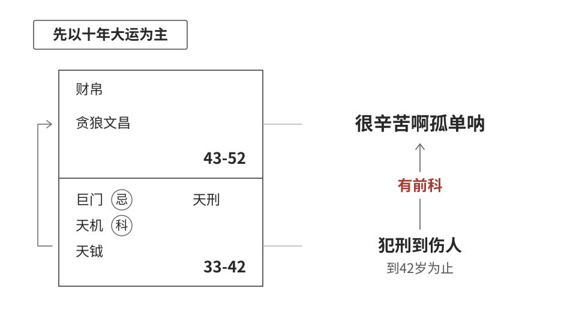 |
| **53 岁以后的两步大限为什么转好？** | 〔口述〕倪师说「直要到53-62 他才会化禄」，「63-72 禄存」，「晚年很好」。（[00:05:31–00:05:38](https://www.bilibili.com/video/BV1KJsLekEfA/?p=25&t=331)，第 9954–10145 帧） 〔叠图〕第 10290 帧起贴两格，旁边加红字「晚年很好」：疾厄丁未格：太阳得、太阴不（后带「禄」）、擎羊庙、寡宿不，数字串含「5362」；迁移丙午格：禄存庙、武曲旺、天府旺、文曲陷、八座旺，数字串含「6372」。（[00:05:43–00:05:47](https://www.bilibili.com/video/BV1KJsLekEfA/?p=25&t=343)，第 10290–10410 帧） 〔推断〕推断：叠图里带「5362」的疾厄丁未格有太阴后带「禄」，带「6372」的迁移丙午格有禄存庙，与口述「53-62 化禄」「63-72 禄存」对得上；倪师本块没有说出这两步大限的宫名。（[00:05:31–00:05:47](https://www.bilibili.com/video/BV1KJsLekEfA/?p=25&t=331)，第 9954–10410 帧） |
| **如果小时候就让他从武职，23–32 会怎样？** | 〔口述〕倪师假设：「那如果他从武官呢」，「小的时候我们给他从武职」，「他从武职 23-32」「进入紫微天相」。（[00:05:51–00:05:58](https://www.bilibili.com/video/BV1KJsLekEfA/?p=25&t=351)，第 10554–10769 帧） 〔口述〕「你23-32 你虽然你当警察或军人」，「一出来就到了很高的将官旁边」，「一直在旁边当军当当兵」。（[00:06:27–00:06:34](https://www.bilibili.com/video/BV1KJsLekEfA/?p=25&t=387)，第 11622–11849 帧） 〔叠图〕夫妻庚戌格：紫微得、天相得、右弼庙、天空陷、天月，数字串含「2332」，该格标着「靠近天子」；同时贴出的命宫壬子格为七杀旺、铃星陷、天喜旺。（[00:06:07–00:06:08](https://www.bilibili.com/video/BV1KJsLekEfA/?p=25&t=367)，第 11010–11040 帧） 〔板书〕同一板面下方可辨「紫微」「天相」「23-32」，旁边的字被身体挡住、认不出。（[00:05:16](https://www.bilibili.com/video/BV1KJsLekEfA/?p=25&t=316)，第 9486 帧） |
| **流年逢紫微星进来，代表什么？** | 〔口述〕「当官的人」「或者在学校当老师都一样」，「当你的流年逢到紫微星进来的时候」「就代表说你会近天子」，「靠近天子」。（[00:06:01–00:06:17](https://www.bilibili.com/video/BV1KJsLekEfA/?p=25&t=361)，第 10830–11321 帧） 〔口述〕举例：「所以说现在比如说你43-52」「是紫微星进来」，「你会位列三台」，「进入进入天子的身边」「身侧的人」。（[00:06:17–00:06:25](https://www.bilibili.com/video/BV1KJsLekEfA/?p=25&t=377)，第 11322–11579 帧） 〔叠图〕第 11700 帧叠图把紫微得、天相得、右弼庙、天空陷那一格标成「财帛戊申」，数字串含「4352」，格里标着「位列三台」「天子身侧」。（[00:06:30–00:06:32](https://www.bilibili.com/video/BV1KJsLekEfA/?p=25&t=390)，第 11700–11789 帧） |
| **33–42 流年不好，为什么劝他去读书？** | 〔口述〕「然后33-42的时候」「流年不好的时候」，「我们有是非口舌官司流年的时候」，知道流年不好，「我们去读书有没有」。（[00:06:35–00:06:42](https://www.bilibili.com/video/BV1KJsLekEfA/?p=25&t=395)，第 11850–12065 帧） 〔口述〕举人名：「所以李登辉在流年不好」，「不好跑到外面去读书嘛」。（[00:06:42–00:06:46](https://www.bilibili.com/video/BV1KJsLekEfA/?p=25&t=402)，第 12066–12185 帧） 〔口述〕对比：「你如果不听的话」「你关到42出来对不对」；「你如果是听的话」，「你变成42岁自修拿到学位出来了」。（[00:06:49–00:06:57](https://www.bilibili.com/video/BV1KJsLekEfA/?p=25&t=409)，第 12282–12539 帧） 〔口述〕「你被关在学校里面读书」「一样是关的象」「象是一样的嘛」，所以先让他「要进进进入自修的阶段」，「你一读书就可以解灾」。（[00:06:58–00:07:09](https://www.bilibili.com/video/BV1KJsLekEfA/?p=25&t=418)，第 12540–12899 帧） |
| **算命的大原则是什么？（进德修业、利建侯）** | 〔口述〕「所以我们算命一个大原则就是」「不管他的流年怎么样」，「只要是遇到坏的流年」就「进德修业」。（[00:07:10–00:07:16](https://www.bilibili.com/video/BV1KJsLekEfA/?p=25&t=430)，第 12900–13085 帧） 〔口述〕「当你进德修业遇到好的流年的时候」就「利建侯」，利建侯是可以出来（字幕此处一词作「见龙在留」，待核），「可以到处去广结善缘」「去建立你的社会背景」，「这都马上就改变掉了」。（[00:07:16–00:07:28](https://www.bilibili.com/video/BV1KJsLekEfA/?p=25&t=436)，第 13086–13451 帧） 〔口述〕倪师说「我们事天的原因就在这里」，「还没开始就知道了」。（[00:07:28–00:07:33](https://www.bilibili.com/video/BV1KJsLekEfA/?p=25&t=448)，第 13452–13607 帧） |
| **太太娶得好，能不能解他命中的灾？** | 〔口述〕「所以他的命中有这个灾星」，命中又带天喜红鸾星（字幕「叉」按上下文作「又」），「太太娶得很好」，但「不能解这个灾」。（[00:07:35–00:07:49](https://www.bilibili.com/video/BV1KJsLekEfA/?p=25&t=455)，第 13674–14099 帧） 〔叠图〕夫妻庚戌格：紫微得、天相庙、右弼庙、天空陷，该格标着「太太很好」；同时贴出的迁移丙午格有红鸾旺、禄存庙、武曲旺、天府旺。（[00:07:49](https://www.bilibili.com/video/BV1KJsLekEfA/?p=25&t=469)，第 14070–14099 帧） |
| **父母宫空、有地劫，祖业怎样？什么情况祖业大？** | 〔口述〕「这个命里面父母宫是空的」，「这个地劫啊」「代表没有祖业」。（[00:07:50–00:07:58](https://www.bilibili.com/video/BV1KJsLekEfA/?p=25&t=470)，第 14100–14363 帧） 〔口述〕对照讲：「我讲过如果父母宫是禄星」「或者是命是禄星」，「他祖业就很大」。（[00:07:58–00:08:04](https://www.bilibili.com/video/BV1KJsLekEfA/?p=25&t=478)，第 14364–14531 帧） 〔叠图〕第 14700 帧起贴出两个「父母癸丑」格：一格有禄存庙、武曲旺、天府旺、文曲陷；另一格（父母癸丑′）有太阳得、太阴不（后带「禄」）、擎羊庙，标着「有祖业」。第 14770 帧起，标「命宫壬子」的格也有禄存庙、武曲旺、天府旺，标着「有祖业」。（[00:08:10–00:08:17](https://www.bilibili.com/video/BV1KJsLekEfA/?p=25&t=490)，第 14700–14910 帧） |
| **在面相上怎么看一个人有祖业？** | 〔口述〕「在相上面怎么看这个人有祖业」：「你看那个头啊」，「两边那个天庭饱满」，「两边不是单是天庭」，「两边都凸起来」。（[00:08:04–00:08:16](https://www.bilibili.com/video/BV1KJsLekEfA/?p=25&t=484)，第 14532–14891 帧） 〔口述〕「山林的地方凸起来」「或者是顶格这样凸起来」，「这样子很宽呐」；「这个两边还凸出来有没有」「这个非常的饱满」，「祖业就很大」，「相上面就可以看到」。（[00:08:16–00:08:45](https://www.bilibili.com/video/BV1KJsLekEfA/?p=25&t=496)，第 14892–15761 帧） 〔指代〕说「这个脸」时手按在刚画的脸形轮廓左侧边线上；说「这个两边还凸出来」那句时手按在脸形轮廓内左上部（额头、两侧凸出处），指的都是图形。（[00:08:23–00:08:26](https://www.bilibili.com/video/BV1KJsLekEfA/?p=25&t=503)，第 15096–15200 帧） 〔板书〕板书可辨：一个脸形轮廓，上方两侧向外凸；轮廓右上角外一个字认不出；右侧可辨「破军」；其余认不出。（[00:08:28](https://www.bilibili.com/video/BV1KJsLekEfA/?p=25&t=508)，第 15265 帧） 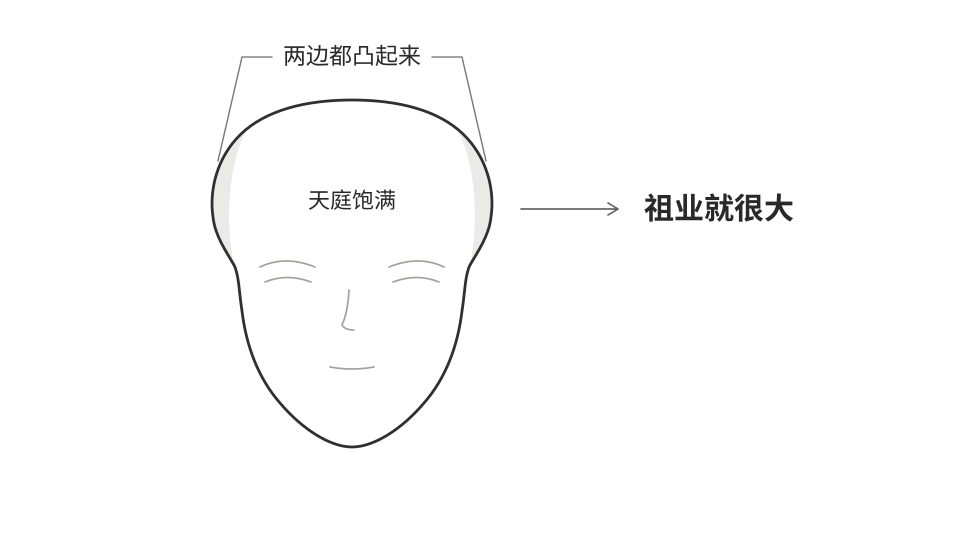 |
| **一颗孤星独守主什么？** | 〔口述〕「你看到他走了42岁在在这边」，「结果42岁出来的时候43岁」。（[00:08:45–00:08:53](https://www.bilibili.com/video/BV1KJsLekEfA/?p=25&t=525)，第 15762–16007 帧） 〔口述〕「诸位这里还有一个要注意的」：「一颗孤星独守」，「这个地劫除了指父母以外」，「这颗星代表他43岁的时候有一个」（话未说完即转入下一句）。（[00:08:53–00:09:02](https://www.bilibili.com/video/BV1KJsLekEfA/?p=25&t=533)，第 16008–16271 帧） 〔口述〕规则：「诸位记得啊一颗单星独守」，「不管你单星是陀罗或擎羊」，「羊陀火铃空劫六杀星」，「一星独守的时候」「这是凶灾」。（[00:09:02–00:09:12](https://www.bilibili.com/video/BV1KJsLekEfA/?p=25&t=542)，第 16272–16577 帧） 〔叠图〕第 15990 帧起贴出六格，格上依次圈着 37 至 42，旁边红字「42岁放出来」：兄弟辛亥（天梁陷、天马平、天魁旺）、命宫壬子（七杀旺、铃星陷、天喜旺）、夫妻庚戌（紫微得、天相得、右弼庙）、子女己酉（巨门庙忌、天机旺科、地空庙）、疾厄丁未（太阳得、擎羊庙）、财帛戊申（贪狼平、文昌得）。（[00:08:53–00:09:01](https://www.bilibili.com/video/BV1KJsLekEfA/?p=25&t=533)，第 15990–16230 帧） |
| **祸不单行在这位男命身上怎么应验？** | 〔口述〕「所以这个人祸不单行」：「这个灾害完了」「出来又出车祸」，「捷运系统又出来了」，「刚好捷运系统开始试线成功」，「他一上去又撞了」，「这都这个都都是祸不单行呐」。（[00:09:12–00:09:29](https://www.bilibili.com/video/BV1KJsLekEfA/?p=25&t=552)，第 16578–17099 帧） 〔口述〕另举一例：「一个人比如说一个爸爸出事了」「在车祸在医院里面」，「结果医院打电话到家里面去」，「打电话通知儿子通知媳妇」，「结果儿子跟媳妇赶到医院的地方」「又出事了」，「这叫做祸不单行」。（[00:09:49–00:10:01](https://www.bilibili.com/video/BV1KJsLekEfA/?p=25&t=589)，第 17682–18059 帧） |
| **坎卦讲的体险是什么？对客人怎么提醒？** | 〔口述〕「所以后面会介绍到坎卦」，「坎为水两个重卦」，「我们有易经有八个纯卦」。（[00:09:30–00:09:37](https://www.bilibili.com/video/BV1KJsLekEfA/?p=25&t=570)，第 17100–17333 帧） 〔口述〕「那意思就是说你这个险出现的时候」「你随时要要体险」，「如果处理不当」「第二个险马上就跟着来」，「所以人家常常会发现祸不单行呀」。（[00:09:37–00:09:48](https://www.bilibili.com/video/BV1KJsLekEfA/?p=25&t=577)，第 17334–17651 帧） 〔口述〕后面介绍易经，「我们要体险」，「体险之道如何处出险」，「处在险局之中的时候」「如何脱险」，这就是坎为水（字幕作「坎力水」）。（[00:10:03–00:10:10](https://www.bilibili.com/video/BV1KJsLekEfA/?p=25&t=603)，第 18090–18329 帧） 〔口述〕对这位客人：「所以你跟他说对不起」，告诉他出来的时候还没有解决，「还有事情呢」，「这个倒霉运要走到这个时候」。（[00:10:13–00:10:20](https://www.bilibili.com/video/BV1KJsLekEfA/?p=25&t=613)，第 18396–18611 帧） |

**总结区**

- 通用规则：流年逢紫微星进来，代表会近天子、位列三台、成为天子身侧的人，当官或在学校当老师都一样（[00:06:01–00:06:25](https://www.bilibili.com/video/BV1KJsLekEfA/?p=25&t=361)，第 10830–11579 帧）；算命大原则：不管流年怎样，遇到坏的流年就进德修业；进德修业后遇到好的流年就利建侯，出来广结善缘、建立社会背景（[00:07:10–00:07:28](https://www.bilibili.com/video/BV1KJsLekEfA/?p=25&t=430)，第 12900–13451 帧）；父母宫是禄星或命是禄星，祖业就很大；相上看头两边天庭饱满、凸起来，也是祖业大（[00:07:58–00:08:45](https://www.bilibili.com/video/BV1KJsLekEfA/?p=25&t=478)，第 14364–15761 帧）；羊陀火铃空劫六杀星，一星独守时是凶灾，险处理不当第二个险马上跟来，就是祸不单行（[00:09:02–00:09:48](https://www.bilibili.com/video/BV1KJsLekEfA/?p=25&t=542)，第 16272–17651 帧）
- 只在本例：这位男命刑判到 42 岁为止，43–52 进入贪狼文昌，因有前科记录，这十年辛苦孤单（[00:05:16–00:05:51](https://www.bilibili.com/video/BV1KJsLekEfA/?p=25&t=316)，第 9486–10553 帧）；53–62 才化禄，63–72 禄存，晚年很好（[00:05:31–00:05:38](https://www.bilibili.com/video/BV1KJsLekEfA/?p=25&t=331)，第 9954–10145 帧）；若小时候让他从武职，23–32 进入紫微天相，一出来就在很高的将官旁边（[00:05:51–00:06:34](https://www.bilibili.com/video/BV1KJsLekEfA/?p=25&t=351)，第 10554–11849 帧）；他父母宫空、有地劫，没有祖业；太太娶得好也解不了灾；42 岁出狱后又碰上捷运出车祸，祸不单行（[00:07:35–00:09:29](https://www.bilibili.com/video/BV1KJsLekEfA/?p=25&t=455)，第 13674–17099 帧）
- 不是排盘规则，是处世方法：流年不好时去读书自修，被关在学校读书一样是关的象，读书可以解灾（[00:06:35–00:07:09](https://www.bilibili.com/video/BV1KJsLekEfA/?p=25&t=395)，第 11850–12899 帧）；处在险局之中要体险，知道如何脱险（[00:10:03–00:10:10](https://www.bilibili.com/video/BV1KJsLekEfA/?p=25&t=603)，第 18090–18329 帧）；看出客人出来后倒霉运还没走完，要跟他说对不起、告诉他还有事情（[00:10:13–00:10:20](https://www.bilibili.com/video/BV1KJsLekEfA/?p=25&t=613)，第 18396–18611 帧）

**待核**

1. [00:05:17](https://www.bilibili.com/video/BV1KJsLekEfA/?p=25&t=317)，第 9528 帧：字幕「火到42岁为止」，语音只有「42岁为止」，「火」未引。
2. 第 9606、9786、9870、9954 帧：字幕句头「天存」「天存」「天」「二」语音栏里没有，引原话时已去掉。
3. [00:05:16](https://www.bilibili.com/video/BV1KJsLekEfA/?p=25&t=316)，第 9486 帧：叠图同时有「命宫壬子」（廉贞陷、贪狼陷、天马平等）和「命宫壬子′」（擎羊不、陀罗陷、地空庙等）两格，与[00:06:07](https://www.bilibili.com/video/BV1KJsLekEfA/?p=25&t=367)，第 11010 帧的命宫壬子（七杀旺、铃星陷）内容都不同，哪格是本盘命宫待核。
4. [00:05:31](https://www.bilibili.com/video/BV1KJsLekEfA/?p=25&t=331)，第 9954 帧：语音作「他怎么会划路」，字幕作「他才会化禄」；化禄是哪颗星、在哪宫，倪师本块没说。
5. [00:05:38](https://www.bilibili.com/video/BV1KJsLekEfA/?p=25&t=338)，第 10146 帧：字幕「这一时间」，语音作「这一十年」。
6. [00:05:51–00:05:57](https://www.bilibili.com/video/BV1KJsLekEfA/?p=25&t=351)，第 10554–10739 帧：字幕「武官」「武职」，语音作「五官」「五直」，按上下文作武职。
7. [00:06:30](https://www.bilibili.com/video/BV1KJsLekEfA/?p=25&t=390)，第 11700 帧：叠图把与夫妻庚戌相同的紫微、天相、右弼一格标成「财帛戊申」，配合倪师「比如说你43-52是紫微星进来」的假设说法，像是剪辑借格示意，不是本盘财帛宫。
8. [00:06:43](https://www.bilibili.com/video/BV1KJsLekEfA/?p=25&t=403)，第 12114 帧：字幕「李登挥」，语音作「李登辉」，按语音写；「李登辉也有这个不好」所指何事本块没说。
9. [00:06:46–00:06:49](https://www.bilibili.com/video/BV1KJsLekEfA/?p=25&t=406)，第 12186–12281 帧：「人家42去」「你33岁去算什么嘛」意思不清。
10. [00:07:19](https://www.bilibili.com/video/BV1KJsLekEfA/?p=25&t=439)，第 13182 帧：字幕「见龙在留」，语音作「建荣在田」，原词待核。
11. [00:07:29](https://www.bilibili.com/video/BV1KJsLekEfA/?p=25&t=449)，第 13488 帧：字幕「事天」语音作「四天」；「事天」一词本块没有解释。
12. [00:07:37](https://www.bilibili.com/video/BV1KJsLekEfA/?p=25&t=457)，第 13716 帧：字幕「命叉带天喜红鸾星」，「叉」按上下文改作「又」，语音作「中在天气红蓝心」；天喜、红鸾在哪宫倪师没说，叠图里天喜旺在标「命宫壬子」的格（[00:06:07](https://www.bilibili.com/video/BV1KJsLekEfA/?p=25&t=367)，第 11010 帧），红鸾旺在标「迁移丙午」的格（[00:07:49](https://www.bilibili.com/video/BV1KJsLekEfA/?p=25&t=469)，第 14070 帧）。
13. [00:07:49](https://www.bilibili.com/video/BV1KJsLekEfA/?p=25&t=469)，第 14070 帧：叠图夫妻庚戌的天相此处作「庙」，[00:06:07](https://www.bilibili.com/video/BV1KJsLekEfA/?p=25&t=367)，第 11010 帧作「得」，两处不一致。
14. [00:07:50–00:07:58](https://www.bilibili.com/video/BV1KJsLekEfA/?p=25&t=470)，第 14100–14363 帧：倪师说父母宫空、有地劫，但本块叠图没贴出带地劫的父母宫格；[00:07:54](https://www.bilibili.com/video/BV1KJsLekEfA/?p=25&t=474)，第 14248 帧指代看不到所指的字。
15. [00:08:04–00:08:10](https://www.bilibili.com/video/BV1KJsLekEfA/?p=25&t=484)，第 14532–14729 帧：「父母癸丑」「父母癸丑′」「命宫壬子」格里的星曜与迁移丙午、疾厄丁未格相同，并标着「有祖业」，像剪辑借格示意「父母宫是禄星／命是禄星」，不是本盘宫位。
16. 第 14310、14658、14844 帧：字幕「祖业」「组业」「相业」与语音栏「主业」「哇」「山」对不齐，按上下文作祖业、山林；[00:08:19](https://www.bilibili.com/video/BV1KJsLekEfA/?p=25&t=499)，第 14970 帧字幕「顶格」语音作「顶头」。
17. [00:08:28](https://www.bilibili.com/video/BV1KJsLekEfA/?p=25&t=508)，第 15265 帧：板书脸形轮廓右上角外的一个字认不出。
18. [00:05:16](https://www.bilibili.com/video/BV1KJsLekEfA/?p=25&t=316)，第 9486 帧：板书左上角、右侧圆圈里的字及部分小字认不出。
19. [00:08:31–00:08:50](https://www.bilibili.com/video/BV1KJsLekEfA/?p=25&t=511)，第 15336–15929 帧：语音里有数岁数「三七三八……四十二岁」，字幕没有；「在这边」所指（[00:08:47](https://www.bilibili.com/video/BV1KJsLekEfA/?p=25&t=527)，第 15834 帧）看不出。
20. [00:08:55–00:09:02](https://www.bilibili.com/video/BV1KJsLekEfA/?p=25&t=535)，第 16056–16271 帧：「一颗孤星独守」指哪一宫、哪颗星不明；「这颗星代表他43岁的时候有一个」后半句没说完；「地劫」语音作「地结」「铁」。
21. [00:09:12](https://www.bilibili.com/video/BV1KJsLekEfA/?p=25&t=552)，第 16585 帧：说「所以这个人」时手在黑板「七杀」一格附近，是否借此指该格不确定。
22. [00:09:23](https://www.bilibili.com/video/BV1KJsLekEfA/?p=25&t=563)，第 16914 帧：字幕「试线成功」，语音作「实现成功」。
23. [00:09:32](https://www.bilibili.com/video/BV1KJsLekEfA/?p=25&t=572)，第 17184 帧：字幕「坎中坎为坎为水」杂乱，语音作「中砍为水」；[00:10:08](https://www.bilibili.com/video/BV1KJsLekEfA/?p=25&t=608)，第 18258 帧字幕「坎力水」语音作「砍为水」，按上下文作坎为水。
24. [00:09:35](https://www.bilibili.com/video/BV1KJsLekEfA/?p=25&t=575)，第 17250 帧：字幕「我们有易经有八个纯卦」，语音作「我们已经有八个存挂」。
25. 第 17430、18090 帧：「体险」语音作「提险」，含义本块未解释。

## 例二（女命，命宫戊辰紫微天相）：科权禄三会、男女之别

| 巳 | 午 | 未 | 申 |
|---|---|---|---|
| **父母 己巳** 天梁得 | **福德 庚午** 七杀旺 右弼旺 文曲陷 | **田宅 辛未** 天钺旺 | **官禄 壬申**（身宫） 廉贞庙禄 左辅平 文昌得 |
| **命宫 戊辰** 紫微得 天相得 火星陷 | **例二 · 命宫戊辰** | 据视频叠图重排 | **交友 癸酉** 地空庙 |
| **兄弟 丁卯** 天机旺 巨门庙 擎羊陷 | 后期贴图，不算倪师的话 |  | **迁移 甲戌** 破军旺权 |
| **夫妻 丙寅** 贪狼平 禄存庙 天马旺 | **子女 丁丑** 太阳不忌 太阴庙 天魁旺 陀罗庙 地劫陷 | **财帛 丙子** 武曲旺科 天府庙 铃星陷 | **疾厄 乙亥** 天同庙 |

按视频里这张盘逐格重画（我们自己画的图，不是视频截图）；数据见 [命盘-P25-例二.json](图/命盘-P25-例二.json)。

### 3　例二科权禄三会女校长与男女之别（[00:10:22–00:14:38](https://www.bilibili.com/video/BV1KJsLekEfA/?p=25&t=622)，第 18666–26369 帧）

| 提示区 | 笔记区 |
|---|---|
| **什么叫科权禄三会？本例化科、化权、化禄各在哪宫？** | 〔口述〕倪师拿出新一张盘说：「这个八字的就叫做科权禄三会」，又说讲例子要拿极好的，「普通的都没什么」。（[00:10:22–00:10:30](https://www.bilibili.com/video/BV1KJsLekEfA/?p=25&t=622)，第 18666–18923 帧） 〔口述〕本盘三化的位置：「化科在财帛」，权在迁移（字幕作「杈」），「化禄在官禄身宫」，「这叫科权禄」。（[00:10:30–00:10:38](https://www.bilibili.com/video/BV1KJsLekEfA/?p=25&t=630)，第 18924–19169 帧） 〔叠图〕第 19020 帧起贴四格，旁边红字「科权禄三会」：命宫戊辰（紫微得、天相得、火星）；官禄壬申（廉贞庙、标「禄」，文昌得、左辅平，注身宫）；财帛丙子（武曲旺、标「科」，天府庙）；迁移甲戌（破军旺、标「权」）。（[00:10:34–00:10:50](https://www.bilibili.com/video/BV1KJsLekEfA/?p=25&t=634)，第 19020–19500 帧） 〔板书〕本块开头的板面可辨：右侧竖写「科權祿三會」；左格「紫微」「天相」「3-12」；其下「巨門」「天機」「13-22」；中间「33年.女」；上排一格写「廉貞·化祿」并画圈；下格「太陰」「太陽·化」等字。其余认不出。（[00:10:22](https://www.bilibili.com/video/BV1KJsLekEfA/?p=25&t=622)，第 18666 帧） 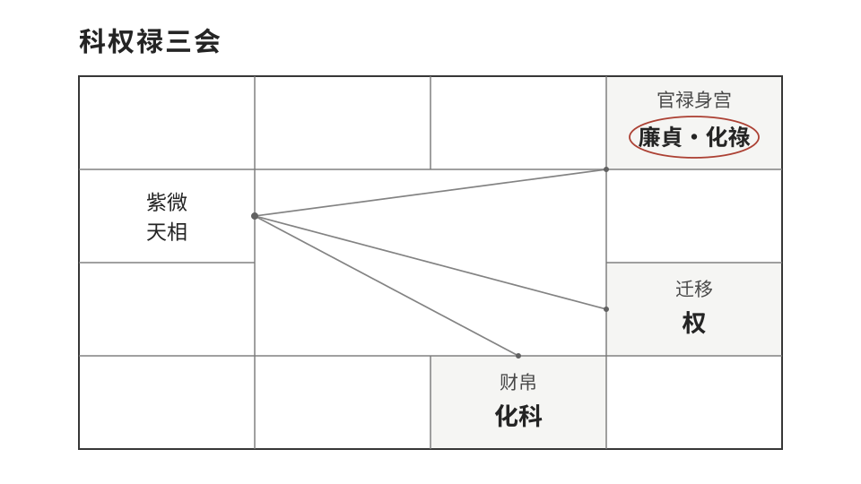 〔指代〕说「如果今天这个禄」时，手按在黑板上方被圈起的「廉貞·化祿」一处。（[00:10:40](https://www.bilibili.com/video/BV1KJsLekEfA/?p=25&t=640)，第 19219 帧） |
| **禄、科、权换了宫位，还算不算科权禄三会？** | 〔口述〕倪师说假如禄在财帛、科在官、权在对面，或者权在官，「都没有关系」，「那是天子命」。（[00:10:39–00:10:51](https://www.bilibili.com/video/BV1KJsLekEfA/?p=25&t=639)，第 19170–19553 帧） 〔口述〕只要拿到科权禄，「我们不用管他」，他一定是一方之主，「一方之主的科权禄的命」，「这科权禄命很厉害」（字幕句头多一个「禄」字，已去掉）。（[00:10:51–00:10:59](https://www.bilibili.com/video/BV1KJsLekEfA/?p=25&t=651)，第 19554–19793 帧） |
| **这张盘的本人是做什么的？为什么说她不会屈居人下？** | 〔口述〕说到这张盘的本人：「这个太太呢」，「是个学校当校长的」。（[00:10:59–00:11:04](https://www.bilibili.com/video/BV1KJsLekEfA/?p=25&t=659)，第 19794–19949 帧） 〔口述〕倪师说这种八字「当老师一定干校长的」，「不会屈居人下」，「都是个地方最大的诸侯的」。（[00:11:05–00:11:15](https://www.bilibili.com/video/BV1KJsLekEfA/?p=25&t=665)，第 19950–20279 帧） |
| **她的十年大运怎么走？为什么走官、走教育？** | 〔口述〕倪师逐个点大运：「你看他43-52 是不是化科」，「53-62天同是官星」，「63-72 是化权」。（[00:11:16–00:11:23](https://www.bilibili.com/video/BV1KJsLekEfA/?p=25&t=676)，第 20280–20519 帧） 〔口述〕倪师说这要靠流年（字幕作「流连」）上来决定；又说「你看十年大运她禄是不是在后面」，「所以她会比较会走官走官」。（[00:11:24–00:11:37](https://www.bilibili.com/video/BV1KJsLekEfA/?p=25&t=684)，第 20520–20927 帧） 〔口述〕之所以走教育，「因为命中是科权来会」，「禄也有会到」，「可是禄并没有会到大运你懂不懂」，「十年交运没有会到」。（[00:11:37–00:11:49](https://www.bilibili.com/video/BV1KJsLekEfA/?p=25&t=697)，第 20928–21275 帧） 〔叠图〕第 20130 帧起另贴疾厄乙亥一格：天同庙、天使旺、孤辰陷、长生等；旁边红字「校长」。（[00:11:11–00:11:18](https://www.bilibili.com/video/BV1KJsLekEfA/?p=25&t=671)，第 20130–20340 帧） |
| **这么厉害的女孩子，婚姻子女就一定好吗？** | 〔口述〕倪师问这种女孩子厉不厉害（字幕作「后不厉害」），自答「太厉害了」；可是厉害归厉害，「上帝并没有说这个厉害的女孩子」「这个婚姻子女一定好啊」。（[00:11:49–00:12:00](https://www.bilibili.com/video/BV1KJsLekEfA/?p=25&t=709)，第 21276–21629 帧） |
| **女孩子太阳陷地、化忌，会怎样？** | 〔口述〕倪师说「你看看太阳化忌」，「我这里提出来跟你讲」，「只要女孩子这个太阳一陷地」，「好累呀」。（[00:12:01–00:12:08](https://www.bilibili.com/video/BV1KJsLekEfA/?p=25&t=721)，第 21630–21857 帧） 〔指代〕说「我这里提出来」时，食指点在黑板右下格的「太陽」下方，右边是红圈圈住的「化忌」。（[00:12:03](https://www.bilibili.com/video/BV1KJsLekEfA/?p=25&t=723)，第 21692 帧） 〔指代〕说「这个太阳」时，指尖点在黑板右下格「太陽、化忌」那一行左边的「太陽」上。（[00:12:05](https://www.bilibili.com/video/BV1KJsLekEfA/?p=25&t=725)，第 21758 帧） |
| **33 年出世的她，为什么批无夫无子？** | 〔口述〕倪师说这个八字拿到手上时，「她33年出世的（……）」，「50岁了 51了」；八字拿出来批的是「无夫无子啊」，是已经发生了才来找的。（[00:12:08–00:12:21](https://www.bilibili.com/video/BV1KJsLekEfA/?p=25&t=728)，第 21858–22241 帧） 〔口述〕「太阳星陷地在这个时候」：「第一个她本身就不会生到儿子」，「第二个这段时间根本就没有先生了」。（[00:12:21–00:12:27](https://www.bilibili.com/video/BV1KJsLekEfA/?p=25&t=741)，第 22242–22415 帧） 〔口述〕没有先生的原因是「红鸾天喜星化忌」；所以前面没有结婚，中间也没有结婚，「到现在还没有结婚呐」。（[00:12:27–00:12:38](https://www.bilibili.com/video/BV1KJsLekEfA/?p=25&t=747)，第 22416–22757 帧） 〔叠图〕第 22740 帧先贴子女丁丑格，第 22770 帧时田宅辛未格也已贴出：子女丁丑（太阳不、标「忌」，太阴庙、天喜陷、地劫陷、天刑陷、天魁旺、陀罗庙）；田宅辛未（红鸾陷、天钺旺、天官庙、寡宿不、帝旺）。（[00:12:38–00:12:45](https://www.bilibili.com/video/BV1KJsLekEfA/?p=25&t=758)，第 22740–22950 帧） |
| **她厉害到哪里？主卧房住在哪个角？** | 〔口述〕倪师说「很厉害啊」，「她厉害到哪里」，在黑板上画方位，「东南西北」，「哎她的主卧房就住西北角你看看」，「风天小畜卦」，「哇她可厉害」。（[00:12:42–00:12:57](https://www.bilibili.com/video/BV1KJsLekEfA/?p=25&t=762)，第 22872–23321 帧） 〔板书〕可辨：画了一个方框，上边标「S」、左边标「E」、右边标「W」，下方一字像「N」；方框右下角隔出一小格，格内字像「主卧」，不能确定。其余认不出。（[00:12:48](https://www.bilibili.com/video/BV1KJsLekEfA/?p=25&t=768)，第 23040 帧） 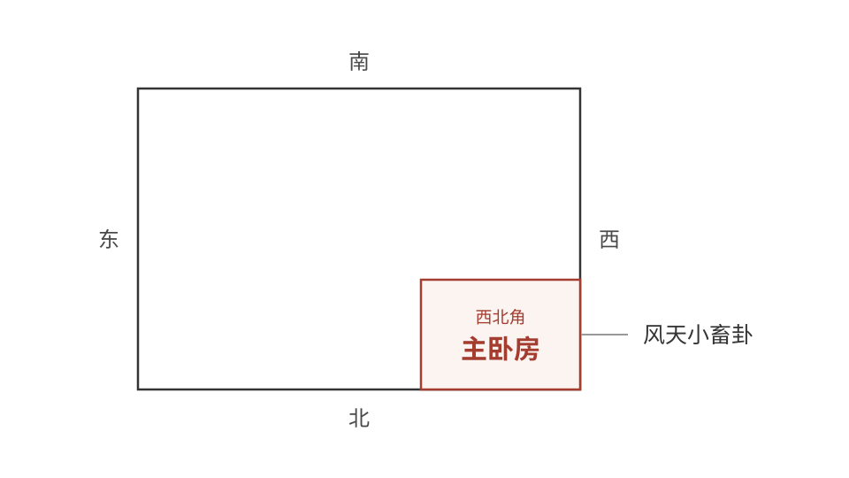 |
| **她 43 岁为什么走马上任当校长？** | 〔口述〕「43岁开始化科」，「科就是声名远播」，「就一方一方之主了」；要从「十年大运上面来看」，「诸位看43-52」。（[00:12:57–00:13:07](https://www.bilibili.com/video/BV1KJsLekEfA/?p=25&t=777)，第 23322–23621 帧） 〔口述〕倪师问这个33年她是什么生年（字幕作「申年」），说「午未申所以37岁在这边（……）」，「女孩子呢逆转」。（[00:13:07–00:13:16](https://www.bilibili.com/video/BV1KJsLekEfA/?p=25&t=787)，第 23622–23891 帧） 〔指代〕说「37岁在这边」时，手指按在黑板右侧格内刚写下并画圈的「37」上。（[00:13:13](https://www.bilibili.com/video/BV1KJsLekEfA/?p=25&t=793)，第 23793 帧） 〔口述〕「43岁开始结果43岁当年」，「是不是入到本命宫」，「刚好紫微天相对面是化权」，所以肯定是43岁开始「走马上任当校长」。（[00:13:21–00:13:33](https://www.bilibili.com/video/BV1KJsLekEfA/?p=25&t=801)，第 24054–24413 帧） 〔叠图〕第 24240 帧起贴八格（格上圈着 37 至 43，旁边红字「走马上任」「当校长」），含命宫戊辰（紫微得、天相得、火星陷）、迁移甲戌（破军旺、标「权」）、官禄壬申（廉贞庙、标「禄」、身宫）、交友癸酉、兄弟丁卯、父母己巳、田宅辛未、福德庚午。（[00:13:28–00:13:36](https://www.bilibili.com/video/BV1KJsLekEfA/?p=25&t=808)，第 24240–24480 帧） |
| **走到化忌的时候，还会去当校长吗？** | 〔口述〕倪师问「你那个化忌的时候」「会不会去当校长」，答「不会啦哪那么厉害啦」，「除非你八字错了」，「或者你太懂人间道了」，「这不太可能」。（[00:13:33–00:13:49](https://www.bilibili.com/video/BV1KJsLekEfA/?p=25&t=813)，第 24414–24881 帧） 〔推断〕推断：板书图第24236帧可辨圈住的「43」与「33年.女」，与倪师口述的43岁、33年出世对得上；其余板书被身体和叠图挡住。（[00:13:27](https://www.bilibili.com/video/BV1KJsLekEfA/?p=25&t=807)，第 24236 帧） |
| **两个十年相邻或隔开、全是杀星，会怎样？** | 〔口述〕倪师说「像这种灾」，如果隔年，「这两个十年是隔壁」，「如果隔个十年」，「这个是凶全部是杀星的话」，「这个是致命的懂不懂我意思」。（[00:13:49–00:13:59](https://www.bilibili.com/video/BV1KJsLekEfA/?p=25&t=829)，第 24882–25199 帧） 〔口述〕紧接着又说「但不会致命啊」，「致命在孩子身上啊在先生身上致命」，「这样就会发生这样子」。前后两句照原话先后记。（[00:14:00–00:14:08](https://www.bilibili.com/video/BV1KJsLekEfA/?p=25&t=840)，第 25200–25457 帧） 〔叠图〕第 25200 帧起贴子女丁丑、财帛丙子两格；子女丁丑格里叠图标着「致命」；这次的财帛丙子列擎羊陷、火星陷、铃星陷、解神庙、龙池旺。（[00:14:00](https://www.bilibili.com/video/BV1KJsLekEfA/?p=25&t=840)，第 25200–25223 帧） |
| **同一个八字换成男命，差在哪？怎么改？** | 〔口述〕「那这个这种命的女孩子」，「如果是男孩子呢」，「所以同一个时间生人男的会不一样了命」，「为什么我跟你讲男女之别哈」。（[00:14:08–00:14:23](https://www.bilibili.com/video/BV1KJsLekEfA/?p=25&t=848)，第 25458–25901 帧） 〔口述〕倪师说看生病，女孩子只是「多了个妇科而已」；「男女这八字之别很简单」，「你3-12岁同个八字」，「如果你把她换成男的」，「你把流年改一下就好了」，接着写「13-22岁」。（[00:14:23–00:14:38](https://www.bilibili.com/video/BV1KJsLekEfA/?p=25&t=863)，第 25902–26369 帧） 〔叠图〕第 26310 帧起再贴同八格（宫名、干支、主星同前；旁边红字「男命反过来」「财官双美格」），但各格岁数串和格底小字与第 24240 帧那张不同，如命宫戊辰这次标「衰」、兄弟丁卯标「帝旺」。是哪张盘以口述为准。（[00:14:37–00:14:38](https://www.bilibili.com/video/BV1KJsLekEfA/?p=25&t=877)，第 26310–26369 帧） |

**总结区**

- 通用规则：只要科权禄三会，禄、科、权落在财帛、官禄、迁移哪一宫都没关系，是一方之主的天子命（[00:10:39–00:10:59](https://www.bilibili.com/video/BV1KJsLekEfA/?p=25&t=639)，第 19170–19793 帧）；只要女孩子太阳一陷地，倪师说「好累呀」（[00:12:04–00:12:08](https://www.bilibili.com/video/BV1KJsLekEfA/?p=25&t=724)，第 21744–21857 帧）；两个十年相邻或隔一个十年、全是杀星的凶限，倪师先说致命，又说不致命在本人而致命在孩子、先生身上（[00:13:49–00:14:08](https://www.bilibili.com/video/BV1KJsLekEfA/?p=25&t=829)，第 24882–25457 帧）；同一个八字男女之别很简单，3-12岁相同，换成男的把流年改一下就好（[00:14:26–00:14:38](https://www.bilibili.com/video/BV1KJsLekEfA/?p=25&t=866)，第 25980–26369 帧）
- 只在本例：本例化科在财帛、化权在迁移、化禄在官禄身宫，科权禄三会，本人是当校长的女性（[00:10:30–00:11:04](https://www.bilibili.com/video/BV1KJsLekEfA/?p=25&t=630)，第 18924–19949 帧）；禄没有会到大运，所以走官、走教育（[00:11:32–00:11:49](https://www.bilibili.com/video/BV1KJsLekEfA/?p=25&t=692)，第 20766–21275 帧）；33年出世、50多岁，无夫无子，没有先生的原因是红鸾天喜星化忌，主卧房住西北角（[00:12:10–00:12:57](https://www.bilibili.com/video/BV1KJsLekEfA/?p=25&t=730)，第 21906–23321 帧）；43岁开始化科、入本命宫、对面化权，走马上任当校长（[00:12:57–00:13:33](https://www.bilibili.com/video/BV1KJsLekEfA/?p=25&t=777)，第 23322–24413 帧）

**待核**

1. [00:10:32–00:10:45](https://www.bilibili.com/video/BV1KJsLekEfA/?p=25&t=632)，第 18966–19355 帧：字幕「杈在迁移」「杈在对面」的「杈」按上下文改为「权」
2. [00:10:34](https://www.bilibili.com/video/BV1KJsLekEfA/?p=25&t=634)，第 19020 帧：叠图命宫戊辰第一次贴出时火星庙旺字缺（□），[00:11:11](https://www.bilibili.com/video/BV1KJsLekEfA/?p=25&t=671)，第 20130 帧那次作「火星陷」
3. [00:10:51–00:11:04](https://www.bilibili.com/video/BV1KJsLekEfA/?p=25&t=651)，第 19554–19949 帧：字幕句头多一个「禄」字，语音栏没有，引原话时已去掉
4. [00:11:19](https://www.bilibili.com/video/BV1KJsLekEfA/?p=25&t=679)，第 20370 帧：「53-62天同是官星」，叠图天同庙在疾厄乙亥；「官星」本段没解释，天同与这个大限的关系也没讲
5. [00:11:24](https://www.bilibili.com/video/BV1KJsLekEfA/?p=25&t=684)，第 20520 帧：字幕「流连上来決定」按语音改为「流年上来决定」；语音栏后半「如果他的是画路在这边的话……他可能会去做生意」字幕没有，未当原话收
6. [00:11:27](https://www.bilibili.com/video/BV1KJsLekEfA/?p=25&t=687)，第 20616 帧：「化禄在这边」的「这边」看不出指哪
7. [00:11:30](https://www.bilibili.com/video/BV1KJsLekEfA/?p=25&t=690)，第 20712 帧：字幕「困为」改为「因为」
8. [00:11:50–00:11:56](https://www.bilibili.com/video/BV1KJsLekEfA/?p=25&t=710)，第 21324–21503 帧：字幕「后不厉害」语音作「厉不厉害」，「厉書」改为「厉害」
9. [00:12:10](https://www.bilibili.com/video/BV1KJsLekEfA/?p=25&t=730)，第 21906 帧：「33年」是什么纪年本段没说；括号（1944）是字幕注字，不是倪师说的，未据此推年份
10. [00:12:04–00:12:23](https://www.bilibili.com/video/BV1KJsLekEfA/?p=25&t=724)，第 21744–22295 帧：倪师说太阳陷地，叠图子女丁丑写的是「太阳不」并标「忌」，两者对不上
11. [00:12:28](https://www.bilibili.com/video/BV1KJsLekEfA/?p=25&t=748)，第 22458 帧：「红鸾天喜星化忌」怎么讲本段没解释；叠图红鸾陷在田宅辛未、天喜陷在子女丁丑，化忌标在太阳
12. [00:12:33](https://www.bilibili.com/video/BV1KJsLekEfA/?p=25&t=753)，第 22614 帧：字幕句头「馬」语音栏没有，已去掉
13. [00:12:38](https://www.bilibili.com/video/BV1KJsLekEfA/?p=25&t=758)，第 22758 帧：字幕「你了解我意思吧」语音作「还厉害」，两路对不上
14. [00:12:48](https://www.bilibili.com/video/BV1KJsLekEfA/?p=25&t=768)，第 23040 帧：板书方框下方的字像「N」，小格内像「主卧」，都不能确定
15. [00:12:52](https://www.bilibili.com/video/BV1KJsLekEfA/?p=25&t=772)，第 23160 帧：「风天小畜卦」语音只听出「处挂」；这一卦和西北角主卧的关系本段没解释
16. [00:13:07](https://www.bilibili.com/video/BV1KJsLekEfA/?p=25&t=787)，第 23622 帧：字幕「申年」语音作「生年」，已按语音转述；括号（1944）（戌宫）是字幕注字，未用来推岁数和宫位
17. [00:13:16](https://www.bilibili.com/video/BV1KJsLekEfA/?p=25&t=796)，第 23892 帧：字幕句头「3」语音栏没有，已去掉
18. [00:13:26](https://www.bilibili.com/video/BV1KJsLekEfA/?p=25&t=806)，第 24180 帧：字幕「入到本命宫」语音作「路到本命运工」，是「入」还是「禄」待核
19. [00:13:27](https://www.bilibili.com/video/BV1KJsLekEfA/?p=25&t=807)，第 24216 帧：「对面是化权」的对面是哪一宫倪师没明说；叠图带「权」的是迁移甲戌破军
20. [00:13:41](https://www.bilibili.com/video/BV1KJsLekEfA/?p=25&t=821)，第 24630 帧：「人间道」本段没有解释
21. [00:13:49–00:14:08](https://www.bilibili.com/video/BV1KJsLekEfA/?p=25&t=829)，第 24882–25457 帧：先说「这个是致命的」，又说「但不会致命啊」「致命在孩子身上啊在先生身上致命」，照原话先后记，未调和
22. [00:14:00](https://www.bilibili.com/video/BV1KJsLekEfA/?p=25&t=840)，第 25200 帧：这次贴的财帛丙子列擎羊陷、火星陷，没有前两次的天府、武曲，和前面那格内容不同
23. [00:14:23](https://www.bilibili.com/video/BV1KJsLekEfA/?p=25&t=863)，第 25902 帧：字幕「我看生病好像女女孩子」语音作「讲生病女孩子」，按语音转述
24. [00:14:31](https://www.bilibili.com/video/BV1KJsLekEfA/?p=25&t=871)，第 26130 帧：字幕「太」是乱码，已略过；[00:14:31](https://www.bilibili.com/video/BV1KJsLekEfA/?p=25&t=871)，第 26136 帧语音作「莲改一下」，按字幕「流年」
25. [00:14:33](https://www.bilibili.com/video/BV1KJsLekEfA/?p=25&t=873)，第 26190 帧：再贴的八格岁数串、长生类小字与[00:13:27](https://www.bilibili.com/video/BV1KJsLekEfA/?p=25&t=807)，第 24216 帧那张不同，是不是换成男命的盘倪师没说

### 4　例二换男命：财官双美与40岁婚姻关（[00:14:39–00:18:53](https://www.bilibili.com/video/BV1KJsLekEfA/?p=25&t=879)，第 26370–34013 帧）

| 提示区 | 笔记区 |
|---|---|
| **同一个八字换成男命，大限和小流年怎么排？** | 〔口述〕接着把大限往下数完：「然后43-52 53-62」「63-72 又循环回来」，说男命只是「男孩子变成这样子转而已」，十年的「刚好反过来而已」，「你把这个反过来就排就是男孩子」。（[00:14:39–00:14:52](https://www.bilibili.com/video/BV1KJsLekEfA/?p=25&t=879)，第 26370–26789 帧） 〔口述〕又说「但是小流年还是一样哦」，接着「男孩子顺转女孩子逆转」「那完全不一样了」。此处说男命顺转，与本块后面第 32358 帧说的男孩子是逆转不同，照原话分别记。（[00:14:53–00:15:00](https://www.bilibili.com/video/BV1KJsLekEfA/?p=25&t=893)，第 26790–27011 帧） 〔叠图〕本块开头贴出例二盘：命宫戊辰（紫微得、天相得、火星陷、天寿庙、封诰、华盖庙），官禄壬申（廉贞庙化禄、文昌得、左辅平、八座庙、台辅、截空庙，标身宫），迁移甲戌（破军旺化权）。（[00:14:39–00:14:43](https://www.bilibili.com/video/BV1KJsLekEfA/?p=25&t=879)，第 26370–26501 帧） 〔板书〕板书图可辨：上方一格写「田宅」；右侧竖写一列可辨「禄」「三」，上面两字像「科」「权」但被画面切掉，拿不准；其余粉笔字认不出。（[00:14:42](https://www.bilibili.com/video/BV1KJsLekEfA/?p=25&t=882)，第 26460 帧） 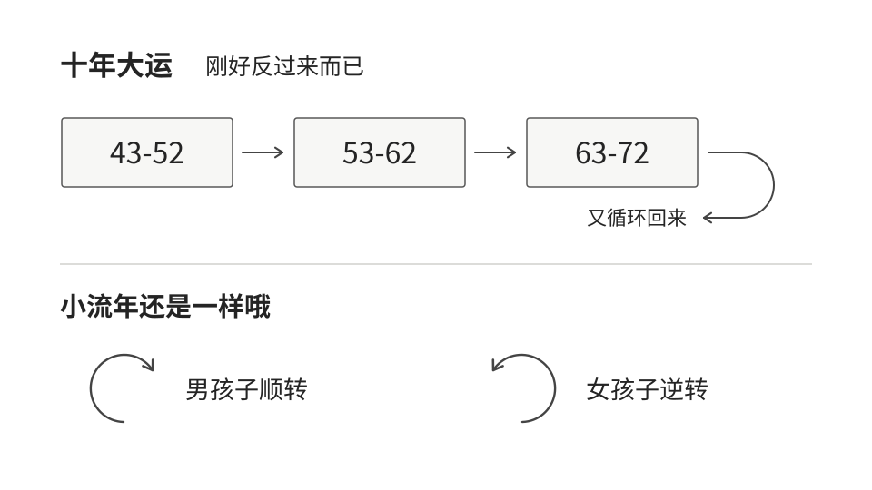 |
| **作男命时 3-12、23-32 怎么批？何谓财官双美格？** | 〔口述〕第一个大限 3-12「还科权禄」「还是一样的命啊」「但他读书读的很好」；又说「那财官这种叫」「男人批的话就叫财官双美格了」。（[00:15:00–00:15:10](https://www.bilibili.com/video/BV1KJsLekEfA/?p=25&t=900)，第 27012–27329 帧） 〔口述〕「财官双美格走到23-32」，「对面是化科七杀进来」，所以他考公家单位的考试一定考得上，「然后手有生杀之权」「那可能是干司法官或干什么」。（[00:15:11–00:15:21](https://www.bilibili.com/video/BV1KJsLekEfA/?p=25&t=911)，第 27330–27641 帧） 〔叠图〕第 27660 帧起贴福德庚午格：七杀旺、右弼旺、文曲陷、三台旺、旬空庙、阴煞；第 27690 帧起加贴财帛丙子格：武曲旺化科、天府庙、天才旺、铃星陷、解神庙、龙池旺。福德庚午、财帛丙子在午、子两宫，彼此对冲；倪师没说「对面」是哪一宫。（[00:15:22–00:15:30](https://www.bilibili.com/video/BV1KJsLekEfA/?p=25&t=922)，第 27660–27900 帧） |
| **男命走到 33-42 化忌，会是什么情形？** | 〔口述〕「结果 33-42呢」「本宫对面化忌就是」：「干了半天火大了」，好心不得好报，「我做了半天该轮到我轮不到我」「不得到重用」「我火大了老子不干了」「不干了出来」。（[00:15:21–00:15:31](https://www.bilibili.com/video/BV1KJsLekEfA/?p=25&t=921)，第 27654–27953 帧） 〔叠图〕第 27960 帧起贴田宅辛未格（本块开头的八格里也有）：天钺旺、红鸾陷、天官庙、寡宿不；第 27990 帧起加贴子女丁丑格：太阳不、化忌，太阴庙，地劫陷、天刑陷、天喜陷、天魁旺、陀罗庙。（[00:15:32–00:15:41](https://www.bilibili.com/video/BV1KJsLekEfA/?p=25&t=932)，第 27960–28230 帧） |
| **43 岁起化禄、本身有科有权，主什么？** | 〔口述〕43 岁开始出来化禄，本身有科有权，代表做自由业，他名气很大。「像任何人的命」「只要有科进来名」「名气都会很大」「那读书会读得很好」。（[00:15:31–00:15:42](https://www.bilibili.com/video/BV1KJsLekEfA/?p=25&t=931)，第 27954–28277 帧） 〔口述〕「那到了43-52化禄了」，「那么大的财星化禄」「对面还禄马交驰有没有」「代表他会自己做事业」，自己当老板，一定是自由业。「你看男女都反过来了」。（[00:15:42–00:15:56](https://www.bilibili.com/video/BV1KJsLekEfA/?p=25&t=942)，第 28278–28703 帧） 〔叠图〕叠图迁移甲戌格（第 28350 帧已贴，同时贴着官禄壬申、财帛丙子）：破军旺化权、天哭平、月煞。夫妻丙寅格（第 28680 帧起）：禄存庙、天马旺、贪狼平、凤阁庙、年解庙、天虚旺。（[00:15:42–00:15:58](https://www.bilibili.com/video/BV1KJsLekEfA/?p=25&t=942)，第 28278–28740 帧） 〔推断〕推断：倪师说「财星化禄」时，叠图上标化禄的是官禄壬申格的廉贞；他说的「禄马交驰」，叠图上禄存、天马同在夫妻丙寅格。但倪师没点明是哪颗星、哪一宫，只能并列，不能坐实。（[00:15:42–00:15:56](https://www.bilibili.com/video/BV1KJsLekEfA/?p=25&t=942)，第 28278–28703 帧） |
| **52、53 岁以后为什么钱会「倒光光」？** | 〔口述〕自由业做到五十二三岁，「到了52岁很旺啊对不对」，很旺之后不知戒慎（字幕作「戒盛」），心想「我怎么会有问题呢」「我看人看的很清楚啊」，结果「53-62的时候钱都给朋友倒光光了」。（[00:15:56–00:16:11](https://www.bilibili.com/video/BV1KJsLekEfA/?p=25&t=956)，第 28704–29159 帧） 〔叠图〕第 29700 帧起贴出交友癸酉格，叠图该格标着「钱被朋友倒光光」；格内有地空庙、天伤平、咸池平、天福庙、天空旺、破碎平、晦气。（[00:16:29–00:16:30](https://www.bilibili.com/video/BV1KJsLekEfA/?p=25&t=989)，第 29682–29711 帧） 〔口述〕「如果这是男孩子的八字」，「他会刚好53岁以后来找我们算的」，「真的很累的」，那是「最麻烦的时候」。（[00:16:17–00:16:27](https://www.bilibili.com/video/BV1KJsLekEfA/?p=25&t=977)，第 29334–29621 帧） |
| **这种命若早点来算，该给什么建议？** | 〔口述〕「那如果是早一天来找我们算」「像这种命的人的时候」「我们要给他建议什么」：一定干自由业，同时要化科。「什么叫化科」「要同时任教」「如果你有在教学」「再去走自由业」「相辅相成」。（[00:16:27–00:16:40](https://www.bilibili.com/video/BV1KJsLekEfA/?p=25&t=987)，第 29622–30029 帧） 〔口述〕比如在学校当教授，「当然当讲师也好都无所谓」，「哎学生就是我的客户」「都是我的客户啊」，「这个教学相长啊」「不但我自己能有进步」「我还能广结善缘」「这是利建侯嘛」。（[00:16:41–00:16:57](https://www.bilibili.com/video/BV1KJsLekEfA/?p=25&t=1001)，第 30030–30515 帧） 〔口述〕「所以你看所有外面的医生」「名医或者名律师」「或者是名的会计师」，除了自己职业以外「在学校都有任教」「真的很有名」；「不要放弃这个」「薪水再少也去」「无所谓也去」，这就是「科的意思」。（[00:16:57–00:17:15](https://www.bilibili.com/video/BV1KJsLekEfA/?p=25&t=1017)，第 30516–31055 帧） |
| **换成男命后，子女、夫妻哪个变了？父亲怎样？** | 〔口述〕「那至于说十年大运转换了没错」，子女还是一样，但夫妻不一样了。「你不要跟他说不要说没有太太啊」「不会啊」「夫妻不一样」。（[00:17:15–00:17:24](https://www.bilibili.com/video/BV1KJsLekEfA/?p=25&t=1035)，第 31056–31343 帧） 〔口述〕提到「太太是太阴」，接着「但是这个变成如果给男孩子的话」「这个太阳代表爸爸要早逝」「爸爸要早走」。语音两句作找事、找走，与字幕不全对得上（见待核）。（[00:17:24–00:17:33](https://www.bilibili.com/video/BV1KJsLekEfA/?p=25&t=1044)，第 31344–31595 帧） |
| **男命的太太是什么样的人？婆媳关系如何？** | 〔口述〕「然后太太呢」「哇很彪悍很凶悍呐」「太太她家里很有钱」「有禄马交驰」「长得很漂亮」「个性很刚强很固执」。（[00:17:33–00:17:43](https://www.bilibili.com/video/BV1KJsLekEfA/?p=25&t=1053)，第 31596–31913 帧） 〔口述〕太阳太阴化忌的意思就是说，「还还会有婆媳不和的现象」，「只要化忌都会有这种现象」。字幕作「太阴星」「太阳太阴化忌」，语音只作太阳、太阳化忌（见待核）。（[00:17:43–00:17:54](https://www.bilibili.com/video/BV1KJsLekEfA/?p=25&t=1063)，第 31914–32237 帧） 〔叠图〕第 32220 帧起再贴夫妻丙寅格：禄存庙、天马旺、贪狼平、凤阁庙、年解庙、天虚旺；第 32250 帧起与子女丁丑格同贴。（[00:17:54–00:18:01](https://www.bilibili.com/video/BV1KJsLekEfA/?p=25&t=1074)，第 32220–32430 帧） |
| **男命婚姻要特别注意 34 岁还是 40 岁？为什么？** | 〔口述〕「所以说如果是男人的话」「我们唯一要担心的就是」「男孩子是逆转」，40 岁这一年「刚好在33-42中间又化忌」，「那当年天喜红鸾星来会到」。（[00:17:54–00:18:08](https://www.bilibili.com/video/BV1KJsLekEfA/?p=25&t=1074)，第 32238–32645 帧） 〔口述〕「男孩子刚好反的」，34 岁也在 33-42 中间，「可是34岁这年有天钺星本身有红鸾」，所以夫妻之间有争执，「但是还有贵人来解」，还不至于怎样，有长辈在旁边不好意思。（[00:18:10–00:18:25](https://www.bilibili.com/video/BV1KJsLekEfA/?p=25&t=1090)，第 32706–33179 帧） 〔口述〕「啊到了40岁的时候哦」「进入这个化忌的时候」婚姻就会有问题，「就会在40岁那一年」，「这个是个我们要注意的事情」。（[00:18:26–00:18:37](https://www.bilibili.com/video/BV1KJsLekEfA/?p=25&t=1106)，第 33180–33521 帧） 〔板书〕板书图可辨：左下一格像「太阳」「化忌」，下面像「33-4」后接圈起的「40」，再下方像「43-5」；右侧竖列可辨「禄」「三」「会」；其余认不出。（[00:18:06](https://www.bilibili.com/video/BV1KJsLekEfA/?p=25&t=1086)，第 32584 帧） 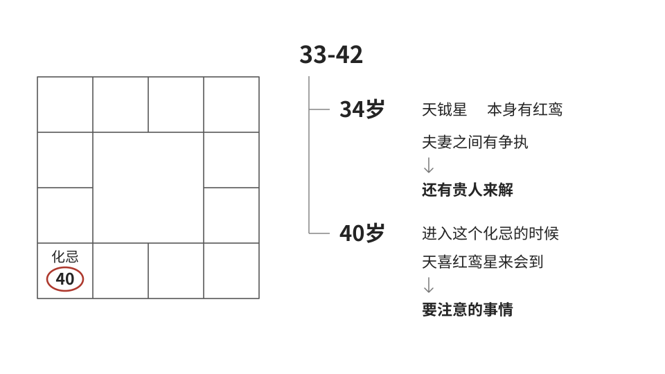 〔推断〕推断：叠图田宅辛未格岁数串「102234」可还原为 10,22,34，格内有天钺旺、红鸾陷；子女丁丑格「405264」可还原为 40,52,64，格内太阳化忌。与倪师讲的 34、40 岁相合，但叠图是否已按男命改排拿不准。（[00:14:39–00:15:34](https://www.bilibili.com/video/BV1KJsLekEfA/?p=25&t=879)，第 26370–28025 帧） |
| **这些问题有没有办法解？** | 〔口述〕「当然这些通通可以靠阳宅来解」，「这个我帮诸位提出来」「比较几个重要的重点」，随后转入下一个话题「八字我们怎么看」。本块没讲阳宅怎么解。（[00:18:37–00:18:53](https://www.bilibili.com/video/BV1KJsLekEfA/?p=25&t=1117)，第 33522–34013 帧） |

**总结区**

- 通用规则：同一个八字换成男命，十年大限反过来排，小流年还是一样（[00:14:39–00:14:57](https://www.bilibili.com/video/BV1KJsLekEfA/?p=25&t=879)，第 26370–26933 帧）；任何人的命只要有科进来，名气都会很大（[00:15:37–00:15:41](https://www.bilibili.com/video/BV1KJsLekEfA/?p=25&t=937)，第 28116–28241 帧）；化科就是同时任教，教学与自由业相辅相成（[00:16:33–00:16:40](https://www.bilibili.com/video/BV1KJsLekEfA/?p=25&t=993)，第 29802–30029 帧）；太阳太阴化忌有婆媳不和，倪师说「只要化忌都会有这种现象」（[00:17:43–00:17:54](https://www.bilibili.com/video/BV1KJsLekEfA/?p=25&t=1063)，第 31914–32237 帧）
- 只在本例：此八字作男命：3-12 仍科权禄、读书好，称财官双美格；23-32 化科七杀进来，考公家单位一定上、手有生杀之权（[00:15:00–00:15:21](https://www.bilibili.com/video/BV1KJsLekEfA/?p=25&t=900)，第 27012–27641 帧）；作男命：33-42 化忌不得重用、火大不干；43-52 化禄自己当老板做自由业；53-62 钱给朋友倒光光（[00:15:21–00:16:11](https://www.bilibili.com/video/BV1KJsLekEfA/?p=25&t=921)，第 27654–29159 帧）；作男命：太阳主爸爸早走；太太彪悍、家里有钱、漂亮、刚强固执（[00:17:29–00:17:43](https://www.bilibili.com/video/BV1KJsLekEfA/?p=25&t=1049)，第 31476–31913 帧）；作男命：34 岁有天钺、红鸾，夫妻争执但有贵人解；40 岁进入化忌，婚姻会出问题（[00:17:54–00:18:37](https://www.bilibili.com/video/BV1KJsLekEfA/?p=25&t=1074)，第 32238–33521 帧）
- 不是排盘规则，是处世方法：这种命早来算，建议做自由业同时任教，学生就是客户，教学相长、广结善缘（[00:16:27–00:16:57](https://www.bilibili.com/video/BV1KJsLekEfA/?p=25&t=987)，第 29622–30515 帧）；名医、名律师、名会计师都在学校任教，薪水再少也不要放弃（[00:16:57–00:17:15](https://www.bilibili.com/video/BV1KJsLekEfA/?p=25&t=1017)，第 30516–31055 帧）；男命换了夫妻宫，不要跟他说没有太太（[00:17:21–00:17:24](https://www.bilibili.com/video/BV1KJsLekEfA/?p=25&t=1041)，第 31236–31325 帧）

**待核**

1. 「男孩子顺转女孩子逆转」（[00:14:54](https://www.bilibili.com/video/BV1KJsLekEfA/?p=25&t=894)，第 26832 帧）与「男孩子是逆转」（[00:17:58](https://www.bilibili.com/video/BV1KJsLekEfA/?p=25&t=1078)，第 32358 帧）说法相反，未调和
2. [00:14:45–00:14:50](https://www.bilibili.com/video/BV1KJsLekEfA/?p=25&t=885)，第 26550–26717 帧字幕只有「男孩子变成这样子转而已」「年的刚好反过来而已」，语音多出「女孩子变成这样子转而已十」，字幕疑缺半句
3. [00:14:51](https://www.bilibili.com/video/BV1KJsLekEfA/?p=25&t=891)，第 26734 帧指代 D071「你把这个反过来」看不出所指，未用
4. [00:14:53](https://www.bilibili.com/video/BV1KJsLekEfA/?p=25&t=893)，第 26790 帧字幕句头「旺」去掉；[00:15:00](https://www.bilibili.com/video/BV1KJsLekEfA/?p=25&t=900)，第 27012 帧「第个」语音作「第一个」
5. [00:15:12](https://www.bilibili.com/video/BV1KJsLekEfA/?p=25&t=912)，第 27384 帧「对面是化科七杀进来」、[00:15:23](https://www.bilibili.com/video/BV1KJsLekEfA/?p=25&t=923)，第 27690 帧「本宫对面化忌」：本宫、对面各是哪宫倪师没说
6. [00:15:14](https://www.bilibili.com/video/BV1KJsLekEfA/?p=25&t=914)，第 27426 帧字幕「巴定」按语音改为「一定」
7. [00:15:21](https://www.bilibili.com/video/BV1KJsLekEfA/?p=25&t=921)，第 27642 帧字幕尾混入乱码「旺庙陷旺不机门羊贵耗德」，改用[00:15:21](https://www.bilibili.com/video/BV1KJsLekEfA/?p=25&t=921)，第 27654 帧那句
8. [00:15:31](https://www.bilibili.com/video/BV1KJsLekEfA/?p=25&t=931)，第 27954 帧字幕「43岁」，语音作「十三」，两路不全对
9. [00:15:35](https://www.bilibili.com/video/BV1KJsLekEfA/?p=25&t=935)，第 28056 帧「自宙业」改为「自由业」；第 28584、29802 帧「自由业2的」里的「2」语音没有，引文未收
10. [00:15:44](https://www.bilibili.com/video/BV1KJsLekEfA/?p=25&t=944)，第 28332 帧「那么大的财星」未说是哪颗星；第 28386、31782 帧「禄马交驰」未解释
11. [00:15:56](https://www.bilibili.com/video/BV1KJsLekEfA/?p=25&t=956)，第 28704 帧「5253岁」语音作「五十三岁」，岁数待核
12. [00:16:02](https://www.bilibili.com/video/BV1KJsLekEfA/?p=25&t=962)，第 28866 帧「戒盛」语音作「戒胜」，笔记按上下文转述为戒慎，原词待核
13. [00:16:54](https://www.bilibili.com/video/BV1KJsLekEfA/?p=25&t=1014)，第 30438 帧「利建侯」倪师未解释
14. [00:17:08](https://www.bilibili.com/video/BV1KJsLekEfA/?p=25&t=1028)，第 30843 帧指代 D075「不要放弃这个」不确定，未用；第 31412、31473、33233、33470 帧指代 D076–D079 均不确定，未用
15. 第 31128、31212 帧句尾「太」去掉；[00:17:20](https://www.bilibili.com/video/BV1KJsLekEfA/?p=25&t=1040)，第 31212 帧「失妻」改为「夫妻」
16. [00:17:24](https://www.bilibili.com/video/BV1KJsLekEfA/?p=25&t=1044)，第 31344 帧「怎么那么太太是太阴呐」语音作「太太是太医呢」，为何太太是太阴本块未解释
17. [00:17:29–00:17:33](https://www.bilibili.com/video/BV1KJsLekEfA/?p=25&t=1049)，第 31476–31595 帧字幕「早逝」「早走」，语音作「找事」「找走」
18. [00:17:43–00:17:46](https://www.bilibili.com/video/BV1KJsLekEfA/?p=25&t=1063)，第 31914–32009 帧字幕「太阴星」「太阳太阴化忌」，语音只作「太阳」「太阳化妓」
19. [00:18:01](https://www.bilibili.com/video/BV1KJsLekEfA/?p=25&t=1081)，第 32430 帧语音有「三七三八三九四十岁」、[00:18:10](https://www.bilibili.com/video/BV1KJsLekEfA/?p=25&t=1090)，第 32706 帧语音有「三七三六三五三十四」的数岁，字幕只有「37 36」，数法待核
20. [00:18:14–00:18:17](https://www.bilibili.com/video/BV1KJsLekEfA/?p=25&t=1094)，第 32832–32939 帧两句重复，当一句看；[00:18:14](https://www.bilibili.com/video/BV1KJsLekEfA/?p=25&t=1094)，第 32832 帧句头「太 《」为乱码
21. [00:18:20](https://www.bilibili.com/video/BV1KJsLekEfA/?p=25&t=1100)，第 33006 帧「陈以」改为「所以」；男命仍用「她」，照原字
22. [00:18:22–00:18:25](https://www.bilibili.com/video/BV1KJsLekEfA/?p=25&t=1102)，第 33078–33179 帧「还不至于说会」「有长辈在旁边不好意思」话没说完，意思待核
23. [00:18:29](https://www.bilibili.com/video/BV1KJsLekEfA/?p=25&t=1109)，第 33270 帧「挪婚姻就会有间题」按语音改为「婚姻就会有问题」
24. [00:18:43](https://www.bilibili.com/video/BV1KJsLekEfA/?p=25&t=1123)，第 33702 帧「看价八字」按语音作「八字我们怎么看」
25. 叠图迁移甲戌格「天哭」后庙旺[00:14:39](https://www.bilibili.com/video/BV1KJsLekEfA/?p=25&t=879)，第 26370 帧印成「□」、[00:15:42](https://www.bilibili.com/video/BV1KJsLekEfA/?p=25&t=942)，第 28278 帧作「平」；财帛丙子「31527」、迁移甲戌「11325」等数字串还原不了，未写
26. [00:14:42](https://www.bilibili.com/video/BV1KJsLekEfA/?p=25&t=882)，第 26460 帧板书图上叠图仍是命宫 3~12、父母 13~22 的排法，并有剪辑字「男命反过来」「财官双美格」，材料▣行未列；叠图大限是否已按男命改排拿不准
27. 板书第 26460、32584 帧大部分粉笔字认不出；右侧竖列上两字疑为「科」「权」，未定

## （跳过·非紫微）小六壬掐指法：起法、六神断事

### 5　跳过：小六壬掐指起法与断事（[00:18:53–00:25:56](https://www.bilibili.com/video/BV1KJsLekEfA/?p=25&t=1133)，第 34014–46691 帧）

| 提示区 | 笔记区 |
|---|---|
| **这一段讲了什么、为什么不做笔记？** | 〔推断〕推断：本段通篇是倪师在例二、例三之间插讲的小六壬掐指法（左手起月令、六个名字、按月日时断一件事的吉凶与应验快慢），没有讲到紫微斗数的星曜、宫位、四化或排盘；其中「迁移宫黑黑的青青的」「驿马的位置」说的是机场里看人脸上的气色，不是命盘上的宫，所以整段不做逐条笔记。（[00:18:53–00:25:56](https://www.bilibili.com/video/BV1KJsLekEfA/?p=25&t=1133)，第 34014–46691 帧） 〔口述〕因为最近发生空难，倪师要教大家「出门平安保保身的一个方法」，就是掐指一算，「叫六壬法」；以前诸葛亮出兵时用它看是不是好日子、会不会有事。（[00:18:54–00:19:34](https://www.bilibili.com/video/BV1KJsLekEfA/?p=25&t=1134)，第 34026–35231 帧） 〔口述〕在黑板上画左手手指，最下面一节「这叫寅宫」，「寅宫呢起月令」；六个名字用「小空大」「流速赤」来记，原名是空亡、小吉、大安、流连、速喜、赤口。（[00:19:57–00:20:50](https://www.bilibili.com/video/BV1KJsLekEfA/?p=25&t=1197)，第 35928–37529 帧） 〔口述〕倪师说「这个东西在黄历上有」，但「他们没有用到神」；它用在心血来潮（眼皮跳、心慌意乱）、一件事犹豫难决定、或想知道此行利不利的时候。（[00:20:51–00:21:17](https://www.bilibili.com/video/BV1KJsLekEfA/?p=25&t=1251)，第 37530–38327 帧） 〔口述〕插讲在机场候机：人死之前或霉运当头，两个礼拜就看得到气色，「你看到迁移宫黑黑的青青的要死」，在机场看到三个以上就该走，宁可不搭这班飞机。（[00:21:17–00:21:49](https://www.bilibili.com/video/BV1KJsLekEfA/?p=25&t=1277)，第 38328–39299 帧） |
| **这一段后面还讲了哪些话题？** | 〔口述〕要月、日、时三个资料，以起念当时为准，只算农历、不算国历；举例农历四月五号戌时，从大安起数到四月、五号、戌时「有落空亡」，若想的是明天买股票，就「凶此行不利」。（[00:21:50–00:23:04](https://www.bilibili.com/video/BV1KJsLekEfA/?p=25&t=1310)，第 39300–41531 帧） 〔口述〕此刻是空亡、下个时辰是大安，就改到下个时间再想，到时往往就忘了；算过以后「你不要在同一个念再去起第二次」，反而会害到自己、到时不知所措。（[00:23:04–00:23:38](https://www.bilibili.com/video/BV1KJsLekEfA/?p=25&t=1384)，第 41532–42557 帧） 〔口述〕用法举例：去签约谈生意走到办公室门口一算，正是流连（事情停滞不前、此行不利），中午11-1点不利，「那别管我1-3点是速喜」，1-3点再进去，不需要下次再去。（[00:23:38–00:24:19](https://www.bilibili.com/video/BV1KJsLekEfA/?p=25&t=1418)，第 42558–43781 帧） 〔口述〕各名字主事：赤口是第三者介入、小人是非、人为因素；速喜「立竿见影」；可用来找失物；流连是事情停滞；小吉约两个礼拜、大安约一个礼拜会看到；空亡「你可以断念了」；只测单一一件事，不拿来算命。（[00:24:19–00:25:04](https://www.bilibili.com/video/BV1KJsLekEfA/?p=25&t=1459)，第 43782–45131 帧） 〔口述〕在中山机场若见人人脸上「这个驿马的位置都黑黑的」，掐指又正逢空亡，就要准备跑路；「君子是事天」、小人事人；「要用它就要听它的」，问了又不听，就像易经说的「涉水灭顶」，自己害自己。（[00:25:04–00:25:53](https://www.bilibili.com/video/BV1KJsLekEfA/?p=25&t=1504)，第 45132–46607 帧） |

**总结区**

**待核**

1. 字幕「因为最近发生空滩，」的「空滩」按语音改作「空难」（[00:18:56](https://www.bilibili.com/video/BV1KJsLekEfA/?p=25&t=1136)，第 34098 帧）
2. 字幕「就要以当时沟准」的「沟准」按语音改作「为准」（[00:22:06](https://www.bilibili.com/video/BV1KJsLekEfA/?p=25&t=1326)，第 39792 帧）
3. 字幕「不要拿来不用它来拿算哦」语句不通，按语音「不用他来算命哦」转述为不拿来算命（[00:24:53](https://www.bilibili.com/video/BV1KJsLekEfA/?p=25&t=1493)，第 44814 帧）
4. 字幕「问了叉不听」的「叉」按语音改作「又」（[00:25:38](https://www.bilibili.com/video/BV1KJsLekEfA/?p=25&t=1538)，第 46158 帧）

## 例三（男命，命宫癸酉天相）：府相会命、中风、一侧住人

〔叠图〕这一例视频里只贴过 7 格：命宫 癸酉：天相陷、文曲庙忌、三台庙、天刑庙、天官平、天虚旺、恩光陷、截空庙、旬空庙；财帛 己巳：天府得、文昌庙、天马平、陀罗陷、八座庙、孤辰陷、破碎陷；夫妻 辛未：武曲庙禄、贪狼庙权、擎羊庙、凤阁陷、华盖陷、年解得、龙池庙；疾厄 戊辰：左辅庙、地劫陷、天使陷、天空庙；迁移 丁卯：廉贞平、破军陷、铃星利、天哭庙；官禄 丁丑：天姚平、天贵旺、寡宿平；子女 庚午：天同陷、太阴不、禄存庙、地空庙、天喜庙。

### 6　府相会命男命中风与一侧住人宅（[00:25:56–00:31:42](https://www.bilibili.com/video/BV1KJsLekEfA/?p=25&t=1556)，第 46692–57089 帧）

| 提示区 | 笔记区 |
|---|---|
| **这一段为什么说要给全世界的女人看？** | 〔口述〕倪师换讲一张新命盘，开头说「这一段呢」「要给这个全世界的女人看一下」，又提醒看「这个八字哦」时「都脑筋要清楚一点」。（[00:25:56–00:26:04](https://www.bilibili.com/video/BV1KJsLekEfA/?p=25&t=1556)，第 46692–46943 帧） 〔口述〕他重提事天：「我讲过我们事天」「在事先事情发机之前呐」「我们先去解」，即事情发生之前先去化解。（[00:26:04–00:26:12](https://www.bilibili.com/video/BV1KJsLekEfA/?p=25&t=1564)，第 46944–47189 帧） |
| **什么叫府相会命？这种人适合做什么？** | 〔指代〕说「像这个男人的命」时，手指点在黑板右侧「文曲」下方的「4-13」处，下面一行是「命宫」，即指这张盘的命宫。（[00:26:13](https://www.bilibili.com/video/BV1KJsLekEfA/?p=25&t=1573)，第 47197 帧） 〔口述〕「这种是府相会命」「府相会命不是不好做佐才啊」「就是我去帮你做领薪水就好了」「我就当你的助手好了助理」。又说「像他命都没有会到科权禄」；解释府相就是「有没有天相和天府来会」。（[00:26:19–00:26:34](https://www.bilibili.com/video/BV1KJsLekEfA/?p=25&t=1579)，第 47370–47825 帧） 〔口述〕这样的人「所以会到私人企业」「私人公司行号去做事情」。（[00:26:35–00:26:39](https://www.bilibili.com/video/BV1KJsLekEfA/?p=25&t=1595)，第 47862–47981 帧） 〔叠图〕命宫癸酉：天相陷、文曲庙、三台庙、天刑庙、恩光陷、截空庙、旬空庙等；财帛己巳：天府得、文昌庙、天马平、陀罗陷、八座庙等。另一版叠图里命宫是「文曲庙忌」，官禄丁丑只有天姚平、天贵旺、寡宿平等，迁移丁卯是廉贞平、破军陷、铃星利。（[00:26:28–00:26:39](https://www.bilibili.com/video/BV1KJsLekEfA/?p=25&t=1588)，第 47646–47981 帧） 〔板书〕本块开头的板面（上一例留下的命盘格）。可辨：圈起的「53」、「左辅」「地劫」、「疾厄」、右栏「巨门」「太阳」「天相」「文曲」，其余认不出。（[00:25:58](https://www.bilibili.com/video/BV1KJsLekEfA/?p=25&t=1558)，第 46740 帧） |
| **第一个重点：他的太太命上是什么样？** | 〔口述〕「第一个重点」「你看他的太太」「这种权禄重逢」「太太能力非常的强」。（[00:26:41–00:26:48](https://www.bilibili.com/video/BV1KJsLekEfA/?p=25&t=1601)，第 48030–48245 帧） 〔叠图〕夫妻辛未：武曲庙禄、贪狼庙权、擎羊庙、龙池庙、凤阁陷、封诰、年解得，格内标「身宫」。（[00:27:02–00:27:03](https://www.bilibili.com/video/BV1KJsLekEfA/?p=25&t=1622)，第 48666–48695 帧） 〔推断〕推断：口述「权禄重逢」和叠图夫妻辛未格里武曲带禄、贪狼带权同在一格对得上；倪师本段没有明说是哪两颗星。（[00:26:44–00:27:03](https://www.bilibili.com/video/BV1KJsLekEfA/?p=25&t=1604)，第 48144–48695 帧） |
| **能力强的女孩子为什么常嫁给差的男人？** | 〔口述〕「而根据本人的临床的经验」「往往很强的女孩子都喜欢嫁这种人」「因为她有安全感啊」「觉得先生会被她掌握」。（[00:26:48–00:26:58](https://www.bilibili.com/video/BV1KJsLekEfA/?p=25&t=1608)，第 48246–48551 帧） 〔口述〕「所以你看到能力很强很漂亮的女孩子」「找个先生都很丑的很差的」，她只为了一个安全感。（[00:27:00–00:27:08](https://www.bilibili.com/video/BV1KJsLekEfA/?p=25&t=1620)，第 48618–48857 帧） 〔口述〕「实际上婚前婚后完全不一样」：婚前男人对太太很好，「当然都把好的一面表现给你看」，「那结婚以后马上人就变了」。（[00:27:08–00:27:24](https://www.bilibili.com/video/BV1KJsLekEfA/?p=25&t=1628)，第 48858–49343 帧） |
| **这位男命几岁出事？疾厄十年代表什么？** | 〔口述〕「他在53岁的时候出事了」；接着说「54-63十年大运是疾厄宫」「代表这十年中做十年的值日神」「是疾厄代表身体」「最凶的就是身体」。（[00:27:24–00:27:47](https://www.bilibili.com/video/BV1KJsLekEfA/?p=25&t=1644)，第 49344–50039 帧） 〔叠图〕疾厄戊辰：左辅庙、地劫陷、天使陷、天空庙等，格内印「54~63」；财帛己巳格印「44~53」，并单独标出「53」，叠图该格标着「出事」。（[00:27:36–00:27:40](https://www.bilibili.com/video/BV1KJsLekEfA/?p=25&t=1656)，第 49704–49805 帧） 〔板书〕可辨：圈起的「53」、上方「34-43」、手指处框起的「……疾厄」（前面数字认不全），左下「64-73」，其余被叠图和身体挡住认不出。（[00:27:39](https://www.bilibili.com/video/BV1KJsLekEfA/?p=25&t=1659)，第 49793 帧） |
| **天府星为什么逃不掉？出事后人怎样？** | 〔口述〕「天府南斗星君这颗星」「不能够解厄制化」「南斗星君往往它发生的事情」「就是吉处藏凶」「逃都逃不掉」，并举「我们的尹清枫就是这样子啊」，再说「逃都逃不掉这是天府星」。（[00:27:48–00:28:03](https://www.bilibili.com/video/BV1KJsLekEfA/?p=25&t=1668)，第 50040–50507 帧） 〔口述〕他53岁出事：「脑中风了」「中风以后脑就有障碍了」「从此就不能讲话」，像半白痴的样子（字幕作「半自痴」）。（[00:28:03–00:28:15](https://www.bilibili.com/video/BV1KJsLekEfA/?p=25&t=1683)，第 50508–50855 帧） 〔口述〕「可是这种人好福气啊」「有个太太很强在旁边照顾他」。（[00:28:15–00:28:22](https://www.bilibili.com/video/BV1KJsLekEfA/?p=25&t=1695)，第 50856–51065 帧） 〔推断〕推断：叠图里天府在财帛己巳，同一格标着「出事」并印着 53；倪师本段口述没有说天府在哪一宫。（[00:27:36–00:28:03](https://www.bilibili.com/video/BV1KJsLekEfA/?p=25&t=1656)，第 49704–50507 帧） |
| **强太太照顾中风先生，对她是好事吗？** | 〔指代〕说「那你说对这个太太来说」时，手指点在黑板一格的「武曲」下方、该格底部「夫妻」上方，即指夫妻宫。（[00:28:22](https://www.bilibili.com/video/BV1KJsLekEfA/?p=25&t=1702)，第 51082 帧） 〔口述〕「是好事还是不好呢」，也有人说好、觉得可以一辈子照顾人；倪师说「这是个人的角度而已嘛」「但是在我们命上面可以看得很清楚」他太太为什么嫁给他。（[00:28:23–00:28:37](https://www.bilibili.com/video/BV1KJsLekEfA/?p=25&t=1703)，第 51108–51515 帧） 〔口述〕「可是他54岁以后」「人就没有了」「人就等于是照顾一个半身瘫痪的人了」。（[00:28:41–00:28:46](https://www.bilibili.com/video/BV1KJsLekEfA/?p=25&t=1721)，第 51648–51809 帧） 〔叠图〕夫妻辛未格再贴一次，叠图该格标着「太太能力非常强」；同时贴出命宫癸酉、疾厄戊辰、财帛己巳。（[00:28:43–00:28:46](https://www.bilibili.com/video/BV1KJsLekEfA/?p=25&t=1723)，第 51696–51809 帧） |
| **婆媳不和从哪里看？太太两个十年各忍什么？** | 〔口述〕这男人的命里面「太阴星在午时出」「出月亮中午出月亮」，月亮不亮了，「或者是化忌的」「都是婆媳不和」，「你跟你先生和没有用啊」。（[00:28:51–00:29:00](https://www.bilibili.com/video/BV1KJsLekEfA/?p=25&t=1731)，第 51930–52223 帧） 〔叠图〕子女庚午：太阴不、天同陷、天喜庙、禄存庙、地空庙、博士、养等；叠图该格标着「婆媳不和」。（[00:29:00–00:29:02](https://www.bilibili.com/video/BV1KJsLekEfA/?p=25&t=1740)，第 52224–52277 帧） 〔口述〕「所以她在（先生）还没有出事的时候」「34-43的时候」「一直在十年中忍受婆媳不和」「而到了44-53以后」「还要忍受他先生的半身瘫痪」「中风人脑子神志不清呐」。（[00:29:00–00:29:13](https://www.bilibili.com/video/BV1KJsLekEfA/?p=25&t=1740)，第 52224–52595 帧） 〔推断〕推断：口述「太阴星在午」与叠图太阴所在格地支为午（子女庚午）对得上；倪师本段没有说为什么用这一格看婆媳。（[00:28:51–00:29:02](https://www.bilibili.com/video/BV1KJsLekEfA/?p=25&t=1731)，第 51930–52277 帧） |
| **算命实际上是在做什么？** | 〔口述〕很多事情一般人事前无法预见，「所以必须要靠命来预见」。（[00:29:13–00:29:20](https://www.bilibili.com/video/BV1KJsLekEfA/?p=25&t=1753)，第 52596–52811 帧） 〔口述〕「所以我们实际上算是什么呀」「是事天」，即事先知道凶与吉。（[00:29:20–00:29:28](https://www.bilibili.com/video/BV1KJsLekEfA/?p=25&t=1760)，第 52812–53045 帧） |
| **中风瘫痪的人常住哪种宅？什么叫一侧住人？** | 〔口述〕「人中风瘫痪的时候」「有一种宅叫做一侧住人」。（[00:29:30–00:29:36](https://www.bilibili.com/video/BV1KJsLekEfA/?p=25&t=1770)，第 53112–53309 帧） 〔指代〕说「这边都是卧房」前的「这边」时，手按在自己在黑板右侧画的长方形房屋示意图左侧隔间，不是命盘宫位。（[00:29:39](https://www.bilibili.com/video/BV1KJsLekEfA/?p=25&t=1779)，第 53388 帧） 〔口述〕一个房子盖起来，「这边都是卧房」「卧房三间卧房」，另一边「客厅餐厅厨房」，「人住在一边」。（[00:29:38–00:29:50](https://www.bilibili.com/video/BV1KJsLekEfA/?p=25&t=1778)，第 53358–53729 帧） 〔板书〕黑板右侧画一个长方形，中间一条竖线分成左右两半，左半有横线隔成几格，右半竖写几个字认不出（口述同时说客厅餐厅厨房）。（[00:29:49](https://www.bilibili.com/video/BV1KJsLekEfA/?p=25&t=1789)，第 53697 帧） 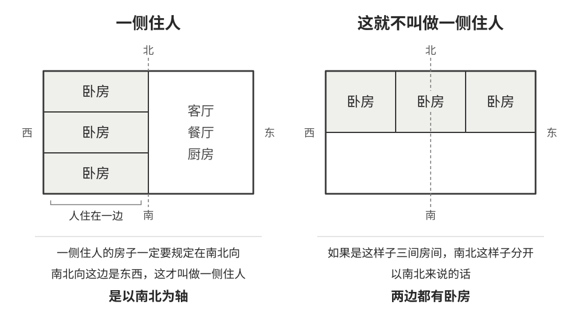 〔板书〕黑板最左侧竖写大字「一侧住人」，可辨；右侧房屋图里的字被身体挡住，认不出。（[00:31:10](https://www.bilibili.com/video/BV1KJsLekEfA/?p=25&t=1870)，第 56124 帧） |
| **一侧住人的房子一定是什么朝向？怎样就不算？** | 〔口述〕「一侧住人的房子」「一定要规定在南北向」，「南北向这边是东西」「这才叫做一侧住人」。（[00:29:51–00:30:04](https://www.bilibili.com/video/BV1KJsLekEfA/?p=25&t=1791)，第 53736–54143 帧） 〔指代〕说「这边是东西」时，手移到自画房屋示意图的左侧隔间，指的是示意图左半边。（[00:30:00](https://www.bilibili.com/video/BV1KJsLekEfA/?p=25&t=1800)，第 54005 帧） 〔口述〕如果「房子隔起来是东南西北」，三间房间南北这样分开、「两边都有卧房」，「这就不叫做一侧住人」，「是以南北为轴」。（[00:30:04–00:30:20](https://www.bilibili.com/video/BV1KJsLekEfA/?p=25&t=1804)，第 54144–54611 帧） 〔板书〕这时板面镜头晃动模糊，字认不出。（[00:30:15](https://www.bilibili.com/video/BV1KJsLekEfA/?p=25&t=1815)，第 54473 帧） |
| **为什么房子要讲中心轴？** | 〔口述〕我们在地球上也这样，「地球有地轴」；「我们船航在水上面有个龙骨」，「两边要平稳」。（[00:30:21–00:30:27](https://www.bilibili.com/video/BV1KJsLekEfA/?p=25&t=1821)，第 54636–54833 帧） 〔口述〕你跟先生两个人在那边划船，「两个人坐船一边就翻过去了对不对」。（[00:30:29–00:30:37](https://www.bilibili.com/video/BV1KJsLekEfA/?p=25&t=1829)，第 54882–55133 帧） 〔口述〕「实际上一个房子盖在地上面」「就好像一个条船放在水上面一样」「它有个中心的轴」。（[00:30:38–00:30:43](https://www.bilibili.com/video/BV1KJsLekEfA/?p=25&t=1838)，第 55164–55313 帧） 〔推断〕推断：倪师用船两边要平稳来比房子，意思是人只住一侧就像船只坐一边；他没有逐字这样说。（[00:30:24–00:30:43](https://www.bilibili.com/video/BV1KJsLekEfA/?p=25&t=1824)，第 54720–55313 帧） |
| **罗盘把房子切两半，各看什么？** | 〔口述〕「所以我们拿罗盘去看的时候」「所以中心轴切两半来是看夫妻」。（[00:30:43–00:30:50](https://www.bilibili.com/video/BV1KJsLekEfA/?p=25&t=1843)，第 55314–55529 帧） 〔口述〕「如果是东西切两半」看「生男生女」，「往北边通通是男的」；「那这面切两半的话」「看身体健康的问题」。（[00:30:51–00:31:01](https://www.bilibili.com/video/BV1KJsLekEfA/?p=25&t=1851)，第 55530–55859 帧） 〔指代〕说「那这面切两半的话」的「这边」时，手掌按在黑板右侧房屋平面图的右半边。（[00:30:59](https://www.bilibili.com/video/BV1KJsLekEfA/?p=25&t=1859)，第 55783 帧） 〔口述〕「像这个厨房是在西北角」「就是伤先生对不对」。（[00:31:02–00:31:06](https://www.bilibili.com/video/BV1KJsLekEfA/?p=25&t=1862)，第 55860–55991 帧） |
| **厨房换到西南会怎样？一侧住人能住吗？** | 〔口述〕如果有的人「客厅餐厅厨房在这里呢（西南）」，就「变成太太中风瘫痪在那边」，「反的了解我意思吧」「加減要依此类推」。（[00:31:06–00:31:19](https://www.bilibili.com/video/BV1KJsLekEfA/?p=25&t=1866)，第 55992–56387 帧） 〔指代〕说「客厅餐厅厨房在这里呢」的「这里」时，手在房屋平面图右半上部，正拿粉笔书写，新写的字被手挡住看不清。（[00:31:09](https://www.bilibili.com/video/BV1KJsLekEfA/?p=25&t=1869)，第 56092 帧） 〔口述〕结论：「所以一侧住人的房子不可以」「不可以住人」。（[00:31:19–00:31:34](https://www.bilibili.com/video/BV1KJsLekEfA/?p=25&t=1879)，第 56388–56831 帧） 〔口述〕「我们暂停一下」，随后擦板。（[00:31:34–00:31:42](https://www.bilibili.com/video/BV1KJsLekEfA/?p=25&t=1894)，第 56832–57089 帧） 〔板书〕块末擦板后新画的命盘（下一张命盘）。可辨：「武曲」「太阳」「太阴」「天机」「天同」等字，其余认不出。（[00:31:42](https://www.bilibili.com/video/BV1KJsLekEfA/?p=25&t=1902)，第 57077 帧） |

**总结区**

- 通用规则：府相会命（有天相、天府来会）的人适合做佐才、当助理领薪水，会到私人企业、公司行号做事（[00:26:19–00:26:39](https://www.bilibili.com/video/BV1KJsLekEfA/?p=25&t=1579)，第 47370–47981 帧）；天府南斗星君不能解厄制化，它发生的事往往吉处藏凶、逃都逃不掉（[00:27:48–00:28:03](https://www.bilibili.com/video/BV1KJsLekEfA/?p=25&t=1668)，第 50040–50507 帧）；太阴星在午时出、月亮不亮，或者化忌，都是婆媳不和（[00:28:51–00:29:00](https://www.bilibili.com/video/BV1KJsLekEfA/?p=25&t=1731)，第 51930–52223 帧）；一侧住人的房子是南北向、人只住一边，罗盘中心轴切两半看夫妻、东西切两半看生男生女，一侧住人的房子不可以住人（[00:29:30–00:31:34](https://www.bilibili.com/video/BV1KJsLekEfA/?p=25&t=1770)，第 53112–56831 帧）
- 只在本例：这位男命府相会命、没会到科权禄，会到私人企业做事（[00:26:28–00:26:39](https://www.bilibili.com/video/BV1KJsLekEfA/?p=25&t=1588)，第 47646–47981 帧）；太太权禄重逢、能力非常强（[00:26:41–00:26:48](https://www.bilibili.com/video/BV1KJsLekEfA/?p=25&t=1601)，第 48030–48245 帧）；他53岁出事脑中风，从此不能讲话，54-63十年大运是疾厄宫，由太太照顾（[00:27:24–00:28:22](https://www.bilibili.com/video/BV1KJsLekEfA/?p=25&t=1644)，第 49344–51065 帧）；太太34-43十年忍受婆媳不和，44-53以后还要忍受先生半身瘫痪（[00:29:00–00:29:13](https://www.bilibili.com/video/BV1KJsLekEfA/?p=25&t=1740)，第 52224–52595 帧）
- 不是排盘规则，是处世方法：事天：在事情发生之前先去化解（[00:26:04–00:26:12](https://www.bilibili.com/video/BV1KJsLekEfA/?p=25&t=1564)，第 46944–47189 帧）；一般人事前无法预见，要靠命来预见，算命就是事天（[00:29:13–00:29:28](https://www.bilibili.com/video/BV1KJsLekEfA/?p=25&t=1753)，第 52596–53045 帧）；倪师临床经验：很强的女孩子往往为了安全感嫁给能掌握的男人，但婚前婚后完全不一样（[00:26:48–00:27:24](https://www.bilibili.com/video/BV1KJsLekEfA/?p=25&t=1608)，第 48246–49343 帧）

**待核**

1. 「在事先事情发机之前呐」的「发机」语音作「发迹」「发现」，原字待核（[00:26:06](https://www.bilibili.com/video/BV1KJsLekEfA/?p=25&t=1566)，第 46992 帧）
2. 「然后他是拼的上财宗（3）」语音作「他是拼在那财博」，两路对不齐，本笔记略过（[00:26:34](https://www.bilibili.com/video/BV1KJsLekEfA/?p=25&t=1594)，第 47826 帧）
3. 「佐才」一词倪师没有解释，照字幕原字（[00:26:20](https://www.bilibili.com/video/BV1KJsLekEfA/?p=25&t=1580)，第 47418 帧）
4. 命宫癸酉的「忌」两版叠图不一致：一版单列「忌」，一版印作「文曲庙忌」（[00:26:28](https://www.bilibili.com/video/BV1KJsLekEfA/?p=25&t=1588)，第 47646 帧、[00:26:36](https://www.bilibili.com/video/BV1KJsLekEfA/?p=25&t=1596)，第 47898 帧）
5. 「这种权禄重逢」语音作「学路从逢」，按字幕写（[00:26:44](https://www.bilibili.com/video/BV1KJsLekEfA/?p=25&t=1604)，第 48144 帧）
6. 岁数前后不一：「53岁出事」（[00:27:27](https://www.bilibili.com/video/BV1KJsLekEfA/?p=25&t=1647)，第 49410 帧、[00:28:03](https://www.bilibili.com/video/BV1KJsLekEfA/?p=25&t=1683)，第 50508 帧）、「54-63十年大运是疾厄宫」（[00:27:34](https://www.bilibili.com/video/BV1KJsLekEfA/?p=25&t=1654)，第 49632 帧）、「可是他54岁以后」（[00:28:41](https://www.bilibili.com/video/BV1KJsLekEfA/?p=25&t=1721)，第 51648 帧）、「34-43」（[00:29:02](https://www.bilibili.com/video/BV1KJsLekEfA/?p=25&t=1742)，第 52278 帧）、「而到了44-53以后」（[00:29:05](https://www.bilibili.com/video/BV1KJsLekEfA/?p=25&t=1745)，第 52374 帧），照原话分别写，没有自行计算
7. 「值日神」「解厄制化」「吉处藏凶」倪师没有解释；语音分别作「植日神」「解恶之化」「急促长胸」（[00:27:36](https://www.bilibili.com/video/BV1KJsLekEfA/?p=25&t=1656)，第 49704 帧、[00:27:50](https://www.bilibili.com/video/BV1KJsLekEfA/?p=25&t=1670)，第 50100 帧、[00:27:54](https://www.bilibili.com/video/BV1KJsLekEfA/?p=25&t=1674)，第 50244 帧）
8. 人名「尹清枫」照原话写，没交代是谁；语音作「隐清风」（[00:27:57](https://www.bilibili.com/video/BV1KJsLekEfA/?p=25&t=1677)，第 50328 帧）
9. 「半自痴」按语音改为半白痴（[00:28:10](https://www.bilibili.com/video/BV1KJsLekEfA/?p=25&t=1690)，第 50724 帧）
10. 「而实际上他太太只是对他而已」语意不清，未引（[00:28:37](https://www.bilibili.com/video/BV1KJsLekEfA/?p=25&t=1717)，第 51516 帧）
11. 「所以我说最好看看。命。呀」句中带句号、意思不清，未引（[00:28:48](https://www.bilibili.com/video/BV1KJsLekEfA/?p=25&t=1728)，第 51864 帧）
12. 「太阴星在午时出」语音作「太阴心在五十出」；下一句「反正太月亮不亮了」中「太」字语音栏没有，未引原句（[00:28:51](https://www.bilibili.com/video/BV1KJsLekEfA/?p=25&t=1731)，第 51930 帧、[00:28:54](https://www.bilibili.com/video/BV1KJsLekEfA/?p=25&t=1734)，第 52032 帧）
13. 叠图子女庚午格数字串「3443」按图例像是「34~43」，与口述「34-43」或有关，未核实；格内另有一格「□」认不出（[00:29:00](https://www.bilibili.com/video/BV1KJsLekEfA/?p=25&t=1740)，第 52224 帧）
14. 「天事先就知道这个凶与吉」句头「天」可能是混字，语音作「天就知道这个事情」，未引原句（[00:29:24](https://www.bilibili.com/video/BV1KJsLekEfA/?p=25&t=1764)，第 52938 帧）
15. 「有一种宅叫做一侧住人」的「宅」语音作「室」（[00:29:32](https://www.bilibili.com/video/BV1KJsLekEfA/?p=25&t=1772)，第 53184 帧）
16. 字幕「64-73号」语音栏为空，板书图[00:27:39](https://www.bilibili.com/video/BV1KJsLekEfA/?p=25&t=1659)，第 49793 帧左下有粉笔「64-73」，可能是画面上的字，不当倪师的话（[00:29:51](https://www.bilibili.com/video/BV1KJsLekEfA/?p=25&t=1791)，第 53730 帧）
17. 「你跟你男先生两个人在那边划船」的「男」语音栏没有，未引（[00:30:31](https://www.bilibili.com/video/BV1KJsLekEfA/?p=25&t=1831)，第 54942 帧）
18. 「往北边通通是男的」语音作「往南边通通往北边通难的」，南北拿不准；另一半是什么没讲清（[00:30:57](https://www.bilibili.com/video/BV1KJsLekEfA/?p=25&t=1857)，第 55716 帧）
19. 厨房在西北角为什么伤先生、在西南为什么太太中风，倪师本段没有解释；「（西南）」是字幕括号注字，不是口述（[00:31:02](https://www.bilibili.com/video/BV1KJsLekEfA/?p=25&t=1862)，第 55860 帧、[00:31:08](https://www.bilibili.com/video/BV1KJsLekEfA/?p=25&t=1868)，第 56058 帧）
20. 「加減要依此类推」照字幕原字（[00:31:15](https://www.bilibili.com/video/BV1KJsLekEfA/?p=25&t=1875)，第 56262 帧）
21. 指代看不出或不确定、未作依据：[00:26:40](https://www.bilibili.com/video/BV1KJsLekEfA/?p=25&t=1600)，第 48010 帧、[00:28:47](https://www.bilibili.com/video/BV1KJsLekEfA/?p=25&t=1727)，第 51838 帧、[00:28:49](https://www.bilibili.com/video/BV1KJsLekEfA/?p=25&t=1729)，第 51893 帧、[00:31:02](https://www.bilibili.com/video/BV1KJsLekEfA/?p=25&t=1862)，第 55864 帧
22. 说「这里」（西南）时手挡住了新写的字，指代所指的字认不出（[00:31:09](https://www.bilibili.com/video/BV1KJsLekEfA/?p=25&t=1869)，第 56092 帧）
23. 板书图[00:30:15](https://www.bilibili.com/video/BV1KJsLekEfA/?p=25&t=1815)，第 54473 帧镜头晃动模糊、认不出；[00:29:49](https://www.bilibili.com/video/BV1KJsLekEfA/?p=25&t=1789)，第 53697 帧房屋图右半竖写字认不出；[00:31:42](https://www.bilibili.com/video/BV1KJsLekEfA/?p=25&t=1902)，第 57077 帧是下一张命盘，只认出少数星名（[00:29:49](https://www.bilibili.com/video/BV1KJsLekEfA/?p=25&t=1789)，第 53697 帧、[00:30:15](https://www.bilibili.com/video/BV1KJsLekEfA/?p=25&t=1815)，第 54473 帧、[00:31:42](https://www.bilibili.com/video/BV1KJsLekEfA/?p=25&t=1902)，第 57077 帧）
24. 开头板面[00:25:58](https://www.bilibili.com/video/BV1KJsLekEfA/?p=25&t=1558)，第 46740 帧有叠在画面上的六壬法掌图（剪辑贴图），挡住黑板左下，板书只认出少数字（[00:25:58](https://www.bilibili.com/video/BV1KJsLekEfA/?p=25&t=1558)，第 46740 帧）

## 例四（女命，命宫己酉紫微贪狼）：化权坐命、红鸾天喜化忌

| 巳 | 午 | 未 | 申 |
|---|---|---|---|
| **财帛 乙巳** 武曲平忌 破军平 文曲庙 天钺旺 | **子女 丙午** 太阳旺 | **夫妻 丁未** 天府庙 | **兄弟 戊申** 天机得 太阴利 |
| （辰：没贴过） | **例四 · 命宫己酉** | 据视频叠图重排 | **命宫 己酉** 紫微旺权 贪狼利 文昌庙 |
| **迁移 癸卯** 天魁庙 火星利 | 后期贴图，不算倪师的话 |  | **父母 庚戌** 巨门陷 陀罗庙 地空陷 |
| **交友 壬寅** 右弼旺 天马旺 | **官禄 癸丑** 廉贞利 七杀庙 | **田宅 壬子** 天梁庙禄 左辅旺科 擎羊陷 地劫陷 | **福德 辛亥**（身宫） 天相得 禄存庙 铃星利 |

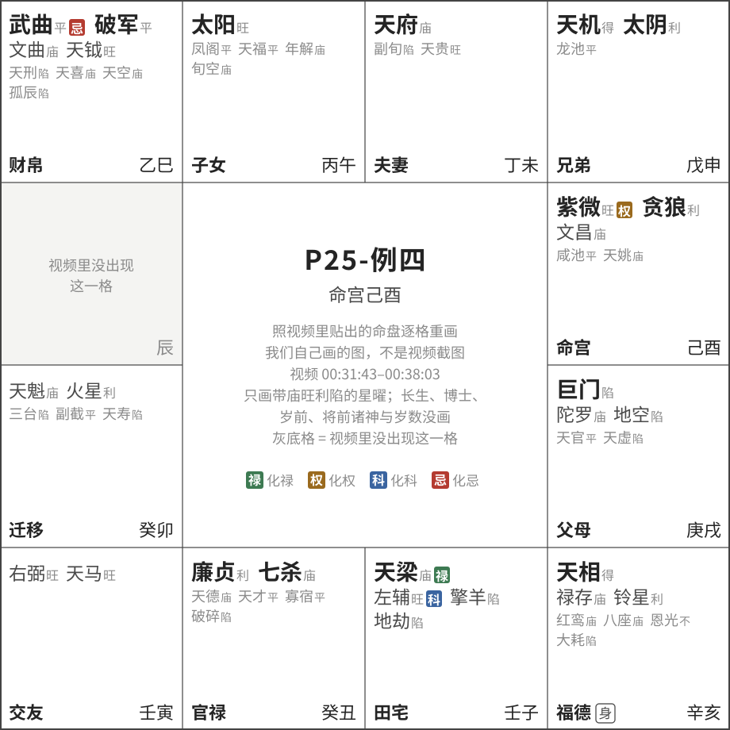

按视频里这张盘逐格重画（我们自己画的图，不是视频截图）；数据见 [命盘-P25-例四.json](图/命盘-P25-例四.json)。

### 7　例四紫贪化权女命与同盘男命（[00:31:43–00:38:03](https://www.bilibili.com/video/BV1KJsLekEfA/?p=25&t=1903)，第 57090–68495 帧）

| 提示区 | 笔记区 |
|---|---|
| **例四女命命宫什么星？化权坐命强到什么程度？** | 〔口述〕倪师换一张新盘：「这个这个人很好玩」「诸位看这个八字哦」「这种就是女孩子对不对」。（[00:31:43–00:31:55](https://www.bilibili.com/video/BV1KJsLekEfA/?p=25&t=1903)，第 57090–57461 帧） 〔口述〕「你看她的命」「这个紫微贪狼了」「这种杀破狼都是属于男人的命」「女人呢拿到男人的八字」，武官的命「已经够强了对不对」。（[00:31:57–00:32:08](https://www.bilibili.com/video/BV1KJsLekEfA/?p=25&t=1917)，第 57528–57863 帧） 〔指代〕说「这个紫微贪狼了」时手指的是黑板命盘右列第二格，即写有「命」字的那一格。（[00:32:00](https://www.bilibili.com/video/BV1KJsLekEfA/?p=25&t=1920)，第 57606 帧） 〔叠图〕命宫己酉：紫微旺（化权）、贪狼利、文昌庙、天姚庙、咸池平、天厨、月德；官禄癸丑：七杀庙、廉贞利；财帛乙巳：武曲平（化忌）、破军平、文曲庙、天喜庙、天钺旺、天空庙、天刑陷。（[00:32:07–00:32:08](https://www.bilibili.com/video/BV1KJsLekEfA/?p=25&t=1927)，第 57816–57863 帧） 〔口述〕「再化个权坐命」「就是要乘两倍的强」「加倍的强」「个性很固执的强」「要全世界人都要听我的强」「这是最强的慈禧太后」；后面又说「这个女人是慈禧太后啊」。（[00:32:08–00:32:58](https://www.bilibili.com/video/BV1KJsLekEfA/?p=25&t=1928)，第 57864–59345 帧） |
| **她的先生是什么星？是什么样的人？** | 〔口述〕「这种人的命呢」「你看看她的先生」「南斗星君天府星」「天府星是种温和很厚道的星」「你知道她发生什么事情」。（[00:32:26–00:32:35](https://www.bilibili.com/video/BV1KJsLekEfA/?p=25&t=1946)，第 58380–58661 帧） 〔叠图〕夫妻丁未：天府庙、天贵旺、台辅、天煞，大限 25~34；该格标着「温和厚道」。（[00:32:38–00:32:47](https://www.bilibili.com/video/BV1KJsLekEfA/?p=25&t=1958)，第 58740–59010 帧） 〔口述〕「她先生很厚道很老实」「实在拿她太太没有办法啊」。（[00:32:58–00:33:01](https://www.bilibili.com/video/BV1KJsLekEfA/?p=25&t=1978)，第 59346–59441 帧） |
| **红鸾天喜化不化忌，批法差在哪？** | 〔口述〕「如果她的红鸾天喜星没有化忌」「没有化忌哈」「没事哦」；「太阳在午宫的很旺啊」「都很好都一化忌以后哈」「就不一样不是这样批喽」。（[00:32:37–00:32:54](https://www.bilibili.com/video/BV1KJsLekEfA/?p=25&t=1957)，第 58734–59225 帧） 〔叠图〕福德辛亥：红鸾庙、禄存庙、天相得、铃星利、八座庙、大耗陷，标「身宫」；财帛乙巳里有天喜庙，同格武曲平化忌。（[00:32:48–00:32:49](https://www.bilibili.com/video/BV1KJsLekEfA/?p=25&t=1968)，第 59052–59087 帧） 〔叠图〕子女丙午：太阳旺、凤阁平、天福平、年解庙、旬空庙，大限 35~44。（[00:32:58–00:32:59](https://www.bilibili.com/video/BV1KJsLekEfA/?p=25&t=1978)，第 59346–59387 帧） |
| **25-34 走夫妻宫结了婚，30 岁出了什么事？** | 〔口述〕「那刚好25 26 27 28岁走夫妻宫」「25-34通通吉星来会啊」「那她先生人很厚道」，「嫁给就是跟她娶了她对不对」「跟她结婚」。（[00:33:01–00:33:12](https://www.bilibili.com/video/BV1KJsLekEfA/?p=25&t=1981)，第 59442–59765 帧） 〔口述〕「一结婚以后发现第二第二」「到了30岁不得不得了了」「这个同宫星有化忌啊」「化忌来的时候」「那女的说」「你要离婚对不起」「我福德有红鸾星」「我不同意对不对」。（[00:33:12–00:33:22](https://www.bilibili.com/video/BV1KJsLekEfA/?p=25&t=1992)，第 59766–60071 帧） 〔口述〕「那男的实在没有办法跑路」「从此呢找不到先生了」「因为他没有办法嘛」「所以南斗星君比较温和」「温柔的星啊」；「然后搞到现在她夫妻两个有名无实」「也没有孩子」「都停在那边来」。（[00:33:22–00:33:43](https://www.bilibili.com/video/BV1KJsLekEfA/?p=25&t=2002)，第 60072–60695 帧） 〔叠图〕夫妻丁未格标着「结婚」，财帛乙巳格标着「要离婚」（同格有武曲平、忌），之后夫妻丁未格又标着「跑路」。（[00:33:21–00:33:43](https://www.bilibili.com/video/BV1KJsLekEfA/?p=25&t=2001)，第 60036–60695 帧） 〔推断〕推断：倪师说的「同宫星有化忌」，叠图上对应天喜庙与武曲化忌同在财帛乙巳一格；倪师口头没点明是哪颗星化忌。（[00:33:16–00:33:17](https://www.bilibili.com/video/BV1KJsLekEfA/?p=25&t=1996)，第 59880–59933 帧） |
| **后来她变成什么样？「目有兇光」指什么？** | 〔口述〕「妻兼夫职啊」「这个太阳就变成孤星独守」「然后她的个性很刚强」「出来的时候有兇光啊」「目有兇光」。（[00:33:47–00:33:59](https://www.bilibili.com/video/BV1KJsLekEfA/?p=25&t=2027)，第 60822–61187 帧） 〔口述〕倪师分辨两个字：「是这个兇哈」「不是那个凶」「就是很凶悍那个凶啊」。（[00:33:59–00:34:04](https://www.bilibili.com/video/BV1KJsLekEfA/?p=25&t=2039)，第 61188–61331 帧） 〔指代〕说「是这个兇」时手指的是黑板中间格「女」字下方的红粉笔字「兇」。（[00:34:00](https://www.bilibili.com/video/BV1KJsLekEfA/?p=25&t=2040)，第 61222 帧） 〔口述〕「她进来的时候看人都这样看的」「那个好像人家每个都欠她500万一样」「谁也受不了她」「又跟她离不掉跑掉了」「对啊要要是是我也跑掉了」。（[00:34:04–00:34:16](https://www.bilibili.com/video/BV1KJsLekEfA/?p=25&t=2044)，第 61332–61685 帧） 〔叠图〕子女丙午（太阳旺）格标着「个性刚强」「妻兼夫职」。（[00:34:23–00:34:24](https://www.bilibili.com/video/BV1KJsLekEfA/?p=25&t=2063)，第 61908–61943 帧） |
| **财帛宫化忌的人走什么路？她实际做什么？** | 〔口述〕「可是你看她其它强不强」「其它很强啊」；「批的时候要注意」「这个人财帛宫是化忌」「这种人不会去做事业的做生意的」「一定是走正官带走官带」。（[00:34:21–00:34:34](https://www.bilibili.com/video/BV1KJsLekEfA/?p=25&t=2061)，第 61830–62249 帧） 〔口述〕「而结果我说你是不是干武官了」「她说对啊」「她说她不能说正式武官了」「我是在军方服务了」「你懂吧这是命」。（[00:34:35–00:34:44](https://www.bilibili.com/video/BV1KJsLekEfA/?p=25&t=2075)，第 62250–62543 帧） |
| **同一个八字给男人会怎样？** | 〔口述〕「可是这个八字如果给男人」「哇那不得了」「出出将入相哦」「整个反过来你看」。（[00:34:44–00:34:51](https://www.bilibili.com/video/BV1KJsLekEfA/?p=25&t=2084)，第 62544–62759 帧） 〔口述〕「所以同个格同时间生人」「男女就不一样」。（[00:34:52–00:34:55](https://www.bilibili.com/video/BV1KJsLekEfA/?p=25&t=2092)，第 62760–62873 帧） |
| **男格女格怎么看？后天能不能改？** | 〔口述〕「诸位看八字的时候不要紧张」「你是女孩子」「你就要有女人的格」「男人就要有男人的格」「你说男人拿到女人的格也不行」「是女人拿到男人格也不好」。（[00:34:55–00:35:08](https://www.bilibili.com/video/BV1KJsLekEfA/?p=25&t=2095)，第 62874–63263 帧） 〔口述〕「当然我们先天我们小孩子一出来」「我们把他排出来以后」「我们后天的运去改」「让他性不要像」「就不会被命所绑到」「可是往往人都是被命绑到」。（[00:35:08–00:35:19](https://www.bilibili.com/video/BV1KJsLekEfA/?p=25&t=2108)，第 63264–63581 帧） |
| **换成男命，大限怎么走？** | 〔口述〕「你看这个如果是男人」「流年是不是会反过来走啊」，接着从「你看他5-14岁」起往后数大限。（[00:35:19–00:35:26](https://www.bilibili.com/video/BV1KJsLekEfA/?p=25&t=2119)，第 63582–63803 帧） 〔指代〕说「你看这个如果是男人」时手指的是黑板上紫微、红圈化权、文昌、命所在那一格（被点的字被手半挡）。（[00:35:19](https://www.bilibili.com/video/BV1KJsLekEfA/?p=25&t=2119)，第 63587 帧） 〔板书〕可辨：右列「太阴」「天机」「15-24」「兄弟」，红圈「化权」，「文昌」「命」，其旁数字只认得「5-□4」，下方红圈内「25」，最下「红鸾」；其余认不出。（[00:35:33](https://www.bilibili.com/video/BV1KJsLekEfA/?p=25&t=2133)，第 63996 帧） 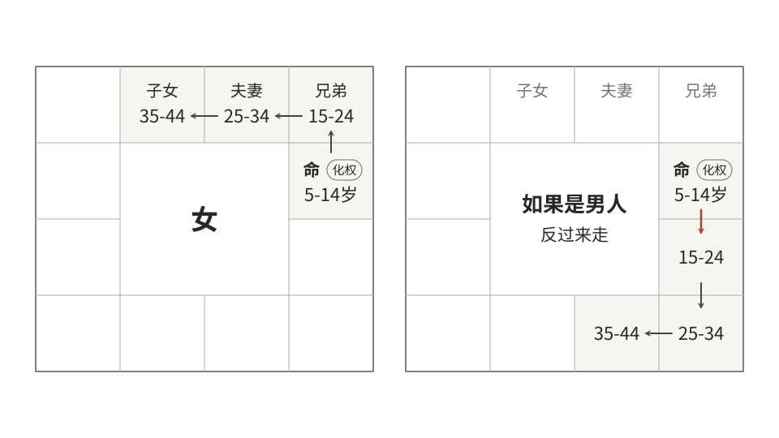 〔叠图〕男命版：命宫己酉大限 5~14，父母庚戌（巨门陷、陀罗庙、地空陷）大限 15~24，福德辛亥（红鸾庙）大限 25~34；女命版的 25~34 标在夫妻丁未（第 58740 帧），两版不同。（[00:35:34–00:35:48](https://www.bilibili.com/video/BV1KJsLekEfA/?p=25&t=2134)，第 64020–64440 帧） 〔板书〕可辨：「武曲」「天喜」（中间一字有红圈，认不出），「太阳」「35-44」「子女」，「天府」「25-34」「夫妻」，「天同」「55-64」，中间大字「女」；其余认不出。（[00:35:43](https://www.bilibili.com/video/BV1KJsLekEfA/?p=25&t=2143)，第 64308 帧） |
| **男命 25-34 逢红鸾化忌，几岁结婚？** | 〔口述〕「你看他的八字」「一进入第二个25-34」「逢红鸾星进来」「红鸾星遇到化忌的时候」「我们要过忌结婚」。（[00:35:48–00:35:55](https://www.bilibili.com/video/BV1KJsLekEfA/?p=25&t=2148)，第 64440–64667 帧） 〔口述〕「32岁还在忌」「这要走到 33 34岁」「男人的话就变成34岁结婚」「过这个忌懂不懂我意思」「一定会过忌」「过这个忌结婚」「到34岁结婚」。（[00:35:58–00:36:07](https://www.bilibili.com/video/BV1KJsLekEfA/?p=25&t=2158)，第 64752–65033 帧） 〔叠图〕财帛乙巳（武曲平化忌）格标着「过忌」；夫妻丁未格标着「结婚」。（[00:36:13–00:36:16](https://www.bilibili.com/video/BV1KJsLekEfA/?p=25&t=2173)，第 65214–65285 帧） |
| **男命 35-44 化科化禄进田宅主什么？** | 〔口述〕「化科化禄进来到田宅的时候」「除了代表说他的祖业巨门星」「父母亲坐巨门星也会有祖业」「巨门是豪门大宅院哦」。（[00:36:13–00:36:22](https://www.bilibili.com/video/BV1KJsLekEfA/?p=25&t=2173)，第 65214–65465 帧） 〔口述〕「祖业分到以外」「代表化科他就升」「他就不管是里面的升腾的考试」「或者是在公家单位里面再深造」「都是很好的流年哦」「日在中午出现」。（[00:36:22–00:36:34](https://www.bilibili.com/video/BV1KJsLekEfA/?p=25&t=2182)，第 65466–65831 帧） 〔叠图〕田宅壬子：天梁庙（化禄）、左辅旺（化科）、地劫陷、擎羊陷，男命版大限 35~44；同一屏父母庚戌的巨门这次印作「旺」。（[00:36:27–00:36:29](https://www.bilibili.com/video/BV1KJsLekEfA/?p=25&t=2187)，第 65628–65693 帧） |
| **45-54 廉贞七杀、55-64 天马，男人主什么？** | 〔口述〕「然后45-54廉贞七杀」「廉贞七杀（庙旺）是代表什么」「一方之主」「武官的话化将」；「如果是男人的话」「进入这段时间的话」「将军呐警察的话干局长」「很大」。（[00:36:34–00:36:46](https://www.bilibili.com/video/BV1KJsLekEfA/?p=25&t=2194)，第 65832–66209 帧） 〔口述〕「那55-64 天马星」「对面是你看太阳太阴通通来会」「巨门有没有」「命在这边来巨日格来会」「男人来会的话腰金衣紫啊」「腰缠黄金衣服穿紫色的」「所以说会进入很尊贵的流年」。（[00:36:47–00:37:00](https://www.bilibili.com/video/BV1KJsLekEfA/?p=25&t=2207)，第 66210–66629 帧） 〔指代〕说「命在这边」时手指的是黑板上写「右弼」的那一格（「66-72」字样下方）。（[00:36:51](https://www.bilibili.com/video/BV1KJsLekEfA/?p=25&t=2211)，第 66352 帧） 〔叠图〕交友壬寅：天马旺、右弼旺、天伤平、天哭平、截空陷，大限 55~64；随后同一格内容又以「命宫壬寅」贴出。（[00:36:58–00:37:02](https://www.bilibili.com/video/BV1KJsLekEfA/?p=25&t=2218)，第 66558–66683 帧） |
| **同一八字，男女婚姻为何刚好相反？** | 〔口述〕「所以男人女人刚好反过来」「同一个八字啊男女不样」，一个「老公吓死了，逃走了」「一个老婆好的要死」。（[00:37:01–00:37:10](https://www.bilibili.com/video/BV1KJsLekEfA/?p=25&t=2221)，第 66630–66905 帧） 〔口述〕「因为你的流年在这里」「夫妻宫还在这里嘛」「太太是不是天府星最好了」「温和厚很温和很厚道的」。（[00:37:10–00:37:17](https://www.bilibili.com/video/BV1KJsLekEfA/?p=25&t=2230)，第 66906–67127 帧） 〔指代〕说「流年在这里」「夫妻宫还在这里」时手指的都是黑板上写「天府」、下写「25-34 夫妻」的那一格。（[00:37:10–00:37:11](https://www.bilibili.com/video/BV1KJsLekEfA/?p=25&t=2230)，第 66929–66956 帧） 〔叠图〕夫妻丁未（天府庙）格标着「太太天府星温和最好了」。（[00:37:25–00:37:29](https://www.bilibili.com/video/BV1KJsLekEfA/?p=25&t=2245)，第 67350–67475 帧） |
| **倪师劝女士们什么？这种命为何会误家误国？** | 〔口述〕「所以诸位女士们呢」「有时候不要太不要太凶」「不然有时候什么状况都会出来的」「你以为管得住」「他就不让你管了」「跑掉啊你不离没关系」「我不要离嘛我跑掉了」。（[00:37:17–00:37:29](https://www.bilibili.com/video/BV1KJsLekEfA/?p=25&t=2237)，第 67128–67475 帧） 〔口述〕「女孩子常常不要丢问题给给男人哦」，比如「你看你要是要听我的」「还是要跟我在一起」，男生会说「我通通不要」，「因为你把你太认为太重要了」。（[00:37:30–00:37:46](https://www.bilibili.com/video/BV1KJsLekEfA/?p=25&t=2250)，第 67506–67997 帧） 〔口述〕「要把自我要舍掉」「现在很多人都认为她自己太重要」；「像女人拿了这个命的话」「很很很很很可怕」「这人会对家来说会误家」「对国来说会误国」「女人拿到这会误国的」。（[00:37:48–00:38:03](https://www.bilibili.com/video/BV1KJsLekEfA/?p=25&t=2268)，第 68064–68495 帧） |

**总结区**

- 通用规则：杀破狼属于男人的命，女人拿到男人的格不好，男人拿到女人的格也不行；同个格同时间生人，男女就不一样（[00:32:01–00:35:08](https://www.bilibili.com/video/BV1KJsLekEfA/?p=25&t=1921)，第 57642–63263 帧）；红鸾星遇到化忌，要过了忌才结婚（[00:35:52–00:36:07](https://www.bilibili.com/video/BV1KJsLekEfA/?p=25&t=2152)，第 64578–65033 帧）；财帛宫化忌的人不会去做生意，一定走官带（[00:34:25–00:34:34](https://www.bilibili.com/video/BV1KJsLekEfA/?p=25&t=2065)，第 61968–62249 帧）；先天排出来以后，后天的运去改，让性不要像，就不会被命所绑到（[00:35:08–00:35:19](https://www.bilibili.com/video/BV1KJsLekEfA/?p=25&t=2108)，第 63264–63581 帧）
- 只在本例：例四女命紫微贪狼化权坐命，倪师比作最强的慈禧太后；先生天府星厚道，30 岁化忌时她不肯离婚，先生跑掉，夫妻有名无实、没有孩子（[00:31:57–00:33:43](https://www.bilibili.com/video/BV1KJsLekEfA/?p=25&t=1917)，第 57528–60695 帧）；她目有兇光、妻兼夫职，财帛化忌，实际在军方服务（[00:33:47–00:34:44](https://www.bilibili.com/video/BV1KJsLekEfA/?p=25&t=2027)，第 60822–62543 帧）；同一八字换成男命：34 岁过忌结婚，35-44 化科化禄进田宅有祖业、宜升考深造，45-54 廉贞七杀可当将军局长，55-64 巨日来会腰金衣紫（[00:34:44–00:37:00](https://www.bilibili.com/video/BV1KJsLekEfA/?p=25&t=2084)，第 62544–66629 帧）；男命的流年在夫妻宫天府，太太好得要死；女命则老公吓得逃走（[00:37:01–00:37:17](https://www.bilibili.com/video/BV1KJsLekEfA/?p=25&t=2221)，第 66630–67127 帧）
- 不是排盘规则，是处世方法：女士们不要太凶，你以为管得住，对方不让你管就跑掉（[00:37:17–00:37:29](https://www.bilibili.com/video/BV1KJsLekEfA/?p=25&t=2237)，第 67128–67475 帧）；不要丢问题给男人逼他做选择，要把自我舍掉，不要认为自己太重要（[00:37:30–00:37:53](https://www.bilibili.com/video/BV1KJsLekEfA/?p=25&t=2250)，第 67506–68201 帧）

**待核**

1. [00:31:46](https://www.bilibili.com/video/BV1KJsLekEfA/?p=25&t=1906)，第 57187 帧：说「这个这个人很好玩」时手指黑板下排一格，指代标为不确定，格内字被挡，未采用。
2. [00:32:15](https://www.bilibili.com/video/BV1KJsLekEfA/?p=25&t=1935)，第 58062 帧：叠图「命宫□酉」天干认不出，内容与命宫己酉相同，未猜。
3. [00:33:06](https://www.bilibili.com/video/BV1KJsLekEfA/?p=25&t=1986)，第 59604 帧：「一直也看不清楚啊就好吧」字幕与语音「就好了嫁」不全对得上，意思不明，未写入。
4. [00:33:12](https://www.bilibili.com/video/BV1KJsLekEfA/?p=25&t=1992)，第 59766 帧：「一结婚以后发现第二第二」话没说完，「第二」指什么不清楚。
5. [00:33:21](https://www.bilibili.com/video/BV1KJsLekEfA/?p=25&t=2001)，第 60036 帧：字幕句头混进「宫」」，与上句「我福德有红鸾星」可能原是「福德宫」，引文按字幕原字未补。
6. [00:33:13–00:33:22](https://www.bilibili.com/video/BV1KJsLekEfA/?p=25&t=1993)，第 59814–60071 帧：叠图夫妻丁未格多出「28」、财帛乙巳格多出「30」，可能对应倪师说的 28 岁、30 岁，未核实，未写进笔记区。
7. [00:33:43](https://www.bilibili.com/video/BV1KJsLekEfA/?p=25&t=2023)，第 60696 帧：「变成35-44 太阳入庙的母女母」字幕与语音「成35到44太阳露面比较母女母」对不齐，略过。
8. [00:33:47](https://www.bilibili.com/video/BV1KJsLekEfA/?p=25&t=2027)，第 60822 帧：「妻兼夫职」语音作「七肩父夫子」，按字幕与叠图提示字收录。
9. [00:34:29](https://www.bilibili.com/video/BV1KJsLekEfA/?p=25&t=2069)，第 62088 帧：「正官带」「官带」（语音「关带」）倪师用了但没解释，词义待核。
10. [00:34:36–00:34:38](https://www.bilibili.com/video/BV1KJsLekEfA/?p=25&t=2076)，第 62298–62363 帧：「她说她不能说正式武官了」语音作「不能说正是五关」，「正式」与「正是」哪个对待核。
11. [00:35:24](https://www.bilibili.com/video/BV1KJsLekEfA/?p=25&t=2124)，第 63726 帧：字幕「你看他5-14岁」，语音作「五岁到二十四岁二十五」，对不齐。
12. [00:35:26](https://www.bilibili.com/video/BV1KJsLekEfA/?p=25&t=2126)，第 63804 帧：字幕「25-34 35-44 哎15-24」是一边写板书一边念，与语音数字顺序对不上。
13. [00:35:33](https://www.bilibili.com/video/BV1KJsLekEfA/?p=25&t=2133)，第 63996 帧：板书「命」旁数字只认得「5-□4」，第二位认不出。
14. [00:35:43](https://www.bilibili.com/video/BV1KJsLekEfA/?p=25&t=2143)，第 64308 帧：板书左上红圈里的字、右上红圈里的数字认不出。
15. [00:35:52](https://www.bilibili.com/video/BV1KJsLekEfA/?p=25&t=2152)，第 64572 帧、[00:35:55](https://www.bilibili.com/video/BV1KJsLekEfA/?p=25&t=2155)，第 64668 帧：字幕「旺旺平陷平村庙平平陷庙」「旺旺平陷利庙」是乱码，略过；后者语音是在数 25 到 32 岁。
16. [00:36:03](https://www.bilibili.com/video/BV1KJsLekEfA/?p=25&t=2163)，第 64901 帧、[00:36:05](https://www.bilibili.com/video/BV1KJsLekEfA/?p=25&t=2165)，第 64978 帧：说「过这个忌」时手指被叠图挡住或看不出，未作依据。
17. [00:36:07](https://www.bilibili.com/video/BV1KJsLekEfA/?p=25&t=2167)，第 65034 帧：「25到这里走宏以肩」语音作「十五到三十四走完以后」，按语音理解为二十五到三十四走完以后。
18. [00:36:09](https://www.bilibili.com/video/BV1KJsLekEfA/?p=25&t=2169)，第 65094 帧：「他到35-25」语音作「到三十五到四十四」，按语音理解为进入 35-44。
19. [00:36:11](https://www.bilibili.com/video/BV1KJsLekEfA/?p=25&t=2171)，第 65136 帧：「你看化科仳禄啊」，「仳」语音对不上（语音「画画路」），推测为「化禄」，未定。
20. [00:36:27](https://www.bilibili.com/video/BV1KJsLekEfA/?p=25&t=2187)，第 65628 帧：叠图父母庚戌巨门此处印「旺」，[00:35:26](https://www.bilibili.com/video/BV1KJsLekEfA/?p=25&t=2126)，第 63804 帧同格印「陷」，前后不一致。
21. [00:36:36](https://www.bilibili.com/video/BV1KJsLekEfA/?p=25&t=2196)，第 65898 帧：「廉贞七杀（庙旺）」括号字是字幕注字，叠图官禄癸丑印作七杀庙、廉贞利，未据此定庙旺。
22. [00:37:01](https://www.bilibili.com/video/BV1KJsLekEfA/?p=25&t=2221)，第 66630 帧：叠图先贴「交友壬寅」，随后同一格内容以「命宫壬寅」贴出，紧接男命 55-64 天马星之后；是哪个宫以口述为准，不当成本盘命宫。
23. [00:37:25](https://www.bilibili.com/video/BV1KJsLekEfA/?p=25&t=2245)，第 67350 帧：叠图同时出现「夫妻丁未」与「夫妻丁未′」两格，内容不同（前者大限印 105114、标「太太天府星温和最好了」），哪格才是该宫待核。
24. [00:37:46](https://www.bilibili.com/video/BV1KJsLekEfA/?p=25&t=2266)，第 67998 帧：「待会我们一集一个卦」语音作「一进一个挂」，意思不明。
25. [00:37:06](https://www.bilibili.com/video/BV1KJsLekEfA/?p=25&t=2226)，第 66792 帧：字幕句头「个」是上句「一个」被切开，引文去掉。
26. [00:36:14](https://www.bilibili.com/video/BV1KJsLekEfA/?p=25&t=2174)，第 65248 帧：说「田宅的时候」时手是否已指向右下带圈「禄」字格不能确认，盲标这里没有「是 + 确定」的题，不当指代依据。

## 例五（女命，紫微在子）：化忌冲夫妻、阳宅误子女与改宅

〔叠图〕这一例视频里只贴过 7 格：官禄 戊申：武曲得忌、天相庙、天才庙、恩光平、龙池平；财帛 壬子：紫微平权、擎羊陷；父母 乙巳：太阴陷、天钺旺、铃星得、天喜庙、天空庙、孤辰陷；交友 己酉：太阳平、天梁得禄、火星得、咸池平、天伤平；夫妻 壬寅：破军陷、天马旺、天哭平、截空陷；疾厄 辛亥：天机平、文曲旺、禄存庙、大耗陷、天使旺、红鸾庙；子女 癸丑：左辅庙科、右弼庙、天德庙、寡宿平、破碎陷。

### 8　例五女命：化忌冲夫妻与阳宅误子女（[00:38:03–00:43:53](https://www.bilibili.com/video/BV1KJsLekEfA/?p=25&t=2283)，第 68496–78995 帧）

| 提示区 | 笔记区 |
|---|---|
| **例五女命紫微在哪？官禄武曲天相主什么？** | 〔口述〕倪师换讲一个新命例，开口先交代「这个女孩子的命呢」「紫微星在子宫」。（[00:38:03–00:38:08](https://www.bilibili.com/video/BV1KJsLekEfA/?p=25&t=2283)，第 68496–68663 帧） 〔指代〕说「这个女孩子的命呢」时，手指的是黑板中央新画的方框图内部，所指处没有可辨认的字。（[00:38:03](https://www.bilibili.com/video/BV1KJsLekEfA/?p=25&t=2283)，第 68499 帧） 〔口述〕倪师说官禄宫有武曲、天相这样的星，「都不会走公职的」「不会走公职走私人企业」。原话「像这个官禄宫武曲星呐」「天相这种杀星在官禄宫」。（[00:38:08–00:38:15](https://www.bilibili.com/video/BV1KJsLekEfA/?p=25&t=2288)，第 68664–68879 帧） 〔指代〕说「像这个官禄宫武曲星」时，手指的是黑板右上「武曲 天相」那格（带圈的「忌」），格下写「事业」。（[00:38:09](https://www.bilibili.com/video/BV1KJsLekEfA/?p=25&t=2289)，第 68677 帧） 〔叠图〕官禄戊申：武曲得、化忌，天相庙，天巫、天才庙、官符、小耗、恩光平、阴煞、龙池平，病；岁数 3,15,27 / 39,51,63，大限 86~95。（[00:38:17–00:38:20](https://www.bilibili.com/video/BV1KJsLekEfA/?p=25&t=2297)，第 68934–69011 帧） |
| **财帛宫紫微化权，这个女孩子事业如何？** | 〔口述〕「财帛宫是紫微紫微星化权」「所以她会在私人企业当主管」「而且做的很有声有色」。（[00:38:16–00:38:22](https://www.bilibili.com/video/BV1KJsLekEfA/?p=25&t=2296)，第 68880–69071 帧） 〔口述〕接着说「化权在这命宫命里面有权的」「一定会做主管」。（[00:38:22–00:38:29](https://www.bilibili.com/video/BV1KJsLekEfA/?p=25&t=2302)，第 69072–69287 帧） 〔指代〕说「化权在这命宫」时，手放在黑板底排「紫微（权圈）41-55」那格上；格内宫名被手挡住。（[00:38:23](https://www.bilibili.com/video/BV1KJsLekEfA/?p=25&t=2303)，第 69094 帧） 〔叠图〕财帛壬子：紫微平、化权，擎羊陷，官符、将星、白虎，冠带；岁数 11,23,35 / 47,59,71，大限 46~55。（[00:38:17–00:38:20](https://www.bilibili.com/video/BV1KJsLekEfA/?p=25&t=2297)，第 68934–69011 帧） 〔推断〕推断：叠图把紫微化权贴在财帛壬子，与倪师说的「紫微星在子宫」「财帛宫是紫微」对得上；随后一句里的「命宫」所指，材料内看不出。（[00:38:16–00:38:24](https://www.bilibili.com/video/BV1KJsLekEfA/?p=25&t=2296)，第 68880–69137 帧） |
| **破军、化忌怎样看出这位女命婚姻凶？** | 〔口述〕倪师讲破军星：「破军星呢这一颗星」「或者落到福德宫里面去」「都代表婚姻不好」。语音这里还多一句落到夫妻宫，字幕只录到福德宫。（[00:38:31–00:38:41](https://www.bilibili.com/video/BV1KJsLekEfA/?p=25&t=2311)，第 69330–69659 帧） 〔指代〕说「像这个女孩子的命啊」时，手指的是黑板中央方框图右下的小方块。（[00:38:41](https://www.bilibili.com/video/BV1KJsLekEfA/?p=25&t=2321)，第 69651 帧） 〔口述〕「像这个女孩子的命啊」「你看她这个化忌来冲」「对冲夫妻」「所以婚姻是非常的凶」。（[00:38:42–00:38:49](https://www.bilibili.com/video/BV1KJsLekEfA/?p=25&t=2322)，第 69660–69899 帧） 〔叠图〕夫妻壬寅：破军陷，天马旺、天哭平、截空陷，吊客、大耗、岁驿，大限 26~35；该格标着「婚姻不好」，格右下那个字只露出「生」，上一字被这个标签挡住。（[00:38:54–00:38:55](https://www.bilibili.com/video/BV1KJsLekEfA/?p=25&t=2334)，第 70020–70067 帧） 〔推断〕推断：叠图里化忌只在官禄戊申的武曲上，破军在夫妻壬寅；倪师口说「化忌来冲」「对冲夫妻」，没有明说是哪颗星的化忌。（[00:38:43–00:38:55](https://www.bilibili.com/video/BV1KJsLekEfA/?p=25&t=2323)，第 69708–70067 帧） |
| **主卧在东南角，为什么先生会犯桃花？** | 〔口述〕倪师说先不看盘，「再一看她的阳宅」「一看哎呀主卧房在东南角」，婚姻凶「因为先生是天风姤」「姤是男女交合的象姤卦」「所以先生在外面会有桃花」。（[00:38:51–00:39:05](https://www.bilibili.com/video/BV1KJsLekEfA/?p=25&t=2331)，第 69948–70367 帧） 〔口述〕他对太太小姐们说：结婚前认识的男人「的确很老实」，你每天跟踪他「他绝对不犯桃花」；「结了婚以后你不知道啊」「你跟他去住到东南角」，嘴上行动上「你不准犯桃花」，「住在阳宅上面是鼓励他犯桃花」。（[00:39:15–00:39:35](https://www.bilibili.com/video/BV1KJsLekEfA/?p=25&t=2355)，第 70650–71261 帧） 〔口述〕「所以你只能掌握到你自己」「你不要说你先生」「连你儿子你都没办法掌握到」「我们唯有只有用这个方法来掌握」。（[00:39:36–00:39:44](https://www.bilibili.com/video/BV1KJsLekEfA/?p=25&t=2376)，第 71298–71537 帧） |
| **她几岁结婚？天喜红鸾落父母宫说明什么？** | 〔口述〕「所以造成她婚姻离婚」；「第一个30岁天喜红鸾星来会」「她30岁会结婚」「天喜红鸾星落父母宫」。（[00:39:44–00:39:53](https://www.bilibili.com/video/BV1KJsLekEfA/?p=25&t=2384)，第 71538–71807 帧） 〔口述〕「所以姻缘是怎样」，是父母亲在掌握、帮她挑的；「那太阴跟她最近」「所以她的姻缘的妈妈影响她最大」。（[00:39:53–00:40:01](https://www.bilibili.com/video/BV1KJsLekEfA/?p=25&t=2393)，第 71808–72053 帧） 〔叠图〕父母乙巳：天喜庙、太阴陷、天钺旺、天空庙、孤辰陷、铃星得，劫煞、晦气、飞廉，绝；叠图该格标着「结婚」。（[00:39:59–00:40:01](https://www.bilibili.com/video/BV1KJsLekEfA/?p=25&t=2399)，第 71988–72053 帧） 〔叠图〕疾厄辛亥：红鸾庙、天机平、文曲旺、禄存庙、大耗陷、天使旺，博士、亡神、龙德，临官；岁数 12,24,36 / 48,60,72，大限 56~65。（[00:39:59–00:40:01](https://www.bilibili.com/video/BV1KJsLekEfA/?p=25&t=2399)，第 71988–72053 帧） 〔推断〕推断：叠图里天喜在父母乙巳、红鸾在疾厄辛亥，并不同格；倪师口说「天喜红鸾星落父母宫」，两者不一致。（[00:39:52–00:40:01](https://www.bilibili.com/video/BV1KJsLekEfA/?p=25&t=2392)，第 71772–72053 帧） |
| **听妈妈挑的婚姻，结果怎样？** | 〔口述〕倪师学妈妈口气：「哎呀女儿啊你嫁给他」「根据妈妈的眼光」「这个绝对没错」，反问「上帝有说妈妈的一定对吗」；女儿说「那妈妈我就听你的好了」「那就结婚好了」。（[00:40:04–00:40:14](https://www.bilibili.com/video/BV1KJsLekEfA/?p=25&t=2404)，第 72126–72431 帧） 〔口述〕「结婚以后38岁就毁了」。（[00:40:14–00:40:20](https://www.bilibili.com/video/BV1KJsLekEfA/?p=25&t=2414)，第 72432–72605 帧） |
| **为什么她事业一级棒，碰到感情却处理不好？** | 〔口述〕「这个女孩子的命呐」「在事业上面都是一级棒了」，因为处理事情的时候「脑筋没有感情的观念」，「所以她办事情办起来都非常的优秀」「甚而至于女孩子比男人强」。（[00:40:25–00:40:38](https://www.bilibili.com/video/BV1KJsLekEfA/?p=25&t=2425)，第 72750–73169 帧） 〔口述〕「一遇到这种感情的问题呢」「跟个猪一样」，「猪不是笨死的」「是蠢死的」；蠢在「取舍之间呢」「进退之间」「没有办法拿捏的很好」。（[00:40:39–00:40:54](https://www.bilibili.com/video/BV1KJsLekEfA/?p=25&t=2439)，第 73170–73625 帧） 〔叠图〕交友己酉：太阳平、天梁得、化禄，火星得、天伤平，咸池、天厨、封诰、月德、青龙、小耗，衰；大限 76~85。倪师此处没有讲交友宫。（[00:40:25–00:40:26](https://www.bilibili.com/video/BV1KJsLekEfA/?p=25&t=2425)，第 72750–72809 帧） |
| **56到65岁红鸾再进来，有什么用？** | 〔口述〕「到了56-65 红鸾星还有再进来」「这个红鸾星进来就怎么样」「太慢了」。（[00:40:59–00:41:05](https://www.bilibili.com/video/BV1KJsLekEfA/?p=25&t=2459)，第 73782–73955 帧） 〔指代〕说「这个红鸾星进来」时，食指点在黑板右下格「红」字下方，那格写有 56-65（数字部分被手挡）。（[00:41:01](https://www.bilibili.com/video/BV1KJsLekEfA/?p=25&t=2461)，第 73855 帧） 〔推断〕推断：叠图疾厄辛亥有红鸾庙、大限 56~65，与倪师说的「56-65 红鸾星」岁数段对得上；倪师没有说出这一格的宫名。（[00:40:59–00:41:02](https://www.bilibili.com/video/BV1KJsLekEfA/?p=25&t=2459)，第 73782–73865 帧） |
| **左辅右弼加化科，子女上看出什么？** | 〔口述〕倪师说左辅右弼在这里，「这种单星本来是一颗星的话没有」「两颗星加起来」，她反而带有一个儿子；「这个儿子呢化科读书会读的很好」。（[00:41:11–00:41:20](https://www.bilibili.com/video/BV1KJsLekEfA/?p=25&t=2471)，第 74148–74411 帧） 〔指代〕说「这个儿子」前后，食指点在底排中间格（写有 36-45）右上方一个红圈圈住的字上，那个字潦草看不清。（[00:41:17](https://www.bilibili.com/video/BV1KJsLekEfA/?p=25&t=2477)，第 74322 帧） 〔叠图〕子女癸丑：左辅庙、化科，右弼庙，台辅、寡宿平、破碎陷、天德庙，伏兵、攀鞍，沐浴；岁数 10,22,34 / 46,58,70，大限 36~45。（[00:42:41–00:42:42](https://www.bilibili.com/video/BV1KJsLekEfA/?p=25&t=2561)，第 76842–76889 帧） |
| **母子女三人同住，房间怎么分出了问题？** | 〔口述〕倪师说这个女孩子来的时候，是一个儿子一个女儿跟她三个人住在这个屋檐下（字幕识别作「坏在……宣个人」「佳在」，按语音改为三个人住、住在）。（[00:41:20–00:41:28](https://www.bilibili.com/video/BV1KJsLekEfA/?p=25&t=2480)，第 74412–74645 帧） 〔指代〕说「这个屋檐下」时，手指点在黑板中央画的房屋图内、左上小格下沿下方的空白处。（[00:41:25](https://www.bilibili.com/video/BV1KJsLekEfA/?p=25&t=2485)，第 74565 帧） 〔口述〕「又问题又来了」：她让儿子住这边、女儿住这边（字幕括号注「西厢」「西南」，不是倪师说的），原话「女儿住这边（西南） 都是天才」。（[00:41:28–00:41:34](https://www.bilibili.com/video/BV1KJsLekEfA/?p=25&t=2488)，第 74646–74831 帧） 〔板书〕可辨：房屋图右上那间写「女」，房屋图下方标「N」、右侧标「W」；右上格「武曲」「天相」和圈起的「忌」「事业」；右列「太阳」「天梁」、圈起的「禄」「交友」，其下一格「七杀」；其余认不出。（[00:41:34](https://www.bilibili.com/video/BV1KJsLekEfA/?p=25&t=2494)，第 74832 帧） 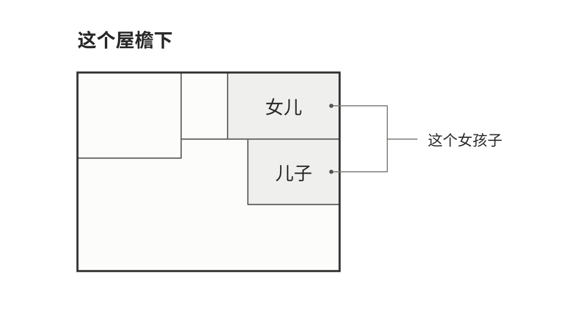 〔口述〕「你看看真是害的害的」「她把她妈妈把她害了」「她也自己还把子女也害了」。（[00:41:34–00:41:39](https://www.bilibili.com/video/BV1KJsLekEfA/?p=25&t=2494)，第 74832–74993 帧） |
| **女儿住西南角、儿子住西厢，各鼓励什么？** | 〔口述〕「啊女儿没有结婚」「给她住西南角」「是不是鼓励她女儿去做偏房」；儿子给他去住西厢，「她鼓励她儿子去做同性恋」。（[00:41:41–00:41:49](https://www.bilibili.com/video/BV1KJsLekEfA/?p=25&t=2501)，第 75042–75287 帧） 〔口述〕「神这个是看东南西北是看神哦」「这是易经」；「后面会雷泽归妹卦归妹啊」，二男二女并行，「雷住到泽的位置」。（[00:41:49–00:41:59](https://www.bilibili.com/video/BV1KJsLekEfA/?p=25&t=2509)，第 75288–75581 帧） 〔口述〕「所以很多父母亲呢」嘴上说「你绝对不能闹同性恋啊」「同性恋不好啊会得艾滋病啊」，「然后手上的把他推西厢」，「手这边给他推到西厢去你看无知啊」。（[00:41:59–00:42:12](https://www.bilibili.com/video/BV1KJsLekEfA/?p=25&t=2519)，第 75582–75971 帧） |
| **怎么改宅？太太为什么要回太太的位子？** | 〔口述〕倪师说把这个房间让出来，「让出来叫太太来睡这边（西南）」，「她的名字叫妻子」；「你太名字叫太太住太太的位子」。（[00:42:14–00:42:23](https://www.bilibili.com/video/BV1KJsLekEfA/?p=25&t=2534)，第 76026–76295 帧） 〔口述〕「现在离婚离婚没办法」「今天以前没有办法帮你补啊」「今今天以后可以让你好一点了」。（[00:42:23–00:42:27](https://www.bilibili.com/video/BV1KJsLekEfA/?p=25&t=2543)，第 76296–76421 帧） 〔口述〕「运改哦运改上去以后她46-55」「本来她这段时间已经化权了」「这段时间化科就已经很好了」，「我们再给她改到位置上」，正上去以后「她会位置爬的更高」「做的更好」。（[00:42:29–00:42:45](https://www.bilibili.com/video/BV1KJsLekEfA/?p=25&t=2549)，第 76470–76961 帧） 〔推断〕推断：叠图财帛壬子大限 46~55、带紫微化权，与「46-55」「这段时间已经化权了」对得上；子女癸丑大限 36~45 带左辅化科，「化科」那句是否指这一段，倪师没明说。（[00:42:29–00:42:42](https://www.bilibili.com/video/BV1KJsLekEfA/?p=25&t=2549)，第 76470–76889 帧） |
| **儿子、长女怎么重新安排？风泽中孚主什么？** | 〔口述〕儿子没有位置的时候，「把儿子住到东」，「很多人是东和东南切一个角」，「就把儿子尽量靠近什么」「这个房间的东边去睡」；「然后这个让长女来这边住」。（[00:42:46–00:42:57](https://www.bilibili.com/video/BV1KJsLekEfA/?p=25&t=2566)，第 76998–77321 帧） 〔指代〕说「就把儿子尽量靠近什么这个」时，食指指着小房屋图左上那间房的下沿和左侧（板上标 E 的一侧），房里的字认不出。（[00:42:53](https://www.bilibili.com/video/BV1KJsLekEfA/?p=25&t=2573)，第 77206 帧） 〔指代〕说「然后这个让长女来这边住」时，粉笔尖一直点在小房屋图右侧中间的小方框上（右边标 W），框里的字认不出。（[00:42:56](https://www.bilibili.com/video/BV1KJsLekEfA/?p=25&t=2576)，第 77280–77299 帧） 〔板书〕可辨：小房屋图右上那间写「女」，右侧标「W」，左上那间与「女」下方小方框里的字认不出；右列「交友」「七杀」，右上「事业」；其余认不出。（[00:42:54](https://www.bilibili.com/video/BV1KJsLekEfA/?p=25&t=2574)，第 77244 帧） 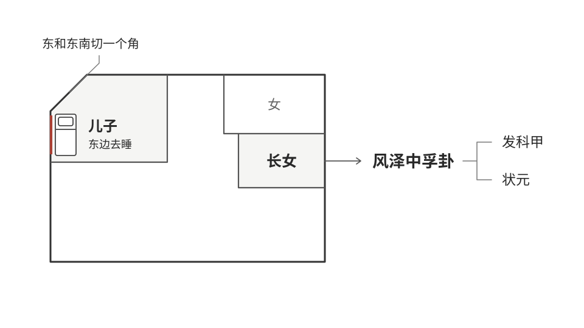 〔口述〕长女住这边，「易经上面是风泽中孚卦」「中孚卦是发科甲」，女儿住进去以后，「中孚卦就是状元」；问考试会不会考不好，「一卜到风泽中孚」「那是考状元了」。（[00:42:58–00:43:13](https://www.bilibili.com/video/BV1KJsLekEfA/?p=25&t=2578)，第 77352–77819 帧） 〔板书〕可辨：底排一格「紫微」和圈起的「权」，下方数字似「41-55」；右列「七杀」下有两字认不全；左侧小房屋图同前；其余认不出。（[00:43:00](https://www.bilibili.com/video/BV1KJsLekEfA/?p=25&t=2580)，第 77412 帧） |
| **易经、八字、紫微怎么分工？讲完又劝学生做什么？** | 〔口述〕「我们后面会有」「易经会介绍很多卦」「哪一个卦是主什么事」，「等到64卦学完以后」开始批流年。（[00:43:16–00:43:23](https://www.bilibili.com/video/BV1KJsLekEfA/?p=25&t=2596)，第 77880–78113 帧） 〔口述〕「所以我们用易经来排八字」「用子平法排起来就不是紫微」「就不教你们紫微斗数了」；「八字排起来的时候」「我们用卦来解释它」「这个阳宅有没有问题」。（[00:43:23–00:43:39](https://www.bilibili.com/video/BV1KJsLekEfA/?p=25&t=2603)，第 78114–78593 帧） 〔口述〕「所以很多事情发生在一念之间」；「我们诸位需要出去帮」「多帮人家嘛」，「我们不是说要介绍客户给我」「而是你去多帮助一些」，「很多无知啊」「造成后面的问题很大」「害了自己的还不知道呢」。（[00:43:39–00:43:53](https://www.bilibili.com/video/BV1KJsLekEfA/?p=25&t=2619)，第 78594–78995 帧） |

**总结区**

- 通用规则：官禄宫是武曲、天相这类星的人，不会走公职，走私人企业（[00:38:08–00:38:15](https://www.bilibili.com/video/BV1KJsLekEfA/?p=25&t=2288)，第 68664–68879 帧）；破军星落到福德宫（语音还说夫妻宫），都代表婚姻不好（[00:38:31–00:38:41](https://www.bilibili.com/video/BV1KJsLekEfA/?p=25&t=2311)，第 69330–69659 帧）；主卧房在东南角，先生是天风姤，先生在外会有桃花；住在这样的阳宅上就是鼓励他犯桃花（[00:38:53–00:39:35](https://www.bilibili.com/video/BV1KJsLekEfA/?p=25&t=2333)，第 69990–71261 帧）；没结婚的女儿住西南角是鼓励她做偏房，儿子住西厢是鼓励他做同性恋；长女住到风泽中孚的位置主发科甲、考状元（[00:41:41–00:43:13](https://www.bilibili.com/video/BV1KJsLekEfA/?p=25&t=2501)，第 75042–77819 帧）
- 只在本例：这位女命财帛宫紫微化权，在私人企业当主管，做得有声有色（[00:38:16–00:38:29](https://www.bilibili.com/video/BV1KJsLekEfA/?p=25&t=2296)，第 68880–69287 帧）；化忌对冲夫妻，30岁天喜红鸾来会而结婚，姻缘受妈妈影响最大，38岁婚姻就毁了（[00:38:43–00:40:20](https://www.bilibili.com/video/BV1KJsLekEfA/?p=25&t=2323)，第 69708–72605 帧）；倪师让她让出房间、太太睡回太太的位子，46-55这段运改上去会爬得更高（[00:42:14–00:42:45](https://www.bilibili.com/video/BV1KJsLekEfA/?p=25&t=2534)，第 76026–76961 帧）；儿子挪到房间东边去睡，长女住到W侧那间（[00:42:46–00:42:58](https://www.bilibili.com/video/BV1KJsLekEfA/?p=25&t=2566)，第 76998–77351 帧）
- 不是排盘规则，是处世方法：结了婚只能掌握自己，掌握不了先生和儿子，只能用阳宅的方法来掌握（[00:39:36–00:39:44](https://www.bilibili.com/video/BV1KJsLekEfA/?p=25&t=2376)，第 71298–71537 帧）；已经离婚的补不回来，只能让对方今天以后好一点（[00:42:23–00:42:27](https://www.bilibili.com/video/BV1KJsLekEfA/?p=25&t=2543)，第 76296–76421 帧）；多出去帮人家，不是为了介绍客户，无知会造成后面很大的问题、害了自己还不知道（[00:43:39–00:43:53](https://www.bilibili.com/video/BV1KJsLekEfA/?p=25&t=2619)，第 78594–78995 帧）

**待核**

1. [00:38:03](https://www.bilibili.com/video/BV1KJsLekEfA/?p=25&t=2283)，第 68496 帧：本块开头叠图「命宫己酉」（紫微旺、贪狼利、化权）与上一块例四命宫同名同内容，倪师此时说「紫微星在子宫」，不当例五命宫；例五命宫干支叠图没贴、倪师也没说。
2. [00:38:11](https://www.bilibili.com/video/BV1KJsLekEfA/?p=25&t=2291)，第 68730 帧：字幕「天相这种杀星在官禄宫」，语音只有「种杀心在关儒工」，「杀星」指武曲还是天相不明。
3. [00:38:22](https://www.bilibili.com/video/BV1KJsLekEfA/?p=25&t=2302)，第 69072 帧：倪师上一句说财帛宫紫微化权，这一句说「化权在这命宫」，叠图紫微权在财帛壬子；「命宫」所指待核，指代那一格的宫名被手挡。
4. [00:38:33](https://www.bilibili.com/video/BV1KJsLekEfA/?p=25&t=2313)，第 69402 帧：字幕只录「或者落到福德宫里面去」，语音是「落到夫妻宫里面或者是落到福德宫里面」，两路不全一致。
5. [00:38:43](https://www.bilibili.com/video/BV1KJsLekEfA/?p=25&t=2323)，第 69713 帧：说「你看她这个化忌来冲」时手在「太阳」与右上「忌」之间移动，指代不确定，未当依据。
6. [00:39:41](https://www.bilibili.com/video/BV1KJsLekEfA/?p=25&t=2381)，第 71450 帧：「我们唯有只有用这个方法来掌握」的「这个方法」指代不确定，未当依据。
7. [00:39:46](https://www.bilibili.com/video/BV1KJsLekEfA/?p=25&t=2386)，第 71586 帧：「第一个流年25岁在这」语音作「留年25岁的人2627282930」，这句含义没听懂，未写进笔记。
8. [00:39:52](https://www.bilibili.com/video/BV1KJsLekEfA/?p=25&t=2392)，第 71772 帧：倪师说「天喜红鸾星落父母宫」，叠图父母乙巳只有天喜庙，红鸾庙在疾厄辛亥。
9. [00:39:55](https://www.bilibili.com/video/BV1KJsLekEfA/?p=25&t=2395)，第 71850 帧：字幕「父母亲在掌握我帮她挑的」多一个「我」，语音作「母亲在掌握帮她挑的」。
10. [00:40:25](https://www.bilibili.com/video/BV1KJsLekEfA/?p=25&t=2425)，第 72750 帧：叠图「交友己酉」与开头「命宫己酉」同干支，咸池、天厨、月德、青龙、小耗等杂曜重合，是否同一格换宫名待核。
11. [00:41:05](https://www.bilibili.com/video/BV1KJsLekEfA/?p=25&t=2465)，第 73956 帧：字幕「那时候肯定说红鸾了」，语音「那是跟从红蓝了」，两路对不上，原话待核。
12. [00:41:09](https://www.bilibili.com/video/BV1KJsLekEfA/?p=25&t=2469)，第 74086 帧：说「所以这个太太呢」时手指底排中间格，指代不确定，未当依据。
13. [00:41:11](https://www.bilibili.com/video/BV1KJsLekEfA/?p=25&t=2471)，第 74148 帧：字幕「左辅有弼」改为左辅右弼；[00:41:15](https://www.bilibili.com/video/BV1KJsLekEfA/?p=25&t=2475)，第 74274 帧字幕「反正带有一个儿子」，语音作「她反而带有一个儿子」，按语音理解。
14. [00:41:21](https://www.bilibili.com/video/BV1KJsLekEfA/?p=25&t=2481)，第 74448 帧：字幕「坏在一个儿子一个女儿跟她宣个人」按语音改为「一个儿子一个女儿跟她三个人住」；第74550、74766、75168、77484帧字幕「佳」都改为住。
15. [00:41:33](https://www.bilibili.com/video/BV1KJsLekEfA/?p=25&t=2493)，第 74796 帧：「都是天才」两路一致但意思不明，照原话写。
16. [00:41:33](https://www.bilibili.com/video/BV1KJsLekEfA/?p=25&t=2493)，第 74810 帧：说「女儿住这边」时倪师正在房屋图右上写「女」，指代不确定，未当依据。
17. 字幕括号注字「（西厢）」「（西南）」（第74766、74796、75168、76176、77322帧）不是倪师说出口的话；[00:42:57](https://www.bilibili.com/video/BV1KJsLekEfA/?p=25&t=2577)，第 77322 帧长女住「这边（西厢）」与前文女儿住西南角怎样对应，材料内看不出。
18. [00:41:49](https://www.bilibili.com/video/BV1KJsLekEfA/?p=25&t=2509)，第 75288 帧：「神这个是看东南西北是看神哦」，「神」指什么倪师没解释。
19. [00:41:55](https://www.bilibili.com/video/BV1KJsLekEfA/?p=25&t=2515)，第 75474 帧：字幕「二男二女井行」按语音改为并行；「二男二女」与雷泽归妹的关系倪师没展开。
20. [00:42:14](https://www.bilibili.com/video/BV1KJsLekEfA/?p=25&t=2534)，第 76026 帧：字幕「太太免惊这个房间呢」按语音作「太这个房间呢让出来」；[00:42:21](https://www.bilibili.com/video/BV1KJsLekEfA/?p=25&t=2541)，第 76254 帧「位=名」乱码略过；[00:40:49](https://www.bilibili.com/video/BV1KJsLekEfA/?p=25&t=2449)，第 73470 帧「歌回早」乱码略过。
21. [00:42:29](https://www.bilibili.com/video/BV1KJsLekEfA/?p=25&t=2549)，第 76470 帧：字幕「46-55」，语音「45到54」；叠图财帛壬子大限 46~55；[00:38:23](https://www.bilibili.com/video/BV1KJsLekEfA/?p=25&t=2303)，第 69094 帧指代与[00:43:00](https://www.bilibili.com/video/BV1KJsLekEfA/?p=25&t=2580)，第 77412 帧板书在紫微权那格写的似是「41-55」，三处数字不一致。
22. [00:42:32–00:42:37](https://www.bilibili.com/video/BV1KJsLekEfA/?p=25&t=2552)，第 76578–76715 帧：「这段时间已经化权了」「这段时间化科就已经很好了」各指哪一段，倪师没明说。
23. [00:43:22](https://www.bilibili.com/video/BV1KJsLekEfA/?p=25&t=2602)，第 78084 帧：字幕「开姶批流年」改为开始；[00:43:39](https://www.bilibili.com/video/BV1KJsLekEfA/?p=25&t=2619)，第 78594 帧字幕「一念之间」，语音作「一年之间」。
24. [00:41:34](https://www.bilibili.com/video/BV1KJsLekEfA/?p=25&t=2494)，第 74832 帧：板书图右下已出现子女癸丑叠图（左辅庙科、右弼庙、36~45），比材料记的约[00:42:41](https://www.bilibili.com/video/BV1KJsLekEfA/?p=25&t=2561)，第 76842 帧更早。
25. [00:43:00](https://www.bilibili.com/video/BV1KJsLekEfA/?p=25&t=2580)，第 77412 帧：板书右列「七杀」下两字认不全，不补。

