# P27 · 14 上：忌冲太阳 / 男命太阴陷 / 太阴化忌入命 / 孤鸾命（00:00:00–00:38:37，共 69,511 帧）

> 2026-11-12 整理。依据 DeepSeek 逐帧记录与现成的五层材料（字幕、语音、叠图、板书、指代），由 Claude（Opus 5.5 子代理）分段起草，引文由程序逐段对过字幕。流程 2026-11-11 经站长认可。
> 依据标记：〔口述〕字幕与语音两路对得上的话，「」里是字幕原字 ·〔叠图〕后期贴的电子命盘，**不算倪师的话** ·〔板书〕粉笔字（看过那一帧原图才写）·〔指代〕「这里 / 这个」指哪（只收核过、确定的）·〔推断〕笔记作者自己的推断。每条后面的时间码可以点，跳到 B 站那一秒。

## 全集总结

**通用规则**

- 最好的命是早年比较凶、吉星在后面（[00:00:30–00:00:37](https://www.bilibili.com/video/BV1KJsLekEfA/?p=27&t=30)，第 924–1139 帧）。
- 男人九是老阳，男人很多在逢九买单（[00:04:43–00:05:01](https://www.bilibili.com/video/BV1KJsLekEfA/?p=27&t=283)，第 8514–9041 帧）。
- 寿限到时面相下角会有黑点黑线；黑气隐在皮肤里面是大限，痣长在皮肤外面就过不了那个关（[00:09:19–00:09:41](https://www.bilibili.com/video/BV1KJsLekEfA/?p=27&t=559)，第 16794–17435 帧）
- 命里只要太阴会来，太阴就完全受到母亲的影响（[00:11:00–00:11:13](https://www.bilibili.com/video/BV1KJsLekEfA/?p=27&t=660)，第 19818–20219 帧）。
- 男人的命太阴化忌，最怕婆媳不和，太太跟妈妈一定不和（[00:11:20–00:11:28](https://www.bilibili.com/video/BV1KJsLekEfA/?p=27&t=680)，第 20418–20669 帧）。
- 化忌是官司是非；日月反背代表眼睛看不到天日，还会有牢狱之灾（[00:14:33–00:14:41](https://www.bilibili.com/video/BV1KJsLekEfA/?p=27&t=873)，第 26196–26453 帧）
- 女孩子婚姻要过忌；忌若很晚才来，搞不好代表死别（[00:20:47–00:20:55](https://www.bilibili.com/video/BV1KJsLekEfA/?p=27&t=1247)，第 37410–37661 帧）
- 同一组星放在哪一宫就读那宫的人：紫微天相化权在父母宫是父母当官，在命宫自己当官，在兄弟宫兄弟当官，在子女宫儿子当官；财星会聚在哪宫就是那宫的人做生意，以此类推（[00:23:57–00:24:29](https://www.bilibili.com/video/BV1KJsLekEfA/?p=27&t=1437)，第 43116–44093 帧）
- 命里化忌，除了早年比较辛苦，个性很刚、心眼比较多，容易害自己（[00:29:27–00:30:07](https://www.bilibili.com/video/BV1KJsLekEfA/?p=27&t=1767)，第 53034–54227 帧）
- 红鸾天喜星很重要，是决定一个人喜庆的星（[00:37:17–00:37:24](https://www.bilibili.com/video/BV1KJsLekEfA/?p=27&t=2237)，第 67128–67331 帧）

**只在本例**

- 42岁进廉破，未来十年52–61化忌无大运，45岁得大肠癌、57岁出大车祸都没死，今年69岁逢大限（[00:01:30–00:05:16](https://www.bilibili.com/video/BV1KJsLekEfA/?p=27&t=90)，第 2700–9509 帧）。
- 父母宫太阳星独守，化忌来冲，父亲先走、再走母亲（[00:07:51–00:08:10](https://www.bilibili.com/video/BV1KJsLekEfA/?p=27&t=471)，第 14148–14711 帧）
- 娶进门第二年进入太阴化忌，婆媳处得很不好，太太跳河自杀，倪师说是妈妈搞出来的（[00:13:30–00:13:48](https://www.bilibili.com/video/BV1KJsLekEfA/?p=27&t=810)，第 24300–24857 帧）。
- 这位男命 22-31 太阴化忌，与母亲对抗、作奸犯科，26 岁开始犯官府坐牢（[00:14:10–00:15:04](https://www.bilibili.com/video/BV1KJsLekEfA/?p=27&t=850)，第 25500–27137 帧）
- 儿子放西北角取代丈夫位置；子女宫武曲化忌，有子但冲突大难管；属二婚命，带着孩子到老（[00:21:34–00:22:46](https://www.bilibili.com/video/BV1KJsLekEfA/?p=27&t=1294)，第 38844–41003 帧）
- 倪师断为标准的孤鸾命，当面劝她出家、念心经（[00:30:51–00:31:27](https://www.bilibili.com/video/BV1KJsLekEfA/?p=27&t=1851)，第 55542–56615 帧）
- 例四婚姻星拖得晚，倪师说拖晚反而救了她，不结婚比结了婚离婚好（[00:34:11–00:34:33](https://www.bilibili.com/video/BV1KJsLekEfA/?p=27&t=2051)，第 61542–62219 帧）

**不是排盘规则，是处世方法**

- 帮人算命遇到流年不好，一定鼓励人家去读书、深造、进修，读书能忘掉很多事情、让自己成长（[00:07:28–00:07:40](https://www.bilibili.com/video/BV1KJsLekEfA/?p=27&t=448)，第 13446–13805 帧）
- 母亲不要替小孩做决策，做不好孩子会怨你，做好很难，因为两人想的不一样（[00:12:47–00:13:01](https://www.bilibili.com/video/BV1KJsLekEfA/?p=27&t=767)，第 23034–23453 帧）。
- 批命看出对方心性不好，放在肚子里、心知肚明，不要当场说（[00:29:42–00:29:57](https://www.bilibili.com/video/BV1KJsLekEfA/?p=27&t=1782)，第 53478–53915 帧）
- 早碰到就要劝她念宗教、每天念心经改心性，再给她找温和的好对象，别找吹火嘴（[00:33:02–00:33:37](https://www.bilibili.com/video/BV1KJsLekEfA/?p=27&t=1982)，第 59460–60539 帧）
- 用手下看神：眼神不能有兇光，有威可当主管；鼻正眼珠不动的可用，鼻歪眼神闪动的要防背叛（[00:34:57–00:35:54](https://www.bilibili.com/video/BV1KJsLekEfA/?p=27&t=2097)，第 62910–64637 帧）

## 目录

**例一（男命，命宫丁丑武曲贪狼）：豪门、廉破杀限、大肠癌**

1. 例一男命：豪门、廉破大限与逢九（00:00:00–00:05:16）

**例一续：阳宅缺西北与改宅、劝读书、父先走、寿限黑点与油**

2. 例一阳宅缺位改宅、父先走与寿限油气（00:05:17–00:10:39）

**例二（男命，命宫甲申天同天梁）：太阴化忌、婆媳、早婚丧妻**

3. 太阴化忌：母亲左右婚事致早婚丧妻（00:10:39–00:14:09）

**例二续：22-31化忌坐牢、机月同梁、隔离母亲、男女命之别**

4. 22-31太阴化忌坐牢，劝隔离母亲（00:14:10–00:18:11）

**例三（女命，命宫癸卯天机巨门）：二婚命、同理推宫、相法**

5. 天机巨门女命：二婚命与西南角阳宅（00:18:11–00:23:37）
6. 同理推宫与颧鼻眼袋额纹相法（00:23:37–00:28:55）

**例四（女命，命宫癸酉太阴文曲忌）：孤鸾命、改心性、用人看神**

7. 孤鸾命：心性害己、阳宅加凶与补救（00:28:55–00:33:44）
8. 孤鸾命：事业好、婚姻晚，用人看神（00:33:44–00:38:37）

## 例一（男命，命宫丁丑武曲贪狼）：豪门、廉破杀限、大肠癌

| 巳 | 午 | 未 | 申 |
|---|---|---|---|
| **官禄 己巳** 紫微旺 七杀平 陀罗陷 | （午：没贴过） | **迁移 辛未** 左辅庙 右弼庙 擎羊庙 火星利 地空平 | **疾厄 壬申** 文曲得忌 天钺庙 |
| **田宅 戊辰** 天机利 天梁庙科 | **例一 · 命宫丁丑** | 据视频叠图重排 | **财帛 癸酉**（身宫） 廉贞平 破军陷 |
| **福德 丁卯** 天相陷 地劫平 | 后期贴图，不算倪师的话 |  | **子女 甲戌** （无主星、辅星） |
| **父母 丙寅** 太阳旺 巨门庙 铃星庙 | **命宫 丁丑** 武曲庙禄 贪狼庙权 | **兄弟 丙子** 天同旺 太阴庙 天魁旺 | **夫妻 乙亥** 天府得 天马平 |

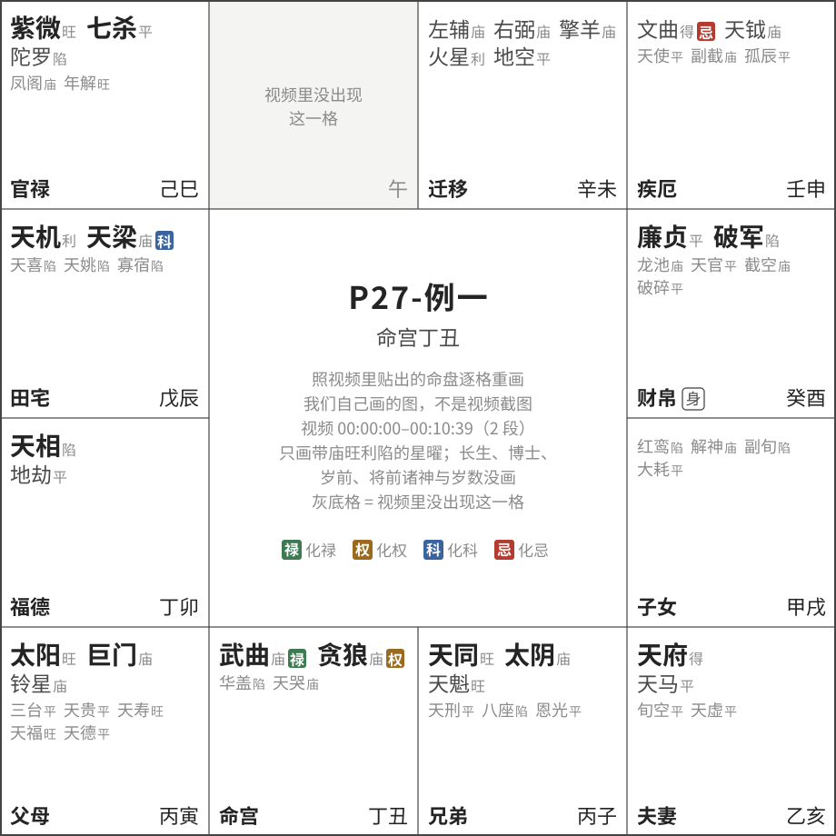

按视频里这张盘逐格重画（我们自己画的图，不是视频截图）；同一个人的 2 段合成一张；数据见 [命盘-P27-例一.json](图/命盘-P27-例一.json)。

### 1　例一男命：豪门、廉破大限与逢九（[00:00:00–00:05:16](https://www.bilibili.com/video/BV1KJsLekEfA/?p=27&t=0)，第 0–9509 帧）

| 提示区 | 笔记区 |
|---|---|
| **例一是哪一年的什么命？命宫在哪、坐什么星？** | 〔口述〕倪师先拿出民国18年这张盘：「先看18年这章（1929）」「提出来这章的目的呢」，说明是男命：「这个人的这个男这男人命呢」。（[00:00:01–00:00:13](https://www.bilibili.com/video/BV1KJsLekEfA/?p=27&t=1)，第 48–419 帧） 〔口述〕倪师指出命宫，说命宫是贪狼、武曲，带化权、化禄：「命宫在这里」「小的时候是贪狼武曲啊」「化权化禄.」。（[00:00:14–00:00:19](https://www.bilibili.com/video/BV1KJsLekEfA/?p=27&t=14)，第 420–575 帧） 〔指代〕说「命宫在这里」时手指点在底行第二列那一格（圈字所在格），板上该格底部可见「~11 命」；说「这个贪狼武曲」时手指也点向同一格。（[00:00:14–00:00:18](https://www.bilibili.com/video/BV1KJsLekEfA/?p=27&t=14)，第 430–561 帧） 〔叠图〕叠图命宫丁丑：武曲庙、化禄，贪狼庙、化权，另有华盖、华盖陷、天哭庙、奏书、白虎、死；岁数串「211」按图例读作 2~11。（[00:01:19–00:01:20](https://www.bilibili.com/video/BV1KJsLekEfA/?p=27&t=79)，第 2370–2411 帧） 〔板书〕黑板中央可辨「18」「年」「男」，与倪师口述的民国18年男命对应。（[00:02:10](https://www.bilibili.com/video/BV1KJsLekEfA/?p=27&t=130)，第 3900 帧） |
| **武曲贪狼化权禄主什么？最好的命是什么样？** | 〔口述〕倪师说贪狼武曲除了主武官，还主财：「这贪狼武曲啊」「我们除了主武官星以外」「还可以主财星」。（[00:00:19–00:00:23](https://www.bilibili.com/video/BV1KJsLekEfA/?p=27&t=19)，第 576–707 帧） 〔口述〕带权禄生下来就是豪门巨富：「所以生下来的话」「权禄这是豪门巨富啊」「生在家里面一定很有钱」。（[00:00:23–00:00:30](https://www.bilibili.com/video/BV1KJsLekEfA/?p=27&t=23)，第 708–923 帧） 〔口述〕倪师讲最好的命是早年凶、吉星在后：「诸位呢我们最好的命是怎样」「就是早年比较凶……后吉星在后面嘛」「那比较好一点」；接着说本例「那这个生的实在太好了」「太有钱了，」。（[00:00:30–00:00:42](https://www.bilibili.com/video/BV1KJsLekEfA/?p=27&t=30)，第 924–1283 帧） 〔口述〕生得太好的坏处是没有戒心：「就像我们这个蒋家三弟一样」「太好了我怎么会有事呢」「我就没有戒心了」。（[00:00:42–00:00:49](https://www.bilibili.com/video/BV1KJsLekEfA/?p=27&t=42)，第 1284–1481 帧） |
| **父母宫巨门太阳，说明他出身怎样？** | 〔口述〕倪师说他的父母宫是巨门太阳，家里家业很好：「他的父母宫是巨门太阳」「巨门太阳来说的话」……「家里面家业都很好的」。（[00:00:56–00:01:02](https://www.bilibili.com/video/BV1KJsLekEfA/?p=27&t=56)，第 1680–1865 帧） 〔口述〕化禄的话家财多，但这是先天：「家财这种是化禄的话」「就家里面财富很多的」「可是这个是先天呐生下来巨门豪门」。（[00:01:02–00:01:10](https://www.bilibili.com/video/BV1KJsLekEfA/?p=27&t=62)，第 1866–2117 帧） 〔叠图〕叠图父母丙寅：太阳旺、巨门庙、铃星庙，另有三台平、天寿旺、天福旺、天贵平、天德、天月、劫煞、将军、病。（[00:02:06–00:02:07](https://www.bilibili.com/video/BV1KJsLekEfA/?p=27&t=126)，第 3786–3821 帧） |
| **后天财帛廉破、官禄紫微七杀，适合做什么？** | 〔口述〕倪师转看后天：财帛是廉破，官禄宫是紫微七杀，待在本乡本地适宜从武官：「后天你看看他的财帛是廉破」「官禄宫是紫微七杀」「所以如果他待在本乡本地的话」「他适宜从武官呐武官呐」。（[00:01:10–00:01:18](https://www.bilibili.com/video/BV1KJsLekEfA/?p=27&t=70)，第 2118–2369 帧） 〔口述〕一是生下享有祖业，二是后天会从武职：「哎一个生下享有祖业」「还有一个他后来后天的发展会从武职」。（[00:01:19–00:01:22](https://www.bilibili.com/video/BV1KJsLekEfA/?p=27&t=79)，第 2370–2489 帧） 〔口述〕财帛宫廉破就不可能自己做生意：「财宗宫是廉破的话」「不可能说会自己做生意」「完全不可能的」（「财宗宫」即财帛宫）。（[00:01:24–00:01:29](https://www.bilibili.com/video/BV1KJsLekEfA/?p=27&t=84)，第 2532–2699 帧） 〔叠图〕叠图官禄己巳：紫微旺、七杀平、陀罗陷、凤阁庙、年解旺等；财帛癸酉：廉贞平、破军陷、身宫，另有龙池庙、截空庙、天官平、破碎平、大耗、将星、官符、养。（[00:01:13–00:01:14](https://www.bilibili.com/video/BV1KJsLekEfA/?p=27&t=73)，第 2190–2231 帧） |
| **42岁进廉破大限，对面福德宫是什么星？** | 〔口述〕倪师顺着行运数到41岁，42岁以后进入廉破，说这是杀星：「那我们看他流年行运」「走走走走走走到41岁」「42岁以后进入廉破」「这个是杀星」。（[00:01:30–00:01:35](https://www.bilibili.com/video/BV1KJsLekEfA/?p=27&t=90)，第 2700–2867 帧） 〔指代〕说「这个是杀星」时手指的是叠图上的财帛宫，叠图显示廉贞、破军，42~51 财帛。（[00:01:34](https://www.bilibili.com/video/BV1KJsLekEfA/?p=27&t=94)，第 2836 帧） 〔口述〕对面是福德宫，天相落陷加地劫，也是杀星；福德宫主宰一世福禄，结果杀星来会：「对面还是天相星落陷地劫」「这个是杀星在对面」「本身的福德咯」「福德官主宰一世的福禄」「结果杀星来会」。（[00:01:35–00:01:43](https://www.bilibili.com/video/BV1KJsLekEfA/?p=27&t=95)，第 2868–3119 帧） 〔叠图〕叠图福德丁卯：天相陷、地劫平，另有吊客、小耗、灾煞、衰；岁数串「102111」按图例读作 102~111。（[00:01:35–00:01:37](https://www.bilibili.com/video/BV1KJsLekEfA/?p=27&t=95)，第 2868–2939 帧） |
| **为何倪师当初说「你先生只能活在45岁」？** | 〔口述〕下一个十年 52–61 是化忌，倪师看到盘时问是不是拿错了：「就未来十年52-61 是不是化忌」「这个八字拿出来的时候」「我说你你这个八字有没有拿错」。（[00:01:44–00:01:51](https://www.bilibili.com/video/BV1KJsLekEfA/?p=27&t=104)，第 3120–3341 帧） 〔口述〕理由是未来十年没有大运，大限在前十年：「你先生只能活在45岁就是大限了嘛」「为什么因为未来十年」「按照我们算未来十年没有大运」「对不对大限是不是在前十年」「是在这个时候」。（[00:01:51–00:02:02](https://www.bilibili.com/video/BV1KJsLekEfA/?p=27&t=111)，第 3342–3683 帧） 〔叠图〕叠图疾厄壬申：文曲得、化忌，天钺庙，另有孤辰平、天使平、天厨、副截庙、阴煞、亡神、伏兵、贯索、长生，该格标着「未来十年无大运」，岁数串「5261」读作 52~61；财帛癸酉格标着「大限在前十年」。（[00:01:44–00:01:47](https://www.bilibili.com/video/BV1KJsLekEfA/?p=27&t=104)，第 3120–3215 帧） |
| **45岁在哪一宫？为什么这一年「无解」？** | 〔口述〕倪师在板上写出岁数，指出45岁落在这里，对冲是廉破，正是这十年的对宫：「47 46 45岁是不是在这里啊」「45岁对冲这边是廉破」「刚好在这十年的对宫」。（[00:02:06–00:02:12](https://www.bilibili.com/video/BV1KJsLekEfA/?p=27&t=126)，第 3786–3971 帧） 〔指代〕说「45岁是不是在这里」时手持粉笔点着左侧中格圈起的「45」，其上方写「田宅」，下方有潦草的「福德」字样。（[00:02:08](https://www.bilibili.com/video/BV1KJsLekEfA/?p=27&t=128)，第 3844 帧） 〔口述〕杀星落陷代表无解，很凶：「然后杀星落陷」「杀星落陷代表代表是无解」「这是很凶的」「哎45岁就该买单了」「走人了我告诉你」。（[00:02:12–00:02:24](https://www.bilibili.com/video/BV1KJsLekEfA/?p=27&t=132)，第 3972–4331 帧） 〔叠图〕叠图福德丁卯格标着「45岁大限」「大小二限逢」。（[00:02:06–00:02:07](https://www.bilibili.com/video/BV1KJsLekEfA/?p=27&t=126)，第 3786–3821 帧） 〔板书〕可辨：圈起的「45」、其上「田宅」、中央「18」「年」「男」，上方「文昌」「天喜」，左下「巨门」「太阳」，底部「武曲」；其余认不出。（[00:02:10](https://www.bilibili.com/video/BV1KJsLekEfA/?p=27&t=130)，第 3900 帧） |
| **他45岁实际发生了什么？结果如何？** | 〔口述〕倪师说他45岁得了大肠癌、开了刀：「他45岁的时候得了大肠癌」「刀子一开下去」。（[00:02:24–00:02:29](https://www.bilibili.com/video/BV1KJsLekEfA/?p=27&t=144)，第 4332–4475 帧） 〔口述〕倪师接着说大肠癌存活率最长五年、后来影响到肝癌：「大肠癌目前世界上存活率啊」「最长的是5年」「后来影响到肝癌」「都死掉了」。（[00:02:30–00:02:37](https://www.bilibili.com/video/BV1KJsLekEfA/?p=27&t=150)，第 4524–4721 帧） 〔口述〕紧接着又说这个人没死，没死的要祖上有德：「哎没死哦」「没有死这诸位」「这种没死的要祖上有德」「有德哈」。（[00:02:37–00:02:44](https://www.bilibili.com/video/BV1KJsLekEfA/?p=27&t=157)，第 4722–4943 帧） |
| **45加12是几岁？那一年又出了什么事？** | 〔口述〕没死之后再转一圈12年：「可是没有死了以后呢」「诸位想想看」「你在下个大运这边」「你再转一圈是不是12年」「那45岁加12是不是57啊」。（[00:02:44–00:02:54](https://www.bilibili.com/video/BV1KJsLekEfA/?p=27&t=164)，第 4944–5231 帧） 〔板书〕可辨：「+12」、圈起的「57」、「45大限」，以及「18」「年」「男」「文昌」「天喜」；其余认不出。（[00:02:55](https://www.bilibili.com/video/BV1KJsLekEfA/?p=27&t=175)，第 5256 帧） 〔口述〕57岁本应走人却没走，出了大车祸也没死：「57岁那你没死没错呀」「那像57岁应该走人了」「对不对但没57岁是没走啊」「他出个大车祸」「廉破啊出了化忌啊」「出个大车祸也没死」。（[00:02:54–00:03:05](https://www.bilibili.com/video/BV1KJsLekEfA/?p=27&t=174)，第 5232–5573 帧） |
| **流年逢杀星化忌，事业会怎样？（重点）** | 〔口述〕倪师说提45岁动刀这件事是重点：「因为他在45 动了刀以后」「我为什么要提这个」「这个是重点啊诸位」。（[00:03:07–00:03:11](https://www.bilibili.com/video/BV1KJsLekEfA/?p=27&t=187)，第 5610–5759 帧） 〔口述〕流年逢杀星化忌，什么都不用谈，光讲事业就完全停摆：「流年逢到化忌的时候」「这种杀星化忌的时候」「不管你什么都不要谈」「光讲事业来说的话」「完全是停摆的」。（[00:03:12–00:03:21](https://www.bilibili.com/video/BV1KJsLekEfA/?p=27&t=192)，第 5760–6047 帧） |
| **这张盘最好的宫是哪一宫？好在哪里？** | 〔口述〕倪师说整个盘最好的是夫妻宫，太太是天马：「这个八字整个格」「最好一个宫在哪里」「在夫妻宫」「太太是天马」。（[00:03:21–00:03:26](https://www.bilibili.com/video/BV1KJsLekEfA/?p=27&t=201)，第 6048–6209 帧） 〔口述〕夫妻宫天府带天马，这个人要感谢老婆：「你的命里面的夫妻宫是天府带天马」「你最好感谢你老婆啊」「你这一辈子什么决策都错了」「娶个老婆娶对了」。（[00:03:30–00:03:37](https://www.bilibili.com/video/BV1KJsLekEfA/?p=27&t=210)，第 6306–6533 帧） 〔口述〕天马吃苦耐劳、为你奔波；天府善于理财、厚道拼命、善良：「天马星是吃苦耐劳」「为你奔波啊」「天府星是很善于理财」「又很厚道又拼命做事情」「人又很善良的一种人」「又非常善于理财的」。（[00:03:37–00:03:45](https://www.bilibili.com/video/BV1KJsLekEfA/?p=27&t=217)，第 6534–6773 帧） 〔口述〕倪师拿来对比：若娶的老婆是廉贞贪狼落陷，就会把家财赌光：「你娶个老婆廉贞贪狼看看落陷」「入庙没关系你落陷看看」「把你家财万贯给你赌光」。（[00:03:45–00:03:52](https://www.bilibili.com/video/BV1KJsLekEfA/?p=27&t=225)，第 6774–6983 帧） 〔叠图〕叠图夫妻乙亥：天府得、天马平，另有天巫、天虚平、旬空平、岁破、岁驿、喜神，岁数串「2231」读作 22~31；叠图该格标着「太太奔波劳累」「善良又会理财」「厚道拼命做事」。（[00:04:25–00:04:26](https://www.bilibili.com/video/BV1KJsLekEfA/?p=27&t=265)，第 7968–8009 帧） |
| **回台湾后为何只能帮人做事？哪几年停摆？** | 〔口述〕杀进来后，他回台湾就没办法做了，因为他在大陆本是军人：「那他这—杀进来」「他回来到台湾来以后」「台湾他就没有办法做了」「因为他大陆是本人是军人啊」「台湾的没办法」。（[00:03:53–00:04:00](https://www.bilibili.com/video/BV1KJsLekEfA/?p=27&t=233)，第 7014–7205 帧） 〔口述〕外地是擎羊跟左辅右弼，只能帮人家做事，做到45岁身体凶：「台湾来外地是什么」「擎羊跟左辅右弼」「是不是只能去帮人家做事情」「然后帮人家做事情到45岁」「身体凶啊」。（[00:04:00–00:04:07](https://www.bilibili.com/video/BV1KJsLekEfA/?p=27&t=240)，第 7206–7421 帧） 〔叠图〕叠图迁移辛未：擎羊庙、左辅庙、右弼庙，另有地空平、火星利、丧门、官符、月煞、蜚廉、沐浴。（[00:04:25–00:04:26](https://www.bilibili.com/video/BV1KJsLekEfA/?p=27&t=265)，第 7968–8009 帧） 〔推断〕推断：倪师口中「外地」的擎羊、左辅、右弼，与叠图迁移辛未格的三颗星一致；倪师在本块没有说出「迁移宫」三字。（[00:04:00–00:04:03](https://www.bilibili.com/video/BV1KJsLekEfA/?p=27&t=240)，第 7206–7295 帧） 〔口述〕从45岁起一直没做事，熬到61岁才跟朋友出来做；62–71进入权禄，灾逃过去了：「所以从45岁开始一直没有做事」「熬到61岁」「就跟朋友出来做啊」「所以62-71进入权禄有没有」「这个因为这个灾逃过去了」「所以他过去的流年」「他一直在命正面走」。（[00:04:07–00:04:25](https://www.bilibili.com/video/BV1KJsLekEfA/?p=27&t=247)，第 7422–7967 帧） |
| **今年他几岁？为什么男人多在逢九买单？** | 〔口述〕按今年来算，民国83年一加起来66岁；倪师又说57加12是69：「按今年来找我们算的话」「83年（1994） 一加起来是不是66岁啊」「57+12是不是69」。（[00:04:25–00:04:39](https://www.bilibili.com/video/BV1KJsLekEfA/?p=27&t=265)，第 7968–8387 帧） 〔指代〕说「是不是又是这个」时手指的是左侧叠图框，叠图显示「天相 地劫 / 九为阳之极 / 45 57 69 / 大限 男人逢九买单 / 福德 卯」。（[00:04:36](https://www.bilibili.com/video/BV1KJsLekEfA/?p=27&t=276)，第 8298 帧） 〔口述〕倪师说男人九是老阳，女人八，六是老老阴、阴到极限，所以男人多在逢九买单：「男人呢九是老阳」「老阳的数啊」「女人呢」「八是老阳（少阴）」「哎六是老老阴啊」「阴到极限呐」「所以男人很多在逢九买单」。（[00:04:43–00:05:01](https://www.bilibili.com/video/BV1KJsLekEfA/?p=27&t=283)，第 8514–9041 帧） 〔板书〕可辨：左列「男人」「九」「老」，右列「女人」；右列「女人」下方的字认不出。右侧格内可辨「田宅」「天相」「地劫」。（[00:04:58](https://www.bilibili.com/video/BV1KJsLekEfA/?p=27&t=298)，第 8963 帧） 〔口述〕今年来找时刚好69岁，进入大灾，69岁是大限；20年前开刀至今一直带着人工肛门：「就刚好69岁逢到这个」「这个进入这个大灾」「69岁是大限」「那他20年前开刀到现在」「还装个人工肛门一直带到」「一直带到身边喽」。（[00:05:02–00:05:16](https://www.bilibili.com/video/BV1KJsLekEfA/?p=27&t=302)，第 9072–9509 帧） 〔指代〕说「就刚好69岁逢到这个」时食指点在「田宅」下方那一格（旁边是圈起的「45」，格底有潦草的「福德」字样）。（[00:05:03–00:05:04](https://www.bilibili.com/video/BV1KJsLekEfA/?p=27&t=303)，第 9115–9124 帧） |

**总结区**

- 通用规则：最好的命是早年比较凶、吉星在后面（[00:00:30–00:00:37](https://www.bilibili.com/video/BV1KJsLekEfA/?p=27&t=30)，第 924–1139 帧）。；杀星落陷代表无解，很凶（[00:02:12–00:02:18](https://www.bilibili.com/video/BV1KJsLekEfA/?p=27&t=132)，第 3972–4157 帧）。；流年逢到杀星化忌，什么都不要谈，光讲事业就完全停摆（[00:03:12–00:03:21](https://www.bilibili.com/video/BV1KJsLekEfA/?p=27&t=192)，第 5760–6047 帧）。；男人九是老阳，男人很多在逢九买单（[00:04:43–00:05:01](https://www.bilibili.com/video/BV1KJsLekEfA/?p=27&t=283)，第 8514–9041 帧）。
- 只在本例：民国18年男命，命宫贪狼武曲化权化禄，父母宫巨门太阳，生在豪门、家财多（[00:00:14–00:01:10](https://www.bilibili.com/video/BV1KJsLekEfA/?p=27&t=14)，第 420–2117 帧）。；财帛廉破、官禄紫微七杀：享祖业、从武职，不可能自己做生意（[00:01:10–00:01:29](https://www.bilibili.com/video/BV1KJsLekEfA/?p=27&t=70)，第 2118–2699 帧）。；42岁进廉破，未来十年52–61化忌无大运，45岁得大肠癌、57岁出大车祸都没死，今年69岁逢大限（[00:01:30–00:05:16](https://www.bilibili.com/video/BV1KJsLekEfA/?p=27&t=90)，第 2700–9509 帧）。；全盘最好是夫妻宫天府带天马，娶老婆娶对了（[00:03:21–00:03:45](https://www.bilibili.com/video/BV1KJsLekEfA/?p=27&t=201)，第 6048–6773 帧）。
- 不是排盘规则，是处世方法：生得太好的人觉得自己不会有事，就没有戒心了（[00:00:42–00:00:49](https://www.bilibili.com/video/BV1KJsLekEfA/?p=27&t=42)，第 1284–1481 帧）。；夫妻宫好的男人，一辈子决策都错也要感谢老婆（[00:03:30–00:03:37](https://www.bilibili.com/video/BV1KJsLekEfA/?p=27&t=210)，第 6306–6533 帧）。

**待核**

1. [00:00:00](https://www.bilibili.com/video/BV1KJsLekEfA/?p=27&t=0)，第 0 帧板书图是片头字卡（「天纪14上」等后期字），没有粉笔字（[00:00:00](https://www.bilibili.com/video/BV1KJsLekEfA/?p=27&t=0)，第 0 帧）。
2. 「先看18年这章（1929）」语音作「八年这张提出来这张」，「（1929）」是字幕括号注字、语音没有（[00:00:01](https://www.bilibili.com/video/BV1KJsLekEfA/?p=27&t=1)，第 48 帧）。
3. 「早年比较凶= 凉点」字幕夹乱码，语音作「找点比较凶点集星」，引文只取「就是早年比较凶」（[00:00:33](https://www.bilibili.com/video/BV1KJsLekEfA/?p=27&t=33)，第 990 帧）。
4. 「蒋家三弟」语音作「蒋家三兄弟」，人名照原话写，没有推断是谁（[00:00:42](https://www.bilibili.com/video/BV1KJsLekEfA/?p=27&t=42)，第 1284 帧）。
5. 「那张老师还好了」「沟什么杀嘛化忌嘛」「杀化忌」两路对不齐，未写入笔记（[00:00:49–00:00:55](https://www.bilibili.com/video/BV1KJsLekEfA/?p=27&t=49)，第 1482–1661 帧）。
6. 「是巨门豪简」一句字幕识别有误（句尾带杂字），语音作「巨门的豪门家」，未引用（[00:00:59](https://www.bilibili.com/video/BV1KJsLekEfA/?p=27&t=59)，第 1788 帧）。
7. 「财宗宫」按语音和上下文改为财帛宫（[00:01:24](https://www.bilibili.com/video/BV1KJsLekEfA/?p=27&t=84)，第 2532 帧）。
8. 「福德官」按上下文改为福德宫（[00:01:41](https://www.bilibili.com/video/BV1KJsLekEfA/?p=27&t=101)，第 3048 帧）。
9. 「你这个八字有没有拿错」语音作「你这个化季有没有拿错」，两路不一致（[00:01:48](https://www.bilibili.com/video/BV1KJsLekEfA/?p=27&t=108)，第 3252 帧）。
10. 字幕句头「/」是杂字，引文已去掉（[00:02:00](https://www.bilibili.com/video/BV1KJsLekEfA/?p=27&t=120)，第 3606 帧）。
11. 「无解」「买单」「对冲」倪师用了没解释（[00:02:09–00:02:21](https://www.bilibili.com/video/BV1KJsLekEfA/?p=27&t=129)，第 3882–4259 帧）。
12. 倪师先说大肠癌、肝癌「都死掉了」，紧接「哎没死哦」，「都死掉了」的主语本块没讲明，照原话先后写，未调和（[00:02:30–00:02:44](https://www.bilibili.com/video/BV1KJsLekEfA/?p=27&t=150)，第 4524–4943 帧）。
13. 板书图里的叠图另有「大肠癌」（[00:02:10](https://www.bilibili.com/video/BV1KJsLekEfA/?p=27&t=130)，第 3900 帧）、「大车祸」（[00:02:55](https://www.bilibili.com/video/BV1KJsLekEfA/?p=27&t=175)，第 5256 帧）字样，材料 ▣ 行未列，未写进叠图条目。
14. 字幕句尾「太太奔波劳累」语音里没有，像是叠图提示字混入，引文已去掉（[00:03:30](https://www.bilibili.com/video/BV1KJsLekEfA/?p=27&t=210)，第 6306 帧、[00:04:11](https://www.bilibili.com/video/BV1KJsLekEfA/?p=27&t=251)，第 7554 帧）。
15. 「把你家财万贯给你赌光」语音作「家妈妈的给赌光」，两路部分不一致（[00:03:51](https://www.bilibili.com/video/BV1KJsLekEfA/?p=27&t=231)，第 6936 帧）。
16. 「他大陆是本人是军人」语音作「本身君子」，两路不一致（[00:03:57](https://www.bilibili.com/video/BV1KJsLekEfA/?p=27&t=237)，第 7134 帧）。
17. 「熬到61岁觉得待在没有事实在没事干」语音作「觉得在台湾那边实在没事干」，未整句引用（[00:04:11](https://www.bilibili.com/video/BV1KJsLekEfA/?p=27&t=251)，第 7554 帧）。
18. 「62-71进入权禄」对应哪一格，本块叠图没有印出 62~71，待核（[00:04:16](https://www.bilibili.com/video/BV1KJsLekEfA/?p=27&t=256)，第 7704 帧）。
19. 「他一直在命正面走」语音作「命上面走」，意思本块没解释（[00:04:22](https://www.bilibili.com/video/BV1KJsLekEfA/?p=27&t=262)，第 7884 帧）。
20. 「83年（1994）」括号注字语音没有；66岁与 57+12=69 之间的关系材料没讲清，未自行计算；「6669学；是不是又是这个」是乱码（[00:04:27–00:04:39](https://www.bilibili.com/video/BV1KJsLekEfA/?p=27&t=267)，第 8010–8387 帧）。
21. 叠图兄弟□子的天干认不出；该格印「66」，命宫格印「67」，夫妻格印「65」，含义未讲（[00:04:27–00:04:37](https://www.bilibili.com/video/BV1KJsLekEfA/?p=27&t=267)，第 8010–8315 帧）。
22. 「八是老阳（少阴）」括号里的字语音没有，语音只到「老羊」，是哪一个未判（[00:04:50](https://www.bilibili.com/video/BV1KJsLekEfA/?p=27&t=290)，第 8700 帧）。
23. 「老老阴」倪师没有解释（[00:04:51](https://www.bilibili.com/video/BV1KJsLekEfA/?p=27&t=291)，第 8754 帧）。
24. 倪师说「69岁是大限」，叠图福德格标的是「45岁大限」，两处「大限」的关系本块没讲清（[00:02:06](https://www.bilibili.com/video/BV1KJsLekEfA/?p=27&t=126)，第 3786 帧、[00:05:08](https://www.bilibili.com/video/BV1KJsLekEfA/?p=27&t=308)，第 9246 帧）。
25. [00:02:10](https://www.bilibili.com/video/BV1KJsLekEfA/?p=27&t=130)，第 3900 帧板书除所列字外大部分认不出；左下「巨门」「太阳」字迹潦草，辨认把握不大（[00:02:10](https://www.bilibili.com/video/BV1KJsLekEfA/?p=27&t=130)，第 3900 帧）。
26. [00:04:58](https://www.bilibili.com/video/BV1KJsLekEfA/?p=27&t=298)，第 8963 帧板书右列「女人」下方两字认不出，未据口述补成「八」「少阴」或「老阴」（[00:04:58](https://www.bilibili.com/video/BV1KJsLekEfA/?p=27&t=298)，第 8963 帧）。

## 例一续：阳宅缺西北与改宅、劝读书、父先走、寿限黑点与油

〔叠图〕这一例视频里只贴过 7 格：财帛 癸酉：廉贞平、破军陷、龙池庙、天官平、截空庙、破碎平；疾厄 壬申：文曲得忌、天钺庙、天使平、副截庙、孤辰平；子女 甲戌：红鸾陷、解神庙、副旬陷、大耗平；夫妻 乙亥：天府得、天马平、旬空平、天虚平；父母 丙寅：太阳旺、巨门庙、铃星庙、三台平、天贵平、天寿旺、天福旺、天德平；官禄 己巳：紫微旺、七杀平、陀罗陷、凤阁庙、年解旺；命宫 丁丑：武曲庙禄、贪狼庙权、华盖陷、天哭庙。

### 2　例一阳宅缺位改宅、父先走与寿限油气（[00:05:17–00:10:39](https://www.bilibili.com/video/BV1KJsLekEfA/?p=27&t=317)，第 9510–19193 帧）

| 提示区 | 笔记区 |
|---|---|
| **例一这个人个性如何？不懂的事该怎么表态？** | 〔口述〕倪师接着说例一这个人的太太非常好，转而问个性强不强：「这种个性是最刚强最固执的一种人」。（[00:05:20–00:05:30](https://www.bilibili.com/video/BV1KJsLekEfA/?p=27&t=320)，第 9624–9905 帧） 〔口述〕对这种人「你根本还不要跟他讲」，他会说「我不信这个」。（[00:05:30–00:05:33](https://www.bilibili.com/video/BV1KJsLekEfA/?p=27&t=330)，第 9906–10013 帧） 〔口述〕倪师借此讲无知在哪里：「不懂又要说又要有讲结论」；「不懂没关系嘛」「说我不予置评嘛」「我不懂嘛对不对」。（[00:05:33–00:05:43](https://www.bilibili.com/video/BV1KJsLekEfA/?p=27&t=333)，第 10014–10295 帧） 〔叠图〕第 9780 帧起贴出：命宫丁丑，武曲庙化禄、贪狼庙化权，另有天哭庙、华盖陷，大限 2~11，小限 7,19,31,43,55,67；官禄己巳，紫微旺、七杀平、陀罗陷，大限 82~91；财帛癸酉，廉贞平、破军陷，标身宫，大限 42~51。（[00:05:26–00:05:30](https://www.bilibili.com/video/BV1KJsLekEfA/?p=27&t=326)，第 9780–9905 帧） |
| **例一原来的阳宅是怎么布局的？** | 〔口述〕倪师在黑板上画他的阳宅：「阳宅这样子的」「房子切两半」「门从这边进来」，「这边有两间房间」「一间卧房」，「然后这里是厕所」「这里是厨房」。（[00:05:43–00:05:56](https://www.bilibili.com/video/BV1KJsLekEfA/?p=27&t=343)，第 10296–10691 帧） 〔口述〕接着标方位（字幕只有「西在这边」一句），然后说「西北角刚好是一个什么」「走道还有厨房沾到」「卧房也沾到」，这房子「一直住就一直住下来」。（[00:05:57–00:06:19](https://www.bilibili.com/video/BV1KJsLekEfA/?p=27&t=357)，第 10722–11399 帧） 〔指代〕说「这边两间房间」时粉笔点在房屋草图左墙中下部，随即在左下侧画隔间横线；说「这里是厕所」时在草图右侧中部画小方框并在框内写「厕」字。（[00:05:47–00:05:52](https://www.bilibili.com/video/BV1KJsLekEfA/?p=27&t=347)，第 10429–10577 帧） 〔板书〕可辨：一个竖长方形房屋草图，上部有竖线分隔、中间几道横线隔间，两条斜线交叉于中央小圆圈；左上方一字形似「东」；右侧小方框内一字形似「厕」，其下一字只认得「厂」字头；其余记号认不出。（[00:06:10](https://www.bilibili.com/video/BV1KJsLekEfA/?p=27&t=370)，第 11100 帧） 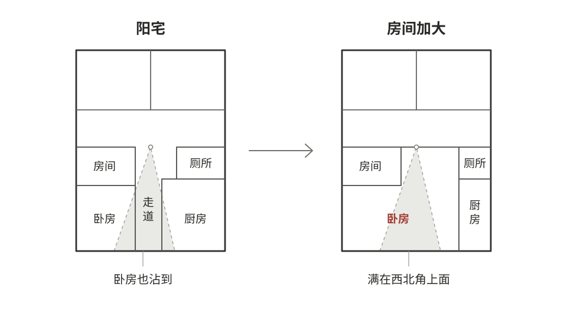 |
| **这套阳宅缺了什么位？对家里有何影响？** | 〔口述〕「诸位看它本身没有先生的位置」，「这套房子本身得不到先生的助力」，「一家之主就不是先生了」，「缺位看到没有缺位」。（[00:06:21–00:06:40](https://www.bilibili.com/video/BV1KJsLekEfA/?p=27&t=381)，第 11454–12023 帧） 〔指代〕说「对这个家来说」「他这个家」时，食指点在房屋草图中下部中心竖线旁，指的是整个房屋草图。（[00:06:25–00:06:26](https://www.bilibili.com/video/BV1KJsLekEfA/?p=27&t=385)，第 11569–11605 帧） 〔口述〕倪师又说「如果厨房在正中」「正中的话」「那就买单了走人了」，接着说「厨房再偏一点」，后半句没讲完就转到改宅。（[00:06:40–00:06:49](https://www.bilibili.com/video/BV1KJsLekEfA/?p=27&t=400)，第 12024–12281 帧） 〔推断〕推断：倪师是在说西北角被走道、厨房、卧房沾到之后，紧接着说「没有先生的位置」「缺位」；本块没有明说西北角与先生的对应关系。（[00:06:05–00:06:40](https://www.bilibili.com/video/BV1KJsLekEfA/?p=27&t=365)，第 10956–12023 帧） |
| **倪师怎么帮他改宅？** | 〔口述〕「我们现在帮他改的时候」：「我们把厨房改成长条形」，「厕所移到移到这边来」，「把这个房间改成厕所」。（[00:06:49–00:06:57](https://www.bilibili.com/video/BV1KJsLekEfA/?p=27&t=409)，第 12282–12539 帧） 〔口述〕「就是原来的房间给他加大」，「加到厨房一半这边来」，「就刚好满在满在」「满在西北角上面」。（[00:06:59–00:07:04](https://www.bilibili.com/video/BV1KJsLekEfA/?p=27&t=419)，第 12594–12749 帧） 〔指代〕说「厕所移到这边来」时手按在房屋草图右下部的长条小格上（正在画长条框）；说「加到厨房一半这边来」时手在右下部右侧长条格附近比划，所指处被手挡住。（[00:06:55–00:07:01](https://www.bilibili.com/video/BV1KJsLekEfA/?p=27&t=415)，第 12467–12659 帧） 〔板书〕可辨：房屋草图右侧新加一个竖长条框，框内上部仍是形似「厕」的小框；左下区域加了弧形线，并有红色粉笔横线与斜线；新添部分的字认不出。（[00:07:03](https://www.bilibili.com/video/BV1KJsLekEfA/?p=27&t=423)，第 12716 帧） |
| **改宅后床怎么摆、头脚朝哪？** | 〔口述〕「然后他东北方」「东北方是不是朝这里」，「所以我们把他这样子改」「朝他的最好的方向来睡」：「头在这边」「脚朝东北」「改成这样子位置上」。（[00:07:05–00:07:15](https://www.bilibili.com/video/BV1KJsLekEfA/?p=27&t=425)，第 12774–13067 帧） 〔指代〕说「头在这边」时右手伸向板面右下角，指尖落在右下格带红色粉笔记号处，所指处的字看不清。（[00:07:12](https://www.bilibili.com/video/BV1KJsLekEfA/?p=27&t=432)，第 12982 帧） 〔口述〕这样改的理由，倪师说他「还要在做事」。（[00:07:15–00:07:24](https://www.bilibili.com/video/BV1KJsLekEfA/?p=27&t=435)，第 13068–13331 帧） 〔板书〕板面与第 12716 帧大致相同；新添的头、脚记号认不出。（[00:07:10](https://www.bilibili.com/video/BV1KJsLekEfA/?p=27&t=430)，第 12929 帧） 〔板书〕板面与第 12929 帧大致相同；新添的记号仍认不出。（[00:07:15](https://www.bilibili.com/video/BV1KJsLekEfA/?p=27&t=435)，第 13068 帧） |
| **替人算命遇到流年不好，该劝人做什么？** | 〔口述〕「所以遇到这个流年的时候」「诸位记得」「帮人家算命的时候」「遇到流年不好」「一定鼓励人家去读书」「去深造去进修」。（[00:07:25–00:07:35](https://www.bilibili.com/video/BV1KJsLekEfA/?p=27&t=445)，第 13362–13661 帧） 〔口述〕理由是「所以读书是人最愉快的事情」「也可以忘掉很多事情」「好让自己成长」。（[00:07:35–00:07:40](https://www.bilibili.com/video/BV1KJsLekEfA/?p=27&t=455)，第 13662–13805 帧） 〔叠图〕第 13380 帧起贴出：夫妻乙亥，天府得、天马平；子女甲戌，红鸾陷、解神庙；疾厄壬申，天钺庙、文曲得、化忌，大限 52~61；财帛癸酉同前。（[00:07:26–00:07:28](https://www.bilibili.com/video/BV1KJsLekEfA/?p=27&t=446)，第 13380–13445 帧） |
| **化忌冲父母宫，主父亲先走还是母亲先走？** | 〔口述〕「化忌的是不是来冲到父母宫」，「他的父母宫刚好太阳星独守」。（[00:07:51–00:08:00](https://www.bilibili.com/video/BV1KJsLekEfA/?p=27&t=471)，第 14148–14411 帧） 〔口述〕「父母亲光以八字来看的话」「是不是父亲先走」「再来走母亲」「爸爸要先走」「因为对面是化忌来冲」，并说「这就看父母」。（[00:08:02–00:08:33](https://www.bilibili.com/video/BV1KJsLekEfA/?p=27&t=482)，第 14484–15419 帧） 〔叠图〕第 14200 帧已贴出父母丙寅（第 14148 帧还没有）：太阳旺、巨门庙、铃星庙，另有天寿旺、天福旺、天贵平、三台平等。（[00:07:53–00:07:56](https://www.bilibili.com/video/BV1KJsLekEfA/?p=27&t=473)，第 14200–14303 帧） |
| **66、67 岁流年的因与果，怎么跟当事人说？** | 〔口述〕倪师说看他「今年有什么决策」「看什么动作」，基本「上他的因为明年的果是好」。（[00:08:45–00:08:51](https://www.bilibili.com/video/BV1KJsLekEfA/?p=27&t=525)，第 15756–15941 帧） 〔推断〕推断（大意，字幕可信度约 0.3）：语音大意是跨过这一年后未来一年流年很好，这一年是因、明年是果，所以他今年的决策方向是对的，可以尽量去做；但后面有大限，赚了钱没办法享受到 69 岁。（[00:08:34–00:09:08](https://www.bilibili.com/video/BV1KJsLekEfA/?p=27&t=514)，第 15420–16451 帧） 〔板书〕可辨：板面左侧「田宅」「巨门」，其余被身体挡住或认不出。（[00:08:20](https://www.bilibili.com/video/BV1KJsLekEfA/?p=27&t=500)，第 15000 帧） 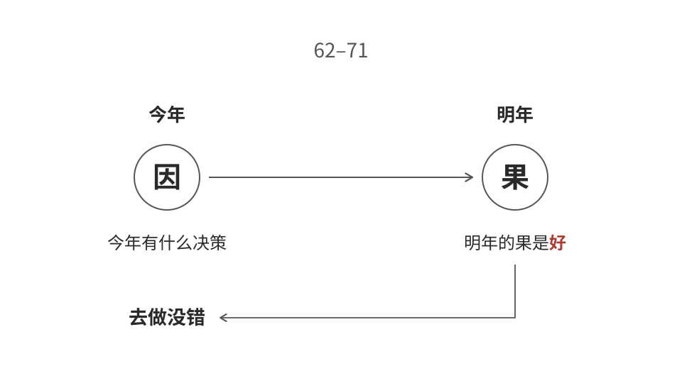 〔板书〕可辨：「文昌」「天钺」「文曲」（旁边圆圈里一字形似「忌」）、「廉贞」「破军」、「62–71」，另一个圈起的「52–6…」后半被挡；其余认不出。（[00:08:44](https://www.bilibili.com/video/BV1KJsLekEfA/?p=27&t=524)，第 15732 帧） |
| **69 岁寿限在面相哪里看？** | 〔口述〕倪师让大家把「脸相那张拿出来看」，「69在下下下角这边」「看到没有下角这边」。（[00:09:08–00:09:19](https://www.bilibili.com/video/BV1KJsLekEfA/?p=27&t=548)，第 16452–16793 帧） 〔口述〕「那个寿限到的时候」「这边会有黑点黑线」。（[00:09:19–00:09:25](https://www.bilibili.com/video/BV1KJsLekEfA/?p=27&t=559)，第 16794–16973 帧） 〔指代〕说「下角这边」时先用手指点着胸前举着的面相讲义下部（讲义字太小看不清），随后手指点在自己下巴、腮角处。（[00:09:15–00:09:18](https://www.bilibili.com/video/BV1KJsLekEfA/?p=27&t=555)，第 16678–16769 帧） 〔指代〕说「这边会有黑点黑线」前后，右手拇指指向自己下颌、颈侧。（[00:09:21](https://www.bilibili.com/video/BV1KJsLekEfA/?p=27&t=561)，第 16832 帧） |
| **黑点分哪两种？脸上黑痣黑斑主什么？** | 〔口述〕黑点有两种：「一种是这个黑气啊」「是隐在皮肤里面的」「这是大限」；「一种是有个痣长到这边来」「长在皮肤外面」「就过不了那个关」。（[00:09:25–00:09:41](https://www.bilibili.com/video/BV1KJsLekEfA/?p=27&t=565)，第 16974–17435 帧） 〔指代〕说「有个痣长到这边来」时食指点在自己下颌、下巴侧。（[00:09:33](https://www.bilibili.com/video/BV1KJsLekEfA/?p=27&t=573)，第 17204 帧） 〔口述〕举例：「像我们萧天赞这边就是一个大黑点」「就过不了那一年」；说「这边」时右手按在自己眼角、太阳穴侧（指代确定，第 17467 帧）。（[00:09:41–00:09:45](https://www.bilibili.com/video/BV1KJsLekEfA/?p=27&t=581)，第 17436–17567 帧） 〔口述〕「那我们脸上有黑痣黑斑的话」「是流年不利」：「当官的会下台」「做生意的会破财」「在那个黑点上」。（[00:09:45–00:09:53](https://www.bilibili.com/video/BV1KJsLekEfA/?p=27&t=585)，第 17568–17813 帧） |
| **大限前两个礼拜，黑点和头发有什么变化？** | 〔口述〕「那大限到了时候」「那个黑点会变成什么呀」「青色就是暗黑色」「然后再隐在皮肤下面」，看得很清楚。（[00:09:53–00:10:01](https://www.bilibili.com/video/BV1KJsLekEfA/?p=27&t=593)，第 17814–18059 帧） 〔口述〕「那在接近两个礼拜以内」「人整个气都没了」，「摸他头发都没有油了」。（[00:10:02–00:10:07](https://www.bilibili.com/video/BV1KJsLekEfA/?p=27&t=602)，第 18060–18239 帧） 〔口述〕倪师说头发、鼻子会出油，「你最好出油」，并开玩笑说有人哪天不出油还高兴，「你快快买单了」。（[00:10:08–00:10:16](https://www.bilibili.com/video/BV1KJsLekEfA/?p=27&t=608)，第 18240–18485 帧） 〔口述〕「我们在发生事情之前」看得到这个气色，「头发整个没有油的蓬起来」。（[00:10:16–00:10:20](https://www.bilibili.com/video/BV1KJsLekEfA/?p=27&t=616)，第 18486–18623 帧） |
| **身上的油和气是什么关系？** | 〔口述〕「我们身上的油」「在中医讲的就是气」，「大家对气不了解」，「实际上相书里面」「讲的就是我们身上的油」。（[00:10:22–00:10:31](https://www.bilibili.com/video/BV1KJsLekEfA/?p=27&t=622)，第 18660–18947 帧） 〔口述〕「油就是我们的气」「所以一定要有油」，「哪天发现没油」「赶快赶快来找我哈」。（[00:10:33–00:10:39](https://www.bilibili.com/video/BV1KJsLekEfA/?p=27&t=633)，第 18990–19193 帧） 〔板书〕可辨：黑板中部一个圆圈，圈里一字形似「气」；圈下方另一字认不出。（[00:10:30](https://www.bilibili.com/video/BV1KJsLekEfA/?p=27&t=630)，第 18912 帧） 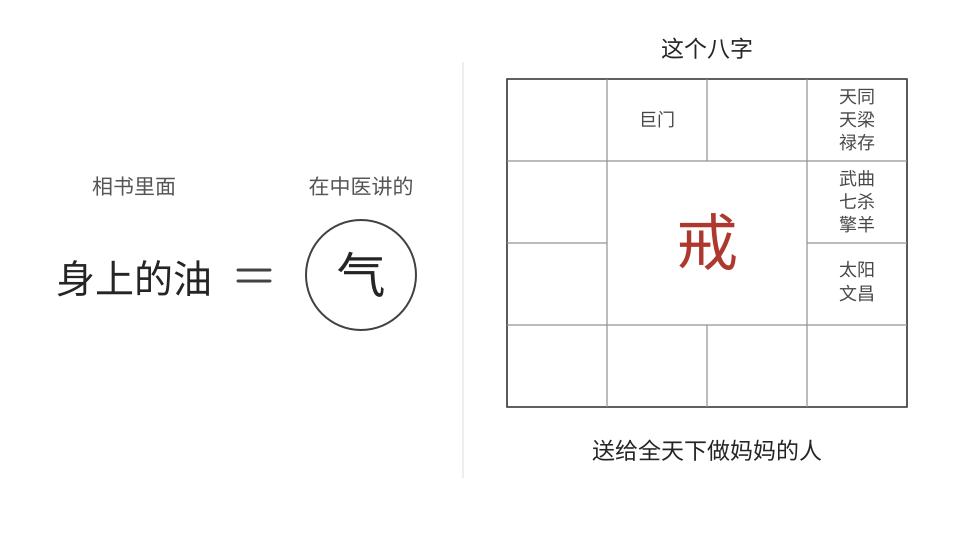 |

**总结区**

- 通用规则：寿限到时面相下角会有黑点黑线；黑气隐在皮肤里面是大限，痣长在皮肤外面就过不了那个关（[00:09:19–00:09:41](https://www.bilibili.com/video/BV1KJsLekEfA/?p=27&t=559)，第 16794–17435 帧）；脸上有黑痣黑斑是流年不利，当官的会下台，做生意的会破财（[00:09:45–00:09:53](https://www.bilibili.com/video/BV1KJsLekEfA/?p=27&t=585)，第 17568–17813 帧）；大限到时黑点变成青色即暗黑色、隐在皮肤下面，接近两个礼拜以内人整个气都没了、头发没有油（[00:09:53–00:10:07](https://www.bilibili.com/video/BV1KJsLekEfA/?p=27&t=593)，第 17814–18239 帧）；身上的油在中医讲就是气，相书讲的也是身上的油，所以一定要有油（[00:10:22–00:10:35](https://www.bilibili.com/video/BV1KJsLekEfA/?p=27&t=622)，第 18660–19067 帧）
- 只在本例：例一这个人个性最刚强最固执，不信这个（[00:05:24–00:05:33](https://www.bilibili.com/video/BV1KJsLekEfA/?p=27&t=324)，第 9720–10013 帧）；他的阳宅西北角刚好是走道、厨房和卧房沾到，房子没有先生的位置、得不到先生的助力（[00:06:05–00:06:40](https://www.bilibili.com/video/BV1KJsLekEfA/?p=27&t=365)，第 10956–12023 帧）；改宅：厨房改成长条形、厕所移位，原房间加大到西北角上面，头在这边、脚朝东北来睡（[00:06:49–00:07:15](https://www.bilibili.com/video/BV1KJsLekEfA/?p=27&t=409)，第 12282–13067 帧）；父母宫太阳星独守，化忌来冲，父亲先走、再走母亲（[00:07:51–00:08:10](https://www.bilibili.com/video/BV1KJsLekEfA/?p=27&t=471)，第 14148–14711 帧）
- 不是排盘规则，是处世方法：帮人算命遇到流年不好，一定鼓励人家去读书、深造、进修，读书能忘掉很多事情、让自己成长（[00:07:28–00:07:40](https://www.bilibili.com/video/BV1KJsLekEfA/?p=27&t=448)，第 13446–13805 帧）；不懂没关系，可以说不予置评；不懂又要讲结论就是无知（[00:05:33–00:05:43](https://www.bilibili.com/video/BV1KJsLekEfA/?p=27&t=333)，第 10014–10295 帧）

**待核**

1. [00:05:18](https://www.bilibili.com/video/BV1KJsLekEfA/?p=27&t=318)，第 9540 帧：本块开头画面左下有叠图写着「九为阳之极」「大限 男人 逢九买单」及福德卯、天相陷、地劫平、45/57/69，材料没有对应的 ▣ 行，未写入笔记。
2. [00:05:20](https://www.bilibili.com/video/BV1KJsLekEfA/?p=27&t=320)，第 9624 帧：字幕「这个人他太太非常好」，语音「这个人他非常好」，有没有「太太」两路不一致。
3. [00:05:57](https://www.bilibili.com/video/BV1KJsLekEfA/?p=27&t=357)，第 10722 帧：字幕只有「西在这边」，语音是「东在这边西在这边南在这边北在这边西北」，东、南、北三句只有语音，未当口述引用；各方位在草图上的位置未写入。
4. [00:06:10](https://www.bilibili.com/video/BV1KJsLekEfA/?p=27&t=370)，第 11100 帧：板书草图左上一字形似「东」，也像「长」；「厕」下方一字只认得「厂」字头，是否为「厨」认不出。哪间是卧房、厨房各在哪个方位，图上认不出，未推。
5. [00:06:47](https://www.bilibili.com/video/BV1KJsLekEfA/?p=27&t=407)，第 12228 帧：「厨房再偏一点」后半句没讲完，偏一点会怎样不清楚。
6. 第 12716、12929、13068 帧：改宅后新添的线条、红色粉笔记号与头脚位置认不出。
7. [00:07:15](https://www.bilibili.com/video/BV1KJsLekEfA/?p=27&t=435)，第 13068 帧：字幕「还要在做事」，语音与画面字幕作「因为他还要在做事」。
8. [00:07:49](https://www.bilibili.com/video/BV1KJsLekEfA/?p=27&t=469)，第 14082 帧：「对面化忌」的「对面」指哪一宫本块没有说明；同期叠图贴出疾厄壬申文曲化忌，是否就是它待核。
9. [00:07:58](https://www.bilibili.com/video/BV1KJsLekEfA/?p=27&t=478)，第 14364 帧：口述「父母宫刚好太阳星独守」，但叠图父母丙寅格同时有太阳旺、巨门庙，与「独守」不合。
10. [00:08:11](https://www.bilibili.com/video/BV1KJsLekEfA/?p=27&t=491)，第 14754 帧：「这就看父母」之后约 18 秒没有烧录字幕，语音讲 66 岁流年、67 岁明年第二年很好，不能当口述依据。
11. [00:08:34–00:09:08](https://www.bilibili.com/video/BV1KJsLekEfA/?p=27&t=514)，第 15420–16451 帧：字幕可信度约 0.3（「你救这个翠跨了这一年的时候」「他是已经是果」「着给果然的因是在这一年」「閒以他的決策」「你这量去做没错」「没法享受到69」），只写了大意；[00:08:44](https://www.bilibili.com/video/BV1KJsLekEfA/?p=27&t=524)，第 15732 帧画面字幕实为「看结果 他的因 是在这一年」，与材料字幕识别不同。
12. [00:08:44](https://www.bilibili.com/video/BV1KJsLekEfA/?p=27&t=524)，第 15732 帧：画面叠图在命宫丁丑 67 标「果」、兄弟丙子 66（天同旺、太阴庙、天魁旺）标「因」，材料没有对应 ▣ 行，未写入。
13. [00:08:45](https://www.bilibili.com/video/BV1KJsLekEfA/?p=27&t=525)，第 15756 帧：字幕「今年有什么决策」，语音作「今天」。
14. 第 16561、18912 帧：画面叠图是在下颌一侧标「69」的面相图，材料没有对应 ▣ 行，未写入。
15. [00:09:32](https://www.bilibili.com/video/BV1KJsLekEfA/?p=27&t=572)，第 17166 帧：语音另有「或者是一个黑斑长到这边来」，字幕栏没有这句。
16. [00:09:41](https://www.bilibili.com/video/BV1KJsLekEfA/?p=27&t=581)，第 17436 帧：人名照字幕写「萧天赞」，语音作「肖天站」。
17. [00:09:49](https://www.bilibili.com/video/BV1KJsLekEfA/?p=27&t=589)，第 17682 帧：字幕「当官的会下台」，语音「当官了会下财」。
18. [00:10:17](https://www.bilibili.com/video/BV1KJsLekEfA/?p=27&t=617)，第 18534 帧：字幕「都会有看到这个气色」，语音「都没有看到这个气色」，意思相反，笔记只写了看得到气色。
19. [00:10:28](https://www.bilibili.com/video/BV1KJsLekEfA/?p=27&t=628)，第 18864 帧：语音后半「而根据我们的灵状看是油」，画面字幕作「而根据我们临床看」，材料字幕栏无此句。
20. [00:10:32](https://www.bilibili.com/video/BV1KJsLekEfA/?p=27&t=632)，第 18978 帧：字幕「当朝L维晋」为乱码，已略过。

## 例二（男命，命宫甲申天同天梁）：太阴化忌、婆媳、早婚丧妻

| 巳 | 午 | 未 | 申 |
|---|---|---|---|
| **子女 辛巳** 廉贞陷 贪狼陷 | **夫妻 壬午** 巨门旺 | **兄弟 癸未** 天相得 天钺旺 陀罗庙 | **命宫 甲申**（身宫） 天同旺科 天梁陷 禄存庙 |
| **财帛 庚辰** 太阴陷忌 右弼庙 文曲得 | **例二 · 命宫甲申** | 据视频叠图重排 | **父母 乙酉** 武曲利权 七杀旺 擎羊陷 |
| **疾厄 己卯** 天府得 | 后期贴图，不算倪师的话 |  | **福德 丙戌** 太阳不禄 左辅庙 文昌陷 铃星庙 |
| （寅：没贴过） | （丑：没贴过） | （子：没贴过） | （亥：没贴过） |

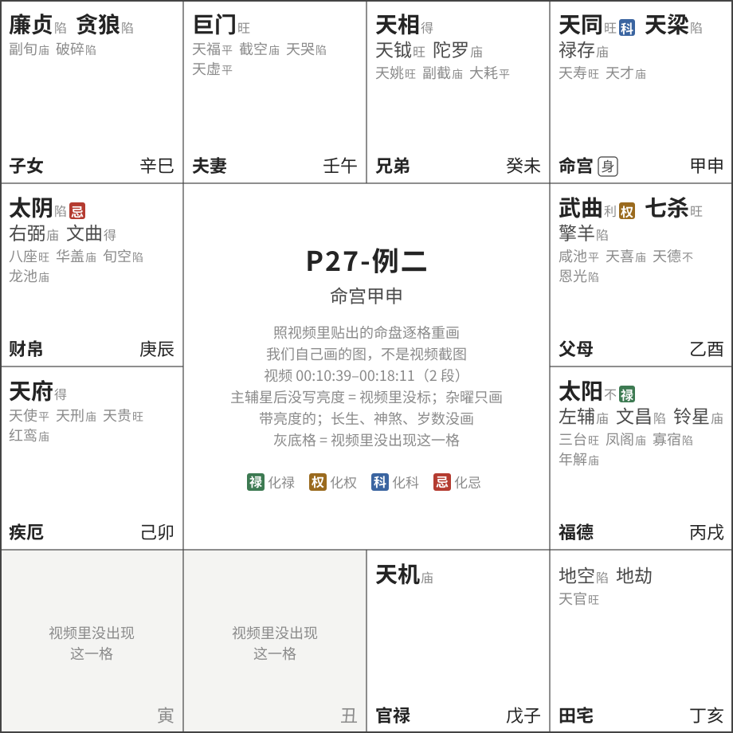

按视频里这张盘逐格重画（我们自己画的图，不是视频截图）；同一个人的 2 段合成一张；星名后没写亮度的，视频里本来就没标亮度；数据见 [命盘-P27-例二.json](图/命盘-P27-例二.json)。

### 3　太阴化忌：母亲左右婚事致早婚丧妻（[00:10:39–00:14:09](https://www.bilibili.com/video/BV1KJsLekEfA/?p=27&t=639)，第 19194–25499 帧）

| 提示区 | 笔记区 |
|---|---|
| **这个八字为什么要送给做妈妈的人做警戒？** | 〔口述〕倪师开讲新一张盘，先说这个八字是给天下做母亲的人看的警示：「这个这个八字啊」「这个送给全天下做妈妈的人呐」「要做个警戒」。（[00:10:39–00:10:50](https://www.bilibili.com/video/BV1KJsLekEfA/?p=27&t=639)，第 19194–19511 帧） 〔板书〕写板书后，盘中央空白处新出现一个「戒」字；盘上原有各格可辨「巨门」「天同」「天梁」「禄存」「命」「武曲」「七杀」「擎羊」「太阳」「文昌」「太阴」「财帛」「疾厄」及「2-11」「12-21」「69.」「男」等字，其余认不出。（[00:10:48](https://www.bilibili.com/video/BV1KJsLekEfA/?p=27&t=648)，第 19464 帧） 〔口述〕倪师说算命、研究命的用处，就是先知道消息：「我们在算命的时候」「我们研究命」「就是知道消息」「知道盈亏」「……事先知道事情」。（[00:10:50–00:10:57](https://www.bilibili.com/video/BV1KJsLekEfA/?p=27&t=650)，第 19512–19739 帧） |
| **太阴星代表谁？看这张盘先看哪颗星？** | 〔口述〕倪师说不论命是太阳还是太阴，只要命里太阴会来，「太阴就完全受到母亲的影响」。（[00:11:00–00:11:13](https://www.bilibili.com/video/BV1KJsLekEfA/?p=27&t=660)，第 19818–20219 帧） 〔口述〕看这张命先只看太阴有没有化忌：「诸位一看太阴化」「先不要管别的」「太阴化忌有没有化忌」。（[00:11:14–00:11:20](https://www.bilibili.com/video/BV1KJsLekEfA/?p=27&t=674)，第 20220–20417 帧） 〔叠图〕第 19920 帧起叠图贴出命宫甲申：天同旺科、天梁陷、禄存庙、天寿旺、天才庙，标「身宫」；财帛庚辰：太阴陷忌、文曲得、右弼庙、八座旺、龙池庙、旬空陷等。（[00:11:04–00:11:06](https://www.bilibili.com/video/BV1KJsLekEfA/?p=27&t=664)，第 19920–20000 帧） |
| **男命太阴化忌，最怕什么？** | 〔口述〕倪师说男人的命太阴化忌，最怕的就是婆媳不和：「太阴化忌的人呐」「最怕太阴化忌就是这样」「婆媳不和」「太太跟妈妈一定不和的」。（[00:11:20–00:11:29](https://www.bilibili.com/video/BV1KJsLekEfA/?p=27&t=680)，第 20418–20699 帧） 〔口述〕落到本例：「像这个男人的命呢」「太阴化忌」「他妈妈就一直在这个制造问题」。（[00:11:30–00:11:36](https://www.bilibili.com/video/BV1KJsLekEfA/?p=27&t=690)，第 20700–20891 帧） |
| **父母宫擎羊落陷，说明谁是他的小人？** | 〔口述〕「然后他的父母宫你看看」「擎羊星落陷在这里」，倪师说「爸爸妈妈妈妈就是他的小人呢」。（[00:11:36–00:11:42](https://www.bilibili.com/video/BV1KJsLekEfA/?p=27&t=696)，第 20892–21071 帧） 〔指代〕说「擎羊星落陷在这里」的「这里」时，手指的是板书「武曲、天喜、七杀、12-21、擎羊」那一格的「擎羊」；叠图同时框出擎羊、父母乙酉。（[00:11:38](https://www.bilibili.com/video/BV1KJsLekEfA/?p=27&t=698)，第 20964 帧） 〔叠图〕父母乙酉：七杀旺、擎羊陷、武曲利权、天喜庙、咸池平、恩光陷、天德；叠图该格标着「看不见的小人」。（[00:11:32–00:11:36](https://www.bilibili.com/video/BV1KJsLekEfA/?p=27&t=692)，第 20760–20891 帧） 〔口述〕倪师替母亲说出心里话再反驳：「心想我怎么会害我儿子」「对这是你的想法」「可是你的动作所有出来」「都是害你儿子的」。（[00:11:42–00:11:48](https://www.bilibili.com/video/BV1KJsLekEfA/?p=27&t=702)，第 21072–21245 帧） |
| **这个人本身的命格好不好？** | 〔口述〕倪师说这人命格本来很好：「他这个人生下来化科带禄存」「聪明才智很高」「家里面又有钱」「对不对命格上很好啊」；接着转折「可是你看他的妈妈」。（[00:11:48–00:11:57](https://www.bilibili.com/video/BV1KJsLekEfA/?p=27&t=708)，第 21246–21539 帧） 〔叠图〕此时叠图贴命宫甲申（天同旺科、禄存庙）与财帛庚辰。（[00:11:48–00:11:49](https://www.bilibili.com/video/BV1KJsLekEfA/?p=27&t=708)，第 21246–21299 帧） 〔推断〕推断：倪师说的「化科带禄存」，与叠图命宫甲申的天同旺科、禄存庙相合。（[00:11:48–00:11:49](https://www.bilibili.com/video/BV1KJsLekEfA/?p=27&t=708)，第 21246–21299 帧） |
| **12-21 岁这十年，天喜、红鸾落在哪里？** | 〔口述〕「父母宫12-21岁」「天喜星就进来红鸾」，又说「天喜在红鸾星在对面哈」「红鸾星在这里」。（[00:11:59–00:12:06](https://www.bilibili.com/video/BV1KJsLekEfA/?p=27&t=719)，第 21576–21791 帧） 〔叠图〕父母乙酉格有天喜庙；接着贴出疾厄己卯：红鸾庙、天府得、天刑庙、天贵旺、天使平。（[00:12:02–00:12:04](https://www.bilibili.com/video/BV1KJsLekEfA/?p=27&t=722)，第 21678–21731 帧） 〔推断〕推断：叠图父母乙酉印有「1221」，与口述「父母宫12-21岁」相对应；按图例应是「12~21」，本块倪师没有再讲这个数字串。（[00:11:59–00:12:00](https://www.bilibili.com/video/BV1KJsLekEfA/?p=27&t=719)，第 21570–21617 帧） |
| **他为什么 18 岁就早婚？谁在搅和？** | 〔口述〕「你看哦18岁这一年」「他是12-21」「是不是天喜红鸾星來……」「是不是啊」「会早婚的」。（[00:12:14–00:12:23](https://www.bilibili.com/video/BV1KJsLekEfA/?p=27&t=734)，第 22038–22301 帧） 〔板书〕可辨：左列一格写「天府」，格内圈起一个「18」，下方写「疾厄」；圈旁还有几个字，认不出。（[00:12:18](https://www.bilibili.com/video/BV1KJsLekEfA/?p=27&t=738)，第 22152 帧） 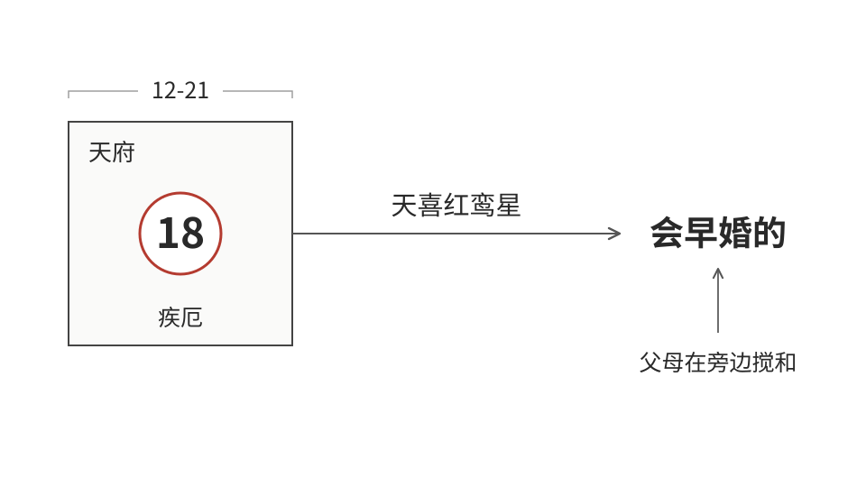 〔口述〕倪师说早婚的人都是这个样子，是父母在旁边搅和：「会早婚的人都是这样」「父母在旁边搅和」。（[00:12:24–00:12:28](https://www.bilibili.com/video/BV1KJsLekEfA/?p=27&t=744)，第 22344–22469 帧） 〔叠图〕疾厄己卯格印有「18」（与红鸾同格）。（[00:12:26–00:12:28](https://www.bilibili.com/video/BV1KJsLekEfA/?p=27&t=746)，第 22392–22469 帧） |
| **母亲怎么想？倪师说错在谁？** | 〔口述〕倪师学母亲的口气：「我是独子啊」「我这个孩子很很好啊」，希望儿子娶媳妇，「啊18岁让他结婚」，「红鸾星动了」。（[00:12:29–00:12:39](https://www.bilibili.com/video/BV1KJsLekEfA/?p=27&t=749)，第 22470–22775 帧） 〔口述〕问是谁错的，一看就知道是妈妈（字幕乱，按语音改）；倪师接着说「不是我不是我」「就是你啊懂不懂」，「……你的小人就是你妈妈」。（[00:12:39–00:12:47](https://www.bilibili.com/video/BV1KJsLekEfA/?p=27&t=759)，第 22776–23033 帧） |
| **做母亲的该不该替孩子做决策？** | 〔口述〕倪师劝母亲不要替小孩做决策：「你做了决策不好」「小孩子会怨你」「做的好也罢了」「可是你要做的好很难的」。（[00:12:47–00:12:57](https://www.bilibili.com/video/BV1KJsLekEfA/?p=27&t=767)，第 23034–23327 帧） 〔口述〕原因是两人想法不同：「因为你想的不见得是他想的」「你想我想两个想的都不一样」。（[00:12:57–00:13:01](https://www.bilibili.com/video/BV1KJsLekEfA/?p=27&t=777)，第 23328–23453 帧） 〔口述〕接着说了句「飞机掉下来了」（上下文没交代），然后「所以不要去不要去想着」「只能掌握自己」「不要乱想」。（[00:13:01–00:13:07](https://www.bilibili.com/video/BV1KJsLekEfA/?p=27&t=781)，第 23454–23639 帧） |
| **18 岁结婚后，19、20 岁走到什么星？** | 〔指代〕说「他这个18岁一结婚」的「这个」时，手指的是板书左列「天府」格内圈起的「18」；随后第 23650 帧起叠图贴出疾厄己卯，有天府、红鸾、18。（[00:13:07](https://www.bilibili.com/video/BV1KJsLekEfA/?p=27&t=787)，第 23621 帧） 〔口述〕「他这个18岁一结婚」「19 20岁你看他是不是廉贪落陷」「你知道他发生什么事情」「一结婚以后为什么」。（[00:13:08–00:13:16](https://www.bilibili.com/video/BV1KJsLekEfA/?p=27&t=788)，第 23640–23903 帧） 〔叠图〕第 23650–23840 帧叠图贴出子女辛巳：廉贞陷、贪狼陷，格内印「20」；财帛庚辰格内印「19」；疾厄己卯格内印「18」，标「结婚」。（[00:13:08–00:13:14](https://www.bilibili.com/video/BV1KJsLekEfA/?p=27&t=788)，第 23650–23840 帧） 〔推断〕推断：「廉贪落陷」应指叠图子女辛巳的廉贞陷、贪狼陷；倪师说的 19、20 岁，可能对应叠图印「19」的财帛庚辰与印「20」的子女辛巳，本块没有明说。（[00:13:09–00:13:12](https://www.bilibili.com/video/BV1KJsLekEfA/?p=27&t=789)，第 23694–23771 帧） |
| **22-31 太阴不亮，男人的月亮指谁？** | 〔口述〕「因为12-21 在这十年中间」，再「先看未来」：「22-31 是不是太阴星就不亮了」「换句话说 22岁以前」「就看不到月亮了懂不懂」。（[00:13:16–00:13:26](https://www.bilibili.com/video/BV1KJsLekEfA/?p=27&t=796)，第 23904–24185 帧） 〔叠图〕此时叠图贴财帛庚辰：太阴陷忌；同框还有父母乙酉、福德丙戌。（[00:13:21–00:13:23](https://www.bilibili.com/video/BV1KJsLekEfA/?p=27&t=801)，第 24030–24119 帧） 〔口述〕倪师问男人的月亮除了妈妈还指谁，答「老婆啊」：「那男人的月亮除了妈妈以外还指谁」「老婆啊」。（[00:13:26–00:13:29](https://www.bilibili.com/video/BV1KJsLekEfA/?p=27&t=806)，第 24186–24299 帧） |
| **太太为什么娶进门第二年就跳河自杀？** | 〔口述〕「他一娶进来以后」「第二年他太太这一年就跳河自杀」；倪师问为什么，答「又是妈妈搞出来的嘛」。（[00:13:30–00:13:40](https://www.bilibili.com/video/BV1KJsLekEfA/?p=27&t=810)，第 24300–24605 帧） 〔口述〕「你看他在第二年进入这一年结婚」「进入这年太阴化忌」「跟她处的很不好」，之后太太在逼迫下自杀（原话字幕不通，见待核）。（[00:13:40–00:13:48](https://www.bilibili.com/video/BV1KJsLekEfA/?p=27&t=820)，第 24606–24857 帧） 〔口述〕倪师批评母亲：「媳妇也是你要挑的嘛」，又虐待媳妇，「你看这就是妈妈到处决定」「这很很很可恶啊」。（[00:13:48–00:13:55](https://www.bilibili.com/video/BV1KJsLekEfA/?p=27&t=828)，第 24858–25073 帧） |
| **看到这种象，算命的人该怎么做？** | 〔口述〕倪师说真有这种女人：「你们承不承认有这种女人」「有啊我告诉你」，而且「有时候你自己犯了你都不知道」「自己犯了错都不晓得」。（[00:13:56–00:14:04](https://www.bilibili.com/video/BV1KJsLekEfA/?p=27&t=836)，第 25080–25337 帧） 〔口述〕做法是一看到这种象，马上把母亲撇开、不要乱左右他：「所以我们拿到一看到这种象星（②）」「马上马上把他妈妈撇开来懂不懂」「你不要去乱左有他」。（[00:14:04–00:14:09](https://www.bilibili.com/video/BV1KJsLekEfA/?p=27&t=844)，第 25338–25499 帧） |

**总结区**

- 通用规则：命里只要太阴会来，太阴就完全受到母亲的影响（[00:11:00–00:11:13](https://www.bilibili.com/video/BV1KJsLekEfA/?p=27&t=660)，第 19818–20219 帧）。；男人的命太阴化忌，最怕婆媳不和，太太跟妈妈一定不和（[00:11:20–00:11:28](https://www.bilibili.com/video/BV1KJsLekEfA/?p=27&t=680)，第 20418–20669 帧）。；男人的月亮除了妈妈以外，还指老婆（[00:13:26–00:13:29](https://www.bilibili.com/video/BV1KJsLekEfA/?p=27&t=806)，第 24186–24299 帧）。；会早婚的人都是这样，是父母在旁边搅和（[00:12:24–00:12:28](https://www.bilibili.com/video/BV1KJsLekEfA/?p=27&t=744)，第 22344–22469 帧）。
- 只在本例：此人生下来化科带禄存，聪明才智高、家里有钱，命格本来很好（[00:11:48–00:11:55](https://www.bilibili.com/video/BV1KJsLekEfA/?p=27&t=708)，第 21246–21473 帧）。；父母宫擎羊落陷，母亲就是他的小人（[00:11:36–00:11:42](https://www.bilibili.com/video/BV1KJsLekEfA/?p=27&t=696)，第 20892–21071 帧）。；12-21 岁天喜红鸾来，18 岁由母亲做主早婚（[00:12:14–00:12:37](https://www.bilibili.com/video/BV1KJsLekEfA/?p=27&t=734)，第 22038–22721 帧）。；娶进门第二年进入太阴化忌，婆媳处得很不好，太太跳河自杀，倪师说是妈妈搞出来的（[00:13:30–00:13:48](https://www.bilibili.com/video/BV1KJsLekEfA/?p=27&t=810)，第 24300–24857 帧）。
- 不是排盘规则，是处世方法：研究命就是事先知道消息、知道盈亏（[00:10:50–00:10:57](https://www.bilibili.com/video/BV1KJsLekEfA/?p=27&t=650)，第 19512–19739 帧）。；母亲不要替小孩做决策，做不好孩子会怨你，做好很难，因为两人想的不一样（[00:12:47–00:13:01](https://www.bilibili.com/video/BV1KJsLekEfA/?p=27&t=767)，第 23034–23453 帧）。；只能掌握自己，不要乱想（[00:13:04–00:13:07](https://www.bilibili.com/video/BV1KJsLekEfA/?p=27&t=784)，第 23526–23639 帧）。；看到这种象，马上把他妈妈撇开，不要去乱左右他（[00:14:04–00:14:09](https://www.bilibili.com/video/BV1KJsLekEfA/?p=27&t=844)，第 25338–25499 帧）。

**待核**

1. [00:10:45](https://www.bilibili.com/video/BV1KJsLekEfA/?p=27&t=645)，第 19356 帧：字幕「要做个警戒」，语音作「要做个警戒要做个戒心」，板书写了「戒」字（[00:10:48](https://www.bilibili.com/video/BV1KJsLekEfA/?p=27&t=648)，第 19464 帧）。
2. 第 19194、19740、20216、20695、20788、21237、24906 帧：这几处「这个 / 这里」的指代为看不出、不确定或否，未作依据。
3. [00:11:07](https://www.bilibili.com/video/BV1KJsLekEfA/?p=27&t=667)，第 20034 帧：语音先说「父亲的影响」再说「母亲的影响」，字幕只有「母亲」，按字幕写。
4. [00:11:17–00:11:31](https://www.bilibili.com/video/BV1KJsLekEfA/?p=27&t=677)，第 20316–20759 帧：语音「化剂」即化忌，已按字幕「化忌」写。
5. [00:11:48](https://www.bilibili.com/video/BV1KJsLekEfA/?p=27&t=708)，第 21246 帧：字幕「化科带禄存」，语音作「化磕在路上」，两路只大体对得上。
6. [00:11:50](https://www.bilibili.com/video/BV1KJsLekEfA/?p=27&t=710)，第 21300 帧：字幕「人聪明啊台」末字「台」是乱码，未引。
7. 第 21540、21570 帧：字幕「福怜」「不合」与语音对不上，略过。
8. [00:12:02](https://www.bilibili.com/video/BV1KJsLekEfA/?p=27&t=722)，第 21678 帧：「天喜在红鸾星在对面哈」的「对面」本块没有解释。
9. [00:12:06–00:12:14](https://www.bilibili.com/video/BV1KJsLekEfA/?p=27&t=726)，第 21792–22037 帧：倪师数「小流年」，字幕「不陷庙庙旺庙陷庙 25在这边」「大文左铃二凤寡年」「2120和19」混进叠图字，语音对不上，略过；「小流年」一词本块没有解释。
10. 第 22038、22158、22344 帧：字幕句尾「妈妈搅和禄」语音没有，已去掉；板书帧[00:12:18](https://www.bilibili.com/video/BV1KJsLekEfA/?p=27&t=738)，第 22152 帧画面叠图上有剪辑提示字「妈妈搅和 18岁早婚」「12~21天喜红鸾星来会 18岁红鸾星动大小二限逢」，疑为这串字的来源，但未见于叠图文字转写。
11. [00:12:18](https://www.bilibili.com/video/BV1KJsLekEfA/?p=27&t=738)，第 22158 帧：字幕「红鸾星來念」，语音作「红蓝星来会」，[00:12:18](https://www.bilibili.com/video/BV1KJsLekEfA/?p=27&t=738)，第 22152 帧画面字幕作「来会」，「念」疑为「会」的误识。
12. [00:12:29–00:12:31](https://www.bilibili.com/video/BV1KJsLekEfA/?p=27&t=749)，第 22470–22553 帧：句尾「“更」「“过交动」「”考里动」及[00:12:45](https://www.bilibili.com/video/BV1KJsLekEfA/?p=27&t=765)，第 22962 帧「“里动」为乱码，已去掉。
13. [00:12:31](https://www.bilibili.com/video/BV1KJsLekEfA/?p=27&t=751)，第 22554 帧：字幕「我希望儿子娶上媳妈啊」，语音作「娶旁媳妇」，「媳妈」应为媳妇，原话未引。
14. [00:12:39–00:12:42](https://www.bilibili.com/video/BV1KJsLekEfA/?p=27&t=759)，第 22776–22883 帧：字幕「你看是谁谁错证」「一看就晓得是婷护」「懂不懂写在这阴摆」不通，按语音改为「是谁错的」「一看就知道是妈妈」。
15. [00:12:47](https://www.bilibili.com/video/BV1KJsLekEfA/?p=27&t=767)，第 23034 帧：字幕「不要去替小孩干撒什么決策」，语音作「做什么决策」，已按语音转述。
16. [00:13:01](https://www.bilibili.com/video/BV1KJsLekEfA/?p=27&t=781)，第 23454 帧：「飞机掉下来了」上下文没有交代，照原话记。
17. [00:13:04](https://www.bilibili.com/video/BV1KJsLekEfA/?p=27&t=784)，第 23526 帧：字幕「所以不要去不要去想着」，语音作「去想他」。
18. [00:13:09](https://www.bilibili.com/video/BV1KJsLekEfA/?p=27&t=789)，第 23694 帧：字幕「廉贪落陷」，语音作「连弹落线」；「廉贪」指廉贞、贪狼是推断。
19. [00:13:21](https://www.bilibili.com/video/BV1KJsLekEfA/?p=27&t=801)，第 24030 帧：字幕「22-31」，语音作「十二到三十一」；22-31 这十年对应叠图哪一宫本块没讲，福德丙戌格印有「2231」，关系待核。
20. [00:13:24](https://www.bilibili.com/video/BV1KJsLekEfA/?p=27&t=804)，第 24120 帧：上句说「22-31 太阴星就不亮」，下句字幕「换句话说 22岁以前……就看不到月亮了」，字面似有出入，照原话记。
21. [00:13:31](https://www.bilibili.com/video/BV1KJsLekEfA/?p=27&t=811)，第 24330 帧：字幕「第二年他太太这一年」，语音作「第二年他的这一年」；「第二年」是指结婚后第二年还是第二个小限年，待核。
22. [00:13:44](https://www.bilibili.com/video/BV1KJsLekEfA/?p=27&t=824)，第 24738 帧：原话「结果被逼着被她火了我自杀去你看看」不通，语音作「得被他火了自杀去」，只写了在逼迫下自杀。
23. [00:13:50](https://www.bilibili.com/video/BV1KJsLekEfA/?p=27&t=830)，第 24912 帧：字幕「这个叉把媳妇虐待」，语音作「又把习武六代」，「叉」疑为「又」。
24. [00:13:51](https://www.bilibili.com/video/BV1KJsLekEfA/?p=27&t=831)，第 24954 帧：字幕「妈妈到处决定」，语音作「妈妈这种决定」。
25. [00:13:56](https://www.bilibili.com/video/BV1KJsLekEfA/?p=27&t=836)，第 25080 帧：字幕「你们承不承认有这种女人」，语音作「本成有这种原因」，两路对得不好。
26. [00:13:58](https://www.bilibili.com/video/BV1KJsLekEfA/?p=27&t=838)，第 25152 帧：字幕「你不相信我是不是随时可以找啊」，语音作「谁谁可以找来」，未引。
27. [00:14:04](https://www.bilibili.com/video/BV1KJsLekEfA/?p=27&t=844)，第 25338 帧：字幕「这种象星（②）」，语音作「这种消息」，括号注字不是倪师原话。
28. [00:14:08](https://www.bilibili.com/video/BV1KJsLekEfA/?p=27&t=848)，第 25458 帧：字幕「乱左有他」，语音作「乱左右他」，应为左右。
29. [00:10:48](https://www.bilibili.com/video/BV1KJsLekEfA/?p=27&t=648)，第 19464 帧：板书「69.」「男」「庚」及一个像「8」的字，本块没有讲含义；武曲旁圈起的字认不清。
30. [00:12:26](https://www.bilibili.com/video/BV1KJsLekEfA/?p=27&t=746)，第 22392 帧：这一版叠图有缺字（□），父母乙酉写作「武曲利」无「权」，财帛庚辰的「太阴陷」与「忌」分开印，与其他版本不一致。

## 例二续：22-31化忌坐牢、机月同梁、隔离母亲、男女命之别

| 巳 | 午 | 未 | 申 |
|---|---|---|---|
| **子女 辛巳** 廉贞陷 贪狼陷 | **夫妻 壬午** 巨门旺 | **兄弟 癸未** 天相得 天钺旺 陀罗庙 | **命宫 甲申**（身宫） 天同旺科 天梁陷 禄存庙 |
| **财帛 庚辰** 太阴陷忌 右弼庙 文曲得 | **例二续：22-31化忌坐牢、机月同梁、隔离母亲、男女命之别 · 命宫甲申** | 据视频叠图重排 | **父母 乙酉** 武曲利权 七杀旺 擎羊陷 |
| **疾厄 己卯** 天府得 | 后期贴图，不算倪师的话 |  | **福德 丙戌** 太阳不禄 左辅庙 文昌陷 铃星庙 |
| （寅：没贴过） | （丑：没贴过） | **官禄 戊子** 天机庙 | **田宅 丁亥** 地空陷 |

同例二的命盘，见上图。

### 4　22-31太阴化忌坐牢，劝隔离母亲（[00:14:10–00:18:11](https://www.bilibili.com/video/BV1KJsLekEfA/?p=27&t=850)，第 25500–32735 帧）

| 提示区 | 笔记区 |
|---|---|
| **例二太太出事以后，22-31 这十年他变成什么样？** | 〔口述〕倪师接着讲例二：「好了他太太一出事」「一出事以后」「你看他22-31是不是太阴化忌」，于是「他产生跟他妈妈相抗的那种」「抗的心理产生」。（[00:14:10–00:14:20](https://www.bilibili.com/video/BV1KJsLekEfA/?p=27&t=850)，第 25500–25829 帧） 〔口述〕倪师说这人「本来是很好的人啊」，妈妈说「你不能犯法你不能做」，他偏「我就要犯法」，「我是你的儿子啊」「我想尽办法把你儿子整惨」，于是「他就开始作奸犯科了」。（[00:14:21–00:14:33](https://www.bilibili.com/video/BV1KJsLekEfA/?p=27&t=861)，第 25830–26195 帧） 〔叠图〕叠图贴出两格：福德丙戌，大限 22~31，小限 1,13,25,37,49,61，太阳（不、化禄）、文昌陷、左辅庙、铃星庙、三台旺、凤阁庙、寡宿陷、年解庙；财帛庚辰，大限 82~91，小限 7,19,31,43,55,67，太阴陷化忌、文曲得、右弼庙、八座旺、华盖庙、龙池庙、旬空陷。（[00:14:13–00:14:17](https://www.bilibili.com/video/BV1KJsLekEfA/?p=27&t=853)，第 25614–25715 帧） 〔板书〕可辨：右列上格「天同」「(科)」「天梁」「禄存」「2-11」「命」「身」；右列第二格「武曲」「七杀」、圈起的「权」、「12-21」；第三格圈起的「禄」、圈起的「25」、「22-31」；中间「戌」；下排「紫微」「破军」「天魁」「52-61」「42-51」「地劫」；上排中格「天相」等字。其余被叠图和老师身体挡住，认不出。（[00:14:16](https://www.bilibili.com/video/BV1KJsLekEfA/?p=27&t=856)，第 25692 帧） 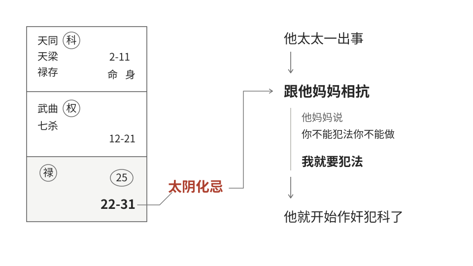 〔推断〕推断：倪师口说「22-31是不是太阴化忌」，但叠图上 22~31 那格是福德丙戌（太阳化禄），太阴陷化忌印在财帛庚辰格；两者怎么连起来，倪师在下文说是「化忌来沖」，本块没有再细讲。（[00:14:13–00:15:08](https://www.bilibili.com/video/BV1KJsLekEfA/?p=27&t=853)，第 25614–27245 帧） |
| **化忌进来、日月反背，各主什么？** | 〔口述〕倪师说「22-31化忌进来」，「化忌是官司是非啊」。（[00:14:33–00:14:36](https://www.bilibili.com/video/BV1KJsLekEfA/?p=27&t=873)，第 26196–26285 帧） 〔口述〕倪师又说「日月反背的话」「代表眼睛看不到天日啊」「还会有牢狱之灾的」。日月反背具体指什么，本块没有解释。（[00:14:36–00:14:41](https://www.bilibili.com/video/BV1KJsLekEfA/?p=27&t=876)，第 26286–26453 帧） 〔叠图〕同时在画面上的两格：福德丙戌的太阳旁印「不」，财帛庚辰的太阴旁印「陷」。（[00:14:13–00:14:17](https://www.bilibili.com/video/BV1KJsLekEfA/?p=27&t=853)，第 25614–25715 帧） |
| **他几岁开始犯官府、坐牢？** | 〔口述〕倪师说「25岁 26岁逢空劫」，「你看26岁流年有没有」，「从22-31中间」逐年数下来。（[00:14:41–00:14:47](https://www.bilibili.com/video/BV1KJsLekEfA/?p=27&t=881)，第 26454–26627 帧） 〔指代〕数流年时说「22是这个星」的「这个」，手掌按在黑板右列最上格圈起的「(科)」一带，下面就是「2-11 命 身」；叠图同时显示 23=命宫甲申。（[00:14:49–00:14:51](https://www.bilibili.com/video/BV1KJsLekEfA/?p=27&t=889)，第 26694–26747 帧） 〔口述〕倪师结论：「最差马上26岁呢」「开始犯了官府了」，「一天到晚就在坐牢」「牢狱之灾」。（[00:14:56–00:15:04](https://www.bilibili.com/video/BV1KJsLekEfA/?p=27&t=896)，第 26892–27137 帧） 〔推断〕推断：叠图田宅丁亥格有地劫、地空陷，印的岁数「21426」按图例还原为 2,14,26，含 26 岁，与「26岁逢空劫」对得上；倪师本块没有明说是这一格。（[00:15:08–00:15:09](https://www.bilibili.com/video/BV1KJsLekEfA/?p=27&t=908)，第 27246–27281 帧） |
| **为什么说还有危险、寿命在 32 岁以前？** | 〔口述〕倪师说「然后还有还有危险呢为什么」「因为22-31化忌来沖」，接着讲下一个大限（字幕作「5132-41 变成大限」，语音只听得出到四一大谢几个音）。（[00:15:04–00:15:09](https://www.bilibili.com/video/BV1KJsLekEfA/?p=27&t=904)，第 27138–27281 帧） 〔口述〕倪师说「没有没有没有大运了」，「没有大运的话寿命在32岁以前」，「你知不知道」。（[00:15:09–00:15:15](https://www.bilibili.com/video/BV1KJsLekEfA/?p=27&t=909)，第 27282–27479 帧） 〔叠图〕叠图田宅丁亥：大限 32~41，格内临官、亡神、地劫、地空陷、天官旺、天月、小耗、病符。（[00:15:08–00:15:09](https://www.bilibili.com/video/BV1KJsLekEfA/?p=27&t=908)，第 27246–27281 帧） |
| **机月同梁本是好格，这张盘怎么被搅了局？** | 〔口述〕倪师说「本来是很好的格」，「你看机月同梁多好的格」，「这个进来搅局你看看」，「这也是命啊」「你懂不懂我意思命中注定」。「这个」指什么，本句没有手指依据。（[00:15:16–00:15:28](https://www.bilibili.com/video/BV1KJsLekEfA/?p=27&t=916)，第 27480–27857 帧） 〔叠图〕这时叠图贴出三格：命宫甲申（大限 2~11，天同旺化科、天梁陷、禄存庙、天寿旺、天才庙，身宫）、官禄戊子（大限 42~51，天机庙）、财帛庚辰（太阴陷化忌）。（[00:15:16](https://www.bilibili.com/video/BV1KJsLekEfA/?p=27&t=916)，第 27480–27509 帧） |
| **倪师怎样借「地雷复」说这位母亲？** | 〔口述〕倪师说「然后那个妈妈执迷不悟啊」，「你们地雷复（卦）嘛」，「要始复就是君子之道」，「她永远不复她迷复」，「懂不懂我意思」。卦义本块没有展开。（[00:15:28–00:15:35](https://www.bilibili.com/video/BV1KJsLekEfA/?p=27&t=928)，第 27858–28079 帧） 〔口述〕倪师学母亲的口气：「没有没有我没有错啊」。（[00:15:36](https://www.bilibili.com/video/BV1KJsLekEfA/?p=27&t=936)，第 28080–28109 帧） |
| **机月同梁定为吏人：做什么工作？何时会做生意？** | 〔口述〕倪师说「像这种命的人」「机月同梁（天机太阴、天同、天梁）」，「你只要你不用看他的什么」，「机月同梁定为吏人」。（[00:15:41–00:15:46](https://www.bilibili.com/video/BV1KJsLekEfA/?p=27&t=941)，第 28254–28391 帧） 〔口述〕倪师解释：「一定是在公家单位或者学校」「吃固定薪水的人」；「那除非有科权禄会到」「才会有做生意的状况」「科权禄都会到」。（[00:15:46–00:15:58](https://www.bilibili.com/video/BV1KJsLekEfA/?p=27&t=946)，第 28392–28769 帧） |
| **判刑关到几岁？出来以后运走到几岁？** | 〔口述〕倪师说「所以这个活活给她整死啊」，「那这个牢狱之灾」「他犯了作奸犯科」「一判呢关到33岁」「你看刚好是到这」。（[00:15:59–00:16:11](https://www.bilibili.com/video/BV1KJsLekEfA/?p=27&t=959)，第 28770–29153 帧） 〔口述〕倪师打趣「判的那个那个法官好像会算命哈」，「看到他又要上33」，并说关了几年（字幕作「刚好关8七年」，语音作关87年，年数待核）。（[00:16:11–00:16:21](https://www.bilibili.com/video/BV1KJsLekEfA/?p=27&t=971)，第 29154–29447 帧） 〔叠图〕叠图贴出上排几格：兄弟癸未（天相得、天钺旺、陀罗庙、天姚旺）、命宫甲申（天同旺、科、天梁陷、禄存庙）、夫妻壬午（巨门旺、天福平、台辅，印的岁数里有 33）、子女辛巳（廉贞陷、贪狼陷）。（[00:16:06–00:16:10](https://www.bilibili.com/video/BV1KJsLekEfA/?p=27&t=966)，第 28992–29123 帧） 〔口述〕倪师说「然后34岁又开始要」「后面走他的运了」，「可是他的运呢」「走到41岁啊」。（[00:16:21–00:16:26](https://www.bilibili.com/video/BV1KJsLekEfA/?p=27&t=981)，第 29448–29609 帧） |
| **37 到 39 岁这一关，男命女命有什么不同？** | 〔口述〕倪师数岁数：「38岁如果是37在这边」「当然不可能在这边了」「如果37在这边38」「男人在逢39逢到这个」「39岁就走人的了」，「限就在中年就是变成半空折翅」。（[00:16:27–00:16:38](https://www.bilibili.com/video/BV1KJsLekEfA/?p=27&t=987)，第 29610–29957 帧） 〔指代〕说「如果是37在这边」「当然不可能在这边了」时，手掌一直按在黑板右列第二格「天喜」「12-21」右侧；叠图同时标「假设」37=父母乙酉 12~21。（[00:16:28–00:16:31](https://www.bilibili.com/video/BV1KJsLekEfA/?p=27&t=988)，第 29658–29747 帧） 〔叠图〕叠图父母乙酉：大限 12~21，七杀旺、武曲利、权、擎羊陷、天喜庙、恩光陷、咸池平、沐浴。（[00:16:28–00:16:30](https://www.bilibili.com/video/BV1KJsLekEfA/?p=27&t=988)，第 29658–29723 帧） 〔口述〕倪师说「但38岁男人没关系」，「如果女人的话完蛋了」「这个灾来的完蛋了」；「那男人没关系」，「男人的话」「这个灾变成意外灾横祸」「变成横祸」。（[00:16:38–00:16:55](https://www.bilibili.com/video/BV1KJsLekEfA/?p=27&t=998)，第 29958–30461 帧） 〔指代〕说「男人的话这个灾」的「这个」时，手一直指着黑板中列下方写「地劫」的那一格。（[00:16:49](https://www.bilibili.com/video/BV1KJsLekEfA/?p=27&t=1009)，第 30276–30299 帧） |
| **生到这种孩子，倪师劝怎么办？为什么不能赌？** | 〔口述〕倪师说「就生到这种小孩子」，「诸位呢想办法把他跟他妈隔离起来」；虽然「很不人道」，「可是你要救人呐」。（[00:16:58–00:17:06](https://www.bilibili.com/video/BV1KJsLekEfA/?p=27&t=1018)，第 30540–30803 帧） 〔口述〕倪师说「可是你没有没有办法」「证明我们是对的」「很惨的」，「因为你只有一次机会」「没有不可能有第二次机会」，「所以千万不能抱着侥幸的心理」，「这要做妈妈的警戒」。（[00:17:06–00:17:18](https://www.bilibili.com/video/BV1KJsLekEfA/?p=27&t=1026)，第 30804–31157 帧） |
| **这么温厚的命为何还坐牢？他的恨怎么发作？** | 〔口述〕倪师说「你看这个命这多好」，「这个是我们命里面最温驯」「最温厚的一种人」，「结果还是一样坐牢了」。（[00:17:19–00:17:27](https://www.bilibili.com/video/BV1KJsLekEfA/?p=27&t=1039)，第 31188–31439 帧） 〔指代〕说「你看这个命」时，手臂伸向右上角，指尖抵在叠图「命宫 甲申 2~11」那一格左缘。（[00:17:19–00:17:21](https://www.bilibili.com/video/BV1KJsLekEfA/?p=27&t=1039)，第 31188–31253 帧） 〔口述〕倪师说「你看他就对他妈妈产生恨」，「可是这个人的个性不会爆发」；「如果是落陷」「杀星啊落陷太阴星在命落陷啊」，「抗力很强还好」，这人「反而没有抗力」，「我就消极的抵抗」「我就做反而闷在肚子里面去做」，「然后他妈妈担心烦恼」。（[00:17:28–00:17:44](https://www.bilibili.com/video/BV1KJsLekEfA/?p=27&t=1048)，第 31440–31937 帧） 〔口述〕倪师把源头指到「18岁这个婚姻」（语音此处多出始作俑者就在几个字，字幕没有）。（[00:17:44–00:17:49](https://www.bilibili.com/video/BV1KJsLekEfA/?p=27&t=1064)，第 31938–32093 帧） 〔指代〕说「18岁这个婚姻」的「这个」时，手指着黑板左列圈起的「18」与下方「疾厄」；叠图疾厄己卯：天府得、红鸾庙、天刑庙、天贵旺，格内还标着「大小二限逢」「早婚」。（[00:17:44–00:17:49](https://www.bilibili.com/video/BV1KJsLekEfA/?p=27&t=1064)，第 31938–32093 帧） |
| **太阴化忌为何对男命特别可怕？** | 〔口述〕倪师说「所以这个太阴化忌非常的可怕」。（[00:17:49–00:17:51](https://www.bilibili.com/video/BV1KJsLekEfA/?p=27&t=1069)，第 32094–32159 帧） 〔指代〕说「这个太阴化忌」时，食指指着黑板左列「太阴」右边圈起的「忌」字，该格还写有「右弼 文曲 财帛」。（[00:17:49–00:17:51](https://www.bilibili.com/video/BV1KJsLekEfA/?p=27&t=1069)，第 32094–32159 帧） 〔口述〕倪师说「如果是女人的女孩」「这个女不是男命是女命的话」「这八字完全不是这样的」，「男命的话就惨」「这太阴就犯到了」，因为「女人的话是太阳啊」「男人是太阴」。（[00:17:52–00:18:04](https://www.bilibili.com/video/BV1KJsLekEfA/?p=27&t=1072)，第 32160–32543 帧） 〔口述〕倪师收尾：「这刚好这个格我提出来的重点」「最重要是在这里」，说时手指黑板右侧格内「庚」字旁的红线处，指尖下的字被挡住看不清。（[00:18:05–00:18:11](https://www.bilibili.com/video/BV1KJsLekEfA/?p=27&t=1085)，第 32550–32735 帧） |

**总结区**

- 通用规则：化忌是官司是非；日月反背代表眼睛看不到天日，还会有牢狱之灾（[00:14:33–00:14:41](https://www.bilibili.com/video/BV1KJsLekEfA/?p=27&t=873)，第 26196–26453 帧）；机月同梁定为吏人，一定在公家单位或学校吃固定薪水，除非科权禄会到才会做生意（[00:15:41–00:15:58](https://www.bilibili.com/video/BV1KJsLekEfA/?p=27&t=941)，第 28254–28769 帧）；太阴化忌对男命特别可怕：女人的话是太阳，男人是太阴（[00:17:49–00:18:04](https://www.bilibili.com/video/BV1KJsLekEfA/?p=27&t=1069)，第 32094–32543 帧）
- 只在本例：这位男命 22-31 太阴化忌，与母亲对抗、作奸犯科，26 岁开始犯官府坐牢（[00:14:10–00:15:04](https://www.bilibili.com/video/BV1KJsLekEfA/?p=27&t=850)，第 25500–27137 帧）；化忌来冲、没有大运，寿命在 32 岁以前（[00:15:04–00:15:15](https://www.bilibili.com/video/BV1KJsLekEfA/?p=27&t=904)，第 27138–27479 帧）；判刑关到 33 岁，34 岁后走运到 41 岁（[00:16:01–00:16:26](https://www.bilibili.com/video/BV1KJsLekEfA/?p=27&t=961)，第 28848–29609 帧）；38 岁那一关男人没关系、女人就完蛋，男人这个灾变成意外横祸（[00:16:38–00:16:55](https://www.bilibili.com/video/BV1KJsLekEfA/?p=27&t=998)，第 29958–30461 帧）
- 不是排盘规则，是处世方法：生到这种孩子，要想办法把他跟母亲隔离，虽不人道但要救人（[00:16:58–00:17:06](https://www.bilibili.com/video/BV1KJsLekEfA/?p=27&t=1018)，第 30540–30803 帧）；只有一次机会，千万不能抱侥幸心理，这要做妈妈的警戒（[00:17:06–00:17:18](https://www.bilibili.com/video/BV1KJsLekEfA/?p=27&t=1026)，第 30804–31157 帧）

**待核**

1. 倪师口说「22-31是不是太阴化忌」，叠图 22~31 是福德丙戌（太阳化禄），太阴陷化忌印在财帛庚辰；「化忌来沖」怎么冲到 22-31，本块没讲（第 25614、27186 帧）
2. 「日月反背」「半空折翅」倪师用了但没解释（第 26286、29886 帧）
3. 数流年那几句「4是不是在这里说 25 24 23 22」「422是从这边 22是这个星」「23这个24这个25」字幕与语音数字对不齐，只引了能对上的；指代 D076、D077、D079、D080 都不确定（[00:14:47–00:14:56](https://www.bilibili.com/video/BV1KJsLekEfA/?p=27&t=887)，第 26628–26891 帧）
4. 「5132-41 变成大限」语音只有「到四一大谢」，几岁到几岁只按叠图田宅丁亥大限 32~41 理解，未经倪师口述确认（[00:15:08](https://www.bilibili.com/video/BV1KJsLekEfA/?p=27&t=908)，第 27246 帧）
5. 「这个进来搅局」的「这个」指什么，没有手指依据（[00:15:20](https://www.bilibili.com/video/BV1KJsLekEfA/?p=27&t=920)，第 27606 帧）
6. 「地雷复」「始复」「迷复」语音作「地雷父」「父」「迷父」，卦义本块没讲（[00:15:30–00:15:34](https://www.bilibili.com/video/BV1KJsLekEfA/?p=27&t=930)，第 27924–28043 帧）
7. 「女孩子都这样」语音作「孩子就像像这」，两路对不上，未引用（[00:15:37](https://www.bilibili.com/video/BV1KJsLekEfA/?p=27&t=937)，第 28110 帧）
8. 「所以这个活活给她整死啊」字幕用「她」，指谁不明；指代 D082 否、D083 否（[00:15:59–00:16:01](https://www.bilibili.com/video/BV1KJsLekEfA/?p=27&t=959)，第 28770–28847 帧）
9. 「刚好关8七年」语音作「关87年」，关了几年待核，未自行计算（[00:16:17](https://www.bilibili.com/video/BV1KJsLekEfA/?p=27&t=977)，第 29322 帧）
10. 说「你看刚好是到这」时手出画框，指代 D084 看不出（[00:16:11](https://www.bilibili.com/video/BV1KJsLekEfA/?p=27&t=971)，第 29148 帧）
11. 37、38、39 岁对应哪一格说得反复；指代 D087、D088、D089 都不确定，「这个灾」只在[00:16:49](https://www.bilibili.com/video/BV1KJsLekEfA/?p=27&t=1009)，第 30293 帧确定指「地劫」格（[00:16:27–00:16:43](https://www.bilibili.com/video/BV1KJsLekEfA/?p=27&t=987)，第 29610–30113 帧）
12. 「限就在中年……」句头「限」字疑是上句尾字串入（[00:16:36](https://www.bilibili.com/video/BV1KJsLekEfA/?p=27&t=996)，第 29886 帧）
13. 「要仁」语音作「小」，未引用（[00:16:57](https://www.bilibili.com/video/BV1KJsLekEfA/?p=27&t=1017)，第 30534 帧）
14. 「太阴星在命落陷」与叠图命宫甲申（天同、天梁，无太阴）对不上，可能是倪师假设的对比，待核（[00:17:33](https://www.bilibili.com/video/BV1KJsLekEfA/?p=27&t=1053)，第 31590 帧）
15. 「始作俑者就在」只见于语音，字幕上句作「然后他妈妈担心烦恼」（[00:17:41–00:17:44](https://www.bilibili.com/video/BV1KJsLekEfA/?p=27&t=1061)，第 31842–31938 帧）
16. 叠图疾厄己卯岁数串「18、618□、7281」还原不全，未写；「天使□」亮度缺字（[00:17:44](https://www.bilibili.com/video/BV1KJsLekEfA/?p=27&t=1064)，第 31938 帧）
17. 去掉了字幕句头混入的「4）（」「4）」「4」「4、」及「杠抗力」的「杠」（第 27024、27246、28608、30300、31674 帧）
18. 乱码句「的半晋Y留」略过（[00:18:04](https://www.bilibili.com/video/BV1KJsLekEfA/?p=27&t=1084)，第 32544 帧）
19. 板书图大部分被叠图和老师身体挡住，右列第二格「天」后的字被头挡住，上排中格和下排中格的字认不全（[00:14:16](https://www.bilibili.com/video/BV1KJsLekEfA/?p=27&t=856)，第 25692 帧）

## 例三（女命，命宫癸卯天机巨门）：二婚命、同理推宫、相法

| 巳 | 午 | 未 | 申 |
|---|---|---|---|
| **福德 乙巳** 天梁得禄 天钺旺 | **田宅 丙午** 七杀旺 | **官禄 丁未**（身宫） 地劫平 | **交友 戊申** 廉贞庙 天马旺 |
| **父母 甲辰** 紫微得权 天相得 | **例三 · 命宫癸卯** | 据视频叠图重排 | **迁移 己酉** 火星得 |
| **命宫 癸卯** 天机旺 巨门庙 天魁庙 地空平 | 后期贴图，不算倪师的话 |  | **疾厄 庚戌** 破军旺 陀罗庙 |
| **兄弟 壬寅** 贪狼平 文昌陷 | **夫妻 癸丑** 太阳不 太阴庙 左辅庙科 右弼庙 | **子女 壬子** 武曲旺忌 天府庙 文曲得 擎羊陷 | **财帛 辛亥** 天同庙 禄存庙 铃星利 |

按视频里这张盘逐格重画（我们自己画的图，不是视频截图）；数据见 [命盘-P27-例三.json](图/命盘-P27-例三.json)。

### 5　天机巨门女命：二婚命与西南角阳宅（[00:18:11–00:23:37](https://www.bilibili.com/video/BV1KJsLekEfA/?p=27&t=1091)，第 32736–42533 帧）

| 提示区 | 笔记区 |
|---|---|
| **例三的阳宅图怎么画，怎么跟命盘一起看？** | 〔口述〕倪师换看这张命，说要把阳宅一起参照：「诸位看这个命哦」「阳宅的部分呢」「我们天文地理一起参照」「东南西北」「她的地理位置呢」「一画出来的时候」。（[00:18:11–00:18:23](https://www.bilibili.com/video/BV1KJsLekEfA/?p=27&t=1091)，第 32736–33119 帧） 〔口述〕边画边讲宅图：「本人在这里」「……两个浴室厕所」「然后这里是厨房」「儿子住这边」；又说「八字拿到我们手上」「排出来是这样子」「然后她住的阳宅是这样子」「就天文和地理配在一起看」。（[00:18:24–00:18:40](https://www.bilibili.com/video/BV1KJsLekEfA/?p=27&t=1104)，第 33126–33611 帧） 〔指代〕说第一个「这里」时粉笔点在宅图里写着「本人」的小方框；第二个「这里」落在「本人」方框正下方新画的小格（后来格里画了叉）；说「这里是厨房」时在宅图左下角小格写字，字认不出。（[00:18:24–00:18:27](https://www.bilibili.com/video/BV1KJsLekEfA/?p=27&t=1104)，第 33130–33239 帧） 〔板书〕中宫画出一张宅图：上写「S」，左写「E」，下写「N」；大方框里右上小框写「本人」，其下小格有叉形记号；下排三个小格，中格可辨「女」，左右两格的字认不准，其余认不出。（[00:18:31](https://www.bilibili.com/video/BV1KJsLekEfA/?p=27&t=1111)，第 33336 帧） 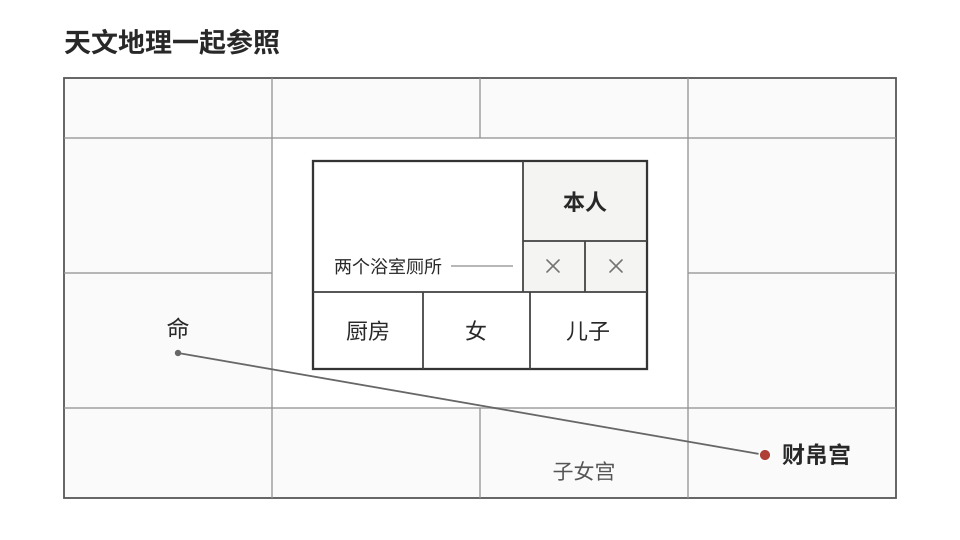 |
| **为什么说宅图一画、命就「读完了」？** | 〔口述〕倪师说图一画就读完了：「这是不是已经图已经读完了」「不要把它当文字啊」「整整个图已经读完了」「所以她会这样住」「这是她的命」。（[00:18:40–00:18:48](https://www.bilibili.com/video/BV1KJsLekEfA/?p=27&t=1120)，第 33612–33863 帧） 〔口述〕举以前客人的问法作对照：「以前啊人家还说」「倪先生我们家门从哪里啊」「不要讲了」「我就看完了」「你还在那边讲」「我家哪边窗户」「这都不重要」「哪边什么不重要」。（[00:18:56–00:19:03](https://www.bilibili.com/video/BV1KJsLekEfA/?p=27&t=1136)，第 34086–34313 帧） 〔口述〕结论是方位已在图上：「那东南西北都在这里」「已经画好了」「越简单图越好」。（[00:19:03–00:19:08](https://www.bilibili.com/video/BV1KJsLekEfA/?p=27&t=1143)，第 34314–34463 帧） |
| **倪师改正了自己画的哪条线？** | 〔口述〕倪师改正板上的连线：「抱歉这个（三方四正）这要画到这面来」（字幕连出两次，当一句；括号是字幕注字），「不是画在子女宫」「对啊财帛宫来」。（[00:19:12–00:19:20](https://www.bilibili.com/video/BV1KJsLekEfA/?p=27&t=1152)，第 34566–34829 帧） 〔板书〕宅图同前；板上多了几条红色连线，从左侧命宫格一带拉向右边和下方，端点看不清；右列可辨「火星」「64」「破军」「陀罗」，其余认不出。（[00:19:18](https://www.bilibili.com/video/BV1KJsLekEfA/?p=27&t=1158)，第 34740 帧） 〔推断〕推断：从口述看，这条线原先画到了子女宫，倪师改成画到财帛宫；改的是哪一条线、从哪格起，画面看不出。（[00:19:12–00:19:20](https://www.bilibili.com/video/BV1KJsLekEfA/?p=27&t=1152)，第 34566–34829 帧） |
| **官禄宫地劫地空、迁移这种星，事业怎么走？** | 〔口述〕「你看她官禄宫是什么」「地劫空的就不会当官的」「那天机天同进入财帛是不是」，所以应在「……私人企业公司行号」「私人企业来做事情」。（[00:19:22–00:19:35](https://www.bilibili.com/video/BV1KJsLekEfA/?p=27&t=1162)，第 34884–35255 帧） 〔叠图〕官禄丁未：地劫平、天空陷、天贵旺，格内标「身宫」。（[00:19:22–00:19:24](https://www.bilibili.com/video/BV1KJsLekEfA/?p=27&t=1162)，第 34884–34931 帧） 〔口述〕「那这个迁移像这种星的话」「不可能到外地去发展」。（[00:19:35–00:19:39](https://www.bilibili.com/video/BV1KJsLekEfA/?p=27&t=1175)，第 35256–35381 帧） 〔指代〕说「那这个迁移」时手指指向黑板右中格（火星、64-73 那格）左侧；叠图同时显示迁移己酉 64~73。（[00:19:34](https://www.bilibili.com/video/BV1KJsLekEfA/?p=27&t=1174)，第 35244 帧） 〔叠图〕迁移己酉：火星得、红鸾旺、三台庙、恩光陷、天才旺、天厨、副旬庙；大限 64~73，小限 8,20,32 44,56,68。（[00:19:31–00:19:35](https://www.bilibili.com/video/BV1KJsLekEfA/?p=27&t=1171)，第 35148–35255 帧） |
| **44–53、54–63、64–73 三步大限说明她什么运？** | 〔口述〕「而且你看她事业」进入 44–53（字幕作「44-53\| 同禄」，语音作住44到53同路），「对面是不是禄存」「54-63破军对面是紫微」「有没有全部吉星」，64–73 都是吉星来会（字幕作「青星」，语音作集星）。（[00:19:39–00:19:50](https://www.bilibili.com/video/BV1KJsLekEfA/?p=27&t=1179)，第 35382–35717 帧） 〔叠图〕财帛辛亥：天同庙、禄存庙、铃星利，大限 44~53；疾厄庚戌：破军旺、陀罗庙，大限 54~63；父母甲辰：紫微得权、天相得；福德乙巳：天梁得禄、天钺旺。（[00:19:39–00:19:47](https://www.bilibili.com/video/BV1KJsLekEfA/?p=27&t=1179)，第 35382–35633 帧） 〔口述〕由此断晚运：「你看她是不是晚运很好」「晚运很好」「那早年就比较差」。（[00:19:50–00:19:59](https://www.bilibili.com/video/BV1KJsLekEfA/?p=27&t=1190)，第 35718–35993 帧） |
| **她晚运好，是因为想通了什么？** | 〔口述〕「我们看整个八字」「看她的格的时候」「诸位有个观念」「你知道她为什么晚运很好」「因为她想通了」。（[00:19:59–00:20:07](https://www.bilibili.com/video/BV1KJsLekEfA/?p=27&t=1199)，第 35994–36239 帧） 〔口述〕想通的是不要婚姻：「想通了你知道想通什么事情」，「我不要婚姻晚运就很……」；可她当初「可是我不信邪」「哪有说不要婚姻」「没关系我就去结婚」。（[00:20:08–00:20:17](https://www.bilibili.com/video/BV1KJsLekEfA/?p=27&t=1208)，第 36240–36527 帧） |
| **为什么断她 26 岁结婚？** | 〔口述〕「25岁 26岁在天喜红鸾星来会」「因为她24-33正好进入什么夫妻宫」「太阳星在里面对不对」「她的26岁那年」「是不是刚好天喜红鸾星来会」。（[00:20:17–00:20:27](https://www.bilibili.com/video/BV1KJsLekEfA/?p=27&t=1217)，第 36528–36833 帧） 〔口述〕「红鸾星在这里」「因为刚好十年大运进入夫妻」「她红鸾天喜星来会」「所以她26 会结婚」。（[00:20:30–00:20:43](https://www.bilibili.com/video/BV1KJsLekEfA/?p=27&t=1230)，第 36924–37295 帧） 〔叠图〕命宫癸卯：天机旺、巨门庙、天喜旺、天魁庙、地空平，大限 4~13，格内标着数字 26 和提示字「结婚」；夫妻癸丑：太阳不、太阴庙、左辅庙科、右弼庙，大限 24~33。（[00:20:17–00:20:23](https://www.bilibili.com/video/BV1KJsLekEfA/?p=27&t=1217)，第 36528–36713 帧） 〔指代〕说「是不是在这里」「夫妻宫在这里」时手指点在黑板底排中间格（太阴、太阳那格，可见 24-3…）；叠图同时显示夫妻癸丑 24~33。（[00:20:33–00:20:35](https://www.bilibili.com/video/BV1KJsLekEfA/?p=27&t=1233)，第 37009–37060 帧） 〔板书〕右列可辨「火星」「64-73」，旁边新写两个草书字认不全；下方「破军」「陀罗」「54-63」，再下「天同」「禄存」；其余被身体挡住。（[00:20:33](https://www.bilibili.com/video/BV1KJsLekEfA/?p=27&t=1233)，第 36996 帧） |
| **34–43 化忌，为什么说女孩子婚姻要过忌？** | 〔口述〕「可是这一结婚以后哈」「34-43 是不是化忌」「我们一般来说」「女孩子婚姻的时候要过忌」「她的忌刚好在下面懂不懂」。（[00:20:43–00:20:52](https://www.bilibili.com/video/BV1KJsLekEfA/?p=27&t=1243)，第 37296–37571 帧） 〔口述〕忌来得晚反而更重：「你如果忌在很晚的时候」「这搞不好代表死别」。（[00:20:52–00:20:55](https://www.bilibili.com/video/BV1KJsLekEfA/?p=27&t=1252)，第 37572–37661 帧） 〔叠图〕子女壬子：武曲旺忌、天府庙、文曲得、擎羊陷，大限 34~43。（[00:20:44–00:20:46](https://www.bilibili.com/video/BV1KJsLekEfA/?p=27&t=1244)，第 37338–37409 帧） |
| **为什么断她 35 岁离婚？** | 〔口述〕「37 36 35 是不是刚好34-43」「第一个逢化忌在这里」「化忌对冲」「对冲比在本宫还凶啊」。（[00:20:58–00:21:05](https://www.bilibili.com/video/BV1KJsLekEfA/?p=27&t=1258)，第 37740–37979 帧） 〔口述〕「35岁进入这个对宫化忌」「因为刚好是对大小二限嘛」「34-43化忌小限在这边七杀」「对冲化忌刚好在这里」「所以她35岁要婚姻就要破裂掉」「破裂掉她跟先生离婚了」。（[00:21:09–00:21:23](https://www.bilibili.com/video/BV1KJsLekEfA/?p=27&t=1269)，第 38088–38519 帧） 〔指代〕说「35岁进入这个对宫化忌」时手指指向黑板顶排写着七杀、田宅那格；说「第一个逢化忌在这里」「小限在这边」「刚好在这里」时手指向顶排中间格叠图下沿，叠图显示七杀、35、田宅丙午。（[00:21:01–00:21:18](https://www.bilibili.com/video/BV1KJsLekEfA/?p=27&t=1261)，第 37847–38351 帧） 〔叠图〕田宅丙午：七杀旺、天刑平、天福平、天月，格内标 35，大限 94~103；子女壬子格内标着「35岁离婚」「大小二限逢」。（[00:21:06–00:21:11](https://www.bilibili.com/video/BV1KJsLekEfA/?p=27&t=1266)，第 37980–38141 帧） |
| **她住西南角、儿子放西北角，倪师怎么用卦说？** | 〔口述〕「离婚走了以后呢她本人」「她就她一开始结婚就住在这位置上」「那注定的嘛」；「她是坤为地了对不对」。（[00:21:24–00:21:34](https://www.bilibili.com/video/BV1KJsLekEfA/?p=27&t=1284)，第 38520–38843 帧） 〔口述〕「然后她呢生了儿子呢」「她把儿子放到西北角」「雷天大壮象出现了」。（[00:21:34–00:21:40](https://www.bilibili.com/video/BV1KJsLekEfA/?p=27&t=1294)，第 38844–39023 帧） 〔口述〕「她的住在这个西南角的女孩子」「不管未婚已婚」「住在西南角的位置」「代表她是孤单的」「因为坤为地纯阴啊」。（[00:21:40–00:21:47](https://www.bilibili.com/video/BV1KJsLekEfA/?p=27&t=1300)，第 39024–39215 帧） 〔指代〕说「这个西南角」时手掌一直按在小方位图「本人」框右侧（S 在上、N 在下）。（[00:21:41](https://www.bilibili.com/video/BV1KJsLekEfA/?p=27&t=1301)，第 39049 帧） 〔口述〕西北角代表取代先生：「……代表他取代先生的位置」「结果她她的儿子会取代丈夫的位置」「取代爸爸的位置」「所以她就不需要先生了嘛」。（[00:21:47–00:21:55](https://www.bilibili.com/video/BV1KJsLekEfA/?p=27&t=1307)，第 39216–39461 帧） |
| **子女宫武曲化忌，儿子会怎样？** | 〔口述〕「那儿子是化忌哦」「这个天府武曲化忌代表」「有儿子但是儿子化忌」「就有子但是冲突很大」「很难管」。（[00:21:56–00:22:06](https://www.bilibili.com/video/BV1KJsLekEfA/?p=27&t=1316)，第 39492–39791 帧） 〔叠图〕子女壬子：武曲旺忌、天府庙（同前）。（[00:21:56–00:22:06](https://www.bilibili.com/video/BV1KJsLekEfA/?p=27&t=1316)，第 39492–39791 帧） |
| **离婚后不想结婚，为什么成了二婚命还事业好？** | 〔口述〕「离婚了以后呢」「她想到说算了」「我就不要管婚姻好了」「我就专心从事我的事业好了」「当她一想不结婚」「她在这个位置上」「自然而然不会想去结婚了」。（[00:22:13–00:22:26](https://www.bilibili.com/video/BV1KJsLekEfA/?p=27&t=1333)，第 40014–40403 帧） 〔口述〕「我很好啊」「我结婚干嘛」「结婚我还倒霉呢」「对不对不要结婚」「后后面事业就做的很好了你看」。（[00:22:26–00:22:36](https://www.bilibili.com/video/BV1KJsLekEfA/?p=27&t=1346)，第 40404–40709 帧） 〔口述〕「所以这像这种命的人呢」「就是属于二婚命」「然后带着孩子」，到老就这样住（字幕「佳」，语音「住」）。（[00:22:37–00:22:46](https://www.bilibili.com/video/BV1KJsLekEfA/?p=27&t=1357)，第 40710–41003 帧） 〔叠图〕讲到事业做得好时贴出财帛辛亥：天同庙、禄存庙，大限 44~53。（[00:22:31–00:22:36](https://www.bilibili.com/video/BV1KJsLekEfA/?p=27&t=1351)，第 40536–40709 帧） |
| **天机巨门坐命，为什么先生受不了？** | 〔口述〕「那你说人好不好呢」；说天机巨门，巨门星主口舌（字幕作「回香」，语音作口舌），「就是这个唠叨……」「那个男人受不了」「天机星心眼比较多一」「比较多点」。（[00:22:46–00:22:55](https://www.bilibili.com/video/BV1KJsLekEfA/?p=27&t=1366)，第 41004–41273 帧） 〔叠图〕命宫癸卯：天机旺、巨门庙（同前）。（[00:22:46–00:22:48](https://www.bilibili.com/video/BV1KJsLekEfA/?p=27&t=1366)，第 41004–41051 帧） 〔板书〕本块开头的板面：可辨左上「天梁」「天钺」；顶排「七杀」「田宅」「地劫」；左列「紫微」及一个圈起的字（像「权」）、「巨门」「天机」「4-13」「命」；左下「14-23」；底排「太阴」「太阳」「左辅」「24-33」，「天府」「武曲」；其余认不出，右侧被身体挡住。（[00:18:11](https://www.bilibili.com/video/BV1KJsLekEfA/?p=27&t=1091)，第 32736 帧） |
| **夫妻宫日月化科，先生做什么？夫妻为何不和？** | 〔口述〕「那她命里面太阳星」「你看看他先生的话」「像这种夫妻宫化科的话」「代表先生是专科技术专长」「来赚钱的」「很多人从自由业或当老师」「或医师律师会计师工程师建筑师」「诸位看哦这种科跟日月并在一起」「日月化科」「代表说这个人的专业技术专长」。（[00:22:55–00:23:13](https://www.bilibili.com/video/BV1KJsLekEfA/?p=27&t=1375)，第 41274–41795 帧） 〔指代〕说「这个人的专业技术专长」时右手食指点在黑板底排板书「太阴」「太阳」一带（下面还有「左辅」和圈起的字）。（[00:23:11](https://www.bilibili.com/video/BV1KJsLekEfA/?p=27&t=1391)，第 41752 帧） 〔口述〕日月同会就日夜忙：「……晚上都要忙啊」「所以太阳太阴同时来会」「就是没有一定说」「早上六点八点钟上班」「下午六点钟下班没有了」「常常白天晚上都要忙」「忙得都夫妻不和」。（[00:23:13–00:23:25](https://www.bilibili.com/video/BV1KJsLekEfA/?p=27&t=1393)，第 41796–42155 帧） 〔口述〕住西南角不和的原因（字幕「哎佳」，语音「住」）：「一定是太太太强了嘛」「个性太强太刚强」「要求太多」「好冲突就来了」。（[00:23:25–00:23:37](https://www.bilibili.com/video/BV1KJsLekEfA/?p=27&t=1405)，第 42156–42533 帧） |

**总结区**

- 通用规则：女孩子婚姻要过忌；忌若很晚才来，搞不好代表死别（[00:20:47–00:20:55](https://www.bilibili.com/video/BV1KJsLekEfA/?p=27&t=1247)，第 37410–37661 帧）；化忌对冲比在本宫还凶（[00:21:02–00:21:05](https://www.bilibili.com/video/BV1KJsLekEfA/?p=27&t=1262)，第 37878–37979 帧）；不管未婚已婚，女孩子住西南角代表孤单，因为坤为地纯阴（[00:21:40–00:21:47](https://www.bilibili.com/video/BV1KJsLekEfA/?p=27&t=1300)，第 39024–39215 帧）；夫妻宫日月化科，代表先生靠专业技术专长赚钱，白天晚上都要忙（[00:22:58–00:23:25](https://www.bilibili.com/video/BV1KJsLekEfA/?p=27&t=1378)，第 41346–42155 帧）
- 只在本例：官禄宫地劫地空不会当官、应到私人企业做事，迁移宫这种星不能到外地发展；晚运好、早年差（[00:19:22–00:19:59](https://www.bilibili.com/video/BV1KJsLekEfA/?p=27&t=1162)，第 34884–35993 帧）；24–33 大限进入夫妻宫、26 岁天喜红鸾来会，所以 26 岁结婚（[00:20:17–00:20:43](https://www.bilibili.com/video/BV1KJsLekEfA/?p=27&t=1217)，第 36528–37295 帧）；35 岁逢 34–43 化忌对冲、大小二限，婚姻破裂离婚（[00:20:58–00:21:23](https://www.bilibili.com/video/BV1KJsLekEfA/?p=27&t=1258)，第 37740–38519 帧）；儿子放西北角取代丈夫位置；子女宫武曲化忌，有子但冲突大难管；属二婚命，带着孩子到老（[00:21:34–00:22:46](https://www.bilibili.com/video/BV1KJsLekEfA/?p=27&t=1294)，第 38844–41003 帧）
- 不是排盘规则，是处世方法：客人问家门、窗户、神位朝哪边都不重要，宅图画好就看完了，越简单图越好（[00:18:56–00:19:08](https://www.bilibili.com/video/BV1KJsLekEfA/?p=27&t=1136)，第 34086–34463 帧）；个性太强太刚强、要求太多，冲突就来了（[00:23:25–00:23:37](https://www.bilibili.com/video/BV1KJsLekEfA/?p=27&t=1405)，第 42156–42533 帧）

**待核**

1. 字幕「这里我打又的是两个浴室厕所」的「打又」按语音「打擦」改作打叉（[00:18:25](https://www.bilibili.com/video/BV1KJsLekEfA/?p=27&t=1105)，第 33174 帧）
2. [00:18:20](https://www.bilibili.com/video/BV1KJsLekEfA/?p=27&t=1100)，第 33012 帧「非星車¥」、[00:18:24](https://www.bilibili.com/video/BV1KJsLekEfA/?p=27&t=1104)，第 33120 帧「重王\$」、[00:19:15](https://www.bilibili.com/video/BV1KJsLekEfA/?p=27&t=1155)，第 34668 帧「20一」为乱码，略过
3. 语音另有「女孩子住这边」，字幕只出「儿子住这边」；两处「这边」指宅图下排哪一格看不出（D104、D105 不确定），下排小格左右两字认不准（[00:18:30](https://www.bilibili.com/video/BV1KJsLekEfA/?p=27&t=1110)，第 33300 帧）
4. 字幕「倪先生我们家门从哪里啊」，语音作「现在我们家门从哪里」（[00:18:57](https://www.bilibili.com/video/BV1KJsLekEfA/?p=27&t=1137)，第 34116 帧）
5. 「抱歉这个（三方四正）这要画到这面来」字幕连出两次当一句，括号是字幕注字；改的是哪条线、从哪格起看不出（[00:19:12](https://www.bilibili.com/video/BV1KJsLekEfA/?p=27&t=1152)，第 34566 帧）
6. 口述「那天机天同进入财帛」，叠图财帛辛亥只有天同、禄存、铃星，没有天机，两者不一致（[00:19:27](https://www.bilibili.com/video/BV1KJsLekEfA/?p=27&t=1167)，第 35010 帧）
7. 字幕「应在私人企业公司行号」，语音作「一定要私人企业公司私人」（[00:19:29](https://www.bilibili.com/video/BV1KJsLekEfA/?p=27&t=1169)，第 35088 帧）
8. 字幕「进入44-53\| 同禄」不可靠，语音「住44到53同路」，只转述为事业进入 44–53（[00:19:43](https://www.bilibili.com/video/BV1KJsLekEfA/?p=27&t=1183)，第 35496 帧）
9. 「对面是不是禄存」说的是哪一宫的对面，口述没说清；叠图禄存在财帛辛亥本格（[00:19:44](https://www.bilibili.com/video/BV1KJsLekEfA/?p=27&t=1184)，第 35532 帧）
10. 字幕「青星」语音「集星」，按上句「全部吉星」改作吉星（[00:19:48](https://www.bilibili.com/video/BV1KJsLekEfA/?p=27&t=1188)，第 35664 帧）
11. 字幕「北偏西」语音没有，略过（[00:20:03](https://www.bilibili.com/video/BV1KJsLekEfA/?p=27&t=1203)，第 36090 帧）
12. 字幕「妤麻」改作好嘛（[00:20:10](https://www.bilibili.com/video/BV1KJsLekEfA/?p=27&t=1210)，第 36312 帧）
13. 命宫癸卯格里的「26」「结婚」是剪辑提示字，不是星曜（[00:20:17](https://www.bilibili.com/video/BV1KJsLekEfA/?p=27&t=1217)，第 36528 帧）
14. 说「红鸾星在这里」时黑板 64-73 格旁新写的两个草书字认不全；「红鸾星在这个地方」的指代不确定（D112）（[00:20:28–00:20:33](https://www.bilibili.com/video/BV1KJsLekEfA/?p=27&t=1228)，第 36865–36996 帧）
15. 「她的忌刚好在下面」的「下面」指哪里没有解释；「哎就在人家下一个」意思不清（第 37500、37662 帧）
16. 字幕「平陷」与语音「他26岁一结婚到27282933131335」对不上，略过（[00:21:06](https://www.bilibili.com/video/BV1KJsLekEfA/?p=27&t=1266)，第 37980 帧）
17. 「因为刚好是对大小二限嘛」中「大小二限」倪师没有解释（[00:21:11](https://www.bilibili.com/video/BV1KJsLekEfA/?p=27&t=1271)，第 38142 帧）
18. 字幕「爱人天地否」语音「地痞他是」，改不了，略过（[00:21:31](https://www.bilibili.com/video/BV1KJsLekEfA/?p=27&t=1291)，第 38742 帧）
19. 「坤为地」「雷天大壮象」只说了住位与卦名，卦义材料没讲；「坤为地纯阴」之外不补（[00:21:32–00:21:47](https://www.bilibili.com/video/BV1KJsLekEfA/?p=27&t=1292)，第 38784–39215 帧）
20. 字幕「那西北角的代表他取代先生的位置」的「他」按下句应指儿子（[00:21:47](https://www.bilibili.com/video/BV1KJsLekEfA/?p=27&t=1307)，第 39216 帧）
21. 字幕「你看到老她就这样佳啊」的「佳」按语音改作住（[00:22:43](https://www.bilibili.com/video/BV1KJsLekEfA/?p=27&t=1363)，第 40908 帧）
22. 字幕「天机巨门当然巨门星回香」不可靠，语音「剧本当然剧本性口舌就是」，按语音改作巨门星主口舌（[00:22:48](https://www.bilibili.com/video/BV1KJsLekEfA/?p=27&t=1368)，第 41052 帧）
23. 字幕「唠咧」按语音改作唠叨（[00:22:50](https://www.bilibili.com/video/BV1KJsLekEfA/?p=27&t=1370)，第 41106 帧）
24. 口述「日月化科」，叠图夫妻癸丑的「科」挂在左辅下，不在太阳、太阴下（[00:22:58–00:23:11](https://www.bilibili.com/video/BV1KJsLekEfA/?p=27&t=1378)，第 41346–41741 帧）
25. 字幕「常常自天忙」的「自天」按语音改作白天（[00:23:13](https://www.bilibili.com/video/BV1KJsLekEfA/?p=27&t=1393)，第 41796 帧）
26. 字幕「早上六点八点钟上班」，语音作「早上八点钟上班」（[00:23:18](https://www.bilibili.com/video/BV1KJsLekEfA/?p=27&t=1398)，第 41958 帧）
27. 字幕「哎佳西南角」按语音改作住西南角（[00:23:25](https://www.bilibili.com/video/BV1KJsLekEfA/?p=27&t=1405)，第 42156 帧）
28. 板书图第 32736、34740、36996 帧大部分字认不出或被身体挡住，左列圈起的字像「权」认不准

### 6　同理推宫与颧鼻眼袋额纹相法（[00:23:37–00:28:55](https://www.bilibili.com/video/BV1KJsLekEfA/?p=27&t=1417)，第 42534–52073 帧）

| 提示区 | 笔记区 |
|---|---|
| **例三34-43这十年只有一个化忌，为什么说不会死？** | 〔口述〕倪师接着讲例三，问还有哪里看不懂，指出「像这个34-43」「只有一个化忌」，未来十年又是吉星（字幕作「叉是吉星」），「没有杀星」「所以这个不会死啊」。（[00:23:40–00:23:45](https://www.bilibili.com/video/BV1KJsLekEfA/?p=27&t=1420)，第 42618–42767 帧） 〔口述〕他提醒学生：「你不要给她乱批哈」「一定是很凶才会死」。（[00:23:45–00:23:48](https://www.bilibili.com/video/BV1KJsLekEfA/?p=27&t=1425)，第 42768–42869 帧） 〔口述〕他说这个化忌「这个就是就是婚姻的忌」「了解吧婚姻的忌」。说话时手没有指着哪一格，具体指哪一宫的忌口述里没点明。（[00:23:49–00:23:54](https://www.bilibili.com/video/BV1KJsLekEfA/?p=27&t=1429)，第 42870–43025 帧） 〔板书〕本块开头的板面，可辨：上格「天钺」、右格「田宅」，其余被身体挡住或认不出。（[00:23:41](https://www.bilibili.com/video/BV1KJsLekEfA/?p=27&t=1421)，第 42632 帧） 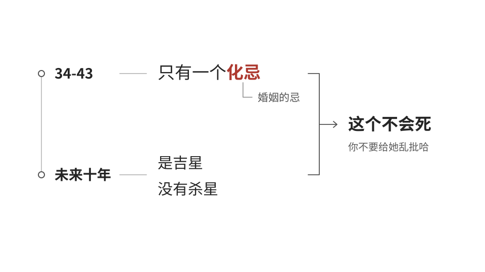 |
| **同一组紫微天相化权放在不同宫，怎么推？** | 〔口述〕倪师说「诸位可以用同理来推」，举例：「比如说这个父母宫」「父母宫是紫微天相化权」，这个父母宫是什么？「当官的嘛」。（[00:23:57–00:24:05](https://www.bilibili.com/video/BV1KJsLekEfA/?p=27&t=1437)，第 43116–43367 帧） 〔指代〕说「这个父母宫」时手指的是黑板中排左格写有「紫微 天相」的那一格；随后食指尖顶在格中圈住的「权」字上。（[00:23:59–00:24:02](https://www.bilibili.com/video/BV1KJsLekEfA/?p=27&t=1439)，第 43198–43281 帧） 〔口述〕「那如果你的命是紫微天相化权呢」「你也是当官的」；「那如果你的兄弟是紫微天相」「那就是兄弟当官的嘛」；「那如果你儿子是紫微天相」「你儿子当官的嘛」，「就是这样推的懂不懂」。（[00:24:06–00:24:18](https://www.bilibili.com/video/BV1KJsLekEfA/?p=27&t=1446)，第 43398–43751 帧） 〔叠图〕先贴父母甲辰格：紫微得、化权，天相得，凤阁陷、吊客、喜神、寡宿陷、年解庙、月煞、浴、解神庙，大限114~123。随后同一格内容换宫名再贴：兄弟壬寅（14~23，标着「兄弟当官」）、命宫癸卯（4~13，标着「自己当官」）、子女壬子（34~43，标着「子女当官」）。（[00:23:58–00:24:17](https://www.bilibili.com/video/BV1KJsLekEfA/?p=27&t=1438)，第 43140–43710 帧） 〔推断〕推断：兄弟、命宫、子女三格的星曜与父母甲辰格逐项相同，又配合「同理来推」的口述，是剪辑演示同一组星换宫的读法，不是例三本人的兄弟、命宫、子女。（[00:23:58–00:24:18](https://www.bilibili.com/video/BV1KJsLekEfA/?p=27&t=1438)，第 43140–43751 帧） |
| **财星会聚在哪一宫，代表谁做生意？** | 〔口述〕倪师说「所以我们讲一个宫」「讲它的星其实放在那里」「说这个人会做生意」。（[00:24:18–00:24:22](https://www.bilibili.com/video/BV1KJsLekEfA/?p=27&t=1458)，第 43752–43871 帧） 〔口述〕「如果财星通通会聚在兄弟宫」「兄弟做生意」；会在子女宫，就是「你儿子将来做生意」，「以此类推上去」。（[00:24:22–00:24:29](https://www.bilibili.com/video/BV1KJsLekEfA/?p=27&t=1462)，第 43872–44093 帧） 〔口述〕他说「我们不用讲的很复杂」「挑几个例子讲给你听」「你就会了」。（[00:24:29–00:24:34](https://www.bilibili.com/video/BV1KJsLekEfA/?p=27&t=1469)，第 44094–44237 帧） |
| **颧大压鼻长什么样？** | 〔口述〕转讲面相：「那像（相）这个女孩子的时候」「在相上面可以看出来哦」，「颧大压鼻」。（[00:24:34–00:24:51](https://www.bilibili.com/video/BV1KJsLekEfA/?p=27&t=1474)，第 44238–44741 帧） 〔板书〕黑板左侧竖写大字「颧大压鼻」。右边命盘格可辨「天钺」「巨门」「天机」「（4-13）命」「贪狼」「14-23」，其余认不出。（[00:24:50](https://www.bilibili.com/video/BV1KJsLekEfA/?p=27&t=1490)，第 44724 帧） 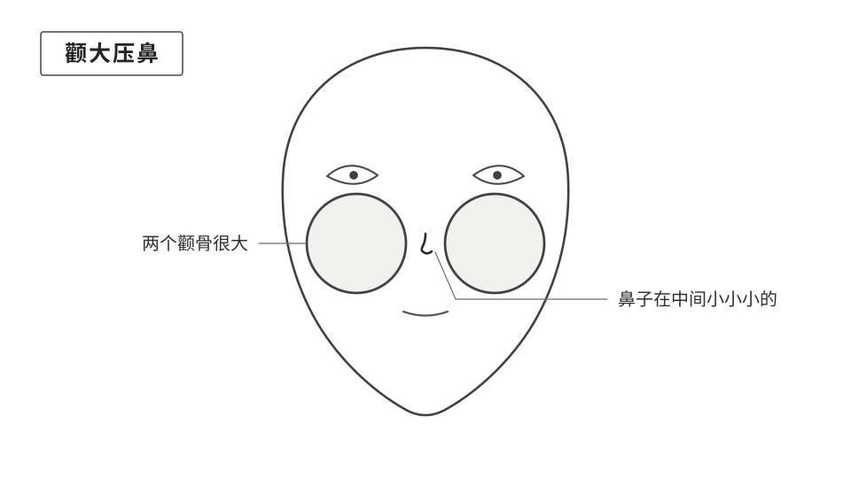 〔口述〕「那女孩子长得两个颧很大」，鼻子只有「一点点大」，「旁边两个颧骨很大」。（[00:24:51–00:25:02](https://www.bilibili.com/video/BV1KJsLekEfA/?p=27&t=1491)，第 44742–45077 帧） 〔口述〕他边画边说：「眼睛在这里」「眼睛这样子的」「然后两个颧骨这样很大」「鼻子在中间小小小的」，「这是脸嘛」。（[00:25:02–00:25:12](https://www.bilibili.com/video/BV1KJsLekEfA/?p=27&t=1502)，第 45078–45383 帧） 〔板书〕中排空格画了一张脸：下巴收窄的脸廓、两只眼、两颊各一个大圆圈、中间小鼻子、一张嘴；这张图里没有字。（[00:25:13](https://www.bilibili.com/video/BV1KJsLekEfA/?p=27&t=1513)，第 45395 帧） |
| **颧骨太大、皮骨相连在相上主什么？** | 〔口述〕「所以你看这两个颧骨太大」「不好」，颧骨太大「大部分人到老」「孤独独坐到老」。（[00:25:15–00:25:21](https://www.bilibili.com/video/BV1KJsLekEfA/?p=27&t=1515)，第 45450–45653 帧） 〔口述〕「那又没有肉」「皮骨相连」，「我们相上面最怕是皮骨相连」。（[00:25:21–00:25:28](https://www.bilibili.com/video/BV1KJsLekEfA/?p=27&t=1521)，第 45654–45845 帧） 〔口述〕女孩子手上是皮骨相连的「是贤妻良母」；但「那脸上面不能皮骨相连」「脸上要有肉」。（[00:25:28–00:25:36](https://www.bilibili.com/video/BV1KJsLekEfA/?p=27&t=1528)，第 45846–46085 帧） 〔口述〕有的人脸上没有肉，「那皮跟骨连到那亮亮的」，摸「一点肉都没有」；本人还说「你看我都不用做美容」「我的脸上都是皮」。（[00:25:36–00:25:43](https://www.bilibili.com/video/BV1KJsLekEfA/?p=27&t=1536)，第 46086–46307 帧） 〔口述〕这就是相书上写的孤坐：「就是孤坐到一个人坐那边到老啊」。（[00:25:43–00:25:51](https://www.bilibili.com/video/BV1KJsLekEfA/?p=27&t=1543)，第 46308–46535 帧） |
| **颧大压鼻为何婚会离？加吹火嘴呢？能改吗？** | 〔口述〕「那如果这是这个是颧大压鼻」，因为女孩子的夫妻看鼻子，「鼻子太小了嘛」「就她有婚会离」。（[00:25:51–00:25:59](https://www.bilibili.com/video/BV1KJsLekEfA/?p=27&t=1551)，第 46542–46793 帧） 〔口述〕「那你如果再加上吹火嘴的话」「那不必婚的」「从头到尾都不用结婚了」。（[00:25:59–00:26:05](https://www.bilibili.com/video/BV1KJsLekEfA/?p=27&t=1559)，第 46794–46955 帧） 〔口述〕他说这种很丑，「当然我后天运可以帮她改了哦」「我们帮她改东南还是改什么的」「但是看她愿不愿意啊」。（[00:26:05–00:26:13](https://www.bilibili.com/video/BV1KJsLekEfA/?p=27&t=1565)，第 46956–47219 帧） 〔口述〕「有时候你帮她改她的命是这样」「她还不愿意我不相信」，那「就很麻烦」。（[00:26:14–00:26:21](https://www.bilibili.com/video/BV1KJsLekEfA/?p=27&t=1574)，第 47220–47459 帧） |
| **相上看子女在哪里？哪边是儿子、哪边是女儿？** | 〔口述〕「还有在相上面看子女」，看「眼袋下方啊」；他画出眼睛，说「这个是鼻子」。（[00:26:22–00:26:34](https://www.bilibili.com/video/BV1KJsLekEfA/?p=27&t=1582)，第 47460–47849 帧） 〔口述〕「眼袋这边呢是儿子（左）」「这边是女儿（右）」。（[00:26:35–00:26:39](https://www.bilibili.com/video/BV1KJsLekEfA/?p=27&t=1595)，第 47856–47987 帧） 〔指代〕说「这边呢是儿子」时粉笔停在画面右侧那只眼睛下方，正写一个形似「子」的草书字；说「这边是女儿」时粉笔在画面左侧那只眼睛下方、鼻子左边，写着形似「女」的字。（[00:26:35–00:26:36](https://www.bilibili.com/video/BV1KJsLekEfA/?p=27&t=1595)，第 47867–47897 帧） 〔板书〕两道横线加椭圆画成双眼，中间一个梯形鼻子；可辨：画面左侧眼下草书「女」，画面右侧眼下一个草书字认不全（形似「子」）。（[00:26:40](https://www.bilibili.com/video/BV1KJsLekEfA/?p=27&t=1600)，第 48012 帧） 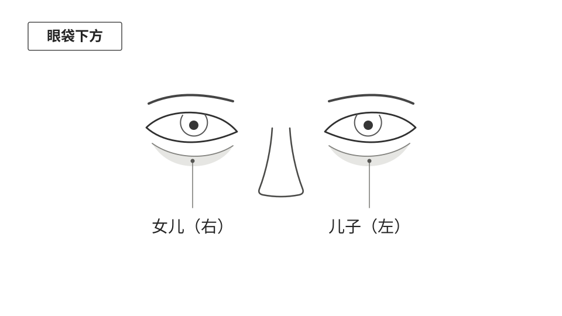 〔推断〕推断：口述、手指与板书三者对得上——儿子在画面右侧眼下，女儿在画面左侧眼下。字幕括号里的（左）（右）与画面方向正好相反，是按什么方向标的，材料没有说明。（[00:26:35–00:26:40](https://www.bilibili.com/video/BV1KJsLekEfA/?p=27&t=1595)，第 47856–48012 帧） |
| **眼袋膨起、凹下各代表对子女怎样？** | 〔口述〕「儿子女儿很贵很棒」，父亲以儿女为荣的时候，「那个那个眼袋哦」「膨起来很很丰满」，他就对儿子女儿很满意。（[00:26:39–00:26:51](https://www.bilibili.com/video/BV1KJsLekEfA/?p=27&t=1599)，第 47988–48335 帧） 〔口述〕「突然有一天」一边膨起来一边凹下去：儿子这边膨起来的话，「对女儿不满意」（语音另有对儿子满意一句，字幕没有）。（[00:26:51–00:26:56](https://www.bilibili.com/video/BV1KJsLekEfA/?p=27&t=1611)，第 48336–48503 帧） 〔口述〕反过来「而女儿膨起来」、儿子这边凹下去，「这变成对女儿满意」「对儿子不满意」。（[00:26:56–00:27:00](https://www.bilibili.com/video/BV1KJsLekEfA/?p=27&t=1616)，第 48504–48617 帧） 〔口述〕他又说「现在我看到这边（左）膨起来比较多」，「这是一个」例子。（[00:27:00–00:27:03](https://www.bilibili.com/video/BV1KJsLekEfA/?p=27&t=1620)，第 48618–48719 帧） 〔指代〕两次说「这边」时，手指的是倪师自己脸上一侧眼睛下方（眼袋、眼角附近），不是黑板。（[00:26:53–00:27:01](https://www.bilibili.com/video/BV1KJsLekEfA/?p=27&t=1613)，第 48391–48633 帧） |
| **眼下出现阴骘纹，代表什么？** | 〔口述〕「如果看到阴骘纹的时候」「就是所谓叫阴骘纹」，「就是说这个纹这样子」「叉叉叉叉叉一票」，「这个代表死掉」「儿子死掉了哈」。（[00:27:05–00:27:19](https://www.bilibili.com/video/BV1KJsLekEfA/?p=27&t=1625)，第 48756–49175 帧） 〔指代〕说「这个纹这样子」「这个代表死掉」时，粉笔指的是画面右侧眼睛正下方刚画的一串小叉形纹路（即写「子」的一侧）。（[00:27:14–00:27:16](https://www.bilibili.com/video/BV1KJsLekEfA/?p=27&t=1634)，第 49039–49107 帧） 〔口述〕「如果是在这边的话（右）」「这样叉叉叉一票」，乱纹「在下面的话代表女儿已经走了」。（[00:27:19–00:27:26](https://www.bilibili.com/video/BV1KJsLekEfA/?p=27&t=1639)，第 49176–49385 帧） 〔指代〕说「如果是在这边的话」「这个纹呐」时，手指的是画面左侧那只眼睛下方（原写「女」处附近），在那里画乱纹。（[00:27:19–00:27:22](https://www.bilibili.com/video/BV1KJsLekEfA/?p=27&t=1639)，第 49180–49265 帧） 〔板书〕两只眼睛下方都画了叉形乱纹；画面右侧乱纹下方还写了字，认不出。（[00:27:32](https://www.bilibili.com/video/BV1KJsLekEfA/?p=27&t=1652)，第 49560 帧） |
| **子女刚走时，眼下袋怎么看？** | 〔口述〕「那如果是刚走」，「然后你到华航去看他们做头七」，「看看那个每个人的眼色哈」，「你去给她上上香」「偷偷把一下」。（[00:27:26–00:27:36](https://www.bilibili.com/video/BV1KJsLekEfA/?p=27&t=1646)，第 49386–49709 帧） 〔口述〕「刚走的时候」「眼下袋可以看到」，「一般来说」「在子女宫出现啊」「往往都两边都可以看到」。（[00:27:37–00:27:45](https://www.bilibili.com/video/BV1KJsLekEfA/?p=27&t=1657)，第 49710–49955 帧） 〔口述〕「这边是暗黄色」，「很黄就是代表刚走啊」，「很伤心嘛很伤痛啊」。（[00:27:45–00:27:52](https://www.bilibili.com/video/BV1KJsLekEfA/?p=27&t=1665)，第 49956–50171 帧） 〔板书〕两只眼睛下方已被抹成一片涂抹区；画面左侧涂抹区下方仍可辨形似「女」的字，其余字迹认不出。（[00:27:42](https://www.bilibili.com/video/BV1KJsLekEfA/?p=27&t=1662)，第 49877 帧） |
| **两边都有时怎么分死儿子还是女儿？死久了呢？** | 〔口述〕「那如果在这边的话（右） 是死女儿」「在这边（左）死儿子」。（[00:27:52–00:27:54](https://www.bilibili.com/video/BV1KJsLekEfA/?p=27&t=1672)，第 50172–50243 帧） 〔指代〕说「是死女儿」的「这边」时，食指指的是黑板脸形图鼻子左侧眼下的涂抹乱纹处；说「死儿子」的「这边」时，指的是鼻子右侧眼下的涂抹乱纹处。（[00:27:52–00:27:54](https://www.bilibili.com/video/BV1KJsLekEfA/?p=27&t=1672)，第 50182–50221 帧） 〔口述〕「那时候两边都可以看得到」「因为伤心过度」，「那以比较浓的那一边」「来決定他是哪一个」。（[00:27:54–00:28:03](https://www.bilibili.com/video/BV1KJsLekEfA/?p=27&t=1674)，第 50244–50513 帧） 〔口述〕「这是刚死」；「那死掉很久的话」「这个阴骘纹很很浓」。（[00:28:03–00:28:07](https://www.bilibili.com/video/BV1KJsLekEfA/?p=27&t=1683)，第 50514–50639 帧） 〔指代〕说「这个阴骘纹很很浓」时，食指指的是黑板脸形图鼻子右侧眼下的涂抹纹线带。（[00:28:05](https://www.bilibili.com/video/BV1KJsLekEfA/?p=27&t=1685)，第 50569 帧） |
| **男人太太过世看哪里？看纹路的原则是什么？** | 〔口述〕「那男人的话」「太太过世的话」「脸上也可以看到」，「那在额角这边来」「我们叫做这个天罗纹」，「在这边这样子」「一票」。（[00:28:08–00:28:23](https://www.bilibili.com/video/BV1KJsLekEfA/?p=27&t=1688)，第 50640–51119 帧） 〔指代〕说「额角这边」「这个天罗纹」「在这边这样子」时，手指的是黑板脸形图左眉上方的额角处，他随即在那里画交叉斜线。（[00:28:13–00:28:19](https://www.bilibili.com/video/BV1KJsLekEfA/?p=27&t=1693)，第 50793–50995 帧） 〔口述〕「天罗就是那个网罗就是网嘛」，「这个盖到天顶上了」「天顶上天罗纹」「太太过世」。（[00:28:30–00:28:37](https://www.bilibili.com/video/BV1KJsLekEfA/?p=27&t=1710)，第 51300–51539 帧） 〔板书〕可辨：板上方格中一个「天」字，下一行被手臂挡住、认不全；脸形图额角处被手臂挡住，看不到。（[00:28:32](https://www.bilibili.com/video/BV1KJsLekEfA/?p=27&t=1712)，第 51384 帧） 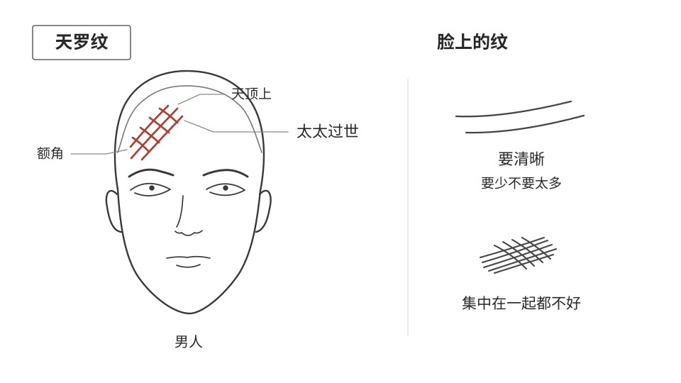 〔口述〕总原则：「所以脸上的纹哦」「我们有纹路出现的时候」「这个要要清晰」「要少不要太多」「集中在一起都不好」，「基本上你能掌握到这个原则」「基本上就可以看得很清楚」。（[00:28:38–00:28:55](https://www.bilibili.com/video/BV1KJsLekEfA/?p=27&t=1718)，第 51540–52073 帧） |

**总结区**

- 通用规则：同一组星放在哪一宫就读那宫的人：紫微天相化权在父母宫是父母当官，在命宫自己当官，在兄弟宫兄弟当官，在子女宫儿子当官；财星会聚在哪宫就是那宫的人做生意，以此类推（[00:23:57–00:24:29](https://www.bilibili.com/video/BV1KJsLekEfA/?p=27&t=1437)，第 43116–44093 帧）；相上最怕皮骨相连、颧骨太大，主到老孤坐；颧大压鼻、鼻子太小有婚会离，再加吹火嘴则从头到尾不用结婚（[00:25:15–00:26:05](https://www.bilibili.com/video/BV1KJsLekEfA/?p=27&t=1515)，第 45450–46955 帧）；相上看子女在眼袋下方：膨起丰满是对儿女满意，一边膨一边凹看偏向；出现阴骘纹代表子女死掉，刚走时眼下暗黄，两边都有以较浓那边定，死久了阴骘纹很浓（[00:26:22–00:28:07](https://www.bilibili.com/video/BV1KJsLekEfA/?p=27&t=1582)，第 47460–50639 帧）；男人太太过世看额角的天罗纹；脸上纹路要清晰、要少，集中在一起都不好（[00:28:08–00:28:53](https://www.bilibili.com/video/BV1KJsLekEfA/?p=27&t=1688)，第 50640–52001 帧）
- 只在本例：例三34-43这十年只有一个化忌、又是吉星、没有杀星，倪师断不会死，这个忌是婚姻的忌（[00:23:40–00:23:54](https://www.bilibili.com/video/BV1KJsLekEfA/?p=27&t=1420)，第 42618–43025 帧）
- 不是排盘规则，是处世方法：不要给人乱批，一定是很凶才会死（[00:23:45–00:23:48](https://www.bilibili.com/video/BV1KJsLekEfA/?p=27&t=1425)，第 42768–42869 帧）；后天可以帮人改，但要看对方愿不愿意，不相信的就很麻烦（[00:26:09–00:26:21](https://www.bilibili.com/video/BV1KJsLekEfA/?p=27&t=1569)，第 47076–47459 帧）

**待核**

1. [00:23:41](https://www.bilibili.com/video/BV1KJsLekEfA/?p=27&t=1421)，第 42632 帧板书图右下角有叠图：子女壬子（武曲旺、天府庙、文曲得、忌，34~43，标着「婚姻的忌」）、财帛辛亥（天同庙、禄存庙，44~53，标着「吉星来会」「未来十年有大运」）；本块材料没有对应的 ▣ 行，未作依据。倪师说「婚姻的忌」时手没有指（[00:23:48](https://www.bilibili.com/video/BV1KJsLekEfA/?p=27&t=1428)，第 42866 帧指代为否），是否就指这个子女宫的忌，口述未点明。
2. [00:23:42](https://www.bilibili.com/video/BV1KJsLekEfA/?p=27&t=1422)，第 42678 帧字幕「未来十年叉是吉星」，语音作「又是极星」，按上下文改为「又是吉星」。
3. [00:24:04](https://www.bilibili.com/video/BV1KJsLekEfA/?p=27&t=1444)，第 43320 帧字幕「当官的嘛L」末尾的「L」是混入字，已去掉。
4. [00:24:11](https://www.bilibili.com/video/BV1KJsLekEfA/?p=27&t=1451)，第 43554 帧子女壬子叠图的数字串「11325」和一个「□」按图例还原不了，未写；只写了能还原的34~43。
5. [00:24:26](https://www.bilibili.com/video/BV1KJsLekEfA/?p=27&t=1466)，第 43986 帧字幕「女做生你儿子将来做生意」句头「女做生」像是残字，只引了后半句。
6. [00:24:50](https://www.bilibili.com/video/BV1KJsLekEfA/?p=27&t=1490)，第 44724 帧板书命盘格中一个圆圈里的字（紫微天相格旁、带向下箭头）认不出；巨门天机格右上的字也认不出。
7. [00:24:34](https://www.bilibili.com/video/BV1KJsLekEfA/?p=27&t=1474)，第 44238 帧字幕「像（相）」的括号字是字幕注解，语音没有。
8. [00:25:28](https://www.bilibili.com/video/BV1KJsLekEfA/?p=27&t=1528)，第 45846 帧字幕「好的女孩子手上面是皮骨相连」，语音作「好多女孩子手上面是皮骨相连」，两路有一字不同。
9. [00:25:43](https://www.bilibili.com/video/BV1KJsLekEfA/?p=27&t=1543)，第 46308 帧字幕「你这个这个孤到老孤坐」语序混乱，未直接引用。
10. [00:25:59](https://www.bilibili.com/video/BV1KJsLekEfA/?p=27&t=1559)，第 46794 帧「吹火嘴」（语音作「吹魔嘴」）是什么样的嘴，倪师没有解释。
11. [00:26:09](https://www.bilibili.com/video/BV1KJsLekEfA/?p=27&t=1569)，第 47076 帧字幕「后天运」语音作「后天又」；[00:26:11](https://www.bilibili.com/video/BV1KJsLekEfA/?p=27&t=1571)，第 47130 帧字幕「改东南」语音作「改动了」，改什么方位两路对不上。
12. [00:26:39](https://www.bilibili.com/video/BV1KJsLekEfA/?p=27&t=1599)，第 47988 帧字幕「父亲以他儿子女儿荣的时候」少一个「为」，语音作「为荣」。
13. [00:26:51](https://www.bilibili.com/video/BV1KJsLekEfA/?p=27&t=1611)，第 48354 帧字幕「-边膨起来一边凹下去」句头「-」按上下文应为「一」；[00:26:53](https://www.bilibili.com/video/BV1KJsLekEfA/?p=27&t=1613)，第 48396 帧字幕作「捧起来」，语音作「砰起来」，应同「膨起来」。
14. [00:26:54](https://www.bilibili.com/video/BV1KJsLekEfA/?p=27&t=1614)，第 48438 帧语音有「对儿子满意」，字幕只有「对女儿不满意」。
15. [00:26:56](https://www.bilibili.com/video/BV1KJsLekEfA/?p=27&t=1616)，第 48504 帧字幕括号「（有）」语音没有，意思不明。
16. [00:27:00](https://www.bilibili.com/video/BV1KJsLekEfA/?p=27&t=1620)，第 48618 帧「现在我看到这边（左）膨起来比较多」说的是谁的眼袋（倪师自己还是在场某人），材料看不出。
17. 字幕括号（左）（右）与黑板画面方向相反（儿子在画面右侧、女儿在画面左侧），括号是按什么方向标的待核。
18. [00:27:05](https://www.bilibili.com/video/BV1KJsLekEfA/?p=27&t=1625)，第 48756 帧起「阴骘纹」（语音作「英直纹」「阴子纹」）是什么样的纹，只说叉叉叉一票，没有进一步解释；[00:27:32](https://www.bilibili.com/video/BV1KJsLekEfA/?p=27&t=1652)，第 49560 帧板书右侧乱纹下方新写的字认不出。
19. [00:27:29](https://www.bilibili.com/video/BV1KJsLekEfA/?p=27&t=1649)，第 49470 帧「华航」「头七」照原话写，未补充是何事；[00:27:34](https://www.bilibili.com/video/BV1KJsLekEfA/?p=27&t=1654)，第 49626 帧「偷偷把一下」（语音作「拔一下」）意思不明。
20. [00:27:31](https://www.bilibili.com/video/BV1KJsLekEfA/?p=27&t=1651)，第 49530 帧字幕「眼色」，语音作「颜色」。
21. [00:27:39](https://www.bilibili.com/video/BV1KJsLekEfA/?p=27&t=1659)，第 49781 帧、[00:27:43](https://www.bilibili.com/video/BV1KJsLekEfA/?p=27&t=1663)，第 49910 帧说「这边」时指哪一边看不准（指代不确定），未作依据。
22. [00:28:01](https://www.bilibili.com/video/BV1KJsLekEfA/?p=27&t=1681)，第 50436 帧字幕「来決定他是哪一个」，语音作「边来决定他是男人」，两路不同。
23. [00:28:23](https://www.bilibili.com/video/BV1KJsLekEfA/?p=27&t=1703)，第 51103 帧、[00:28:24](https://www.bilibili.com/video/BV1KJsLekEfA/?p=27&t=1704)，第 51147 帧「在这个角」「有的时候在这个角」指的是哪个角，指代不确定；[00:28:32](https://www.bilibili.com/video/BV1KJsLekEfA/?p=27&t=1712)，第 51384 帧板书「天」下一行认不全。
24. 第48012、49560、49877、51384帧画面左下角有剪辑贴的「面部十二宫图」（女、子分在两眼下，后来框出额上一行），材料没有对应的 ▣ 行，未作依据。
25. [00:25:52](https://www.bilibili.com/video/BV1KJsLekEfA/?p=27&t=1552)，第 46565 帧说「这个是颧大压鼻」时的指代不确定，未作依据。

## 例四（女命，命宫癸酉太阴文曲忌）：孤鸾命、改心性、用人看神

| 巳 | 午 | 未 | 申 |
|---|---|---|---|
| **财帛 己巳** 太阳旺 文昌庙 陀罗陷 | （午：没贴过） | （未：没贴过） | **兄弟 壬申** 紫微旺 天府得 天钺庙 火星陷 |
| **疾厄 戊辰** 武曲庙禄 左辅庙 地劫陷 | **例四 · 命宫癸酉** | 据视频叠图重排 | **命宫 癸酉** 太阴旺 文曲庙忌 |
| （卯：没贴过） | 后期贴图，不算倪师的话 |  | **父母 甲戌** 贪狼庙权 右弼庙 |
| **交友 丙寅** 七杀庙 | **官禄 丁丑** 天梁旺科 | （子：没贴过） | **福德 乙亥** 巨门旺 天马平 |

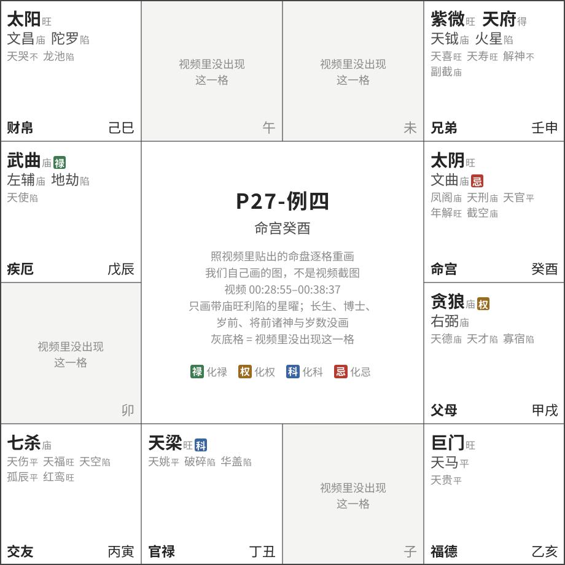

按视频里这张盘逐格重画（我们自己画的图，不是视频截图）；数据见 [命盘-P27-例四.json](图/命盘-P27-例四.json)。

### 7　孤鸾命：心性害己、阳宅加凶与补救（[00:28:55–00:33:44](https://www.bilibili.com/video/BV1KJsLekEfA/?p=27&t=1735)，第 52074–60737 帧）

| 提示区 | 笔记区 |
|---|---|
| **这个八字的重点在哪？太阴坐命的人心性如何？** | 〔口述〕倪师换到新命盘，先点出重点：「诸位看哦这个八字有重点……可以看到一个人的心性」。（[00:28:55–00:29:06](https://www.bilibili.com/video/BV1KJsLekEfA/?p=27&t=1735)，第 52074–52409 帧） 〔口述〕他说太阴坐命的人性子偏阴：「太阴坐命的人本来就是性比较阴」，又说「像文曲星太阴星这种……会到命格来」。（[00:29:07–00:29:16](https://www.bilibili.com/video/BV1KJsLekEfA/?p=27&t=1747)，第 52410–52709 帧） 〔叠图〕第 52410 帧起贴「命宫癸酉」：太阴旺、文曲庙忌，另有凤阁庙、天刑庙、天官平、年解旺、截空庙、将星、小耗、白虎、蜚廉；叠图该格大限为 4~13。（[00:29:07–00:29:09](https://www.bilibili.com/video/BV1KJsLekEfA/?p=27&t=1747)，第 52410–52475 帧） 〔板书〕本块开头的板面：右列上格可辨「太阴」「文曲」、圈起的「忌」、「4-13」「命」；其下一格可辨「贪狼」、圈起的「权」、「14-23」，下面两字像「父母」（不确定）；左侧可辨「武曲」与圈起的「禄」；右上可辨「兄弟」「天喜」；右下可辨「巨门」「24-33」；其余认不出。（[00:28:56](https://www.bilibili.com/video/BV1KJsLekEfA/?p=27&t=1736)，第 52080 帧） |
| **太阴入命遇文曲、文昌，倪师说是什么命？** | 〔口述〕倪师举历史人物：「过去历史上有一个人」「杨贵妃」。（[00:29:17–00:29:21](https://www.bilibili.com/video/BV1KJsLekEfA/?p=27&t=1757)，第 52710–52841 帧） 〔口述〕接着下断语：「太阴星入命在文曲文昌」「这种是桃花命」。（[00:29:21–00:29:27](https://www.bilibili.com/video/BV1KJsLekEfA/?p=27&t=1761)，第 52842–53033 帧） 〔推断〕推断：杨贵妃是紧接在「太阴星入命在文曲文昌，这种是桃花命」之前举的，应是用来说明这类桃花命的例子；倪师没有讲杨贵妃的命盘细节。（[00:29:17–00:29:27](https://www.bilibili.com/video/BV1KJsLekEfA/?p=27&t=1757)，第 52710–53033 帧） |
| **命里化忌的人，个性和心眼怎样？** | 〔口述〕倪师说命里化忌：「当然化忌除了早年比较辛苦以外」，这种人「本来就是个性很刚」「心胸比较恶毒」。（[00:29:27–00:29:40](https://www.bilibili.com/video/BV1KJsLekEfA/?p=27&t=1767)，第 53034–53423 帧） 〔口述〕又说「当然这个心眼比较多」「结果造成她害她自己」；之所以要提个性，是「因为她害了她自己」。（[00:29:59–00:30:07](https://www.bilibili.com/video/BV1KJsLekEfA/?p=27&t=1799)，第 53970–54227 帧） 〔推断〕推断：倪师只说「命里面化忌」，没有说出化忌跟的是太阴还是文曲；黑板上圈起的「忌」写在「文曲」后面，多数叠图也印成「文曲庙忌」。（[00:29:27–00:29:32](https://www.bilibili.com/video/BV1KJsLekEfA/?p=27&t=1767)，第 53034–53165 帧） |
| **批命时看出对方心性不好，能不能当场说？** | 〔口述〕倪师叮嘱：「你不要当时给她批的时候」「当场说人家这样子不好」，「你要放到肚子里就好了」。（[00:29:42–00:29:48](https://www.bilibili.com/video/BV1KJsLekEfA/?p=27&t=1782)，第 53478–53651 帧） 〔口述〕「但是你肚心知肚明」「我们不能讲啊」；因为「你讲她就给你翻脸了」「后面也不会听你的」。（[00:29:48–00:29:57](https://www.bilibili.com/video/BV1KJsLekEfA/?p=27&t=1788)，第 53652–53915 帧） |
| **她的红鸾、天喜落在哪里？第一次会到是几岁？** | 〔口述〕倪师说：「诸位注意看她的红鸾天喜星」「落的位置非常的不好对不对」。（[00:30:07–00:30:14](https://www.bilibili.com/video/BV1KJsLekEfA/?p=27&t=1807)，第 54228–54443 帧） 〔口述〕「你看她的流年是往下走」「结果红鸾天喜星走在那边」「第一次会到的时候是54-63」，并说「那更不用结婚嘛」（这句语音不同，见待核）。（[00:30:14–00:30:24](https://www.bilibili.com/video/BV1KJsLekEfA/?p=27&t=1814)，第 54444–54737 帧） 〔叠图〕第 54255 帧起贴出（第 54240 帧还没有）：交友丙寅，七杀庙、红鸾旺，叠图该格大限为 54~63；兄弟壬申，紫微旺、天府得、天钺庙、火星陷、天喜旺。（[00:30:08–00:30:34](https://www.bilibili.com/video/BV1KJsLekEfA/?p=27&t=1808)，第 54255–55043 帧） 〔板书〕这段写板书后，右上角「天喜」二字外加了一个圆圈（开头板面上还没有圈）；左侧可辨「疾厄」「天同」「64-73」；其余被叠图挡住或认不出。（[00:30:13](https://www.bilibili.com/video/BV1KJsLekEfA/?p=27&t=1813)，第 54396 帧） 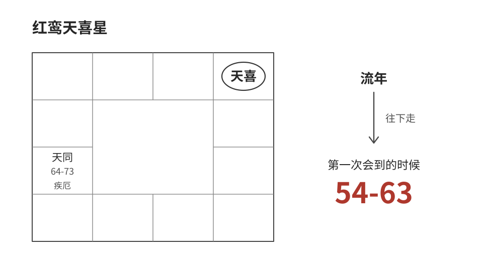 |
| **她为什么那么晚才结婚？跟什么有关？** | 〔口述〕倪师自问：「她为什么都不结」「命上面为什么到那么晚才结婚呢」，答：「哦跟这个人有关」。（[00:30:24–00:30:30](https://www.bilibili.com/video/BV1KJsLekEfA/?p=27&t=1824)，第 54738–54929 帧） 〔指代〕说「跟这个人有关」时，手指点的是黑板上写「命」的那一格（右列上格，4-13）。（[00:30:29](https://www.bilibili.com/video/BV1KJsLekEfA/?p=27&t=1829)，第 54874 帧） 〔口述〕他接着说「所以小人不能长久」，「做君子比较好」；「你骗得了人家一时骗不了一世嘛」，相处久了「发觉你心眼太多了」「一天到晚在算计别人」，「这个就造成她婚姻不好啊」。（[00:30:31–00:30:51](https://www.bilibili.com/video/BV1KJsLekEfA/?p=27&t=1831)，第 54930–55541 帧） |
| **什么叫标准的孤鸾命？倪师当面怎么劝她？** | 〔口述〕倪师断：「那像这种就是标准的孤鸾命」「孤鸾命呐」。（[00:30:51–00:30:58](https://www.bilibili.com/video/BV1KJsLekEfA/?p=27&t=1851)，第 55542–55751 帧） 〔口述〕他说当年算这个命时对她讲：「算这个命的时候我说小姐啊」「这个您认不认得这两个字啊孤鸾」「就是叫您出家比较好」「出家最好」。（[00:30:58–00:31:12](https://www.bilibili.com/video/BV1KJsLekEfA/?p=27&t=1858)，第 55752–56183 帧） 〔口述〕又劝她念经：「反正你你你喜欢讲嘛」「你就开始念经呐」「那心经就可以念好几万遍」「对你很好」「就这样劝她啊」。（[00:31:12–00:31:27](https://www.bilibili.com/video/BV1KJsLekEfA/?p=27&t=1872)，第 56184–56615 帧） 〔板书〕这段写板书后，板面中部新写的字可辨一个「孤」，旁边几笔像「鸾」（不确定），其余认不出。（[00:31:12](https://www.bilibili.com/video/BV1KJsLekEfA/?p=27&t=1872)，第 56160 帧） |
| **她的阳宅住在哪里？为什么叫加凶？** | 〔口述〕倪师转到阳宅：「然后这个人的阳宅住在哪里你看看」「东南西北」「啊不好挑就挑了个位置」「就住这里更凶」「这种叫加凶啊」。（[00:31:27–00:31:38](https://www.bilibili.com/video/BV1KJsLekEfA/?p=27&t=1887)，第 56616–56951 帧） 〔口述〕又说「婚前就要住西北」「再加上她的命是孤鸾」「要加凶懂不懂加凶啊」。（[00:31:38–00:31:43](https://www.bilibili.com/video/BV1KJsLekEfA/?p=27&t=1898)，第 56952–57101 帧） 〔指代〕说「这个人的阳宅」时手指停在黑板写有「14-23」的那一格；说「调到这个位置」时，粉笔正点在板面左侧新画房屋方框右下角的小方格。（[00:31:27–00:31:34](https://www.bilibili.com/video/BV1KJsLekEfA/?p=27&t=1887)，第 56620–56830 帧） 〔板书〕板面左侧新画一个方框（房屋），右下角有一个小方格，方框边上有像「5」「2」的记号，小方格里的字认不出。（[00:31:35](https://www.bilibili.com/video/BV1KJsLekEfA/?p=27&t=1895)，第 56868 帧） 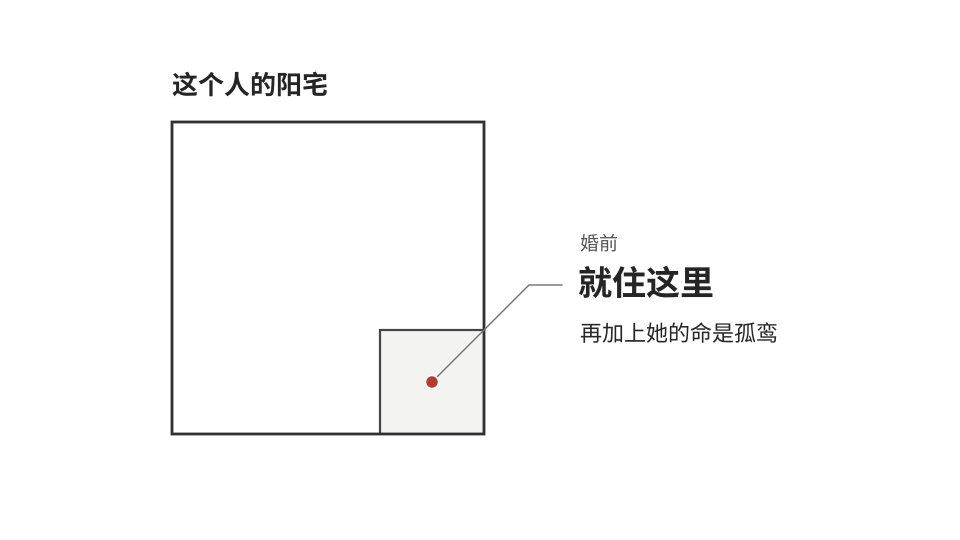 |
| **六亲最好，为何全家受不了她？** | 〔口述〕倪师说：「那这个八字出来的话」「家里面没有人受得了她」；但「整个布局上面来说的话」「她的六亲最好看到没」「你看她的父母兄弟有没有」。（[00:31:43–00:31:56](https://www.bilibili.com/video/BV1KJsLekEfA/?p=27&t=1903)，第 57102–57503 帧） 〔口述〕「可是你要知道」「整个家会因为她这一个人」「闹得鸡飞狗跳」，「所以一粒老鼠屎会坏一锅粥」。（[00:31:56–00:32:06](https://www.bilibili.com/video/BV1KJsLekEfA/?p=27&t=1916)，第 57504–57797 帧） 〔叠图〕第 57420 帧起贴父母甲戌（贪狼庙权、右弼庙），第 57460 帧时已加贴兄弟壬申；第 57600 帧起又贴命宫癸酉，忌印在文曲下方（文曲庙忌），与其余各版相同。（[00:31:53–00:32:01](https://www.bilibili.com/video/BV1KJsLekEfA/?p=27&t=1913)，第 57414–57641 帧） |
| **父母若从小让她出家，她会同意吗？** | 〔口述〕倪师设想对她母亲说：「哎这个太太啊」「您这个女儿」「您从小就给她出家当尼姑和尚」，结果「她不会同意啊」。（[00:32:10–00:32:16](https://www.bilibili.com/video/BV1KJsLekEfA/?p=27&t=1930)，第 57918–58097 帧） 〔口述〕他由此感叹「所以很多是命啊」「拿到我们手上」，「所以人都是命」。（[00:32:08–00:32:19](https://www.bilibili.com/video/BV1KJsLekEfA/?p=27&t=1928)，第 57858–58199 帧） |
| **她的父母、兄弟宫好在哪里？** | 〔口述〕倪师指盘：「你看她都权禄」「父母是权禄重逢」；「化权一般来说是武官」「对面是化禄还有从商啊」「做生意当老板」。（[00:32:20–00:32:28](https://www.bilibili.com/video/BV1KJsLekEfA/?p=27&t=1940)，第 58200–58457 帧） 〔口述〕又说「兄弟是南北斗星君的」（语音不同，见待核）「又是官贵对面又是禄」「你看六亲多好」「可是她就是不行」。（[00:32:28–00:32:35](https://www.bilibili.com/video/BV1KJsLekEfA/?p=27&t=1948)，第 58458–58655 帧） 〔叠图〕第 58262 帧起同时贴父母甲戌（贪狼庙权、右弼庙）与疾厄戊辰（武曲庙禄、左辅庙、地劫陷）；第 58470 帧起贴交友丙寅、兄弟壬申、疾厄戊辰。（[00:32:22–00:32:29](https://www.bilibili.com/video/BV1KJsLekEfA/?p=27&t=1942)，第 58262–58493 帧） 〔推断〕推断：讲「父母是权禄重逢」「对面是化禄」时叠图同时贴出父母甲戌（贪狼权）和疾厄戊辰（武曲禄），「对面」的禄可能指疾厄戊辰这一格；倪师没有说出宫名。（[00:32:22–00:32:27](https://www.bilibili.com/video/BV1KJsLekEfA/?p=27&t=1942)，第 58266–58421 帧） |
| **父母宠女儿，让她住西北角主卧，结果怎样？** | 〔口述〕倪师说很多家里「父母亲很」「爸爸很厉害兄弟很强」，「唉出个女儿好累」「大家都在扑灰火一样」（扑灭火）。（[00:32:35–00:32:44](https://www.bilibili.com/video/BV1KJsLekEfA/?p=27&t=1955)，第 58656–58931 帧） 〔口述〕「然后人都是懵懵懂懂的」「他就会让他女儿去住西北角」「还说西北角是主卧房」，「我为了我宠我那个女儿」「我最大的房间给她去住」。（[00:32:44–00:32:54](https://www.bilibili.com/video/BV1KJsLekEfA/?p=27&t=1964)，第 58932–59243 帧） 〔口述〕倪师评：「你看看这都」「害死人不负责」「就害到自己」。（[00:32:54–00:33:01](https://www.bilibili.com/video/BV1KJsLekEfA/?p=27&t=1974)，第 59244–59459 帧） 〔叠图〕第 58800 帧起又贴命宫癸酉（文曲庙忌）和父母甲戌′（贪狼庙权、右弼庙，与父母甲戌是同一格再贴一次）。（[00:32:40](https://www.bilibili.com/video/BV1KJsLekEfA/?p=27&t=1960)，第 58800–58829 帧） |
| **早点碰到有没有救？结婚对象怎么找？** | 〔口述〕倪师说「像这种八字」「碰到我们比较晚」，「如果早碰到我们有没有救」——「有当然有救啊」。（[00:33:02–00:33:08](https://www.bilibili.com/video/BV1KJsLekEfA/?p=27&t=1982)，第 59460–59651 帧） 〔口述〕「那诸位给她结婚的时候啊」「千万不要让她害人」；若「找个吹火嘴来」「先生也是吹火嘴」「太太两个对上了」，「可能这个骨肉相残啊」「都不太好」。（[00:33:08–00:33:24](https://www.bilibili.com/video/BV1KJsLekEfA/?p=27&t=1988)，第 59652–60131 帧） 〔口述〕所以「那我们再找个比较温和的星」（语音作「心」，见待核）。（[00:33:24–00:33:26](https://www.bilibili.com/video/BV1KJsLekEfA/?p=27&t=2004)，第 60132–60191 帧） 〔叠图〕第 59820–60090 帧一带贴命宫癸酉与福德乙亥（巨门旺、天马平、天贵平、台辅）；第 60120 帧起只贴命宫癸酉。（[00:33:12–00:33:26](https://www.bilibili.com/video/BV1KJsLekEfA/?p=27&t=1992)，第 59760–60191 帧） |
| **要先改她什么？怎么改？** | 〔口述〕倪师说「还要首先要改变她的性」「改变她的心」，「所以一定要让她念宗教」；「像这种你跟她讲人间道没有用啊」「你就跟她叫她念宗教」。（[00:33:26–00:33:34](https://www.bilibili.com/video/BV1KJsLekEfA/?p=27&t=2006)，第 60192–60443 帧） 〔口述〕「每天念心经」「心经念念念念」「还比较不容易发脾气」。（[00:33:34–00:33:37](https://www.bilibili.com/video/BV1KJsLekEfA/?p=27&t=2014)，第 60444–60539 帧） 〔口述〕「然后再给她找好的对象」，但「那好的对象不能害到人家」「不然你都能害到人家」，「所以要再三的叮咛告诉她」。（[00:33:38–00:33:44](https://www.bilibili.com/video/BV1KJsLekEfA/?p=27&t=2018)，第 60540–60737 帧） |

**总结区**

- 通用规则：太阴坐命的人本来性比较阴（[00:29:09–00:29:13](https://www.bilibili.com/video/BV1KJsLekEfA/?p=27&t=1749)，第 52476–52607 帧）；太阴星入命遇文曲、文昌，倪师称为桃花命（[00:29:21–00:29:27](https://www.bilibili.com/video/BV1KJsLekEfA/?p=27&t=1761)，第 52842–53033 帧）；命里化忌，除了早年比较辛苦，个性很刚、心眼比较多，容易害自己（[00:29:27–00:30:07](https://www.bilibili.com/video/BV1KJsLekEfA/?p=27&t=1767)，第 53034–54227 帧）；化权一般来说是武官，化禄是从商、做生意当老板（[00:32:23–00:32:28](https://www.bilibili.com/video/BV1KJsLekEfA/?p=27&t=1943)，第 58308–58457 帧）
- 只在本例：这位女命红鸾天喜位置不好，第一次会到是 54-63，结婚很晚（[00:30:07–00:30:30](https://www.bilibili.com/video/BV1KJsLekEfA/?p=27&t=1807)，第 54228–54929 帧）；倪师断为标准的孤鸾命，当面劝她出家、念心经（[00:30:51–00:31:27](https://www.bilibili.com/video/BV1KJsLekEfA/?p=27&t=1851)，第 55542–56615 帧）；六亲最好（父母权禄重逢、兄弟官贵对禄），却因她一人全家鸡飞狗跳（[00:31:43–00:32:35](https://www.bilibili.com/video/BV1KJsLekEfA/?p=27&t=1903)，第 57102–58655 帧）；父母宠女让她住西北角主卧，倪师说是加凶、害到自己（[00:31:27–00:31:43](https://www.bilibili.com/video/BV1KJsLekEfA/?p=27&t=1887)，第 56616–57101 帧、[00:32:44–00:33:01](https://www.bilibili.com/video/BV1KJsLekEfA/?p=27&t=1964)，第 58932–59459 帧）
- 不是排盘规则，是处世方法：批命看出对方心性不好，放在肚子里、心知肚明，不要当场说（[00:29:42–00:29:57](https://www.bilibili.com/video/BV1KJsLekEfA/?p=27&t=1782)，第 53478–53915 帧）；做君子比较好，小人不能长久，骗得了一时骗不了一世（[00:30:31–00:30:46](https://www.bilibili.com/video/BV1KJsLekEfA/?p=27&t=1831)，第 54930–55403 帧）；早碰到就要劝她念宗教、每天念心经改心性，再给她找温和的好对象，别找吹火嘴（[00:33:02–00:33:37](https://www.bilibili.com/video/BV1KJsLekEfA/?p=27&t=1982)，第 59460–60539 帧）；好对象不能被她害到，要再三叮咛她（[00:33:38–00:33:44](https://www.bilibili.com/video/BV1KJsLekEfA/?p=27&t=2018)，第 60540–60737 帧）

**待核**

1. [00:29:27](https://www.bilibili.com/video/BV1KJsLekEfA/?p=27&t=1767)，第 53034 帧：倪师只说「命里面化忌」，没说忌跟哪颗星；板书与叠图都是「文曲庙忌」（叠图定稿把[00:32:00](https://www.bilibili.com/video/BV1KJsLekEfA/?p=27&t=1920)，第 57600 帧那版转成「太阴旺忌、文曲庙」，抽第 57600、57625 帧放大看，忌仍印在文曲下方，与[00:30:05](https://www.bilibili.com/video/BV1KJsLekEfA/?p=27&t=1805)，第 54150 帧等其余各版相同）；倪师口头没点明忌跟哪颗星，待核。
2. [00:29:35](https://www.bilibili.com/video/BV1KJsLekEfA/?p=27&t=1775)，第 53262 帧：字幕「个性很刚」，语音作「个性很高」，两路不一致。
3. [00:29:51](https://www.bilibili.com/video/BV1KJsLekEfA/?p=27&t=1791)，第 53742 帧：字幕「有苦难盲」，按语音改作「有苦难言」。
4. [00:30:22](https://www.bilibili.com/video/BV1KJsLekEfA/?p=27&t=1822)，第 54666 帧：字幕「那更不用结婚嘛」，语音作「他跟别人结婚嘛」，两路对不上，原话待核。
5. [00:30:38](https://www.bilibili.com/video/BV1KJsLekEfA/?p=27&t=1838)，第 55146 帧：字幕「骗得了人家一时骗不了一世」，语音作「一次……一次」。
6. [00:31:32–00:31:35](https://www.bilibili.com/video/BV1KJsLekEfA/?p=27&t=1892)，第 56760–56855 帧：字幕「东南西北」「啊不好挑就挑了个位置」，语音作「西北不好」「调调到这个位置」，两路有出入；房屋方框里挑的是哪个方位没说清。
7. [00:31:37](https://www.bilibili.com/video/BV1KJsLekEfA/?p=27&t=1897)，第 56922 帧：「加凶」倪师用了但没解释，语音作「家凶」，是哪两个字待核。
8. [00:31:38](https://www.bilibili.com/video/BV1KJsLekEfA/?p=27&t=1898)，第 56952 帧：「婚前就要住西北」的意思（是她婚前住在西北，还是要她住西北）本块没说清。
9. [00:31:39](https://www.bilibili.com/video/BV1KJsLekEfA/?p=27&t=1899)，第 56994 帧：字幕「再加上她的命是孤鸾」，语音作「加上他的命中过来」，两路不一致。
10. [00:32:20](https://www.bilibili.com/video/BV1KJsLekEfA/?p=27&t=1940)，第 58200 帧：字幕「那再强你看她都权禄」中「再强」意思不明。
11. [00:32:28](https://www.bilibili.com/video/BV1KJsLekEfA/?p=27&t=1948)，第 58458 帧：字幕「兄弟是南北斗星君的」，语音作「是南北的我新军的」，原话待核；「官贵」倪师没有解释。
12. [00:32:25](https://www.bilibili.com/video/BV1KJsLekEfA/?p=27&t=1945)，第 58368 帧：「对面是化禄」的「对面」指哪一宫倪师没说出，推断为疾厄戊辰，待核。
13. [00:32:41](https://www.bilibili.com/video/BV1KJsLekEfA/?p=27&t=1961)，第 58830 帧：字幕「扑灰火」，按语音改作「扑灭火」。
14. [00:32:14](https://www.bilibili.com/video/BV1KJsLekEfA/?p=27&t=1934)，第 58044 帧：字幕「客顺回」是乱码，已略过。
15. [00:33:24](https://www.bilibili.com/video/BV1KJsLekEfA/?p=27&t=2004)，第 60132 帧：字幕「温和的星」，语音作「温和的心」，是星还是心待核。
16. [00:33:31](https://www.bilibili.com/video/BV1KJsLekEfA/?p=27&t=2011)，第 60348 帧：字幕「人间道」，语音作「人家那」，待核。
17. 第 52080、54396、56160、56868 帧：板书大部分认不出；「父母」「鸾」两处只是像，房屋方框边的「5」「2」记号与小方格里的字认不出。
18. 第 52085、52178、53235、54156、55410、55795、57112、57826 帧：这几处「这个」指代不确定，未作依据。

### 8　孤鸾命：事业好、婚姻晚，用人看神（[00:33:44–00:38:37](https://www.bilibili.com/video/BV1KJsLekEfA/?p=27&t=2024)，第 60738–69510 帧）

| 提示区 | 笔记区 |
|---|---|
| **例四这个八字事业好不好？凭什么说好？** | 〔口述〕倪师自问以这个八字事业好不好，自答「事业太好了」，说「你看看这一路上都是吉星啊」。（[00:33:47–00:33:52](https://www.bilibili.com/video/BV1KJsLekEfA/?p=27&t=2027)，第 60834–60989 帧） 〔口述〕倪师说「你看看她是官禄宫化科」，像这种人参加公家单位的考试、考公务员资格、考老师资格，「一考就上去了」，「当老师也好啊」。（[00:33:54–00:34:03](https://www.bilibili.com/video/BV1KJsLekEfA/?p=27&t=2034)，第 61032–61313 帧） 〔口述〕接着倪师补一句「可是事业上」，「上帝并没有说老师一定是对的嘛」，「这两回事啊」，把事业好和做人对不对分开讲。（[00:34:03–00:34:11](https://www.bilibili.com/video/BV1KJsLekEfA/?p=27&t=2043)，第 61314–61541 帧） 〔叠图〕第 61380 帧起叠图贴出官禄丁丑：天梁旺、化科，同格还有天姚平、华盖、喜神、墓、岁建、破碎陷。（[00:34:06–00:34:07](https://www.bilibili.com/video/BV1KJsLekEfA/?p=27&t=2046)，第 61380–61439 帧） 〔板书〕本块开头的板面可辨：天机、兄弟、太阴、文曲、圈起的「忌」、4-1（后一位不清）、贪狼、圈起的「权」、14-23、父母、巨门、子女宫（字形似「3女宫」），其余认不出。（[00:33:49](https://www.bilibili.com/video/BV1KJsLekEfA/?p=27&t=2029)，第 60875 帧） |
| **她的流年怎样？婚姻星为什么拖得晚？** | 〔口述〕倪师说「那你看她的流年」，「你看都是好星」，「就是个婚姻星啊」「拖的晚」。（[00:34:11–00:34:17](https://www.bilibili.com/video/BV1KJsLekEfA/?p=27&t=2051)，第 61542–61727 帧） 〔口述〕倪师说「所以婚姻星拖的晚」，「跟她本身的个性也有关系」。（[00:34:17–00:34:19](https://www.bilibili.com/video/BV1KJsLekEfA/?p=27&t=2057)，第 61728–61799 帧） 〔叠图〕第 61830 帧起叠图贴出交友丙寅（第 61800 帧还没有）：七杀庙、红鸾旺、天福旺、天伤平、天空陷、孤辰平、劫煞、阴煞、晦气、病符、绝。（[00:34:21](https://www.bilibili.com/video/BV1KJsLekEfA/?p=27&t=2061)，第 61830–61841 帧） |
| **婚姻拖晚为什么反而救了她？** | 〔口述〕倪师说「还有可能婚姻拖的晚」「也救了她知不知道」。（[00:34:20–00:34:23](https://www.bilibili.com/video/BV1KJsLekEfA/?p=27&t=2060)，第 61800–61919 帧） 〔口述〕倪师说「你宁可不结婚」，与其结了婚又离婚，「你让她不结婚」「比结了婚离婚来的好一点嘛」。（[00:34:24–00:34:29](https://www.bilibili.com/video/BV1KJsLekEfA/?p=27&t=2064)，第 61920–62099 帧） 〔口述〕倪师说「如果你只有两个选择」「没有第三个选择」，「那那就选择不结婚了」。（[00:34:30–00:34:33](https://www.bilibili.com/video/BV1KJsLekEfA/?p=27&t=2070)，第 62100–62219 帧） |
| **帮她改还是害她？取舍的第一个原则是什么？** | 〔口述〕倪师说「所以有时候帮她改还是害她」，「这个时候在取舍之间就很难」，「遇到这种八字」。（[00:34:34–00:34:38](https://www.bilibili.com/video/BV1KJsLekEfA/?p=27&t=2074)，第 62220–62369 帧） 〔口述〕倪师说诸位做取舍时「一定要掌握第一个原则就是」「看她心性有没有变过来」。（[00:34:39–00:34:43](https://www.bilibili.com/video/BV1KJsLekEfA/?p=27&t=2079)，第 62370–62507 帧） 〔口述〕倪师说心性「很难变的我跟你讲」，「你这江山易改本性难移」。（[00:34:44–00:34:47](https://www.bilibili.com/video/BV1KJsLekEfA/?p=27&t=2084)，第 62538–62639 帧） 〔口述〕有人会说不是她父母，「我也没办法在每天旁边观察她」；倪师说「很简单你只要过一段时间」「看她的气色就知道了」。（[00:34:49–00:34:55](https://www.bilibili.com/video/BV1KJsLekEfA/?p=27&t=2089)，第 62676–62855 帧） |
| **做老板用手下，先看眼神的什么？** | 〔口述〕倪师说诸位以后做老板，用人之道「你只要掌握一个大原则」，「用手下的人」看「两个眼神」。（[00:34:57–00:35:08](https://www.bilibili.com/video/BV1KJsLekEfA/?p=27&t=2097)，第 62910–63251 帧） 〔口述〕倪师说「眼神呢不能有兇光」，眼神可以有威，「看起来比较威严的眼神呢」「你可以拿她当主管」「当经理呀厂长啊主管」。（[00:35:10–00:35:20](https://www.bilibili.com/video/BV1KJsLekEfA/?p=27&t=2110)，第 63300–63611 帧） |
| **什么样的人可以用？什么样的人要防背叛？** | 〔口述〕倪师说「然后人是很柔的人」，「鼻子很正」，「然后眼睛眼动都不动两个眼珠」，「这种人都可以用她」「绝对不会背叛你」。（[00:35:20–00:35:28](https://www.bilibili.com/video/BV1KJsLekEfA/?p=27&t=2120)，第 63612–63857 帧） 〔口述〕倪师说「哎呀那鼻子歪着」「然后眼睛那边闪动的」「那就完蛋了」，「你你准备她背叛你」，「你这个是你用人不当」。（[00:35:28–00:35:36](https://www.bilibili.com/video/BV1KJsLekEfA/?p=27&t=2128)，第 63858–64103 帧） |
| **用手下归结起来看什么？长得丑能不能用？** | 〔口述〕倪师说「用个人用手下不管怎样」「看她的神就够了」。（[00:35:37–00:35:41](https://www.bilibili.com/video/BV1KJsLekEfA/?p=27&t=2137)，第 64134–64235 帧） 〔口述〕倪师说「那有的人长得很丑对不对」「可是她神很好」，你用她，「她永远不会背叛你」「永远会帮你断后的」。（[00:35:41–00:35:49](https://www.bilibili.com/video/BV1KJsLekEfA/?p=27&t=2141)，第 64236–64475 帧） 〔口述〕倪师说用人要很注意，「那你只要看她有没有正」「看她的神就知道了」。（[00:35:49–00:35:54](https://www.bilibili.com/video/BV1KJsLekEfA/?p=27&t=2149)，第 64476–64637 帧） |
| **神从哪里看？有神、没神各是什么样子？** | 〔口述〕倪师说神「有很多地方我们可以看到」，「除了眼神我们的鼻梁以外」「还有我们这有神气呀」「神的气」。（[00:35:54–00:36:02](https://www.bilibili.com/video/BV1KJsLekEfA/?p=27&t=2154)，第 64638–64877 帧） 〔口述〕倪师说有人坐在那边是大富大贵的相，「她是神很足啊」，坐着「她动都不动的」，背杆挺直。（[00:36:02–00:36:11](https://www.bilibili.com/video/BV1KJsLekEfA/?p=27&t=2162)，第 64878–65159 帧） 〔口述〕倪师说他看过有的小孩子坐那边「动都不动的哦」「从小开始的」，「那个神那么挺啊」。（[00:36:12–00:36:19](https://www.bilibili.com/video/BV1KJsLekEfA/?p=27&t=2172)，第 65160–65381 帧） 〔口述〕相反「那下面躺的软趴趴的」「脚翘起来软软绵绵的」，「躺着没有没有神了懂吗」「气不够了」；倪师说「这人要有神」。（[00:36:19–00:36:26](https://www.bilibili.com/video/BV1KJsLekEfA/?p=27&t=2179)，第 65382–65603 帧） |
| **心性变正怎么看？念经、宗教有什么用？** | 〔口述〕倪师说「如果心性变正的时候」「看她眼睛就知道了」。（[00:36:26–00:36:31](https://www.bilibili.com/video/BV1KJsLekEfA/?p=27&t=2186)，第 65604–65747 帧） 〔口述〕倪师说「那我看过很多眼睛有兇光的」，「念念念念佛经念了回来」「真的变慈祥了是有」。（[00:36:31–00:36:38](https://www.bilibili.com/video/BV1KJsLekEfA/?p=27&t=2191)，第 65748–65945 帧） 〔口述〕倪师说「但是我们不能说它一定是最好的」，而是各种宗教「有存在的必要」，有的人「必须要经过这个程度」「才有办法到很高很好的阶段」。（[00:36:39–00:36:49](https://www.bilibili.com/video/BV1KJsLekEfA/?p=27&t=2199)，第 65970–66299 帧） 〔口述〕倪师说「对呀你不能要求每一个人」，但宗教「可以给对方一种心性的修养」，对这种人只有这样，「你跟她讲人间道没有用」。（[00:36:50–00:36:59](https://www.bilibili.com/video/BV1KJsLekEfA/?p=27&t=2210)，第 66300–66575 帧） |
| **她肯改地理位置吗？这叫什么格？** | 〔口述〕倪师说「而且呢地理位置」「她不见得愿意去改」。（[00:36:59–00:37:03](https://www.bilibili.com/video/BV1KJsLekEfA/?p=27&t=2219)，第 66576–66713 帧） 〔口述〕倪师说「这是叫做标准的……」「标准的格」；字幕在「标准的」后括注「（孤鸾命）」，语音里没有这三个字，括号是字幕注字。（[00:37:03–00:37:07](https://www.bilibili.com/video/BV1KJsLekEfA/?p=27&t=2223)，第 66714–66827 帧） 〔叠图〕第 67005 帧起叠图命宫癸酉格（太阴旺、文曲庙忌、凤阁庙、天刑庙、天官平、帝旺、截空庙等）里标着「孤鸾命」（第 66996 帧还是财帛己巳、福德乙亥）。（[00:37:13–00:37:15](https://www.bilibili.com/video/BV1KJsLekEfA/?p=27&t=2233)，第 67005–67067 帧） |
| **不会批的人看她夫妻宫，会怎么说？** | 〔口述〕倪师说「那你如果不会批」，会说「你看老师她夫妻宫很好啊」，「巨门天马，太阳旺啊」，「这个旺夫的命太好了」「给她对不对」。（[00:37:07–00:37:13](https://www.bilibili.com/video/BV1KJsLekEfA/?p=27&t=2227)，第 66828–66995 帧） 〔叠图〕第 66870 帧起叠图同时贴出福德乙亥（巨门旺、天马平、台辅、天贵平、吊客、奏书、岁驿、病）与财帛己巳（太阳旺、文昌庙、陀罗陷、龙池陷、天哭不、天巫、长生），宫名与口述的「夫妻宫」对不上。（[00:37:09](https://www.bilibili.com/video/BV1KJsLekEfA/?p=27&t=2229)，第 66870–66887 帧） 〔推断〕推断：这几句以「那你如果不会批」起头，紧接着倪师就说「这个人呢不会结婚的」，看来是在说不会批的人会这样看，不是倪师自己的断语；材料没有明说。（[00:37:07–00:37:15](https://www.bilibili.com/video/BV1KJsLekEfA/?p=27&t=2227)，第 66828–67067 帧） |
| **倪师为什么断她不会结婚？红鸾天喜管什么？** | 〔口述〕倪师说「这个人呢不会结婚的」，「这红鸾天喜星都没有会到」。（[00:37:13–00:37:17](https://www.bilibili.com/video/BV1KJsLekEfA/?p=27&t=2233)，第 66996–67127 帧） 〔口述〕倪师说「所以红鸾天喜星很重要」，「是决定一个人喜庆的星」。（[00:37:17–00:37:24](https://www.bilibili.com/video/BV1KJsLekEfA/?p=27&t=2237)，第 67128–67331 帧） 〔叠图〕第 67005 帧起叠图贴着交友丙寅（红鸾旺），第 67100 帧时又贴出兄弟壬申（天喜旺、紫微旺、天府得、天钺庙、火星陷、天寿旺、天厨、解神不）。（[00:37:13–00:37:18](https://www.bilibili.com/video/BV1KJsLekEfA/?p=27&t=2233)，第 67005–67163 帧） |
| **孤鸾命女孩子在相上有什么样子？** | 〔口述〕倪师说孤鸾命女孩子有几个地方可看，「当然有些有些疾病的问题」「我们写在书里书里面好了」，「上课不好意思讲」。（[00:37:32–00:37:43](https://www.bilibili.com/video/BV1KJsLekEfA/?p=27&t=2252)，第 67572–67907 帧） 〔口述〕倪师说「这个因为没有结婚嘛」「就没有跟男孩子常常在一起」，「那这个阴气很盛」。（[00:37:48–00:37:55](https://www.bilibili.com/video/BV1KJsLekEfA/?p=27&t=2268)，第 68046–68261 帧） 〔口述〕倪师说这种女孩子肉长得很扎实、「硬绷绷的」，结了婚的女孩子「那个肉就比较软」；「骨头都很扎实」，「因为还没有接触过男人」，「这都是我们看相的地方」。（[00:38:02–00:38:22](https://www.bilibili.com/video/BV1KJsLekEfA/?p=27&t=2282)，第 68466–69071 帧） |
| **全集最后说的「这种星」「这种格的人」是指什么？** | 〔口述〕倪师说「那谁谁愿意啊」「都吓死吓死了」，接着说「这个这个这种星啊」。（[00:38:24–00:38:29](https://www.bilibili.com/video/BV1KJsLekEfA/?p=27&t=2304)，第 69138–69293 帧） 〔指代〕说第二个「这个」时，手指的是黑板「太阴 文曲」那格下部的「4-1」（后面的字被头挡住）。（[00:38:28](https://www.bilibili.com/video/BV1KJsLekEfA/?p=27&t=2308)，第 69250 帧） 〔口述〕倪师说「现在我们很很可很可惜的」，「我们李先生就是这种格的人」，话没讲完视频就结束了；语音栏末尾的片尾平台字样不是倪师的话。（[00:38:29–00:38:37](https://www.bilibili.com/video/BV1KJsLekEfA/?p=27&t=2309)，第 69294–69510 帧） |

**总结区**

- 通用规则：红鸾天喜星很重要，是决定一个人喜庆的星（[00:37:17–00:37:24](https://www.bilibili.com/video/BV1KJsLekEfA/?p=27&t=2237)，第 67128–67331 帧）
- 只在本例：例四官禄宫化科、一路吉星，事业太好，考公家单位、公务员、老师资格一考就上（[00:33:47–00:34:03](https://www.bilibili.com/video/BV1KJsLekEfA/?p=27&t=2027)，第 60834–61313 帧）；例四婚姻星拖得晚，倪师说拖晚反而救了她，不结婚比结了婚离婚好（[00:34:11–00:34:33](https://www.bilibili.com/video/BV1KJsLekEfA/?p=27&t=2051)，第 61542–62219 帧）；例四是「标准的格」（字幕注孤鸾命），红鸾天喜都没会到，倪师断她不会结婚（[00:37:03–00:37:17](https://www.bilibili.com/video/BV1KJsLekEfA/?p=27&t=2223)，第 66714–67127 帧）
- 不是排盘规则，是处世方法：帮她改还是害她难以取舍时，第一原则是看心性有没有变正，过一段时间看气色、看眼睛就知道（[00:34:34–00:34:55](https://www.bilibili.com/video/BV1KJsLekEfA/?p=27&t=2074)，第 62220–62855 帧、[00:36:26–00:36:31](https://www.bilibili.com/video/BV1KJsLekEfA/?p=27&t=2186)，第 65604–65747 帧）；用手下看神：眼神不能有兇光，有威可当主管；鼻正眼珠不动的可用，鼻歪眼神闪动的要防背叛（[00:34:57–00:35:54](https://www.bilibili.com/video/BV1KJsLekEfA/?p=27&t=2097)，第 62910–64637 帧）；对这种人讲人间道没有用，宗教有存在的必要，可以给对方心性的修养（[00:36:31–00:36:59](https://www.bilibili.com/video/BV1KJsLekEfA/?p=27&t=2191)，第 65748–66575 帧）

**待核**

1. [00:33:49](https://www.bilibili.com/video/BV1KJsLekEfA/?p=27&t=2029)，第 60875 帧板书大部分认不出，只认得天机、兄弟、太阴、文曲、忌、贪狼、权、14-23、父母、巨门、子女宫等；同一帧画面左下另有一张叠图卡片标着「一路吉星 事业很好」，并有父母甲戌、官禄丁丑等格，材料 ▣ 行没有列出，未写进笔记。
2. [00:34:05](https://www.bilibili.com/video/BV1KJsLekEfA/?p=27&t=2045)，第 61350 帧「上帝并没有说老师一定是对的嘛」字幕可信度 0.54，语音作「帝并没有老师一定是对的好」，原话与句意待核。
3. [00:34:12–00:34:18](https://www.bilibili.com/video/BV1KJsLekEfA/?p=27&t=2052)，第 61566–61757 帧字幕「好星」「婚姻星」语音作「好心」「婚姻心」，按上下文取字幕；倪师说的「婚姻星」指哪颗星，本块没有说。
4. [00:34:25](https://www.bilibili.com/video/BV1KJsLekEfA/?p=27&t=2065)，第 61950 帧字幕「你跟她结了婚离婚」，语音作「你比人家结了婚离婚」，两路不一致。
5. [00:35:44](https://www.bilibili.com/video/BV1KJsLekEfA/?p=27&t=2144)，第 64332 帧「鼻子长的那你用她」句意不完整，未引。
6. [00:36:10](https://www.bilibili.com/video/BV1KJsLekEfA/?p=27&t=2170)，第 65100 帧字幕「背杆提的笔直的」可信度 0.41，语音作「着鼻子的动」，两路对不上，笔记只转述为背杆挺直。
7. [00:36:17](https://www.bilibili.com/video/BV1KJsLekEfA/?p=27&t=2177)，第 65322 帧「把他吓死了」指谁吓到，本块没交代。
8. [00:36:44](https://www.bilibili.com/video/BV1KJsLekEfA/?p=27&t=2204)，第 66138 帧字幕「因內有的人的资质」可信度 0.3，「因內」按上下文读作「因为」；语音作「知识」，「资质」还是「知识」待核。
9. [00:36:59](https://www.bilibili.com/video/BV1KJsLekEfA/?p=27&t=2219)，第 66576 帧「地理位置」指她哪方面的地理位置、怎么改，本块没交代。
10. [00:37:03](https://www.bilibili.com/video/BV1KJsLekEfA/?p=27&t=2223)，第 66714 帧字幕「（孤鸾命）」是括号注字，语音只有「的标准」；笔记未把它当成倪师说出口的话。
11. [00:37:08–00:37:10](https://www.bilibili.com/video/BV1KJsLekEfA/?p=27&t=2228)，第 66852–66923 帧倪师说「夫妻宫很好」「巨门天马，太阳旺」，叠图同时贴的是福德乙亥（巨门旺、天马平）与财帛己巳（太阳旺），宫名与口述对不上，以哪个为准待核；字幕「旺夫」语音作「望夫」。
12. [00:37:08](https://www.bilibili.com/video/BV1KJsLekEfA/?p=27&t=2228)，第 66852 帧福德乙亥格的岁数串有缺字（□），未写。
13. [00:37:15](https://www.bilibili.com/video/BV1KJsLekEfA/?p=27&t=2235)，第 67068 帧「红鸾天喜星都没有会到」的「会到」是什么意思，本块未解释；叠图中红鸾在交友丙寅、天喜在兄弟壬申。
14. [00:37:44](https://www.bilibili.com/video/BV1KJsLekEfA/?p=27&t=2264)，第 67925 帧说「那这个」时手是否指黑板「天梁」格不确定，未当依据。
15. [00:38:13](https://www.bilibili.com/video/BV1KJsLekEfA/?p=27&t=2293)，第 68808 帧字幕「然后攥她们手这样拿出都都很扎实的」可信度 0.6，语音作「坐在那边手上拿着都很扎实的」，原话待核，未引。
16. [00:38:27](https://www.bilibili.com/video/BV1KJsLekEfA/?p=27&t=2307)，第 69210 帧字幕「给她给她吵翻了是吧」语音作「他炒饭了」，指谁、什么事未讲清。
17. [00:38:32](https://www.bilibili.com/video/BV1KJsLekEfA/?p=27&t=2312)，第 69378 帧「我们李先生就是这种格的人」话没讲完视频即结束，「李先生」是谁、「这种格」具体指什么都不清楚，未补。
18. 字幕「兇光」（第 63300、65748 帧）语音作「胸光」，按上下文取字幕。

