# P29 · 15 上：刑夫剋子 / 女命太阳陷 / 廉贪在巳亥 / 六亲不靠 / 手相（00:00:00–00:51:04，共 91,935 帧）

> 2026-11-13 整理。依据 DeepSeek 逐帧记录与现成的五层材料（字幕、语音、叠图、板书、指代），由 Claude（Opus 5.5 子代理）分段起草，引文由程序逐段对过字幕。流程 2026-11-11 经站长认可。
> 依据标记：〔口述〕字幕与语音两路对得上的话，「」里是字幕原字 ·〔叠图〕后期贴的电子命盘，**不算倪师的话** ·〔板书〕粉笔字（看过那一帧原图才写）·〔指代〕「这里 / 这个」指哪（只收核过、确定的）·〔推断〕笔记作者自己的推断。每条后面的时间码可以点，跳到 B 站那一秒。

## 全集总结

**通用规则**

- 化忌代表停滞、官司、孤军、孤单、破耗，破耗讲伤身（[00:03:03–00:03:25](https://www.bilibili.com/video/BV1KJsLekEfA/?p=29&t=183)，第 5496–6173 帧）
- 命带红鸾天喜一定会结婚，婚再散时有生离、有死别（[00:06:26–00:06:36](https://www.bilibili.com/video/BV1KJsLekEfA/?p=29&t=386)，第 11580–11903 帧）
- 太阳星落陷的女命，婚配对象要大7岁以上，或是离过婚的二婚夫（[00:07:26–00:07:50](https://www.bilibili.com/video/BV1KJsLekEfA/?p=29&t=446)，第 13380–14111 帧）
- 兄弟宫化忌主两件事：兄弟不和、兄弟夭折；相上眉毛乱七八糟主不和，眉毛有断落主夭折（[00:13:07–00:13:28](https://www.bilibili.com/video/BV1KJsLekEfA/?p=29&t=787)，第 23628–24257 帧）
- 排盘没办法把每一天都排出来，所以要配合看气色，大原则抓到就好（[00:19:23–00:19:51](https://www.bilibili.com/video/BV1KJsLekEfA/?p=29&t=1163)，第 34914–35735 帧）
- 吉处藏凶：看似好的时候，未来一看没有大运，马上要注意前面（[00:24:06–00:24:24](https://www.bilibili.com/video/BV1KJsLekEfA/?p=29&t=1446)，第 43392–43937 帧）
- 父母和兄弟都带杀，就叫做六亲不靠（[00:28:56–00:29:08](https://www.bilibili.com/video/BV1KJsLekEfA/?p=29&t=1736)，第 52104–52463 帧）
- 看手男女都看左手；掌上乾位主祖宗、也主父母，丰满代表受祖先庇荫、祖上风水好，陷落扁扁代表与父母相克、相处不好或过世（[00:37:37–00:38:41](https://www.bilibili.com/video/BV1KJsLekEfA/?p=29&t=2257)，第 67716–69647 帧）
- 掌上震卦主妻、巽卦主财禄、离卦主官禄、坤卦主子息、兑卦主仆役与朋友；丰满膨起为好，凹陷扁平、暗黑、乱纹多为损（[00:39:47–00:42:43](https://www.bilibili.com/video/BV1KJsLekEfA/?p=29&t=2387)，第 71634–76895 帧）
- 伤、杜、景、死、惊五门见青色、暗色，都指破耗：破财、伤身、耗到祖业、灾盗偷窃；奇门以看气色为主，心情一变手上气色马上就变（[00:47:04–00:47:55](https://www.bilibili.com/video/BV1KJsLekEfA/?p=29&t=2824)，第 84732–86261 帧）

**只在本例**

- 本例命宫丁巳有巨门、天喜，迁移癸亥太阳陷、红鸾，倪师断她注定偏房格（[00:06:03–00:06:43](https://www.bilibili.com/video/BV1KJsLekEfA/?p=29&t=363)，第 10914–12101 帧）
- 25–34走到夫妻的尾巴，36岁起太阳看不到，所以35岁先生过世（[00:08:06–00:08:42](https://www.bilibili.com/video/BV1KJsLekEfA/?p=29&t=486)，第 14592–15671 帧）
- 这位女命天钺入命、科权禄都没有，财帛巨门，一定任公职；太阳陷地，女孩子很累（[00:12:19–00:12:40](https://www.bilibili.com/video/BV1KJsLekEfA/?p=29&t=739)，第 22182–22823 帧）
- 例二49岁先生打高尔夫开球倒下、脖子断掉，倪师说她44-53太阳星落陷看不到先生（[00:17:08–00:18:05](https://www.bilibili.com/video/BV1KJsLekEfA/?p=29&t=1028)，第 30858–32579 帧）
- 兄弟宫廉贞贪狼落陷、逢地劫地空，一排杀星，主兄弟夭折；38 岁兄弟走，倪师用 35-44 卯宫武曲七杀侧会兄弟宫来说（[00:19:51–00:20:21](https://www.bilibili.com/video/BV1KJsLekEfA/?p=29&t=1191)，第 35736–36653 帧、[00:25:28–00:26:05](https://www.bilibili.com/video/BV1KJsLekEfA/?p=29&t=1528)，第 45852–46979 帧）
- 她从小被领养，父母兄弟带杀、六亲不靠，太阴落陷在辰宫，父母看不见（[00:28:33–00:29:27](https://www.bilibili.com/video/BV1KJsLekEfA/?p=29&t=1713)，第 51390–53021 帧）
- 太平洋百货舍掉昂贵的路边地、建筑线往后拉让明堂露出来，结果成为全省百货销售冠军（[00:35:11–00:35:39](https://www.bilibili.com/video/BV1KJsLekEfA/?p=29&t=2111)，第 63354–64193 帧）

**不是排盘规则，是处世方法**

- 遇险而止招凶，遇到险要行险才能脱险，停着不动后面有更大的险（[00:00:45–00:01:33](https://www.bilibili.com/video/BV1KJsLekEfA/?p=29&t=45)，第 1350–2795 帧）
- 很多事可以预防，算命就是君子事天，事情没发生先多看参考资料（[00:18:47–00:19:01](https://www.bilibili.com/video/BV1KJsLekEfA/?p=29&t=1127)，第 33822–34235 帧）
- 人在很好的时候就没有警戒心，事情都发生在没有戒心的时候（[00:23:04–00:23:12](https://www.bilibili.com/video/BV1KJsLekEfA/?p=29&t=1384)，第 41532–41783 帧、[00:27:10–00:27:17](https://www.bilibili.com/video/BV1KJsLekEfA/?p=29&t=1630)，第 48924–49115 帧）
- 看指甲时「不要讲病」，只讲情志（[00:44:39–00:44:41](https://www.bilibili.com/video/BV1KJsLekEfA/?p=29&t=2679)，第 80370–80459 帧）
- 福地福人居，心好流年就好；很多人是自己害自己（[00:48:22–00:48:34](https://www.bilibili.com/video/BV1KJsLekEfA/?p=29&t=2902)，第 87072–87437 帧）

## 目录

**例一（女命，命宫丁巳巨门）：来台化忌、偏房格、刑夫克子**

1. 例一来台化忌：偏房格与夫子皆凶（00:00:00–00:05:46）

**例一续：红鸾天喜、二婚夫、35岁丧夫、眼尾与坤宫、44岁丧子**

2. 红鸾太阳定偏房，35丧夫44丧子（00:05:46–00:12:13）

**例二（女命，命宫壬申天钺）：公职、兄弟化忌、丧父、49岁丧夫**

3. 例二天钺入命：公职、丧父与兄弟化忌（00:12:13–00:16:00）
4. 例二灾年：兄弟走、49岁丧夫与看气色（00:16:00–00:19:51）

**例三（女命，命宫庚子巨门）：兄弟廉贪陷、阴女流年、吉处藏凶**

5. 例三：兄弟宫杀星、夫妻化忌与吉处藏凶（00:19:51–00:27:29）

**例四（女命，命宫丙寅地空）：领养、六亲不靠、偏房、无子、相貌**

6. 例四地空女命：领养、无婚、偏房、相貌（00:27:29–00:34:14）

**手相：后天八卦掌位、明堂、掌纹指甲、奇门八门（末尾答疑不记）**

7. 手相入后天八卦：明堂与乾坎艮三位（00:34:14–00:39:47）
8. 掌上八卦位、掌纹与指甲看心性（00:39:47–00:45:19）
9. 掌形配合人体、奇门八门气色与看神（00:45:19–00:51:04）

## 例一（女命，命宫丁巳巨门）：来台化忌、偏房格、刑夫克子

| 巳 | 午 | 未 | 申 |
|---|---|---|---|
| **命宫 丁巳** 巨门平 禄存庙 火星得 | （午：没贴过） | （未：没贴过） | （申：没贴过） |
| **兄弟 丙辰** 贪狼庙禄 右弼庙科 陀罗庙 | **例一 · 命宫丁巳** | 据视频叠图重排 | （酉：没贴过） |
| **夫妻 乙卯** 太阴陷权 | 后期贴图，不算倪师的话 |  | **交友 壬戌** 武曲庙 左辅庙 |
| **子女 甲寅** 紫微庙 天府庙 天马旺 地劫平 | **财帛 乙丑** 天机陷忌 天魁旺 铃星得 | **疾厄 甲子** 破军庙 | **迁移 癸亥**（身宫） 太阳陷 |

按视频里这张盘逐格重画（我们自己画的图，不是视频截图）；同一个人的 2 段合成一张；数据见 [命盘-P29-例一.json](图/命盘-P29-例一.json)。

### 1　例一来台化忌：偏房格与夫子皆凶（[00:00:00–00:05:46](https://www.bilibili.com/video/BV1KJsLekEfA/?p=29&t=0)，第 0–10391 帧）

| 提示区 | 笔记区 |
|---|---|
| **例一这位女命是什么来历？倪师怎么算她当年几岁？** | 〔口述〕倪师开讲例一：「我们曾经算过非常多的」「这个38年以前（1949）出生的」「从大陆上来台湾的」人，本例就从这类人说起。（[00:00:02–00:00:09](https://www.bilibili.com/video/BV1KJsLekEfA/?p=29&t=2)，第 72–293 帧） 〔口述〕倪师算她当年的岁数：「38年的时候（1949）」「17（1928） 是不是22岁啊」「加一哈加一啊」「是不是22岁（38-17+1）」。括号里的年份与算式是字幕注字，不是倪师说出口的话。（[00:00:12–00:00:22](https://www.bilibili.com/video/BV1KJsLekEfA/?p=29&t=12)，第 360–671 帧） 〔板书〕黑板中宫可辨「17年」「女」「辰」，右边写「38」「17+1」，横线下是「22」；其余认不出。（[00:00:17](https://www.bilibili.com/video/BV1KJsLekEfA/?p=29&t=17)，第 515 帧） 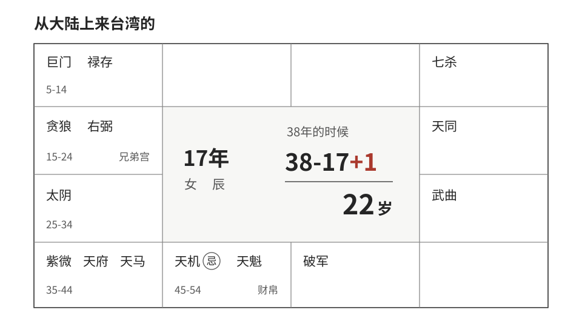 〔板书〕黑板画了十二格命盘，可辨：左上格「巨门」「禄存」「5-14」；左列第二格「贪狼」「右弼」「15-24」「兄弟宫」；第三格「太阴」「25-34」；下排「紫微」「天府」「天马」「35-44」，「天机」旁圈一个「忌」、「天魁」「45-54」「财帛」，再右「破军」；右上「七杀」，右列「天同」「武曲」。其余认不出。（[00:00:17](https://www.bilibili.com/video/BV1KJsLekEfA/?p=29&t=17)，第 515 帧） |
| **播迁来台的人八字有什么共同点？易经哪句话是对的？** | 〔口述〕倪师说「很奇怪的一件事就是」，「我算过很多十几年二十几年的」「播迁来台的哦」，「八字拿出来都是化忌的」。（[00:00:36–00:00:44](https://www.bilibili.com/video/BV1KJsLekEfA/?p=29&t=36)，第 1092–1349 帧） 〔口述〕「所以易经有一句话是对的」，就是「遇险而止」——「招凶啊」。（[00:00:45–00:00:57](https://www.bilibili.com/video/BV1KJsLekEfA/?p=29&t=45)，第 1350–1715 帧） 〔板书〕黑板左边竖写「遇险而止」四字。（[00:00:54](https://www.bilibili.com/video/BV1KJsLekEfA/?p=29&t=54)，第 1620 帧） 〔口述〕「所以我们要遇到险的时候」「要行险」，「行险呢才能够脱险」。（[00:00:57–00:01:05](https://www.bilibili.com/video/BV1KJsLekEfA/?p=29&t=57)，第 1716–1955 帧） 〔板书〕可辨：「遇险而止」旁边加了两字，似「招凶」；上方圈里和左下另有字，认不全，其余认不出。（[00:01:06](https://www.bilibili.com/video/BV1KJsLekEfA/?p=29&t=66)，第 1992 帧） |
| **1949 年流年化忌的人，停在大陆和动身有何不同？** | 〔口述〕「所以38年大陆沦陷的时候」「很多人流年化忌」，「化忌你看到杀就停了」「你就待在大陆上一停」，「40年未来40年就不一样」。（[00:01:05–00:01:13](https://www.bilibili.com/video/BV1KJsLekEfA/?p=29&t=65)，第 1956–2219 帧） 〔口述〕讲脱险之道：「脱险之道要行险」「停着不动险」；「所以坎为水是两个重险」，「停下来后面还有更大的险过来」，「之所以你会收到这个险」「是因为你停下来了」，「所以要行险行险」。（[00:01:14–00:01:33](https://www.bilibili.com/video/BV1KJsLekEfA/?p=29&t=74)，第 2244–2795 帧） 〔口述〕「那当年你你如果来卜个卦」，「卦上面一匹马就叫你动啊」「你赶快跑也可以啊」；要是不信、认为「命都掌握在我自己手上」，「好嘛那你就待在大陆上嘛」「对不对40年就不一样」。（[00:01:33–00:01:46](https://www.bilibili.com/video/BV1KJsLekEfA/?p=29&t=93)，第 2796–3209 帧） |
| **国运与个人化忌怎么分？巨日格为什么叫偏房格？** | 〔口述〕「很多人都是逢到化忌的时候碰到」，「这是第一个」，「38 这是国运国运呐」。（[00:01:47–00:01:54](https://www.bilibili.com/video/BV1KJsLekEfA/?p=29&t=107)，第 3210–3449 帧） 〔口述〕「那至于国运归国运」「那化忌归化忌呐」；她是太阳巨门，「巨日格还是巨日格」，「我不管你是大陆来的还是大台湾的」「都是一样啊」。（[00:01:55–00:02:05](https://www.bilibili.com/video/BV1KJsLekEfA/?p=29&t=115)，第 3450–3773 帧） 〔口述〕倪师断：「这种八字就是属于偏房格的人」。（[00:02:11–00:02:14](https://www.bilibili.com/video/BV1KJsLekEfA/?p=29&t=131)，第 3936–4043 帧） 〔口述〕「如果你拿到你的小孩子会这样」「你赶快要小心一点」「好要注意她」；「当然你如果觉得当偏房很好」「那那无所谓啊」，「我们只是陈述一件事实」。（[00:02:17–00:02:25](https://www.bilibili.com/video/BV1KJsLekEfA/?p=29&t=137)，第 4110–4361 帧） 〔板书〕本次新写的笔画认不出；画面上黑板中宫可辨「38」「17+1」和圈起来的「22」，左下「天机」旁圈一个「忌」。（[00:02:19](https://www.bilibili.com/video/BV1KJsLekEfA/?p=29&t=139)，第 4170 帧） |
| **叠图里命宫、兄弟、夫妻、子女各有哪些星？** | 〔叠图〕命宫丁巳：巨门平、禄存庙、火星得、天喜庙，另有天空庙、孤辰陷、封诰、劫煞。（[00:02:40–00:02:43](https://www.bilibili.com/video/BV1KJsLekEfA/?p=29&t=160)，第 4800–4913 帧） 〔叠图〕兄弟丙辰：贪狼庙且化禄、右弼庙且化科、陀罗庙，另有华盖庙。（[00:02:40–00:02:43](https://www.bilibili.com/video/BV1KJsLekEfA/?p=29&t=160)，第 4800–4913 帧） 〔叠图〕夫妻乙卯：太阴陷且化权，另有天刑庙、天官旺、天寿陷、天福平。（[00:02:40–00:02:43](https://www.bilibili.com/video/BV1KJsLekEfA/?p=29&t=160)，第 4800–4913 帧） 〔叠图〕子女甲寅：紫微庙、天府庙、天马旺、地劫平，另有三台平、天哭平、解神庙、阴煞。（[00:02:40–00:02:43](https://www.bilibili.com/video/BV1KJsLekEfA/?p=29&t=160)，第 4800–4913 帧） |
| **45–54 这十年为什么要很小心？** | 〔口述〕「诸位注意看」「流年是往这边走」，「她从45-54是化忌」，「我们看十年咯」「这个要很很很小心的」。（[00:02:37–00:02:50](https://www.bilibili.com/video/BV1KJsLekEfA/?p=29&t=157)，第 4728–5129 帧） 〔指代〕说「这个要很容易犯错误在这里」的「这个」时，右手按在黑板写「25-34」那一格右侧、向下箭头旁（材料标为夫妻宫那格）。（[00:02:51–00:02:53](https://www.bilibili.com/video/BV1KJsLekEfA/?p=29&t=171)，第 5130–5219 帧） 〔口述〕「你看她的子女宫好不好」「非常的棒」，「可是从45岁一进入的时候」「她为什么又去化忌去了」。（[00:02:54–00:03:03](https://www.bilibili.com/video/BV1KJsLekEfA/?p=29&t=174)，第 5220–5495 帧） 〔叠图〕财帛乙丑：天机陷且化忌、天魁旺、铃星得，另有寡宿平、破碎陷、天德庙。（[00:02:54–00:02:56](https://www.bilibili.com/video/BV1KJsLekEfA/?p=29&t=174)，第 5220–5291 帧） |
| **化忌代表哪些意义？** | 〔口述〕「化忌代表的意义是什么」「代表的是」「停滞官司孤军孤单破破耗」。（[00:03:03–00:03:16](https://www.bilibili.com/video/BV1KJsLekEfA/?p=29&t=183)，第 5496–5909 帧） 〔口述〕「全部是属于化忌」，「破耗就讲伤身啦」，「通通这4个通通是属于化忌」。（[00:03:17–00:03:25](https://www.bilibili.com/video/BV1KJsLekEfA/?p=29&t=197)，第 5910–6173 帧） 〔板书〕黑板右边竖写，可辨「停」「滞」，下一字似「官」，其余被倪师身体挡住，认不出。（[00:03:10](https://www.bilibili.com/video/BV1KJsLekEfA/?p=29&t=190)，第 5700 帧） |
| **过去算命仙怎么断这种八字？** | 〔口述〕「她到外地去的时候」，「像这种八字」「我们给她算命的时候」「怎么算你知道吗」，「平常你们拿到这种八字」，倪师引出过去「几几百年来几千年来」的算法。（[00:03:25–00:03:36](https://www.bilibili.com/video/BV1KJsLekEfA/?p=29&t=205)，第 6174–6497 帧） 〔口述〕倪师转述过去算命仙的说法：「算命仙坐在路边说那个」「来合看这个女孩子的八字」「一看哎呀」「夫人呐您这个女儿呢」「是刑夫克子命」「像这种人出家当尼姑最好」。这是转述旧说，不是倪师自己的断语。（[00:03:38–00:03:53](https://www.bilibili.com/video/BV1KJsLekEfA/?p=29&t=218)，第 6540–7013 帧） |
| **她若 22 岁没离开大陆，结果会不会不同？** | 〔口述〕「那太阳星不亮」，「你看她跑到外地去」；倪师设问如果「她继续待在大陆本地」「那会不会发生这种事情」，答「目前无可验证」。（[00:03:55–00:04:06](https://www.bilibili.com/video/BV1KJsLekEfA/?p=29&t=235)，第 7050–7409 帧） 〔口述〕「我们不能去判断」，「但是她的结果」「她是到台湾来」，「了解吧结果到台湾了」。（[00:04:07–00:04:13](https://www.bilibili.com/video/BV1KJsLekEfA/?p=29&t=247)，第 7410–7613 帧） |
| **为何说她 45 岁后孤单？女命太阳上中下各指谁？** | 〔口述〕「所以对她的子女来说」「她在45岁以前」好，进入45岁就变了：「这已经是果了知不知道」。（[00:04:13–00:04:20](https://www.bilibili.com/video/BV1KJsLekEfA/?p=29&t=253)，第 7614–7823 帧） 〔口述〕「我们这个这一个宫一个宫」「你要把当成果」，「从45岁以后就孤单了」「要这样子看」。（[00:04:20–00:04:31](https://www.bilibili.com/video/BV1KJsLekEfA/?p=29&t=260)，第 7824–8141 帧） 〔口述〕「那太阳星不亮」，「女人的太阳上面指的爸爸」「中间指的是先生」「下面指的是儿子」，「所以她从45岁都看不到了」。（[00:04:31–00:04:40](https://www.bilibili.com/video/BV1KJsLekEfA/?p=29&t=271)，第 8142–8405 帧） |
| **25–34 夫妻、35–44 子女两段，对先生和子女怎么断？** | 〔口述〕「那25-34岁十年呢」「是走的是夫妻」，倪师转到「那对她的先生来说」。（[00:04:40–00:04:47](https://www.bilibili.com/video/BV1KJsLekEfA/?p=29&t=280)，第 8406–8615 帧） 〔口述〕「35-44是天马逢了南北斗星君」，「这你不要管子女」，「35-44也代表这个太太的流年」；流年一进来「紫微天府在里面」，「对她来说也是孤军奋战」「只是孤军奋战得很好而已」。（[00:04:48–00:05:06](https://www.bilibili.com/video/BV1KJsLekEfA/?p=29&t=288)，第 8652–9209 帧） 〔叠图〕叠图子女甲寅格标着「孤军奋战」，同格紫微庙、天府庙、天马旺。（[00:04:37–00:04:40](https://www.bilibili.com/video/BV1KJsLekEfA/?p=29&t=277)，第 8328–8405 帧） 〔口述〕「所以这个宫对先生来说」「她未来她是也是一个人单打独斗」「先生也没有了」；「那对这个子女来说」「未来的宫也是化忌」，「所以她的夫和子都凶啊」。（[00:05:07–00:05:18](https://www.bilibili.com/video/BV1KJsLekEfA/?p=29&t=307)，第 9210–9545 帧） 〔推断〕推断：「未来的宫也是化忌」应指子女（35-44）之后的 45-54 财帛乙丑，叠图该格天机陷且化忌，与前面「她从45-54是化忌」一致；倪师此句没有明说是哪一宫。（[00:05:12–00:05:18](https://www.bilibili.com/video/BV1KJsLekEfA/?p=29&t=312)，第 9384–9545 帧） |
| **批八字为什么要看未来十年、未来一年？** | 〔口述〕「这因为这个很容易犯错」，「所以我们常常要批八字」「要注意一点就是」「看她这十年怎么样走」「要看未来」。（[00:05:18–00:05:26](https://www.bilibili.com/video/BV1KJsLekEfA/?p=29&t=318)，第 9546–9809 帧） 〔口述〕「你看她一年怎么走」「要看未来」；比如「22你你 21岁来找我们算来算」「你就22岁化忌」，「那你21岁的 21岁的决策」「一定通通是错的」。（[00:05:27–00:05:38](https://www.bilibili.com/video/BV1KJsLekEfA/?p=29&t=327)，第 9810–10169 帧） 〔叠图〕叠图子女甲寅格标着「来算」；财帛乙丑格仍是天机陷且化忌。（[00:05:30](https://www.bilibili.com/video/BV1KJsLekEfA/?p=29&t=330)，第 9900–9923 帧） 〔口述〕「她的命是这样子走」「她的想法就会引导到她错误的方向去」，所以「那我们要想办法改变她的念」（句头「2」已去掉）。（[00:05:39–00:05:46](https://www.bilibili.com/video/BV1KJsLekEfA/?p=29&t=339)，第 10170–10391 帧） |

**总结区**

- 通用规则：化忌代表停滞、官司、孤军、孤单、破耗，破耗讲伤身（[00:03:03–00:03:25](https://www.bilibili.com/video/BV1KJsLekEfA/?p=29&t=183)，第 5496–6173 帧）；女人的太阳，上面指爸爸、中间指先生、下面指儿子（[00:04:32–00:04:37](https://www.bilibili.com/video/BV1KJsLekEfA/?p=29&t=272)，第 8166–8327 帧）；国运归国运、化忌归化忌，巨日格不管从哪里来都还是巨日格，这种八字属偏房格（[00:01:55–00:02:14](https://www.bilibili.com/video/BV1KJsLekEfA/?p=29&t=115)，第 3450–4043 帧）；批八字要看未来十年、未来一年怎么走；下一年化忌，这一年的决策通通是错的（[00:05:18–00:05:38](https://www.bilibili.com/video/BV1KJsLekEfA/?p=29&t=318)，第 9546–10169 帧）
- 只在本例：这位民国38年来台的女命，倪师算她当年22岁（[00:00:12–00:00:22](https://www.bilibili.com/video/BV1KJsLekEfA/?p=29&t=12)，第 360–671 帧）；她 45-54 走化忌，子女宫本身很好，但 45 岁后孤单、夫和子都凶（[00:02:37–00:05:18](https://www.bilibili.com/video/BV1KJsLekEfA/?p=29&t=157)，第 4728–9545 帧）；35-44 天马逢南北斗星君，紫微天府在里面，孤军奋战得很好（[00:04:48–00:05:06](https://www.bilibili.com/video/BV1KJsLekEfA/?p=29&t=288)，第 8652–9209 帧）；她若留在大陆会不会如此，倪师说目前无可验证、不能判断（[00:03:55–00:04:08](https://www.bilibili.com/video/BV1KJsLekEfA/?p=29&t=235)，第 7050–7451 帧）
- 不是排盘规则，是处世方法：遇险而止招凶，遇到险要行险才能脱险，停着不动后面有更大的险（[00:00:45–00:01:33](https://www.bilibili.com/video/BV1KJsLekEfA/?p=29&t=45)，第 1350–2795 帧）；算到孩子是偏房格要小心注意，但只陈述事实，觉得当偏房好也无所谓（[00:02:17–00:02:25](https://www.bilibili.com/video/BV1KJsLekEfA/?p=29&t=137)，第 4110–4361 帧）；看到对方下一年化忌，要想办法改变他的念头（[00:05:39–00:05:46](https://www.bilibili.com/video/BV1KJsLekEfA/?p=29&t=339)，第 10170–10391 帧）

**待核**

1. [00:00:00–00:00:02](https://www.bilibili.com/video/BV1KJsLekEfA/?p=29&t=0)，第 0–71 帧 片头字幕「15上紫微斗数」与语音频道广告词，按要求未写。
2. [00:00:28](https://www.bilibili.com/video/BV1KJsLekEfA/?p=29&t=28)，第 864 帧 字幕「陷旺得不平陷庙庙陷陷陷陷庙平陷」是乱码，语音另有「女孩子是逆转嘛男孩子是顺转」，两路对不上，未写入。
3. [00:00:37](https://www.bilibili.com/video/BV1KJsLekEfA/?p=29&t=37)，第 1128 帧 字幕「我算过很多十几年二十几年的」，语音作「算过很多民国事件二十几年」，两路不全对。
4. [00:01:06](https://www.bilibili.com/video/BV1KJsLekEfA/?p=29&t=66)，第 1992 帧 板书「遇险而止」旁两字似「招凶」，上方圈里与左下的字认不全。
5. [00:01:08](https://www.bilibili.com/video/BV1KJsLekEfA/?p=29&t=68)，第 2058 帧 「化忌你看到杀就停了」语音作「看到啥就停了」，「杀」字待核。
6. [00:01:57](https://www.bilibili.com/video/BV1KJsLekEfA/?p=29&t=117)，第 3534 帧 字幕「那日太阳巨门」的「那日」语音里没有，待核。
7. [00:03:07](https://www.bilibili.com/video/BV1KJsLekEfA/?p=29&t=187)，第 5622 帧 化忌列了停滞、官司、孤军、孤单、破耗五项（语音「制官司…破号」），下一句却说「通通这4个」，数目对不上。
8. [00:04:48](https://www.bilibili.com/video/BV1KJsLekEfA/?p=29&t=288)，第 8652 帧 「天马逢了南北斗星君」倪师用了但本块没解释。
9. [00:05:00](https://www.bilibili.com/video/BV1KJsLekEfA/?p=29&t=300)，第 9000 帧 「紫微天府在里面」语音作「天武战里面」，两路不全对。
10. [00:05:07](https://www.bilibili.com/video/BV1KJsLekEfA/?p=29&t=307)，第 9210 帧 「所以这个宫对先生来说」指哪一宫没明说；[00:05:13](https://www.bilibili.com/video/BV1KJsLekEfA/?p=29&t=313)，第 9397 帧指代标为不确定，未采用。
11. 第4796、5054、7827、8837、9397帧 指代标注为「是（不确定）」，未当依据。
12. 第1620、5700帧 黑板右列「天同」格旁有「事业宫」，下方红笔圈「25」并以箭头指向它，另有「田宅」「交友」等字，含义本块没讲。
13. [00:02:19](https://www.bilibili.com/video/BV1KJsLekEfA/?p=29&t=139)，第 4170 帧 板书图画面上已有叠图：左上命宫巳格贴着「女命巨日 偏房格」，右下贴着迁移癸亥、太阳陷、65~74、身宫；材料 ▣ 行本块没有这两张，按要求未写成叠图条目。
14. 第4800、5220、9900帧 叠图格里的岁数串含□或无法按图例还原，未写。

## 例一续：红鸾天喜、二婚夫、35岁丧夫、眼尾与坤宫、44岁丧子

| 巳 | 午 | 未 | 申 |
|---|---|---|---|
| **命宫 丁巳** 巨门平 禄存庙 火星得 | **父母 戊午** 廉贞平 天相庙 擎羊陷 | **福德 己未** 天梁旺 文昌利 文曲旺 天钺旺 | **田宅 庚申** 七杀庙 地空庙 |
| **兄弟 丙辰** 贪狼庙禄 右弼庙科 陀罗庙 | **例一续：红鸾天喜、二婚夫、35岁丧夫、眼尾与坤宫、44岁丧子 · 命宫丁巳** | 据视频叠图重排 | **官禄 辛酉** 天同平 |
| **夫妻 乙卯** 太阴陷权 | 后期贴图，不算倪师的话 |  | **交友 壬戌** 武曲庙 左辅庙 |
| **子女 甲寅** 紫微庙 天府庙 天马旺 地劫平 | **财帛 乙丑** 天机陷忌 天魁旺 | **疾厄 甲子** 破军庙 | **迁移 癸亥**（身宫） 太阳陷 |

同例一的命盘，见上图。

### 2　红鸾太阳定偏房，35丧夫44丧子（[00:05:46–00:12:13](https://www.bilibili.com/video/BV1KJsLekEfA/?p=29&t=346)，第 10392–21995 帧）

| 提示区 | 笔记区 |
|---|---|
| **25–34这十年，本例女命注定了什么？** | 〔口述〕倪师接着讲例一，先问她来找时的年纪：「那像这种是十年」「她来找我们的时候已经几岁了」。随后说出的岁数字幕是乱码，几岁说不清（见待核）。（[00:05:46–00:05:52](https://www.bilibili.com/video/BV1KJsLekEfA/?p=29&t=346)，第 10392–10583 帧） 〔口述〕「25-34这十年中间」「她的命中注定要没有先生」「可是她却结婚了」——命里注定没有先生，她却结了婚。（[00:05:57–00:06:03](https://www.bilibili.com/video/BV1KJsLekEfA/?p=29&t=357)，第 10728–10913 帧） 〔叠图〕叠图贴出夫妻乙卯：太阴陷权、天刑庙、天官旺、天寿陷、天福平、息神、病符、衰、青龙；同时贴迁移癸亥：太阳陷、红鸾庙、天月、副旬平、大耗陷、亡神、绝、身、飞廉、龙德。（[00:05:57–00:06:00](https://www.bilibili.com/video/BV1KJsLekEfA/?p=29&t=357)，第 10728–10805 帧） 〔板书〕本块开头的板面可辨：「天机」「17年」「辰」「女」「果」，其余被人挡住或认不出。（[00:05:46](https://www.bilibili.com/video/BV1KJsLekEfA/?p=29&t=346)，第 10404 帧） |
| **本例的天喜、红鸾落在哪里？** | 〔口述〕「诸位看到她红鸾天喜星在哪里」「这就麻烦就在这里」「天喜红鸾星刚好在这里」。（[00:06:03–00:06:14](https://www.bilibili.com/video/BV1KJsLekEfA/?p=29&t=363)，第 10914–11243 帧） 〔指代〕说「就在这里」时，手指的是黑板最上方写着巨门、禄存那一格的右侧，板面该处可见「天喜」二字。（[00:06:07](https://www.bilibili.com/video/BV1KJsLekEfA/?p=29&t=367)，第 11025 帧） 〔叠图〕叠图贴命宫丁巳：巨门平、禄存庙、火星得、天喜庙、天空庙、孤辰陷、封诰、劫煞、博士、晦气、临官；迁移癸亥：太阳陷、红鸾庙、身宫。（[00:06:07–00:06:14](https://www.bilibili.com/video/BV1KJsLekEfA/?p=29&t=367)，第 11028–11243 帧） 〔板书〕这一刻板面右上可辨「天机」「父母」「17年」，左侧几行和画圈的字认不出，倪师背影挡住大半。（[00:06:07](https://www.bilibili.com/video/BV1KJsLekEfA/?p=29&t=367)，第 11033 帧） |
| **命带红鸾天喜，和红鸾落在别宫，差在哪？** | 〔口述〕倪师假设：「如果女孩子她的命没有天喜红鸾」「她的天喜红鸾星在夫夫妻」「不对不对在父母」「或者在兄弟」，或者在朋友那边，「就会做偏房也就罢了」。（[00:06:16–00:06:25](https://www.bilibili.com/video/BV1KJsLekEfA/?p=29&t=376)，第 11286–11579 帧） 〔叠图〕叠图把命宫丁巳那格原样贴成父母戊午、兄弟丙辰、交友壬□，是配合倪师假设的演示，不是这张盘真的父母、兄弟、交友宫。（[00:06:19–00:06:25](https://www.bilibili.com/video/BV1KJsLekEfA/?p=29&t=379)，第 11394–11579 帧） 〔口述〕「问题是她的命带红鸾天喜星」「一定会结婚」，「命里面红鸾秀喜星会结婚再散」（秀喜即天喜），「那结婚散的时候」「有有有生离还有死别」。（[00:06:26–00:06:36](https://www.bilibili.com/video/BV1KJsLekEfA/?p=29&t=386)，第 11580–11903 帧） |
| **为什么只看巨门和太阳就断她是偏房格？** | 〔口述〕「所以像这种八字的格」「她注定她是偏房格」「我们不用看其他」「光看巨门和太阳」「这太阳星落陷就够了」。（[00:06:36–00:06:43](https://www.bilibili.com/video/BV1KJsLekEfA/?p=29&t=396)，第 11904–12101 帧） 〔口述〕「则太阳星要入庙啊」「要庙旺才行」「那落陷完全不一样啊」「两个刚好极端的相反」「那不是生离就是死别」。（[00:06:43–00:06:52](https://www.bilibili.com/video/BV1KJsLekEfA/?p=29&t=403)，第 12102–12389 帧） 〔叠图〕叠图同一格贴了两次：迁移癸亥写太阳庙、迁移癸亥′写太阳陷，其余红鸾庙、身宫等相同，用来对照倪师说的入庙与落陷。（[00:06:43–00:06:44](https://www.bilibili.com/video/BV1KJsLekEfA/?p=29&t=403)，第 12102–12137 帧） 〔口述〕「如果她结婚了」「不是生离就是死别」「结果还是得做偏房」「做二房就是这样子」。（[00:06:54–00:07:03](https://www.bilibili.com/video/BV1KJsLekEfA/?p=29&t=414)，第 12420–12695 帧） |
| **24岁红鸾星动，「象」只出现一次指什么？** | 〔口述〕「所以你看25 26」「她24岁」「红鸾星就动了」——24岁红鸾星动。（[00:07:03–00:07:14](https://www.bilibili.com/video/BV1KJsLekEfA/?p=29&t=423)，第 12696–13037 帧） 〔指代〕说「但是这个红鸾星」时，粉笔指的是板面右下格上方圈起来的「太阳」字样右端，板上该处没看到「红鸾」二字。（[00:07:14](https://www.bilibili.com/video/BV1KJsLekEfA/?p=29&t=434)，第 13039 帧） 〔口述〕「但是这个红鸾星动的时候」「太阳星陷地象要出现一次」「在我们知道易经呢」「象和数最难懂」「这个象象只有一次」。（[00:07:14–00:07:25](https://www.bilibili.com/video/BV1KJsLekEfA/?p=29&t=434)，第 13038–13379 帧） 〔叠图〕叠图贴出多格，其中迁移己亥：太阳陷、红鸾庙、身宫；财帛□丑：天机陷忌、天魁旺、铃星得；另有三格宫名认不出（□□□□等），不猜。（[00:07:04–00:07:12](https://www.bilibili.com/video/BV1KJsLekEfA/?p=29&t=424)，第 12738–12983 帧） |
| **太阳落陷的女命，婚配要哪两个条件？** | 〔口述〕「太阳星落陷的话」「婚的对象要两个条件」「第一个7岁以上」「第二个二婚夫」。（[00:07:26–00:07:35](https://www.bilibili.com/video/BV1KJsLekEfA/?p=29&t=446)，第 13380–13679 帧） 〔口述〕「先生要年龄大她7岁以上」「或者是离过婚的人」「让她第一次太阳不亮」。（[00:07:36–00:07:41](https://www.bilibili.com/video/BV1KJsLekEfA/?p=29&t=456)，第 13680–13835 帧） 〔口述〕为什么差7岁：「因为我们刚好走到对面是六个时辰」「太阳刚好六个时辰」「12个小时走完」「所以一般要差6岁以上7岁」。（[00:07:41–00:07:50](https://www.bilibili.com/video/BV1KJsLekEfA/?p=29&t=461)，第 13836–14111 帧） 〔板书〕可辨：「天机」「七杀」「父母」「田宅」「天同」「武曲」「17年」「辰」「38」「17+1」、圈起的「22」「果」「财帛」「55-64」「65-74」，右侧「①」「②」；右上画圈的字和①②旁的字认不出。（[00:07:35](https://www.bilibili.com/video/BV1KJsLekEfA/?p=29&t=455)，第 13671 帧） |
| **婚姻有问题的人，倪师教怎么跟她说？** | 〔口述〕「所以有的人婚姻有问题」「我们跟她说你大7岁以上就好了」。（[00:07:50–00:07:56](https://www.bilibili.com/video/BV1KJsLekEfA/?p=29&t=470)，第 14112–14285 帧） 〔口述〕「这个那二婚夫呢」「就是先生有离过婚的」「嫁这种人就可以结」。（[00:07:56–00:08:01](https://www.bilibili.com/video/BV1KJsLekEfA/?p=29&t=476)，第 14286–14435 帧） 〔口述〕反过来，「那你如果嫁个先生年龄跟你差不多」「又没有结过婚的话」「凶了」。（[00:08:01–00:08:06](https://www.bilibili.com/video/BV1KJsLekEfA/?p=29&t=481)，第 14436–14591 帧） |
| **为什么断事情发生在35岁而不是36岁？** | 〔口述〕「所以她在35岁那一年」，「对35岁一个年宫来说」「一年的宫来说」「35岁的第二年」「……36岁是不是太阳就看不到了」。（[00:08:06–00:08:17](https://www.bilibili.com/video/BV1KJsLekEfA/?p=29&t=486)，第 14592–14921 帧） 〔口述〕「所以事情一定是发生在35岁」「因为36岁已经是果了」「懂不懂我意思」「就是说从36岁开始就看不到了」。（[00:08:17–00:08:26](https://www.bilibili.com/video/BV1KJsLekEfA/?p=29&t=497)，第 14928–15203 帧） 〔口述〕「那刚好对25-34来说」「是25-34刚好是走到夫妻的尾巴」「要进入35岁」；「她35岁只看到儿子」「看不到先生嘛」「所以她真的在35岁那年呢」「先生就走人了」。（[00:08:28–00:08:42](https://www.bilibili.com/video/BV1KJsLekEfA/?p=29&t=508)，第 15252–15671 帧） 〔叠图〕叠图贴子女甲寅：紫微庙、天府庙、天马旺、地劫平、三台平、天哭平、天巫、解神庙、阴煞、吊客、岁驿、小耗、病。（[00:08:28–00:08:30](https://www.bilibili.com/video/BV1KJsLekEfA/?p=29&t=508)，第 15252–15323 帧） 〔推断〕推断：叠图夫妻乙卯格的数字串开头「2534」与倪师说的「25-34」「走到夫妻的尾巴」对得上，应是该格所管的25~34十年；材料本身没逐字标明。（[00:08:30–00:08:33](https://www.bilibili.com/video/BV1KJsLekEfA/?p=29&t=510)，第 15324–15395 帧） |
| **面相上，眼尾怎样主夫妻死别？** | 〔口述〕「脸上的相上看的时候」「这个眼睛呐」，看眼尾：「眼尾呢我们在眼睛在这里哈」。（[00:08:42–00:08:55](https://www.bilibili.com/video/BV1KJsLekEfA/?p=29&t=522)，第 15672–16067 帧） 〔指代〕说「眼睛在这里」时，指的是他正在板右上用粉笔画的椭圆眼形（是图，没有字）。（[00:08:54](https://www.bilibili.com/video/BV1KJsLekEfA/?p=29&t=534)，第 16042 帧） 〔口述〕「眼尾呢我们叫好门凹陷下去」，「而且是黑色的」「很暗黑暗」「凹陷下去」「主夫妻死别」「两个眼睛都会有」。「好门」两路对不上（见待核）。（[00:08:55–00:09:19](https://www.bilibili.com/video/BV1KJsLekEfA/?p=29&t=535)，第 16074–16775 帧） 〔板书〕板右上可辨「七杀」「相」，旁边画了两个椭圆眼形和一个「凹」形图；左侧几行字认不出。（[00:09:14](https://www.bilibili.com/video/BV1KJsLekEfA/?p=29&t=554)，第 16620 帧） 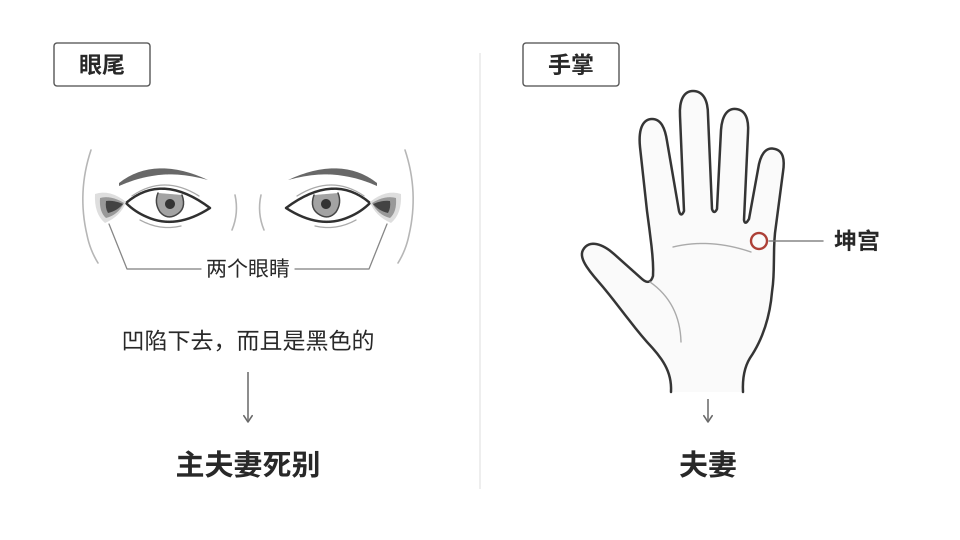 |
| **手掌上的坤宫主什么？日后要怎么合参？** | 〔口述〕「这个手掌上面」「待会我会介绍到」「指头这个手掌」「大拇指在这边」；「手掌上面这个断卦叫做坤宫」「坤宫主的就是什么夫妻」。这是手掌上的部位，不是命盘的宫。（[00:09:19–00:09:30](https://www.bilibili.com/video/BV1KJsLekEfA/?p=29&t=559)，第 16776–17123 帧） 〔指代〕说「指头这个手掌」时，指的是他在板左上空白处画的手掌简笔图（没有字）。（[00:09:22](https://www.bilibili.com/video/BV1KJsLekEfA/?p=29&t=562)，第 16866 帧） 〔板书〕板左上画了手掌简笔图，旁边写了一团字，形似「坤宫」，认不准；命盘格里可辨「巨门」「天喜」「15-24」「兄弟宫」「25-34」「17年」「辰」「果」等。（[00:09:28](https://www.bilibili.com/video/BV1KJsLekEfA/?p=29&t=568)，第 17064 帧） 〔口述〕预告：「待会我们会跟诸位介绍到手相」「我们以后手相脸相八字」「通通合在一起」。（[00:09:30–00:09:38](https://www.bilibili.com/video/BV1KJsLekEfA/?p=29&t=570)，第 17124–17363 帧） 〔口述〕又预告：「后面我们再教四柱」，「推易经推命的时候哈」「我们就把四柱排在中间」「然后先天卦后天卦排这十年大卦」「然后每年流年的小卦都有」。本块没有展开。（[00:09:38–00:09:52](https://www.bilibili.com/video/BV1KJsLekEfA/?p=29&t=578)，第 17364–17789 帧） |
| **35岁丧夫之后，为什么是44岁再出事？** | 〔口述〕「因为什么这36是看不到的」「所以35岁死的先生过世」；「然后这个人哦」「到44岁加9」「我上次跟诸位讲过」「9为老阳数」。（[00:09:56–00:10:27](https://www.bilibili.com/video/BV1KJsLekEfA/?p=29&t=596)，第 17892–18839 帧） 〔板书〕板中右可辨「+9=44」，前面圈住的数字像「35」，认不准。（[00:10:15](https://www.bilibili.com/video/BV1KJsLekEfA/?p=29&t=615)，第 18456 帧） 〔叠图〕叠图贴出八格，各格单印一个数：交友壬戌37、官禄辛酉38、田宅庚申39、福德己未40、父母戊午41、命宫丁巳42、兄弟丙辰43、夫妻乙卯44。父母戊午：廉贞平、天相庙、擎羊陷；兄弟丙辰：贪狼庙禄、右弼庙科、陀罗庙。（[00:10:17–00:10:27](https://www.bilibili.com/video/BV1KJsLekEfA/?p=29&t=617)，第 18534–18839 帧） 〔板书〕这一刻板面大半被叠图和人挡住，可辨「38」「17+1」，其余认不出。（[00:10:25](https://www.bilibili.com/video/BV1KJsLekEfA/?p=29&t=625)，第 18768 帧） |
| **45–54化忌，为什么看不到儿子？** | 〔口述〕「她44岁在这一年」，「45岁开始到54岁化忌」「看不到儿子的」「因为她注定从这个时候孤单」。（[00:10:28–00:10:41](https://www.bilibili.com/video/BV1KJsLekEfA/?p=29&t=628)，第 18840–19253 帧） 〔口述〕「44岁刚好最尾端」「未来第二年」「未来一年就是什么子女宫」；「就她35岁那年先生过世」「9年以后儿子又走了」。（[00:10:41–00:10:54](https://www.bilibili.com/video/BV1KJsLekEfA/?p=29&t=641)，第 19254–19625 帧） 〔叠图〕叠图夫妻□卯格标着「儿子过世」，疾厄□子格标着「先生走人」。（[00:10:51–00:10:54](https://www.bilibili.com/video/BV1KJsLekEfA/?p=29&t=651)，第 19530–19625 帧） 〔指代〕说「如果这个化忌」时，手掌按在板右下角带圈的字上，圈内字被手挡住，下方隐约可见「…54」。（[00:10:54](https://www.bilibili.com/video/BV1KJsLekEfA/?p=29&t=654)，第 19638 帧） |
| **批八字要特别注意哪种「没有大运」？** | 〔口述〕「她的流年是这样子走」，接着说「这个八字不是这样批的」。（[00:10:58–00:11:05](https://www.bilibili.com/video/BV1KJsLekEfA/?p=29&t=658)，第 19740–19979 帧） 〔口述〕「所以我们批八字特别要注意」「你未来一年没有大运的时候」「大运在前一年」；「未来十年没有大运的时候」「大限就在前一年前十年」。（[00:11:06–00:11:19](https://www.bilibili.com/video/BV1KJsLekEfA/?p=29&t=666)，第 19992–20375 帧） 〔叠图〕叠图贴子女甲寅、财帛乙丑：子女甲寅格标着「大限在前十年」；财帛乙丑（天机陷忌、天魁旺）格标着「未来十年无大运」。（[00:11:13–00:11:15](https://www.bilibili.com/video/BV1KJsLekEfA/?p=29&t=673)，第 20202–20261 帧） |
| **这种命的女人，长相有什么特征？** | 〔口述〕「那像这种命的人呢」「长长的样子」「都是面薄脸上没有肉」「皮骨相连」「皮骨啊没有肉」「眼睛呢凹陷下去」。（[00:11:22–00:11:41](https://www.bilibili.com/video/BV1KJsLekEfA/?p=29&t=682)，第 20466–21041 帧） 〔口述〕「然后眼眉是靠得很近」「眼睛眉毛都靠的很近」「因为她没有家了嘛」「她一个人嘛」。（[00:11:41–00:11:46](https://www.bilibili.com/video/BV1KJsLekEfA/?p=29&t=701)，第 21042–21209 帧） 〔口述〕「因为眼眉之间主田宅宫」「那眼眉太近的话」「没有什么家族观念」。（[00:11:48–00:12:06](https://www.bilibili.com/video/BV1KJsLekEfA/?p=29&t=708)，第 21252–21809 帧） 〔口述〕收住例一：「所以女孩子的命啊」「最怕什么呀」「太阳陷地」。（[00:12:07–00:12:13](https://www.bilibili.com/video/BV1KJsLekEfA/?p=29&t=727)，第 21810–21995 帧） |

**总结区**

- 通用规则：命带红鸾天喜一定会结婚，婚再散时有生离、有死别（[00:06:26–00:06:36](https://www.bilibili.com/video/BV1KJsLekEfA/?p=29&t=386)，第 11580–11903 帧）；太阳星落陷的女命，婚配对象要大7岁以上，或是离过婚的二婚夫（[00:07:26–00:07:50](https://www.bilibili.com/video/BV1KJsLekEfA/?p=29&t=446)，第 13380–14111 帧）；眼尾凹陷且黑暗，主夫妻死别，两个眼睛都会有（[00:08:55–00:09:19](https://www.bilibili.com/video/BV1KJsLekEfA/?p=29&t=535)，第 16074–16775 帧）；眼眉之间主田宅宫，眼眉太近没有什么家族观念（[00:11:48–00:12:06](https://www.bilibili.com/video/BV1KJsLekEfA/?p=29&t=708)，第 21252–21809 帧）
- 只在本例：本例命宫丁巳有巨门、天喜，迁移癸亥太阳陷、红鸾，倪师断她注定偏房格（[00:06:03–00:06:43](https://www.bilibili.com/video/BV1KJsLekEfA/?p=29&t=363)，第 10914–12101 帧）；25–34走到夫妻的尾巴，36岁起太阳看不到，所以35岁先生过世（[00:08:06–00:08:42](https://www.bilibili.com/video/BV1KJsLekEfA/?p=29&t=486)，第 14592–15671 帧）；35岁加9到44岁，45–54化忌看不到儿子，9年后儿子又走（[00:10:00–00:10:54](https://www.bilibili.com/video/BV1KJsLekEfA/?p=29&t=600)，第 18018–19625 帧）；这种命的人面薄、皮骨相连、眼睛凹陷、眼眉靠得很近（[00:11:22–00:11:46](https://www.bilibili.com/video/BV1KJsLekEfA/?p=29&t=682)，第 20466–21209 帧）
- 不是排盘规则，是处世方法：婚姻有问题的人，跟她说嫁大7岁以上或离过婚的人就可以结，年龄相近又没结过婚就凶（[00:07:50–00:08:06](https://www.bilibili.com/video/BV1KJsLekEfA/?p=29&t=470)，第 14112–14591 帧）

**待核**

1. [00:05:54](https://www.bilibili.com/video/BV1KJsLekEfA/?p=29&t=354)，第 10632 帧字幕「3736 35岁」是乱码，语音作「3635岁」，她来找时几岁说不清，不定。
2. [00:06:09](https://www.bilibili.com/video/BV1KJsLekEfA/?p=29&t=369)，第 11084 帧指代「天喜红鸾星刚好在这里」看不出手指在哪，未用。
3. [00:06:21](https://www.bilibili.com/video/BV1KJsLekEfA/?p=29&t=381)，第 11448 帧字幕「晦气或署往别的朋友啊」，句头「晦气」是叠图里的字，语音作「或者在别的朋友」，只转述未引原话。
4. [00:06:30](https://www.bilibili.com/video/BV1KJsLekEfA/?p=29&t=390)，第 11724 帧字幕「红鸾秀喜星」按上下文改为红鸾天喜星。
5. 命宫丁巳格的巨门：[00:06:07](https://www.bilibili.com/video/BV1KJsLekEfA/?p=29&t=367)，第 11028 帧叠图写「巨门平」，[00:10:58](https://www.bilibili.com/video/BV1KJsLekEfA/?p=29&t=658)，第 19740 帧叠图写「巨门旺」，两处不一致。
6. [00:07:04](https://www.bilibili.com/video/BV1KJsLekEfA/?p=29&t=424)，第 12738 帧语音栏多出「22岁跑路到台湾来了24岁呢红鸾星就进来了」，字幕只有「她24岁」，未引。
7. [00:07:04](https://www.bilibili.com/video/BV1KJsLekEfA/?p=29&t=424)，第 12738 帧起叠图有三格宫名认不出（□□□□、□□□□′、□□□□′′），疾厄格此处写甲子、后面写□子，不猜。
8. [00:07:23](https://www.bilibili.com/video/BV1KJsLekEfA/?p=29&t=443)，第 13308 帧指代「象和数最难懂」所指画圈的字是不确定，未用；[00:07:35](https://www.bilibili.com/video/BV1KJsLekEfA/?p=29&t=455)，第 13671 帧板书右上画圈的字、①②旁的字认不出。
9. [00:08:38](https://www.bilibili.com/video/BV1KJsLekEfA/?p=29&t=518)，第 15540 帧叠图疾厄□子格另印「35」、迁移癸亥格另印「36」，这两个单独数字的含义图例没说明，未写进笔记。
10. [00:08:55](https://www.bilibili.com/video/BV1KJsLekEfA/?p=29&t=535)，第 16074 帧字幕「眼尾呢我们叫好门凹陷下去」，语音作「街门」，两路对不上，照字幕引。
11. [00:09:28](https://www.bilibili.com/video/BV1KJsLekEfA/?p=29&t=568)，第 17064 帧板书手掌简笔图旁的字形似「坤宫」，认不准。
12. [00:09:40](https://www.bilibili.com/video/BV1KJsLekEfA/?p=29&t=580)，第 17406 帧字幕「四柱命卦值日」，语音作「寡之日推」，对不上，未引；[00:09:53](https://www.bilibili.com/video/BV1KJsLekEfA/?p=29&t=593)，第 17796 帧「那她走到」语音作「因为」，未引。
13. [00:10:17](https://www.bilibili.com/video/BV1KJsLekEfA/?p=29&t=617)，第 18534 帧「9为老阳数」倪师说「我上次跟诸位讲过」，本块没有解释为什么加9。
14. [00:11:04](https://www.bilibili.com/video/BV1KJsLekEfA/?p=29&t=664)，第 19938 帧字幕「这个八字不是这样批的」，语音在前一句作「这八十不是讲P」，大体对得上；此处为何说八字，本块没讲。
15. [00:11:00](https://www.bilibili.com/video/BV1KJsLekEfA/?p=29&t=660)，第 19800 帧、[00:11:06](https://www.bilibili.com/video/BV1KJsLekEfA/?p=29&t=666)，第 19980–19991 帧字幕是画面上的小限、流年数字串，语音栏没有，不是倪师的话，未引。
16. [00:11:19](https://www.bilibili.com/video/BV1KJsLekEfA/?p=29&t=679)，第 20376 帧字幕「这样看了解栽意思吧」中「栽意思」按上下文改为「我意思」。
17. [00:11:51](https://www.bilibili.com/video/BV1KJsLekEfA/?p=29&t=711)，第 21330 帧字幕「没有什么家族观念」，语音作「家庭观念」。

## 例二（女命，命宫壬申天钺）：公职、兄弟化忌、丧父、49岁丧夫

| 巳 | 午 | 未 | 申 |
|---|---|---|---|
| **子女 己巳** 天相得 天马平 陀罗陷 | （午：没贴过） | **兄弟 辛未** 廉贞利 七杀庙 文昌利 文曲旺忌 擎羊庙 | **命宫 壬申** 天钺庙 地空庙 |
| **财帛 戊辰** 巨门陷 | **例二 · 命宫壬申** | 据视频叠图重排 | **父母 癸酉** （无主星、辅星） |
| （卯：没贴过） | 后期贴图，不算倪师的话 |  | **福德 甲戌** 天同平 |
| **迁移 丙寅**（身宫） 天机得 太阴旺 地劫平 | **交友 丁丑** 天府庙 左辅庙 右弼庙 铃星得 | **官禄 丙子** 太阳陷 天魁旺 火星陷 | **田宅 乙亥** 武曲平禄 破军平 |

按视频里这张盘逐格重画（我们自己画的图，不是视频截图）；数据见 [命盘-P29-例二.json](图/命盘-P29-例二.json)。

### 3　例二天钺入命：公职、丧父与兄弟化忌（[00:12:13–00:16:00](https://www.bilibili.com/video/BV1KJsLekEfA/?p=29&t=733)，第 21996–28823 帧）

| 提示区 | 笔记区 |
|---|---|
| **例二这位女命，命宫是什么情况？** | 〔口述〕倪师换一张新盘：「像这个命啊」「诸位看」，说这是「女孩子天钺星入命」，并指出「这个里面科权禄都没有」。（[00:12:13–00:12:25](https://www.bilibili.com/video/BV1KJsLekEfA/?p=29&t=733)，第 21996–22361 帧） 〔叠图〕命宫壬申：格内没有主星，有天钺庙、地空庙、天厨、天巫、劫煞、大耗陷、小耗、月德、阴煞、青龙、临官、副截庙、副旬庙；大限按图例为4~13。（[00:12:17–00:12:19](https://www.bilibili.com/video/BV1KJsLekEfA/?p=29&t=737)，第 22110–22181 帧） 〔板书〕本块开头的板面可辨：右上格「4-13」「命」，上排右侧「天钺」，左列「巨门」，右列「14-23」「24-33」「天同」，左下「64-73」，下排「54-63」；其余粉笔字认不出。（[00:12:13](https://www.bilibili.com/video/BV1KJsLekEfA/?p=29&t=733)，第 21996 帧） |
| **财帛宫是巨门，为什么说她不能做生意？** | 〔口述〕倪师说「走财帛呢是巨门」，巨门「是一个杀星」，「所以不可能去做生意」，「一定从任公职的人员」。（[00:12:25–00:12:35](https://www.bilibili.com/video/BV1KJsLekEfA/?p=29&t=745)，第 22362–22655 帧） 〔叠图〕财帛戊辰：巨门陷，另有天空庙、天贵旺、恩光庙、解神庙、攀鞍、晦气、伏兵、养。（[00:12:25–00:12:26](https://www.bilibili.com/video/BV1KJsLekEfA/?p=29&t=745)，第 22362–22397 帧） |
| **她的太阳星落在哪？太阳陷地对女命意味什么？** | 〔口述〕倪师说「那这个女孩子的命」「你看她太阳星陷地看到没有」，「所以女孩子好很累啊」；看到太阳星陷地，「诸位呢特别要，特别要当心一件事情」。（[00:12:35–00:12:45](https://www.bilibili.com/video/BV1KJsLekEfA/?p=29&t=755)，第 22656–22979 帧） 〔叠图〕官禄丙子：太阳陷、天魁旺、火星陷、红鸾庙、咸池陷、天德庙、飞廉、死；大限按图例为44~53。（[00:12:17–00:12:19](https://www.bilibili.com/video/BV1KJsLekEfA/?p=29&t=737)，第 22110–22181 帧） |
| **夫妻宫天梁化科在午，她先生是做什么的？** | 〔口述〕倪师说「像你看她的夫妻宫是化科」「天梁在午宫啊」「是这个有官威官权很大」。（[00:12:46–00:12:54](https://www.bilibili.com/video/BV1KJsLekEfA/?p=29&t=766)，第 22980–23237 帧） 〔指代〕说「是这个有官威官权很大」时，手指按在黑板上排第二格左上角的粉笔字上（字看不清）；此刻叠图显示天梁、禄存、科、夫妻午。本块▣行没有贴夫妻宫，只依这条指代。（[00:12:51](https://www.bilibili.com/video/BV1KJsLekEfA/?p=29&t=771)，第 23140 帧） 〔口述〕接着推先生：「那她先生的官权又带禄」「所以很可能是走财经界」「不然你这个权是掌掌财禄的嘛」，「所以她先生在银行界」「是一个很高的一个主管」。（[00:12:54–00:13:07](https://www.bilibili.com/video/BV1KJsLekEfA/?p=29&t=774)，第 23238–23627 帧） |
| **兄弟宫化忌主哪两件事？相上怎么印证？** | 〔口述〕倪师说「兄弟化忌」「有化忌在兄弟」「主两件事情」：「第一个兄弟不和」，第二个是兄弟夭折。（[00:13:07–00:13:20](https://www.bilibili.com/video/BV1KJsLekEfA/?p=29&t=787)，第 23628–24017 帧） 〔口述〕设问学生会问怎么知道不和与夭折，答「看眉毛嘛」：「那眉毛乱七八糟就是不和嘛」，眉毛有断落就是夭折，「以后慢慢看多就会了」。（[00:13:20–00:13:31](https://www.bilibili.com/video/BV1KJsLekEfA/?p=29&t=800)，第 24018–24359 帧） 〔叠图〕兄弟辛未：廉贞利、七杀庙、擎羊庙、文昌利、文曲旺忌，另有凤阁陷、华盖、华盖陷、年解得、官符、力士、冠带。（[00:15:14–00:15:17](https://www.bilibili.com/video/BV1KJsLekEfA/?p=29&t=914)，第 27432–27515 帧） |
| **父母宫是空的、太阳陷，从几岁起要注意？** | 〔口述〕倪师说「那她的父母」「你看太阳星是不是陷地」「父母宫是空的」；「我们按照我们刚刚的推算法」「她4-13岁开始」「第一个流年就会到太阳」「看不到太阳」。（[00:13:32–00:13:48](https://www.bilibili.com/video/BV1KJsLekEfA/?p=29&t=812)，第 24360–24869 帧） 〔叠图〕父母癸酉：格内没有主星，有天官平、天虚旺、台辅、截空庙、旬空庙、岁破、灾煞、小耗、帝旺；大限按图例为14~23。（[00:13:32–00:13:34](https://www.bilibili.com/video/BV1KJsLekEfA/?p=29&t=812)，第 24360–24431 帧） 〔叠图〕官禄丙子这次贴出的岁数串按图例为2,14,26,38,50,62（另一串4453即大限44~53），格内仍是太阳陷。（[00:13:39–00:13:42](https://www.bilibili.com/video/BV1KJsLekEfA/?p=29&t=819)，第 24582–24689 帧） 〔板书〕写板书后的板面：右上格的「4-13」「命」被框了起来（推断这两秒写的就是这个框）；右列可辨「14-23」「24-33」「天同」，上排可辨「天钺」，其余认不出。（[00:13:45](https://www.bilibili.com/video/BV1KJsLekEfA/?p=29&t=825)，第 24768 帧） 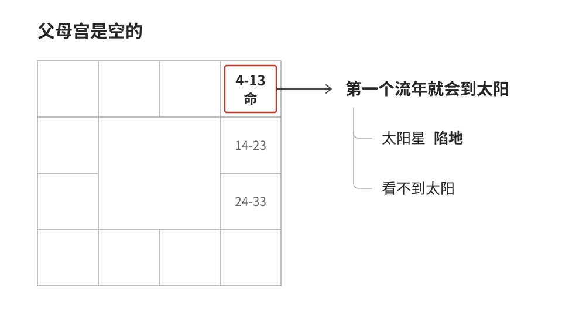 |
| **兼看面相：日角、耳角、额头怎么看早年丧父？** | 〔口述〕倪师说「所以说这时候我们要注意」「兼着的看相」：「那个小姐一来日角没有」，「然后耳角呢」「有缺耳角耳边呐」，「到刚好到14岁」「耳角有缺」。（[00:13:49–00:14:09](https://www.bilibili.com/video/BV1KJsLekEfA/?p=29&t=829)，第 24870–25487 帧） 〔口述〕又说「那如果这个平了很久」「整个平下去摸不到」，「很早就走」「十几岁或很早年就走人」。（[00:14:09–00:14:17](https://www.bilibili.com/video/BV1KJsLekEfA/?p=29&t=849)，第 25488–25721 帧） 〔指代〕说「那如果这个平了很久」时，「这个」指的是倪师自己的额头，他用手摸着额头讲。（[00:14:10](https://www.bilibili.com/video/BV1KJsLekEfA/?p=29&t=850)，第 25502 帧） |
| **如果太阳陷地在对面对冲，会怎样？** | 〔口述〕倪师假设「如果是太阳在对面」，「太阳星落陷在对门对门对冲的话」，第一个大运「4-13岁就要走人了」。（[00:14:17–00:14:24](https://www.bilibili.com/video/BV1KJsLekEfA/?p=29&t=857)，第 25722–25943 帧） 〔叠图〕此处叠图把官禄丙子那格内容（太阳陷、天魁旺、火星陷、红鸾庙等）原样贴成「迁移丙寅」，是配合假设的演示，不是本盘真正的迁移宫（本盘真正的迁移丙寅见本块开头第 22200–22350 帧的叠图）。（[00:14:17–00:14:19](https://www.bilibili.com/video/BV1KJsLekEfA/?p=29&t=857)，第 25722–25787 帧） 〔口述〕又说「所以有的人一一生下来没多久」「爸爸就过世」；有的人呢「到第二个十年再去过世」。（[00:14:24–00:14:31](https://www.bilibili.com/video/BV1KJsLekEfA/?p=29&t=864)，第 25944–26147 帧） 〔叠图〕叠图父母癸酉那格标着「第二个十年父亲过世」。（[00:14:28–00:14:31](https://www.bilibili.com/video/BV1KJsLekEfA/?p=29&t=868)，第 26058–26147 帧） |
| **额角发黑、变苍白，各代表什么？** | 〔口述〕倪师说「最近才走的话」「额角上可以看到很明显的黑黑的一块」，「看到那如果是很暗」，「代表是重病」。（[00:14:31–00:14:39](https://www.bilibili.com/video/BV1KJsLekEfA/?p=29&t=871)，第 26148–26381 帧） 〔口述〕「我跟诸位讲过」：暗已经变成白色、苍白，那个白「好像盐巴」，「你到你把你回家把盐巴拿起来看」，那个白没有光，那个白就是死掉了。（[00:14:39–00:14:46](https://www.bilibili.com/video/BV1KJsLekEfA/?p=29&t=879)，第 26382–26603 帧） 〔口述〕随后一句字幕作「丧父就刚死」，语音作上去就刚死，两路对不上，只记不作断语。（[00:14:46–00:14:49](https://www.bilibili.com/video/BV1KJsLekEfA/?p=29&t=886)，第 26604–26693 帧） |
| **本例几岁丧父？怎么对到盘上？** | 〔指代〕说「那像她这个第一个大运」时，手指点在黑板右列的「14-23」上；叠图显示14~23 父母 癸酉。（[00:14:50](https://www.bilibili.com/video/BV1KJsLekEfA/?p=29&t=890)，第 26707 帧） 〔口述〕倪师说「到14-23的时候父母宫就空了」，「所以这个她14岁的时候」「她父亲就不在了」，「所以流年一逢到的时候就出现」。（[00:14:49–00:15:04](https://www.bilibili.com/video/BV1KJsLekEfA/?p=29&t=889)，第 26694–27149 帧） 〔叠图〕叠图官禄丙子那格标着「丧父」，岁数串里有14，格内太阳陷。（[00:14:49–00:14:50](https://www.bilibili.com/video/BV1KJsLekEfA/?p=29&t=889)，第 26694–26729 帧） |
| **看流年：哪个限侧会、对会到兄弟宫？** | 〔口述〕倪师说「诸位看她的流年」「你在这两个流年没有逢到的时候」，「在这个流年侧会会到兄弟」，「还有对会」。（[00:15:09–00:15:18](https://www.bilibili.com/video/BV1KJsLekEfA/?p=29&t=909)，第 27294–27557 帧） 〔指代〕说「在这个流年」时，手指黑板右下格的「34-43」；右下叠图显示34~43 田宅 乙亥。（[00:15:14](https://www.bilibili.com/video/BV1KJsLekEfA/?p=29&t=914)，第 27436 帧） 〔叠图〕田宅乙亥：武曲平禄、破军平、三台平、天才庙、指背、白虎、病；大限按图例为34~43。（[00:15:14–00:15:17](https://www.bilibili.com/video/BV1KJsLekEfA/?p=29&t=914)，第 27432–27515 帧） 〔口述〕又说「诸位看斗数啊」「看这个限」，兄弟宫对会这两个，「这个和那个那兄弟」，那兄弟宫有化忌。（[00:15:18–00:15:26](https://www.bilibili.com/video/BV1KJsLekEfA/?p=29&t=918)，第 27558–27803 帧） 〔指代〕说「看这个限」和「这个和那个」时，手都按在黑板右下格（下方写34-43）的草书字处，字被手挡住、看不清。（[00:15:20–00:15:23](https://www.bilibili.com/video/BV1KJsLekEfA/?p=29&t=920)，第 27622–27704 帧） |
| **兄弟化忌应在哪一段？兄弟会怎样？** | 〔口述〕倪师说「在这个时候都没有会到兄弟」，「在这个时候才进入化忌」，「就代表说兄弟在这一段时间」兄弟会有夭折的现象。（[00:15:26–00:15:35](https://www.bilibili.com/video/BV1KJsLekEfA/?p=29&t=926)，第 27804–28061 帧） 〔指代〕说「在这个时候才进入化忌」时，食指稳定指在黑板右下格的「34-43」上。（[00:15:28](https://www.bilibili.com/video/BV1KJsLekEfA/?p=29&t=928)，第 27852 帧） 〔叠图〕同时贴出福德甲戌：天同平、天姚庙、天煞、将军、衰、龙德；田宅乙亥又贴一次（田宅乙亥′），内容与田宅乙亥相同。（[00:15:26–00:15:28](https://www.bilibili.com/video/BV1KJsLekEfA/?p=29&t=926)，第 27804–27851 帧） |
| **假如14-23落在兄弟那边，又怎么推？** | 〔口述〕倪师假设「你如果那个4-13岁」「14-23 在这边的话」，「14-23 刚好进入化忌」，那就是14-23中间兄弟会夭折，「了解我意思吧」。（[00:15:35–00:15:46](https://www.bilibili.com/video/BV1KJsLekEfA/?p=29&t=935)，第 28062–28409 帧） 〔指代〕说「14-23 在这边的话」时，食指指在黑板上排圈起的字下方（圈内字看不清）；该处上方叠图标「14~23 兄弟 辛未」。（[00:15:39](https://www.bilibili.com/video/BV1KJsLekEfA/?p=29&t=939)，第 28192 帧） 〔叠图〕兄弟辛未那格这次标着「1423中间」「兄弟会夭折」；本块前面贴的兄弟辛未岁数串是「114123」，推断这次是配合假设的演示。（[00:15:52–00:15:53](https://www.bilibili.com/video/BV1KJsLekEfA/?p=29&t=952)，第 28560–28601 帧） 〔口述〕倪师说「当然这个是一个」，我是举个例，但是你看「如果流年在这边就变兄弟」「流年在那边变父母」，「你们也会以此类推」，「因为八字格出来很多」「你常常会弄乱」。（[00:15:47–00:16:00](https://www.bilibili.com/video/BV1KJsLekEfA/?p=29&t=947)，第 28410–28823 帧） 〔指代〕说「如果流年在这边就变兄弟」时，手指黑板上排圈字下方，上方叠图标14~23 兄弟 辛未；说「流年在那边变父母」时，手移到黑板右列「14-23」格，叠图显示14~23 父母 癸酉。（[00:15:52–00:15:53](https://www.bilibili.com/video/BV1KJsLekEfA/?p=29&t=952)，第 28578–28604 帧） |

**总结区**

- 通用规则：巨门是一个杀星，财帛宫走巨门的人不做生意、走公职（[00:12:25–00:12:35](https://www.bilibili.com/video/BV1KJsLekEfA/?p=29&t=745)，第 22362–22655 帧）；兄弟宫化忌主两件事：兄弟不和、兄弟夭折；相上眉毛乱七八糟主不和，眉毛有断落主夭折（[00:13:07–00:13:28](https://www.bilibili.com/video/BV1KJsLekEfA/?p=29&t=787)，第 23628–24257 帧）；太阳星落陷在对面对冲，第一个大运4-13岁父亲就要走人（[00:14:17–00:14:24](https://www.bilibili.com/video/BV1KJsLekEfA/?p=29&t=857)，第 25722–25943 帧）；额角很明显黑黑一块、很暗代表重病；暗变苍白、白没有光像盐巴，就是死掉了（[00:14:31–00:14:46](https://www.bilibili.com/video/BV1KJsLekEfA/?p=29&t=871)，第 26148–26603 帧）
- 只在本例：这位女命天钺入命、科权禄都没有，财帛巨门，一定任公职；太阳陷地，女孩子很累（[00:12:19–00:12:40](https://www.bilibili.com/video/BV1KJsLekEfA/?p=29&t=739)，第 22182–22823 帧）；夫妻宫午天梁化科、官权带禄，先生在银行界，是很高的主管（[00:12:46–00:13:07](https://www.bilibili.com/video/BV1KJsLekEfA/?p=29&t=766)，第 22980–23627 帧）；父母宫空、太阳陷，14-23父母宫空了，14岁父亲不在；相上日角没有、耳角有缺（[00:13:32–00:15:04](https://www.bilibili.com/video/BV1KJsLekEfA/?p=29&t=812)，第 24360–27149 帧）；34-43这个限侧会、对会兄弟，进入化忌，这一段兄弟有夭折的现象（[00:15:09–00:15:35](https://www.bilibili.com/video/BV1KJsLekEfA/?p=29&t=909)，第 27294–28061 帧）

**待核**

1. 字幕「冥门是一个杀星」的「冥门」按语音改为巨门（[00:12:26](https://www.bilibili.com/video/BV1KJsLekEfA/?p=29&t=746)，第 22398 帧）
2. 「一定从任公职的人员」语音作「从人公职」，「从任」是否为「从事」待核（[00:12:29](https://www.bilibili.com/video/BV1KJsLekEfA/?p=29&t=749)，第 22482 帧）
3. 字幕「-看所以女孩子好很累啊」去掉句头「-看」再引；「找们= 看到大阳星陷地哦」去掉句头乱码，「大阳星」按语音改为太阳星（[00:12:39–00:12:42](https://www.bilibili.com/video/BV1KJsLekEfA/?p=29&t=759)，第 22770–22883 帧）
4. 「不然你这个权是掌掌财禄的嘛」语音作「涨财路」，原话待核（[00:12:59](https://www.bilibili.com/video/BV1KJsLekEfA/?p=29&t=779)，第 23376 帧）
5. 字幕「天折」均按语音改为夭折（第23916、24018、24162、28002、28254帧）
6. 「眉毛有断落」语音作「段落」（[00:13:25](https://www.bilibili.com/video/BV1KJsLekEfA/?p=29&t=805)，第 24162 帧）
7. 「耳角」语音作「耳脚」，照字幕写；日角、耳角具体在哪，本块没有解释（[00:13:58–00:14:09](https://www.bilibili.com/video/BV1KJsLekEfA/?p=29&t=838)，第 25164–25487 帧）
8. 字幕「暗已经变自色，变成苍自」「那个自好像盐巴」「那个自没有光」「那个自就是死掉了」的「自」按语音改为白，「苍自」改为苍白；「盐巴」语音作「岩巴」（[00:14:40–00:14:46](https://www.bilibili.com/video/BV1KJsLekEfA/?p=29&t=880)，第 26418–26603 帧）
9. 「丧父就刚死」语音作「上去就刚死」，两路对不上（[00:14:46](https://www.bilibili.com/video/BV1KJsLekEfA/?p=29&t=886)，第 26604 帧）
10. 「第一个大运」口径不一：太阳在对面那段说第一个大运是4-13岁（[00:14:21–00:14:24](https://www.bilibili.com/video/BV1KJsLekEfA/?p=29&t=861)，第 25854–25943 帧），讲本例时说「她这个第一个大运」并指14-23（[00:14:49–00:14:50](https://www.bilibili.com/video/BV1KJsLekEfA/?p=29&t=889)，第 26694–26729 帧）；另「第一个流年就会到太阳」里流年与大运的用法待核（[00:13:45](https://www.bilibili.com/video/BV1KJsLekEfA/?p=29&t=825)，第 24750 帧）
11. 句头杂字去掉：「暗太阳星……」的「暗」语音没有（[00:14:19](https://www.bilibili.com/video/BV1KJsLekEfA/?p=29&t=859)，第 25794 帧）；「友有的人呢」「友代表是重病」的「友」（第26046、26358帧）；「天友就会出现」「天友还有呢」「天友我是举个例」「天友但是你看」的「天友」（第27150、27234、28488、28518帧）；只剩乱码的「韦」与「入k」略过（第25788、25854帧）
12. 「那兄弟官有化忌」的「兄弟官」改为兄弟宫（[00:15:25](https://www.bilibili.com/video/BV1KJsLekEfA/?p=29&t=925)，第 27756 帧）
13. 「侧会」「对会」倪师用了，本块没有解释（[00:15:14–00:15:18](https://www.bilibili.com/video/BV1KJsLekEfA/?p=29&t=914)，第 27432–27557 帧）
14. 「因为八字格出来很多」语音作「八十隔出来很多」，意思不明（[00:15:56](https://www.bilibili.com/video/BV1KJsLekEfA/?p=29&t=956)，第 28680 帧）
15. 叠图兄弟辛未：前面岁数串为「114123」，约十五分五十三秒那次标「1423」「1423中间」，与父母癸酉的14~23重叠，推断是演示假设，待核（[00:15:52](https://www.bilibili.com/video/BV1KJsLekEfA/?p=29&t=952)，第 28560 帧）
16. 叠图田宅乙亥在一次转写里「奏书」作「秦书」，应是转写差异（[00:15:17](https://www.bilibili.com/video/BV1KJsLekEfA/?p=29&t=917)，第 27516 帧）
17. 本块▣行没有贴夫妻宫，夫妻午天梁、禄存、科只来自指代D036标注（[00:12:51](https://www.bilibili.com/video/BV1KJsLekEfA/?p=29&t=771)，第 23140 帧）
18. 板书f021996大部分粉笔字认不出；上排第二格是否写的是夫妻宫天梁，看不清（[00:12:13](https://www.bilibili.com/video/BV1KJsLekEfA/?p=29&t=733)，第 21996 帧）
19. 例二命宫壬申格内没有主星，倪师说「天钺星入命」，与「科权禄都没有」相合；但D034「这个」指向不确定，未作依据（[00:12:20](https://www.bilibili.com/video/BV1KJsLekEfA/?p=29&t=740)，第 22205 帧）

### 4　例二灾年：兄弟走、49岁丧夫与看气色（[00:16:00–00:19:51](https://www.bilibili.com/video/BV1KJsLekEfA/?p=29&t=960)，第 28824–35735 帧）

| 提示区 | 笔记区 |
|---|---|
| **例二37、38岁那一关，倪师说应在谁身上？** | 〔口述〕倪师接着列这张盘的灾年，先说第一个：「37岁38岁在这里」「34-43 是不是侧会兄弟」「所以38岁太阳星又不亮」。（[00:16:02–00:16:07](https://www.bilibili.com/video/BV1KJsLekEfA/?p=29&t=962)，第 28872–29033 帧） 〔口述〕他说这里「除了讲先生以外」「讲的是兄弟啊」，所以38岁那年「兄弟要走」。（[00:16:08–00:16:16](https://www.bilibili.com/video/BV1KJsLekEfA/?p=29&t=968)，第 29058–29303 帧） 〔叠图〕丙子格（宫名前两字认不出）：太阳陷、火星陷、咸池陷、红鸾庙、天德庙；叠图该格标着「38」「兄弟凶要走」「大小二限逢」「太阳星不亮」。（[00:16:06–00:16:07](https://www.bilibili.com/video/BV1KJsLekEfA/?p=29&t=966)，第 28992–29033 帧） 〔叠图〕田宅乙亥：武曲平禄、破军平、三台平、天才庙，大限34~43；叠图该格标着「侧会兄弟宫化忌」。（[00:16:06–00:16:07](https://www.bilibili.com/video/BV1KJsLekEfA/?p=29&t=966)，第 28992–29033 帧） 〔板书〕本块开头的板面（命盘格）可辨：「天钺」「4-13」「命」「巨门」「财帛」「14-23」「天同」「24-33」「疾厄」「54-63」「64-73」，另有一格里圈着「忌」；其余认不出。（[00:16:03](https://www.bilibili.com/video/BV1KJsLekEfA/?p=29&t=963)，第 28908 帧） 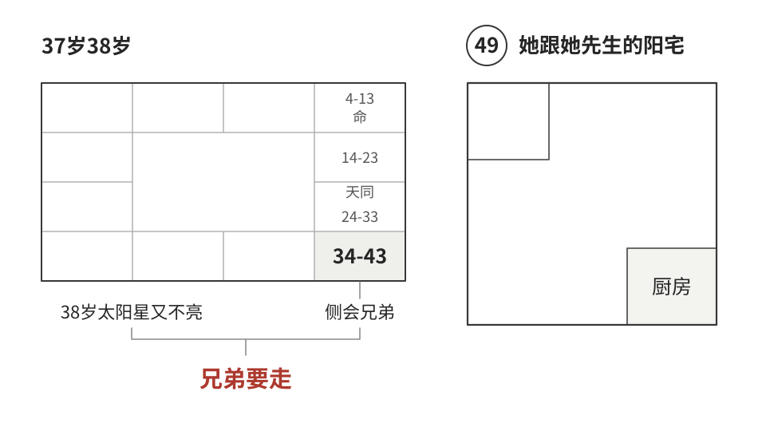 |
| **54-63那个大运，倪师断哪一年、会怎样？** | 〔口述〕第二关：「再来一个54-63」，并说「还没有发生」。（[00:16:16–00:16:18](https://www.bilibili.com/video/BV1KJsLekEfA/?p=29&t=976)，第 29304–29369 帧） 〔口述〕倪师先说「她是61岁」，随即改口「61岁哎62岁」，说「62岁太阳星是不是不亮」，那时「也会走」。（[00:16:19–00:16:30](https://www.bilibili.com/video/BV1KJsLekEfA/?p=29&t=979)，第 29370–29705 帧） 〔叠图〕交友丁丑：天府庙、左辅庙、右弼庙、铃星得、天伤平、寡宿平，大限54~63。（[00:16:06–00:16:07](https://www.bilibili.com/video/BV1KJsLekEfA/?p=29&t=966)，第 28992–29033 帧） 〔推断〕推断：倪师说的54-63与叠图交友丁丑格的大限54~63相同，但他口头没有点出是哪一宫；「也会走」说的是谁，材料里没有明说。（[00:16:16–00:16:30](https://www.bilibili.com/video/BV1KJsLekEfA/?p=29&t=976)，第 29304–29705 帧） |
| **49岁那年，倪师先在黑板上画了什么？** | 〔口述〕讲她的流年：「她的流年呢」「在49岁的时候」「发生了一件事」，然后画「她跟她先生的阳宅」，说「那算的时候厨房在西北角」。（[00:16:30–00:17:04](https://www.bilibili.com/video/BV1KJsLekEfA/?p=29&t=990)，第 29724–30725 帧） 〔板书〕写板后，黑板中部新出现一个圈住的「49」。（[00:16:39](https://www.bilibili.com/video/BV1KJsLekEfA/?p=29&t=999)，第 29982 帧） 〔板书〕黑板左侧画了一个方框（房屋示意），框内左上、右下各有一小格；右下小格里的字似「厨」，左上小格的字和方框下方的字认不出，图上没有标方位。（[00:16:53](https://www.bilibili.com/video/BV1KJsLekEfA/?p=29&t=1013)，第 30416 帧） 〔指代〕说「她跟她先生的阳宅」这句里的「这个」时，手按在黑板左侧他自己画的方框（房屋示意图）里，停在方框右下部。（[00:16:46](https://www.bilibili.com/video/BV1KJsLekEfA/?p=29&t=1006)，第 30196 帧） |
| **49岁那年她先生出了什么事？** | 〔口述〕她先生「去去打高尔夫球」，「打完以后大家都要回去休息了」，他却说「我们再打一圈」「再打一再打一个洞」「硬把大家拉回来」。（[00:17:08–00:17:20](https://www.bilibili.com/video/BV1KJsLekEfA/?p=29&t=1028)，第 30858–31217 帧） 〔口述〕「然后开球」「一开人就躺下去了」「结果去检查脖子断掉了」——「她先生呐脖子断掉」。（[00:17:20–00:17:28](https://www.bilibili.com/video/BV1KJsLekEfA/?p=29&t=1040)，第 31218–31469 帧） 〔口述〕倪师说明这是转述：「这都是人家跟我陈述的」。（[00:17:34–00:17:36](https://www.bilibili.com/video/BV1KJsLekEfA/?p=29&t=1054)，第 31632–31709 帧） |
| **出事前两礼拜，她先生的气色是什么样？** | 〔口述〕「在这个之前的两个礼拜」「他有他有两次的状况」：「在办公室里面看她先生的时候」「就是突然进办公室一看看到」「这个脸色发青的」。（[00:17:29–00:17:43](https://www.bilibili.com/video/BV1KJsLekEfA/?p=29&t=1049)，第 31470–31907 帧） 〔口述〕倪师强调那种青：「那个青啊」「是湛蓝的青青还发亮」。（[00:17:46–00:17:49](https://www.bilibili.com/video/BV1KJsLekEfA/?p=29&t=1066)，第 32004–32099 帧） 〔口述〕她问先生脸色怎么这样，「然后她先生说我没有什么很好啊」「去体检身体也很正常啊」，结果「然后不到两个礼拜」就出事。（[00:18:06–00:18:13](https://www.bilibili.com/video/BV1KJsLekEfA/?p=29&t=1086)，第 32580–32819 帧） 〔口述〕倪师说她「不晓得这两个礼拜的事情」「她只看到那个气色」「没多久就先生就发生这个事情」，因为「我们有节气的关系」「这个时间的关系」，她不懂。（[00:18:14–00:18:24](https://www.bilibili.com/video/BV1KJsLekEfA/?p=29&t=1094)，第 32838–33149 帧） |
| **命盘上哪里看得出49岁「看不到先生」？** | 〔口述〕「如果是不好的」「早就给你太阳星落陷了懂不懂」。（[00:17:58–00:18:00](https://www.bilibili.com/video/BV1KJsLekEfA/?p=29&t=1078)，第 32340–32411 帧） 〔口述〕「她在44-53太阳星落陷了看看不到先生」「就在这段时间」。（[00:18:00–00:18:05](https://www.bilibili.com/video/BV1KJsLekEfA/?p=29&t=1080)，第 32412–32579 帧） 〔口述〕「所以49岁以后」「太阳就落陷了看不到」。（[00:18:31–00:18:34](https://www.bilibili.com/video/BV1KJsLekEfA/?p=29&t=1111)，第 33336–33443 帧） 〔叠图〕官禄丙子：太阳陷、天魁旺、火星陷、咸池陷、红鸾庙、天德庙，格下有「飞廉」「死」，大限44~53。（[00:18:04–00:18:05](https://www.bilibili.com/video/BV1KJsLekEfA/?p=29&t=1084)，第 32532–32579 帧） 〔叠图〕交友丁丑格这次另标着「49」「化忌对冲」，星曜同前（天府庙、左辅庙、右弼庙、铃星得等）。（[00:18:04–00:18:05](https://www.bilibili.com/video/BV1KJsLekEfA/?p=29&t=1084)，第 32532–32579 帧） |
| **44-53那格下面的小星，倪师点了哪两个？** | 〔口述〕倪师拿着讲义说：「你看下面的小宫」「下面的小星有没有」「那个44-53 下面的飞廉」「还有死在这边有没有」。（[00:18:34–00:18:41](https://www.bilibili.com/video/BV1KJsLekEfA/?p=29&t=1114)，第 33444–33647 帧） 〔口述〕接着说「进入这个小运就没有了」「这很很很很很辛苦的哈」。（[00:18:41–00:18:47](https://www.bilibili.com/video/BV1KJsLekEfA/?p=29&t=1121)，第 33648–33821 帧） 〔推断〕推断：他念到的「飞廉」「死」与叠图官禄丙子格下方的小字相同；这两颗小星主什么，本块没有解释。（[00:18:38–00:18:41](https://www.bilibili.com/video/BV1KJsLekEfA/?p=29&t=1118)，第 33540–33647 帧） |
| **倪师说我们为什么要去算命？** | 〔口述〕「所以有的时候」「我们事情有很多事情可以预防的」「所以我们为什么要去算命」。（[00:18:47–00:18:51](https://www.bilibili.com/video/BV1KJsLekEfA/?p=29&t=1127)，第 33822–33959 帧） 〔口述〕「就是君子事天事情还没有发生了」「我们就去去看多个参考资料」「无所谓嘛」。（[00:18:52–00:19:01](https://www.bilibili.com/video/BV1KJsLekEfA/?p=29&t=1132)，第 33960–34235 帧） |
| **她的孩子为什么不会出事？** | 〔口述〕「你看她其它的宫有没有问题」「这个子女宫有没有问题啊」，倪师答：「因为子女宫对会这边没有杀星呐」。（[00:19:01–00:19:08](https://www.bilibili.com/video/BV1KJsLekEfA/?p=29&t=1141)，第 34236–34457 帧） 〔叠图〕子女己巳：天相得、天马平、陀罗陷、天寿平、孤辰陷、破碎陷。（[00:19:03–00:19:05](https://www.bilibili.com/video/BV1KJsLekEfA/?p=29&t=1143)，第 34302–34361 帧） 〔口述〕「如果是她的后来大运44-53」，后面「大运她54-63没有会到子女宫」，「通通没有会到的话」「这个孩子都不会出事懂不懂」「就像我们刚刚那个八字一样」。（[00:19:10–00:19:21](https://www.bilibili.com/video/BV1KJsLekEfA/?p=29&t=1150)，第 34500–34853 帧） |
| **为什么要看气色，不必把每一天都排出来？** | 〔口述〕「为什么叫诸位去看气色看什么」——「因为我们真的在排的时候」「没有办法不会说把一天」「大小每一天怎么样都会给你排起来」，「那么麻烦那排的你寸步难行」。（[00:19:23–00:19:35](https://www.bilibili.com/video/BV1KJsLekEfA/?p=29&t=1163)，第 34914–35255 帧） 〔口述〕玩笑：「你又要算了今天出门右脚会扭伤」「结果你不敢出门躺在床上」「结果肚子饿起来炒菜」「脚滑倒了还是扭到了」。（[00:19:35–00:19:44](https://www.bilibili.com/video/BV1KJsLekEfA/?p=29&t=1175)，第 35274–35543 帧） 〔口述〕结论：「这个不要去管那么细微」「只毛细节的事情」「大原则抓到就好了」。（[00:19:44–00:19:51](https://www.bilibili.com/video/BV1KJsLekEfA/?p=29&t=1184)，第 35544–35735 帧） |

**总结区**

- 通用规则：排盘没办法把每一天都排出来，所以要配合看气色，大原则抓到就好（[00:19:23–00:19:51](https://www.bilibili.com/video/BV1KJsLekEfA/?p=29&t=1163)，第 34914–35735 帧）
- 只在本例：例二38岁太阳星不亮，侧会兄弟，主兄弟要走（[00:16:02–00:16:16](https://www.bilibili.com/video/BV1KJsLekEfA/?p=29&t=962)，第 28872–29303 帧）；例二54-63大运里62岁太阳星不亮也会走，倪师说还没有发生（[00:16:16–00:16:30](https://www.bilibili.com/video/BV1KJsLekEfA/?p=29&t=976)，第 29304–29705 帧）；例二49岁先生打高尔夫开球倒下、脖子断掉，倪师说她44-53太阳星落陷看不到先生（[00:17:08–00:18:05](https://www.bilibili.com/video/BV1KJsLekEfA/?p=29&t=1028)，第 30858–32579 帧）；例二子女宫对会没有杀星、后面大运都没会到子女宫，孩子不会出事（[00:19:01–00:19:21](https://www.bilibili.com/video/BV1KJsLekEfA/?p=29&t=1141)，第 34236–34853 帧）
- 不是排盘规则，是处世方法：很多事可以预防，算命就是君子事天，事情没发生先多看参考资料（[00:18:47–00:19:01](https://www.bilibili.com/video/BV1KJsLekEfA/?p=29&t=1127)，第 33822–34235 帧）；不要把每一天都算出来、管那么细微，免得寸步难行（[00:19:29–00:19:51](https://www.bilibili.com/video/BV1KJsLekEfA/?p=29&t=1169)，第 35070–35735 帧）

**待核**

1. [00:16:03](https://www.bilibili.com/video/BV1KJsLekEfA/?p=29&t=963)，第 28914 帧：指代 D050「37岁38岁在这里」看不出指哪（手不在画面里，疑被叠图挡住）。
2. [00:16:04](https://www.bilibili.com/video/BV1KJsLekEfA/?p=29&t=964)，第 28932 帧：字幕「34-43 是不是侧会兄弟」（句尾「/」已去），语音作「十四到四三」，两路数字对不上；叠图田宅乙亥大限为34~43。
3. [00:16:06](https://www.bilibili.com/video/BV1KJsLekEfA/?p=29&t=966)，第 28992 帧：叠图丙子格宫名只认出「丙子」；[00:18:04](https://www.bilibili.com/video/BV1KJsLekEfA/?p=29&t=1084)，第 32532 帧叠图「官禄丙子」星曜与之相同，是否同一格待核，未据此补宫名。
4. [00:16:07](https://www.bilibili.com/video/BV1KJsLekEfA/?p=29&t=967)，第 29034 帧：字幕「女孩子横的」，语音作「你还是横的」，意思拿不准。
5. [00:16:12](https://www.bilibili.com/video/BV1KJsLekEfA/?p=29&t=972)，第 29184 帧：字幕「所以38岁有介灾」，语音作「有个在兄」，意思拿不准，未补。
6. [00:16:30](https://www.bilibili.com/video/BV1KJsLekEfA/?p=29&t=990)，第 29724 帧：字幕句头「友」去掉；[00:16:25](https://www.bilibili.com/video/BV1KJsLekEfA/?p=29&t=985)，第 29574 帧「李」、[00:16:30](https://www.bilibili.com/video/BV1KJsLekEfA/?p=29&t=990)，第 29706 帧「“芝」为乱码已略过。
7. [00:16:53](https://www.bilibili.com/video/BV1KJsLekEfA/?p=29&t=1013)，第 30416 帧：板书方框里左上小格的字、方框下方的字认不出；右下小格似「厨」，不确定；「厨房在西北角」在图上对应哪个角未标。
8. [00:16:03](https://www.bilibili.com/video/BV1KJsLekEfA/?p=29&t=963)，第 28908 帧：板书命盘格大部分字认不出，只记了可辨的几处。
9. [00:17:47](https://www.bilibili.com/video/BV1KJsLekEfA/?p=29&t=1067)，第 32034 帧：字幕「是湛蓝的青青还发亮」，语音作「好像发亮」。
10. [00:17:50](https://www.bilibili.com/video/BV1KJsLekEfA/?p=29&t=1070)，第 32100 帧：字幕「不是她奇」，按语音改作「他奇怪」，未引入正文。
11. [00:17:52–00:17:57](https://www.bilibili.com/video/BV1KJsLekEfA/?p=29&t=1072)，第 32184–32339 帧：「她先生很好啊」「太太人也很好」「你为为什么脸色是这个样子」是谁对谁说的不清，未写入正文。
12. [00:18:00](https://www.bilibili.com/video/BV1KJsLekEfA/?p=29&t=1080)，第 32412 帧：字幕「44-53」，语音作「四十六十五十」，两路对不上。
13. [00:18:31–00:18:41](https://www.bilibili.com/video/BV1KJsLekEfA/?p=29&t=1111)，第 33336–33647 帧：字幕句头「PF定」「Y-P」「F」「PF」去掉；指代 D058「这边」为否，不当依据；「飞廉」「死」主什么本块没解释。
14. [00:18:41](https://www.bilibili.com/video/BV1KJsLekEfA/?p=29&t=1121)，第 33648 帧：字幕「进入这个小运」，语音作「这个小宫」，待核。
15. [00:18:52](https://www.bilibili.com/video/BV1KJsLekEfA/?p=29&t=1132)，第 33960 帧：「君子事天」语音作「君子四天」，倪师未解释此词。
16. [00:19:02](https://www.bilibili.com/video/BV1KJsLekEfA/?p=29&t=1142)，第 34279 帧、[00:19:06](https://www.bilibili.com/video/BV1KJsLekEfA/?p=29&t=1146)，第 34398 帧：指代 D060「这个子女宫」、D061「这边」均为不确定，未当依据。
17. [00:19:12](https://www.bilibili.com/video/BV1KJsLekEfA/?p=29&t=1152)，第 34572 帧：字幕「肩面」按上下文改作「后面」。
18. [00:19:16](https://www.bilibili.com/video/BV1KJsLekEfA/?p=29&t=1156)，第 34692 帧：字幕「这个孩子都不会出事」，语音作「孩子都会出事」，少一个「不」，以字幕为准待核。
19. [00:19:17](https://www.bilibili.com/video/BV1KJsLekEfA/?p=29&t=1157)，第 34734 帧：「就像我们刚刚那个八字一样」，「刚刚那个八字」指哪一例材料没说清。
20. [00:19:40–00:19:44](https://www.bilibili.com/video/BV1KJsLekEfA/?p=29&t=1180)，第 35412–35543 帧：字幕句头「7」「PF -」去掉。

## 例三（女命，命宫庚子巨门）：兄弟廉贪陷、阴女流年、吉处藏凶

| 巳 | 午 | 未 | 申 |
|---|---|---|---|
| **交友 癸巳** （无主星、辅星） | **迁移 甲午** 天机庙 | **疾厄 乙未** 紫微庙 破军旺 | **财帛 丙申** 陀罗陷 |
| **官禄 壬辰** 太阳旺权 文曲得科 | **例三 · 命宫庚子** | 据视频叠图重排 | （酉：没贴过） |
| **田宅 辛卯** 武曲陷 七杀陷 火星利 | 后期贴图，不算倪师的话 |  | **夫妻 戊戌** 太阴旺 文昌陷忌 擎羊庙 铃星庙 |
| **福德 庚寅** 天同利 天梁庙 左辅庙 | **父母 辛丑** 天相庙 | **命宫 庚子**（身宫） 巨门旺禄 右弼庙 | **兄弟 己亥** 廉贞陷 贪狼陷 天马平 地空陷 |

按视频里这张盘逐格重画（我们自己画的图，不是视频截图）；星名后没写亮度的，视频里本来就没标亮度；数据见 [命盘-P29-例三.json](图/命盘-P29-例三.json)。

### 5　例三：兄弟宫杀星、夫妻化忌与吉处藏凶（[00:19:51–00:27:29](https://www.bilibili.com/video/BV1KJsLekEfA/?p=29&t=1191)，第 35736–49487 帧）

| 提示区 | 笔记区 |
|---|---|
| **兄弟宫廉贞贪狼落陷、逢空劫，主什么？** | 〔口述〕倪师让大家看这张盘的兄弟宫：「她是不是廉贞落陷」「贪狼落陷」「逢地劫地空」「有没有天马逢在兄弟宫」。（[00:19:51–00:20:07](https://www.bilibili.com/video/BV1KJsLekEfA/?p=29&t=1191)，第 35736–36227 帧） 〔口述〕「那么多的一排杀星在里面」「本身一定主的是什么呀」「兄弟天折」（天折即夭折），并说「有的人呢她没有兄弟」「大部分没有兄弟人呢」。（[00:20:07–00:20:21](https://www.bilibili.com/video/BV1KJsLekEfA/?p=29&t=1207)，第 36228–36653 帧） 〔板书〕黑板中右处竖写了几列字，可辨似「廉」「地」，其余被身体挡住或认不出。（[00:20:07](https://www.bilibili.com/video/BV1KJsLekEfA/?p=29&t=1207)，第 36228 帧） |
| **她的眉毛什么样？怎样的眉毛最好？** | 〔口述〕讲这位女命的眉毛：「她那个眉毛哈」「非常的浓」「但那个浓哈是很宽厚的浓」「有时候看不到底」「看不到她眉底看不到」。（[00:20:21–00:20:38](https://www.bilibili.com/video/BV1KJsLekEfA/?p=29&t=1221)，第 36654–37169 帧） 〔口述〕「最好的眉毛呢」「是细细长长的」「根根见底」「你不能通通看不到」。（[00:20:39–00:20:46](https://www.bilibili.com/video/BV1KJsLekEfA/?p=29&t=1239)，第 37170–37403 帧） 〔口述〕「那你太浓了」「看又看不到眉」「太过浓了」，又说「越细越长越好」「眉毛要浓淡适宜最好」「有的人太浓太淡都不是很好的事情」。（[00:20:49–00:21:05](https://www.bilibili.com/video/BV1KJsLekEfA/?p=29&t=1249)，第 37476–37961 帧） 〔板书〕板上方画了左右两道横向的弧线（像一对眉形），没有写字。（[00:20:55](https://www.bilibili.com/video/BV1KJsLekEfA/?p=29&t=1255)，第 37673 帧） 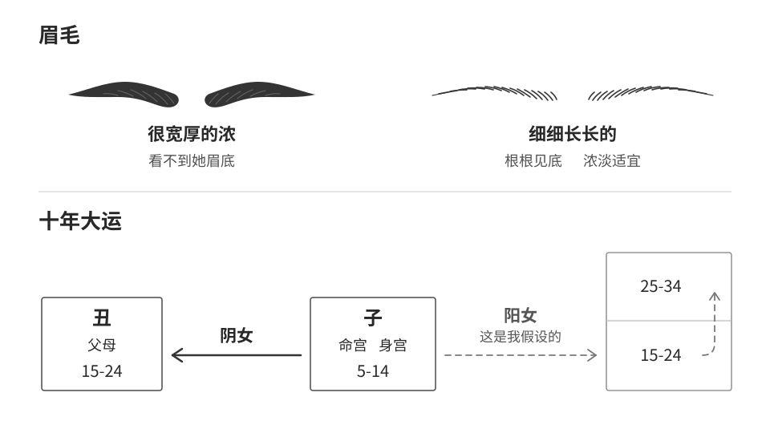 |
| **这张盘为什么要提出来讲？** | 〔口述〕「那你看她的夫妻宫」「这个夫妻宫化忌」，接着问「这个八字我提出来的原因是什么」，引出看她的流年。（[00:21:05–00:21:14](https://www.bilibili.com/video/BV1KJsLekEfA/?p=29&t=1265)，第 37962–38225 帧） 〔叠图〕夫妻戊戌一格：太阴旺、文昌陷忌、擎羊庙、红鸾陷、铃星庙，另有天月、月德、攀鞍、小耗等。（[00:20:59–00:21:05](https://www.bilibili.com/video/BV1KJsLekEfA/?p=29&t=1259)，第 37776–37961 帧） |
| **她的流年从命宫往哪边走？** | 〔口述〕「你看她的流年流年」「她在子命宫在子宫」「命宫啊和身宫是不是在子宫」「是不是5-14岁」。（[00:21:14–00:21:26](https://www.bilibili.com/video/BV1KJsLekEfA/?p=29&t=1274)，第 38226–38609 帧） 〔口述〕「然肩她旁边的丑宫呢」（然肩即然后）「是父母……是15-24岁」「她的流年是不是往这边走」。（[00:21:27–00:21:34](https://www.bilibili.com/video/BV1KJsLekEfA/?p=29&t=1287)，第 38610–38843 帧） 〔指代〕说「往这边走」时手指的是板上从「5-14」画向左的箭头，箭头尖指着「15-24 丑」。（[00:21:33](https://www.bilibili.com/video/BV1KJsLekEfA/?p=29&t=1293)，第 38795 帧） 〔叠图〕命宫庚子：巨门旺禄、右弼庙、身宫，大限5~14；父母辛丑：天相庙，大限15~24；福德庚寅：天同利、天梁庙、天魁、左辅庙，大限25~34。（[00:21:24–00:21:26](https://www.bilibili.com/video/BV1KJsLekEfA/?p=29&t=1284)，第 38544–38609 帧） 〔板书〕可辨左边「15-24」，其下「丑」，一条箭头从右边「5」指向它；下方另有字认不出。（[00:21:33](https://www.bilibili.com/video/BV1KJsLekEfA/?p=29&t=1293)，第 38801 帧） |
| **倪师假设她反着走，为什么？阴女阳女怎么分？** | 〔口述〕「我还宁可她流年往这边走呢」「为什么宁可假这是我假设的」，说明下面是假设；原因是「因为她是阴女」。（[00:21:36–00:21:52](https://www.bilibili.com/video/BV1KJsLekEfA/?p=29&t=1296)，第 38886–39383 帧） 〔口述〕阴年生的女的叫阴女；「这个那如果女的是阳年生的话」「十年大运刚好是反着走」「格是一样的哦」「阳的话就是反过来走」。（[00:21:59–00:22:11](https://www.bilibili.com/video/BV1KJsLekEfA/?p=29&t=1319)，第 39570–39941 帧） 〔指代〕说「格是一样的哦」接「她是往这边」时，指尖落在板上「5」往左箭头的箭尖、丑（15-24）处，示意她实际往左走。（[00:22:08](https://www.bilibili.com/video/BV1KJsLekEfA/?p=29&t=1328)，第 39857 帧） 〔叠图〕这时叠图把兄弟己亥标为大限15~24（廉贞陷、贪狼陷、地劫、地空陷、天马平），夫妻戊戌标为25~34（文昌陷忌）。（[00:21:36–00:21:43](https://www.bilibili.com/video/BV1KJsLekEfA/?p=29&t=1296)，第 38886–39095 帧） 〔板书〕可辨右上「25-34」，其下「15-24」，两行被框线圈在一起；左边仍有「5-14」。（[00:21:46](https://www.bilibili.com/video/BV1KJsLekEfA/?p=29&t=1306)，第 39180 帧） |
| **反着走到 25-34 会怎样？生离与死别哪个好？** | 〔口述〕若反过来走，「走到25-34 刚好入夫妻宫」「是不是化忌」「那是生离」。（[00:22:12–00:22:18](https://www.bilibili.com/video/BV1KJsLekEfA/?p=29&t=1332)，第 39972–40151 帧） 〔口述〕「生离还算好」，但有的人说「我宁可死别哦」「我不要分离啊」，因为「死别比较凄惨」「回味的比较多啊」，倪师说「也很难讲哈」。（[00:22:19–00:22:37](https://www.bilibili.com/video/BV1KJsLekEfA/?p=29&t=1339)，第 40188–40715 帧） 〔叠图〕夫妻戊戌又贴一次，这次「忌」挂在太阴（太阴旺忌、文昌陷），叠图该格标着「生离」。（[00:22:05–00:22:06](https://www.bilibili.com/video/BV1KJsLekEfA/?p=29&t=1325)，第 39756–39797 帧） |
| **45-54 这十年为什么事业很强？** | 〔口述〕「45-54这十年」「是不是太阳旺化科化权化科」「有没有文曲星化科太阳化权」。（[00:22:43–00:22:50](https://www.bilibili.com/video/BV1KJsLekEfA/?p=29&t=1363)，第 40896–41105 帧） 〔口述〕「这个这个女孩子的命呢」「是科权禄三会」「右手边财宗宫是不是空的」（财帛宫），「所以这个女孩子在官场上」「在事业上非常的强」。（[00:22:51–00:23:04](https://www.bilibili.com/video/BV1KJsLekEfA/?p=29&t=1371)，第 41136–41531 帧） 〔口述〕转到告诫：「人呢在很好的时候哦」「就没有警戒心了」。（[00:23:04–00:23:12](https://www.bilibili.com/video/BV1KJsLekEfA/?p=29&t=1384)，第 41532–41783 帧） 〔叠图〕官禄壬辰：太阳旺权、文曲得科，另有天喜陷、寡宿陷等，大限45~54。（[00:22:37–00:22:43](https://www.bilibili.com/video/BV1KJsLekEfA/?p=29&t=1357)，第 40716–40895 帧） 〔叠图〕财帛丙申：格内没有主星，有陀罗陷、天贵陷、孤辰平等。（[00:22:56–00:22:59](https://www.bilibili.com/video/BV1KJsLekEfA/?p=29&t=1376)，第 41298–41375 帧） |
| **55-64 进入哪一宫？事情发生在几岁？** | 〔口述〕「在45-54上面」「55-64是不是空的」「那个宫是不是空的」「是不是进入交友仆役官啊」「就是所谓的仆役宫啊」。（[00:23:20–00:23:32](https://www.bilibili.com/video/BV1KJsLekEfA/?p=29&t=1400)，第 42018–42371 帧） 〔口述〕「这个人事情发生在50岁啊50」「49-50岁刚好50岁这一年」「50岁那年会发生事情」「就是因为她后未来十年」。（[00:23:32–00:23:46](https://www.bilibili.com/video/BV1KJsLekEfA/?p=29&t=1412)，第 42372–42791 帧） 〔叠图〕交友癸巳：格内没有主星，有凤阁庙、天才庙、天福旺、截空庙、年解旺等，大限55~64。（[00:23:24–00:23:26](https://www.bilibili.com/video/BV1KJsLekEfA/?p=29&t=1404)，第 42138–42185 帧） 〔叠图〕迁移甲午：天机庙、天空庙、天钺、咸池陷等，叠图该格标着「先生走」；疾厄乙未：紫微庙、破军旺。（[00:23:30–00:23:32](https://www.bilibili.com/video/BV1KJsLekEfA/?p=29&t=1410)，第 42312–42371 帧） 〔板书〕可辨右上「49」，左边「15-24」「丑」及箭头，其余被身体挡住认不出。（[00:23:42](https://www.bilibili.com/video/BV1KJsLekEfA/?p=29&t=1422)，第 42680 帧） 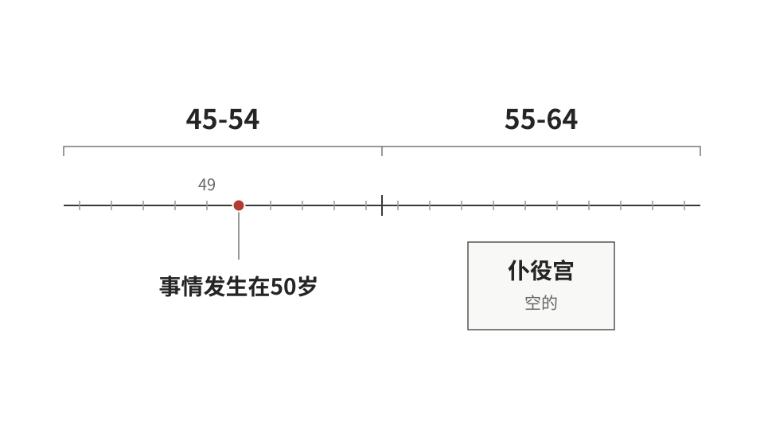 |
| **为什么说 45-54 好、55-64 非常不好？** | 〔口述〕「右下角是廉贪有没有」「廉贪落陷是不是空劫」「有没有通通是杀星啊」。（[00:23:47–00:23:55](https://www.bilibili.com/video/BV1KJsLekEfA/?p=29&t=1427)，第 42822–43061 帧） 〔口述〕「那这一段时间45-54是不是很好啊」「55-64非常的不好」「45-54非常的好」。（[00:23:59–00:24:06](https://www.bilibili.com/video/BV1KJsLekEfA/?p=29&t=1439)，第 43176–43391 帧） 〔叠图〕兄弟己亥（右下角）：廉贞陷、贪狼陷、地劫、地空陷、天马平、天姚陷，此处大限标115~124。（[00:23:47–00:23:50](https://www.bilibili.com/video/BV1KJsLekEfA/?p=29&t=1427)，第 42822–42911 帧） 〔板书〕可辨上方「交友」，其下框住的「55-64」，再下一个「太」字，右上「49」，其余认不出。（[00:24:03](https://www.bilibili.com/video/BV1KJsLekEfA/?p=29&t=1443)，第 43315 帧） |
| **什么叫吉处藏凶？忌来命宫与来夫妻宫有何不同？** | 〔口述〕「所以人呢叫做吉处啊藏凶」「八字里面也是吉处藏凶」「这看似好」「所以你未来一看没有大运的时候」「马上要注意前面」。（[00:24:06–00:24:24](https://www.bilibili.com/video/BV1KJsLekEfA/?p=29&t=1446)，第 43392–43937 帧） 〔板书〕左边竖写可辨「吉」「藏」「凶」，第二字似「处」；旁边一个「太」字。（[00:24:14](https://www.bilibili.com/video/BV1KJsLekEfA/?p=29&t=1454)，第 43620 帧） 〔口述〕「如果是她的命宫会来的忌」「那是她本人伤啊」「结果她的忌是什么」「先生会来的」「所以夫妻宫是化忌的时候」。（[00:24:24–00:24:35](https://www.bilibili.com/video/BV1KJsLekEfA/?p=29&t=1464)，第 43938–44261 帧） 〔叠图〕叠图把夫妻戊戌那格内容原样贴成「命宫戊戌」，配合「如果是她的命宫会来的忌」的假设，不是她真正的命宫。（[00:24:20–00:24:24](https://www.bilibili.com/video/BV1KJsLekEfA/?p=29&t=1460)，第 43824–43937 帧） |
| **夫妻宫化忌和合八字有什么关系？** | 〔口述〕「如果夫妻两个人八字不合」「不受命的影响」「如果两个八字是合到了」「就完了化忌就要来了」「知道怎么合八字了吗」。（[00:24:35–00:24:49](https://www.bilibili.com/video/BV1KJsLekEfA/?p=29&t=1475)，第 44262–44675 帧） 〔口述〕「那所以我们有时候八字合才能结婚」「这是光论命」「你就找个八字跟她很合的」。（[00:24:49–00:24:56](https://www.bilibili.com/video/BV1KJsLekEfA/?p=29&t=1489)，第 44676–44885 帧） 〔口述〕「就她的夫妻宫是太阴星化忌」「对面是太阳」，她找个先生「八字拿出来还是也是太阴太阳来会」「日子刚好合到」「合到就按照命走」。（[00:24:58–00:25:10](https://www.bilibili.com/video/BV1KJsLekEfA/?p=29&t=1498)，第 44958–45311 帧） 〔叠图〕夫妻戊戌又贴一次，「忌」挂在太阴（太阴旺忌），文昌只标陷；与此前多数版本文昌陷忌不同。（[00:24:35–00:24:38](https://www.bilibili.com/video/BV1KJsLekEfA/?p=29&t=1475)，第 44262–44357 帧） |
| **她 50 岁、38 岁各发生什么？** | 〔口述〕「所以十年大限过不了55-64」「那小运50岁」「50岁更不进不了这个流年」「这个流年就已经发生了」。（[00:25:10–00:25:17](https://www.bilibili.com/video/BV1KJsLekEfA/?p=29&t=1510)，第 45312–45533 帧） 〔口述〕「那她还有一种状况」「38岁兄弟还天折」（夭折）；「所以50岁的时候先生走」「38岁的时候兄弟走人」「38岁你看也是会在这个角上面」。（[00:25:28–00:25:43](https://www.bilibili.com/video/BV1KJsLekEfA/?p=29&t=1528)，第 45852–46313 帧） 〔叠图〕迁移甲午一格这时同时标着「兄弟走」「先生走」，边上有岁数38、50。（[00:25:29–00:25:32](https://www.bilibili.com/video/BV1KJsLekEfA/?p=29&t=1529)，第 45894–45989 帧） |
| **为什么说 38 岁？35-44 卯宫有什么？** | 〔口述〕「为什么会说她38岁」「你看她35-44」「诸位看左下角卯宫」。（[00:25:43–00:25:50](https://www.bilibili.com/video/BV1KJsLekEfA/?p=29&t=1543)，第 46314–46505 帧） 〔指代〕说「卯宫在这边」时手指板上刚写的「卯」字；说「35-44 是不是在这边」时指尖停在板上「35-44」的「44」末端。（[00:25:51–00:25:53](https://www.bilibili.com/video/BV1KJsLekEfA/?p=29&t=1551)，第 46543–46618 帧） 〔口述〕「她是武曲七杀在里面」「武曲和七杀」「哎侧会回来是不是会到兄弟宫」。（[00:25:55–00:26:05](https://www.bilibili.com/video/BV1KJsLekEfA/?p=29&t=1555)，第 46656–46979 帧） 〔叠图〕田宅辛卯：武曲陷、七杀陷、火星利，大限35~44；剪辑在格边加了「侧会兄弟宫」的提示字。（[00:25:45–00:25:47](https://www.bilibili.com/video/BV1KJsLekEfA/?p=29&t=1545)，第 46362–46433 帧） 〔板书〕可辨似「武曲」「七杀」，其下似「35-44」；右上圈住「50岁」，其下另一圈数字认不清；上方框住「55-64」。（[00:26:00](https://www.bilibili.com/video/BV1KJsLekEfA/?p=29&t=1560)，第 46800 帧） 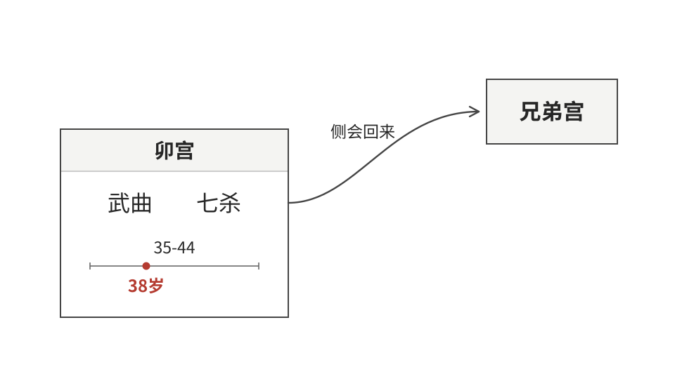 |
| **先生车祸过世这个例子要提醒什么？** | 〔口述〕「这个举个例子」「就是告诉诸位」「有的时候灾你看过去的时候」「我就怕你们看看不出来」「所以要提醒自己」「我连续举几个例子给你看」。（[00:26:06–00:26:14](https://www.bilibili.com/video/BV1KJsLekEfA/?p=29&t=1566)，第 46980–47237 帧） 〔口述〕「这个灾来的时候」「她先生也是车祸死车祸过世啊」「她先生不坏啊」。（[00:26:14–00:26:19](https://www.bilibili.com/video/BV1KJsLekEfA/?p=29&t=1574)，第 47238–47387 帧） 〔口述〕「如果是5-14 15-24 25-34」「她化忌在这边的话」「刚好十年会到这个化忌的」「那就生离了就算了嘛」「结果她没有生离」。（[00:26:20–00:26:30](https://www.bilibili.com/video/BV1KJsLekEfA/?p=29&t=1580)，第 47400–47711 帧） 〔指代〕说「在这边的时候」「她化忌在这边的话」「会到这个化忌的」时，手指的都是板上框住的「25-34」。（[00:26:23–00:26:26](https://www.bilibili.com/video/BV1KJsLekEfA/?p=29&t=1583)，第 47501–47593 帧） 〔叠图〕叠图又贴出命宫庚子（巨门旺禄、右弼庙）、父母辛丑、福德庚寅，仍是同一张盘。（[00:26:30–00:26:31](https://www.bilibili.com/video/BV1KJsLekEfA/?p=29&t=1590)，第 47712–47735 帧） |
| **凶事为什么防不胜防？要怎么做？** | 〔口述〕「很好啊夫妻很好啊」「就是发生这个事情」「所以这个八学我们要警戒的就在这里」（八学即八字）「看似很好」「其实这个凶来的时候」「你根本没有提防」「是刹那间发生的」。（[00:26:31–00:26:47](https://www.bilibili.com/video/BV1KJsLekEfA/?p=29&t=1591)，第 47736–48227 帧） 〔口述〕举例：「比如说你有的先生哦」「开刀开十年的」「也没死哦」；「哎有的先生很好啊」「出去给人给撞死了都有」「马上发生」「突如其来的」。（[00:26:47–00:27:00](https://www.bilibili.com/video/BV1KJsLekEfA/?p=29&t=1607)，第 48228–48605 帧） 〔口述〕「像我们上堂课介绍那个晦暗」，看到晦暗「心里有数了对不对」「还可以吃好的」；突发的「还来不及吃好的哎」「就会有这种事」。（[00:27:00–00:27:10](https://www.bilibili.com/video/BV1KJsLekEfA/?p=29&t=1620)，第 48618–48923 帧） 〔口述〕「这是我们没有戒心的关系」「常常要注意啊」「发生事情的时候」「都是在你没有戒心的时候」「所以出去玩的时候要特别要小心」「做UA的比较好（坐办公室）」。（[00:27:10–00:27:29](https://www.bilibili.com/video/BV1KJsLekEfA/?p=29&t=1630)，第 48924–49487 帧） 〔板书〕板面已擦净，没有可认的粉笔字。（[00:27:23](https://www.bilibili.com/video/BV1KJsLekEfA/?p=29&t=1643)，第 49296 帧） |

**总结区**

- 通用规则：最好的眉毛细细长长、根根见底，太浓太淡都不好，浓淡适宜最好（[00:20:21–00:21:05](https://www.bilibili.com/video/BV1KJsLekEfA/?p=29&t=1221)，第 36654–37961 帧）；女的若是阳年生，十年大运刚好反着走，格是一样的（[00:22:02–00:22:11](https://www.bilibili.com/video/BV1KJsLekEfA/?p=29&t=1322)，第 39672–39941 帧）；忌来命宫是本人伤，夫妻宫化忌是先生会来；两人八字合到了，化忌就要来，合到就按照命走（[00:24:24–00:25:10](https://www.bilibili.com/video/BV1KJsLekEfA/?p=29&t=1464)，第 43938–45311 帧）；吉处藏凶：看似好的时候，未来一看没有大运，马上要注意前面（[00:24:06–00:24:24](https://www.bilibili.com/video/BV1KJsLekEfA/?p=29&t=1446)，第 43392–43937 帧）
- 只在本例：兄弟宫廉贞贪狼落陷、逢地劫地空，一排杀星，主兄弟夭折；38 岁兄弟走，倪师用 35-44 卯宫武曲七杀侧会兄弟宫来说（[00:19:51–00:20:21](https://www.bilibili.com/video/BV1KJsLekEfA/?p=29&t=1191)，第 35736–36653 帧、[00:25:28–00:26:05](https://www.bilibili.com/video/BV1KJsLekEfA/?p=29&t=1528)，第 45852–46979 帧）；她是阴女，流年从命宫子往丑走；倪师假设若反着走，25-34 入夫妻宫化忌就是生离，结果她没有生离（[00:21:14–00:22:18](https://www.bilibili.com/video/BV1KJsLekEfA/?p=29&t=1274)，第 38226–40151 帧、[00:26:20–00:26:30](https://www.bilibili.com/video/BV1KJsLekEfA/?p=29&t=1580)，第 47400–47711 帧）；45-54 官禄太阳化权、文曲化科，科权禄三会，事业非常强；55-64 交友宫是空的，50 岁先生车祸过世（[00:22:43–00:23:46](https://www.bilibili.com/video/BV1KJsLekEfA/?p=29&t=1363)，第 40896–42791 帧、[00:26:14–00:26:19](https://www.bilibili.com/video/BV1KJsLekEfA/?p=29&t=1574)，第 47238–47387 帧）
- 不是排盘规则，是处世方法：人在很好的时候就没有警戒心，事情都发生在没有戒心的时候（[00:23:04–00:23:12](https://www.bilibili.com/video/BV1KJsLekEfA/?p=29&t=1384)，第 41532–41783 帧、[00:27:10–00:27:17](https://www.bilibili.com/video/BV1KJsLekEfA/?p=29&t=1630)，第 48924–49115 帧）；凶事是刹那间发生的，出去玩要特别小心（[00:26:37–00:27:19](https://www.bilibili.com/video/BV1KJsLekEfA/?p=29&t=1597)，第 47928–49187 帧）

**待核**

1. 字幕「天折」按上下文改为夭折（第 36348、36516、45894 帧）
2. 字幕「然肩」改为然后（[00:21:27](https://www.bilibili.com/video/BV1KJsLekEfA/?p=29&t=1287)，第 38610 帧）；「沟什么」改为为什么（[00:21:50](https://www.bilibili.com/video/BV1KJsLekEfA/?p=29&t=1310)，第 39306 帧）；「八学」改为八字（[00:26:37](https://www.bilibili.com/video/BV1KJsLekEfA/?p=29&t=1597)，第 47928 帧）
3. 字幕「财宗宫」改为财帛宫（[00:22:56](https://www.bilibili.com/video/BV1KJsLekEfA/?p=29&t=1376)，第 41298 帧）；「交友仆役官」改为仆役宫（[00:23:28](https://www.bilibili.com/video/BV1KJsLekEfA/?p=29&t=1408)，第 42240 帧）
4. 字幕「就是阳年生的男人就四陌男阳女嘛」，语音作「阳年生的男的就叫阳男阳女」，按语音理解；阴男阴女、阳男阳女的完整说法本块未细讲（[00:21:56–00:22:02](https://www.bilibili.com/video/BV1KJsLekEfA/?p=29&t=1316)，第 39498–39671 帧）
5. 「为什么宁可假这是我假设的」语句不完整，「宁可」后面原意待核（[00:21:43](https://www.bilibili.com/video/BV1KJsLekEfA/?p=29&t=1303)，第 39096 帧）；「阴年生的如果同一个八字的格」语义不完整（[00:21:52](https://www.bilibili.com/video/BV1KJsLekEfA/?p=29&t=1312)，第 39384 帧）
6. 叠图夫妻戊戌的「忌」多数挂在文昌（文昌陷忌），[00:22:05](https://www.bilibili.com/video/BV1KJsLekEfA/?p=29&t=1325)，第 39756 帧与[00:24:35](https://www.bilibili.com/video/BV1KJsLekEfA/?p=29&t=1475)，第 44262 帧两次挂在太阴（太阴旺忌）；口述说「就她的夫妻宫是太阴星化忌」（[00:24:58](https://www.bilibili.com/video/BV1KJsLekEfA/?p=29&t=1498)，第 44958 帧），两种写法不一致
7. 叠图大限数字前后不一：夫妻戊戌先标105~114（[00:20:59](https://www.bilibili.com/video/BV1KJsLekEfA/?p=29&t=1259)，第 37776 帧），兄弟己亥在[00:23:47](https://www.bilibili.com/video/BV1KJsLekEfA/?p=29&t=1427)，第 42822 帧标115~124；[00:21:36](https://www.bilibili.com/video/BV1KJsLekEfA/?p=29&t=1296)，第 38886 帧起改标兄弟15~24、夫妻25~34，疑为配合倪师假设
8. 「科权禄三会」的禄在哪一宫，倪师没有说明；叠图命宫庚子有巨门旺禄（[00:22:53](https://www.bilibili.com/video/BV1KJsLekEfA/?p=29&t=1373)，第 41196 帧）
9. 字幕「“所以对如柔说45-54是非常的不好」句头乱码已去，语音作「他来说四十五到五十是非常的不好」，与随后「45-54非常的好」「55-64非常的不好」相反；板书图[00:23:56](https://www.bilibili.com/video/BV1KJsLekEfA/?p=29&t=1436)，第 43092 帧画面另贴红字「55-64」（[00:23:55](https://www.bilibili.com/video/BV1KJsLekEfA/?p=29&t=1435)，第 43062 帧）
10. 「49-50岁刚好50岁这一年」的岁数怎么算本块未解释；叠图各格边上的49、50、51是岁数，未据此推流年（[00:23:39](https://www.bilibili.com/video/BV1KJsLekEfA/?p=29&t=1419)，第 42594 帧）
11. 「那小运50岁」「从这边一年打到这边」「这个宫」等指代均为不确定，未当依据（[00:25:13–00:25:26](https://www.bilibili.com/video/BV1KJsLekEfA/?p=29&t=1513)，第 45414–45797 帧）
12. 字幕「38岁是不是在这边」，语音前面另有「三十七岁在这边」，37 与 38 待核（[00:25:33](https://www.bilibili.com/video/BV1KJsLekEfA/?p=29&t=1533)，第 45990 帧）
13. 「侧会」倪师用了但没有解释（[00:25:59](https://www.bilibili.com/video/BV1KJsLekEfA/?p=29&t=1559)，第 46788 帧）
14. 字幕「有问题啊」，语音作「没有问题」，两路相反（[00:26:32](https://www.bilibili.com/video/BV1KJsLekEfA/?p=29&t=1592)，第 47772 帧）
15. 语音在「八字合才能结婚」之后还有「有时候八字不合才能结婚」，原意待核（[00:24:49](https://www.bilibili.com/video/BV1KJsLekEfA/?p=29&t=1489)，第 44676 帧）
16. 「日子刚好合到」「日子排的很好」里的「日子」所指本块未讲清（第 45186、45798 帧）
17. 「上堂课介绍那个晦暗」指什么本块未讲；字幕括号「（太太看先生脸色发青）」是字幕注，非口述（[00:27:00–00:27:03](https://www.bilibili.com/video/BV1KJsLekEfA/?p=29&t=1620)，第 48618–48713 帧）
18. 「做UA的比较好（坐办公室）」中「UA」是什么待核，括号字为字幕注（[00:27:19](https://www.bilibili.com/video/BV1KJsLekEfA/?p=29&t=1639)，第 49188 帧）
19. 字幕「人要细细长」，语音作「你要细细长长」（[00:20:54](https://www.bilibili.com/video/BV1KJsLekEfA/?p=29&t=1254)，第 37620 帧）
20. 开头讲兄弟宫时材料还没有 ▣ 行，但板书图[00:20:07](https://www.bilibili.com/video/BV1KJsLekEfA/?p=29&t=1207)，第 36228 帧画面右下已贴出兄弟己亥格（廉贞陷、贪狼陷、地劫、地空陷、天马平），未当叠图依据
21. 板书认不全：[00:20:07](https://www.bilibili.com/video/BV1KJsLekEfA/?p=29&t=1207)，第 36228 帧只认出似「廉」「地」；[00:23:31](https://www.bilibili.com/video/BV1KJsLekEfA/?p=29&t=1411)，第 42355 帧只见「-64」；[00:23:56](https://www.bilibili.com/video/BV1KJsLekEfA/?p=29&t=1436)，第 43092 帧被身体和叠图挡住认不出；[00:26:00](https://www.bilibili.com/video/BV1KJsLekEfA/?p=29&t=1560)，第 46800 帧第二个圈内数字认不清

## 例四（女命，命宫丙寅地空）：领养、六亲不靠、偏房、无子、相貌

| 巳 | 午 | 未 | 申 |
|---|---|---|---|
| **田宅 己巳** 廉贞陷 贪狼陷权 天马平 陀罗陷 | **官禄 庚午** 巨门旺 禄存庙 火星庙 | （未：没贴过） | **迁移 壬申**（身宫） 天同旺 天梁陷科 天钺庙 地劫庙 |
| **福德 戊辰** 太阴陷 | **例四 · 命宫丙寅** | 据视频叠图重排 | （酉：没贴过） |
| **父母 丁卯** 天府平 | 后期贴图，不算倪师的话 |  | **财帛 甲戌** 太阳陷 |
| **命宫 丙寅** 地空陷 | **兄弟 丁丑** 紫微庙 破军旺 左辅庙 右弼庙 文昌庙 文曲庙忌 | **夫妻 丙子** 天机庙 天魁旺 | **子女 乙亥** （无主星、辅星） |

按视频里这张盘逐格重画（我们自己画的图，不是视频截图）；数据见 [命盘-P29-例四.json](图/命盘-P29-例四.json)。

### 6　例四地空女命：领养、无婚、偏房、相貌（[00:27:29–00:34:14](https://www.bilibili.com/video/BV1KJsLekEfA/?p=29&t=1649)，第 49488–61643 帧）

| 提示区 | 笔记区 |
|---|---|
| **例四是哪年生的女命？她的命宫是什么？** | 〔口述〕倪师换讲新命例：「诸位再看 28年（1939）这个」「属兔的」「己卯年生的」，接着问「诸位看她的命宫是什么」。（[00:27:29–00:27:43](https://www.bilibili.com/video/BV1KJsLekEfA/?p=29&t=1649)，第 49488–49919 帧） 〔叠图〕问完命宫是什么，叠图随即贴出命宫丙寅：地空陷、天福旺，格内没有主星；另有亡神、病符、长生。（[00:27:46–00:27:48](https://www.bilibili.com/video/BV1KJsLekEfA/?p=29&t=1666)，第 49980–50040 帧） 〔口述〕倪师说「然后她命官刚好在这里」（命官即命宫），「命宫是地空」「空无一物」。（[00:28:15–00:28:20](https://www.bilibili.com/video/BV1KJsLekEfA/?p=29&t=1695)，第 50862–51029 帧） 〔指代〕说「她命官刚好在这里」时，手执粉笔伸向黑板格子左下那格（板面空白），叠图在旁显示命宫丙寅（地空、天福）。（[00:28:16](https://www.bilibili.com/video/BV1KJsLekEfA/?p=29&t=1696)，第 50890 帧） |
| **命宫对面、官禄宫、财帛宫各坐什么星？** | 〔叠图〕约同时贴出迁移壬申：天同旺、天梁陷科、地劫庙、天钺庙，另有身宫、天巫、阴煞等。（[00:27:44–00:27:54](https://www.bilibili.com/video/BV1KJsLekEfA/?p=29&t=1664)，第 49920–50231 帧） 〔口述〕倪师说「空的对面呢」「这个对面呢」「这里是巨门禄存」「这是46-55」「这是事业宫」「就是所谓的官禄官了」（官禄官即官禄宫）。（[00:27:44–00:28:11](https://www.bilibili.com/video/BV1KJsLekEfA/?p=29&t=1664)，第 49920–50747 帧） 〔叠图〕官禄庚午：巨门旺、禄存庙、天喜庙、天刑平、火星（约第50256帧时亮度认不出，约第50748帧那次印作庙），另有天月、帝旺。（[00:27:55–00:27:59](https://www.bilibili.com/video/BV1KJsLekEfA/?p=29&t=1675)，第 50256–50387 帧） 〔指代〕说「这里是巨门禄存」时，手执粉笔在黑板新画格子上排中间那格书写，叠图显示巨门、禄存、46~55、官禄庚午。（[00:27:55](https://www.bilibili.com/video/BV1KJsLekEfA/?p=29&t=1675)，第 50253 帧） 〔口述〕「财帛宫呢太阳星陷地」。叠图同时贴出财帛甲戌：太阳陷、天姚庙。（[00:28:11–00:28:15](https://www.bilibili.com/video/BV1KJsLekEfA/?p=29&t=1691)，第 50748–50861 帧） |
| **黑板上这张新盘格写了哪些字？** | 〔板书〕上排中间格可辨「巨门」「46-55」，中间两行潦草（按口述疑为「禄存」「事业」），认不全。（[00:28:07](https://www.bilibili.com/video/BV1KJsLekEfA/?p=29&t=1687)，第 50616 帧） 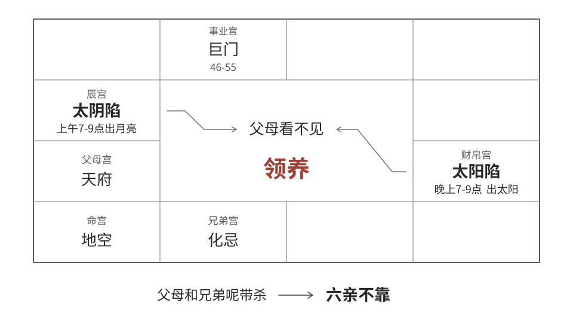 〔板书〕右侧中格可辨「财帛」，上面一行可辨「太阳」，后一字潦草（疑「陷」）；左下有一处被身体挡住认不出。（[00:28:18](https://www.bilibili.com/video/BV1KJsLekEfA/?p=29&t=1698)，第 50964 帧） 〔板书〕与上一张相同，只认得上中格「巨门」、右中格「太阳」「财帛」，没有新增可辨的字。（[00:28:30](https://www.bilibili.com/video/BV1KJsLekEfA/?p=29&t=1710)，第 51300 帧） |
| **她的兄弟宫、父母宫怎么看？** | 〔口述〕倪师说「诸位看她兄弟宫」，「化忌你都不用看了」「完第官就是化忌的」（按语音即兄弟宫就是化忌的）「就就不用看了」。（[00:28:21–00:28:29](https://www.bilibili.com/video/BV1KJsLekEfA/?p=29&t=1701)，第 51030–51281 帧） 〔叠图〕兄弟丁丑：紫微庙、破军旺、文昌庙、文曲庙忌、左辅庙、右弼庙、寡宿平。（[00:28:23–00:28:24](https://www.bilibili.com/video/BV1KJsLekEfA/?p=29&t=1703)，第 51108–51143 帧） 〔口述〕接着说「你天府星是父母宫」。（[00:28:29–00:28:32](https://www.bilibili.com/video/BV1KJsLekEfA/?p=29&t=1709)，第 51282–51389 帧） 〔叠图〕父母丁卯：天府平，另有台辅、天哭庙、大耗、将星、岁建、沐浴。（[00:30:19–00:30:20](https://www.bilibili.com/video/BV1KJsLekEfA/?p=29&t=1819)，第 54582–54629 帧） |
| **她从小被谁养大？什么叫六亲不靠？** | 〔口述〕「这个人呢是从小被人家领养」「领养」「被人领养的」。（[00:28:33–00:28:56](https://www.bilibili.com/video/BV1KJsLekEfA/?p=29&t=1713)，第 51390–52103 帧） 〔口述〕「父母和兄弟呢带杀」「我们就叫做六亲不靠」「像刚刚前面那位也是六亲不靠」「这个叫六亲不靠」。（[00:28:56–00:29:08](https://www.bilibili.com/video/BV1KJsLekEfA/?p=29&t=1736)，第 52104–52463 帧） 〔板书〕中间大格可辨「领养」；左中格可辨「天府」；右侧有一列竖写的字只认得头一个「六」，其余认不全（按口述疑为「六亲不靠」）。（[00:29:06](https://www.bilibili.com/video/BV1KJsLekEfA/?p=29&t=1746)，第 52388 帧） |
| **太阴落陷在辰宫，为什么说父母看不见？** | 〔口述〕「你看为什么太阳在这边」「太阴星是不是在这边」「诸位她太阴星也落陷」「在辰宫出来」「辰宫是上午7-9点出月亮」「晚上7-9点怎么样出太阳」「父母看不见」。（[00:29:08–00:29:27](https://www.bilibili.com/video/BV1KJsLekEfA/?p=29&t=1748)，第 52464–53021 帧） 〔叠图〕福德戊辰：太阴陷，另有天空庙、天贵旺、恩光庙、解神庙、冠带。（[00:29:08–00:29:10](https://www.bilibili.com/video/BV1KJsLekEfA/?p=29&t=1748)，第 52464–52505 帧） 〔指代〕说「太阴星是不是在这边」时，正在黑板左中格用粉笔写「太阴」，叠图显示太阴在福德戊辰。（[00:29:11](https://www.bilibili.com/video/BV1KJsLekEfA/?p=29&t=1751)，第 52544 帧） 〔板书〕左中格可辨「太阴陷」，下一行可辨「辰」，后面数字疑为「7-9」；下面几格可辨「天府」「地空」，中格「领养」。（[00:29:16](https://www.bilibili.com/video/BV1KJsLekEfA/?p=29&t=1756)，第 52692 帧） 〔板书〕右中格「太阳陷」「财帛」旁又添了字，疑为「7-9」，看不清。（[00:30:24](https://www.bilibili.com/video/BV1KJsLekEfA/?p=29&t=1824)，第 54744 帧） |
| **小孩子领养的事看哪里？领养是坏事吗？** | 〔口述〕「小孩子生出来的时候看印堂」，「你看那个有空到到孤儿院去看一看」「她这个印堂是不是圆的」「看不到两个角」。（[00:29:27–00:29:37](https://www.bilibili.com/video/BV1KJsLekEfA/?p=29&t=1767)，第 53022–53339 帧） 〔指代〕说「她这个印堂」时手掌按在自己额头印堂处，不是指黑板。（[00:29:35](https://www.bilibili.com/video/BV1KJsLekEfA/?p=29&t=1775)，第 53252 帧） 〔口述〕「你看我两个角了没有」「有没有两个角都没问题」「比如两个角圆圆的」，又说「也没有凹下去」「没凸起来」，接着说到「领养」。（[00:29:38–00:29:53](https://www.bilibili.com/video/BV1KJsLekEfA/?p=29&t=1778)，第 53340–53813 帧） 〔口述〕「领养当然也不是坏事」「也不是她愿意的嘛」「我们只是跟诸位说」「有这种情形」。（[00:30:00–00:30:04](https://www.bilibili.com/video/BV1KJsLekEfA/?p=29&t=1800)，第 54006–54149 帧） |
| **她的红鸾、天喜在哪？流年一路上来有没有婚姻？** | 〔口述〕「诸位看她的流年怎么走的」「16-25在这边」「是不是流年是不是这样子走」。（[00:30:08–00:30:19](https://www.bilibili.com/video/BV1KJsLekEfA/?p=29&t=1808)，第 54252–54581 帧） 〔指代〕说「26到35在这边」时在左中「太阴」格内写「26-35」，说「36到45在这边」时在其上一格写「36-45」；叠图分别为福德戊辰、田宅己巳。（[00:30:14–00:30:15](https://www.bilibili.com/video/BV1KJsLekEfA/?p=29&t=1814)，第 54428–54477 帧） 〔叠图〕夫妻丙子：天机庙、天魁旺、红鸾庙，另有咸池陷、天德庙。（[00:30:19–00:30:20](https://www.bilibili.com/video/BV1KJsLekEfA/?p=29&t=1819)，第 54582–54629 帧） 〔指代〕说「她的红鸾星在这边」时粉笔点在下中格带下划线、近「红鸾」的字（叠图夫妻丙子）；说「天喜星在这」时在上中格巨门那格右上写「天」（叠图官禄庚午、天喜）。（[00:30:21–00:30:23](https://www.bilibili.com/video/BV1KJsLekEfA/?p=29&t=1821)，第 54655–54707 帧） 〔口述〕「结果她一路上来」「通通没有什么红鸾星啊」「这红鸾天喜星要46-55才会会逢」「所以她婚姻也没有」。（[00:30:25–00:30:38](https://www.bilibili.com/video/BV1KJsLekEfA/?p=29&t=1825)，第 54768–55163 帧） |
| **流年没有红鸾天喜，什么情况下也会结婚？** | 〔口述〕先讲一般情形：「有的人有的人」「红鸾天喜星没有在这里」「也是在这里结婚」「那是因为这个是吉星呐」「如果这里是杀星」。（[00:30:40–00:30:49](https://www.bilibili.com/video/BV1KJsLekEfA/?p=29&t=1840)，第 55212–55499 帧） 〔指代〕说「没有在这里」「也是在这里结婚」「这个是吉星」「如果这里是杀星」时，手都按或点在黑板左中格，叠图为福德戊辰 26~35。（[00:30:43–00:30:48](https://www.bilibili.com/video/BV1KJsLekEfA/?p=29&t=1843)，第 55295–55465 帧） 〔口述〕再回到她：「她26-35 是中午」「她早上出月亮」「应该是出太阳」「这个时间应该太阳」「结果月亮出来是杀星」「所以不会成」。叠图福德戊辰格标着「杀星」。（[00:30:50–00:30:58](https://www.bilibili.com/video/BV1KJsLekEfA/?p=29&t=1850)，第 55500–55763 帧） 〔口述〕又讲一般情形：「那有的人呢」「26-35 吉星很多」「然后即使没有红鸾天喜星」「她也会结婚」，因为「你们媒妁之言或朋友那边起哄啊」「照这样一起结婚了」。（[00:30:58–00:31:08](https://www.bilibili.com/video/BV1KJsLekEfA/?p=29&t=1858)，第 55764–56063 帧） |
| **36-45 那段为什么也结不了婚？** | 〔口述〕「那36-45也是」「你看看廉贞贪狼落陷化忌（侧会）」，「我是从来没有看过」「家在这种流年结婚的没有了」「那是桃花嘛桃花」「所以她呢」「一直没有婚姻」。（[00:31:08–00:31:19](https://www.bilibili.com/video/BV1KJsLekEfA/?p=29&t=1868)，第 56064–56399 帧） 〔叠图〕田宅己巳（约第54582帧起）：廉贞陷、贪狼陷权、天马平、陀罗陷，另有三台平、天才庙、孤辰陷、破碎陷。（[00:30:19–00:30:20](https://www.bilibili.com/video/BV1KJsLekEfA/?p=29&t=1819)，第 54582–54629 帧） 〔推断〕推断：倪师说36-45这段时，前面已在其上一格写「36-45」，叠图该格为田宅己巳，格内正是廉贞、贪狼两颗落陷星；但口述说「化忌」，叠图标的是「权」，两者不一致。（[00:30:15–00:31:11](https://www.bilibili.com/video/BV1KJsLekEfA/?p=29&t=1815)，第 54477–56153 帧） |
| **她为什么做偏房、没有子嗣？** | 〔口述〕「而且她是做人家偏房」「只好做偏房了」。（[00:31:20–00:31:24](https://www.bilibili.com/video/BV1KJsLekEfA/?p=29&t=1880)，第 56400–56543 帧） 〔叠图〕叠图命宫丙寅格此时标着「侧会巨日女命偏房格」（剪辑时加的提示字，不是星曜）。（[00:31:20–00:31:22](https://www.bilibili.com/video/BV1KJsLekEfA/?p=29&t=1880)，第 56400–56471 帧） 〔口述〕「然后看她的子女宫」「子女宫在这边」「子女宫是不是空的」「对面是不是廉贪落陷化权」「廉贪是杀星有没有」「所以她也没有子嗣」。（[00:31:24–00:31:37](https://www.bilibili.com/video/BV1KJsLekEfA/?p=29&t=1884)，第 56544–56927 帧） 〔叠图〕子女乙亥：没有主星，只有天寿旺、封诰、奏书、指背、白虎、绝。约第56634帧起田宅己巳格改印为廉贞陷权、贪狼陷。（[00:31:24–00:31:28](https://www.bilibili.com/video/BV1KJsLekEfA/?p=29&t=1884)，第 56544–56663 帧） 〔指代〕说「子女宫在这边」时手指向黑板右下格（横线下方，板上无字），叠图显示子女乙亥。（[00:31:28](https://www.bilibili.com/video/BV1KJsLekEfA/?p=29&t=1888)，第 56647 帧） |
| **她一进门的相貌有哪些特征？个子小要怎样才算好？** | 〔口述〕「这个小姐来的时候」「几个特征看相一进来」「个子小」，倪师强调：「要通通要小懂不懂」「手也要小眼睛也要小一起小」「你不能说个子很小眼睛很大」「要全部都小」。（[00:31:37–00:31:58](https://www.bilibili.com/video/BV1KJsLekEfA/?p=29&t=1897)，第 56928–57545 帧） 〔口述〕「结果她个子很小」「脸孔一点肉都没有」「真的是吓人」「鼻子也没有肉」「鼻子骨相连」「鼻跟骨头连在一起没有肉」。（[00:31:58–00:32:11](https://www.bilibili.com/video/BV1KJsLekEfA/?p=29&t=1918)，第 57546–57941 帧） 〔口述〕「过去我们老老太太讲了」没有屁股，举模特「故意把屁股翘起来」「这个姿势谁都翘啊对不对」，要「要站在那边看看看屁股」；她是「屁股没有肉」。（[00:32:11–00:32:31](https://www.bilibili.com/video/BV1KJsLekEfA/?p=29&t=1931)，第 57942–58535 帧） |
| **眼眶陷、眉眼连在一起主什么？娶老婆看什么？** | 〔口述〕「东方人的眼眶」「不能太陷下去太深」「眼眶一陷下去的话」「就会变成眼睛和」「眼睛和那个眉毛怎么样」「几乎连在一起」。（[00:32:32–00:32:42](https://www.bilibili.com/video/BV1KJsLekEfA/?p=29&t=1952)，第 58566–58865 帧） 〔板书〕黑板左侧新画了两组横的弧线和椭圆，没有字；配合口述「眉毛就这样子」「眼睛就是这样」。第59112帧画面同一处图形相同。（[00:32:46](https://www.bilibili.com/video/BV1KJsLekEfA/?p=29&t=1966)，第 58980 帧） 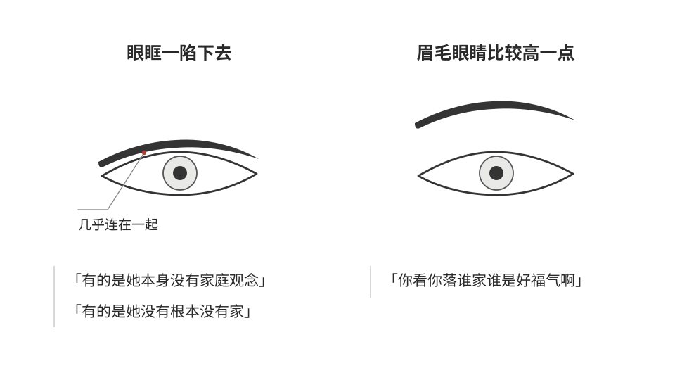 〔口述〕「过去你们可能还很羡慕」很多电影明星「眼睛泪汪汪的」，「我看这家伙是败家子啊」，因为「她没有家庭观念嘛」；又分「有的是她本身没有家庭观念」和「有的是她没有根本没有家」。（[00:32:46–00:33:07](https://www.bilibili.com/video/BV1KJsLekEfA/?p=29&t=1966)，第 58986–59639 帧） 〔口述〕「所以娶老婆啊找什么」「最好找眉毛眼睛比较高一点」；举一位小姐，「你看眉眼那么高」她想压下来，倪师说「你看你落谁家谁是好福气啊」，「她还不喜欢呢」。（[00:33:08–00:33:31](https://www.bilibili.com/video/BV1KJsLekEfA/?p=29&t=1988)，第 59640–60341 帧） |
| **这种八字该怎么看待？巨门太阳落陷的人什么脾气？** | 〔口述〕「所以这种八字就比较」「我们要比较博人同情她」「那命上面是博人同情」「可是还有在人人事上的行为」。（[00:33:34–00:33:44](https://www.bilibili.com/video/BV1KJsLekEfA/?p=29&t=2014)，第 60432–60743 帧） 〔口述〕「你们看我提出很多八字有没有」「那巨门太阳落陷」，「凶到人家谁都受不了她」「很很恶啊很凶恶啊」「脾气很拗的很坏的」「个性很刚强很固执」。（[00:33:46–00:34:01](https://www.bilibili.com/video/BV1KJsLekEfA/?p=29&t=2026)，第 60780–61259 帧） 〔口述〕「然后你要如果跟她吵架」「你才讲一句」「她十句已经骂完了」「跟泼妇骂街型的」，最后说「所以人还有外相」。（[00:34:02–00:34:14](https://www.bilibili.com/video/BV1KJsLekEfA/?p=29&t=2042)，第 61260–61643 帧） |

**总结区**

- 通用规则：父母和兄弟都带杀，就叫做六亲不靠（[00:28:56–00:29:08](https://www.bilibili.com/video/BV1KJsLekEfA/?p=29&t=1736)，第 52104–52463 帧）；流年没有红鸾天喜，若那段是吉星也会结婚，是杀星就不会成；26-35 吉星多的人靠媒妁之言或朋友起哄也会结婚（[00:30:40–00:31:08](https://www.bilibili.com/video/BV1KJsLekEfA/?p=29&t=1840)，第 55212–56063 帧）；个子小要手、眼睛等全部一起小，不能个子很小眼睛很大（[00:31:37–00:31:58](https://www.bilibili.com/video/BV1KJsLekEfA/?p=29&t=1897)，第 56928–57545 帧）；东方人眼眶不能陷太深，一陷下去眉眼就几乎连在一起，倪师说这种人没有家庭观念（[00:32:32–00:33:07](https://www.bilibili.com/video/BV1KJsLekEfA/?p=29&t=1952)，第 58566–59639 帧）
- 只在本例：命宫丙寅地空、空无一物，官禄巨门禄存在46-55，财帛太阳陷（[00:27:29–00:28:15](https://www.bilibili.com/video/BV1KJsLekEfA/?p=29&t=1649)，第 49488–50861 帧）；她从小被领养，父母兄弟带杀、六亲不靠，太阴落陷在辰宫，父母看不见（[00:28:33–00:29:27](https://www.bilibili.com/video/BV1KJsLekEfA/?p=29&t=1713)，第 51390–53021 帧）；红鸾天喜要46-55才会逢，26-35月亮出来是杀星、36-45廉贪落陷，所以一直没有婚姻（[00:30:21–00:31:19](https://www.bilibili.com/video/BV1KJsLekEfA/?p=29&t=1821)，第 54630–56399 帧）；做人家偏房；子女宫空、对面廉贪落陷，所以没有子嗣（[00:31:20–00:31:37](https://www.bilibili.com/video/BV1KJsLekEfA/?p=29&t=1880)，第 56400–56927 帧）
- 不是排盘规则，是处世方法：领养不是坏事，也不是本人愿意的，只是说有这种情形（[00:30:00–00:30:04](https://www.bilibili.com/video/BV1KJsLekEfA/?p=29&t=1800)，第 54006–54149 帧）；娶老婆最好找眉毛眼睛比较高一点的（[00:33:08–00:33:11](https://www.bilibili.com/video/BV1KJsLekEfA/?p=29&t=1988)，第 59640–59753 帧）；这种八字命上要博人同情，但还要看人事上的行为（[00:33:34–00:33:44](https://www.bilibili.com/video/BV1KJsLekEfA/?p=29&t=2014)，第 60432–60743 帧）

**待核**

1. 字幕「命官」改作命宫（[00:28:15](https://www.bilibili.com/video/BV1KJsLekEfA/?p=29&t=1695)，第 50862 帧）；「官禄官」改作官禄宫（[00:28:08](https://www.bilibili.com/video/BV1KJsLekEfA/?p=29&t=1688)，第 50652 帧）
2. 字幕「完第官就是化忌的」，语音作「弟宫就是话剧的」，按上下文改作兄弟宫就是化忌的（[00:28:26](https://www.bilibili.com/video/BV1KJsLekEfA/?p=29&t=1706)，第 51180 帧）
3. 「空的对面呢」时叠图贴出迁移壬申，随后「这个对面呢」「这里是巨门禄存」写在官禄庚午那格；「对面」所指何宫说不清，该处指代（D107）也看不出（[00:27:44–00:27:55](https://www.bilibili.com/video/BV1KJsLekEfA/?p=29&t=1664)，第 49920–50255 帧）
4. 字幕「这是事业宫」语音作「四月宫」，按字幕取（[00:28:05](https://www.bilibili.com/video/BV1KJsLekEfA/?p=29&t=1685)，第 50550 帧）
5. 官禄庚午格的火星亮度第一次叠图认不出，后一次印作庙（第 49920、50748 帧）
6. 「像刚刚前面那位也是六亲不靠」的「前面那位」指哪一例，材料没说清（[00:29:03](https://www.bilibili.com/video/BV1KJsLekEfA/?p=29&t=1743)，第 52296 帧）
7. 「你看为什么太阳在这边」的指代（D112）不确定，未作依据（[00:29:09](https://www.bilibili.com/video/BV1KJsLekEfA/?p=29&t=1749)，第 52496 帧）
8. 「辰宫是上午7-9点出月亮」「晚上7-9点怎么样出太阳」怎样推出「父母看不见」，本块没有解释（[00:29:15–00:29:27](https://www.bilibili.com/video/BV1KJsLekEfA/?p=29&t=1755)，第 52650–53021 帧）
9. 字幕「孤儿院」语音作「育儿院」（[00:29:31](https://www.bilibili.com/video/BV1KJsLekEfA/?p=29&t=1771)，第 53130 帧）；「看不到两个角」的「角」语音作「脚」，指印堂的角还是别处待核（[00:29:37](https://www.bilibili.com/video/BV1KJsLekEfA/?p=29&t=1777)，第 53316 帧）
10. 字幕「两难有没有领养」语音作「两男」，意思拿不准（[00:29:49](https://www.bilibili.com/video/BV1KJsLekEfA/?p=29&t=1789)，第 53676 帧）
11. 「红鸾星在这里夫妻宫」指代（D117）不确定；流年的「6到15」「16-25」两处指代也不确定，字幕只有「16-25在这边」，语音还连说6到15至36到45（第 54165、54312 帧）
12. 「她26-35 是中午」与前面「辰宫是上午7-9点出月亮」的时间说法不一致（叠图 26~35 在福德戊辰），待核（[00:30:50](https://www.bilibili.com/video/BV1KJsLekEfA/?p=29&t=1850)，第 55500 帧）
13. 「你看看廉贞贪狼落陷化忌（侧会）」语音作「年龄太阳落泄花姐」，两路对不上；后面又说「对面是不是廉贪落陷化权」，化忌与化权不一致（第 56100、56718 帧）
14. 叠图田宅己巳的「权」约[00:30:19](https://www.bilibili.com/video/BV1KJsLekEfA/?p=29&t=1819)，第 54582 帧挂在贪狼（贪狼陷权），约[00:31:27](https://www.bilibili.com/video/BV1KJsLekEfA/?p=29&t=1887)，第 56634 帧改挂廉贞（廉贞陷权），两种挂法不一致（第 54582、56634 帧）
15. 字幕括号注字「（侧会）」不是口述；「侧会」「偏房格」倪师本块未解释，叠图命宫格「侧会巨日女命偏房格」是剪辑提示字（第 56100、56400 帧）
16. 「那巨门太阳落陷」是讲本例还是泛讲材料没说清；本例叠图巨门在官禄庚午、太阳陷在财帛甲戌（[00:33:47](https://www.bilibili.com/video/BV1KJsLekEfA/?p=29&t=2027)，第 60834 帧）
17. 「博人同情」含义倪师未解释（[00:33:36](https://www.bilibili.com/video/BV1KJsLekEfA/?p=29&t=2016)，第 60492 帧）
18. 「到头来都以为自己所谓有理（3）」语音作「时候还对我自己的所以人」，对不上（[00:34:10](https://www.bilibili.com/video/BV1KJsLekEfA/?p=29&t=2050)，第 61512 帧）
19. 板书认不全：[00:28:07](https://www.bilibili.com/video/BV1KJsLekEfA/?p=29&t=1687)，第 50616 帧上中格中间两行（疑「禄存」「事业」）；[00:28:18](https://www.bilibili.com/video/BV1KJsLekEfA/?p=29&t=1698)，第 50964 帧「太阳」后一字（疑「陷」）；[00:29:06](https://www.bilibili.com/video/BV1KJsLekEfA/?p=29&t=1746)，第 52388 帧右侧竖写只认得「六」；[00:29:16](https://www.bilibili.com/video/BV1KJsLekEfA/?p=29&t=1756)，第 52692 帧「辰」后数字疑「7-9」；[00:30:24](https://www.bilibili.com/video/BV1KJsLekEfA/?p=29&t=1824)，第 54744 帧「财帛」旁新字看不清
20. 父母丁卯格在[00:28:30](https://www.bilibili.com/video/BV1KJsLekEfA/?p=29&t=1710)，第 51300 帧画面上已贴出，材料▣行到约[00:30:19](https://www.bilibili.com/video/BV1KJsLekEfA/?p=29&t=1819)，第 54582 帧才列出该格内容（[00:28:30](https://www.bilibili.com/video/BV1KJsLekEfA/?p=29&t=1710)，第 51300 帧）

## 手相：后天八卦掌位、明堂、掌纹指甲、奇门八门（末尾答疑不记）

### 7　手相入后天八卦：明堂与乾坎艮三位（[00:34:14–00:39:47](https://www.bilibili.com/video/BV1KJsLekEfA/?p=29&t=2054)，第 61644–71633 帧）

| 提示区 | 笔记区 |
|---|---|
| **看手相要放进哪一套八卦？** | 〔口述〕倪师转入手相：「诸位看这个手相」，要把手掌「放到」「文王的后天八卦里面」，并说「这是后天卦啊」「后天卦为用」「所以我们就用后天卦来看的」。（[00:34:14–00:34:29](https://www.bilibili.com/video/BV1KJsLekEfA/?p=29&t=2054)，第 61644–62093 帧） 〔板书〕开讲时板上只有粉笔画的手掌轮廓线，没有字。（[00:34:14](https://www.bilibili.com/video/BV1KJsLekEfA/?p=29&t=2054)，第 61644 帧） 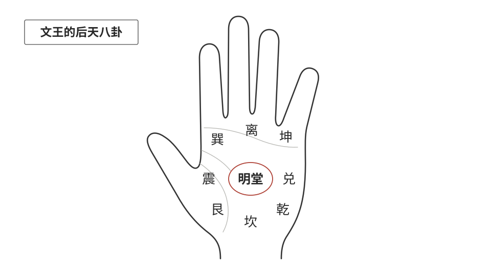 〔推断〕推断：这里的八卦方位是画在手掌上的部位，下文乾、坎、艮各主什么，都是手掌部位的说法，不是命盘的宫。（[00:34:16–00:34:29](https://www.bilibili.com/video/BV1KJsLekEfA/?p=29&t=2056)，第 61704–62093 帧） |
| **后天八卦八个方位各是哪一卦？** | 〔口述〕倪师边说边写：「定位乾在西北」；「北方是坎卦」；「东北角是艮卦」；「东方是什么震卦」；「东南角呢是巽卦」；「正南方呢离卦」；「西南角是什么坤卦」；「正西边是兑卦」。（[00:34:20–00:34:45](https://www.bilibili.com/video/BV1KJsLekEfA/?p=29&t=2060)，第 61824–62579 帧） 〔板书〕手掌轮廓里写了几个卦名。可辨：右上「坤」、右侧「兑」、右下「乾」；左上圆圈里和上方中间各有一个草写字，认不出。（[00:34:44](https://www.bilibili.com/video/BV1KJsLekEfA/?p=29&t=2084)，第 62531 帧） |
| **手掌正中间叫什么？跟堪舆有什么关系？** | 〔口述〕「手掌正中间」「我们过去有个名称叫做明堂」，倪师说「诸位开始要学堪舆了」。（[00:34:46–00:34:51](https://www.bilibili.com/video/BV1KJsLekEfA/?p=29&t=2086)，第 62580–62747 帧） 〔口述〕盖房子、过去盖坟墓、「盖阳宅都是有有院子比较好」，「所以说明堂很重要」。（[00:34:57–00:35:06](https://www.bilibili.com/video/BV1KJsLekEfA/?p=29&t=2097)，第 62916–63185 帧） 〔口述〕「那中国的时代的堪舆学啊」「和我们手相学和人相」「通通是结合在一起」。（[00:35:06–00:35:11](https://www.bilibili.com/video/BV1KJsLekEfA/?p=29&t=2106)，第 63186–63353 帧） 〔板书〕可辨：板面中间新画一个圆圈，圈内写「明堂」；下方写「坎」；左侧一个草写字认不出。（[00:34:50](https://www.bilibili.com/video/BV1KJsLekEfA/?p=29&t=2090)，第 62700 帧） |
| **太平洋百货的例子说明明堂什么道理？** | 〔口述〕倪师问为什么要明堂，举太平洋百货：门前路边的地「一平呢上200万」，但日本人「他可以把地舍掉」「把建筑线往后拉」「房子往后盖」，让明堂露出来，「结果太平洋……是全省百货销售冠军」。（[00:35:11–00:35:39](https://www.bilibili.com/video/BV1KJsLekEfA/?p=29&t=2111)，第 63354–64193 帧） 〔口述〕对比别家舍不得路边地，盖到马路边、「就盖在行道上面都盖满了」，结果「里面没有生意」「外外面有生意」，「小摊摊贩很多」，警察来了可以躲到里面、转个巷柱就挡到。（[00:35:39–00:36:06](https://www.bilibili.com/video/BV1KJsLekEfA/?p=29&t=2139)，第 64194–65003 帧） 〔口述〕反过来「你整个明堂打出来的时候」，「摊贩一站里面就全世界人都看到他」「他都他没地方跑啊」。（[00:36:10–00:36:16](https://www.bilibili.com/video/BV1KJsLekEfA/?p=29&t=2170)，第 65112–65309 帧） |
| **好的明堂应该是什么样子？手掌怎么验？** | 〔口述〕「明堂要平广」。「那你手中间你放个东西看看」，晚上会「睡不着觉的」，「因为中间被挡到」「明堂被破坏掉」。（[00:36:20–00:36:33](https://www.bilibili.com/video/BV1KJsLekEfA/?p=29&t=2180)，第 65424–65819 帧） 〔口述〕「明堂最好的明堂在风水上」「在手相上面都是一样」：「要能够留东西」「就是凹一点」「或者是平板」，「不要凸不能凸起来哈」，甚至凹下去一点，「所以手掌要凹」。（[00:36:34–00:36:50](https://www.bilibili.com/video/BV1KJsLekEfA/?p=29&t=2194)，第 65820–66311 帧） 〔口述〕验法：「甚而至于你水倒上去的时候」「哎还有点水停在上面这样」；若学生说手掌倒水「水跑掉了」，倪师说「你自己检讨检讨」，「这个中间要有点水可以留到这叫明堂」。（[00:36:50–00:37:01](https://www.bilibili.com/video/BV1KJsLekEfA/?p=29&t=2210)，第 66312–66647 帧） |
| **看陌生人的手要注意什么礼数？** | 〔口述〕对不认识的人「你不好意思开口说」，握手只一刹那，「你不好意思老是看他手啊」。（[00:37:05–00:37:14](https://www.bilibili.com/video/BV1KJsLekEfA/?p=29&t=2225)，第 66756–67043 帧） 〔口述〕倪师举例：「那我你如果看我的右手我手上瘤」，「我还以为你在看我这个瘤」，「对不对我以为你在笑我」，「其实你在研究我的手掌」；「对呀万一人家有缺陷怎么样」。（[00:37:14–00:37:26](https://www.bilibili.com/video/BV1KJsLekEfA/?p=29&t=2234)，第 67044–67385 帧） 〔口述〕「像我们中医比较好」，「手伸出来摸摸脉看」，其实「已经在开始读了」，「读脸读读手就已经读完了」。（[00:37:26–00:37:37](https://www.bilibili.com/video/BV1KJsLekEfA/?p=29&t=2246)，第 67386–67715 帧） |
| **掌上乾位主什么？男女看哪只手？** | 〔口述〕「诸位看你们手掌上面写的乾的位置」，「乾位呢是祖宗」，「也主的是什么父母」。（[00:37:37–00:37:53](https://www.bilibili.com/video/BV1KJsLekEfA/?p=29&t=2257)，第 67716–68219 帧） 〔口述〕讲「乾位这个角」时说「左手哈」「部是左手」（语音连起来作左手全部是左手），「在手男女都看左手」（语音作左手男女都看左手）。（[00:37:54–00:38:01](https://www.bilibili.com/video/BV1KJsLekEfA/?p=29&t=2274)，第 68220–68459 帧） 〔指代〕说「乾位这个角」时，手掌按在板面中下方写着「乾」的小圆圈上；稍后说「这个」时手指仍按在同一个「乾」圈上。（[00:37:54–00:38:01](https://www.bilibili.com/video/BV1KJsLekEfA/?p=29&t=2274)，第 68233–68430 帧） 〔板书〕可辨：右下的「乾」已用圆圈圈起；圈旁新写两个草写字，认不出。（[00:37:47](https://www.bilibili.com/video/BV1KJsLekEfA/?p=29&t=2267)，第 68034 帧） 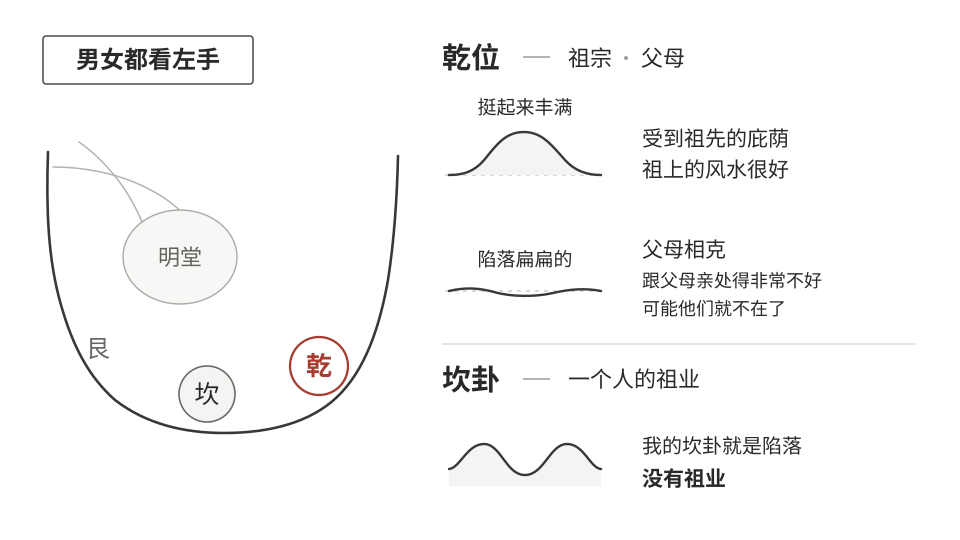 |
| **乾位丰满与陷落各代表什么？** | 〔口述〕乾位那个角挺起来丰满，代表能受到祖先的庇荫（字幕识别不清，按语音改正），「对祖宗来说代表祖上的风水很好」。（[00:38:02–00:38:19](https://www.bilibili.com/video/BV1KJsLekEfA/?p=29&t=2282)，第 68460–68993 帧） 〔口述〕「如果是陷落扁扁的」，「代表父母相克」「跟到你的爸爸妈妈相克」，「可能他们就不在了」「那最好不在」。（[00:38:19–00:38:30](https://www.bilibili.com/video/BV1KJsLekEfA/?p=29&t=2299)，第 68994–69311 帧） 〔口述〕「如果这个平落的话」，代表你跟父母亲处得非常不好（按语音改正），「也代表过世」；「那你这时候摸摸看看他额头就知道了嘛」，「这个是乾位」。（[00:38:31–00:38:41](https://www.bilibili.com/video/BV1KJsLekEfA/?p=29&t=2311)，第 69348–69647 帧） 〔板书〕可辨：「乾」圈旁新写一个箭头「→」，箭头前后的草写字认不出。（[00:38:12](https://www.bilibili.com/video/BV1KJsLekEfA/?p=29&t=2292)，第 68784 帧） 〔板书〕可辨：板面右侧新画一个方框，框内两个草写字认不出。（[00:38:33](https://www.bilibili.com/video/BV1KJsLekEfA/?p=29&t=2313)，第 69396 帧） |
| **掌上坎卦主什么？倪师自己的坎卦怎样？** | 〔口述〕「坎卦呢」「这是祖业」「一个人的祖业」。（[00:38:41–00:38:47](https://www.bilibili.com/video/BV1KJsLekEfA/?p=29&t=2321)，第 69648–69821 帧） 〔口述〕倪师拿自己的手示范：「像诸位你看我手一伸出来」，「这个是不是凹下去」「两边凸起来」「这边是凹下去」，「我的坎卦就是陷落」「陷落就是没有祖业」。（[00:38:47–00:38:58](https://www.bilibili.com/video/BV1KJsLekEfA/?p=29&t=2327)，第 69822–70163 帧） 〔指代〕说「这边」时，倪师左手掌心朝上平伸，右手食指点在左手掌根和掌心处；接着说「这边凹下去」时，左掌朝上托出，展示的是他自己掌心的凹处。（[00:38:51–00:38:53](https://www.bilibili.com/video/BV1KJsLekEfA/?p=29&t=2331)，第 69935–70003 帧） 〔板书〕可辨：圆圈内「坎」、圆圈内「乾」、左下「艮」；下方新写的草字认不出。（[00:38:46](https://www.bilibili.com/video/BV1KJsLekEfA/?p=29&t=2326)，第 69780 帧） |
| **坎卦饱满或凹陷，祖业会怎样？** | 〔口述〕「那有的人饱满」，手伸出来后面整个膨起来（字幕「肩面」按语音改为后面），「代表来龙很旺」；后面会介绍到这个风水（同上改正），「来龙很大」「代表祖业很兴旺」。（[00:39:00–00:39:12](https://www.bilibili.com/video/BV1KJsLekEfA/?p=29&t=2340)，第 70206–70589 帧） 〔指代〕说「后面这个整个膨起来」时，倪师用左手手指点着自己右手的掌根部示范，没有指黑板。（[00:39:03](https://www.bilibili.com/video/BV1KJsLekEfA/?p=29&t=2343)，第 70301 帧） 〔口述〕「这个这个坎卦要丰满」，「凹陷下去代表没有祖业」，那就要白手起家、靠白手生财（字幕「自手」按语音改正）。（[00:39:13–00:39:21](https://www.bilibili.com/video/BV1KJsLekEfA/?p=29&t=2353)，第 70590–70841 帧） 〔板书〕可辨：「坎」「艮」两字；下方草写字认不出。（[00:39:15](https://www.bilibili.com/video/BV1KJsLekEfA/?p=29&t=2355)，第 70668 帧） |
| **掌上艮卦主什么？肉膨起与扁下去各代表什么？** | 〔口述〕「艮卦呢起田宅」；「像艮卦的位置」，「你看这个肉膨起来」，「代表田宅很多」。（[00:39:21–00:39:32](https://www.bilibili.com/video/BV1KJsLekEfA/?p=29&t=2361)，第 70842–71177 帧） 〔口述〕「这也代表兄弟很旺」「兄弟很多」；「如果这个肉田宅的位艮卦的位置扁下去」，「兄弟稀少」。（[00:39:32–00:39:47](https://www.bilibili.com/video/BV1KJsLekEfA/?p=29&t=2372)，第 71178–71633 帧） 〔指代〕说「这也代表兄弟很旺」时，整个手掌按在黑板左侧写着「艮」的圆圈上。（[00:39:32](https://www.bilibili.com/video/BV1KJsLekEfA/?p=29&t=2372)，第 71180 帧） |

**总结区**

- 通用规则：看手相要把手掌放进文王后天八卦，用后天卦来看（[00:34:16–00:34:29](https://www.bilibili.com/video/BV1KJsLekEfA/?p=29&t=2056)，第 61704–62093 帧）；手掌正中叫明堂，明堂要平广、能留东西，凹一点或平板，不能凸起，倒水上去要能留住一点水（[00:34:46–00:37:01](https://www.bilibili.com/video/BV1KJsLekEfA/?p=29&t=2086)，第 62580–66647 帧）；看手男女都看左手；掌上乾位主祖宗、也主父母，丰满代表受祖先庇荫、祖上风水好，陷落扁扁代表与父母相克、相处不好或过世（[00:37:37–00:38:41](https://www.bilibili.com/video/BV1KJsLekEfA/?p=29&t=2257)，第 67716–69647 帧）；掌上坎卦主祖业，丰满祖业兴旺、凹陷没有祖业要白手起家；艮卦主田宅也主兄弟，肉膨起田宅多兄弟旺，扁下去兄弟稀少（[00:38:41–00:39:47](https://www.bilibili.com/video/BV1KJsLekEfA/?p=29&t=2321)，第 69648–71633 帧）
- 只在本例：太平洋百货舍掉昂贵的路边地、建筑线往后拉让明堂露出来，结果成为全省百货销售冠军（[00:35:11–00:35:39](https://www.bilibili.com/video/BV1KJsLekEfA/?p=29&t=2111)，第 63354–64193 帧）；倪师自己的手坎卦位凹下去、两边凸起，他说自己坎卦陷落、没有祖业（[00:38:47–00:38:58](https://www.bilibili.com/video/BV1KJsLekEfA/?p=29&t=2327)，第 69822–70163 帧）
- 不是排盘规则，是处世方法：看不认识的人的手不要老盯着看，免得对方以为你在看他的缺陷；中医摸脉时就已经在读脸读手（[00:37:05–00:37:37](https://www.bilibili.com/video/BV1KJsLekEfA/?p=29&t=2225)，第 66756–67715 帧）

**待核**

1. 字幕「沟什么要明堂呢」，「沟什么」按上下文改为为什么（[00:35:11](https://www.bilibili.com/video/BV1KJsLekEfA/?p=29&t=2111)，第 63354 帧）
2. 字幕「SOGO」「SOG0」是连续英文字母，引文里用「……」略去或写作太平洋百货（第 63420、65046 帧）
3. 字幕「让名堂漏出来」，按上下文应为让明堂露出来，未直接引用（[00:35:32](https://www.bilibili.com/video/BV1KJsLekEfA/?p=29&t=2132)，第 63972 帧）
4. 字幕「“乾位丰隆」可信度 0.37，语音作「封龙」，句头引号已去掉，原话待核（[00:37:48](https://www.bilibili.com/video/BV1KJsLekEfA/?p=29&t=2268)，第 68052 帧）
5. 字幕「在手男女都看左手」的「在手」语音同，意思不明，原样保留（[00:37:59](https://www.bilibili.com/video/BV1KJsLekEfA/?p=29&t=2279)，第 68376 帧）
6. 字幕「圣介角挺起来丰满」，语音作「脚挺起来丰满」，前两字认不出，未直接引用（[00:38:02](https://www.bilibili.com/video/BV1KJsLekEfA/?p=29&t=2282)，第 68460 帧）
7. 字幕「代表是祖先能够受到祖先的底随」，语音作「皮印」，板书图画面上的字幕显示为庇荫，转述时改为庇荫（[00:38:05](https://www.bilibili.com/video/BV1KJsLekEfA/?p=29&t=2285)，第 68556 帧）
8. 字幕「需參母相克的意思是」识别不清，略过（[00:38:30](https://www.bilibili.com/video/BV1KJsLekEfA/?p=29&t=2310)，第 69312 帧）
9. 字幕「代表你限父母亲处的手常的不好」按语音改为你跟父母亲处得非常不好（[00:38:32](https://www.bilibili.com/video/BV1KJsLekEfA/?p=29&t=2312)，第 69384 帧）
10. 「那你这时候摸摸看看他额头就知道了嘛」与乾位的关系本块没有解释；句尾「奴仆」语音没有，已去掉（[00:38:36](https://www.bilibili.com/video/BV1KJsLekEfA/?p=29&t=2316)，第 69492 帧）
11. 字幕「财禄官禄」语音没有，像画面上别的字，略过（[00:38:49](https://www.bilibili.com/video/BV1KJsLekEfA/?p=29&t=2329)，第 69876 帧）
12. 字幕「肩面」两处按语音改为后面（第 70290、70392 帧）
13. 「来龙」本块没有解释，倪师说后面会介绍到这个风水（[00:39:05](https://www.bilibili.com/video/BV1KJsLekEfA/?p=29&t=2345)，第 70356 帧）
14. 字幕「自手起家」「自手生财」按语音改为白手（第 70692、70758 帧）
15. 句尾「仆役」「麥仆役」语音没有，引文已去掉（第 70494、70650、70842 帧）
16. 指代 D142 标为确定指向黑板「明堂」圈右下方的小圆圈，但圈内字被手和掌图叠图挡住，看不清，未当依据（[00:38:31](https://www.bilibili.com/video/BV1KJsLekEfA/?p=29&t=2311)，第 69359 帧）
17. 指代 D136、D137、D143、D149、D150、D152 为不确定或看不出，未当依据（第 66552、66701、69548、70978、71002、71300 帧）
18. 板书多处草写字认不出：左上圈内与上方中间两字（[00:34:44](https://www.bilibili.com/video/BV1KJsLekEfA/?p=29&t=2084)，第 62531 帧）、左侧一字（[00:34:50](https://www.bilibili.com/video/BV1KJsLekEfA/?p=29&t=2090)，第 62700 帧）、乾圈旁两字（[00:37:47](https://www.bilibili.com/video/BV1KJsLekEfA/?p=29&t=2267)，第 68034 帧）、箭头前后的字（[00:38:12](https://www.bilibili.com/video/BV1KJsLekEfA/?p=29&t=2292)，第 68784 帧）、方框内两字形似相克但不能确认（[00:38:33](https://www.bilibili.com/video/BV1KJsLekEfA/?p=29&t=2313)，第 69396 帧）、下方草字（第 69780、70668 帧）
19. 板书图第 62153、68664、69228 帧手掌轮廓与已写字大多被身体或掌图叠图挡住，没有新的可辨字，未单独列条

### 8　掌上八卦位、掌纹与指甲看心性（[00:39:47–00:45:19](https://www.bilibili.com/video/BV1KJsLekEfA/?p=29&t=2387)，第 71634–81587 帧）

| 提示区 | 笔记区 |
|---|---|
| **手掌上的震卦管什么？丰满、凹陷、暗黑各主什么？** | 〔口述〕倪师接着讲手掌上的八卦位：「震卦呢」「管的是妻子贤妻啊」；震卦丰满，「代表妻贤」。（[00:39:47–00:39:58](https://www.bilibili.com/video/BV1KJsLekEfA/?p=29&t=2387)，第 71634–71945 帧） 〔口述〕震卦凹陷下去，「代表拆损妻子……」（语音作折损妻子太太），「太太不好」「或者是这个太太过世」。（[00:39:58–00:40:07](https://www.bilibili.com/video/BV1KJsLekEfA/?p=29&t=2398)，第 71946–72233 帧） 〔口述〕又说「震卦颜色比较暗比较黑」「黑黑暗暗这一块」，接着一句「凹黑」，本块没有再单独说暗黑的结论。（[00:40:07–00:40:16](https://www.bilibili.com/video/BV1KJsLekEfA/?p=29&t=2407)，第 72234–72497 帧） 〔指代〕说「黑黑暗暗这一块」时，手在黑板左侧中部的一个圆圈里涂抹点按；圈里的字被手挡住、涂花，看不清是哪个字。（[00:40:12](https://www.bilibili.com/video/BV1KJsLekEfA/?p=29&t=2412)，第 72385 帧） 〔板书〕写完后的板面：左侧竖写可辨「折」「损」二字，旁边一列像「妻」字，其余被手和粉笔挡住认不出；圆圈里的字认不出。（[00:40:07](https://www.bilibili.com/video/BV1KJsLekEfA/?p=29&t=2407)，第 72228 帧） 〔推断〕推断：本块说的震、巽、离、坤、兑「卦 / 宫 / 位置」都是手掌上的部位（倪师曾用右手指点自己左手掌的角来示意），不是命盘十二宫。（[00:40:21](https://www.bilibili.com/video/BV1KJsLekEfA/?p=29&t=2421)，第 72637 帧） |
| **巽卦在手掌哪个位置？主什么？** | 〔口述〕「那巽卦呢」「这个位置上」「这个位置很重要」「就在我们这个角交上面」（语音作角角上面），「看到没有」「这叫做巽」。（[00:40:16–00:40:25](https://www.bilibili.com/video/BV1KJsLekEfA/?p=29&t=2416)，第 72498–72767 帧） 〔指代〕说「这个位置上」时，手伸到黑板左上角那组多重圆圈上画圈、按着；圈内字被水印和圈线干扰，看不清。（[00:40:17–00:40:18](https://www.bilibili.com/video/BV1KJsLekEfA/?p=29&t=2417)，第 72527–72563 帧） 〔指代〕说「就在我们这个角」时，左手掌竖起，右手食指点在左手食指根下方的掌心角上，指的是自己手掌上的角，不是板上的字。（[00:40:21](https://www.bilibili.com/video/BV1KJsLekEfA/?p=29&t=2421)，第 72637 帧） 〔口述〕「巽卦的位置哈」「主的是财禄」。（[00:40:25–00:40:30](https://www.bilibili.com/video/BV1KJsLekEfA/?p=29&t=2425)，第 72768–72929 帧） 〔板书〕黑板左上方新写两字可辨「财禄」；左侧竖写可辨「折」「损」，旁一列像「妻贤」，其余认不出（讲者背身挡住中部）。（[00:40:30](https://www.bilibili.com/video/BV1KJsLekEfA/?p=29&t=2430)，第 72912 帧） |
| **巽卦丰满与凹陷、乱纹多，财禄怎样？** | 〔口述〕巽卦的位置「肉越多越丰滿」，「代表财禄越兴盛」。（[00:40:31–00:40:37](https://www.bilibili.com/video/BV1KJsLekEfA/?p=29&t=2431)，第 72930–73121 帧） 〔口述〕反过来，「如果呢反过来凹陷下去」「或者是乱纹很多」「一票乱纹在里面」，「主的财禄要破财的」。（[00:40:37–00:40:43](https://www.bilibili.com/video/BV1KJsLekEfA/?p=29&t=2437)，第 73122–73319 帧） 〔口述〕举例：「所以你如果有好多钱要给你的子女」「拿出来一看啊」，巽卦凹陷下去、横纹很多，「不行这守不住财的」。（[00:40:44–00:40:55](https://www.bilibili.com/video/BV1KJsLekEfA/?p=29&t=2444)，第 73320–73655 帧） 〔板书〕本时段另一张板面：左上圆圈被反复画圈，圈内字被水印干扰认不出；可辨圆圈「明堂」「艮」「坎」，右侧方框「相刻」。（[00:40:19](https://www.bilibili.com/video/BV1KJsLekEfA/?p=29&t=2419)，第 72583 帧） |
| **离卦主什么？离卦越挺越高代表什么？** | 〔指代〕说「离卦这个位置」前，右手掌按在黑板左上部大椭圆内的草书字上，该字读作「离」。（[00:40:54](https://www.bilibili.com/video/BV1KJsLekEfA/?p=29&t=2454)，第 73641 帧） 〔口述〕「离卦这个位置呢」「起的是官禄」「官禄」。（[00:40:55–00:41:00](https://www.bilibili.com/video/BV1KJsLekEfA/?p=29&t=2455)，第 73656–73811 帧） 〔口述〕「像离卦的位置」「越挺越高」「代表官家……从官得禄」，「懂不懂当官拿官家的钱」。（[00:41:00–00:41:10](https://www.bilibili.com/video/BV1KJsLekEfA/?p=29&t=2460)，第 73812–74111 帧） 〔口述〕「官越这个离卦越太」（语音作离挂越大，即离卦越大），「官位越大」。说这句时手又按在上方中间写「离」的圆圈上。（[00:41:09–00:41:15](https://www.bilibili.com/video/BV1KJsLekEfA/?p=29&t=2469)，第 74078–74279 帧） 〔板书〕本张板面上方被画面裁掉、讲者背身挡住，新写的字认不出；可辨圆圈「明堂」「艮」「坎」，方框「相刻」。（[00:40:59](https://www.bilibili.com/video/BV1KJsLekEfA/?p=29&t=2459)，第 73783 帧） 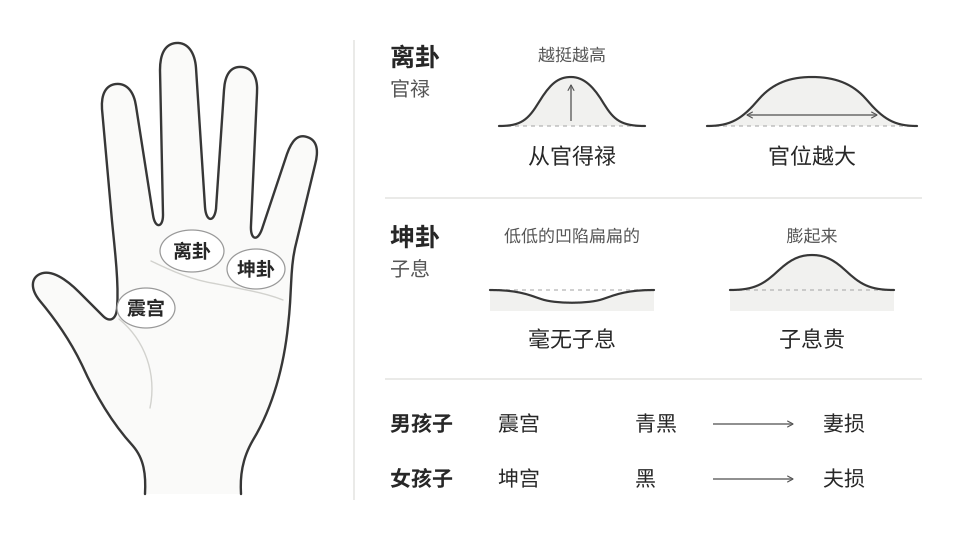 |
| **坤卦主什么？扁平和膨起各代表什么？** | 〔指代〕说「那坤卦的位置呢」时，五指张开按在上方长椭圆里「离」圈右边，板面该处是一个草书字，像「坤」。（[00:41:17](https://www.bilibili.com/video/BV1KJsLekEfA/?p=29&t=2477)，第 74314 帧） 〔口述〕「这个代表子息子息啊」「坤卦的位置代表子息」「子息啊子女」。（[00:41:17–00:41:28](https://www.bilibili.com/video/BV1KJsLekEfA/?p=29&t=2477)，第 74322–74657 帧） 〔口述〕「如果坤卦很平」「低低的凹陷扁扁的」，没有肉，「没有子息的」「毫无子息」。（[00:41:28–00:41:34](https://www.bilibili.com/video/BV1KJsLekEfA/?p=29&t=2488)，第 74658–74849 帧） 〔口述〕「如果坤卦膨起来」，「子息贵」。（[00:41:35–00:41:40](https://www.bilibili.com/video/BV1KJsLekEfA/?p=29&t=2495)，第 74850–75011 帧） 〔板书〕可辨圆圈「明堂」「坎」、方框「相刻」；右上新写两字像「子息」，拿不准；其余认不出。（[00:41:30](https://www.bilibili.com/video/BV1KJsLekEfA/?p=29&t=2490)，第 74724 帧） |
| **男女看掌有何不同？男看哪一位、女看哪一位？** | 〔口述〕「女孩子呢」「和男孩子不一样」：男孩子看震宫，「如果是青黑的话妻损」。（[00:41:40–00:41:49](https://www.bilibili.com/video/BV1KJsLekEfA/?p=29&t=2500)，第 75012–75293 帧） 〔口述〕「女孩子的坤宫」「如果黑的话」「夫损损夫啊」。（[00:41:49–00:41:53](https://www.bilibili.com/video/BV1KJsLekEfA/?p=29&t=2509)，第 75294–75413 帧） 〔口述〕玩笑：「你看看你的坤宫」，如果暗暗黑黑的，「就代表你老公」……「对你老公不满意」；回家嘴上说「你说老公我对你很满意」，「这是真话」「嘴巴那是假话」。（[00:41:53–00:42:07](https://www.bilibili.com/video/BV1KJsLekEfA/?p=29&t=2513)，第 75414–75833 帧） 〔推断〕推断：这个玩笑的意思是手掌坤宫的颜色显示的是真心，嘴上说的不一定是真话；倪师没有把这句话展开成规则。（[00:42:00–00:42:07](https://www.bilibili.com/video/BV1KJsLekEfA/?p=29&t=2520)，第 75618–75833 帧） 〔板书〕可辨左上「财禄」，左侧竖写像「妻贤」，圆圈「明堂」「艮」「坎」，右上圆圈「未婚」，方框「相刻」；其余认不出。（[00:41:53](https://www.bilibili.com/video/BV1KJsLekEfA/?p=29&t=2513)，第 75408 帧） |
| **兑卦代表什么？丰满与扁平各主什么？** | 〔指代〕说「兑卦呢」时，拿粉笔在黑板左侧中部一个像「兑」的草书字四周画圈；后面说「所以这个宫」「我们这个宫」时手掌两次按在这个「兑」字上。（[00:42:08–00:42:28](https://www.bilibili.com/video/BV1KJsLekEfA/?p=29&t=2528)，第 75856–76455 帧） 〔口述〕兑卦这个位置，过去讲「家家人兴旺」「家里面人多」，「代表仆役多」。（[00:42:14–00:42:20](https://www.bilibili.com/video/BV1KJsLekEfA/?p=29&t=2534)，第 76038–76217 帧） 〔口述〕「所以这个宫越起来」，仆役众多（字幕「受众多」，语音作瘦众多）；「越低落代表仆役……」少（字幕作「越坐」，语音作越少）。（[00:42:20–00:42:25](https://www.bilibili.com/video/BV1KJsLekEfA/?p=29&t=2540)，第 76218–76379 帧） 〔口述〕「现在来说的话」「也代表朋友」：「我们这个宫越丰满越晶莹」，「代表朋友非常的好的朋友很多」。（[00:42:26–00:42:32](https://www.bilibili.com/video/BV1KJsLekEfA/?p=29&t=2546)，第 76380–76571 帧） 〔口述〕「如果落陷下去扁扁的」，「这一块没有肉」，「代表朋友都不是很好」「常常受到朋友的伤害」。（[00:42:32–00:42:43](https://www.bilibili.com/video/BV1KJsLekEfA/?p=29&t=2552)，第 76572–76895 帧） |
| **什么叫天柱纹？它发的是什么？** | 〔口述〕「有一个地方哦」「我们从手掌这边啊」「一路纹一路通上去」「通到一直连到中指头」，「这条纹就叫做天柱纹」「发的是科甲」。（[00:42:51–00:43:09](https://www.bilibili.com/video/BV1KJsLekEfA/?p=29&t=2571)，第 77142–77699 帧） 〔指代〕说「我们从手掌这边」时，粉笔头点在黑板左下「坎」字圈的右上沿，即天柱纹从这里起讲。（[00:42:55](https://www.bilibili.com/video/BV1KJsLekEfA/?p=29&t=2575)，第 77260 帧） 〔板书〕写完后的板面：可辨右上圆圈「未婚」、方框「相刻」、圆圈「坎」；新写的天柱纹相关字认不出。（[00:43:13](https://www.bilibili.com/video/BV1KJsLekEfA/?p=29&t=2593)，第 77808 帧） 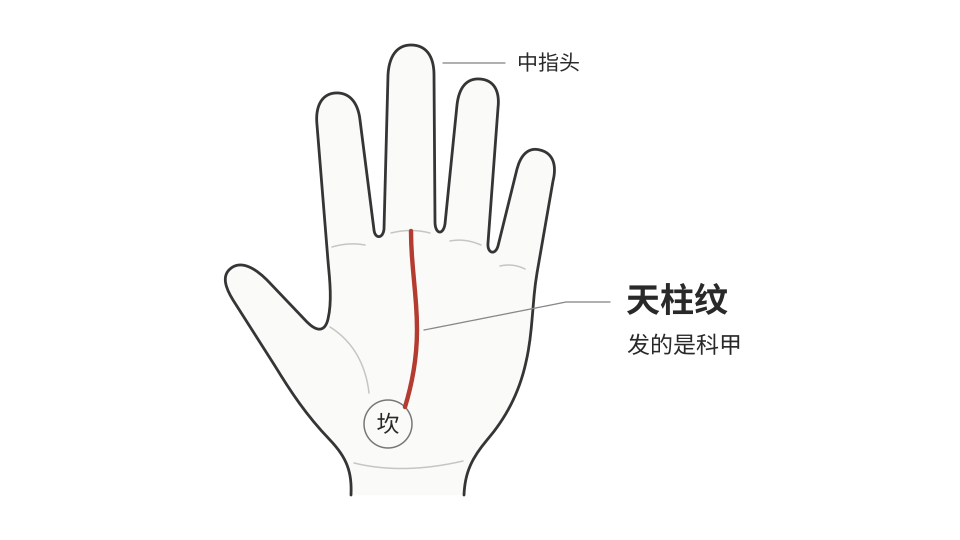 |
| **怎样从手纹看心性？纹细清秀代表什么？** | 〔口述〕「如果这个人呢」「纹路很细」，「我们这手上的纹啊」「纹要越细越好」。（[00:43:10–00:43:16](https://www.bilibili.com/video/BV1KJsLekEfA/?p=29&t=2590)，第 77700–77909 帧） 〔口述〕「我们拿手看手可以看心」「看这个人的心性啊」「看他的心性」。（[00:43:17–00:43:22](https://www.bilibili.com/video/BV1KJsLekEfA/?p=29&t=2597)，第 77910–78077 帧） 〔口述〕「手拿出来很光润」「那纹路很细」「很清秀这个人非常的正」，跟他的心性一样。（[00:43:22–00:43:30](https://www.bilibili.com/video/BV1KJsLekEfA/?p=29&t=2602)，第 78078–78311 帧） |
| **横纹多、手纹深而复杂，各代表什么心性？** | 〔口述〕「那个手的横纹很多」「那个心狠懂不懂」「你知道什么叫心狠」「就心一狠把他干挂了」（语音作干掉了）。（[00:43:30–00:43:36](https://www.bilibili.com/video/BV1KJsLekEfA/?p=29&t=2610)，第 78312–78503 帧） 〔口述〕「那有的人呢」「手纹很深很复杂」「代表手纹深呐」「机亦深心机越深」（语音作记忆深）。（[00:43:40–00:43:48](https://www.bilibili.com/video/BV1KJsLekEfA/?p=29&t=2620)，第 78618–78851 帧） 〔推断〕推断：本段把手纹的细与粗、横纹多少、深浅复杂分别对应心性正、心狠、心机深，是看心性，不是看命盘。（[00:43:10–00:43:48](https://www.bilibili.com/video/BV1KJsLekEfA/?p=29&t=2590)，第 77700–78851 帧） |
| **手纹透到手背上来，是好是坏？** | 〔口述〕有人说「你看老师你看我的纹多好」「还穿过到指头来」「你看我生命线透指过来」。（[00:43:48–00:43:53](https://www.bilibili.com/video/BV1KJsLekEfA/?p=29&t=2628)，第 78852–78995 帧） 〔口述〕倪师答：「对啊手纹透到手背上来」「那种破祖业破财破的很凶……」，「你还好嘞」「所以不要乱讲」「不可以啊」。（[00:43:53–00:44:03](https://www.bilibili.com/video/BV1KJsLekEfA/?p=29&t=2633)，第 78996–79301 帧） |
| **手纹少、柔、明各主什么？看不到手纹呢？** | 〔口述〕「手纹呐要细腻」；「那如果手纹很多一点点点」（语音作很少一点点），「代表这个人心无城府」「很憨厚」。（[00:44:03–00:44:11](https://www.bilibili.com/video/BV1KJsLekEfA/?p=29&t=2643)，第 79302–79535 帧） 〔口述〕「手纹要纹路要柔」，看她纹路很秀气、「非常的润」，「纹路细而且是要明」。（[00:44:11–00:44:20](https://www.bilibili.com/video/BV1KJsLekEfA/?p=29&t=2651)，第 79536–79811 帧） 〔口述〕「你不要看不到手纹」「那个蠢蛋了」「对不对」。（[00:44:19–00:44:22](https://www.bilibili.com/video/BV1KJsLekEfA/?p=29&t=2659)，第 79776–79883 帧） |
| **指甲看什么？指甲上没有太阳、干枯各主什么？** | 〔口述〕「而不看指头」「那个指头啊」「伸出来指头的时候」，「我们的指指指甲哦」「是看胆胆气」「胆气在指甲上面」。（[00:44:22–00:44:32](https://www.bilibili.com/video/BV1KJsLekEfA/?p=29&t=2662)，第 79884–80177 帧） 〔口述〕「我们指甲都是有太阳在上茴」（语音作「上面」），「有吧旭日东升」；「你的太阳没有了」「那个胆小」。（[00:44:32–00:44:38](https://www.bilibili.com/video/BV1KJsLekEfA/?p=29&t=2672)，第 80178–80369 帧） 〔口述〕「那我们不要讲病哈」「我们讲情志」：「那指甲如果干枯枯萎的话」「都是比较儒弱的」（即懦弱）。（[00:44:39–00:44:46](https://www.bilibili.com/video/BV1KJsLekEfA/?p=29&t=2679)，第 80370–80591 帧） |
| **指头如锤的人，一生和个性怎样？** | 〔口述〕「那你再看他指头」「指头如鎚（锤）啊」「这个是比较累的哈」，并比划锤子的样子：「这个指头变成这个形状啊」「你仔细看就是这种啊」。（[00:44:46–00:45:07](https://www.bilibili.com/video/BV1KJsLekEfA/?p=29&t=2686)，第 80592–81233 帧） 〔板书〕黑板左侧竖写可辨「指如鎚」三字，左上「财禄」；板上锤形指头图形在本张图里认不清。（[00:44:59](https://www.bilibili.com/video/BV1KJsLekEfA/?p=29&t=2699)，第 80975 帧） 〔口述〕「指头如鎚（锤）的人呢」「一辈子辛劳」「然后愚顽」「个性很顽强指如鎚（錘）」。（[00:45:07–00:45:19](https://www.bilibili.com/video/BV1KJsLekEfA/?p=29&t=2707)，第 81234–81587 帧） |

**总结区**

- 通用规则：掌上震卦主妻、巽卦主财禄、离卦主官禄、坤卦主子息、兑卦主仆役与朋友；丰满膨起为好，凹陷扁平、暗黑、乱纹多为损（[00:39:47–00:42:43](https://www.bilibili.com/video/BV1KJsLekEfA/?p=29&t=2387)，第 71634–76895 帧）；男子看震宫，青黑主妻损；女子看坤宫，黑主夫损（[00:41:40–00:41:53](https://www.bilibili.com/video/BV1KJsLekEfA/?p=29&t=2500)，第 75012–75413 帧）；从手掌起一路通到中指头的天柱纹发科甲；手纹要细、柔、明、润，纹细清秀心性正，横纹多心狠，纹深复杂心机深（[00:42:51–00:44:22](https://www.bilibili.com/video/BV1KJsLekEfA/?p=29&t=2571)，第 77142–79883 帧）；指甲看胆气，指甲上没有太阳主胆小、干枯枯萎主懦弱；指头如锤一辈子辛劳、愚顽、个性顽强（[00:44:22–00:45:19](https://www.bilibili.com/video/BV1KJsLekEfA/?p=29&t=2662)，第 79884–81587 帧）
- 只在本例：有人自夸纹穿到指头、生命线透过来，倪师说手纹透到手背上来是破祖业、破财（[00:43:48–00:44:03](https://www.bilibili.com/video/BV1KJsLekEfA/?p=29&t=2628)，第 78852–79301 帧）
- 不是排盘规则，是处世方法：要把很多钱交给子女前先看他的手，巽卦凹陷、横纹多就守不住财（[00:40:44–00:40:55](https://www.bilibili.com/video/BV1KJsLekEfA/?p=29&t=2444)，第 73320–73655 帧）；看指甲时「不要讲病」，只讲情志（[00:44:39–00:44:41](https://www.bilibili.com/video/BV1KJsLekEfA/?p=29&t=2679)，第 80370–80459 帧）

**待核**

1. [00:40:00](https://www.bilibili.com/video/BV1KJsLekEfA/?p=29&t=2400)，第 72018 帧：字幕「代表拆损妻子数贤」，语音「表折损妻子太太」，按语音理解为折损妻子，「数贤」认不出。
2. [00:40:07](https://www.bilibili.com/video/BV1KJsLekEfA/?p=29&t=2407)，第 72228 帧：板书被手和粉笔挡住，只认得「折」「损」，旁一列像「妻」，其余认不出。
3. [00:40:07–00:40:16](https://www.bilibili.com/video/BV1KJsLekEfA/?p=29&t=2407)，第 72234–72497 帧：震卦颜色暗黑之后只说「凹黑」（语音「那迅」），暗黑主什么本块没讲清。
4. [00:40:20](https://www.bilibili.com/video/BV1KJsLekEfA/?p=29&t=2420)，第 72600 帧：字幕「角交」，语音「角角」，按语音理解为手掌上的角。
5. [00:40:21](https://www.bilibili.com/video/BV1KJsLekEfA/?p=29&t=2421)，第 72642 帧：字幕「这个角这角是異」，「異」按上下文改为「巽」。
6. [00:40:48](https://www.bilibili.com/video/BV1KJsLekEfA/?p=29&t=2448)，第 73464 帧：字幕「横绞」，语音「横闻」，按上下文改为「横纹」。
7. [00:41:03](https://www.bilibili.com/video/BV1KJsLekEfA/?p=29&t=2463)，第 73896 帧：字幕「代表官家沩官从官得禄」，「沩官」语音作「未官」，认不出，引文中略去。
8. [00:41:10](https://www.bilibili.com/video/BV1KJsLekEfA/?p=29&t=2470)，第 74112 帧：字幕「官越这个离卦越太」，语音「离挂越大」，按语音理解为离卦越大。
9. [00:41:30](https://www.bilibili.com/video/BV1KJsLekEfA/?p=29&t=2490)，第 74724 帧：右上新写两字像「子息」，拿不准；[00:40:59](https://www.bilibili.com/video/BV1KJsLekEfA/?p=29&t=2459)，第 73783 帧、[00:43:13](https://www.bilibili.com/video/BV1KJsLekEfA/?p=29&t=2593)，第 77808 帧新写的字（包括天柱纹相关字）认不出。
10. [00:42:00](https://www.bilibili.com/video/BV1KJsLekEfA/?p=29&t=2520)，第 75618 帧：语音在「我对你很满意」后有「这是读心」，字幕没有，待核。
11. [00:42:09–00:42:14](https://www.bilibili.com/video/BV1KJsLekEfA/?p=29&t=2529)，第 75876–76037 帧：字幕「这个位置过去讲的会終」（语音「不易」）、「为什么中国人很喜欢看你役」识别不好，略过。
12. [00:42:22](https://www.bilibili.com/video/BV1KJsLekEfA/?p=29&t=2542)，第 76260 帧：字幕「仆役受众多的」，语音「瘦众多」；[00:42:23](https://www.bilibili.com/video/BV1KJsLekEfA/?p=29&t=2543)，第 76308 帧字幕「越坐」，语音「越少」，按语音改为越少。
13. [00:42:28](https://www.bilibili.com/video/BV1KJsLekEfA/?p=29&t=2548)，第 76446 帧：字幕「越晶莹」，语音「越近」，两路不同。
14. [00:42:32](https://www.bilibili.com/video/BV1KJsLekEfA/?p=29&t=2552)，第 76572 帧：字幕「没有茵」，语音「没有肉」，按语音改为没有肉。
15. [00:42:39](https://www.bilibili.com/video/BV1KJsLekEfA/?p=29&t=2559)，第 76790 帧：「这个」所指看不出，像口头填充。
16. [00:42:56–00:43:00](https://www.bilibili.com/video/BV1KJsLekEfA/?p=29&t=2576)，第 77286–77423 帧：语音「冲上去」「宗旨头」，按字幕作「通上去」「中指头」。
17. [00:43:31](https://www.bilibili.com/video/BV1KJsLekEfA/?p=29&t=2611)，第 78354 帧：字幕「心狠」，语音「心痕」，两路不同，照字幕引。
18. [00:43:35](https://www.bilibili.com/video/BV1KJsLekEfA/?p=29&t=2615)，第 78456 帧：字幕「干挂了」，语音「干掉了」。
19. [00:43:36–00:43:40](https://www.bilibili.com/video/BV1KJsLekEfA/?p=29&t=2616)，第 78504–78617 帧：「这个心狠嘛」之后接「心性比较正」，前后意思接不上，可能串了句。
20. [00:43:44](https://www.bilibili.com/video/BV1KJsLekEfA/?p=29&t=2624)，第 78744 帧：字幕「机亦深心机越深」，语音「记忆深心记忆越深」，两路不同。
21. [00:43:55](https://www.bilibili.com/video/BV1KJsLekEfA/?p=29&t=2635)，第 79056 帧：字幕句尾「凶端」的「端」语音没有，引文略去；[00:43:59](https://www.bilibili.com/video/BV1KJsLekEfA/?p=29&t=2639)，第 79182 帧「所以不要乱讲」指什么本块没说明。
22. [00:44:05](https://www.bilibili.com/video/BV1KJsLekEfA/?p=29&t=2645)，第 79374 帧：字幕「手纹很多一点点点」，语音「手纹很少一点点」，多、少相反，未定。
23. [00:44:13–00:44:16](https://www.bilibili.com/video/BV1KJsLekEfA/?p=29&t=2653)，第 79602–79697 帧：字幕「秀秀氤」「润润泽虾」尾字乱码，语音作「秀秀气气」「润哲」。
24. [00:44:32](https://www.bilibili.com/video/BV1KJsLekEfA/?p=29&t=2672)，第 80178 帧：字幕「上茴」，语音「上面」，按语音改。[00:44:34](https://www.bilibili.com/video/BV1KJsLekEfA/?p=29&t=2674)，第 80238 帧字幕「有吧」，语音「没有」，两路不同。
25. [00:44:43](https://www.bilibili.com/video/BV1KJsLekEfA/?p=29&t=2683)，第 80514 帧：字幕「儒弱」，按上下文改为「懦弱」。
26. [00:45:03](https://www.bilibili.com/video/BV1KJsLekEfA/?p=29&t=2703)，第 81092 帧：「这个指头变成这个形状」的指代不确定，可能指板上画的锤形指头，未作依据。

### 9　掌形配合人体、奇门八门气色与看神（[00:45:19–00:51:04](https://www.bilibili.com/video/BV1KJsLekEfA/?p=29&t=2719)，第 81588–91934 帧）

| 提示区 | 笔记区 |
|---|---|
| **看手掌为什么要配合人的整体？人瘦掌肥主什么？** | 〔口述〕倪师说手掌一定要配合人的整体来看：「那我们的手掌呢」「一定要配合我们的人」「整体来看」「配合人的整体」。（[00:45:19–00:45:24](https://www.bilibili.com/video/BV1KJsLekEfA/?p=29&t=2719)，第 81588–81731 帧） 〔口述〕人瘦，手掌也瘦，这是正常的：「你人瘦你掌就瘦嘛」「这不很正常」。（[00:45:24–00:45:27](https://www.bilibili.com/video/BV1KJsLekEfA/?p=29&t=2724)，第 81732–81821 帧） 〔口述〕人瘦而手掌肥，倪师说是小气、不漏财：「你人瘦掌那么肥」「你是小气为什么」「不漏财懂不懂」。（[00:45:27–00:45:31](https://www.bilibili.com/video/BV1KJsLekEfA/?p=29&t=2727)，第 81822–81935 帧） |
| **人肥掌瘦、胖人手干干的，主什么？** | 〔口述〕人肥手掌应该也肥一点，若人胖而掌瘦，是相反的相，主无财：「那有的人人肥呢」「掌瘦瘦的」……「掌应该肥一点」「怎么手掌变那么瘦」……「相是反的」「无财」。（[00:45:31–00:45:41](https://www.bilibili.com/video/BV1KJsLekEfA/?p=29&t=2731)，第 81936–82235 帧） 〔口述〕倪师说很多胖人其实没什么钱，胖人手干干的就无财：「所以很多胖胖的人没有什么钱啊」「他胖胖的手干干的」「那就无财」。（[00:45:41–00:45:50](https://www.bilibili.com/video/BV1KJsLekEfA/?p=29&t=2741)，第 82236–82511 帧） |
| **人和手要怎样胖才好？什么样的人是「铁公鸡」？** | 〔口述〕不是胖就一定好，人胖手也要胖，而且要胖得均匀：「所以不是说胖就一定会很好」……「均匀的」。（[00:45:50–00:45:56](https://www.bilibili.com/video/BV1KJsLekEfA/?p=29&t=2750)，第 82512–82703 帧） 〔口述〕人很瘦、手却胖的，倪师叫铁公鸡：「你不能光人很瘦」「手那边胖」「这都是铁公鸡啊」「铁公鸡」。（[00:45:56–00:46:09](https://www.bilibili.com/video/BV1KJsLekEfA/?p=29&t=2756)，第 82704–83081 帧） 〔推断〕推断：前面说人瘦掌肥是「你是小气」「不漏财」，这里说人瘦手胖是「铁公鸡」，两处说的是同一种情形，意思相合。（[00:45:27–00:46:09](https://www.bilibili.com/video/BV1KJsLekEfA/?p=29&t=2727)，第 81822–83081 帧） |
| **掌相怎么核对？「八个宫」指的是什么？** | 〔口述〕倪师说掌相很简单，把八个宫核对一下就可以了：「所以掌相很简单」「诸位就把它八个宫」「核对一下就可以了」「核对一下」。（[00:46:09–00:46:19](https://www.bilibili.com/video/BV1KJsLekEfA/?p=29&t=2769)，第 83082–83381 帧） 〔推断〕推断：这里的「八个宫」是手掌上的八卦部位（本块材料标为「后天八卦掌位」），不是命盘十二宫；本块没有把它们和命盘的宫对应起来。（[00:46:09–00:46:16](https://www.bilibili.com/video/BV1KJsLekEfA/?p=29&t=2769)，第 83082–83297 帧） |
| **手掌上的奇门八门是哪八个门？** | 〔口述〕倪师问手掌上有没有看到各个门，依次念出杜、景、死、惊、开、休、生、伤八门：「你这个手掌上面」「有没有看到有那个」「杜门景门死门有没有」「惊门开门休门生门伤门有没有看到」。（[00:46:20–00:46:28](https://www.bilibili.com/video/BV1KJsLekEfA/?p=29&t=2780)，第 83400–83645 帧） 〔口述〕这八个门合起来叫奇门：「那个叫做奇门」「奇门呢」。（[00:46:28–00:46:33](https://www.bilibili.com/video/BV1KJsLekEfA/?p=29&t=2788)，第 83646–83813 帧） |
| **开门在哪里？开门、生门、休门红润主什么？** | 〔口述〕奇门里最好的是开门红润，开门在乾卦的位置：「最好的是开门要红润」「你看有个开门那边有没有」「开门要红润」「开门在乾卦的地方」。（[00:46:33–00:46:41](https://www.bilibili.com/video/BV1KJsLekEfA/?p=29&t=2793)，第 83814–84041 帧） 〔口述〕开门红润时，主这段时间出入求财求官都有利：「开门红润的时候」「主你出这个时间」……「他出入不管是求财求官」「两者皆利开门」。（[00:46:41–00:46:52](https://www.bilibili.com/video/BV1KJsLekEfA/?p=29&t=2801)，第 84042–84389 帧） 〔口述〕出兵打仗、投资等事，开门好都是大吉：「那有出兵打仗用兵」「或者投资或者怎样」「都是大吉」。（[00:46:53–00:46:59](https://www.bilibili.com/video/BV1KJsLekEfA/?p=29&t=2813)，第 84390–84587 帧） 〔口述〕生门、休门和开门是一样的意思：「那生门休门呢」「跟开门是一样的意思」「都主这个」。（[00:46:59–00:47:04](https://www.bilibili.com/video/BV1KJsLekEfA/?p=29&t=2819)，第 84588–84731 帧） |
| **伤、杜、景、死、惊五门见青色暗色主什么？** | 〔口述〕伤、杜、景、死、惊这五个门若看到青色、暗色，都指破耗：「唯独伤、杜、景、死、惊呢」「这五个门有看到颜色」「有青色有暗」「都是指破耗」。（[00:47:04–00:47:15](https://www.bilibili.com/video/BV1KJsLekEfA/?p=29&t=2824)，第 84732–85073 帧） 〔口述〕破耗包括破财、耗伤身体、耗到祖业，还有灾盗、偷窃，家里被偷：「破财耗呢耗伤身」「耗到祖业」「然后呢灾盗」「灾盗」「偷窃」「家里被偷了」「很火大」。（[00:47:15–00:47:32](https://www.bilibili.com/video/BV1KJsLekEfA/?p=29&t=2835)，第 85074–85565 帧） 〔板书〕这段写完后的板面可辨：「指」「破」「耗」，上方似有「财」字，其余认不出。画面左下角的八门手掌图是后期贴图，不是粉笔字。（[00:47:25](https://www.bilibili.com/video/BV1KJsLekEfA/?p=29&t=2845)，第 85368 帧） |
| **奇门看什么为主？手上气色为什么一夜就变？** | 〔口述〕奇门都是看气色为主：「那这些气色」「这些颜色我们看那个」「那个奇门都是看气色」「看气色为主」。（[00:47:32–00:47:38](https://www.bilibili.com/video/BV1KJsLekEfA/?p=29&t=2852)，第 85566–85751 帧） 〔口述〕手上黑黑的，通通是破财、家里有小偷、回家被搬空：「怎么黑黑的」「那破财啊通通是」「家里面有小偷偷窃」「家里面回家被大搬家了」。（[00:47:38–00:47:47](https://www.bilibili.com/video/BV1KJsLekEfA/?p=29&t=2858)，第 85752–86015 帧） 〔口述〕气色受心情影响，变得很快：「当你今天晚上发生了」「第二天早上起来手就黑了」「为什么受到心情的影响」「马上就看到了」。（[00:47:48–00:47:55](https://www.bilibili.com/video/BV1KJsLekEfA/?p=29&t=2868)，第 86046–86261 帧） |
| **看相除了看形，最重要看什么？** | 〔口述〕倪师说这些是给大家的资料，也会介绍看相的书，大原则大部分都是这样：「这都是给诸位很多资料」……「介绍一些相看相的书」「诸位可以去看」「那大原则是大部分都是这样子」。（[00:47:55–00:48:07](https://www.bilibili.com/video/BV1KJsLekEfA/?p=29&t=2875)，第 86262–86621 帧） 〔口述〕看相时除了看形（纹路之类），最重要是看神：「所以诸位看相的时候要注意看」「除了看他的形」……「那个都是比较着重在形」「最重要是看那个神」「看了神以后」。（[00:48:07–00:48:16](https://www.bilibili.com/video/BV1KJsLekEfA/?p=29&t=2887)，第 86622–86909 帧） |
| **从相上学到的「福地福人居」是什么观念？** | 〔口述〕倪师说从相上会学到一个好观念，看相算命的人都有「福地福人居」的观念，心好流年就好：「诸位从相上面会学到一个很好的观念」……「我们都有个观念是福地福人居啊」「那个心好真的是流年就很好」。（[00:48:17–00:48:27](https://www.bilibili.com/video/BV1KJsLekEfA/?p=29&t=2897)，第 86910–87239 帧） 〔口述〕很多人的命就是那样，研究下来，他真的是那样的人，是他自己害自己变成这样：「我们就研究他」「真的他就是那样子的人」「然后害他自己变成这样子」。（[00:48:28–00:48:34](https://www.bilibili.com/video/BV1KJsLekEfA/?p=29&t=2908)，第 87240–87437 帧） |
| **满手横纹的女孩子，为什么要跟先生离婚？** | 〔口述〕倪师讲他看过一个女孩子，手纹很复杂，到处全是横纹，个子小小的：「我就曾经看过一个女孩子」「那个手纹呐」「哇很复杂那个」「她各个处全部是横纹呐」「女孩子啊个子小小的」。（[00:48:35–00:48:43](https://www.bilibili.com/video/BV1KJsLekEfA/?p=29&t=2915)，第 87456–87695 帧） 〔指代〕说「我们还这个纹」时，倪师举起左手，用右手食指点在自己掌心上，示意掌纹；指的是自己的手，不是板上的字。（[00:48:39](https://www.bilibili.com/video/BV1KJsLekEfA/?p=29&t=2919)，第 87578 帧） 〔口述〕倪师说她看起来很凶，两个鼻孔是空的：「哇怎么那么凶」「那看两个鼻孔空的」。（[00:48:43–00:48:45](https://www.bilibili.com/video/BV1KJsLekEfA/?p=29&t=2923)，第 87696–87779 帧） 〔口述〕转述：问她为什么要跟先生离婚，她说因为先生太好了：「我先生太好了」「所以我要跟他离婚」。（[00:48:46–00:48:52](https://www.bilibili.com/video/BV1KJsLekEfA/?p=29&t=2926)，第 87780–87977 帧） |
| **为什么看人要从很多角度参考？** | 〔口述〕倪师借这个例子说，很多人身在福中不知福：「但是很多人会身在福中不知福」。（[00:48:53–00:48:59](https://www.bilibili.com/video/BV1KJsLekEfA/?p=29&t=2933)，第 88014–88175 帧） 〔口述〕看这种相要读心；很多人看人，看到的长相可能都一样，要从很多角度去参考，才不会看错：「所以那种相诸位读心的时候」……「你看到人可能长得都一样对不对」……「从很多角度去参考」……「不要不要看错」。（[00:48:59–00:49:12](https://www.bilibili.com/video/BV1KJsLekEfA/?p=29&t=2939)，第 88176–88577 帧） |
| **本集最后的答疑讲了什么？** | 〔推断〕推断：从「有没有什么疑问」起到本集末是答疑，讲的是年卦（皇极经世）与天机道的天文、天象，没有讲紫微斗数的星曜、宫位或排盘。（[00:49:12–00:51:04](https://www.bilibili.com/video/BV1KJsLekEfA/?p=29&t=2952)，第 88578–91934 帧） 〔口述〕答学生问：左边那个年卦是皇极经世，也是邵康节弄出来的。「那个是皇极经世」「也是邵康节弄出来的」。（[00:49:12–00:49:22](https://www.bilibili.com/video/BV1KJsLekEfA/?p=29&t=2952)，第 88578–88883 帧） 〔口述〕天机道分天文、天象，讲二十八宿与日月五星和地球的关系，如「那哪天火星经过尾宿心宿呢」「代表隔年有战祸会打仗」。（[00:49:22–00:50:22](https://www.bilibili.com/video/BV1KJsLekEfA/?p=29&t=2962)，第 88884–90689 帧） 〔口述〕易经把每一年的年卦都排好了，以后会教排自己的命卦，排法与年卦一样，然后休息：「如何去排你自己的命卦」「我们休息一下」。（[00:50:24–00:51:04](https://www.bilibili.com/video/BV1KJsLekEfA/?p=29&t=3024)，第 90732–91934 帧） |

**总结区**

- 通用规则：手掌要配合人的整体看：人瘦掌瘦正常；人瘦掌肥是小气、不漏财，叫铁公鸡；人肥掌瘦、胖人手干干的，主无财；人胖手也要胖得均匀（[00:45:19–00:46:09](https://www.bilibili.com/video/BV1KJsLekEfA/?p=29&t=2719)，第 81588–83081 帧）；掌上奇门：开门在乾卦处，红润主出入求财求官皆利、用兵投资大吉，生门休门同义（[00:46:33–00:47:04](https://www.bilibili.com/video/BV1KJsLekEfA/?p=29&t=2793)，第 83814–84731 帧）；伤、杜、景、死、惊五门见青色、暗色，都指破耗：破财、伤身、耗到祖业、灾盗偷窃；奇门以看气色为主，心情一变手上气色马上就变（[00:47:04–00:47:55](https://www.bilibili.com/video/BV1KJsLekEfA/?p=29&t=2824)，第 84732–86261 帧）；看相除了看形（纹路），最重要是看神（[00:48:07–00:48:16](https://www.bilibili.com/video/BV1KJsLekEfA/?p=29&t=2887)，第 86622–86909 帧）
- 只在本例：倪师看过一个满手横纹、个子小小、鼻孔空的女孩子，她说先生太好了所以要离婚（[00:48:35–00:48:52](https://www.bilibili.com/video/BV1KJsLekEfA/?p=29&t=2915)，第 87456–87977 帧）
- 不是排盘规则，是处世方法：福地福人居，心好流年就好；很多人是自己害自己（[00:48:22–00:48:34](https://www.bilibili.com/video/BV1KJsLekEfA/?p=29&t=2902)，第 87072–87437 帧）；很多人身在福中不知福；看人要读心、从很多角度参考，才不会看错（[00:48:53–00:49:12](https://www.bilibili.com/video/BV1KJsLekEfA/?p=29&t=2933)，第 88014–88577 帧）

**待核**

1. 本块开头板书图（[00:45:19](https://www.bilibili.com/video/BV1KJsLekEfA/?p=29&t=2719)，第 81588 帧）板面多是前面留下的圆圈和字，大半被倪师身体挡住或模糊，认不出；右下角手掌图是后期贴图，不是粉笔字。
2. [00:45:43](https://www.bilibili.com/video/BV1KJsLekEfA/?p=29&t=2743)，第 82302 帧：字幕「你以为他胖就有钱不妈」，语音作「不一定」，「不妈」应是识别错字，引用时已略去。
3. [00:45:53](https://www.bilibili.com/video/BV1KJsLekEfA/?p=29&t=2753)，第 82608 帧：字幕「使人胖手要胖就要均匀的拌」，句头「使」不明，「拌」按语音「均匀的胖」改作「胖」，转述时已改。
4. [00:46:25](https://www.bilibili.com/video/BV1KJsLekEfA/?p=29&t=2785)，第 83556 帧：字幕末尾「伤门由门」识别不好，已略去。
5. [00:47:15](https://www.bilibili.com/video/BV1KJsLekEfA/?p=29&t=2835)，第 85074 帧：字幕「破财耗呢耗伤身」可信度 0.33，语音作「号的伤身号到」，原话待核。
6. [00:47:25](https://www.bilibili.com/video/BV1KJsLekEfA/?p=29&t=2845)，第 85368 帧：板书只认得「指」「破」「耗」，上方似有「财」字，其余认不出。
7. [00:48:10](https://www.bilibili.com/video/BV1KJsLekEfA/?p=29&t=2890)，第 86706 帧：字幕「就是我们那个几什么纹路」中的「几」不明，引用时已略去。
8. [00:48:28](https://www.bilibili.com/video/BV1KJsLekEfA/?p=29&t=2908)，第 87240 帧和[00:48:32](https://www.bilibili.com/video/BV1KJsLekEfA/?p=29&t=2912)，第 87360 帧：字幕「很多人命是那样子的」「害他自己变成这样子」，语音作「病」「病人」，两路对不上。
9. [00:48:39](https://www.bilibili.com/video/BV1KJsLekEfA/?p=29&t=2919)，第 87588 帧：字幕「她各个处全部是横纹呐」，语音作「他哥们全部是很纹」，「各个处」待核。
10. [00:48:46](https://www.bilibili.com/video/BV1KJsLekEfA/?p=29&t=2926)，第 87780 帧：字幕「哇人人家我你什么要跟先生离婚」识别混乱，只按大意转述。
11. [00:48:59](https://www.bilibili.com/video/BV1KJsLekEfA/?p=29&t=2939)，第 88176 帧：「读心」一词倪师没有解释；[00:49:01](https://www.bilibili.com/video/BV1KJsLekEfA/?p=29&t=2941)，第 88230 帧字幕「他么要说要诸位呢」，语音作「为什么要说读心呢」，已略过。
12. [00:50:07](https://www.bilibili.com/video/BV1KJsLekEfA/?p=29&t=3007)，第 90222 帧：答疑段字幕「太自星」按语音改作「太白星」；[00:50:08](https://www.bilibili.com/video/BV1KJsLekEfA/?p=29&t=3008)，第 90258 帧「自色」应为「白色」。

