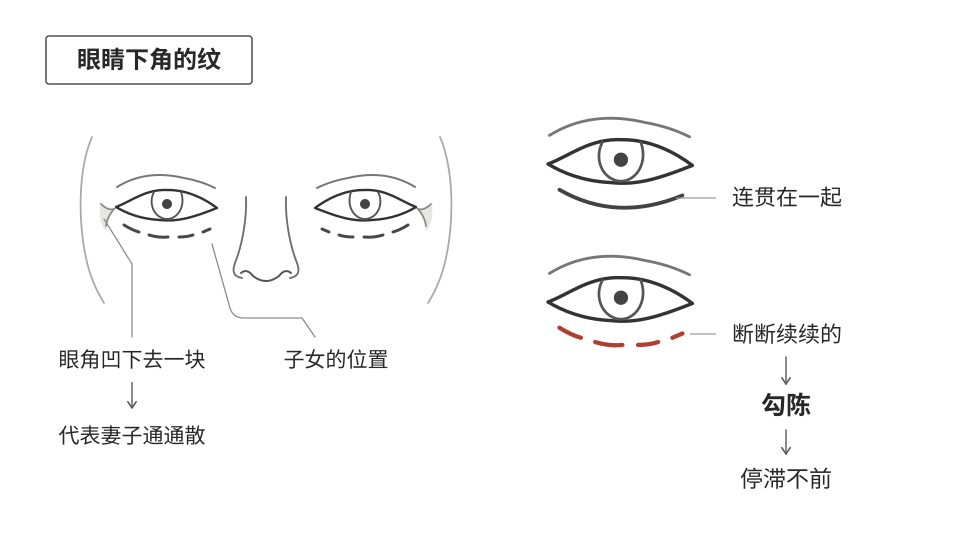
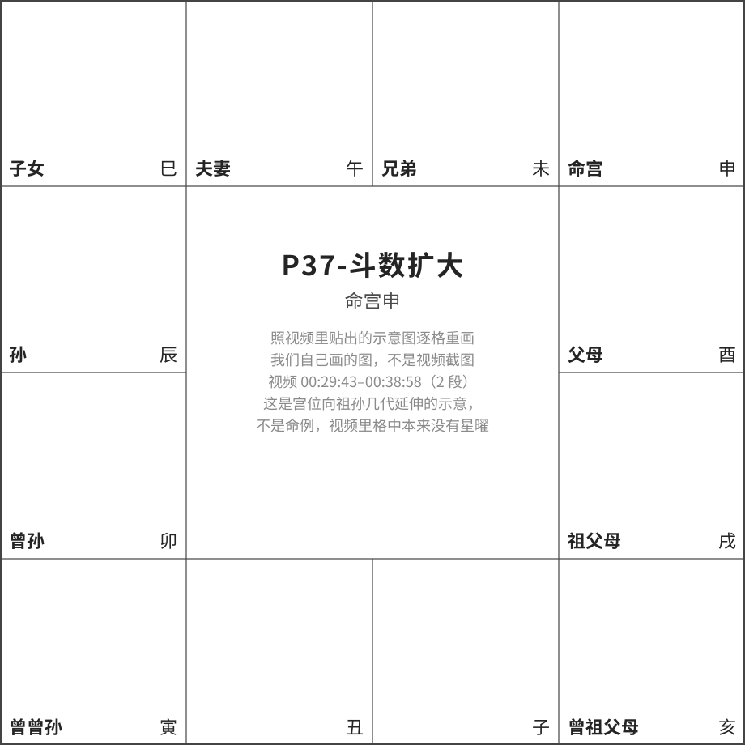
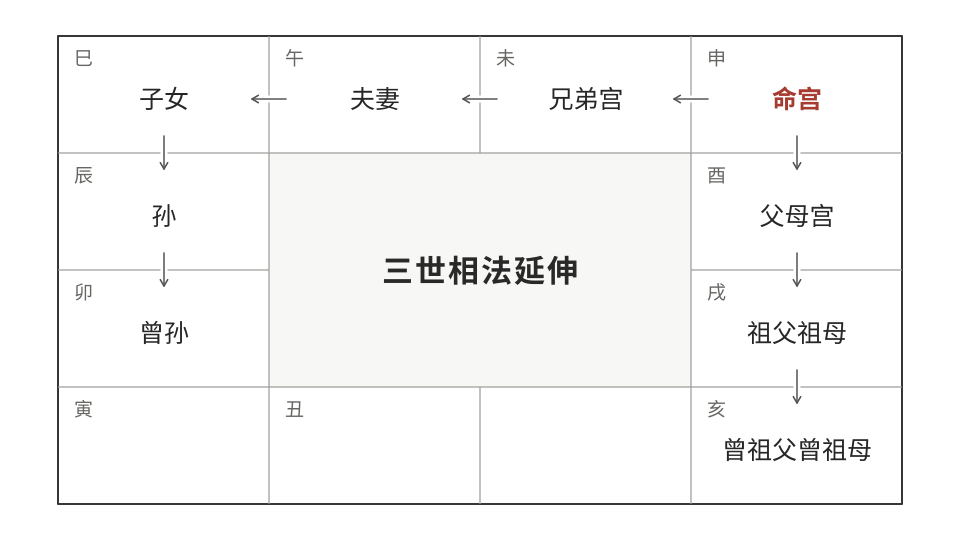
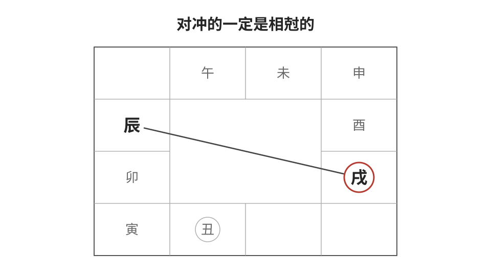
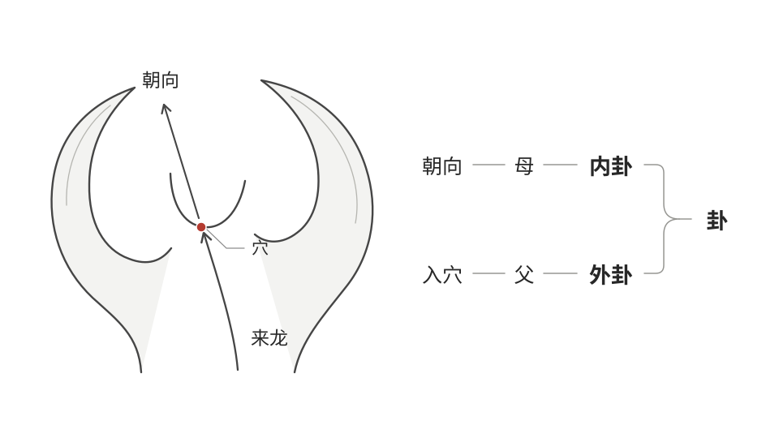
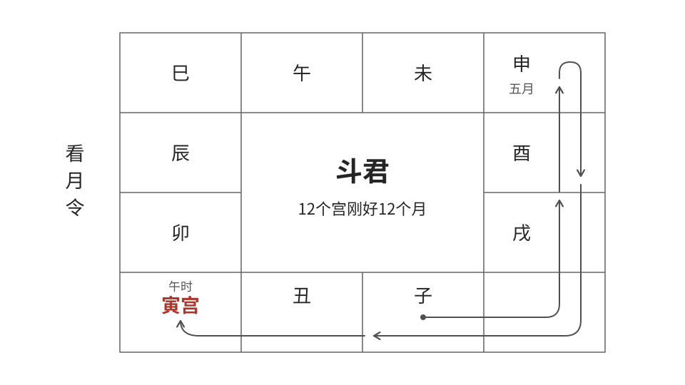
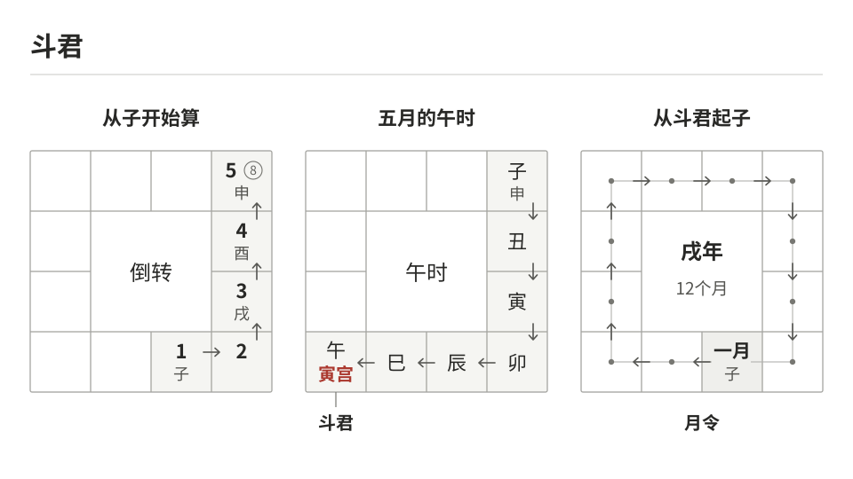

# P37 · 19 上：六神紫微（六神占断法 / 紫微堪舆应用 / 斗君 / 流月流日 / 六神灵机运用）（00:00:00–00:51:23，共 92,520 帧）

> 2026-11-12 整理。依据 DeepSeek 逐帧记录与现成的五层材料（字幕、语音、叠图、板书、指代），由 Claude（Opus 5.5 子代理）分段起草，引文由程序逐段对过字幕。流程 2026-11-11 经站长认可。
> 依据标记：〔口述〕字幕与语音两路对得上的话，「」里是字幕原字 ·〔叠图〕后期贴的电子命盘，**不算倪师的话** ·〔板书〕粉笔字（看过那一帧原图才写）·〔指代〕「这里 / 这个」指哪（只收核过、确定的）·〔推断〕笔记作者自己的推断。每条后面的时间码可以点，跳到 B 站那一秒。

## 全集总结

**通用规则**

- 眼下的纹断断续续、不连贯，看作勾陈，勾陈指事情停滞不前（[00:23:42–00:24:06](https://www.bilibili.com/video/BV1KJsLekEfA/?p=37&t=1422)，第 42660–43385 帧）
- 眼下这一块是子女的位置，眼角凹下去一块代表妻子通通散（[00:24:06–00:24:14](https://www.bilibili.com/video/BV1KJsLekEfA/?p=37&t=1446)，第 43386–43631 帧）
- 斗数要延伸扩大：父母往上是祖父母、曾祖父母，子女往下是孙、曾孙，以延伸出的那一宫看三方四正可推祖父母（[00:30:22–00:31:20](https://www.bilibili.com/video/BV1KJsLekEfA/?p=37&t=1822)，第 54660–56405 帧）
- 地支各有五行，对冲的一定相尅；龙与狗、马与老鼠这类对冲生肖都是相尅，但倪师说尅才会在一起（[00:31:44–00:32:38](https://www.bilibili.com/video/BV1KJsLekEfA/?p=37&t=1904)，第 57132–58763 帧）
- 阴宅立到尅的向都不是很好；命里的向与祖辈来龙同支叫相合，同五行叫比肩，相尅主凶（[00:32:45–00:35:12](https://www.bilibili.com/video/BV1KJsLekEfA/?p=37&t=1965)，第 58950–63371 帧）
- 斗君都在子宫起子，斗君就是用来看月令的；一宫管一年，十二宫刚好对十二个月（[00:36:08–00:36:27](https://www.bilibili.com/video/BV1KJsLekEfA/?p=37&t=2168)，第 65040–65639 帧）
- 起斗君用出生的月和时；找出斗君后，从斗君起子数到今年的年支，得今年一月，依次排出十二个月的月令（[00:36:28–00:37:35](https://www.bilibili.com/video/BV1KJsLekEfA/?p=37&t=2188)，第 65640–67679 帧）
- 一个月里的日子也在十二宫里数，12个一循环，所以一号和十三号落同一宫（[00:37:36–00:37:51](https://www.bilibili.com/video/BV1KJsLekEfA/?p=37&t=2256)，第 67680–68159 帧）
- 测龙最好测比肩和相生的，一定要阳生阳、阴生阴，阳配阴、阴配阳在风水上不好（[00:38:08–00:38:37](https://www.bilibili.com/video/BV1KJsLekEfA/?p=37&t=2288)，第 68652–69533 帧）

**只在本例**

- 这位来客 39 岁那年流年在午宫、太阴星在午宫化忌，倪师断他 39 岁妻离子散（[00:24:21–00:24:37](https://www.bilibili.com/video/BV1KJsLekEfA/?p=37&t=1461)，第 43830–44321 帧）
- 来客今年 45 岁，倪师说他今年还不会好、明年后年非常好、52-61大赚钱、明年 46 岁红鸾星还要动（[00:25:40–00:26:03](https://www.bilibili.com/video/BV1KJsLekEfA/?p=37&t=1540)，第 46218–46895 帧）
- 五月午时，从子数到五月那格再起子数到午，斗君落在寅宫（[00:36:42–00:37:07](https://www.bilibili.com/video/BV1KJsLekEfA/?p=37&t=2202)，第 66084–66827 帧）
- 倪师讲课当年是狗年（戌年），以此示范从斗君起子数流年一月（[00:37:11–00:37:30](https://www.bilibili.com/video/BV1KJsLekEfA/?p=37&t=2231)，第 66942–67529 帧）
- 西龙要找属金的，或找土龙（土生金）（[00:38:15–00:38:28](https://www.bilibili.com/video/BV1KJsLekEfA/?p=37&t=2295)，第 68862–69257 帧）

**不是排盘规则，是处世方法**

- 算命不能只断好坏，要帮人家解掉，同时让他乐天知命、心里愉快（[00:25:15–00:25:36](https://www.bilibili.com/video/BV1KJsLekEfA/?p=37&t=1515)，第 45474–46097 帧）
- 客人想投资做生意，先劝他不必急、要投资先来问（[00:26:06–00:26:24](https://www.bilibili.com/video/BV1KJsLekEfA/?p=37&t=1566)，第 47004–47549 帧）
- 除了鼓励之外，看到机锋也不要把话说死，过去发生的已没办法（[00:26:28–00:26:46](https://www.bilibili.com/video/BV1KJsLekEfA/?p=37&t=1588)，第 47640–48191 帧）

## 目录

**（跳过·非紫微）六神占断法（上）：六神方位，青龙、朱雀、白虎、玄武**

1. 跳过：六神方位与青龙朱雀白虎玄武（00:00:00–00:15:23）

**（跳过·非紫微）六神占断法（下）：勾陈、螣蛇、一字三神、二十八宿与罗经**

2. 跳过：勾陈螣蛇占断与测字（中间来客 39 岁化忌一例照记）（00:15:23–00:29:42）

**斗数扩大：十二宫延伸到祖孙几代，用于阴宅坐向**

3. 斗数延伸祖孙几代，用于阴宅立向（00:29:43–00:36:02）

**斗君起法与流月流日（尾段回到来龙取比肩相生）**

4. 斗君起法、流月流日与来龙相生（00:36:02–00:38:58）

**（跳过·非紫微）六神灵机运用：测字结穴、纹路、动作与讲话**

5. 跳过：六神灵机用于测字看相风水（00:38:58–00:51:23）

## （跳过·非紫微）六神占断法（上）：六神方位，青龙、朱雀、白虎、玄武

### 1　跳过：六神方位与青龙朱雀白虎玄武（[00:00:00–00:15:23](https://www.bilibili.com/video/BV1KJsLekEfA/?p=37&t=0)，第 0–27701 帧）

| 提示区 | 笔记区 |
|---|---|
| **这一段讲了什么、为什么不做笔记？** | 〔推断〕推断：本段通篇讲六神占断法的前半——六神在脸上的方位、讲义上六神的形与占断诗，并举测字、风水来龙、看相的例子；没有讲到紫微斗数的星曜、宫位或排盘，所以按本轮口径不做逐条笔记。（[00:00:00–00:15:23](https://www.bilibili.com/video/BV1KJsLekEfA/?p=37&t=0)，第 0–27701 帧） 〔口述〕开讲说六神占断法过去相师放在肚子里不讲，但应用很广，堪舆、看相、测字乃至社会动乱都可用，「都逃不了这个六神」。（[00:00:06–00:01:14](https://www.bilibili.com/video/BV1KJsLekEfA/?p=37&t=6)，第 186–2237 帧） 〔口述〕在黑板画人脸讲六神方位：上面朱雀，「南方呢北方我们叫玄武」，东方青龙、西边白虎，东南角与西北角为螣蛇，坤位为勾陈，并配后天八卦与五行。（[00:01:15–00:02:53](https://www.bilibili.com/video/BV1KJsLekEfA/?p=37&t=75)，第 2274–5195 帧） 〔口述〕看讲义第一页六神的形，逐句念：蚕头燕额是青龙、「尖短交加是朱雀」、弯弓斜月勾陈、螣蛇长曲、「尾尖口阔是白虎」、体态方尖是玄武。（[00:03:35–00:04:02](https://www.bilibili.com/video/BV1KJsLekEfA/?p=37&t=215)，第 6468–7289 帧） |
| **这一段后面还讲了哪些话题？** | 〔口述〕青龙的形是一撇一捺；风水上山势来龙完整、枝脚整齐才是真龙，「是以青龙最大最吉最好」，一捺有力出去没有断落都属青龙。（[00:04:09–00:05:14](https://www.bilibili.com/video/BV1KJsLekEfA/?p=37&t=249)，第 7476–9449 帧） 〔口述〕朱雀的形是交叉，主口舌官讼；举人来测考试写个「又」字、写文字上面少一点就难考上，「那朱雀专门指的是官司是非哈」。（[00:05:15–00:06:50](https://www.bilibili.com/video/BV1KJsLekEfA/?p=37&t=315)，第 9450–12305 帧） 〔口述〕回头念青龙占断诗、讲真龙脉来龙有力「百世亨通」；再举抽到「孤」字问婚姻，拆开是瓜和子，「得瓜又得子最好了」，说这就是灵机。（[00:06:50–00:10:24](https://www.bilibili.com/video/BV1KJsLekEfA/?p=37&t=410)，第 12306–18731 帧） 〔口述〕白虎主戴孝、牢狱口舌，「专门招病灾」；形是口阔尾尖，风水上两边反背不藏风纳气，测字写「几」、儿、鼠，看相嘴大下巴尖都属白虎。（[00:10:24–00:12:50](https://www.bilibili.com/video/BV1KJsLekEfA/?p=37&t=624)，第 18732–23129 帧） 〔口述〕玄武主盗贼失财，形是体态方尖，幺、绞丝边、方口都属玄武；风水有尖角死角出窃盗，案山后藏小山头，「这个坟墓有下一代一定出窃贼」。（[00:12:51–00:15:23](https://www.bilibili.com/video/BV1KJsLekEfA/?p=37&t=771)，第 23130–27701 帧） |

**总结区**

## （跳过·非紫微）六神占断法（下）：勾陈、螣蛇、一字三神、二十八宿与罗经

### 2　跳过：勾陈螣蛇占断与测字（中间来客 39 岁化忌一例照记）（[00:15:23–00:29:42](https://www.bilibili.com/video/BV1KJsLekEfA/?p=37&t=923)，第 27702–53489 帧）

| 提示区 | 笔记区 |
|---|---|
| **这一段讲了什么、为什么不做笔记？** | 〔推断〕推断：本块讲六神占断法的后半——勾陈、螣蛇的占断与形状、「風」字一字三神的测字例、要看神不看形、看人走路断事，最后讲天机道、二十八宿与罗经。除中间一位来客的例子（另写笔记）外，没有讲到紫微斗数的星曜、宫位或排盘，所以其余只写跳过说明。（[00:15:23–00:29:42](https://www.bilibili.com/video/BV1KJsLekEfA/?p=37&t=923)，第 27702–53489 帧） 〔口述〕讲勾陈：「勾陈逢到勾陈呢事交加」，主事情停滞不前、没有大灾但小祸不断；写字一点点断落、来龙一节节断掉、字尾往上勾，都属勾陈。（[00:15:23–00:17:23](https://www.bilibili.com/video/BV1KJsLekEfA/?p=37&t=923)，第 27702–31301 帧） 〔口述〕讲螣蛇：「螣蛇过者主主虚惊呐」，形状扭扭曲曲、比勾陈回来的角度大；来龙左右扭曲就是螣蛇，相书上叫三曲鼻，「要三曲而二曲就不算」，鹰钩鼻则是勾陈。（[00:17:34–00:20:08](https://www.bilibili.com/video/BV1KJsLekEfA/?p=37&t=1054)，第 31626–36251 帧） 〔口述〕测字例：老公三天没回家，妻子来问，写一个「風」，「这个字有三神在里面」——青龙、勾陈、玄武，断证件掉了、停滞不前但还会回来；并说「要看神不能看形」。（[00:20:08–00:22:04](https://www.bilibili.com/video/BV1KJsLekEfA/?p=37&t=1208)，第 36252–39743 帧） 〔口述〕说六神断龙、断事都可以用：看人在马路上扭着走、12个月换13个地方、晚上搬家，「就是在跑路嘛」；又说不用怕就不会有问题。（[00:22:04–00:23:34](https://www.bilibili.com/video/BV1KJsLekEfA/?p=37&t=1324)，第 39744–42449 帧） |
| **来客脸上什么纹路被看作勾陈？** | 〔口述〕倪师说今天来的一位客人，眼睛下角的纹断断续续，不像连贯在一起：「这纹怎么断断续续的」「这是什么断断续续是什么勾陈」，勾陈指事情停滞不前。（[00:23:35–00:24:06](https://www.bilibili.com/video/BV1KJsLekEfA/?p=37&t=1415)，第 42450–43385 帧） 〔口述〕再指出部位：「这个是子女的位置」，「然后眼角凹下去一块」「代表妻子通通散」，「这边也是两边都一样对不对」，所以「相上面就看到有问题了」。（[00:24:06–00:24:20](https://www.bilibili.com/video/BV1KJsLekEfA/?p=37&t=1446)，第 43386–43829 帧） 〔指代〕说「他不像我们这个连贯在一起」时，手指的是板上人脸图的左眼（几道横线）；所指是图形，旁边没有字。（[00:23:49](https://www.bilibili.com/video/BV1KJsLekEfA/?p=37&t=1429)，第 42890 帧） 〔指代〕说「这个是子女的位置」时，粉笔点在人脸图左眼下方、鼻子旁边；随后说「这边」时，粉笔指着人脸图眼部线条一带。两处都是图形，没有字。（[00:24:07–00:24:14](https://www.bilibili.com/video/BV1KJsLekEfA/?p=37&t=1447)，第 43431–43625 帧） 〔板书〕可辨：「風」「神」二字；板上方中间有几组横线和圆弧的图形，认不出画的是什么；其余认不出。（[00:24:15](https://www.bilibili.com/video/BV1KJsLekEfA/?p=37&t=1455)，第 43676 帧）  |
| **命盘上 39 岁那年为何断妻离子散？** | 〔口述〕相上看到问题后，倪师说「再看他的八字一看39岁的时候」，「流年在午宫」，「太阴星在午宫化忌」，就是「39岁那年」。（[00:24:21–00:24:31](https://www.bilibili.com/video/BV1KJsLekEfA/?p=37&t=1461)，第 43830–44141 帧） 〔口述〕倪师当面对他说「先生呐您39岁妻离子散对啊」；讲完这句话，对方的眼睛直到算完都没闭过（此处字幕有乱码，按大意转述）。（[00:24:31–00:24:42](https://www.bilibili.com/video/BV1KJsLekEfA/?p=37&t=1471)，第 44142–44489 帧） 〔口述〕「这就是我们从神上面去断他」，人还没细看，「再一看八字就晓得」；接着交代这位客人本人今年45岁。（[00:24:43–00:24:52](https://www.bilibili.com/video/BV1KJsLekEfA/?p=37&t=1483)，第 44508–44777 帧） 〔板书〕可辨：板右上方一个「太」字，后一字潦草（与口述「太阴」相合，但认不准），再后面一个画了圈的字认不出；板左侧可辨「神」字；其余认不出。（[00:24:30](https://www.bilibili.com/video/BV1KJsLekEfA/?p=37&t=1470)，第 44124 帧） 〔推断〕推断：倪师先从相上看到眼下子女位的纹断续、眼角凹（代表妻子散），再用命盘 39 岁流年在午宫、太阴星在午宫化忌断「妻离子散」，两头说的是同一件事；本段没有解释太阴化忌为什么主这件事。（[00:23:42–00:24:37](https://www.bilibili.com/video/BV1KJsLekEfA/?p=37&t=1422)，第 42660–44321 帧） |
| **断出坏事之后，算命师还该做什么？** | 〔口述〕光帮人算命很简单，考试上不上、赚钱赔钱「不要5秒钟就讲完了」，可是「好就是好」「不好就是不好没有用」；「要帮人家解掉」，「同时要让他乐天知命」，「让他知道这样子他很愉快」。（[00:25:15–00:25:36](https://www.bilibili.com/video/BV1KJsLekEfA/?p=37&t=1515)，第 45474–46097 帧） 〔口述〕这位客人五官都挤在一起，倪师说「今年还是不会好了」，「但是你明年后年非常好」，「52-61大赚钱」，「您今年才45岁算什么」，「你明年46岁红鸾星还要动哦」，他听着精神就来了。（[00:25:36–00:26:03](https://www.bilibili.com/video/BV1KJsLekEfA/?p=37&t=1536)，第 46098–46895 帧） 〔口述〕客人问要不要去工作、做生意，倪师说「你不必」，要投资「你先问问我嘛」，他听得很高兴回去了；倪师总结：除了鼓励，看到机锋时「你不要跟他说死你」，「当然过去发生的没办法了」。（[00:26:06–00:26:46](https://www.bilibili.com/video/BV1KJsLekEfA/?p=37&t=1566)，第 47004–48191 帧） 〔板书〕可辨：板左上方「神」字、其下「三」字；板中下方圆圈里新写的字认不出；其余认不出。（[00:25:15](https://www.bilibili.com/video/BV1KJsLekEfA/?p=37&t=1515)，第 45468 帧） |
| **这一段后面还讲了哪些话题？** | 〔口述〕说六神在易经八卦上通通有，可放到任何地方看：「你不要把字当字」，把字当山形来龙就是风水、放到脸上就是相；法令纹游走入口叫「腾蛇纹入口」，主饿死。（[00:26:46–00:28:16](https://www.bilibili.com/video/BV1KJsLekEfA/?p=37&t=1606)，第 48192–50909 帧） 〔口述〕讲完六神，发讲义讲天机道与二十八宿，东南西北四方各有七宿，课堂上没法细讲、讲义当笔记；罗经要拿起来「由下往上看」，二十八宿布列与日月五星的关系就在里面。（[00:28:17–00:29:42](https://www.bilibili.com/video/BV1KJsLekEfA/?p=37&t=1697)，第 50910–53489 帧） |

**总结区**

- 通用规则：眼下的纹断断续续、不连贯，看作勾陈，勾陈指事情停滞不前（[00:23:42–00:24:06](https://www.bilibili.com/video/BV1KJsLekEfA/?p=37&t=1422)，第 42660–43385 帧）；眼下这一块是子女的位置，眼角凹下去一块代表妻子通通散（[00:24:06–00:24:14](https://www.bilibili.com/video/BV1KJsLekEfA/?p=37&t=1446)，第 43386–43631 帧）
- 只在本例：这位来客 39 岁那年流年在午宫、太阴星在午宫化忌，倪师断他 39 岁妻离子散（[00:24:21–00:24:37](https://www.bilibili.com/video/BV1KJsLekEfA/?p=37&t=1461)，第 43830–44321 帧）；来客今年 45 岁，倪师说他今年还不会好、明年后年非常好、52-61大赚钱、明年 46 岁红鸾星还要动（[00:25:40–00:26:03](https://www.bilibili.com/video/BV1KJsLekEfA/?p=37&t=1540)，第 46218–46895 帧）
- 不是排盘规则，是处世方法：算命不能只断好坏，要帮人家解掉，同时让他乐天知命、心里愉快（[00:25:15–00:25:36](https://www.bilibili.com/video/BV1KJsLekEfA/?p=37&t=1515)，第 45474–46097 帧）；客人想投资做生意，先劝他不必急、要投资先来问（[00:26:06–00:26:24](https://www.bilibili.com/video/BV1KJsLekEfA/?p=37&t=1566)，第 47004–47549 帧）；除了鼓励之外，看到机锋也不要把话说死，过去发生的已没办法（[00:26:28–00:26:46](https://www.bilibili.com/video/BV1KJsLekEfA/?p=37&t=1588)，第 47640–48191 帧）

**待核**

1. 字幕里「腾蛇」「螣蛇」「塍蛇」混写（语音多作「藤蛇」），转述统一写作「螣蛇」，引文保留字幕原字（[00:17:34](https://www.bilibili.com/video/BV1KJsLekEfA/?p=37&t=1054)，第 31626 帧起）
2. 「再看他的八字一看39岁的时候」（[00:24:21](https://www.bilibili.com/video/BV1KJsLekEfA/?p=37&t=1461)，第 43830 帧）、「再一看八字就晓得」（[00:24:49](https://www.bilibili.com/video/BV1KJsLekEfA/?p=37&t=1489)，第 44670 帧）：口头说「八字」，接着讲的却是流年在午宫、太阴星在午宫化忌，所指是否就是紫微命盘，本段没说明
3. 「先生呐您39岁妻离子散对啊」语音作「气力止散」；下一句字幕「s到算到结尾就没有闭过」有乱码，原话待核（[00:24:31–00:24:42](https://www.bilibili.com/video/BV1KJsLekEfA/?p=37&t=1471)，第 44142–44489 帧）
4. 「这个是子女的位置」语音作「这个是子女的问题」（[00:24:07](https://www.bilibili.com/video/BV1KJsLekEfA/?p=37&t=1447)，第 43434 帧）
5. 字幕「对倪海厦」与语音「52」对不上（[00:25:45](https://www.bilibili.com/video/BV1KJsLekEfA/?p=37&t=1545)，第 46356 帧）；「52-61大赚钱」指哪一段（是否大限）本段没解释（[00:25:46](https://www.bilibili.com/video/BV1KJsLekEfA/?p=37&t=1546)，第 46398 帧）
6. 「红鸾星还要动」倪师用了但没解释（[00:26:00](https://www.bilibili.com/video/BV1KJsLekEfA/?p=37&t=1560)，第 46800 帧）
7. 「机锋」语音作「季风」（[00:26:31](https://www.bilibili.com/video/BV1KJsLekEfA/?p=37&t=1591)，第 47736 帧）；「你不要跟他说死你」语音作「你不要跟他说」，没有「死」字，两路对不上（[00:26:33](https://www.bilibili.com/video/BV1KJsLekEfA/?p=37&t=1593)，第 47814 帧）
8. 板书图 f044124（[00:24:30](https://www.bilibili.com/video/BV1KJsLekEfA/?p=37&t=1470)，第 44124 帧）左下有一块后期贴的电子命盘，材料里没有对应的 ▣ 行，派活说明也说本集叠图只在别处出现：画面可见子女 壬午，太阴陷、化忌（红框），擎羊庙、天喜陷、三台庙、天官旺、解神庙、寡宿陷，小限 15,27,39,51,63（39 标红），大限 33~42，另有官符、天煞、病符、死；按规则未当叠图写进笔记，待核
9. 三张板书图大部分字认不出，人脸图也认不准（第 43676、44124、45468 帧）
10. 说「鼻子在这边」时背对镜头、手被挡住，看不出指哪里（[00:23:41](https://www.bilibili.com/video/BV1KJsLekEfA/?p=37&t=1421)，第 42630 帧）

## 斗数扩大：十二宫延伸到祖孙几代，用于阴宅坐向

| 巳 | 午 | 未 | 申 |
|---|---|---|---|
| **子女 巳** （无主星、辅星） | **夫妻 午** （无主星、辅星） | **兄弟 未** （无主星、辅星） | **命宫 申** （无主星、辅星） |
| **孙 辰** （无主星、辅星） | **斗数扩大：十二宫延伸到祖孙几代，用于阴宅坐向 · 命宫申** | 据视频叠图重排 | **父母 酉** （无主星、辅星） |
| **曾孙 卯** （无主星、辅星） | 后期贴图，不算倪师的话 |  | **祖父母 戌** （无主星、辅星） |
| **曾曾孙 寅** （无主星、辅星） | **丑** （无主星、辅星） | **子** （无主星、辅星） | **曾祖父母 亥** （无主星、辅星） |

按视频里这张示意图逐格重画（我们自己画的图，不是视频截图）；两段贴的是同一张，合成一张；数据见 [命盘-P37-斗数扩大.json](图/命盘-P37-斗数扩大.json)。

### 3　斗数延伸祖孙几代，用于阴宅立向（[00:29:43–00:36:02](https://www.bilibili.com/video/BV1KJsLekEfA/?p=37&t=1783)，第 53490–64865 帧）

| 提示区 | 笔记区 |
|---|---|
| **斗数要怎样「延伸扩大」？** | 〔口述〕倪师转入斗数，先提出要把斗数的范围扩大：「在斗数的时候」「诸位要把斗数延伸扩大」，并自问「你说老师怎么扩大呢」，下面用命盘十二格来示范。（[00:29:43–00:29:57](https://www.bilibili.com/video/BV1KJsLekEfA/?p=37&t=1783)，第 53490–53939 帧） 〔板书〕黑板上画好十二格，可辨地支：上行巳、午、未、申，左列辰、卯，右列酉、戌，下行寅、丑、亥；下行子格那个字写得潦草，认不准。（[00:29:44](https://www.bilibili.com/video/BV1KJsLekEfA/?p=37&t=1784)，第 53544 帧）  〔板书〕盘右边竖着写了两行字，可辨第二行「延伸」；第一行第一字是「斗」，第二字潦草，像「数」，不敢定。（[00:29:48](https://www.bilibili.com/video/BV1KJsLekEfA/?p=37&t=1788)，第 53640 帧） |
| **命宫、父母、兄弟、夫妻、子女各落哪一格？** | 〔口述〕倪师边说边在格子里标宫名：「比如说哈命宫在这里」「父母宫在这里兄弟宫」，接着「这个是夫妻」「再来是不是子女」。（[00:29:58–00:30:20](https://www.bilibili.com/video/BV1KJsLekEfA/?p=37&t=1798)，第 53940–54623 帧） 〔指代〕说「命宫在这里」时，手指的是顶行「未」右边那一格，讲者正用红粉笔在那里写红字「命」；说「父母宫在这里」时，手指的是「酉」字左边，正在写一个红字（还没写完，认不出）。（[00:30:00–00:30:04](https://www.bilibili.com/video/BV1KJsLekEfA/?p=37&t=1800)，第 54005–54128 帧） 〔板书〕申格左边红字可辨「命」；酉、未、午三格左边各添了一个红字，认不出。（[00:30:19](https://www.bilibili.com/video/BV1KJsLekEfA/?p=37&t=1819)，第 54584 帧） 〔叠图〕后期贴的示意盘（不是哪个人的命盘）：命宫申、父母酉、兄弟未、夫妻午、子女巳。（[00:30:12–00:30:15](https://www.bilibili.com/video/BV1KJsLekEfA/?p=37&t=1812)，第 54360–54450 帧） |
| **往上、往下各延伸到哪几代？** | 〔口述〕倪师说「我们现在把斗数扩大」，用「三世相法延伸」：父母往上，「祖父祖母完了就是曾祖父曾祖母」，「看他上几代就知道」。（[00:30:22–00:30:39](https://www.bilibili.com/video/BV1KJsLekEfA/?p=37&t=1822)，第 54660–55199 帧） 〔口述〕子女往下同样推：「那子女完了就是孙孙孙呐」「下面是曾孙依此类推下去」，后面又说「然后到曾曾曾孙」。（[00:30:40–00:30:59](https://www.bilibili.com/video/BV1KJsLekEfA/?p=37&t=1840)，第 55200–55793 帧） 〔叠图〕示意盘往上是祖父母戌、曾祖父母亥；往下是孙辰、曾孙卯、曾曾孙寅。（[00:30:12–00:30:15](https://www.bilibili.com/video/BV1KJsLekEfA/?p=37&t=1812)，第 54360–54450 帧） 〔板书〕戌格、亥格左边都添了红字，认不出。（[00:30:34](https://www.bilibili.com/video/BV1KJsLekEfA/?p=37&t=1834)，第 55020 帧） 〔板书〕巳、午、辰、卯四格左边各有红字，认不出。（[00:30:52](https://www.bilibili.com/video/BV1KJsLekEfA/?p=37&t=1852)，第 55584 帧） |
| **两头排到哪一格？中间的格子怎么处理？** | 〔口述〕倪师比划两头的终点：「刚好我们从这个对面呢一直到丑」「刚好到这边」，「曾祖父呢曾曾祖父在这边」。（[00:30:48–00:30:58](https://www.bilibili.com/video/BV1KJsLekEfA/?p=37&t=1848)，第 55452–55745 帧） 〔指代〕说第一个「到这边」时，手指的是底行「丑」字，随后丑字被画上红圈；说第二个「到这边」时，手指压在右下角「亥」字左边的红字上（红字认不出）。（[00:30:54–00:30:55](https://www.bilibili.com/video/BV1KJsLekEfA/?p=37&t=1854)，第 55625–55654 帧） 〔口述〕倪师说「中间这个舍掉就可以看到」「他们的上一代上一代上一代」「就可以知道」。舍掉的具体是哪几格，口头没有点明。（[00:30:59–00:31:06](https://www.bilibili.com/video/BV1KJsLekEfA/?p=37&t=1859)，第 55794–56009 帧） 〔叠图〕示意盘上子、丑两格只有地支，没有标代名。（[00:30:12–00:30:15](https://www.bilibili.com/video/BV1KJsLekEfA/?p=37&t=1812)，第 54360–54450 帧） |
| **祖父母八字没了，怎么从孙推到祖父母？** | 〔口述〕倪师解释为什么要知道上几代：有时「他祖父祖母的八字没有」「没有了可是人还在」，「我们从孙可以来推断到祖父祖母」，「一样以这个宫看三方四正」「就可以知道祖父祖母」。（[00:31:10–00:31:20](https://www.bilibili.com/video/BV1KJsLekEfA/?p=37&t=1870)，第 56112–56405 帧） 〔推断〕推断：「这个宫」倪师说时手势看不清（指代不确定），按上下文应是延伸出来的祖父母那一宫，示意盘上在戌；以它看三方四正的具体看法，本块没有展开。（[00:31:16–00:31:18](https://www.bilibili.com/video/BV1KJsLekEfA/?p=37&t=1876)，第 56304–56351 帧） |
| **这套延伸在阴宅上怎么用到？** | 〔口述〕倪师说这套「阴宅上面会用到」，因为「有的时候那个人过世了没有八字」。（[00:31:20–00:31:30](https://www.bilibili.com/video/BV1KJsLekEfA/?p=37&t=1880)，第 56406–56729 帧） 〔口述〕举例：在阴宅上知道它的方向是戌向，比如「你的祖坟是祖父祖父祖母这戌向」，「那戌本身在位置上面来说的话」……话没说完就转去讲地支五行。（[00:31:31–00:31:44](https://www.bilibili.com/video/BV1KJsLekEfA/?p=37&t=1891)，第 56730–57131 帧） 〔叠图〕示意盘上祖父母宫标在戌。（[00:30:12–00:30:15](https://www.bilibili.com/video/BV1KJsLekEfA/?p=37&t=1812)，第 54360–54450 帧） 〔推断〕推断：例子里祖坟戌向，与示意盘祖父母宫在戌是同一个地支；这层关系倪师在本块后面才明说（见「戌向正好是祖父的宫」那一行）。（[00:31:34–00:31:39](https://www.bilibili.com/video/BV1KJsLekEfA/?p=37&t=1894)，第 56844–56975 帧） |
| **地支五行和对冲有什么关系？** | 〔口述〕倪师说「辰戌丑未这个我们十二地支里面」「都有十二把木火土金水五行」「放到十二个地支里面去」，有「相生的和相克的」。（[00:31:44–00:32:00](https://www.bilibili.com/video/BV1KJsLekEfA/?p=37&t=1904)，第 57132–57611 帧） 〔口述〕接着说「如果我们是戌」「这两个对面一定是怎么样」，自答对冲，「对冲的一定是相尅的」。（[00:32:00–00:32:07](https://www.bilibili.com/video/BV1KJsLekEfA/?p=37&t=1920)，第 57612–57821 帧） 〔板书〕戌字被圈起来，有一条红线从戌格往左斜伸出去；底行丑字也画了红圈。（[00:32:04](https://www.bilibili.com/video/BV1KJsLekEfA/?p=37&t=1924)，第 57732 帧）  〔板书〕红线从戌格斜连到左边辰格一带；另有一条红线从上行午格一带斜向右下，终点看不清。（[00:32:18](https://www.bilibili.com/video/BV1KJsLekEfA/?p=37&t=1938)，第 58140 帧） 〔推断〕推断：「这两个对面」口头没有说出另一支是什么；只凭板书红线从戌连到辰一带，推测指戌与辰。（[00:32:02–00:32:04](https://www.bilibili.com/video/BV1KJsLekEfA/?p=37&t=1922)，第 57672–57749 帧） |
| **生肖对冲的两个人在一起会怎样？** | 〔口述〕倪师顺带举生肖：「所以龙的人呢如果嫁给」「或者是娶到一个属狗的人」，「属马的人呢」「如果跟个属老鼠的人在一起」「这都是相尅」。中间提到属老虎的人，但没说跟谁配。（[00:32:07–00:32:20](https://www.bilibili.com/video/BV1KJsLekEfA/?p=37&t=1927)，第 57822–58217 帧） 〔口述〕他说这很好玩：「意思就是说尅才会在一起哦」，「不尅我跟你不尅」「根本没有感觉」，「尅才喜欢才爱」「然后就越爱就越尅了」「越尅就越爱了」。（[00:32:20–00:32:38](https://www.bilibili.com/video/BV1KJsLekEfA/?p=37&t=1940)，第 58218–58763 帧） |
| **阴宅立向的好坏，靠这份资料看什么？** | 〔口述〕倪师说阴宅风水看的时候「也是要靠这个资料」：除了可以知道「他上代有没有做什么这样」，还可以知道风水「有没有跟他相冲的问题」，「这样他立这个向好不好」。（[00:32:38–00:32:56](https://www.bilibili.com/video/BV1KJsLekEfA/?p=37&t=1958)，第 58764–59303 帧） 〔指代〕说「他立这个向好不好」时，手指的是黑板右侧画了圈的「戌」格，指尖点在格的右下角，持续多帧。（[00:32:52–00:32:54](https://www.bilibili.com/video/BV1KJsLekEfA/?p=37&t=1972)，第 59189–59249 帧） 〔口述〕结论：「如果立到尅向尅的向的话」「都不是很好」。（[00:32:56–00:33:01](https://www.bilibili.com/video/BV1KJsLekEfA/?p=37&t=1976)，第 59304–59447 帧） |
| **来龙、朝向、入穴怎样对成内外卦？** | 〔口述〕倪师顺带说，把上几代的阴宅风水「也把它拿到阳宅上面」「也把它拿到卦来看的时候」「就不是这样子了哦」，并提到「诸位都知道八卦怎么布列」。（[00:33:04–00:33:27](https://www.bilibili.com/video/BV1KJsLekEfA/?p=37&t=1984)，第 59520–60227 帧） 〔口述〕他画图讲：「这是来龙看龙虎」「这是一个山山龙来这边结穴」，那天站在这边，开车下去「到明堂那来看」。（[00:33:27–00:33:41](https://www.bilibili.com/video/BV1KJsLekEfA/?p=37&t=2007)，第 60228–60653 帧） 〔指代〕说「山龙来这边结穴」时，手指的是右侧山形图中间U形环的下方；说「站在这边」时，手指的是山形图右侧弯臂内侧的尖端，随后那里画了一个小箭头。所指都是图形，没有字。（[00:33:32–00:33:34](https://www.bilibili.com/video/BV1KJsLekEfA/?p=37&t=2012)，第 60370–60449 帧） 〔口述〕「这个是朝向」，朝为母、为内；「入入穴为父为外」，「就是内卦和外卦并在一起」「一对上去以后就知道这是什么卦」；阴宅上用易经推，「卦的设定是这样子设定的」。（[00:33:41–00:34:25](https://www.bilibili.com/video/BV1KJsLekEfA/?p=37&t=2021)，第 60654–61961 帧） 〔板书〕山形图可见几道弧线环抱，中间一个U形环接一条竖线，带箭头；上方可辨「朝」字和一个箭头，下面一行可辨「穴」，其余字认不出。（[00:34:06](https://www.bilibili.com/video/BV1KJsLekEfA/?p=37&t=2046)，第 61392 帧）  |
| **命里戌向配祖父戌龙、寅配寅，各叫什么？** | 〔口述〕倪师回到例子：「那如果祖父来的时候」，我们知道这个在戌宫，「你祖父葬的位置正好是」「你你的命里面戌向正好是祖父的宫」，然后祖父刚好是戌龙，「这是叫做相合相合」。（[00:34:25–00:34:39](https://www.bilibili.com/video/BV1KJsLekEfA/?p=37&t=2065)，第 61962–62399 帧） 〔指代〕说「这个在戌宫」时，手指的是板上红圈里的白字「戌」，指尖紧贴字下方，多帧稳定。（[00:34:27](https://www.bilibili.com/video/BV1KJsLekEfA/?p=37&t=2067)，第 62038 帧） 〔口述〕再举五行相同的：卯、「寅卯都是木对不对」，「你是属木的本身这个是寅龙」「那你刚好是你的命中又是刚好是寅」「配上去的时候叫做属性相同的」「就是比肩」，即比肩兄弟。（[00:34:40–00:35:07](https://www.bilibili.com/video/BV1KJsLekEfA/?p=37&t=2080)，第 62400–63227 帧） 〔口述〕相反：「如果是相尅的这是主凶」。（[00:35:07–00:35:12](https://www.bilibili.com/video/BV1KJsLekEfA/?p=37&t=2107)，第 63228–63371 帧） |
| **祖辈风水来龙最好怎样？墓碑没了怎么办？** | 〔口述〕倪师说测来龙的方向时，「光是我光是讲这个方向而已」，来龙「看这个八字斗数你们也可以看到」。（[00:35:12–00:35:22](https://www.bilibili.com/video/BV1KJsLekEfA/?p=37&t=2112)，第 63372–63683 帧） 〔指代〕说「讲这个方向」时，手指的是右侧山形图中间环与竖线相接处（穴位处），多帧持续；所指是图形，没有字。（[00:35:17](https://www.bilibili.com/video/BV1KJsLekEfA/?p=37&t=2117)，第 63514 帧） 〔口述〕「所以我们的八字命格的」「祖父祖母曾祖父曾祖母」「最好跟他们本身承受的」「风水的来龙是相生的」「或者是比肩的都是最好的」；所以找很多地方，「我们去看哪个比较合他的」。（[00:35:22–00:35:38](https://www.bilibili.com/video/BV1KJsLekEfA/?p=37&t=2122)，第 63684–64169 帧） 〔口述〕就算祖父祖母八字早没了、墓碑都看不到了，「我们还是可以从」「一个人的命里面推上去」「推到他的方向」。（[00:35:39–00:35:52](https://www.bilibili.com/video/BV1KJsLekEfA/?p=37&t=2139)，第 64170–64589 帧） 〔口述〕收尾：「所以八字不是说只看两代三代」「往上往前推往后推照样」「这是一个斗数你们要拓扩展」。（[00:35:53–00:36:02](https://www.bilibili.com/video/BV1KJsLekEfA/?p=37&t=2153)，第 64590–64865 帧） |

**总结区**

- 通用规则：斗数要延伸扩大：父母往上是祖父母、曾祖父母，子女往下是孙、曾孙，以延伸出的那一宫看三方四正可推祖父母（[00:30:22–00:31:20](https://www.bilibili.com/video/BV1KJsLekEfA/?p=37&t=1822)，第 54660–56405 帧）；地支各有五行，对冲的一定相尅；龙与狗、马与老鼠这类对冲生肖都是相尅，但倪师说尅才会在一起（[00:31:44–00:32:38](https://www.bilibili.com/video/BV1KJsLekEfA/?p=37&t=1904)，第 57132–58763 帧）；阴宅立到尅的向都不是很好；命里的向与祖辈来龙同支叫相合，同五行叫比肩，相尅主凶（[00:32:45–00:35:12](https://www.bilibili.com/video/BV1KJsLekEfA/?p=37&t=1965)，第 58950–63371 帧）；祖辈风水的来龙最好与命格相生或比肩；八字没了也可从一个人的命往上推，不只看两三代（[00:35:22–00:36:02](https://www.bilibili.com/video/BV1KJsLekEfA/?p=37&t=2122)，第 63684–64865 帧）

**待核**

1. [00:29:50–00:29:51](https://www.bilibili.com/video/BV1KJsLekEfA/?p=37&t=1790)，第 53700–53741 帧：字幕「范围拉本」「范围拉大」，语音作「道那」「老」，两路对不上，未收。
2. [00:30:09](https://www.bilibili.com/video/BV1KJsLekEfA/?p=37&t=1809)，第 54282 帧：字幕「像弟这个就这样子」，语音作「帝」，疑为「兄弟」的残字，未改未收。
3. [00:30:12](https://www.bilibili.com/video/BV1KJsLekEfA/?p=37&t=1812)，第 54366 帧：字幕「螣蛇」，语音没有对应的字，两路对不上，未收。
4. [00:30:24](https://www.bilibili.com/video/BV1KJsLekEfA/?p=37&t=1824)，第 54744 帧：字幕「三世相法」，语音作「三四项吧」；「三世相法」倪师没有解释。
5. [00:30:48](https://www.bilibili.com/video/BV1KJsLekEfA/?p=37&t=1848)，第 55452 帧：「从这个对面呢一直到丑」的起点指哪一格，指代不确定。
6. [00:30:58](https://www.bilibili.com/video/BV1KJsLekEfA/?p=37&t=1858)，第 55746 帧：字幕「曾曾曾孙」比叠图「曾曾孙寅」多一个「曾」（语音作「真真孙」），以哪个为准待核。
7. [00:30:59](https://www.bilibili.com/video/BV1KJsLekEfA/?p=37&t=1859)，第 55794 帧：「中间这个舍掉」舍掉的是什么没说清，手点在盘中间空白处（指代不确定）。
8. [00:31:16](https://www.bilibili.com/video/BV1KJsLekEfA/?p=37&t=1876)，第 56304 帧：「以这个宫看三方四正」的「这个宫」指代不确定；「三方四正」本块没有解释。
9. 第56730、56976、62022、62202、62262帧：字幕「成向」「成宫」「成龙」「成的龙」，语音作「旭」，按[00:31:34](https://www.bilibili.com/video/BV1KJsLekEfA/?p=37&t=1894)，第 56844 帧字幕「戌向」与叠图「祖父母戌」改作「戌」。
10. [00:32:02](https://www.bilibili.com/video/BV1KJsLekEfA/?p=37&t=1922)，第 57672 帧：「这两个对面」另一支口头没有说出，笔记只按板书红线推测为辰。
11. [00:32:13](https://www.bilibili.com/video/BV1KJsLekEfA/?p=37&t=1933)，第 57996 帧：「属老虎的人」后面没说跟哪个属相配。
12. [00:32:18](https://www.bilibili.com/video/BV1KJsLekEfA/?p=37&t=1938)，第 58140 帧：午格一带那条红线的终点看不清。
13. [00:33:01](https://www.bilibili.com/video/BV1KJsLekEfA/?p=37&t=1981)，第 59448 帧：字幕「那在阴宅这个阳宅」，语音「这个阴灾这个阳」，从阴宅转到阳宅的话没讲完整。
14. [00:33:47](https://www.bilibili.com/video/BV1KJsLekEfA/?p=37&t=2027)，第 60810 帧：字幕「朝为母为肉朝啊」的「肉」，语音作「为内」，按下句「为父为外」改作「内」。
15. [00:33:27–00:34:25](https://www.bilibili.com/video/BV1KJsLekEfA/?p=37&t=2007)，第 60228–61961 帧：「来龙」「龙虎」「结穴」「明堂」「朝向」「内卦外卦」倪师用了但本块没有解释。
16. [00:34:06](https://www.bilibili.com/video/BV1KJsLekEfA/?p=37&t=2046)，第 61392 帧：板书山形图上方和旁边的字只认得「朝」「穴」，其余认不出；[00:33:48](https://www.bilibili.com/video/BV1KJsLekEfA/?p=37&t=2028)，第 60864 帧那张被头挡住，只见「朝」和箭头。
17. [00:34:36](https://www.bilibili.com/video/BV1KJsLekEfA/?p=37&t=2076)，第 62298 帧：字幕「相合」，语音作「香河」。
18. [00:34:43](https://www.bilibili.com/video/BV1KJsLekEfA/?p=37&t=2083)，第 62502 帧：字幕「这个卵」，语音作「帽」，按下句「寅卯都是木」改作「卯」。
19. [00:35:01–00:35:07](https://www.bilibili.com/video/BV1KJsLekEfA/?p=37&t=2101)，第 63036–63227 帧：「比肩」倪师只说是属性相同、比肩兄弟；[00:35:02](https://www.bilibili.com/video/BV1KJsLekEfA/?p=37&t=2102)，第 63078 帧字幕「旯弟」按语音「兄弟」改正。
20. [00:35:18](https://www.bilibili.com/video/BV1KJsLekEfA/?p=37&t=2118)，第 63569 帧：说「看这个八字斗数」时手指戌格正下方那格里的红字，红字看不清（指代不确定）。
21. [00:35:42](https://www.bilibili.com/video/BV1KJsLekEfA/?p=37&t=2142)，第 64260 帧：字幕「我不知道到哪那个坟墓」，语音作「我不想到来那个横无」，两路差得多，只作转述。
22. 第54362、54584、55020、55584帧：各格旁的红字大多认不出，只认得申格旁的「命」。

## 斗君起法与流月流日（尾段回到来龙取比肩相生）

| 巳 | 午 | 未 | 申 |
|---|---|---|---|
| **子女 巳** （无主星、辅星） | **夫妻 午** （无主星、辅星） | **兄弟 未** （无主星、辅星） | **命宫 申** （无主星、辅星） |
| **孙 辰** （无主星、辅星） | **斗君起法与流月流日 · 命宫申** | 据视频叠图重排 | **父母 酉** （无主星、辅星） |
| **曾孙 卯** （无主星、辅星） | 后期贴图，不算倪师的话 |  | **祖父母 戌** （无主星、辅星） |
| **曾曾孙 寅** （无主星、辅星） | **丑** （无主星、辅星） | **子** （无主星、辅星） | **曾祖父母 亥** （无主星、辅星） |

同「斗数扩大」那张的示意图，见上图。

### 4　斗君起法、流月流日与来龙相生（[00:36:02–00:38:58](https://www.bilibili.com/video/BV1KJsLekEfA/?p=37&t=2162)，第 64866–70157 帧）

| 提示区 | 笔记区 |
|---|---|
| **斗君是什么？从哪一宫起？为什么能管十二个月？** | 〔口述〕倪师说前面没有介绍斗君，现在补上：「斗君呢都是起子在子宫起」，「所谓斗君呢就是看月令」。（[00:36:02–00:36:19](https://www.bilibili.com/video/BV1KJsLekEfA/?p=37&t=2162)，第 64866–65375 帧） 〔口述〕他说一个宫管一年（「像我们知道一个一个宫一个宫」「一年一年对不对」），而「一年不是12个月」，「12个宫刚好12个月」，所以斗君用来看月。（[00:36:19–00:36:27](https://www.bilibili.com/video/BV1KJsLekEfA/?p=37&t=2179)，第 65376–65639 帧） 〔板书〕可辨：格子左边竖写「看月令」三字；中宫写有「斗君」，旁边画了一个圈，圈里的字认不清。（[00:37:07](https://www.bilibili.com/video/BV1KJsLekEfA/?p=37&t=2227)，第 66828 帧） 〔板书〕可辨：上排格子里「午」「未」「申」，右列「酉」「戌」，其余被老师身体挡住认不出。（[00:36:12](https://www.bilibili.com/video/BV1KJsLekEfA/?p=37&t=2172)，第 65172 帧）  |
| **起斗君要用到出生的什么？** | 〔口述〕倪师问「那斗君如何起呢我们看月和什么时」，即起斗君用月和时两样；举例「比如说是五月午时」，并补一句午是「中午的午啊」。（[00:36:28–00:36:42](https://www.bilibili.com/video/BV1KJsLekEfA/?p=37&t=2188)，第 65640–66083 帧） 〔板书〕可辨：中宫一行写「5月」，后面是「午」字，再后一字疑为「時」，认不全。（[00:36:39](https://www.bilibili.com/video/BV1KJsLekEfA/?p=37&t=2199)，第 65976 帧） 〔板书〕可辨：中宫有「月」字，后面一字疑为「時」，其余认不出。这是倪师刚说「看月和什么时」时写下的。（[00:36:32](https://www.bilibili.com/video/BV1KJsLekEfA/?p=37&t=2192)，第 65784 帧） |
| **五月午时，斗君怎么数？落在哪一宫？** | 〔口述〕倪师说「那你从子开始算」，数一到五：「1五月嘛12345 五月在这边倒转」。（[00:36:42–00:36:54](https://www.bilibili.com/video/BV1KJsLekEfA/?p=37&t=2202)，第 66084–66443 帧） 〔板书〕可辨：右上格写着「申」，「申」上方加写了一个「5」。（[00:36:51](https://www.bilibili.com/video/BV1KJsLekEfA/?p=37&t=2211)，第 66348 帧）  〔指代〕说「然后午时子在这边」的「这边」时，手指的是右上格写着「5」「申」的那一格；随后在旁边写了带圈的8。（[00:36:54–00:36:57](https://www.bilibili.com/video/BV1KJsLekEfA/?p=37&t=2214)，第 66444–66521 帧） 〔板书〕可辨：右上格「申」上方的「5」旁边多了一个带圈的「8」。这个圈8是什么意思，本块没有说。（[00:37:03](https://www.bilibili.com/video/BV1KJsLekEfA/?p=37&t=2223)，第 66696 帧） 〔口述〕数完之后的结论：「所以说五月的午时的时候」，「他的这个八字的斗君呢是落在寅宫」。（[00:37:00–00:37:07](https://www.bilibili.com/video/BV1KJsLekEfA/?p=37&t=2220)，第 66624–66827 帧） |
| **斗君找到后，今年的各月怎么排？** | 〔口述〕倪师说「先把斗君找出来」，「找出来斗君以后看」「你是今年是什么年」，举当年为例：「啊今年是狗年是戌年」。（[00:37:07–00:37:20](https://www.bilibili.com/video/BV1KJsLekEfA/?p=37&t=2227)，第 66828–67211 帧） 〔板书〕可辨：黑板左上角格子外画了一个圈，圈里写「戌」。（[00:37:32](https://www.bilibili.com/video/BV1KJsLekEfA/?p=37&t=2252)，第 67581 帧） 〔口述〕接着「那从斗君起子」数到今年的年支，说狗年「的一月在这边」，然后一月、二月……顺着往下数，「这刚好12个月」，「这是月令」。（[00:37:20–00:37:35](https://www.bilibili.com/video/BV1KJsLekEfA/?p=37&t=2240)，第 67212–67679 帧） 〔推断〕推断：按倪师这段的顺序，流月的排法是两步——先由生月、生时定斗君所在宫，再从斗君起子数到今年的年支，那一宫就是今年一月，之后各月依次排。今年一月具体落在哪一格，本块指代看不清，不定。（[00:37:07–00:37:35](https://www.bilibili.com/video/BV1KJsLekEfA/?p=37&t=2227)，第 66828–67679 帧） |
| **一个月里的某一天，怎么找到它落的宫？** | 〔口述〕倪师说「那一月一号就是隔壁这个宫」，「那一月十三号还是在这里嘛」，即一号和十三号落同一宫。（[00:37:36–00:37:42](https://www.bilibili.com/video/BV1KJsLekEfA/?p=37&t=2256)，第 67680–67865 帧） 〔指代〕说「隔壁这个宫」和「还是在这里」时，手指都指着下排左数第二格，格里的字被手挡住看不清。（[00:37:36–00:37:42](https://www.bilibili.com/video/BV1KJsLekEfA/?p=37&t=2256)，第 67680–67865 帧） 〔口述〕再举「那一月二十六号」：「你会不会从一开始算」，一路数到二十六，说这样「很快就算完了」；并点明「你懂不懂12个循环一次」。（[00:37:42–00:37:51](https://www.bilibili.com/video/BV1KJsLekEfA/?p=37&t=2262)，第 67866–68159 帧） 〔指代〕说二十六号「算到这边」时（两次），手按在左下「卯」下方那一格的圆圈上，圈内的字被手挡住看不清。（[00:37:44–00:37:49](https://www.bilibili.com/video/BV1KJsLekEfA/?p=37&t=2264)，第 67932–68087 帧） 〔口述〕讲完连问「有没有问题」「会不会很快」，并说「没听懂最好买书」。（[00:37:52–00:38:01](https://www.bilibili.com/video/BV1KJsLekEfA/?p=37&t=2272)，第 68160–68435 帧） |
| **回到来龙：为什么说祖孙三代都不用担心？** | 〔叠图〕后期叠图把十二宫按祖孙几代命名：命宫申、父母酉、祖父母戌、曾祖父母亥、兄弟未、夫妻午、子女巳、孙辰、曾孙卯、曾曾孙寅；子、丑两格只有地支。这是示意盘，不是哪个人的命盘。（[00:38:01–00:38:03](https://www.bilibili.com/video/BV1KJsLekEfA/?p=37&t=2281)，第 68436–68519 帧） 〔口述〕倪师回到来龙话题，说「这个来龙的上祖孙三代」，「那这个都大家都不要担心为什么」，「因为我们在测龙的时候你就会知道了」。（[00:38:01–00:38:08](https://www.bilibili.com/video/BV1KJsLekEfA/?p=37&t=2281)，第 68436–68651 帧） 〔推断〕推断：叠图出现的时间正是倪师说「来龙的上祖孙三代」的时候，剪辑用它示意上下几代对应的宫位；倪师本人在本块没有逐宫讲这张图。（[00:38:01–00:38:03](https://www.bilibili.com/video/BV1KJsLekEfA/?p=37&t=2281)，第 68436–68519 帧） |
| **测龙要找什么样的？阴阳怎么配？** | 〔口述〕倪师说测龙「最好是测比肩和相生的」，相生如「土生金嘛相生的」。（[00:38:08–00:38:15](https://www.bilibili.com/video/BV1KJsLekEfA/?p=37&t=2288)，第 68652–68861 帧） 〔口述〕举例：西龙属金，「我们要找金这个是金」，找同属金的，「跟他的方向是同样的」；「或者是找土龙也是土生金嘛」。（[00:38:15–00:38:28](https://www.bilibili.com/video/BV1KJsLekEfA/?p=37&t=2295)，第 68862–69257 帧） 〔口述〕强调阴阳不能乱配：「但是一定要阳生阳阴生阴懂不懂」，「你不能阳配阴阴配阳的不好」，「在风水上面不好」。（[00:38:29–00:38:37](https://www.bilibili.com/video/BV1KJsLekEfA/?p=37&t=2309)，第 69288–69533 帧） |
| **来龙取向看朝向，内卦外卦怎么记？** | 〔口述〕倪师说「那来龙取向的时候我们看它的朝向」，「一个是内卦一个是外卦」。（[00:38:37–00:38:44](https://www.bilibili.com/video/BV1KJsLekEfA/?p=37&t=2317)，第 69534–69725 帧） 〔指代〕说「为什么朝这很好记」的「这个」时，手指点在黑板右上角「朝→」那一行最后的「内」字上。（[00:38:44–00:38:45](https://www.bilibili.com/video/BV1KJsLekEfA/?p=37&t=2324)，第 69726–69779 帧） 〔口述〕他用阴宅解释为什么好记：「因为阴宅就是」「其实上就是男女交合的象」，「女人在下面都是朝的嘛」，「男人都是入的嘛」。（[00:38:46–00:38:58](https://www.bilibili.com/video/BV1KJsLekEfA/?p=37&t=2326)，第 69780–70157 帧） 〔板书〕可辨：黑板右上角第一行「朝→」，后接一个带圈的字，再接「内」；下面两行认不出。（[00:38:58](https://www.bilibili.com/video/BV1KJsLekEfA/?p=37&t=2338)，第 70164 帧） |

**总结区**

- 通用规则：斗君都在子宫起子，斗君就是用来看月令的；一宫管一年，十二宫刚好对十二个月（[00:36:08–00:36:27](https://www.bilibili.com/video/BV1KJsLekEfA/?p=37&t=2168)，第 65040–65639 帧）；起斗君用出生的月和时；找出斗君后，从斗君起子数到今年的年支，得今年一月，依次排出十二个月的月令（[00:36:28–00:37:35](https://www.bilibili.com/video/BV1KJsLekEfA/?p=37&t=2188)，第 65640–67679 帧）；一个月里的日子也在十二宫里数，12个一循环，所以一号和十三号落同一宫（[00:37:36–00:37:51](https://www.bilibili.com/video/BV1KJsLekEfA/?p=37&t=2256)，第 67680–68159 帧）；测龙最好测比肩和相生的，一定要阳生阳、阴生阴，阳配阴、阴配阳在风水上不好（[00:38:08–00:38:37](https://www.bilibili.com/video/BV1KJsLekEfA/?p=37&t=2288)，第 68652–69533 帧）
- 只在本例：五月午时，从子数到五月那格再起子数到午，斗君落在寅宫（[00:36:42–00:37:07](https://www.bilibili.com/video/BV1KJsLekEfA/?p=37&t=2202)，第 66084–66827 帧）；倪师讲课当年是狗年（戌年），以此示范从斗君起子数流年一月（[00:37:11–00:37:30](https://www.bilibili.com/video/BV1KJsLekEfA/?p=37&t=2231)，第 66942–67529 帧）；西龙要找属金的，或找土龙（土生金）（[00:38:15–00:38:28](https://www.bilibili.com/video/BV1KJsLekEfA/?p=37&t=2295)，第 68862–69257 帧）

**待核**

1. [00:36:02](https://www.bilibili.com/video/BV1KJsLekEfA/?p=37&t=2162)，第 64866 帧：字幕「前阵我们没有介绍」，语音作「现在我们没有介绍」，「前阵」两字待核。
2. [00:36:47](https://www.bilibili.com/video/BV1KJsLekEfA/?p=37&t=2207)，第 66234 帧：「五月在这边倒转」的「倒转」语音作「倒闪」；倒转是指什么方向、从哪里往哪里转，本块没有解释。同句「这边」的指代标为不确定，未采用。
3. [00:36:57](https://www.bilibili.com/video/BV1KJsLekEfA/?p=37&t=2217)，第 66522 帧：字幕「丑寅卯辰巳午午在这边」，语音为「阴某城市5在这边」，两路对不上，未引原话；这一刻手指向左侧下排一格，字被手和画面边缘挡住，看不出是哪一宫。
4. [00:37:03](https://www.bilibili.com/video/BV1KJsLekEfA/?p=37&t=2223)，第 66690 帧：倪师在讲斗君时说「这个八字的斗君」，用了「八字」一词（语音作「巴士」），本块没有解释为何称八字；「寅宫」语音作「营宫」。
5. [00:37:12](https://www.bilibili.com/video/BV1KJsLekEfA/?p=37&t=2232)，第 66984 帧：「戌年」语音作「旭年」；[00:37:16](https://www.bilibili.com/video/BV1KJsLekEfA/?p=37&t=2236)，第 67080 帧、[00:37:29](https://www.bilibili.com/video/BV1KJsLekEfA/?p=37&t=2249)，第 67470 帧字幕「成年」按上下文应为「戌年」，属识别错字，已按戌年理解，原话未引「成年」。
6. [00:37:22](https://www.bilibili.com/video/BV1KJsLekEfA/?p=37&t=2242)，第 67266 帧：字幕「起子子丑寅卯辰已卯未申酉成」识别有错，语音也对不上，未引原话；从斗君起子数到戌的具体落宫无法从字幕核实。
7. [00:37:30](https://www.bilibili.com/video/BV1KJsLekEfA/?p=37&t=2250)，第 67500 帧：说狗年「一月在这边」时手指的格标为不确定，今年一月落在哪一宫本块定不下来。
8. [00:37:31](https://www.bilibili.com/video/BV1KJsLekEfA/?p=37&t=2251)，第 67530 帧：材料字幕栏为「一月三月三月五月六月七月」，语音为「1月2月3月4月5月6月7月」，画面字幕也漏了四月，原话未引。
9. [00:37:37](https://www.bilibili.com/video/BV1KJsLekEfA/?p=37&t=2257)，第 67721 帧、[00:37:40](https://www.bilibili.com/video/BV1KJsLekEfA/?p=37&t=2260)，第 67820 帧：「隔壁这个宫」「还是在这里」所指的下排左数第二格，字被手挡住，是哪一宫看不出。
10. [00:37:46](https://www.bilibili.com/video/BV1KJsLekEfA/?p=37&t=2266)，第 68009 帧、[00:37:48](https://www.bilibili.com/video/BV1KJsLekEfA/?p=37&t=2268)，第 68042 帧：二十六号「算到这边」所指左下「卯」下方那格圆圈里的字被手挡住；另[00:37:47](https://www.bilibili.com/video/BV1KJsLekEfA/?p=37&t=2267)，第 68022 帧字幕「我二十六算到这边」语音作「说29」，数字待核。
11. [00:37:56](https://www.bilibili.com/video/BV1KJsLekEfA/?p=37&t=2276)，第 68292 帧：字幕「没听懂最好买书买录影带」，语音为「懂最好买书来路一看」，「买录影带」待核。
12. [00:38:01](https://www.bilibili.com/video/BV1KJsLekEfA/?p=37&t=2281)，第 68436 帧：字幕「上下就是生人」语音作「上大就孙的」，对不上，未引；「来龙的上祖孙三代」是什么意思本块没有展开。
13. [00:38:08](https://www.bilibili.com/video/BV1KJsLekEfA/?p=37&t=2288)，第 68652 帧：「比肩」语音作「笔尖」，倪师用了「比肩」但本块没有解释。
14. [00:38:15](https://www.bilibili.com/video/BV1KJsLekEfA/?p=37&t=2295)，第 68862 帧：字幕「西龙」，语音作「有龙」，两路不一致；「西龙」为何属金，本块未说明。
15. [00:38:40](https://www.bilibili.com/video/BV1KJsLekEfA/?p=37&t=2320)，第 69600 帧：「内卦」「外卦」语音作「内挂」「外挂」，已按卦改；倪师没有解释哪一个是内卦、哪一个是外卦。
16. [00:38:51](https://www.bilibili.com/video/BV1KJsLekEfA/?p=37&t=2331)，第 69942 帧：字幕「那妈太太女人在下面都是朝的嘛」前半「那妈太太」不通，未引。
17. [00:37:07](https://www.bilibili.com/video/BV1KJsLekEfA/?p=37&t=2227)，第 66828 帧板书：左下格画有圆圈，圈里的字和格子左下角外的字认不出；中宫「斗君」旁圆圈内的字也认不清。
18. [00:36:51](https://www.bilibili.com/video/BV1KJsLekEfA/?p=37&t=2211)，第 66348 帧等板书图：黑板上有红色字迹（如申格旁的红字），本块写手看作后期加上的，未当板书采用；块3 把同一批红字当红粉笔板书写（第54362、54584、66348帧三个机位里，红字都跟着黑板上的格子走，更像红粉笔，推断），以哪个为准待核；画面另有后期红色小字幕（如「农历」「申宫 倒转」「子宫一月 顺转」）和左侧说明栏，均不在材料 ▣ 行里，未采用。

## （跳过·非紫微）六神灵机运用：测字结穴、纹路、动作与讲话

### 5　跳过：六神灵机用于测字看相风水（[00:38:58–00:51:23](https://www.bilibili.com/video/BV1KJsLekEfA/?p=37&t=2338)，第 70158–92519 帧）

| 提示区 | 笔记区 |
|---|---|
| **这一段讲了什么、为什么不做笔记？** | 〔推断〕推断：本段通篇讲六神灵机的运用，即测字、看人的纹路动作与讲话、看风水来龙，没有讲到紫微斗数的星曜、宫位或排盘；开头那张叠图是上一块留下的，倪师只顺带提到批八字、四柱命卦是论整个局。（[00:38:58–00:51:23](https://www.bilibili.com/video/BV1KJsLekEfA/?p=37&t=2338)，第 70158–92519 帧） 〔口述〕倪师说测字时最后落笔处就像风水的结穴，「文字上最后那一笔就是结穴的地方」；测字只为占一件事，大小道理一样。（[00:38:58–00:39:34](https://www.bilibili.com/video/BV1KJsLekEfA/?p=37&t=2338)，第 70158–71243 帧） 〔口述〕把笔划当纹路看：脸上整齐有力的是青龙纹；来龙突然曲曲扭扭像螣蛇，「这是不好这就是凶这是凶」，要用六神占断。（[00:39:35–00:40:38](https://www.bilibili.com/video/BV1KJsLekEfA/?p=37&t=2375)，第 71274–73145 帧） 〔口述〕讲金城局，「看金城局的时候一定要看到外面去哦」；坟前的水出去若交加成叉，「就是朱雀不好」。（[00:40:38–00:41:23](https://www.bilibili.com/video/BV1KJsLekEfA/?p=37&t=2438)，第 73146–74513 帧） 〔口述〕举丈夫拿账册请测字先生找妻：指到叁拾，「是大三十有没有大三十」，断为私奔；再指陆拾，断人在隔壁太平乡，派人追了回来。（[00:41:38–00:43:09](https://www.bilibili.com/video/BV1KJsLekEfA/?p=37&t=2498)，第 74946–77675 帧） |
| **这一段后面还讲了哪些话题？** | 〔口述〕倪师说除了排八字，还「是要临时的时候想到一个本领懂不懂」；测字只对一件事，批八字、四柱命卦是批终身，「那我都是论整个局」。（[00:43:09–00:44:44](https://www.bilibili.com/video/BV1KJsLekEfA/?p=37&t=2589)，第 77676–80549 帧） 〔口述〕有人把委字硬写成螣蛇，草书最后一点是勾陈；写门字多一点也是勾陈，主停滞不前，卦上「就叫做困」，「处困之时要以悦之道就能处困」。（[00:44:45–00:46:21](https://www.bilibili.com/video/BV1KJsLekEfA/?p=37&t=2685)，第 80550–83435 帧） 〔口述〕来人把烟盒折成一头乱丝，「螣蛇纹就出现了知不知道」；两人讲话时旁边狗叫，合成哭字，问夫妻是死，问父母则父母双全平安，要会应变。（[00:46:21–00:47:51](https://www.bilibili.com/video/BV1KJsLekEfA/?p=37&t=2781)，第 83436–86153 帧） 〔口述〕应机要中虚，「把你变自己变成空杯子」，「那是第一个念是最准的」；连续卜卦、走路突然闪开、讲话断续都是勾陈，讲话歪扭是螣蛇，尾音往上是玄武。（[00:47:51–00:50:45](https://www.bilibili.com/video/BV1KJsLekEfA/?p=37&t=2871)，第 86154–91355 帧） 〔口述〕再回到风水来龙：尾巴勾翘进来、白虎位突高一点等依此类推；左龙右虎包得好好的、脚多而轻，「这个龙一定富贵的大穴」。（[00:50:45–00:51:23](https://www.bilibili.com/video/BV1KJsLekEfA/?p=37&t=3045)，第 91356–92519 帧） |

**总结区**

