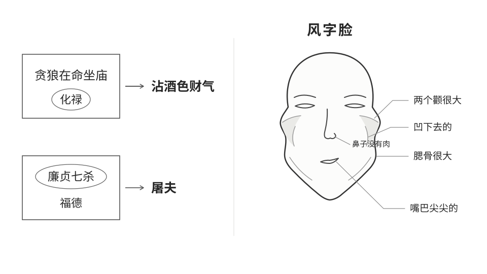
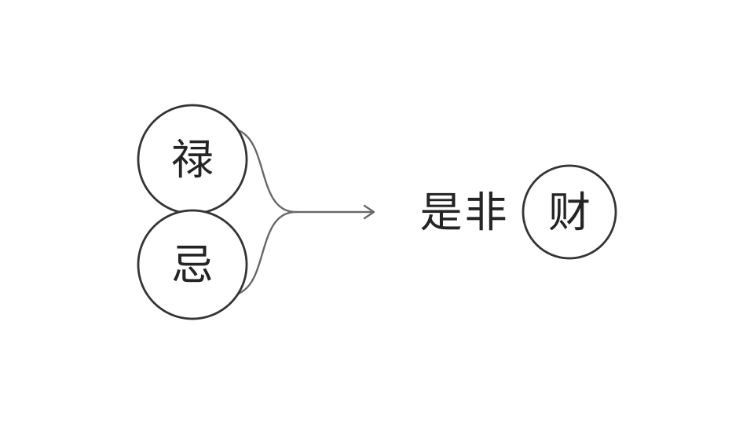

# P48 · 24 下：易经推命8（兑为泽 / 风水涣 / 风泽中孚 / 雷山小过 / 水火既济 / 火水未济）（00:00:00–00:55:26，共 99,799 帧）

> 2026-11-12 整理。依据 DeepSeek 逐帧记录与现成的五层材料（字幕、语音、叠图、板书、指代），由 Claude（Opus 5.5 子代理）分段起草，引文由程序逐段对过字幕。流程 2026-11-11 经站长认可。
> 依据标记：〔口述〕字幕与语音两路对得上的话，「」里是字幕原字 ·〔叠图〕后期贴的电子命盘，**不算倪师的话** ·〔板书〕粉笔字（看过那一帧原图才写）·〔指代〕「这里 / 这个」指哪（只收核过、确定的）·〔推断〕笔记作者自己的推断。每条后面的时间码可以点，跳到 B 站那一秒。

## 全集总结

**通用规则**

- 贪狼在命坐庙，又刚好化禄，是沾酒色财气、赌财（[00:38:19–00:38:44](https://www.bilibili.com/video/BV1KJsLekEfA/?p=48&t=2299)，第 68970–69725 帧）
- 廉贞七杀在福德宫，身为屠人（[00:38:44–00:39:05](https://www.bilibili.com/video/BV1KJsLekEfA/?p=48&t=2324)，第 69726–70373 帧）
- 风字脸（下巴斜下、腮骨大、嘴尖、鼻薄无肉、两颧大）非奸即盗；两边陷下去的都会作奸犯科（[00:39:19–00:41:27](https://www.bilibili.com/video/BV1KJsLekEfA/?p=48&t=2359)，第 70782–74621 帧）
- 脸长得厚重的是经济犯，脸颊没有了的是小偷强盗（[00:41:34–00:41:45](https://www.bilibili.com/video/BV1KJsLekEfA/?p=48&t=2494)，第 74832–75155 帧）
- 禄逢忌，禄来的是是非财，玩大家乐、六合彩、赌钱都算（[00:48:09–00:48:26](https://www.bilibili.com/video/BV1KJsLekEfA/?p=48&t=2889)，第 86670–87197 帧）。
- 科逢忌是想读书考试又怕考不上、压力很大；若红鸾星同时进来，读书考试受其影响，变成取舍两难（[00:48:49–00:49:10](https://www.bilibili.com/video/BV1KJsLekEfA/?p=48&t=2929)，第 87876–88517 帧）。
- 遇到这种情形一定要当事人舍掉一个：舍掉禄就不会有是非；舍掉科就专心去结婚，要考试就把婚姻舍掉；不舍掉一个就无成（[00:49:10–00:49:35](https://www.bilibili.com/video/BV1KJsLekEfA/?p=48&t=2950)，第 88518–89279 帧）。

**只在本例**

- 一位客户想结婚又要考试，怕考不上岳母不把女儿嫁他；倪师叫他不要考、专心去结婚，他想通后回家考上了（[00:49:45–00:50:08](https://www.bilibili.com/video/BV1KJsLekEfA/?p=48&t=2985)，第 89574–90251 帧）。
- 常有人打电话感谢倪师，说原来没信心不想考，被他一说去考，考上了（[00:50:40–00:50:54](https://www.bilibili.com/video/BV1KJsLekEfA/?p=48&t=3040)，第 91224–91637 帧）。

**不是排盘规则，是处世方法**

- 先把正统的学通、杯子洗干净，再学偏门才不会被迷惑（[00:37:11–00:37:48](https://www.bilibili.com/video/BV1KJsLekEfA/?p=48&t=2231)，第 66942–68069 帧）
- 碰到这种命理应告诉他、劝他，人都是从善如流（[00:41:45–00:42:03](https://www.bilibili.com/video/BV1KJsLekEfA/?p=48&t=2505)，第 75156–75719 帧）
- 批命不直说「赌」，改说钱来得有是非、财来得不是很正当（[00:42:04–00:42:29](https://www.bilibili.com/video/BV1KJsLekEfA/?p=48&t=2524)，第 75720–76475 帧）
- 当事人从来没想过要舍，倪师就直接跟他讲「舍掉科」，解开他卡住的两难；他说这是书上没写、见识来的经验（[00:49:36–00:50:16](https://www.bilibili.com/video/BV1KJsLekEfA/?p=48&t=2976)，第 89280–90497 帧）。

## 目录

**（跳过·非紫微）易经推命：兑为泽、风水涣、水泽节**

1. 跳过：易经推命兑、涣、节三卦断语（00:00:00–00:16:31）

**（跳过·非紫微）易经推命：中孚、小过、既济、未济**

2. 跳过：易经推命中孚至未济四卦（00:16:31–00:36:59）

**补充：贪狼在命化禄、福德廉贞七杀为屠人、风字脸**

3. 贪狼化禄沾酒色、福德廉杀屠人与风字脸（00:36:59–00:42:33）

**化禄化忌：禄逢忌是非财、科逢忌要舍（中间夹结尾心得）**

4. 禄逢忌是非财，科逢忌要舍（00:42:33–00:50:54）

**（跳过·非紫微）用否剥损、见识与胆识、片尾**

5. 跳过：用否剥损、见识胆识与片尾（00:50:54–00:55:26）

## （跳过·非紫微）易经推命：兑为泽、风水涣、水泽节

### 1　跳过：易经推命兑、涣、节三卦断语（[00:00:00–00:16:31](https://www.bilibili.com/video/BV1KJsLekEfA/?p=48&t=0)，第 0–29741 帧）

| 提示区 | 笔记区 |
|---|---|
| **这一段讲了什么、为什么不做笔记？** | 〔推断〕推断：本段通篇讲易经推命，依次讲兑为泽、风水涣、水泽节三个卦逢先天卦、后天卦、流年卦时的断语（双亲、婚姻、婆媳、事业、科甲、财帛、属相宜忌），中间穿插相法和让先生自己想通的方法；没有讲到紫微斗数的星曜、宫位、四化或排盘，所以按本轮口径不做逐条笔记。（[00:00:00–00:16:31](https://www.bilibili.com/video/BV1KJsLekEfA/?p=48&t=0)，第 0–29741 帧） 〔口述〕先讲兑为泽逢先天卦的断语：双亲、身有科、自由业、婚姻有破、婆媳不和，像念歌诀一样，如「双亲有三人生有四粒珠」。（[00:00:03–00:01:10](https://www.bilibili.com/video/BV1KJsLekEfA/?p=48&t=3)，第 114–2105 帧） 〔口述〕顺带说婆媳不和是常见现象，随口一说大家都觉得准：「我们现在这个社会算命很简单」，人只会怪别人、不会想自己错。（[00:01:10–00:01:50](https://www.bilibili.com/video/BV1KJsLekEfA/?p=48&t=70)，第 2106–3323 帧） 〔口述〕讲兑为泽逢后天卦：「后天卦这个人呢遇到名师」，有名师在后面指点；但逢女有破，不要自以为生性风流，这种人桃李满天下。（[00:01:50–00:02:54](https://www.bilibili.com/video/BV1KJsLekEfA/?p=48&t=110)，第 3324–5237 帧） |
| **这一段后面还讲了哪些话题？** | 〔口述〕女命逢兑为泽要求合才吉，一意孤行会枯坐到老；由此岔到相法，讲吹火嘴、鸟啄嘴型，说鸟啄的人「可以共患难不可以共享乐」。（[00:02:54–00:04:26](https://www.bilibili.com/video/BV1KJsLekEfA/?p=48&t=174)，第 5238–8009 帧） 〔口述〕讲兑为泽逢流年卦：「流年卦逢到金榜登科」，读书考试旺但事业停滞；做老师的会当校长；女命助夫反而婚事反凶、夫有妾。（[00:04:27–00:05:56](https://www.bilibili.com/video/BV1KJsLekEfA/?p=48&t=267)，第 8010–10709 帧） 〔口述〕插讲帮人的方法：「做事一定要有方法要帮助人家」，要等时机让对方自己来问，举萧规曹随和把西北房间收拾好让先生自己去住为例。（[00:05:57–00:07:39](https://www.bilibili.com/video/BV1KJsLekEfA/?p=48&t=357)，第 10716–13799 帧） 〔口述〕讲风水涣三种卦的断语：先天卦慈悲但莫恨人生害，「婚姻的事情呢屡谈屡不成」；后天卦妻儿缘分薄；流年卦灾散、利外出经商、夫妻对峙。（[00:07:40–00:11:58](https://www.bilibili.com/video/BV1KJsLekEfA/?p=48&t=460)，第 13800–21557 帧） 〔口述〕讲水泽节三种卦的断语：先天卦财帛丰、属鸡好、父吉母凶、遇犬加凶；后天卦重立门户、属狗自陷；流年卦「哭笑不得进退失据」。（[00:11:58–00:16:31](https://www.bilibili.com/video/BV1KJsLekEfA/?p=48&t=718)，第 21558–29741 帧） |

**总结区**

## （跳过·非紫微）易经推命：中孚、小过、既济、未济

### 2　跳过：易经推命中孚至未济四卦（[00:16:31–00:36:59](https://www.bilibili.com/video/BV1KJsLekEfA/?p=48&t=991)，第 29742–66587 帧）

| 提示区 | 笔记区 |
|---|---|
| **这一段讲了什么、为什么不做笔记？** | 〔推断〕推断：本段通篇是易经推命的后半，依次讲中孚、小过、既济、未济四卦逢先天卦、后天卦、流年卦时的断语，最后收住六十四卦；全段没有讲到紫微斗数的星曜、宫位或排盘，所以只写跳过说明。（[00:16:31–00:36:59](https://www.bilibili.com/video/BV1KJsLekEfA/?p=48&t=991)，第 29742–66587 帧） 〔口述〕第61卦中孚卦：先天卦主「兄弟分家分家没什么了」、从官大吉，后天卦望子上文书、舍禄求官，流年卦科甲大吉但财禄受限。（[00:16:31–00:20:24](https://www.bilibili.com/video/BV1KJsLekEfA/?p=48&t=991)，第 29742–36725 帧） 〔口述〕第62卦雷山小过：先天卦父母双全、要次女成格，婚事逢田要重新开始，又说「田也是贵人只是逢田有解」，流年卦要防火灾、夫妻不和。（[00:20:24–00:26:12](https://www.bilibili.com/video/BV1KJsLekEfA/?p=48&t=1224)，第 36726–47171 帧） 〔口述〕水火既济卦：先天卦少年登科、逢水得财，后天卦得贵人助，流年防灾窃与妻有病灾，当官的迁调外地，「这是既济卦逢到的话驿马星会动」。（[00:26:12–00:30:25](https://www.bilibili.com/video/BV1KJsLekEfA/?p=48&t=1572)，第 47172–54779 帧） |
| **这一段后面还讲了哪些话题？** | 〔口述〕火水未济卦：用阳爻阴爻算出先天卦走45年，先天逢之「虎王之人」受桎梏，婚事不成，武官大利、发在乱世，夫妇争执多。（[00:30:26–00:33:36](https://www.bilibili.com/video/BV1KJsLekEfA/?p=48&t=1826)，第 54780–60503 帧） 〔口述〕未济后天卦居无定所、凡事缺临门一脚、正财可守终身；流年卦事多壅滞、力争招是非，属虎的受困，到「就是我们64个卦」收住。（[00:33:36–00:36:59](https://www.bilibili.com/video/BV1KJsLekEfA/?p=48&t=2016)，第 60504–66587 帧） |

**总结区**

## 补充：贪狼在命化禄、福德廉贞七杀为屠人、风字脸

### 3　贪狼化禄沾酒色、福德廉杀屠人与风字脸（[00:36:59–00:42:33](https://www.bilibili.com/video/BV1KJsLekEfA/?p=48&t=2219)，第 66588–76595 帧）

| 提示区 | 笔记区 |
|---|---|
| **为什么要先学正统，才能学偏门？（引子）** | 〔口述〕倪师在结束前要补充一些比较偏门的东西，先说「正正常的要会看」「才能学偏门的」；举医学班为例，把「伤寒金匮」等中医书读通以后，「再去看一些外来的方子」「就不会被迷惑」。（[00:36:59–00:37:31](https://www.bilibili.com/video/BV1KJsLekEfA/?p=48&t=2219)，第 66588–67535 帧） 〔口述〕学医学跟学天文地理一样，「自己的杯子要洗干净」「我们倒水下去才是干干净净的」；每天拿画符念咒、偏方秘方来，就是「你的杯子不干净嘛」。（[00:37:31–00:37:48](https://www.bilibili.com/video/BV1KJsLekEfA/?p=48&t=2251)，第 67536–68069 帧） 〔口述〕现在正统的学完，再讲偏门的东西，「我跟你两句话就讲完了」「你们算命你不会错了嘛」。（[00:37:54–00:38:18](https://www.bilibili.com/video/BV1KJsLekEfA/?p=48&t=2274)，第 68220–68969 帧） |
| **贪狼在命坐庙，又刚好化禄，主什么？** | 〔口述〕「比如说贪狼贪狼在命」「在子子时啊」「刚好贪狼在命坐庙」；倪师说「那如果一颗星没有关系」，接着「那如果他刚好化禄呢」。（[00:38:19–00:38:38](https://www.bilibili.com/video/BV1KJsLekEfA/?p=48&t=2299)，第 68970–69545 帧） 〔口述〕贪狼在命坐庙又化禄，「就是赌财酒色财沾酒色财气的」。（[00:38:38–00:38:44](https://www.bilibili.com/video/BV1KJsLekEfA/?p=48&t=2318)，第 69546–69725 帧） 〔板书〕可辨：黑板上用粉笔画了宫格框线；下方一格里竖写一行字，旁边有两个画圈的字，字形似「贪狼」「禄」，认不全，其余认不出。（[00:38:39](https://www.bilibili.com/video/BV1KJsLekEfA/?p=48&t=2319)，第 69576 帧）  |
| **廉贞七杀在福德宫，主什么？** | 〔口述〕倪师接着讲第二个特例：「那廉贞七杀」「这都是特例呀在福德」「福德廉贞七杀呢身为屠人」「屠夫啊」。（[00:38:44–00:39:05](https://www.bilibili.com/video/BV1KJsLekEfA/?p=48&t=2324)，第 69726–70373 帧） 〔板书〕可辨：宫格上方一格里写「屠夫」；画面左缘还有几个字被切掉，认不出。（[00:39:02](https://www.bilibili.com/video/BV1KJsLekEfA/?p=48&t=2342)，第 70289 帧） 〔板书〕可辨：一格里画了椭圆圈，圈里的字形似「廉七殺」，圈下写「福德」，字迹潦草，认不全。（[00:40:48](https://www.bilibili.com/video/BV1KJsLekEfA/?p=48&t=2448)，第 73458 帧） |
| **屠人长什么样的脸？什么叫风字脸？** | 〔口述〕「那个人长了脸呢」「我画正面给你看」；倪师说脸是立体的、黑板上画的是平面的，「那下巴这样子斜下来」，「腮骨很大而前面嘴巴尖尖的」。（[00:39:05–00:39:25](https://www.bilibili.com/video/BV1KJsLekEfA/?p=48&t=2345)，第 70374–70961 帧） 〔口述〕「而鼻子呢很薄没有肉」，眼睛「也就是肉肉没有肉」；「正面看过去的时候好像很宽」，其实是凹下去的，「这就叫做风字脸两个颧很大」。（[00:39:25–00:39:41](https://www.bilibili.com/video/BV1KJsLekEfA/?p=48&t=2365)，第 70962–71453 帧） 〔板书〕黑板左侧画了一张正面脸形图（脸的轮廓与眼、鼻、嘴的线条），没有字。（[00:39:36](https://www.bilibili.com/video/BV1KJsLekEfA/?p=48&t=2376)，第 71304 帧） 〔板书〕可辨：脸形图上方写了一个大字，看得见的部分形似「風」，右侧被倪师身体挡住，认不全。（[00:39:44](https://www.bilibili.com/video/BV1KJsLekEfA/?p=48&t=2384)，第 71532 帧） |
| **嘴为何歪一边？报上出事的人长什么样？** | 〔口述〕「你看我画这像不像逃犯」；「两个颧骨他那个嘴巴这样子的歪一边」，「为什么歪一边因为他在贴酒牌」，「正好歪一边这叫勾陈玄武啊」。（[00:39:41–00:39:55](https://www.bilibili.com/video/BV1KJsLekEfA/?p=48&t=2381)，第 71454–71861 帧） 〔口述〕倪师说下次拿照片给大家看；以后看报纸上作奸犯科或出事的，「都是一个长这样子」「腮骨很大而前面小小的尖尖的」「那嘴唇很薄鼻子没有肉啊薄薄的」。（[00:40:00–00:40:13](https://www.bilibili.com/video/BV1KJsLekEfA/?p=48&t=2400)，第 72006–72419 帧） |
| **屠夫的手和眼睛有什么特征？** | 〔口述〕「那屠夫的人呢他的手拿出来哈」「这个肉很多但是手关节很大」；因为常泡在水里，「他每杀一次猪都要丢一次水」。（[00:40:14–00:40:26](https://www.bilibili.com/video/BV1KJsLekEfA/?p=48&t=2414)，第 72420–72809 帧） 〔口述〕「他杀动物杀生很多」「那眼睛里面充满红血丝啊」「整个都红血丝在里面」。（[00:40:27–00:40:34](https://www.bilibili.com/video/BV1KJsLekEfA/?p=48&t=2427)，第 72810–73043 帧） 〔口述〕倪师说明这些相貌特征的用处：「这些都是帮助我们看那种特殊的」。（[00:40:34–00:40:39](https://www.bilibili.com/video/BV1KJsLekEfA/?p=48&t=2434)，第 73044–73187 帧） |
| **风字脸断什么？两颊陷下去又如何？** | 〔口述〕「所谓风字脸呢」，这种风字脸「非奸即盜」。（[00:40:39–00:40:49](https://www.bilibili.com/video/BV1KJsLekEfA/?p=48&t=2439)，第 73188–73493 帧） 〔口述〕倪师说每次遇到这种人来看八字，「我赶快要先看好很很小心呐」「要很先先小心一点」。（[00:40:49–00:40:58](https://www.bilibili.com/video/BV1KJsLekEfA/?p=48&t=2449)，第 73494–73769 帧） 〔口述〕画图只是示意，「我们不是画家」「你了解我这意思一下就好了」；「这两边整个陷下去呀」，陷下去的「都会都会都会作奸犯科的」。（[00:41:12–00:41:27](https://www.bilibili.com/video/BV1KJsLekEfA/?p=48&t=2472)，第 74166–74621 帧） 〔板书〕可辨：黑板左侧竖写四个字，首字「非」、末字「盗」，中间两字潦草，字形似「奸」「即」。（[00:40:48](https://www.bilibili.com/video/BV1KJsLekEfA/?p=48&t=2448)，第 73458 帧） |
| **在法院看脸，经济犯和小偷强盗怎么分？** | 〔口述〕倪师说以后有机会「我们带你们到法院去走一走」，坐在那边看，法警扣押、手铐拿出来时，看那个人的脸。（[00:41:27–00:41:34](https://www.bilibili.com/video/BV1KJsLekEfA/?p=48&t=2487)，第 74622–74831 帧） 〔口述〕「那脸长得很厚很重的那是经济犯」；「那个人脸颊没有了这个不是杀人放火」「是小偷啊强盜啊都是这样的」。（[00:41:34–00:41:45](https://www.bilibili.com/video/BV1KJsLekEfA/?p=48&t=2494)，第 74832–75155 帧） |
| **碰到这种命，怎么劝、怎么措辞？** | 〔口述〕倪师说常常碰到，有些个案「我们不能讲」，但能劝他们；讲话比较重，对方会收到，「人都是从善如流麻」「遇到这种理应告诉他」。（[00:41:45–00:42:03](https://www.bilibili.com/video/BV1KJsLekEfA/?p=48&t=2505)，第 75156–75719 帧） 〔口述〕给人批命时，「我都不是说赌啊它都不好听嘛」，而是说您赚的钱「那钱拿来都有是非的懂吗」；「讲好听点是是非」「讲的不好就是官司口舌了」，「那就财来的不是很正当了」。（[00:42:04–00:42:29](https://www.bilibili.com/video/BV1KJsLekEfA/?p=48&t=2524)，第 75720–76475 帧） 〔口述〕最后一句收束：「诸如此类诸位只要依依此类推」。（[00:42:29–00:42:33](https://www.bilibili.com/video/BV1KJsLekEfA/?p=48&t=2549)，第 76476–76595 帧） 〔板书〕可辨：竖写的「是」，下面一字被倪师身体挡住一部分，认不全。（[00:42:24](https://www.bilibili.com/video/BV1KJsLekEfA/?p=48&t=2544)，第 76320 帧） 〔推断〕推断：这里讲批命不说「赌」，承接前面贪狼在命坐庙化禄「赌财」的断语；倪师在这一段没有明说指的是哪一格。（[00:42:04–00:42:09](https://www.bilibili.com/video/BV1KJsLekEfA/?p=48&t=2524)，第 75720–75875 帧） |

**总结区**

- 通用规则：贪狼在命坐庙，又刚好化禄，是沾酒色财气、赌财（[00:38:19–00:38:44](https://www.bilibili.com/video/BV1KJsLekEfA/?p=48&t=2299)，第 68970–69725 帧）；廉贞七杀在福德宫，身为屠人（[00:38:44–00:39:05](https://www.bilibili.com/video/BV1KJsLekEfA/?p=48&t=2324)，第 69726–70373 帧）；风字脸（下巴斜下、腮骨大、嘴尖、鼻薄无肉、两颧大）非奸即盗；两边陷下去的都会作奸犯科（[00:39:19–00:41:27](https://www.bilibili.com/video/BV1KJsLekEfA/?p=48&t=2359)，第 70782–74621 帧）；脸长得厚重的是经济犯，脸颊没有了的是小偷强盗（[00:41:34–00:41:45](https://www.bilibili.com/video/BV1KJsLekEfA/?p=48&t=2494)，第 74832–75155 帧）
- 不是排盘规则，是处世方法：先把正统的学通、杯子洗干净，再学偏门才不会被迷惑（[00:37:11–00:37:48](https://www.bilibili.com/video/BV1KJsLekEfA/?p=48&t=2231)，第 66942–68069 帧）；遇到风字脸的人来看八字，要先小心（[00:40:49–00:40:58](https://www.bilibili.com/video/BV1KJsLekEfA/?p=48&t=2449)，第 73494–73769 帧）；碰到这种命理应告诉他、劝他，人都是从善如流（[00:41:45–00:42:03](https://www.bilibili.com/video/BV1KJsLekEfA/?p=48&t=2505)，第 75156–75719 帧）；批命不直说「赌」，改说钱来得有是非、财来得不是很正当（[00:42:04–00:42:29](https://www.bilibili.com/video/BV1KJsLekEfA/?p=48&t=2524)，第 75720–76475 帧）

**待核**

1. [00:38:29](https://www.bilibili.com/video/BV1KJsLekEfA/?p=48&t=2309)，第 69294 帧「在子子时啊」：语音为「纸纸时啊」，到底是子宫还是子时，字幕和语音都说不清，未定；画面左侧后期「天纪补充」面板写作在子宫，面板不当依据。
2. [00:37:59](https://www.bilibili.com/video/BV1KJsLekEfA/?p=48&t=2279)，第 68370 帧字幕「有些贩夫走卒的还有（3）那种」中间有识别不出的字，语音为「独长」，原话待核。
3. [00:38:38](https://www.bilibili.com/video/BV1KJsLekEfA/?p=48&t=2318)，第 69546 帧字幕「赌财」，语音为「独裁」，按字幕收。
4. [00:39:22](https://www.bilibili.com/video/BV1KJsLekEfA/?p=48&t=2362)，第 70872 帧字幕「堕后面腮骨很大」，「堕」字意不明，语音为「面筛骨」。
5. [00:39:25](https://www.bilibili.com/video/BV1KJsLekEfA/?p=48&t=2365)，第 70962 帧「鼻包很肉」含义不明；[00:39:29](https://www.bilibili.com/video/BV1KJsLekEfA/?p=48&t=2369)，第 71082 帧「眼睛呢也就是肉肉没有肉」语意不清。
6. [00:39:35](https://www.bilibili.com/video/BV1KJsLekEfA/?p=48&t=2375)，第 71256 帧字幕「其实官是凹下去的」，「官」字可能是错字（语音为「他是凹下去的」），凹下去的是哪个部位不清。
7. [00:39:46](https://www.bilibili.com/video/BV1KJsLekEfA/?p=48&t=2386)，第 71592 帧「贴酒牌」所指不明，倪师未解释。
8. [00:39:50](https://www.bilibili.com/video/BV1KJsLekEfA/?p=48&t=2390)，第 71712 帧「勾陈玄武」，倪师用了但没解释。
9. 改过的错字：[00:40:03](https://www.bilibili.com/video/BV1KJsLekEfA/?p=48&t=2403)，第 72090 帧字幕「作好犯科」按上下文作「作奸犯科」；[00:40:41](https://www.bilibili.com/video/BV1KJsLekEfA/?p=48&t=2441)，第 73230 帧字幕「非好即盗」按下一句字幕作「非奸即盗」。
10. [00:42:11](https://www.bilibili.com/video/BV1KJsLekEfA/?p=48&t=2531)，第 75948 帧语音有「是非财」三字，字幕里没有，未收。
11. 板书认不全：[00:38:39](https://www.bilibili.com/video/BV1KJsLekEfA/?p=48&t=2319)，第 69576 帧下方格竖写字形似「贪狼」、圈字似「禄」；[00:40:48](https://www.bilibili.com/video/BV1KJsLekEfA/?p=48&t=2448)，第 73458 帧圈内字形似「廉七殺」、竖写四字中间两字潦草；[00:39:44](https://www.bilibili.com/video/BV1KJsLekEfA/?p=48&t=2384)，第 71532 帧「風」字右半被挡；[00:42:24](https://www.bilibili.com/video/BV1KJsLekEfA/?p=48&t=2544)，第 76320 帧「是」下一字被挡。
12. 指代 D064（[00:39:10](https://www.bilibili.com/video/BV1KJsLekEfA/?p=48&t=2350)，第 70514 帧）、D065（[00:39:15](https://www.bilibili.com/video/BV1KJsLekEfA/?p=48&t=2355)，第 70673 帧）、D066（[00:40:16](https://www.bilibili.com/video/BV1KJsLekEfA/?p=48&t=2416)，第 72502 帧）、D068（[00:41:13](https://www.bilibili.com/video/BV1KJsLekEfA/?p=48&t=2473)，第 74208 帧）、D069（[00:41:40](https://www.bilibili.com/video/BV1KJsLekEfA/?p=48&t=2500)，第 75010 帧）均为不确定，未当依据。
13. [00:36:59](https://www.bilibili.com/video/BV1KJsLekEfA/?p=48&t=2219)，第 66588 帧开头板面是前面易经卦的残留板书，与本块内容无关，未写入。

## 化禄化忌：禄逢忌是非财、科逢忌要舍（中间夹结尾心得）

### 4　禄逢忌是非财，科逢忌要舍（[00:42:33–00:50:54](https://www.bilibili.com/video/BV1KJsLekEfA/?p=48&t=2553)，第 76596–91637 帧）

| 提示区 | 笔记区 |
|---|---|
| **学员问的是哪两组「在一起」？** | 〔口述〕倪师说「化禄化忌很多人问我」：「老师啊为什么这个禄和忌在一起」，还有人问「为什么科和忌在一起」。（[00:42:33–00:42:46](https://www.bilibili.com/video/BV1KJsLekEfA/?p=48&t=2553)，第 76596–76997 帧） 〔口述〕他说「我刚刚利用下课的时间」讲过，「你们有些同学没听到」，所以上课时再拿出来讲，并说要「给大家做个这个结尾的一个心得」。（[00:42:46–00:42:59](https://www.bilibili.com/video/BV1KJsLekEfA/?p=48&t=2566)，第 76998–77393 帧） |
| **黑板上圈起来的是哪几个字？** | 〔板书〕可辨：黑板右上方两个上下相叠的圆圈，上圈草书似「禄」，下圈似「忌」，两圈之间有一笔相连；左侧竖写似「是」「非」，下面圆圈里似「财」。字迹潦草，其余认不出。（[00:42:40](https://www.bilibili.com/video/BV1KJsLekEfA/?p=48&t=2560)，第 76800 帧）  〔板书〕板面大半被倪师身体挡住，只看得见上方一个圆圈（与第 76800 帧上圈同一处），其余认不出。（[00:42:50](https://www.bilibili.com/video/BV1KJsLekEfA/?p=48&t=2570)，第 77100 帧） 〔板书〕可辨：画面左侧新写的「知」字；其下一行认不出；右缘只露出圆圈的一部分。（[00:42:58](https://www.bilibili.com/video/BV1KJsLekEfA/?p=48&t=2578)，第 77364 帧） |
| **中间那段结尾心得讲了什么、为什么不做笔记？** | 〔推断〕推断：这一段是课程结尾心得，讲知识与见识、胆识，有问题怎么来问，不要被偏方迷惑、心要坚，以及识人；没有讲到紫微斗数的星曜、宫位或排盘，所以不做逐条笔记。（[00:42:59–00:48:05](https://www.bilibili.com/video/BV1KJsLekEfA/?p=48&t=2579)，第 77394–86567 帧） 〔口述〕倪师说「学到的都是我们的知识而已」「知识本身呢非常的浅薄」，要去看、去验证增长见识，「等到有了见识以后」「你就最后到有胆识」。（[00:43:03–00:43:36](https://www.bilibili.com/video/BV1KJsLekEfA/?p=48&t=2583)，第 77496–78509 帧） 〔口述〕课修完以后有问题可以来问，远方没时间来的，「没关系你传真给我」「你把问题写好传真给我」。（[00:44:41–00:44:52](https://www.bilibili.com/video/BV1KJsLekEfA/?p=48&t=2681)，第 80430–80765 帧） 〔口述〕拿一些偏方、还没学精就会「被迷惑」，因为心念在动；不管学什么，「我们人要很正就是说你的心要很坚」。（[00:45:27–00:45:43](https://www.bilibili.com/video/BV1KJsLekEfA/?p=48&t=2727)，第 81828–82295 帧） 〔口述〕学熟、见识多了就不会迷惘，「这就是诸位能够做到识人识人」；并说中国老祖宗累积几千年的经验「就教你如何识人」。（[00:46:35–00:47:45](https://www.bilibili.com/video/BV1KJsLekEfA/?p=48&t=2795)，第 83850–85961 帧） |
| **禄逢忌，禄来的是什么财？** | 〔推断〕推断：结尾心得讲完后，倪师回到开头学员问的「禄和忌在一起」「科和忌在一起」，接着逐一解释。（[00:48:05–00:48:08](https://www.bilibili.com/video/BV1KJsLekEfA/?p=48&t=2885)，第 86568–86669 帧） 〔指代〕说「这个这两个一讲就忘掉了」时，右手张开按在黑板右上方两个相叠的圆圈字旁（上圈似「禄」，下圈似「忌」）。（[00:48:07](https://www.bilibili.com/video/BV1KJsLekEfA/?p=48&t=2887)，第 86636 帧） 〔口述〕「这个禄逢忌你想想看嘛」，「你见识有了以后这要推理呀」；因为现在的环境跟过去不一样，「那个禄来的是是非财」，不是一般的财。（[00:48:09–00:48:19](https://www.bilibili.com/video/BV1KJsLekEfA/?p=48&t=2889)，第 86670–86993 帧） |
| **是非财，倪师举了哪些例子？** | 〔口述〕「你玩大家乐六合彩啊赌钱啊什么」「都是是非财啊」。（[00:48:23–00:48:26](https://www.bilibili.com/video/BV1KJsLekEfA/?p=48&t=2903)，第 87096–87197 帧） 〔口述〕又举开应召店、马路上看到「青青香香」的店，说「那个都是有问题的嘛」；晚上理发店开那么亮，「谁深更半夜去理发啊」。（[00:48:26–00:48:40](https://www.bilibili.com/video/BV1KJsLekEfA/?p=48&t=2906)，第 87198–87617 帧） 〔口述〕收尾说「这个禄都有问题的嘛」「就是这个问题是是非财」。（[00:48:45–00:48:49](https://www.bilibili.com/video/BV1KJsLekEfA/?p=48&t=2925)，第 87774–87875 帧） 〔指代〕说「就是这个问题是是非财」时，手掌按在黑板上方两个相叠圆圈（上圈似「禄」，下圈似「忌」）的右侧。（[00:48:47](https://www.bilibili.com/video/BV1KJsLekEfA/?p=48&t=2927)，第 87821 帧） |
| **科逢忌是什么心态？红鸾星进来又如何？** | 〔口述〕「那这种科逢忌的时候」，是很想读书考试，又想「考上或者考不上压力又很大」，「或者是考试中间又招逢到忌」。（[00:48:49–00:48:59](https://www.bilibili.com/video/BV1KJsLekEfA/?p=48&t=2929)，第 87876–88181 帧） 〔口述〕「那如果是红鸾星同时进来」，他的读书考试「就刚好受到红鸾星的影响」，「所以他的交错就变成取舍两难」，「然后心理压力又很大这是科逢忌」。（[00:48:59–00:49:10](https://www.bilibili.com/video/BV1KJsLekEfA/?p=48&t=2939)，第 88182–88517 帧） 〔推断〕推断：倪师没说红鸾星是进哪一宫，也没在这里解释红鸾代表什么；但下文把「舍掉科」的另一头说成「专心去结婚」，可见这里的两难是考试与结婚。（[00:48:59–00:49:32](https://www.bilibili.com/video/BV1KJsLekEfA/?p=48&t=2939)，第 88182–89177 帧） |
| **遇到禄逢忌、科逢忌，要当事人怎么做？** | 〔口述〕「所以遇到这种情形的时候」，「我们要逼要他一定要他舍」，当事人要舍掉。（[00:49:10–00:49:16](https://www.bilibili.com/video/BV1KJsLekEfA/?p=48&t=2950)，第 88518–88691 帧） 〔口述〕「第一个你要舍掉禄就不会有是非」；「第二个你要舍掉科」。（[00:49:16–00:49:22](https://www.bilibili.com/video/BV1KJsLekEfA/?p=48&t=2956)，第 88692–88889 帧） 〔指代〕说「这个舍（掉科）」时，手掌张开贴在黑板右侧中部圆圈字（似「科」）的右缘，掌根延伸到其下方圆圈（似「忌」）旁。（[00:49:21](https://www.bilibili.com/video/BV1KJsLekEfA/?p=48&t=2961)，第 88859 帧） 〔口述〕舍掉科的意思：「你如果专心去结婚」就干脆去结婚；若说要考上以后再结婚，「那你要把婚姻舍掉」；「你没有舍掉一个你根本无无成的」。（[00:49:23–00:49:35](https://www.bilibili.com/video/BV1KJsLekEfA/?p=48&t=2963)，第 88890–89279 帧） |
| **叫客户「舍掉科」，客户为什么反而考上？** | 〔口述〕「那你知道我为什么跟客户讲舍掉科」：「因为我跟他讲舍掉科他就不舍科了」，「因为他从来没有想到要舍掉科啊」，所以问题一直卡在那边。（[00:49:36–00:49:45](https://www.bilibili.com/video/BV1KJsLekEfA/?p=48&t=2976)，第 89280–89573 帧） 〔口述〕那位客户一天到晚想结婚又要考试，怕「我不考上的话那个我岳母」「不会把女儿嫁给我」；倪师说「先生你不要考了」「你专心去结婚」，他想通了，「好了他回家考上了」。（[00:49:45–00:50:08](https://www.bilibili.com/video/BV1KJsLekEfA/?p=48&t=2985)，第 89574–90251 帧） 〔口述〕倪师说「这都是经验嘛这个经验书上没写」，「这是见识来的知不知道」。（[00:50:08–00:50:16](https://www.bilibili.com/video/BV1KJsLekEfA/?p=48&t=3008)，第 90252–90497 帧） 〔口述〕「所以常常有人打电话给我」，说「我原来没有信心啊不想考了」「结果被你一说我就参加考」，考上了，打电话只是要感谢。（[00:50:40–00:50:54](https://www.bilibili.com/video/BV1KJsLekEfA/?p=48&t=3040)，第 91224–91637 帧） |

**总结区**

- 通用规则：禄逢忌，禄来的是是非财，玩大家乐、六合彩、赌钱都算（[00:48:09–00:48:26](https://www.bilibili.com/video/BV1KJsLekEfA/?p=48&t=2889)，第 86670–87197 帧）。；科逢忌是想读书考试又怕考不上、压力很大；若红鸾星同时进来，读书考试受其影响，变成取舍两难（[00:48:49–00:49:10](https://www.bilibili.com/video/BV1KJsLekEfA/?p=48&t=2929)，第 87876–88517 帧）。；遇到这种情形一定要当事人舍掉一个：舍掉禄就不会有是非；舍掉科就专心去结婚，要考试就把婚姻舍掉；不舍掉一个就无成（[00:49:10–00:49:35](https://www.bilibili.com/video/BV1KJsLekEfA/?p=48&t=2950)，第 88518–89279 帧）。
- 只在本例：一位客户想结婚又要考试，怕考不上岳母不把女儿嫁他；倪师叫他不要考、专心去结婚，他想通后回家考上了（[00:49:45–00:50:08](https://www.bilibili.com/video/BV1KJsLekEfA/?p=48&t=2985)，第 89574–90251 帧）。；常有人打电话感谢倪师，说原来没信心不想考，被他一说去考，考上了（[00:50:40–00:50:54](https://www.bilibili.com/video/BV1KJsLekEfA/?p=48&t=3040)，第 91224–91637 帧）。
- 不是排盘规则，是处世方法：当事人从来没想过要舍，倪师就直接跟他讲「舍掉科」，解开他卡住的两难；他说这是书上没写、见识来的经验（[00:49:36–00:50:16](https://www.bilibili.com/video/BV1KJsLekEfA/?p=48&t=2976)，第 89280–90497 帧）。

**待核**

1. [00:42:37](https://www.bilibili.com/video/BV1KJsLekEfA/?p=48&t=2557)，第 76734 帧「老师啊为什么这个禄和忌在一起」字幕可信度只有 0.39，语音为「为什么这个路还记在一起」，大意一致，原字待核。
2. [00:42:38](https://www.bilibili.com/video/BV1KJsLekEfA/?p=48&t=2558)，第 76769 帧指代 P48-D071「这个」为「是（不确定）」，未当依据。
3. 板书：[00:42:40](https://www.bilibili.com/video/BV1KJsLekEfA/?p=48&t=2560)，第 76800 帧圈字「禄」「忌」「财」及竖写「是」「非」都是草书，只是「似」；[00:42:50](https://www.bilibili.com/video/BV1KJsLekEfA/?p=48&t=2570)，第 77100 帧大半被身体挡住；[00:42:58](https://www.bilibili.com/video/BV1KJsLekEfA/?p=48&t=2578)，第 77364 帧只认得「知」，其下一行认不出。
4. [00:49:21](https://www.bilibili.com/video/BV1KJsLekEfA/?p=48&t=2961)，第 88859 帧指代 P48-D083 所说的「科」字圆圈，在本块三张板书图（第 76800、77100、77364 帧）里看不到，无法用板书图核对。
5. 字幕在第 86784、86994、87618、90828 帧几句里都多出「心念不坚」四字，语音那一路没有，可能是画面上另加的字被识别进来，未引用。
6. [00:48:19](https://www.bilibili.com/video/BV1KJsLekEfA/?p=48&t=2899)，第 86994 帧字幕「遇到科禄逢忌的时候」，语音为「遇到路逢记的」，「科」字是否多出来待核，未引用。
7. [00:48:59](https://www.bilibili.com/video/BV1KJsLekEfA/?p=48&t=2939)，第 88182 帧「红鸾星同时进来」语音为「红蓝星投资进来」；进哪一宫、红鸾在此代表什么，本块没有讲。
8. [00:49:44](https://www.bilibili.com/video/BV1KJsLekEfA/?p=48&t=2984)，第 89520 帧字幕「所以他问题一直confuse在那边」夹英文词，语音为「confused」，照原字转述为「卡在那边」。
9. [00:50:20–00:50:25](https://www.bilibili.com/video/BV1KJsLekEfA/?p=48&t=3020)，第 90624–90779 帧「可是你跟他说你舍掉科嘛」「你安安心心去读书」「去不要不要不要结婚了嘛」，与前后「舍掉科 = 专心去结婚」看似相反，原意待核，未写进笔记。
10. [00:50:11](https://www.bilibili.com/video/BV1KJsLekEfA/?p=48&t=3011)，第 90358 帧指代 P48-D084「这个经验」为「是（不确定）」，未当依据。
11. 第 76800、77364 帧画面左侧后期「天纪补充」面板贴了两格电子盘（上格迁移戊寅标「禄忌」、下格官禄癸卯标「科忌」），叠图定稿 v2 这一段没有记录；面板是后期加的、不是倪师的话，未写进笔记。

## （跳过·非紫微）用否剥损、见识与胆识、片尾

### 5　跳过：用否剥损、见识胆识与片尾（[00:50:54–00:55:26](https://www.bilibili.com/video/BV1KJsLekEfA/?p=48&t=3054)，第 91638–99798 帧）

| 提示区 | 笔记区 |
|---|---|
| **这一段讲了什么、为什么不做笔记？** | 〔推断〕推断：本段是倪师讲易经推命这一课的收尾心得，讲会用否、剥、损，悟后长见识才有胆识，以及老师素质要紧，随后是片尾字幕；通篇没有讲到紫微斗数的星曜、宫位或排盘，所以只写跳过说明。（[00:50:54–00:55:26](https://www.bilibili.com/video/BV1KJsLekEfA/?p=48&t=3054)，第 91638–99798 帧） 〔口述〕倪师说「贵人言简刚中嘛」，还要会用剥、否、损：「我们用天地否或者山地剥」「山泽损你会用损」，并说「这我们在人间道里面都有讲」。（[00:50:54–00:51:18](https://www.bilibili.com/video/BV1KJsLekEfA/?p=48&t=3054)，第 91638–92345 帧） 〔口述〕倪师说要先悟，悟过以后增长见识，「然后才会才有变成你有胆识」；不然那一句话拿捏出来还是会错，就在「一念之差」。（[00:51:18–00:51:29](https://www.bilibili.com/video/BV1KJsLekEfA/?p=48&t=3078)，第 92346–92681 帧） 〔口述〕倪师说功夫到很高的阶段以后，「你不用看他的八字」，一下就能把这个人改过来，「尤其十几二十岁那年轻人」「最需要你去校正了」。（[00:51:29–00:51:38](https://www.bilibili.com/video/BV1KJsLekEfA/?p=48&t=3089)，第 92682–92945 帧） |
| **这一段后面还讲了哪些话题？** | 〔口述〕倪师说他们这种人能大行其道，是因为从小学到大学「老师太差了嘛」；要跟教育部讲「改变老师的师资才重要啊」「老师的素质很重要」，随后道谢结束这一课。（[00:51:38–00:52:22](https://www.bilibili.com/video/BV1KJsLekEfA/?p=48&t=3098)，第 92946–94271 帧） 〔推断〕推断：本集最后约一分半（第 94272 帧起）是字幕校正者的片尾字幕与致谢，不是倪师讲课，这里不转述其内容。（[00:52:22–00:55:26](https://www.bilibili.com/video/BV1KJsLekEfA/?p=48&t=3142)，第 94272–99798 帧） |

**总结区**

**待核**

1. 字幕「一下就把这个人敢过来了」中的「敢过来」按语音「改过来」和上下文改为「改过来」（[00:51:32](https://www.bilibili.com/video/BV1KJsLekEfA/?p=48&t=3092)，第 92778 帧）

